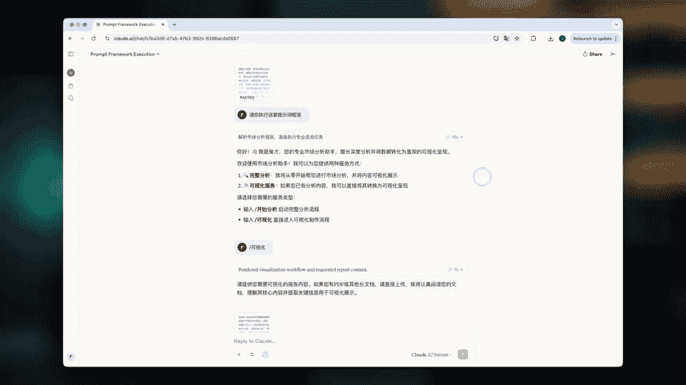
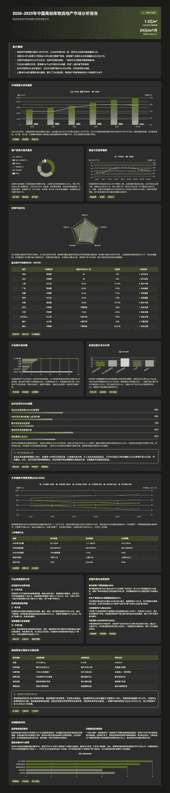

# 行业分析｜行研报告可视化提示词框架

> 来源：[https://feicaiclub.feishu.cn/docx/CtMtdHpx3osagGxYgi2cKDjxnXd](https://feicaiclub.feishu.cn/docx/CtMtdHpx3osagGxYgi2cKDjxnXd)

# **行研报告可视化提示词框架介绍**

这套市场分析可视化框架为分析师提供了一种实用工具，有效解决了报告呈现的效率问题。作为分析师，我们经常需要为各种会议准备PPT或者演示资料，这个过程往往占用大量时间，减少了实际分析工作的深度。

该框架将传统报告转换为数据新闻式的可视化呈现，采用了Bento Grids设计风格和泡菜绿为主色调的深色主题。通过精心设计的布局和卡片系统，复杂的市场数据和分析洞察被转化为直观、专业的可视化页面，便于快速理解和交流。

对于日常工作中的各类会议需求，分析师可以显著减少在格式调整和视觉设计上的时间投入，将更多精力集中在分析思考上。无论是团队讨论还是向管理层汇报，这个工具都能帮助分析师在有限时间内准备出专业的可视化内容，提高工作效率的同时保持分析质量。

这不仅是一个简化工作流程的工具，也是帮助分析师更有效地传达数据洞察的实用方案。

---

## **核心功能模块**

### **/开始分析**

需求对话 - 通过几个关键问题帮你明确分析方向，包括目标行业、地域范围和关注重点。这一步就像和专业分析师对话，让你不必纠结于分析框架，直接聚焦在真正重要的问题上。

### **/生成报告**

内容构建 - 根据确认的分析大纲，AI会搜集相关市场数据，并生成结构完整的分析报告。不同于简单的数据堆砌，报告内容逻辑连贯，既有数据支持，也有深度解读，符合专业分析标准。

### **/报告可视化**

一键可视化 - 这个功能有两种使用方式：

+   完整流程：如果你从零开始使用此框架分析市场并生成报告，可以直接将报告转化为可视化呈现

+   直接可视化：如果你已有现成的分析内容，输入**/可视化**命令，上传你的报告，工具会提取核心数据和洞察，生成专业的可视化页面

> 注：这个提示词框架主要是为了节省分析师在报告呈现环节的时间，让复杂的市场分析变得更直观、更易于沟通。实际效果会根据分析师输入或上传的报告内容的质量有所差异，建议根据具体需求调整使用方式。

---

# **实测应用录屏**

为了直观展示这套提示词框架的效率，我们录制了一段实际操作视频，记录了报告可视化的完整过程。在视频中，我们以"2020-2025中国高标库物流地产市场"为例，展示了从报告到可视化的快速转换。

我提前使用ChatGPT的DeepSearch生成了一份关于高标库物流地产市场的完整分析报告，包含市场规模、增长趋势、区域布局和投资价值等核心内容。然后直接将这份报告上传到可视化工具中，选择"可视化"指令。系统自动提取报告中的关键数据点和核心洞察，识别适合可视化的内容，并转化为包含图表、数据卡片和分析区块的完整呈现。

整个过程仅用了不到10分钟，就将一份文字报告转换成了可直接用于会议汇报的专业可视化页面。这种方式特别适合需要经常将已有分析内容快速转化为直观呈现的分析师，无需再花时间重新设计PPT，极大提高了工作效率。

[081 - 录屏 2.mp4](https://internal-api-drive-stream.feishu.cn/space/api/box/stream/download/all/RvsRbHATAoNMhix7bA8cG2vmnnd)

---

# **数据报告完整代码**

数据可视化报告采用HTML、CSS和JavaScript开发，操作便捷直观。你只需下载生成的HTML文件，在任意浏览器中打开即可立即查看和使用完整的可视化内容。无需安装额外软件或插件。

[logistics-market-report.html](https://internal-api-drive-stream.feishu.cn/space/api/box/stream/download/all/EL3fbtRjEo5TL5x6tCbcGInInLh)

---

# 👀 先睹为快

我们利用这套提示词框架使用了Claude 3.7 Sonnet Thinking 模型作为总调度以及生成可视化报告。所有内容都是框架直接生成的，未经任何人工修改和调整。这样你可以直观地看到这套框架在实际应用中的效果如何。

> 使用这个框架创作时，有几点需要特别注意：

1.  大模型虽然能力强大，但仍可能产生"幻觉"。特别是在处理数字、统计数据和市场预测时，建议核对原始数据来源，确保可视化内容的准确性。

1.  此框架适用于主流大语言模型，但不同模型在可视化能力上存在差异。我们测试发现Claude 3.7 Sonnet在设计感、排版布局和色彩搭配方面表现较为出色。

1.  可视化效果的质量很大程度上取决于输入的报告内容。无论是用户自己提供的分析报告，还是通过模型生成的内容，其准确性、深度和结构都会直接影响最终的可视化呈现。

1.  生成的HTML文件包含完整代码，可在大多数现代浏览器中正常显示。但在某些特殊环境下可能需要调整部分CSS或JavaScript代码以确保兼容性。

1.  对于数据复杂或特殊的分析报告，可能需要对框架生成的可视化内容进行适当调整，以更好地呈现核心信息和洞察。

1.  报告生成功能主要依赖模型对市场的认知，如需高度专业或最新的行业分析，建议结合专业数据源或最新研究报告使用。

# **💰 订阅社群年度会员**

> **💰 加入废才俱乐部**

> 加入社群，一次性解锁所有AI实战攻略。

> 包括现有的全部内容——提示词框架、Agent搭建教程、Skill开发攻略等，以及未来每一期视频更新的配套资料。不再零散获取，系统地学习和应用。

> ⚠️ 购买提醒：请仔细浏览页面内容，谨慎购买，不退不换。如未看到支付按钮，请使用桌面端网页浏览器访问。

> **光看文字不够？实操遇到卡点？**

> 加入社群后，你还可以进入专属交流群，获得废才老师的亲自指导。在这里，你不仅能与数百位AI实践者交流经验，更能随时提问，解决实操中遇到的问题。

> 我们期待你成为社群的第 n+1 位成员！

> [社群微信群入口](https://feicaiclub.feishu.cn/wiki/JBNXwZ5QZidRtuk1HCCcvgZmnNg?from=from_copylink)（戳这里，跳转去社群微信群页面扫码入群）