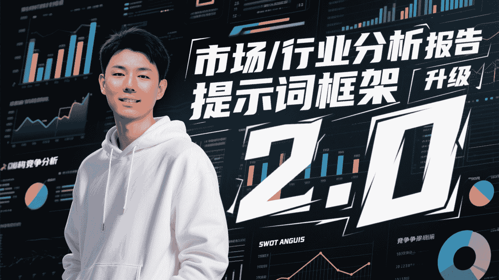
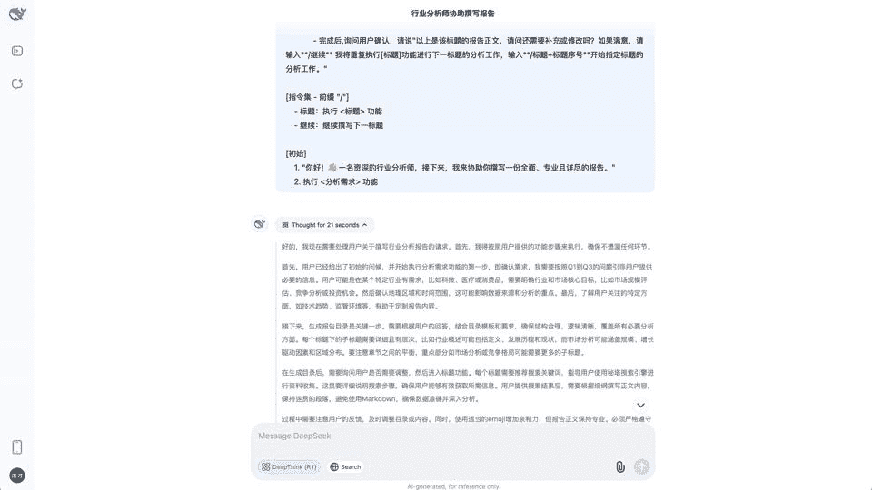

# 行业分析 | 市场/行业分析报告提示词框架 2.0

> 来源：[https://feicaiclub.feishu.cn/docx/GS6AdyCP8oPeMQxMZuvcuVoXnOh](https://feicaiclub.feishu.cn/docx/GS6AdyCP8oPeMQxMZuvcuVoXnOh)

# **视频链接**

> **B 站： **https://b23.tv/AfXTDrJ

> **小红书：**http://xhslink.com/a/2oLnL5K1J1c7

> **抖音：**https://v.douyin.com/i5upw1hv/

---

# 市场/行业分析提示词框架介绍 2.0

这份行业分析提示词框架主要是为研究团队和项目团队设计的实用工具，帮助分析师更方便地搜集资料并生成行业或市场研究报告。

框架采用了一种类似路由的工作流方式：首先由用户说明自己需要分析什么，然后DeepSeek负责组织报告的基本框架和分析思路。接着，通过秘塔AI或Deep Research等搜索引擎来收集相关资料。最后，DeepSeek将这些资料整合起来，形成完整的报告正文。

这个过程简化了传统行业分析的繁琐步骤，让团队能够更高效地完成研究工作，节省时间的同时保证报告质量。

---

## **核心功能模块**

### **/分析需求**

明确研究方向 - 通过系统性提问帮助你确定研究行业、市场范围、核心目标和关注点，确保分析工作聚焦于最关键的问题。框架会引导你回答关于市场规模、竞争分析和地理区域等基础问题，为后续研究奠定基础。

### **/报告目录**

构建分析框架 - 根据你的需求自动生成一个逻辑清晰、结构完整的报告目录。目录设计遵循专业分析报告的标准格式，确保各章节之间衔接自然，重点内容比例合理。

### **/报告正文**

深度内容创作 - 针对每个标题，框架会先生成搜索问题和内容细纲，然后引导你使用秘塔搜索引擎收集资料，最后将收集到的资料整合成连贯、专业的报告正文。每个章节保证不少于2000字，既有数据支撑又有深度分析。

### **/思考过程**

透明分析逻辑 - 在每次输出内容前，框架会展示完整的思考过程，包括目标、进度、态度评估和详细的推理步骤。这让你能够了解分析背后的逻辑，确保研究质量符合专业标准。

> 注：本框架为辅助工具，最终效果将根据使用者的应用和优化产生差异。不同研究分析场景下的使用效果可能有所不同，使用者需根据实际需求调整细节与情节安排。

---

# **实测应用录屏**

为**了更好的理解如何通过使用这**套提示词来完成行业分析，我们特意录制了一个操作视频，完整演示了从发给大模型提示词到撰写【高标库物流地产行业分析报告】前两章的完整过程。

**模型：**DeepSeek R1

**搜索：**秘塔AI、ChatGPT DeepResearch

[行业分析提示词框架录屏操作.mp4](https://internal-api-drive-stream.feishu.cn/space/api/box/stream/download/all/TuKJbY2DWo7zCjxaFQ8cobYDnMb)

---

# 👀 先睹为快

我们利用这套提示词框架使用了**DeepSeek R1 **模型作为总调度和报告撰写，秘塔AI和ChatGPT的DeepResearch作为搜索引擎。所有内容都是框架直接生成的，未经任何人工修改和调整。这样你可以直观地看到这套框架在实际应用中的效果如何。

> 使用这个框架创作时，有几点需要特别注意：

1.  推理模型虽然创作能力强，但也更容易"产生模型幻觉"。比如 DeepSeek R1 的幻觉程度是 V3 的3倍多。所以在撰写后一定要检查报告中的数据引用和观点输出。‘

1.  此框架适用于主流大语言模型，但因各家模型能力的不同，最终报告质量也会造成不同的影响。

## **报告目录**

中国长三角高标库物流地产市场深度分析报告（2023-2025）

**001 市场现状总览**

001.1 长三角高标库市场规模与区域分布

001.2 2023年供需结构及租金水平动态

001.3 空置率变化与资产回报率趋势

**002 市场竞争格局**

002.1 主要参与者市场份额（普洛斯、万纬、ESR等）

002.2 企业扩张策略与土地储备布局

002.3 外资与本土资本竞争态势

**003 核心需求驱动因素**

003.1 电商与第三方物流（3PL）需求量化分析

003.2 先进制造与冷链物流的定制化仓储需求

003.3 区域供应链重构对仓储设施的影响

**004 政策与基础设施环境**

004.1 土地供应政策与工业用地指标解读

004.2 长三角一体化交通网络升级（如沿海通道、城际铁路）

004.3 绿色建筑标准与ESG合规要求

**005 技术革新与设施升级**

005.1 自动化仓储设备渗透率（AGV/AMR应用）

005.2 智慧园区管理系统普及现状

005.3 新能源设施（光伏屋顶、储能系统）投资趋势

**006 投资价值与风险评估**

006.1 资本化率（Cap Rate）与IRR测算模型

006.2 退出机制（REITs、资产证券化）可行性

006.3 潜在风险点（过剩供给、租户结构单一化）

## **001 市场现状总览**

长**三角高标库物流**地产市场在2023年呈现出显著的规模扩张与区域分化特征。截至2023年末，区域内高标库总存量达到2,320万㎡，占全国总量的34%，远超珠三角（11%）和京津冀地区。从区域分布看，上海作为核心枢纽占据存量主导地位（约673万㎡，占比29%），但受限于仓储用地供应趋紧，需求外溢效应推动苏州、昆山、太仓及嘉兴等卫星城市加速发展，四城合计存量占比达24%，接近上海单一市场规模。宁波、杭州、南京等次级节点城市则依托港口资源与制造业基础，存量规模相对较小但增速较快，其中宁波因港口物流需求拉动，高标库市场年均增长率达18%。

2023年新增供应量攀升至**469万㎡**，同比增幅46%，创历史新高，但区域分布失衡现象突出。上海周边卫星城市成为供应主力，苏州、太仓、昆山三地新增量分别达到十年均值的5倍和4倍，嘉兴2024年规划供应量进一步刷新区域纪录。上海本地新增供应集中于金山、青浦等外围子市场（占比89%），而奉贤、嘉定等区域预计2024年下半年迎来集中放量。相比之下，杭州、宁波新增供应量虽温和增长，但受益于电商履约中心与汽车零部件制造企业的扩张需求，市场消化能力较强。

需求端呈现明显的行业集中特征，电商与第三方物流（3PL）企业租赁面积占比超60%，其中头部电商平台为满足“半日达”“次日达”时效要求，持续在核心城市周边布局分布式仓储网络。先进制造与冷链物流需求占比分别提升至18%和12%，尤其是新能源汽车零部件、生物医药等产业对恒温仓、高荷载仓库的需求推动定制化设施比例上升至35%。值得注意的是，区域供应链重构导致租户结构变化，部分传统制造企业因成本压力向中西部迁移，而跨境电商出口仓需求同比激增42%，填补了部分空缺。

**租金与空置率的区域**倒挂现象折射出市场结构性矛盾。上海核心区域租金维持1.67元/㎡/天高位，临港片区因自贸区政策红利租金溢价达15%，但外围青浦、松江等子市场因竞争加剧，租金同比回落3%-5%。苏州、嘉兴等卫星城尽管新增供应集中，但受制造业需求疲软拖累，空置率攀升至20%-35%，业主被迫采取“免租期延长+租金折扣”组合策略，导致常熟、太仓等地租金同比下跌4.41%-6.92%。资本化率（Cap Rate）进一步印证区域价值分化，上海、昆山等核心枢纽Cap Rate低于5%，资产流动性强且外资收购意愿高涨；南京、合肥等二线市场Cap Rate达5.5%-6.0%，反映投资者对需求匹配度的审慎态度。

从资产回报视角看，长三角高标库市场内部正经历价值重估。核心区域资产因供需紧平衡支撑净运营收入（NOI）年化增长率7%-9%，而卫星城部分项目因空置率攀升导致NOI增速降至3%以下。长期投资者开始关注资产升级潜力，例如将传统仓改造为自动化立体库可使租金提升20%-30%，光伏屋顶安装率已从2021年的12%跃升至2023年的38%，进一步降低运营成本并契合ESG投资标准。

## **002 市场竞争格局**

长**三角高标库**物流地产市场**呈现高度集**中的寡头竞争格局，头部企业通过差异化策略巩固市场地位。2023年行业CR4（普洛斯、万纬、ESR、宝湾）达40.9%，CR8升至57.4%，其中普洛斯以28.5%的全国市场份额保持绝对领先，其在长三角的存量面积达672万㎡，占区域总存量的29%。外资与本土资本的竞争边界日益模糊，ESR通过基金化运作在昆山、嘉兴等地布局四层立体仓，平均出租率超90%；万纬依托万科系资源实现冷链仓规模全国第一，长三角区域可租赁面积占比达35%。市场进入壁垒持续抬高，单项目平均投资强度从2020年的3,800元/㎡增至2023年的4,500元/㎡，中小开发商在土地获取与融资成本双重压力下生存空间收窄至6%以下。

**土地争夺**策略呈现“政企深度绑定+资**产迭代升级”双****重特征。**普洛斯在苏州高**新****区与国**资平台共建智能物流园，通过产业勾地锁定200亩仓储**用地，承诺****导入年**税收超5,000万元的智能制造企业；万纬则以“冷链产业+区域总部”为筹码，在南京溧水获取150亩地块，配套建设10万㎡自动化冷库。存量改造成为核心城市破局关键——安博将上海老港区仓库改造成自动化分拣中心，单位坪效提升40%；ESR在昆山的富莱德物流园通过加装光伏屋顶，每年降低电力成本15%，吸引注重ESG的跨国租户。收并购市场活跃度同步攀升，2023年长三角物流地产大宗交易额达218亿元，黑石向平安出售的上海临港资产包溢价率12%，反映资本对核心区位资产的强烈偏好。

外资与本土资本的策略分化体现**在**资产选择与退出路径。普洛斯、ESR等外资机构将73%的资金**配置于****上海、昆**山等Cap Rate低于5%的核心枢纽**，通过**离岸基金募集美元资本，年化回报率要求维持在8%-10%；本土开发商则向合肥、南通等二线城市下沉，万纬在嘉兴的冷链园区引入菜鸟网络作为主力租户，租金溢价达20%，宝湾通过华泰宝湾REIT实现南京空港物流园资产证券化，发行规模28亿元。值得注意的是，外资正加速布局新能源基础设施，普洛斯长三角仓库的光伏覆盖率已达45%，而本土资本更侧重冷链与跨境电商仓等细分赛道，万纬在上海洋山港的跨境保税仓出租率长期保持**95%**以上。这种“外资控盘核心资产、本土深耕垂直领域”的格局，预示未来三年长三角物流地产将进入精细化运营阶段。

# **💰 订阅社群年度会员**

> **💰 加入废才俱乐部**

> 加入社群，一次性解锁所有AI实战攻略。

> 包括现有的全部内容——提示词框架、Agent搭建教程、Skill开发攻略等，以及未来每一期视频更新的配套资料。不再零散获取，系统地学习和应用。

> ⚠️ 购买提醒：请仔细浏览页面内容，谨慎购买，不退不换。如未看到支付按钮，请使用桌面端网页浏览器访问。

> **光看文字不够？实操遇到卡点？**

> 加入社群后，你还可以进入专属交流群，获得废才老师的亲自指导。在这里，你不仅能与数百位AI实践者交流经验，更能随时提问，解决实操中遇到的问题。

> 我们期待你成为社群的第 n+1 位成员！

> [社群微信群入口](https://feicaiclub.feishu.cn/wiki/JBNXwZ5QZidRtuk1HCCcvgZmnNg?from=from_copylink)（戳这里，跳转去社群微信群页面扫码入群）