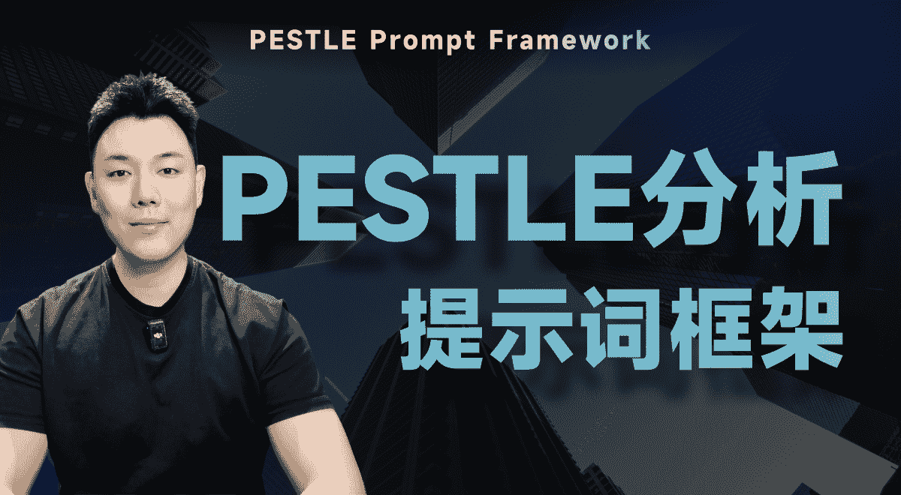

# 行业分析 | PESTLE分析提示词框架 2.0

> 来源：[https://feicaiclub.feishu.cn/docx/Y65hdFPhRohATWxnES4ccOXOnpX](https://feicaiclub.feishu.cn/docx/Y65hdFPhRohATWxnES4ccOXOnpX)

# PESTLE **提示词框架介绍 2.0**

这个PESTLE分析提示词框架是为那些需要了解外部环境的企业团队和个人设计的。不管你是企业管理者、战略顾问还是市场分析师，它都能帮你更有条理地完成政治、经济、社会、技术、法律和环境六个维度的分析工作。

它的使用方式很简单：你先告诉AI你想分析的对象和目标，AI会帮你设计一个包含六个维度的报告框架。然后针对每个部分，AI会给你推荐一些有价值的搜索问题，你可以用秘塔搜索引擎去查找最新的相关信息。最后，AI会把你收集到的资料整合成一份连贯的分析报告。

这种方式让PESTLE分析变得更加便捷，你不需要从头思考分析结构，也不用花太多时间整理信息。通过你和AI的合作，既能获取到实时的市场数据，又能按照专业的分析思路进行整合，帮你更高效地评估外部环境。整个过程既节省了时间，也提升了分析的质量，让你在制定决策时能有更全面的参考依据。

---

## **核心功能模块**

### **/分析需求**

明确分析对象与目标 - 通过几个关键问题帮你确定分析的主体（企业、行业或项目）、分析目标（如市场进入、战略规划或风险评估）、地理范围和时间范围等。这一步骤能让后续的PESTLE分析更加聚焦和有效，避免分析过于宽泛或偏离实际需求。

### **/报告框架**

生成完整报告结构 - 根据你的分析需求，自动生成一份包含政治、经济、社会、技术、法律、环境六个维度及综合战略建议的完整报告目录。目录设计既符合标准PESTLE分析框架，又会根据你的具体需求调整各部分的侧重点，确保分析的针对性和实用性。

## **/标题+标题序号**

分步骤深入研究与撰写 - 针对PESTLE六个维度中的每个部分，框架会首先推荐3个相关的搜索问题和内容细纲，引导你使用秘塔搜索获取最新的相关信息，然后帮你将这些信息整合成一份连贯、有深度的分析内容。每个部分都注重数据支持和影响分析，既保持客观性又提供实用洞见。

## **/继续**

顺序完成分析报告 - 当你完成一个维度的分析后，使用这个指令可以直接进入下一个维度的分析工作，使整个PESTLE报告的撰写过程更加流畅。这种线性工作流程减少了中断，让你能够更专注于每个环境因素的分析内容。

> 注：本框架为辅助工具，最终效果将根据使用者的应用和优化产生差异。不同研究分析场景下的使用效果可能有所不同，使用者需根据实际需求调整细节与情节安排。

---

# 👀 先睹为快

我们利用这套提示词框架使用了**DeepSeek R1 **模型作为总调度和报告撰写，**秘塔AI**作为搜索引擎。所有内容都是框架直接生成的，未经任何人工修改和调整。这样你可以直观地看到这套框架在实际应用中的效果如何。

> 使用这个框架创作时，有几点需要特别注意：

1.  推理模型虽然创作能力强，但也更容易"产生模型幻觉"。比如 DeepSeek R1 的幻觉程度是 V3 的3倍多。所以在撰写后一定要检查报告中的数据引用和观点输出。‘

1.  此框架适用于主流大语言模型，但因各家模型能力的不同，最终报告质量也会造成不同的影响。

## **报告目录**

### **中国新能源汽车行业（2024-2**025年）构建完整的PESTLE分析框架

001 政治环境分析（Political）

+   中国新能源汽车产业政策导向

+   地方政府补贴与基础设施配套

+   国际贸易壁垒（如欧盟反补贴调查）

002 经济环境分析（Economic）

+   宏观经济与新能源汽车消费能力

+   锂/镍等原材料价格波动对成本的影响

+   充电桩网络建设投资趋势

003 社会环境分析（Social）

+   消费者对智能电动车的接受度演变

+   年轻群体购车偏好与品牌认知

+   城乡市场渗透差异

004 技术环境分析（Technological）

+   固态电池技术商业化进程

+   车路云一体化示范项目进展

+   自动驾驶L3级落地政策与技术瓶颈

005 法律环境分析（Legal）

+   数据安全法对智能汽车的影响

+   动力电池回收法规强制化

+   新能源汽车出口认证标准

006 环境因素分析（Environmental）

+   碳足迹核算标准实施进展

+   动力电池梯次利用生态构建

+   稀土开采环保监管强化

**007 综合环境战略建议**

+   政策驱动与技术突破的协同路径

+   产业链风险对冲策略

+   差异化市场竞争定位

---

## 📝 政治环境分析（Political）正文

**国家政策导向呈现战略升级态势**

2024年12月31日，财政部等四部门联合发布《关于完善新能源汽车推广应用财政补贴政策的通知》，明确中央财政补贴标准较2023年退坡30%，并宣布自2025年1月1日起全面终止实施（财政部官网公告）。这一政策转向标志着中国新能源汽车产业正式进入"后补贴时代"，倒逼企业从依赖政策红利转向技术创新驱动。与此同时，工信部修订的双积分政策将2024年新能源汽车积分比例要求提升至28%，通过积分交易机制形成市场化调节，例如长城汽车因积分缺口在2024年上半年支付了4.2亿元积分购买费用（中国汽车工业协会2024年7月数据）。值得注意的是，政策开始强化智能网联与绿色化协同发展，2024年6月发布的《智能网联汽车准入和上路通行试点实施细则》已批准比亚迪、小鹏等8家车企开展L3级自动驾驶道路测试（工信部新闻发布会实录）。

**地方政府政策呈现差异化创新特征**

在中央补贴退坡背景下，地方政策转向基础设施配套与使用端激励。北京市2024年出台的《交通综合治理行动计划》要求全市新增出租车100%电动化，并对货运车辆新能源替代给予每车最高5万元运营补贴（北京市交通委2024年3月文件）。上海市则聚焦充电网络建设，规定新建住宅小区停车位100%预留充电设施安装条件，并在外环内建成3公里充电服务圈（上海市发改委2024年充电设施建设白皮书）。值得关注的是区域政策差异带来的市场影响，例如江苏省对纯电动客车按电池容量给予1200元/千瓦时的补贴，但要求车辆注册地必须为本省，这种地方保护主义倾向可能导致市场分割（江苏省财政厅2024年新能源汽车补贴实施细则）。

**国际贸易环境倒逼战略调整**

针对欧盟委员会2024年2月启动的反补贴调查，中国新能源汽车出口面临重大挑战。调查结果显示，抽样企业中比亚迪、吉利、上汽分别被征收17%、18.8%、35.3%的临时反补贴税（欧盟委员会2024年7月4日公告）。作为应对，商务部于2024年11月向WTO提起申诉，主张欧盟调查违反《补贴与反补贴措施协定》第11.3条关于"充分证据"的规定（WTO文件WT/DS612/1）。企业层面则加速全球化布局，比亚迪投资7亿欧元在匈牙利建设年产能20万辆的整车工厂，计划2025年实现欧洲本地化生产（路透社2024年3月报道）。这种"产地多元化"战略使中国车企在2024年对东南亚出口量同比增长58%，部分抵消了欧盟市场下滑的影响（海关总署2024年12月统计数据）。

# **💰 订阅社群年度会员**

> **💰 加入废才俱乐部**

> 加入社群，一次性解锁所有AI实战攻略。

> 包括现有的全部内容——提示词框架、Agent搭建教程、Skill开发攻略等，以及未来每一期视频更新的配套资料。不再零散获取，系统地学习和应用。

> ⚠️ 购买提醒：请仔细浏览页面内容，谨慎购买，不退不换。如未看到支付按钮，请使用桌面端网页浏览器访问。

> **光看文字不够？实操遇到卡点？**

> 加入社群后，你还可以进入专属交流群，获得废才老师的亲自指导。在这里，你不仅能与数百位AI实践者交流经验，更能随时提问，解决实操中遇到的问题。

> 我们期待你成为社群的第 n+1 位成员！

> [社群微信群入口](https://feicaiclub.feishu.cn/wiki/JBNXwZ5QZidRtuk1HCCcvgZmnNg?from=from_copylink)（戳这里，跳转去社群微信群页面扫码入群）