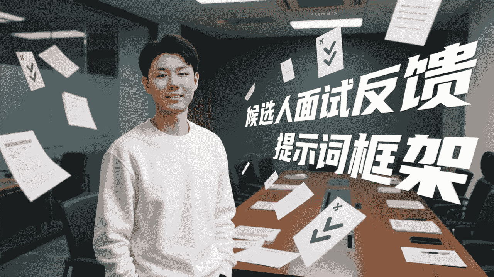

# 职场 | 候选人面试反馈提示词框架

> 来源：[https://feicaiclub.feishu.cn/docx/SSNYdCNZbojkM6xOUqzckASOnOg](https://feicaiclub.feishu.cn/docx/SSNYdCNZbojkM6xOUqzckASOnOg)

# 视频链接

> **youtube：**https://www.youtube.com/watch?v=6-USlBgyvqk&t=8s

> **B站：**https://b23.tv/bmV8Hoh

> **小红书：**http://xhslink.com/IIgMrU

> **抖音：**https://v.douyin.com/ir3ospUe/

---

# 候选人面试反馈提示词框架介绍

在招聘过程中进行面试时，是否曾遇到过以下难题：**面试过程冗长且主观性强。不同面试官的评分标准差异显著，导致候选人的表现难以客观比较？** 这些问题不仅令招聘者头痛，还可能导致优秀人才的流失，甚至阻碍团队找到最优人选。

这正是为何我们设计了这套AI面试专家框架。该框架将AI作为您的辅助工具，帮助系统化地分析面试过程，对候选人进行全面且客观的评分。通过此框架，您将能够：

+   **客观地评估候选人的表现**：从专业能力、沟通能力到团队协作，每个评分维度都经过标准化处理，确保评分的公平和透明。

+   **节省时间与人力成本**：AI可以分析面试录音并生成详尽报告，大幅减轻面试官的工作负担，使招聘流程更加高效。

+   **提供具体的改进建议**：AI不仅提供评分，还为候选人生成个性化的改进建议，帮助他们有针对性地提升，为未来的面试做好准备。

## 框架核心结构与详解

1.  **评分标准与项目**

**明确的评分标准**将候选人的表现划分为不同能力维度，设定相应权重及详细评分标准。评分项目包括：专业能力匹配度、沟通能力、学习能力、团队协作、抗压能力、文化契合度和职业发展规划。

+   **示例**：沟通能力包括语言的清晰度、回答的切题程度、表达的结构性等多个维度，确保候选人的沟通能力得到全面衡量。

+   **详解**：通过多样化的评分项目，面试的各方面得到量化评估，AI能够在每个方面详细分析候选人的表现，确保面试结果具有说服力。

1.  **思考过程展示**

**利用代码框展示AI的思考过程**。这一功能确保AI在每次生成内容时能够透明地展示其逻辑推理路径。AI将解释其如何分析面试文本、如何评估候选人能力，并逐步展示其决策依据。

+   **示例**：([目标], “分析候选人的专业能力匹配度”) ([思考], “候选人回答的技术问题涉及具体细节，术语使用准确，体现了扎实的专业背景”)

+   **详解**：此展示方式使面试官更容易理解AI的评分背后逻辑，确保决策的透明性与合理性。

1.  **详细评分报告生成**

**报告生成包括评分、能力分析及改进建议**。该框架将自动生成详尽评分报告，以表格形式直观呈现候选人在各项评分项目中的得分及表现。

+   **示例**：

+   能力类别 | 得分 | 权重 | 加权得分 | 评级

+   专业能力匹配度 | 85/100 | 25% | 21.25 | 良好

+   **详解**：报告不仅展示候选人的得分，还附有详细的评语，帮助面试官更好地理解每项评分背后的原因，并为候选人提供建设性反馈。

1.  **改进建议和录用建议生成**

**AI根据评分结果自动生成针对性的改进建议及录用推荐**，帮助面试官做出明智的招聘决策，同时为候选人提供明确的提升方向。

+   **示例**：候选人在抗压能力方面表现尚可，但情绪管理需要提升。建议参加相关培训以提高高压环境下的表现。

+   **详解**：AI提供的改进建议不仅是对候选人表现的总结，也是帮助他们在未来面试中提高成功率的指导。

# 为什么这套框架独特？

这套AI面试专家提示词框架**不仅仅是一个面试评分工具**，而是涵盖了全面、细致、结构化的面试过程管理方案。它可以帮助您：

+   **提升面试效率和质量**：将复杂的面试评估转化为标准化流程，确保评估更加客观一致。

+   **实现全方位的能力评估**：从沟通能力到抗压能力，每个维度都经过精细化分析，确保候选人的表现得到全面衡量。

+   **提升候选人的成长潜力**：通过详细的改进建议，帮助候选人更好地认识自身不足并有针对性地提升。

**重要说明**：该提示词框架仅适用于高性能自然语言处理模型（如Claude 3.5 Sonnet或ChatGPT-4），因为这些模型具备更强的语言理解和分析能力，能够处理复杂的面试内容和细微的语义差异，确保面试分析的准确性和一致性。其他模型可能无法提供同样的高效分析和评分结果。

---

# **💰 订阅社群年度会员**

> **💰 加入废才俱乐部**

> 加入社群，一次性解锁所有AI实战攻略。

> 包括现有的全部内容——提示词框架、Agent搭建教程、Skill开发攻略等，以及未来每一期视频更新的配套资料。不再零散获取，系统地学习和应用。

> ⚠️ 购买提醒：请仔细浏览页面内容，谨慎购买，不退不换。如未看到支付按钮，请使用桌面端网页浏览器访问。

> **光看文字不够？实操遇到卡点？**

> 加入社群后，你还可以进入专属交流群，获得废才老师的亲自指导。在这里，你不仅能与数百位AI实践者交流经验，更能随时提问，解决实操中遇到的问题。

> 我们期待你成为社群的第 n+1 位成员！

> [社群微信群入口](https://feicaiclub.feishu.cn/wiki/JBNXwZ5QZidRtuk1HCCcvgZmnNg?from=from_copylink)（戳这里，跳转去社群微信群页面扫码入群）