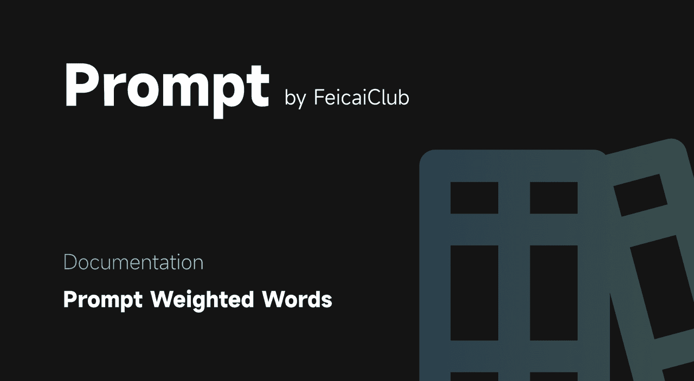

# 12 个常用场景 Prompt权重词整理

> 来源：[https://feicaiclub.feishu.cn/docx/K4ood4BckoJ9SgxC36Nctqfcnkb](https://feicaiclub.feishu.cn/docx/K4ood4BckoJ9SgxC36Nctqfcnkb)

在提示词（prompt）里，小到一个形容词、语言切换，甚至标点顺序，都会改变大模型“看到”的 token 序列，从而左右理解与输出质量。本文综合行业基准测试、开源实验与各家文档，可归纳出以下规律与实战技巧，帮助你有意识地挑词、换词，提升效果并控制成本。

# **词汇为何会“敏感”**

+   **Token 化机制**：GPT-系模型先把文本分成 token，再送进网络。不同语言或词形被切得长短不一，直接影响注意力分配、概率估计与费用。

+   **训练语料分布**：主流模型仍以英文为核心语料，英文 token 的统计特征更稳定；非英文或稀有词出现频率低，embedding 空间稀疏，推理时更易漂移。

+   **高权重／低权重 token**：最新 embedding 研究发现，“替换成本”高的核心词（如动词、逻辑连接词）在向量空间更突出，热度词汇微调输出方向的力度也更大。

# **同义词、情感词的“力度”差别**

+   角色扮演、链式思考、Few-shot 等“指令性词组”经过实测，是最具权重的一类关键词。

+   情绪强度词会在输出中被镜像放大（Plutchik 实验）

# **实战写词策略**

+   **先定输出语言**：若要中文结果，可先用英文写清任务，再补一句“请用中文回答”；能兼顾理解与输出质量。

+   **给角色+任务+尺度**：

> You are a policy analyst. Evaluate the proposal in 3 bullet points, each under 20 words.

+   **使用动词驱动**：与其写 “请提供信息”，不如写 “列出 5 条具体做法，并比较优缺点”。

+   **降低稀有 token**：避免冷僻缩写或无意义 Emoji；必要时加解释。

词汇选择会显著影响大模型对任务的“意图权重”与“资源配给”。在英语语料优势、token 经济性与情感放大效应的多重作用下，精心挑选动词、情绪词和角色描述，比单纯换成英文或扩写同义词更能稳定提升输出质量；而对成本敏感的场景，则优先考虑英文或高度凝练的中文提示。

# 12 个常用场景权重词表

以下是Prompt权重词表，**按照12个成熟AI使用场景归档整理。每个场**景列出30组，总共 360 对强弱权重词，以"语义 | 弱词 | 强词 | 典型影响"格式呈现表格，优先使用中文权重词。