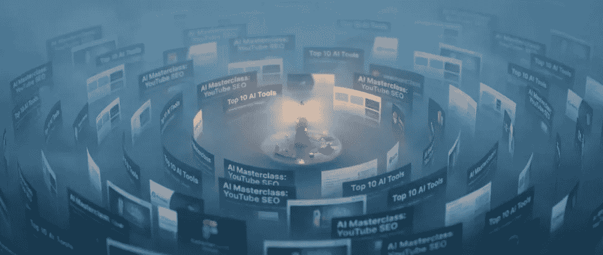

# AI 时代，Vibe Marketing 可行吗？

> 来源：[https://feicaiclub.feishu.cn/docx/MUzadUmA9okOjLxUquXcl1Ignae](https://feicaiclub.feishu.cn/docx/MUzadUmA9okOjLxUquXcl1Ignae)

# AI 时代，Vibe Marketing 可行吗？

如果你跟我一样，你可能已经发现了一个残酷的事实。

在 AI 时代，做出一个产品已经不难了。难的是让别人知道它。

AI 让开发速度快了十倍。一个人一个周末就能搭出一个过去需要一个团队三个月才能做出来的东西。但你打开 Product Hunt，看到满屏的 "AI-powered" 标签，每一个都长得差不多，然后你心里冒出一个念头。

**我做的东西，跟这些有什么区别？**

或者换个场景。你打开📕、打开👸号、打开任何一个内容平台，满屏的 AI 生成图文、AI 写的攻略、AI 剪的视频。你刷了十条，质量都差不多，看完什么都没记住。

产品在泛滥。内容在泛滥。噪音越来越厚。

而你的努力正在被淹没。

过去一年，我踩过的坑比我愿意承认的多得多。我做过没人用的产品，发过没人看的内容，在凌晨三点盯着后台数据怀疑过自己是不是根本不适合干这行。

但也正是在这些反复撞墙的过程中，我想明白了一件事，瓶颈不在产品。瓶颈在 Marketing。

不是那种投广告、买流量的传统营销。而是一种更根本的东西，怎么让人知道你，信任你，愿意把时间和钱给你。

这篇文章就是我对这个问题的回答。有些结论可能让你不舒服。有些判断你可能本能地想反驳。

都没关系。

但如果你是一个独立开发者、一个正在用 AI 做产品的人，或者一个隐约觉得"我明明很努力但为什么没有结果"的人，我建议你读完它。

这篇文章很长。不是那种你刷两屏就能划走的东西。

找个安静的时间。带着你正在做的项目来读。

## I — 你的产品不是输在功能上，是输在"存在感"上

先说一个让我自己都觉得残酷的事实。

**2025 年，A**I 生成的英文内容已经占到互联网上所有文章的超过一半，52%。人类写的，反而成了少数。

中文互联网虽然没有同口径的数字，但情况恐怕只会更夸张。中国的生成式 AI 用户半年内翻了一倍。抖音光是 2025 年上半年就清理了超过 2.4 万条 AI 生成的虚假和低质内容。

而这还只是被抓到的。

你知道这意味着什么吗？

意味着"做出一个产品"或者"做出一条内容"这件事，已经不是壁垒了。

它甚至算不上入场券。

它更像是呼吸。是你活着的基本证明。但没有人会因为你在呼吸就注意到你。

我自己就犯过这个错误。花了快 2个月研究一个产品，页面和功能做得自己都觉得很满意，然后坐在电脑前等着世界发现我。

结果...石沉大海，没人用。

不是产品不好。是到了发布那天，我在所有真正重要的事情上都是零。零受众。零信任。零证据证明我的东西解决了一个真实存在的问题。

我把 100% 的时间花在了做产品上，0% 花在了让人知道这个产品上。

无论你做的是产品还是内容，逻辑都一样，埋头开发，打磨到完美，一朝发布，期待世界自动来敲门，这条路在 2026 年不是通向成功的路径。

**这是通向默默无闻的配方。**

你需要做 Marketing。这不是可选项，这是必选项。

但你可能会想，"那我多做推广不就行了？"

没那么简单。

因为推广本身，也烂掉了。

## **II — Vibe Marketi**ng 听起来很美，但它也是一种 Slop

2025 年有一个概念特别火，叫 "Vibe Marketing"。

脱胎于 Andrej Karpathy 提出的 "Vibe Coding"，意思是你不再需要一个完整的营销团队，借助 AI 工具和自动化，一个人就能干五个人的活。写文案、做视频、投广告、分析数据，全部用 AI 加速搞定。

听起来太美了，对吧？

确实美。这个概念的热度在 2025 年飙升了将近 7 倍，甚至有创业公司开出百万美元年薪招 "Vibe Marketer"。

我自己也兴奋过。我也试过用 AI 一天产出过去一周的内容量。

然后我发现了一个问题，当每个人都在用 AI 做营销的时候，会发生什么？

一模一样的事情，Slop。只不过从产品端蔓延到了营销端。

"AI Slop" 这个词在 2025 年的提及量涨了 9 倍。网上关于 "slop" 的讨论增长了 200% 以上，其中 82% 是负面的。用户在大规模地、愤怒地点名批评那些千篇一律的 AI 视频、毫无灵魂的推广文案、敷衍到侮辱智商的营销内容。

**有人直接把 V**ibe Marketing 称为策略上的空心化，鼓励你跳过实质，把表面美学推出去，然后期望内容自己跟上。

但营销不是代码。营销不会"编译通过"。

你用 AI 两小时做出来的东西，别人也能两小时做出来。当所有人的营销都长一个样的时候，用户会怎么反应？

他们划走。

更快地划走。

如果你在国内，你可能已经亲身感受到了。打开抖音，是不是越来越多的视频开头都是"震惊了！""新王又登基了！""99% 的人不知道的秘密！"？

你是不是已经开始本能地怀疑，这是一个真人在说话，还是一个 AI 套了模板在批量生产？

**缺的不是信息。是人味。**

缺的不是制作精良。是你能感受到的、这个人真的用过这个东西、真的在乎你要不要买的那种真实感。

所以问题不是"该不该做营销"，当然该做。

问题是，当产品是 slop、营销也是 slop 的时候，什么才是真正稀缺的？

这个问题的答案，才是整篇文章真正要说的东西。

而且答案可能会让你意外。

## III — 在 AI 时代，信任是新货币

我曾经以为粉丝数就是一切。

一万粉丝不够，那就涨到十万。十万不够，那就百万。只要数字够大，总会有转化。

这个想法是错的。而且在 2026 年，它比以往任何时候都更错。

粉丝数是一个虚荣指标。十万人关注了你，不代表十万人信任你。大部分人只是刷到了随手一点，他们不记得你是谁，不会打开你的主页，更不会因为你推荐了什么就掏钱。你没有办法转化他们，因为从来就没有什么东西可以转化。

粉丝数不等于信任。这是两件完全不同的事。

粉丝数在贬值，越来越多的关注是无意义的、一次性的、不带任何承诺的。

但信任在升值。LTK 联合西北大学零售分析委员会做的一项研究发现，消费者对创作者的信任同比增长了 21%。不是对所有创作者，是对那些他们真正认可的、觉得"这个人说的话我信"的创作者。

为什么？

想想看，当所有内容都可能是 AI 编的，当所有产品页面都可能是模板套出来的，当所有评测都可能是 AI 写的，

一个真实的、有判断力的、你能感觉到"这个人真的懂这件事"的人，就变得极其珍贵。

AI slop 越泛滥，人们就越渴望信任一个有真实经历的真人。

对独立开发者来说，这意味着一个根本性的转变，你的竞争优势不是你能用 AI 生成多少内容，而是有多少人在做决定的时候，会想"我去看看那个人怎么说"。

一个微妙但重要的变化正在发生，过去，精心打磨的专业外观代表高质量；现在，它代表的可能是 AI 生成的、不可信的。你在📕上看到一篇图文并茂、排版精美的产品测评，你的第一反应不再是"好专业"，而是"这是不是 AI 写的？"

**在一个充满无限供给**和无限怀疑的世界里，真实性就是奢侈品。

好，那真实性怎么建立？

这才是真正难的部分。

## IV — 不要做"内容创作者"，做一个碰巧在分享的实干家

大多数人听到"要做个人品牌"，第一反应是开始拼命发内容。每天三条推文、每周两个视频、每个平台同步运营。

我也干过。我甚至做过内容日历，把每天发什么排得整整齐齐。

结果呢？数据一塌糊涂。更重要的是，我自己都觉得假。

因为这是错的。这只是另一种形式的 slop。

真正有效的路径不是"做内容创作者"，而是做一个碰巧在分享的实干家。

区别在哪？

"内容创作者"的逻辑是，我要生产内容 → 内容获得流量 → 流量变成收入。

"实干家"的逻辑是，我在解决一个真实问题 → 我把过程分享出来 → 分享建立了信任 → 信任带来了一切。

前者的核心是内容。后者的核心是你这个人。

前者越来越廉价。

后者越来越稀缺。

这也是 Build in Public 这种方式真正有效的原因。但这里面有一个巨大的陷阱，我见过太多人栽在上面。

**最大的陷阱是"表演真实"。**

精心打磨一条关于挣扎的"真诚"帖子？那是行为艺术。你的受众能看出区别。一条修改了八遍的"坦诚分享我的失败"比一条用 AI 生成的推广文案更虚伪，因为它带着伪装成真实的表演性。

真正有效的是什么？

是你花了一周做的功能结果没人用，然后你说"我做错了，这是我学到的"。

是你的身份验证终于跑通了那个瞬间，你顺手截个图发出来。

是你定价定错了、方向选错了、时间浪费了，而你没有把这些包装成"成长故事"，只是如实说了。

不需要每条内容都是"干货"。不需要每个帖子都有"价值"。

你只需要让人觉得，**这个人是真的在做事，不是在演。**

1000 个真正信任你的人，比 10 万个订阅了但永远不看你内容的人有价值得多。

这不是鸡汤。在粉丝数已经变成虚荣指标的今天，这是数学。

但这里有一个问题，信任不能凭空产生。你得有一个东西让人信任你。

那个东西是什么？

## **V — 越具体，越值钱**

那个东西，必须足够具体。

做什么？

这可能是我过去一年想得最多、也犯错最多的一个问题。

我翻了大量 Reddit、X 上的帖子，也看了不少国内博主和社群里的讨论，自己也亲身试过几个方向。结论非常清楚，不是做"下一个大平台"，而是做垂直行业的 AI 工具。

通用 AI 工具的时代已经过去了。"又一个 ChatGPT wrapper" 不会让任何人掏钱。

真正的机会在哪？

在那些 AI 解决不了的地方。某个具体行业里，某个具体角色，每天都在手动做的，烦人的、重复性的操作。

为什么垂直能赢？因为通用工具只能给你 70 分的解决方案。但一个真正懂这个行业痛点的人做出来的垂直工具，能给你 95 分。

那多出来的 25 分，恰好是最值钱的部分。

好，假设你认同"做垂直"这个方向。下一个问题是，怎么把产品本身变成你最大的营销武器？

这才是我最想跟你分享的部分。

## VI — 最好的产品是透明的：工具即教学

到目前为止，我们聊了"做什么"和"怎么推"。但我在过去一年里发现了一种产品模式，天然地把这两件事融为一体。

我把它叫做透明工具 Transparent Tooling。

核心思路很简单，产品的内部实现本身就是价值的一部分，而不是被隐藏起来的商业秘密。

我自己就经历过这个过程。我做了一个 AI 分镜师，最初是帮人做漫剧和短剧的分镜。用户一开始只是把它当生产工具用，输入脚本，输出分镜图，提升效率。但很快，有意思的事情发生了，用户开始自己上手迭代。就在昨天，我社群里一个朋友跟我说，他已经在我的基础上把分镜师改到了 3.0 版本，越来越贴合他自己的需求，效率提升巨大。

他不再只是"**用户**"。他是**共同建设者**。

买来是工具，用起来是教学，改完变成自己的。

但真正让我理解这个模式能有多大规模的，是 OpenClaw。

OpenClaw 之所以让这么多人着迷，不只是因为它是一个开源 AI Agent，而是因为它把"透明"做到了极致。它的核心就是几个 Markdown 配置文件，SOUL.md 定义 Agent 的人格和说话方式，AGENTS.md 定义行为指令和能力边界，USER.md 存储用户的偏好和上下文信息。再加上一个 heartbeat 心跳机制，Agent 每隔 30 分钟自动唤醒一次，检查有没有需要主动处理的事，这意味着它是 24 小时待命的，不需要你去触发。

全是人类可读的文本。打开就能看懂，改几行就能变成完全不同的东西。

然后有意思的事情发生了，大部分人都开始魔改。

X 上几乎每天都有人在分享自己的配置方案。有人把 OpenClaw 改成了自己的全职个人助理，每天早上自动推送日程摘要、天气预报和待办事项。有人用它管理邮件、日历和 Notion，所有事情通过一个 Telegram 对话搞定。有个创业者直接搭了四个 Agent 组成的"虚拟团队"，一个管策略，一个管开发，一个管营销，一个管商务，24 小时在 VPS 上跑，通过 Telegram 指挥。还有人遛狗的时候用语音让 Agent 去检查服务器部署、review 代码、提交 PR，全程没碰一下电脑。

社区自发建了 souls.directory 来收录 SOUL.md 的各种人格模板，几百个贡献者开始写自己的 SKILL.md 插件。

没有人"运营"这个社区。它是自己长出来的。

为什么？

因为透明工具有三个其他模式不具备的特性。

第一，AI 产品的核心载体天然就是透明的。

传统软件的核心是编译后的二进制代码，你看不懂，也改不了。但 AI 工具的核心是什么？Prompt。配置文件。Workflow 规则。全是人类可读的文本。

当你的产品是一组精心设计的 prompt 和配置时，"工具"和"教材"之间的边界天然就是模糊的。OpenClaw 的 SOUL.md 如此，我的 AI 分镜师也是，用户看到 prompt 的写法之后，自己就开始改了。

这不是刻意设计的"教学功能"。是这个介质本身的特性。

第二，用户在"改"的过程中会扎根。

这是最精妙的部分。

用户拿到工具 → 用了 → 看懂了 → 按自己的需求改了 → 改完之后，他的工作流已经跟你的框架深度绑定了。

商业上这叫转换成本。但在透明工具模式里，它是以一种对用户完全友好的方式产生的。

用户不是被"锁住"了。而是"扎根"了。

他投入了自己的定制化劳动，不会轻易离开。不是因为离开很痛苦，而是因为留下来很舒服。

OpenClaw 的大量贡献者就是这样来的。最初只是用户。然后开始改 SOUL.md。然后开始写 SKILL.md 插件。最后变成了社区的一部分。

你见过哪个闭源产品能做到这一点？

**第三，它天然自带传播属性。**

用户从你的工具中学到了东西，他们会分享。这不是营销，是学习者的自然行为。每一次分享都是免费的产品推广。

产品的使用过程本身就是营销。用户的学习过程本身就是传播。

飞轮自己会转。

**但我必须说一个致命风险。**

因为你的产品本质上是透明的，所以它极其容易被复制。任何人都可以 fork OpenClaw 的代码做一个竞品，也可以拿走我的 AI 分镜师的 prompt 自己搭一个。

那凭什么赢？

Peter Steinberger 花了 13 年做 PSPDFKit，又用一个周末 hack 出了 OpenClaw 的原型。从 Clawdbot 到 Moltbot 再到 OpenClaw，他一路公开构建，在社区里积累了多年的信任。这份信任最终让 Sam Altman 亲自邀请他加入 OpenAI。

产品可以被复制。

**你这个人不能。**

所以这个模式成立的前提非常清晰，你必须是你自己产品的最深度用户，并且持续公开分享你的使用、修改和迭代过程。

产品是载体。你这个人是灵魂。

这就引出了最后一个问题，怎么把以上所有东西，变成一个你每天都能执行的系统？

## VII — 把它变成一个可执行的游戏

如果你读到了这里，我猜你心里已经有了一个大致的图景。

做产品不再是瓶颈。Marketing 才是。

但传统的 Marketing，投广告、买流量、批量生产内容，已经变成了 slop。

真正有效的 Marketing 是建立信任、积累影响力、成为一个被人记住的 IP。

而最好的方式，是让你的产品本身成为 Marketing 的载体，透明的、可学习的、让人扎根的。

**但如果你只是"理解"了这些，而没有把它变成可执行的东西，那上**面的一切，都只是另一篇你读完就忘的文章。

我不想写那种文章。

所以我想分享一个框架。不是万能公式，不存在万能公式，而是一个我反复研究和试错之后觉得最现实的路径。

我把它拆成六个组件，像一个游戏的设定。

**痛点（你的战场）。** 你比别人更懂的那个具体领域里，那个具体的、人们愿意付钱解决的痛苦。不要从"我想做什么"出发。从"谁在抱怨什么"出发。去 X 上发帖、去 YouTube 和 B 站发视频、去📕发图文，把你观察到的痛点说出来，看谁有共鸣。选那个能解决你自己最大痛点的想法，这样即使卖不出去，你也自动化了你工作流程中烦人的一环。越无聊越好。越具体越好。

**验证（你的第一关）。** 在写一行代码之前，先用半自动的方式跑通这个服务。举个例子，你关注了几百个 X 上的账号，每天光是读 feeds 和帖子就要花两个小时，而且总会漏掉重要的东西。你觉得这是个痛点，想做一个 AI Agent 帮人自动整理行业资讯。别急着写代码。先用 OpenClaw 搭一个半自动的方案，自己跑起来，然后去 X 上发一条帖子描述你的痛苦和解决方案，"我关注了 300 个账号，每天读推花两小时还是会漏。我用 OpenClaw 做了个 Agent，每天早上自动帮我整理昨天最重要的 20 条，按主题分类推送到 Telegram。有人需要类似的方案吗？如果评论区有人说“我也想要，怎么搞”，恭喜，你有了一个经过验证的需求。没人理你，恭喜，你省下了三个月。

**MVP（你的武器）。** 用 AI 编码工具快速搭建最小可用版本。一到两周内发布，不是一个月，不是三个月，是两周。功能能少就少。发布形式？直接开源扔 GitHub。现在开源就是最好的分发渠道，也是最自然的 Build in Public 起点，你的代码就是你的名片，你的 commit 历史就是你的信任凭证。

Build in Public（你的经验值系统）。 代码开源了，接下来把过程也“开源”。在 X 上记录你的每一步。不是精心包装的内容，是真实的进展和思考。为什么选了这个技术栈。为什么砍掉了某个花了一周做的功能。第一个用户是怎么来的。把 50% 的时间花在这上面。甚至在产品发布之前就开始。OpenClaw 的爆发靠的不是广告，是 Peter Steinberger 持续公开构建的过程，你也可以。

**社区参与（你的联盟）。** 去你的目标用户聚集的地方真正参与讨论。Discord 群组、🛰️群、X 上发贴。不是发广告，是提供价值，让人们自然地发现你。如果你敢露脸，拍短视频口播，"口播中间夹带产品"比直接推销的转化率高得多，因为你在提供价值的同时顺便展示了你的东西。

**护城河（你的终极防线）。** 你的代码是开源的，你的产品随时可能被 fork，但你对这个领域的理解深度、你持续迭代和分享的过程、你在社区中的信誉，这些东西没有快捷方式，只能靠时间堆出来。在你有 50 个自然获取的用户之前，不要投广告。先证明模式可行。

把整个框架画出来，大概长这样：

这六个组件互相咬合，就像一个游戏的核心循环：

找到痛点 → 验证它是真的 → 做出最小产品，开源发布 → 公开分享过程 → 在社区中建立信任 → 信任成为护城河 → 护城河让你能继续深耕痛点。

飞轮一旦转起来，你不需要刻意"做营销"。

因为你的存在本身就是最好的 Marketing。

## **最后**

让我把整篇文章压缩成一句话。

在 AI 时代，你最重要的工作不是做产品，是做 Marketing。

但这里说的 Marketing，不是投广告，不是买流量，不是用 AI 批量生产千篇一律的推广内容。

而是，在一个你真正懂的领域深耕。公开分享你的真实过程和判断，包括失败。对一小群人建立深度信任。让你的产品体验本身成为口碑的来源。成为一个 IP，不是那种刻意打造的"人设"，而是一个人们在做决定的时候会想到的名字。

你的核心竞争力不是"会用 AI"。

2026 年，所有人都会用 AI。

你的核心竞争力是你这个人。你的判断力。你的品味。你踩过的坑。

这些东西不能被复制，不能被自动化。而且随着 AI slop 越多，它们越值钱。

粉丝数在消退。但影响力没有消失。

它只是变得更人性化、更碎片化、更有意识。

**从今天开始，把你 50% 的精力从"做产**品"转移到"推广你自己和你的产品"上来。

你需要意识到，产品之后的事情，才是真正决定成败的事情。

去建你的影响力。