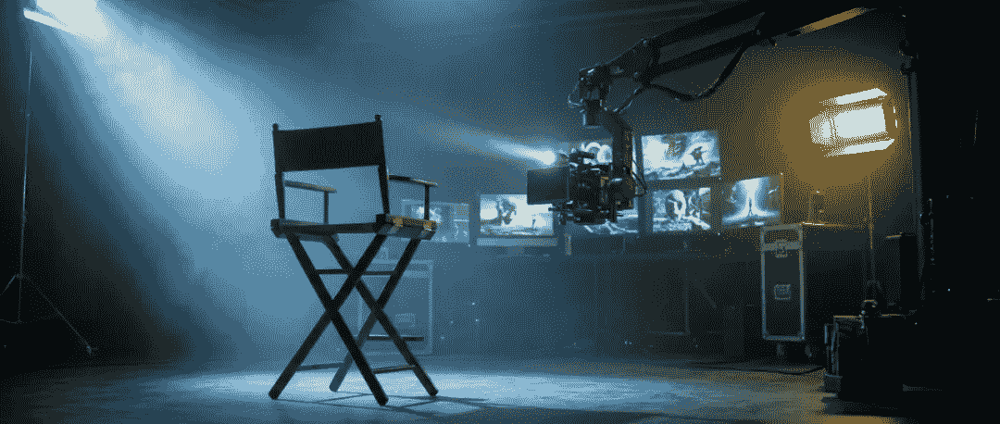

# 当制作不再是门槛，创作者还剩什么？

> 来源：[https://feicaiclub.feishu.cn/docx/A3tedh78xovH51xcX2acKsXEnLb](https://feicaiclub.feishu.cn/docx/A3tedh78xovH51xcX2acKsXEnLb)

上周，我打开即梦，试了一下字节刚上线的 Seedance 2.0。

输入了一段很简单的提示词。大概三十个字，描述一个人在雨中奔跑的场景。然后我等了几分钟。

生成的视频让我愣了大概十秒钟。

不是因为画质，画质好已经不是新闻了。让我愣住的是镜头语言。它自己切了三个分镜：先是一个全景，然后推到中景跟拍，最后一个低角度仰拍溅起的水花。雨声、脚步声、喘息声，全部自动生成，和画面严丝合缝。

我做 AI 视频内容快两年了。我测过市面上几乎所有的视频生成模型。我见过太多"又一个突破性进展"。但这一次不一样。

这一次，我第一反应不是兴奋，而是一种很难描述的不安。

因为 Seedance 2.0 干掉的不是某个技术细节，而是我一直以来认为属于"人"的那部分能力，分镜思维、运镜直觉、声画配合的节奏感。这些东西，我花了很长时间才学会，或者说，才开始觉得自己有点懂了。

冯骥试完之后说了一句话："AIGC 的童年时代，结束了。"

影视飓风的 Tim 说这是"改变视频行业的 AI"。

《死侍》的编剧 Rhett Reese 看到 AI 生成的 Brad Pitt 和 Tom Cruise 打斗片段后，在 X 上写了一句话："I hate to say it. It's likely over for us."

好莱坞慌了。A 股传媒板块 25 只股票涨停。全世界都在讨论。

但这篇文章不是要告诉你 Seedance 2.0 有多厉害。技术评测到处都是，你不需要我再写一篇。

我想谈的是一个更深的问题：当制作能力不再是门槛，内容创作这件事本身，是不是需要被重新定义？

当一个人、一段提示词、几分钟等待就能产出过去需要一整个团队花几周才能完成的东西，"创作者"这三个字到底还意味着什么？当所有人都能生产内容，好内容会因此被淹没，还是反而变得更珍贵？

这篇文章是我过去一周密集思考的结果。它不短。但如果你是一个靠内容吃饭的人，自媒体、影视从业者、短剧制作者、或者任何把视频当作表达工具的人，我建议你认真读完。

因为 2026 年的游戏规则正在被重写。你需要在别人还没反应过来之前，想清楚自己站在哪里。

## I — 制作能力正在归零，但这不是真正的问题

先说一个事实。

Seedance 2.0 之前，用 AI 做一条 15 秒的视频，可用率大概在 20% 左右。也就是说，你要"抽卡"五次，才能得到一条勉强能用的素材。这意味着时间成本、算力成本、以及大量的人工筛选和后期修补。

Seedance 2.0 把可用率拉到了 90%。

你知道这意味着什么吗？它意味着"制作"这个词正在从一种能力变成一种基础设施。就像电和 Wi-Fi 一样，你不会因为你家有电就觉得自己很厉害。

更关键的是，Seedance 2.0 不是个例。可灵 3、Vidu Q3 几乎在同一时间上线，能力都跨过了那个临界点。Sora 和 Veo 在海外也在持续迭代。这不是某一家公司的突破，这是整个赛道的代际跃迁。

有人说"AI 视频制作的门槛已经被踩到了地板上"。这句话在一周前可能还有点夸张，现在已经是事实。

但这里有个很多人没想清楚的地方：门槛消失本身不是问题，门槛消失之后暴露出来的东西才是问题。

打个比方。在智能手机出现之前，拍照是个技术活。你需要懂光圈、快门、ISO，需要一台不便宜的相机。然后 iPhone 来了，人人都能拍出清晰的照片。拍照的门槛消失了。

然后发生了什么？

是所有人都成了摄影师吗？不是。是摄影这件事变得不值钱了吗？也不是。真正发生的是，"拍得清楚"不再有任何价值，而"拍得有意义"变得前所未有地重要。

今天在视频领域发生的，是同一件事的加速版。

Seedance 2.0 让"做得出来"不再值钱。那什么才值钱？

这是我们接下来要回答的问题。

## II — 当所有人都能"拍电影"，"内容"需要被重新定义

这句话听起来可能有点大，但请跟我走一段。

过去二十年，"内容创作"的定义一直和"制作能力"高度绑定。你会剪辑，你能拍出好看的画面，你懂调色和运镜，这些技术层面的东西就是你的入场券，也是你的护城河。

我自己就是这么过来的。我花了很长时间研究提示词工程，学习分镜语言、镜头运动、光影逻辑。我会为了一个三秒钟的画面反复调整参数，尝试不同的生成方式。我曾经觉得，这些积累是我和"随便玩玩的人"之间的壁垒。

Seedance 2.0 上线那天，我突然意识到，这条壁垒正在被拆。

不是慢慢被侵蚀，是被直接拆掉。

模型能自己规划分镜了。能自己决定运镜方式了。能自动生成和画面匹配的音效了。你只需要告诉它"故事是什么"，它自己决定"怎么拍"。

我之前跟一名影视行业编导聊过，他说Seedance 2.0 真正恐怖的地方不是画面一致性，而是它在拆影视从业者最后的护城河，剪辑思维和分镜能力。

如果"制作能力"不再是内容的核心，那什么才是？

我认为答案是："内容"的定义正在从"你做了什么"转向"你选择了什么，以及为什么"。

这不是我的原创观点。设计师 Elizabeth Goodspeed 在 2024 年发表过一篇在设计和科技圈广泛传播的文章，她是关注科技与美学交叉领域的知名专栏作者，核心论点是：当模板、教程和工具让技术技能变得空前容易获取时，仅仅"会做"已经不够了，你需要有品味。品味是让创作者在无限可能性中做出选择和组合的能力。

前 TechCrunch 资深编辑、现硅谷知名风投人 Josh Constine 在他广泛传播的同名文章里把这个观点推得更远：AI 正在把人从"执行者"变成"提问者"和"策展人"，关键问题不再是"怎么做"，而是"做什么"和"为什么是我来做"。

理解这个转变极其重要。因为它意味着，从今往后，"创作者"这个身份的含义彻底改变了。

你不再是"那个会拍视频的人"。

你必须成为"那个知道什么值得拍的人"。

## III — AI Slop 的洪流不会杀死好内容，但会杀死中间层

到这里，可能有人会说："道理我都懂，但现实是 AI 生成的垃圾内容会淹没一切，好内容根本没人看到，这不是品味不品味的问题，这是生存问题。"

你说得对。但只对了一半。

先看数据。"Slop"，这个用来形容 AI 生成的低质量内容的词，已经被 Merriam-Webster 和美国方言学会同时评为 2025 年度词汇。受众对 AI 生成内容的好感度从 2023 年的 60% 暴跌到 2025 年的 26%。AI 生成文章的互动率在 2024 年下降了 40%。

换句话说：AI 内容越多，受众越不买账。

这是一个反直觉的事实：AI slop 越泛滥，真人创作的相对价值反而越高。

2025 年，对自由职业创作者的需求反而激增，尤其是能够提供原创性和情感共鸣的写手、设计师和视频创作者。受众已经开始主动寻找"不像 AI"的内容。

但... 这是一个很大的"但"，这并不意味着所有"真人创作"都能活下来。

Harry Law，一位长期关注科技与文化交叉领域的独立写作者，他的 Substack 专栏在设计和科技圈传播很广，观察到一个历史规律：每一次新的创作工具出现，从活字印刷到桌面排版再到博客平台，都遵循相同的模式：新作品泛滥、人们哀叹标准下降、然后重新校准什么才算"好"。

在这个"重新校准"的过程中，总有一类人最先被淘汰。

不是最顶尖的人，他们有极强的个人辨识度和深度粉丝关系，靠质取胜。

也不是完全拥抱效率的人，他们靠量取胜，用 AI 大规模生产内容，本来就不打算做"精品"。

**被淘汰的是中间层。**

就是那种，技术还不错、审美还行、产出比较稳定、一直在行业里活着的人。他们过去的生存逻辑是"我不是最顶尖的，但我够专业、够稳定、客户能信任我交付"。

现在 AI 恰好可以提供"还不错"的质量，以几乎为零的成本。

这个中间层面临的不是受众缩小的问题，而是生态位消失的问题。

多项学术研究发现了更让人不安的趋势：使用生成式 AI 工具会降低人类的创造性思维能力，导致更同质化的产出。发表在《Technology in Society》期刊上的一项研究甚至发现这种效果会持续，研究者称之为"创意伤疤"（creative scar）。AI 撤走几个月后，同质化水平不但没恢复，反而继续攀升。

这意味着什么？如果你是中间层，而且你越来越依赖 AI 来做那些"还不错"的产出，你不仅在被 AI 替代，你还在被 AI 降级，你的判断力、你的独特性、你和"纯 AI 输出"之间的差距，正在缩小。

这才是真正的危险。

## IV — 品味：AI 时代最后的护城河？

"品味"这个词最近在硅谷成了热词。从 Figma 到 Notion，科技公司的创始人们开始频繁谈论它。当 AI 把"制作"变成廉价商品，价值就迁移到了更上游的东西：审美与取舍、问题定义、叙事与意义。

但"品味"这个词太容易被浪漫化了。所以我想把它拆开，看看它到底是什么。

早在 18 世纪，哲学家大卫·休谟就给过一个至今仍有影响力的定义：真正的品味需要"敏锐的感知力、精致的情感、通过实践不断磨炼、在比较中不断完善、并且摆脱一切偏见"。

说得很美，但不够具体。

我认为在 2026 年的创作语境下，品味至少包含这几个可拆解的能力：

**第一，判断什么值得做。** 这是选题能力。AI 可以回答任何问题，但它不会提出问题。"哪个故事值得讲？为什么此刻必须讲这个故事？"这种判断来自你对世界的独特观察。你在中国三线城市长大的经历，你在某个亚文化圈子里泡了十年的积累，你经历过的那些 AI 训练数据里稀缺的东西，这些才是选题的真正来源。

**第二，判断什么程度算好。** 这是标准能力。AI 可以给你一千个版本，但有品味的人的价值在于敢说"只要这一个，其他都不要"。这种减法，这种"不做什么"的判断，恰恰是 AI 最不擅长的，因为 AI 的本质是概率优化，它选择的是"最可能被认可的"，而不是"最有个性的"。

**第三，知道什么时候停下来。** 这是克制能力。过度渲染、过度解释、过度特效，这些都是缺乏品味的表现。品味的核心往往不是"加了什么"，而是"忍住没加什么"。

**第四，敢于做"错误"的选择。** Facebook 前产品设计副总裁 Julie Zhuo 说过，在最高层面上，品味不仅仅是预测，更是一种"造势"。真正的品味引领者会承担社会风险，他们支持别人觉得陌生的东西，把声誉押在一开始看起来格格不入的判断上。AI 被设计为最小化风险，而最好的创作恰恰需要冒险。

**第五，持续演化。** 品味不是一个静态的标签。它是一个活的过程。一个强创作者的品味会随着阶段变化，你会推翻昨天的自己，主动厌倦旧套路，重新定义"好"。这种"自我厌倦、自我革命"的能力，是 AI 不具备的内驱力。

所以当人们说"品味是 AI 时代最后的护城河"，我基本同意，但有一个重要的补充。

品味是必要条件，但不是充分条件。

因为这里存在一个悖论。

## V — 品味的悖论：你的护城河正在被掏空

这是整篇文章最不舒服的部分，但我必须说。

前面提到的 Julie Zhuo 还提出过一个更不舒服的警告：如果品味的本质是跨越大量文化知识的模式识别，那么 AI 系统完全可以复制这个过程。它们可以吸收最好的品味制造者所拥有的基础语境，追踪前沿社群的偏好，并以越来越高的精度预测有辨别力的个体会看重什么。

换句话说：AI 正在学会"像"你。

更糟糕的是，你创造的每一个新东西，都会变成 AI 的训练数据。你的独特风格、你的审美选择、你好不容易建立起来的辨识度，一旦发布，就开始被稀释。AI 学走了你的"外观"，然后批量复制，让你和其他所有使用同一个模型的人看起来越来越像。

研究已经证实了这一点：当大量用户和场景使用同一套概率驱动的逻辑时，产出会趋同而不是分化。表面上每个个体的作品可能显得新颖，但在规模层面，一切融入了同质性。

而且如果 AI 模型开始在自己生成的数据上训练，准确性会崩溃，就像蛇吞自己的尾巴。没有持续的人类原创输入，AI 自身也会退化。

所以这里有一个双重悖论：

第一，品味是我们的护城河，但过度依赖 AI 工具又会侵蚀培养品味所需的深度思考能力，"创意伤疤"的问题。

第二，你做出的好东西越多，AI 能学到的就越多，你的独特性就越被稀释。

怎么破？

我的思考是：**品味的真正护城河不在于你产出的任何一件具体**作品，而在于你做判断的那个"过程"本身。

作品可以被学走，但你之所以在那个时刻做出那个选择的整套经验、直觉和上下文，是无法被数据化的。

更具体地说：

**速度是护城河。** 你对新事物的反应速度、组合速度、迭代速度，这是一个移动的靶心，AI 永远只能追到你上一个位置。

**语境是护城河。** 你做出的每个选择都嵌套在一个别人无法完全还原的人生语境里。AI 可以学你的风格，但它不知道你为什么在这个项目里用这个风格、在另一个项目里完全反转。

**人格是护城河。** 最终，受众追随的不是某种风格，而是一个持续做出有趣判断的人。风格可以被模仿，但"持续产生新判断"的那个活着的、在变化的主体，这才是不可替代的。

但光有品味还不够。我们还需要讨论一个更硬的东西。

## VI — 你能不能为你的选择承担后果？

这一部分可能是区分"有品味的业余爱好者"和"真正的创作者"最关键的分界线。

Seedance 2.0 上线的第二天，好莱坞的 MPA 就发了声明谴责字节。迪士尼发了停止侵权函。SAG-AFTRA 联合声明反对。周星驰经纪人公开质疑。字节紧急关闭了真人图片参考功能。

为什么反应这么剧烈？因为生成式 AI 真正缺乏的，是对后果的承担能力。

AI 不能被起诉，不能被道德谴责，不能被追究责任。美国版权局已经多次裁定，纯 AI 生成的作品无法获得版权保护。如果你的作品高度依赖 AI 生成，你可能连自己作品的法律所有权都无法主张。

这不是一个遥远的法律问题。这是正在影响每一个创作者的现实。

"承担因果"具体指的是什么？

**署名与责任。** 作品出了问题，侵权、事实错误、文化误读、肖像权争议，谁来负责？AI 不会坐牢也不赔钱。负责的永远是你。

**职业声誉。** 你做的每一次选择，会改变别人对你的信任，影响你下一个项目的合作机会。AI 没有职业生涯曲线，也没有"被同行记住"的利害关系。

**价值立场。 **很多真正重要的创作选择，最后不是"哪个更好看"的问题，而是"你站哪边、你愿意牺牲什么"的问题。这类选择会带来现实代价，被骂、被抵制、失去资源，也会带来现实回报：形成独特标签、建立核心受众。

这就是为什么"人用 AI 做创作"和"AI 做创作"之间有一条根本性的分界线：不在于"有没有用 AI"，而在于"谁在做关键取舍、谁为后果负责"。

AI 视频公司 Runway 的 CEO 说过一句话我很认同："如果你不是电影人，我把 Christopher Nolan 用的同款 IMAX 摄影机给你，你大概也拍不出他的效果。这不代表摄影机不好，而是反映了你是否有创造性的视野和艺术构想。"

AI 就是那台摄影机。

问题从来不是工具，而是拿着工具的人。

## VII — 2026 年，创作者面前的三条路

说了这么多，落到实处。

我认为从今年开始，内容创作者，包括我自己，面前有三条路。你不需要选某一条，但你必须清楚自己在走哪一条，因为最危险的位置是三条路之间的真空地带。

第一条路：做"快餐"，但做最好的快餐

大量内容追求的就是"快"。AI 短剧、悬疑解说、带货视频、视觉奇观类内容，这些是 Seedance 2.0 第一波改造的领域。

但即使是快餐也有麦当劳和路边摊的区别。这条路的逻辑是：用 AI 做执行层面的加速，但在选题、节奏、情感节拍上保持人的判断力。你不跟 AI 比制作速度，你跟其他同样用 AI 的人比判断力。

快，但不是无差别的快。有选择的快。

第二条路：做"手工料理"，小众、深度、高价值

这是品味路线。受众会小，但关系深。

《连线》杂志联合创始人 Kevin Kelly 在 2008 年提出的"1000 个真粉丝"理论，在 AI 时代比以往更有现实意义。硅谷顶级风投 a16z 甚至提出了更激进的版本，"100 个真粉丝"，每人每年愿意付 1000 美元追随你。

当你知道有一群人是因为"你这个人的判断"而付费追随你时，追逐流量的压力就消失了。你获得了创作者最有价值的东西：创作自主权。

面向大众的媒体是商品，而服务于小众受众的媒体不是。可以服务的细分领域是无限的。

这条路的门槛不是技术门槛，而是"你有没有独特的视角和持续产出判断力的能力"。

第三条路：做"策展人"，意义的赋予者

这是我最近想得最多的一条路。

当内容无限多的时候，最稀缺的不是"再多一个内容"，而是"有人告诉我该看什么"。

未来最有价值的角色之一可能不是"制作者"，而是策展人，那些能从海量内容中挑出好东西、赋予意义、构建叙事线索的人。

"创作者"的定义在扩展。以前"创作者"等于"生产者"。未来"创作者"等于"意义赋予者"。你可能不亲手做每一帧画面，但你决定了这个内容为什么重要、给谁看、在什么时候讲、放在什么语境里。

这不是退化，这是创作角色的升级。

## **最后一件事**

我在开头说，Seedance 2.0 给我的第一反应是不安。写到这里，这种不安没有消失，但它变成了一种更清晰的东西。

我想到了法国社会学家布迪厄的一句话：品味不仅分类事物，也分类品尝者，你选择什么，也在暴露你是谁。

在一个所有人都能用同样的工具做出"看起来不错"的内容的世界里，"你是谁"这个问题变得前所未有地重要。

不是你的技能。不是你的工具。不是你的制作能力。

而是：你为什么要做这件事？你愿意为它放弃什么？你想改变什么？你的独特经历如何塑造了你看世界的方式？

AI 能做任何事情，但它不知道为什么。

受众追随的不是技能，也不仅仅是品味，而是一个人的意志和方向感。

"Taste is all you need"这句在硅谷流行的话，只说对了一半。

完整的版本也许应该是：意义是你唯一需要的东西，而品味是你表达它的方式。

2026 年才刚开始。工具会越来越强。模型会越来越便宜。门槛会继续下降。

但有些东西不会贬值：你经历过什么，你在乎什么，你敢为什么承担后果。

这些东西，没有任何模型可以替你生成。