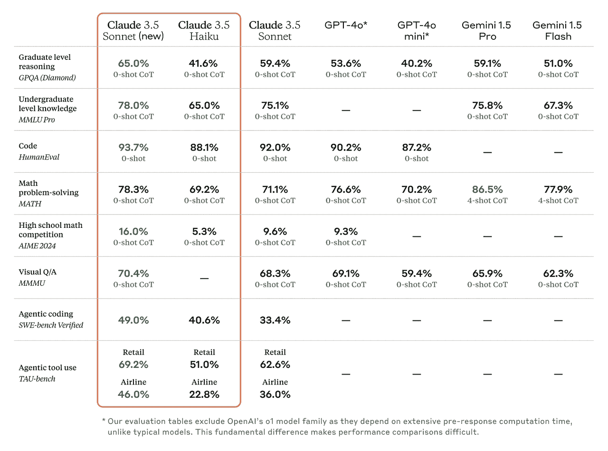

# Claude 3.5 Sonnet 和 Claude 3.5 Haiku 模型发布，同时推出电脑使用功能

> 来源：[https://feicaiclub.feishu.cn/docx/JFdZdzhPXoWKf3xaRWAcq8LAnZg](https://feicaiclub.feishu.cn/docx/JFdZdzhPXoWKf3xaRWAcq8LAnZg)

**2024年10月22日**●阅读时间5分钟

Anthropic 今天宣布推出**升级版 Claude 3.5 Sonnet** 和全新的 Claude 3.5 Haiku 模型。升级后的 Claude 3.5 Sonnet 相比其前代产品实现了全面改进，特别是在编程方面取得了显著进步——这也是它之前就已经处于领先地位的领域。Claude 3.5 Haiku 在许多评估指标上达到了前代最大模型 Claude 3 Opus 的性能水平，同时保持了与上一代 Haiku 相同的成本和相近的速度。

Anthropic 还推出了一项突破性的新功能公测版：**电脑使用能力**。从今天开始在 API 上提供，开发者可以指导 Claude 像人类一样使用电脑——通过观看屏幕、移动光标、点击按钮和输入文本。Claude 3.5 Sonnet 是第一个提供电脑使用功能公测版的前沿 AI 模型。在当前阶段，这项功能仍处于实验性质——有时可能会显得笨拙且容易出错。该公司提前发布电脑使用功能是为了获取开发者的反馈，并预计这项功能会随时间快速改进。

Asana、Canva、Cognition、DoorDash、Replit 和 The Browser Company 已经开始探索这些可能性，执行需要数十甚至数百个步骤才能完成的任务。例如，Replit 正在利用 Claude 3.5 Sonnet 的电脑使用和 UI 导航能力，为他们的 Replit Agent 产品开发一项可以评估应用程序构建过程的关键功能。

Claude 3.5 Sonnet: 领先业界的软件工程能力

升级后的 Claude 3.5 Sonnet 在行业基准测试中展现出全面改进，尤其在主动编程和工具使用任务方面取得显著进展。在编程方面，其在 SWE-bench Verified 上的表现从 33.4% 提升至 49.0%，超越了所有公开可用的模型——包括 OpenAI o1-preview 等推理模型和专门设计用于主动编程的系统。在 TAU-bench(一项主动工具使用任务)上，零售领域的表现从 62.6% 提升至 69.2%，在更具挑战性的航空领域则从 36.0% 提升至 46.0%。新版 Claude 3.5 Sonnet 在保持与前代产品相同价格和速度的同时提供这些进步。

早期客户反馈表明，升级后的 Claude 3.5 Sonnet 在 AI 驱动的编程方面实现了重大飞跃。测试该模型用于 DevSecOps 任务的 GitLab 发现，它在各种用例中的推理能力提升了高达 10%，且没有增加延迟，这使其成为支持多步骤软件开发流程的理想选择。Cognition 使用新版 Claude 3.5 Sonnet 进行自主 AI 评估，在编码、规划和问题解决方面相比前代产品都有显著改进。The Browser Company 在使用该模型实现网络工作流自动化时注意到，Claude 3.5 Sonnet 的表现超越了他们之前测试过的所有模型。

作为与外部专家合作的一部分，新版 Claude 3.5 Sonnet 模型的部署前联合测试是由美国 AI 安全研究所(US AISI)和英国安全研究所(UK AISI)进行的。

Anthropic 还对升级后的 Claude 3.5 Sonnet 进行了灾难性风险评估，发现根据其负责任扩展政策所述的 ASL-2 标准仍然适用于该模型。

Claude 3.5 Haiku: 顶尖技术与经济实惠和速度的结合

Claude 3.5 Haiku 是该公司最快模型的下一代产品。在保持与 Claude 3 Haiku 相同成本和类似速度的同时，Claude 3.5 Haiku 在各方面技能都有所提升，在许多智能基准测试上甚至超越了上一代最大的模型 Claude 3 Opus。Claude 3.5 Haiku 在编码任务上表现尤为出色。例如，它在 SWE-bench Verified 上得分 40.6%，超过了许多使用公开可用最先进模型的代理——包括原始的 Claude 3.5 Sonnet 和 GPT-4o。

凭借低延迟、改进的指令遵循能力和更准确的工具使用能力，Claude 3.5 Haiku 非常适合面向用户的产品、专门的子代理任务，以及从海量数据（如购买历史、定价或库存记录）中生成个性化体验。

Claude 3.5 Haiku 将于本月晚些时候在第一方 API、Amazon Bedrock 和 Google Cloud 的 Vertex AI 上推出——最初仅支持文本功能，图像输入功能将随后推出。

**电脑使用功能的负责任开发**

通过电脑使用功能，Anthropic 正在尝试一些根本性的新事物。该公司不是为 Claude 开发完成单个任务的特定工具，而是教它通用的电脑技能——让它能够使用为人类设计的各种标准工具和软件程序。开发者可以使用这种新兴能力来自动化重复性流程、构建和测试软件，以及进行开放式任务，如研究。

为了实现这些通用技能，Anthropic 构建了一个允许 Claude 感知和交互计算机界面的 API。开发者可以集成这个 API，使 Claude 能够将指令（例如"使用电脑和在线数据填写这个表单"）转换为计算机命令（例如检查电子表格；移动光标打开网络浏览器；导航到相关网页；用这些页面的数据填写表单等）。在评估 AI 模型像人类一样使用电脑能力的 OSWorld 测试中，Claude 3.5 Sonnet 在仅截图类别中得分 14.9%——明显优于下一个最佳 AI 系统 7.8% 的得分。当允许更多步骤来完成任务时，Claude 得分达到 22.0%。

虽然预计这项能力在未来几个月内将快速改进，但 Claude 当前使用电脑的能力并不完美。一些人类轻松就能完成的动作——滚动、拖拽、缩放——目前对 Claude 来说仍具有挑战性，该公司建议开发者从低风险任务开始探索。由于电脑使用可能为垃圾邮件、错误信息或欺诈等更常见的威胁提供新的途径，Anthropic 采取主动方法来促进其安全部署。该公司开发了新的分类器，可以识别何时使用电脑以及是否发生危害。

**展望未来**

从这项仍处于早期阶段的技术的初始部署中学习，将帮助业界更好地理解日益强大的 AI 系统的潜力和影响。

升级版的 Claude 3.5 Sonnet 现已向所有用户开放。开发者现在可以通过 Anthropic API、Amazon Bedrock 和 Google Cloud 的 Vertex AI 使用电脑使用功能测试版进行开发。新的 Claude 3.5 Haiku 将于本月晚些时候发布。