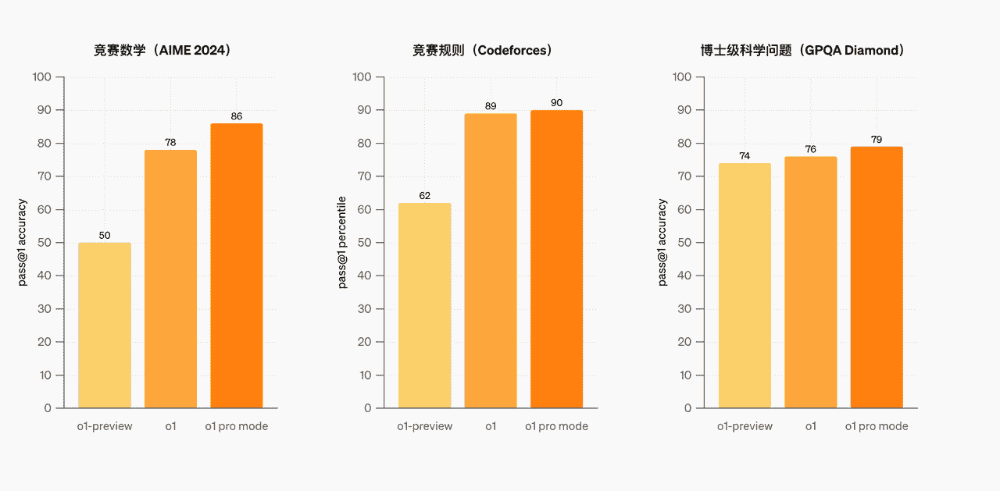
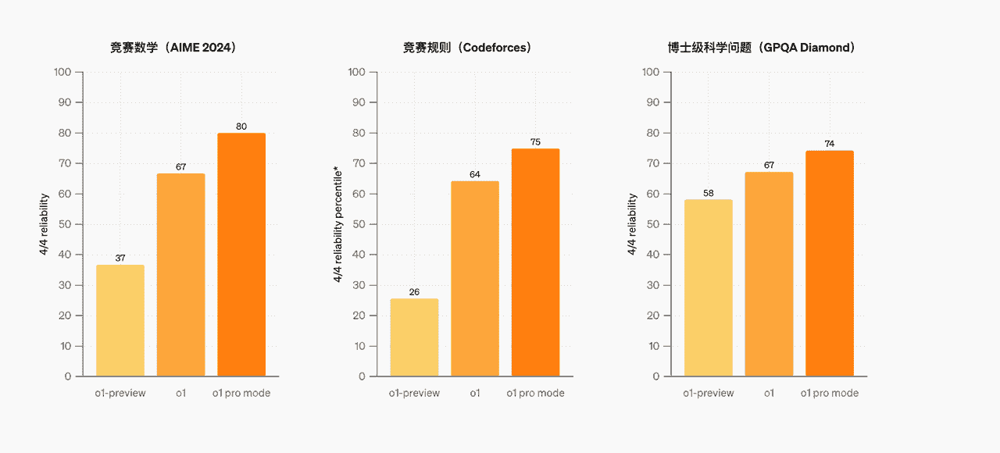
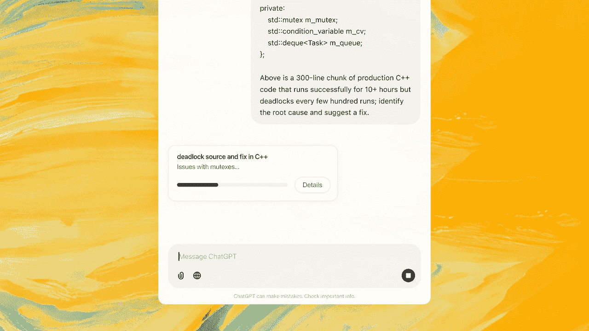

# ChatGPT Pro发布

> 来源：[https://feicaiclub.feishu.cn/docx/VkIidWL2Pou1OWxBvhtcFCMXnPW](https://feicaiclub.feishu.cn/docx/VkIidWL2Pou1OWxBvhtcFCMXnPW)

2024年12月6号 by OpenAI

# ChatGPT Pro 简介

随着人工智能不断进步，它将能够解决日益复杂和关键的问题。同时，驱动这些能力所需的计算资源也会大幅增加。

今天，OpenAI 推出了 ChatGPT Pro，这是一款月费 200 美元的套餐，可在大规模使用场景中充分利用 OpenAI 最先进的模型和工具。该套餐包括对 OpenAI 最智能的模型——OpenAI o1，以及 o1-mini、GPT-4o 和高级语音功能的无限访问权限。套餐中还包含 o1 的专业模式（o1 pro mode），这一模式将投入更多的计算资源，使其能更深入地思考，并为最棘手的问题提供更优质的答案。未来，OpenAI 计划在该套餐中加入更多强大而高计算消耗的生产力功能。

ChatGPT Pro 为需要研究级智能处理的研究人员、工程师以及相关专业人士提供了高效途径，使他们能够更快提升工作效率，并始终走在人工智能技术前沿。

# 为更棘手的问题提供更强大的思考能力

ChatGPT Pro 可提供访问 OpenAI 最智能模型的特殊版本，此版本可进行更长时间的推理，以确保回答更为可靠。在外部专家测试者的评估中，o1 专业模式在数据科学、编程以及案例法律分析等领域中，能给出更准确且更具综合性的回答。

与 o1 和 o1-preview 相比，o1 专业模式在数学、科学和编码等高难度的机器学习基准测试中表现得更为出色。

为突出 o1 专业模式的核心优势（更高可靠性），OpenAI 采用了更严格的评估方式：只有在四次尝试中均回答正确（即“4/4 可靠性”）时，才能视为成功解决问题，而非只需一次答对即可。

Pro 用户可通过在模型选择器中选定 o1 专业模式并直接提出问题来使用此功能。由于回答生成将花费更长时间，ChatGPT 将显示进度条，并在用户切换至其他对话时于应用内发送通知。

# ChatGPT Pro 奖助计划

为推动有益于人类的研究领域取得实质性进展，OpenAI 正在向美国领先研究机构的医学研究人员颁发 10 项 ChatGPT Pro 赠助，并计划未来将此赠助计划扩展到其他地区和研究领域。最初的 10 项赠助将授予包括以下研究人员在内的学者：

+   Catherine Brownstein (MPH, PhD)，波士顿儿童医院和哈佛医学院助理教授，专注于罕见和孤儿疾病相关的新基因发现

+   Justin Reese (PhD)，伯克利实验室的计算机研究科学家，利用复杂的生物医学数据提取新知识，以应对人类疾病

+   Rhoda Au (PhD)，波士顿大学 Chobanian & Avedisian 医学院解剖与神经生物学教授，研究老化与痴呆症

+   Derya Unutmaz (MD)，杰克逊基因组医学实验室教授，研究老化和癌症免疫疗法