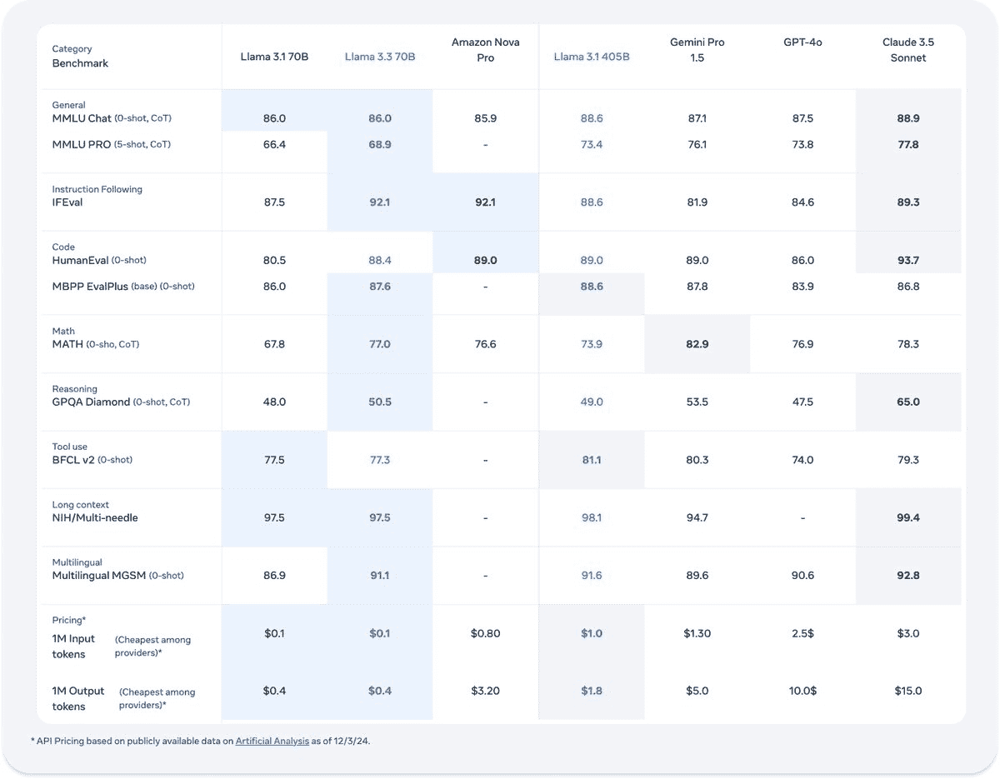

# Llama 3.3：将强大模型从庞大体量精简至更小规模

> 来源：[https://feicaiclub.feishu.cn/docx/K4g9d8j6UokdWFxVywqcoESan6d](https://feicaiclub.feishu.cn/docx/K4g9d8j6UokdWFxVywqcoESan6d)

2024年12月7号 by venturebeat

# Meta发布开源Llama 3.3，将强大模型从庞大体量精简至更小规模

Llama 3.3在核心性能上有显著提升，同时成本更低，使整个开源社区能够更轻松地使用这一技术。

拥有700亿参数（即控制模型行为的设定项）的Llama 3.3，其表现可与今年夏季推出的Llama 3.1中的4050亿参数模型相媲美，但成本和计算开销显著降低，例如运行推理所需的GPU容量得以大幅缩减。

该模型旨在以更小的规模提供高端性能和高可用性，相较此前的基础模型而言体量更为紧凑。

Meta通过Llama 3.3社区许可协议（Llama 3.3 Community License Agreement）对外提供该模型。此协议为模型及其输出的使用、复制、分发和修改提供非独占、免版税的许可。开发者在将Llama 3.3整合进产品或服务时，需进行适当署名（例如使用“Built with Llama”字样），并遵守可接受使用政策（AUP），禁止生成有害内容、违法行为或助长网络攻击等行为。尽管该许可在大多数情况下是免费的，但对于月活用户超过7亿的组织，需要直接从Meta获取商业许可。

Meta的AI团队在声明中强调了这一愿景：“Llama 3.3以极低的推理成本提供领先的性能和质量，适用于各种文本类应用场景。”

# 究竟能省多少成本？一些简单的估算：

根据Substratus博客（一个开源跨云平台解决方案的博客），Llama 3.1-405B需要243 GB至1944 GB的GPU内存。而较早的Llama 2-70B则需要42 GB至168 GB的GPU内存，同样有报告称最低可降至4 GB，或如Exo Labs所示，可在搭载M4芯片且无独立GPU的少数Mac电脑上运行。

如果较低参数量的模型在GPU资源占用方面的节省效应仍然适用，那么部署Meta最强大的开源Llama模型时，有望减少近1940 GB的GPU内存消耗，或在标准的80 GB英伟达H100 GPU上将GPU负载降低约24倍。

以每块H100 GPU约2.5万美元计，这可能意味着高达60万美元的前期GPU采购成本节省，更不用提后续电力成本的持续降低。

# **在小巧体积中保持高性能**

根据Meta AI在X（原Twitter）上的信息，Llama 3.3在多项基准测试中（包括多语对话、推理以及其他高级自然语言处理任务）均超越同等规模的Llama 3.1-70B和亚马逊刚推出的Nova Pro模型（但在HumanEval编程任务中Nova略胜一筹）。

据Meta在其网站发布的“模型卡”信息显示，Llama 3.3以15万亿来自“公开可用”数据的标记（token）进行预训练，并在2500万条合成生成示例上进行了精调。

在H100-80GB硬件上投入了3930万GPU小时的训练时间，这也体现了Meta对于能源效率和可持续性的关注。

在多语言推理测试中，Llama 3.3在MGSM测试中达成91.1%的准确率，可有效支持德语、法语、意大利语、印地语、葡萄牙语、西班牙语、泰语以及英语等多种语言。

# **经济实惠且绿色环保**

Llama 3.3专为高性价比的推理过程而优化，其单词生成成本低至每百万标记0.01美元左右。

这使得Llama 3.3在价格竞争力方面相较GPT-4和Claude 3.5更具优势，为开发者部署高级AI解决方案提供更经济、可持续的选择。

# Meta还强调了此次发布的环境责任

尽管训练过程密集，Meta公司通过利用可再生能源抵消温室气体排放，实现了训练阶段的净零排放。基于位置的排放总计为11,390吨二氧化碳当量，但Meta的可再生能源举措确保了整体的可持续性。

# **先进功能和部署选项**

该模型引入了多项增强功能，包括128k标记的更长上下文窗口（相当于GPT-4o，大约400页书籍的文本），使其适合生成长篇内容和其他高级用例。

其架构采用了分组查询注意力（Grouped Query Attention，GQA），在推理过程中提高了可扩展性和性能。

为了符合用户对安全性和有用性的偏好，Llama 3.3使用了带有人类反馈的强化学习（Reinforcement Learning with Human Feedback，RLHF）和监督微调（Supervised Fine-Tuning，SFT）。这种对齐确保了对不当提示的强有力拒绝，并优化了助理般的行为，适用于现实世界的应用场景。

Llama 3.3已经可以通过Meta、Hugging Face、GitHub等平台下载，并为研究人员和开发者提供了集成选项。Meta还提供了如Llama Guard 3和Prompt Guard等资源，帮助用户安全且负责任地部署该模型。