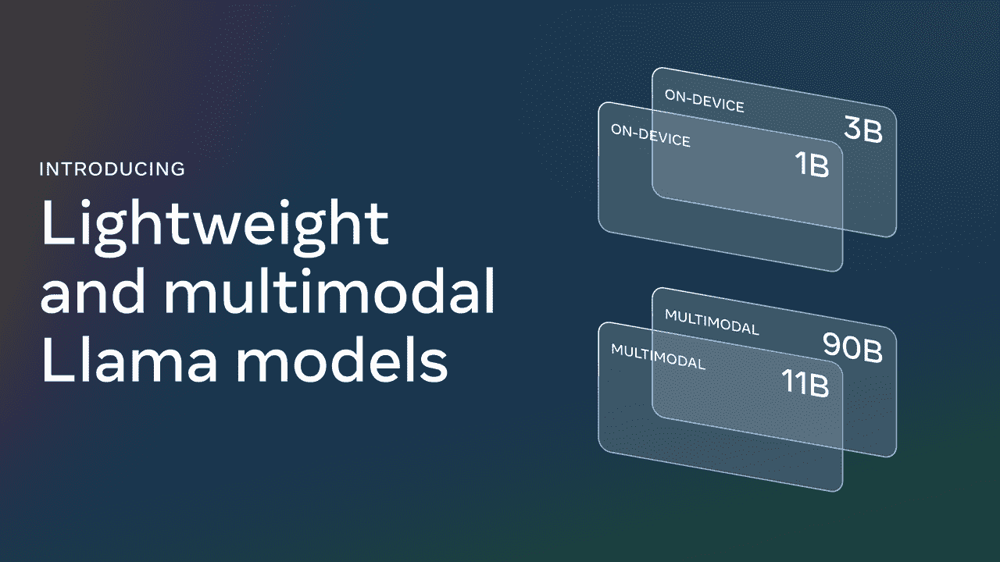
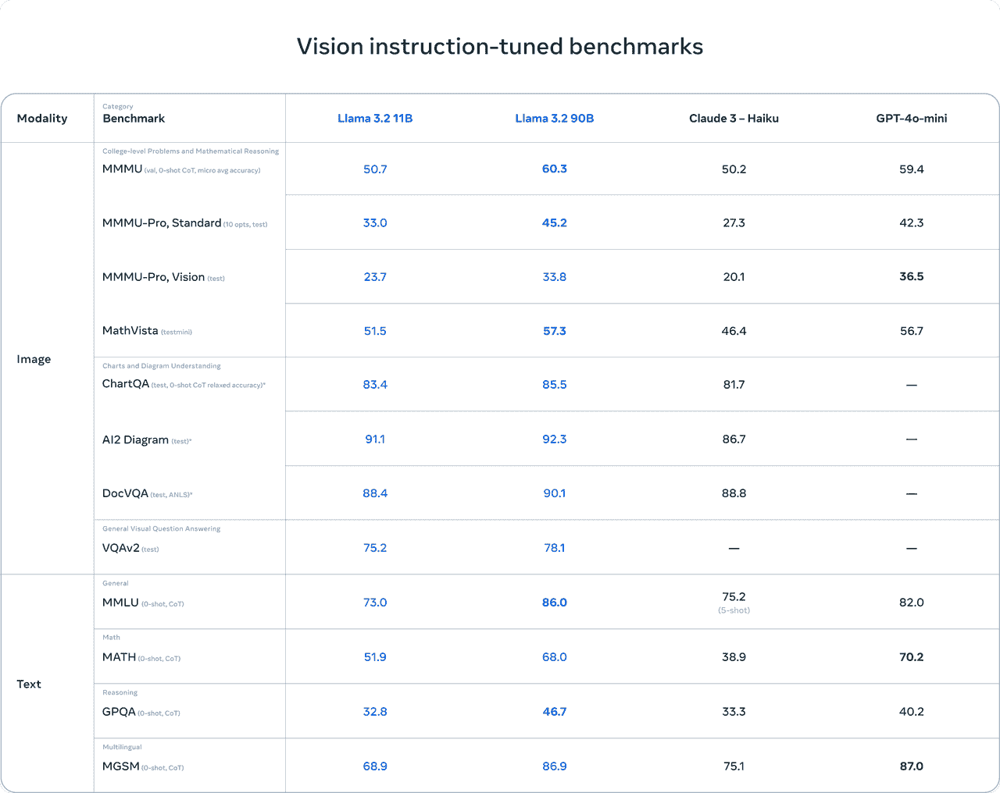
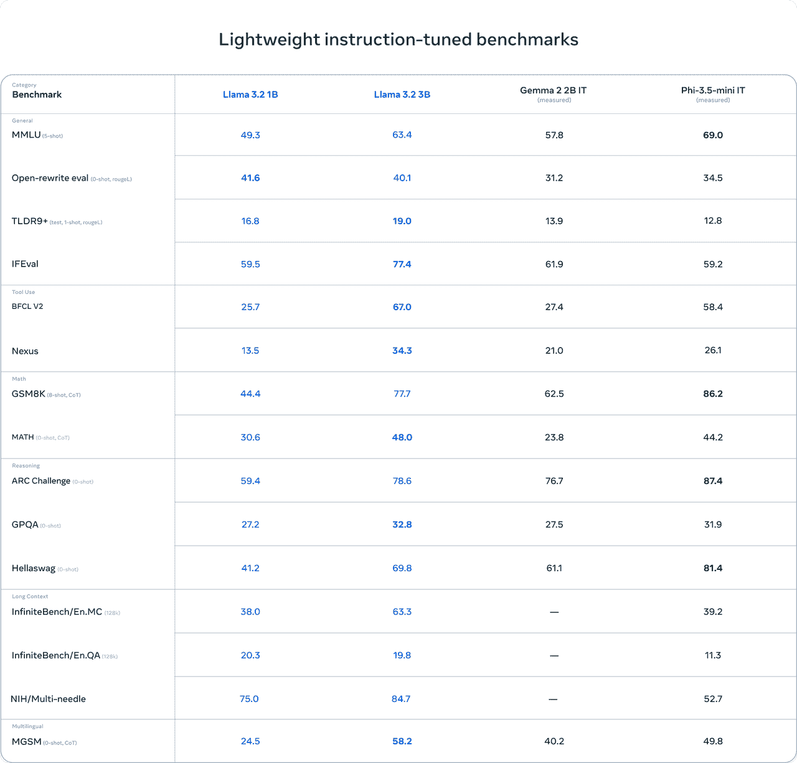
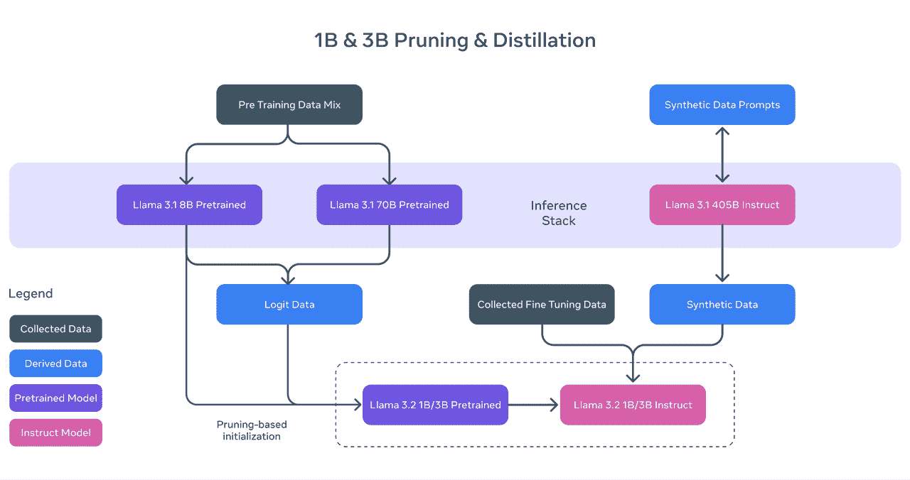
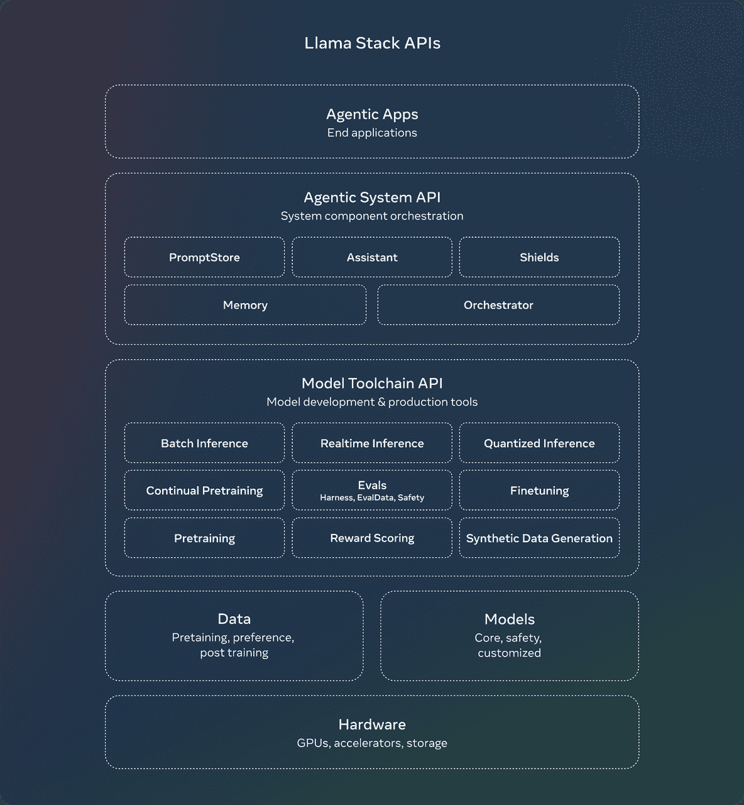
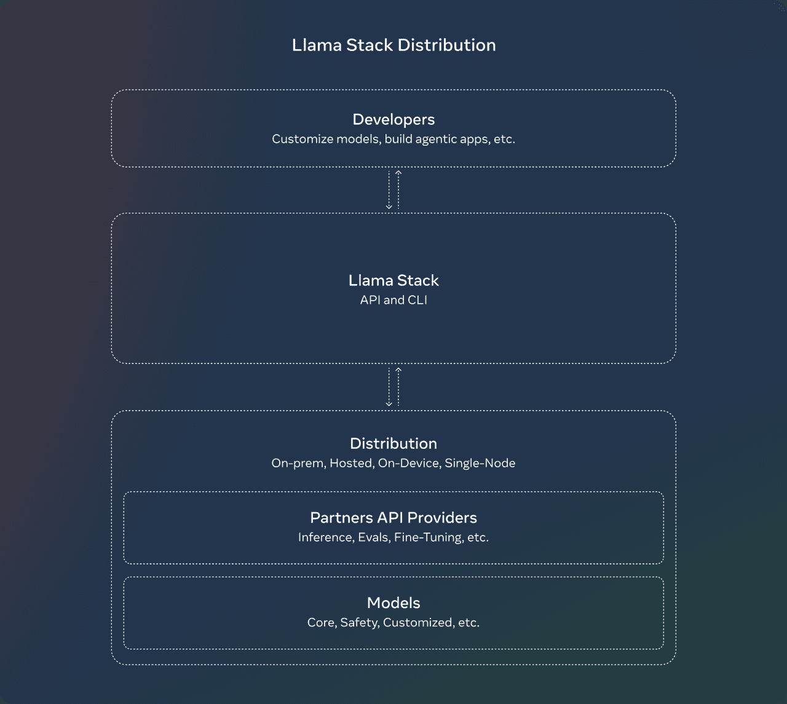

# Llama 3.2：通过开放、可定制的模型革新 AI 和视觉领域

> 来源：[https://feicaiclub.feishu.cn/docx/XX5pdflZWoGs3Ixrnoac2kEonhh](https://feicaiclub.feishu.cn/docx/XX5pdflZWoGs3Ixrnoac2kEonhh)

# 要点：

今天 2024年9月26日，我们发布了 Llama 3.2，包含小型和中型视觉大语言模型（11B 和 90B），以及轻量级的纯文本模型（1B 和 3B），这些模型可以适配边缘和移动设备，包括预训练和指令调优版本。 Llama 3.2 的 1B 和 3B 模型支持长达 128K 令牌的上下文长度，在设备端用例（如摘要生成、指令跟随和重写任务）中表现出色，可本地运行。这些模型在发布当天就支持 Qualcomm 和 MediaTek 硬件，并针对 Arm 处理器进行了优化。 Llama 3.2 的 11B 和 90B 视觉模型由广泛的生态系统支持，可直接替换对应的文本模型，且在图像理解任务上超过了某些封闭模型，如 Claude 3 Haiku。与其他开源多模态模型不同，Llama 3.2 提供了预训练和对齐后的模型，可通过 torchtune 进行定制调优，并通过 torchchat 本地部署。用户还可以通过我们的智能助手 Meta AI 试用这些模型。 我们首次发布了官方的 Llama Stack 分发版，极大地简化了开发者在不同环境下使用 Llama 模型的流程，包括单节点、本地部署、云端和设备端，支持检索增强生成（RAG）和集成安全功能的工具应用。 我们与 AWS、Databricks、戴尔科技、Fireworks、Infosys 和 Together AI 等合作伙伴密切合作，为其企业客户构建 Llama Stack 分发版。设备端分发通过 PyTorch ExecuTorch，单节点分发通过 Ollama。 我们继续公开分享我们的研究成果，因为我们相信开放可以推动创新，对开发者、Meta 以及整个世界都有好处。Llama 已经在开放性、可修改性和成本效率方面领先，为更多人利用生成式 AI 实现创造性、有用且改变生活的突破提供了机会。 我们将在 llama.com 和 Hugging Face 上提供 Llama 3.2 模型下载，并立即在我们的广泛合作伙伴平台生态系统上进行开发，合作伙伴包括 AMD、AWS、Databricks、戴尔、Google Cloud、Groq、IBM、Intel、Microsoft Azure、NVIDIA、Oracle Cloud、Snowflake 等。

自从我们两个月前宣布 Llama 3.1 模型群以来，这些模型，尤其是首个开源的前沿级别 AI 模型 405B，已经产生了显著影响。尽管这些模型非常强大，我们也意识到使用它们需要大量的计算资源和专业知识。同时，我们也听到了那些没有这些资源的开发者的需求，他们希望也能使用 Llama 进行开发。正如 Meta 创始人兼 CEO 马克·扎克伯格今天在 Connect 大会上分享的那样，他们不再需要等待了。今天，我们发布了 Llama 3.2，其中包含小型和中型视觉大语言模型（11B 和 90B），以及轻量级的纯文本模型（1B 和 3B），可适配边缘和移动设备。

距离我们首次宣布 Llama 仅仅一年半的时间，我们已经取得了惊人的进展。今年，Llama 实现了 10 倍的增长，成为负责任创新的标准。Llama 继续在开放性、可修改性和成本效率方面领先，并与封闭模型竞争，甚至在某些领域处于领先地位。我们相信开放推动创新，是未来的正确方向，因此我们继续分享我们的研究成果，并与合作伙伴和开发者社区合作。

我们将在 llama.com 和 Hugging Face 上提供 Llama 3.2 模型下载，并立即在我们的广泛合作伙伴平台上进行开发。合作伙伴是这项工作的关键部分，我们已与超过 25 家公司合作，包括 AMD、AWS、Databricks、戴尔、Google Cloud、Groq、IBM、Intel、Microsoft Azure、NVIDIA、Oracle Cloud 和 Snowflake 等，以确保在发布当天提供服务。为了支持 Llama 3.2 的发布，我们还与设备端合作伙伴 Arm、MediaTek 和 Qualcomm 合作，提供广泛的服务。今天起，我们也向社区开放了 Llama Stack。有关最新发布的更多详细信息，包括多模态功能在欧洲的可用性，请查阅我们的可接受使用政策。

# Llama 3.2 介绍

Llama 3.2 系列中的两个最大模型——11B 和 90B，支持图像推理场景应用，比如文档级理解（包括图表和图形）、图像说明生成，以及视觉定位任务，例如根据自然语言描述在图像中精确定位对象。例如，用户可以询问关于过去一年中其小型企业哪个月销售业绩最好的问题，Llama 3.2 可以基于提供的图表进行推理，并迅速给出答案。在另一个例子中，该模型可以通过地图进行推理，帮助解答问题，比如徒步何时会变得更陡，或地图上标记的小径有多远。11B 和 90B 模型还能够跨越视觉与语言的鸿沟，从图像中提取细节，理解场景，并生成一两句话的说明，以帮助为图像生成描述性文字。

轻量级的 1B 和 3B 模型则在多语言文本生成和工具调用能力方面表现出色。这些模型使开发者能够构建具有强隐私性的个性化设备端应用，确保数据不会离开设备。例如，此类应用可以帮助总结最近收到的 10 条消息，提取关键任务，并利用工具调用直接发送日历邀请安排后续会议。

在本地运行这些模型有两个主要优势。首先，由于处理是在本地完成的，提示和响应可以感觉几乎是瞬时的。其次，本地运行模型可保持隐私，不会将诸如消息和日历信息等数据发送到云端，从而使应用整体更加私密。由于处理是在本地进行的，应用程序可以明确控制哪些查询留在设备上处理，哪些查询可能需要在云端由更大模型处理。

# 模型评估

我们的评估表明，Llama 3.2 的视觉模型在图像识别和一系列视觉理解任务上，与领先的基础模型 Claude 3 Haiku 和 GPT4o-mini 竞争力相当。3B 模型在指令跟随、摘要生成、提示重写和工具使用等任务上，表现优于 Gemma 2 的 2.6B 模型和 Phi 3.5-mini 模型，而 1B 模型在与 Gemma 模型的比较中表现出色。

我们在超过 150 个涵盖多语言的基准数据集上对模型性能进行了评估。对于视觉大语言模型，我们评估了其在图像理解和视觉推理基准上的表现。

# 视觉模型

作为首批支持视觉任务的 Llama 模型，11B 和 90B 模型采用了全新的模型架构，以支持图像推理任务。

为了实现对图像输入的支持，我们训练了一组适配器权重，将预训练的图像编码器与预训练的语言模型集成起来。适配器由一系列交叉注意力层组成，这些层将图像编码器的表示传递给语言模型。我们在文本-图像对上训练了这些适配器，以对齐图像表示与语言表示。在适配器训练期间，我们更新了图像编码器的参数，但故意没有更新语言模型的参数。通过这种方式，我们保留了所有纯文本功能，使开发者可以无缝替换 Llama 3.1 模型。

我们的训练流程分为多个阶段，首先从预训练的 Llama 3.1 纯文本模型开始。然后，我们加入图像适配器和编码器，基于大规模噪声图像-文本对数据进行预训练。接着，我们在中等规模的高质量领域内和知识增强的图像-文本对数据上进行进一步训练。

在后期训练中，我们采用了类似于文本模型的配方，通过多轮对齐、监督微调、拒绝采样和直接偏好优化来完成。此外，我们还利用合成数据生成，使用 Llama 3.1 模型过滤和增强问题和答案，结合领域内的图像，使用奖励模型对所有候选答案进行排名，以提供高质量的微调数据。我们还添加了安全缓解数据，以确保模型在提供高安全性的同时，仍能保持其有用性。

最终结果是一组能够接受图像和文本提示的模型，并能够深入理解和推理它们的组合。这是 Llama 模型迈向更丰富自主能力的又一步。

# 轻量级模型

正如我们在 Llama 3.1 中讨论过的，强大的教师模型可以被用来创建性能更好的小型模型。我们在 1B 和 3B 模型上采用了两种方法——剪枝和知识蒸馏，使它们成为首批高效适用于设备端的轻量级 Llama 模型。

通过剪枝，我们能够缩小现有 Llama 模型的规模，同时尽可能恢复其知识和性能。对于 1B 和 3B 模型，我们采用了一次性结构化剪枝的方法，从 Llama 3.1 的 8B 模型中进行裁剪。这涉及系统性地移除网络中的部分结构，并调整权重和梯度的大小，以创建一个更小、更高效的模型，同时保留原始网络的性能。

知识蒸馏则利用一个较大的网络将知识传递给较小的网络，目的是让较小的模型通过教师模型获得比从头训练更好的性能。在 Llama 3.2 中的 1B 和 3B 模型开发过程中，我们在预训练阶段将 Llama 3.1 的 8B 和 70B 模型的输出（logits）引入，作为令牌级别的目标来指导训练。剪枝后，我们还使用了知识蒸馏来恢复模型的性能。、

在后期训练中，我们采用了与 Llama 3.1 类似的方法，通过多轮对齐操作在预训练模型的基础上生成最终的聊天模型。每一轮包括监督微调（SFT）、拒绝采样（RS）和直接偏好优化（DPO）。

在后期训练中，我们将上下文长度支持扩展到 128K 令牌，同时保持与预训练模型相同的质量标准。我们还进行了合成数据生成，经过仔细的数据处理和筛选，以确保数据的高质量。我们精心混合数据，以在摘要生成、重写、指令跟随、语言推理和工具使用等多种能力上实现高质量优化。

为了让社区能够基于这些模型进行创新，我们与全球两大移动芯片系统公司 Qualcomm 和 MediaTek 以及为 99% 移动设备提供基础计算平台的 Arm 密切合作。今天发布的模型权重基于 BFloat16 数值格式。我们的团队也在积极探索量化版本的模型，它们将运行得更快，我们希望能很快分享更多相关信息。

# Llama Stack 分发版

在今年7月，我们发布了关于 Llama Stack API 的意见征询稿，这是一个标准化接口，针对核心工具链组件（如微调、合成数据生成），旨在定制 Llama 模型并构建自主应用。该征询稿得到了广泛的积极响应。

自那时起，我们一直在努力将这一 API 变为现实。我们构建了 API 的参考实现，支持推理、工具使用和检索增强生成（RAG）。此外，我们还与合作伙伴合作，帮助他们适配并成为这些 API 的服务提供者。最终，我们推出了 Llama Stack Distribution（Llama Stack 分发版），这是一种将多个协同工作的 API 提供商打包在一起的方式，提供给开发者一个统一的端点。

我们现在向社区分享这一简化且一致的体验，帮助他们能够在多种环境中使用 Llama 模型，包括本地部署、云端、单节点和设备端。

完整发布内容包括：

+   Llama CLI（命令行界面）：用于构建、配置和运行 Llama Stack 分发版。

+   多种语言的客户端代码，包括 **Python**、**Node**、**Kotlin** 和 **Swift**。

+   适用于 Llama Stack Distribution Server 和 Agents API Provider 的 **Docker 容器**。

+   多种分发方式：

+   单节点 Llama Stack 分发版：通过 Meta 内部实现和 Ollama 提供。

+   云端 Llama Stack 分发版：通过 AWS、Databricks、Fireworks 和 Together 提供。

+   设备端 Llama Stack 分发版：在 iOS 上通过 PyTorch ExecuTorch 实现。

+   本地部署的 Llama Stack 分发版：由戴尔（Dell）提供支持。

我们期待与开发者和合作伙伴合作，简化基于 Llama 模型的所有构建过程，并欢迎反馈意见。

# 系统级安全

采取开放的方式有很多好处。这有助于确保世界上更多人能够获得人工智能带来的机会，防止权力集中在少数人手中，并能在社会中更公平、更安全地部署技术。随着我们不断创新，我们也希望确保开发者能够构建安全和负责任的系统。

在我们之前的发布基础上，继续支持负责任的创新，今天我们为我们的安全防护措施家族添加了新的更新：

1.  我们发布了 Llama Guard 3 11B Vision，它专为支持 Llama 3.2 的新图像理解能力设计，能够过滤图像+文本输入提示或这些提示的文本输出响应。

1.  由于我们发布了 1B 和 3B Llama 模型，旨在用**于更多受限的环境（如设**备端），我们还对 Llama Guard 进行了优化，大幅降低了其部署成本。Llama Guard 3 1B 基于 Llama 3.2 1B 模型，经过剪枝和量化处理，体积从 2,858 MB 缩小到 438 MB，使其比以往更高效且易于部署。

这些新解决方案已集成到我们的参考实现、演示和应用程序中，并从发布第一天起就可供开源社区使用。

> 原文链接：https://ai.meta.com/blog/llama-3-2-connect-2024-vision-edge-mobile-devices/