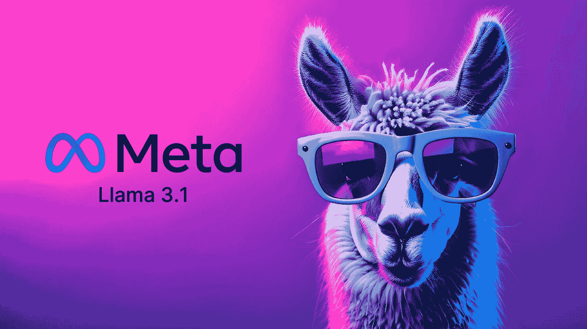
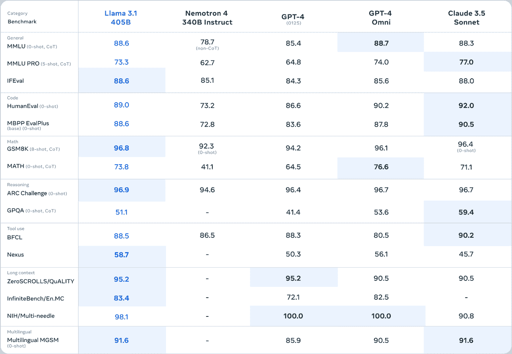
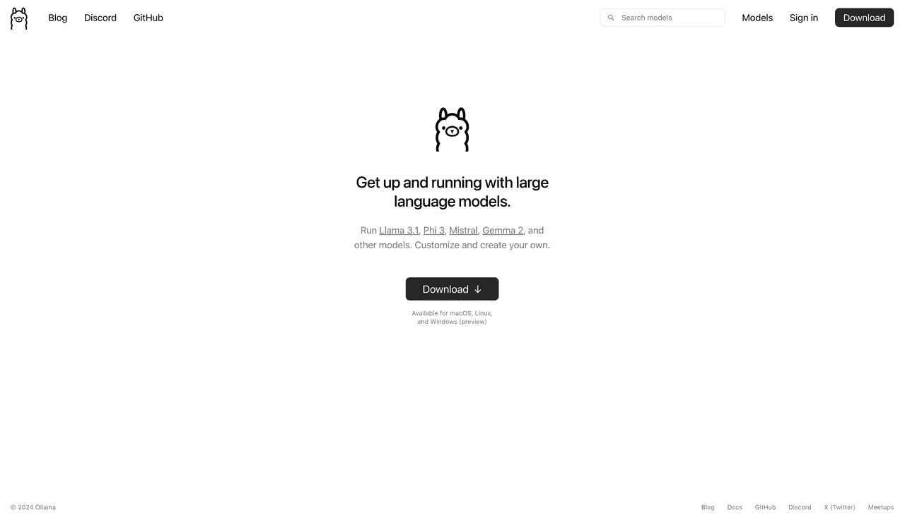
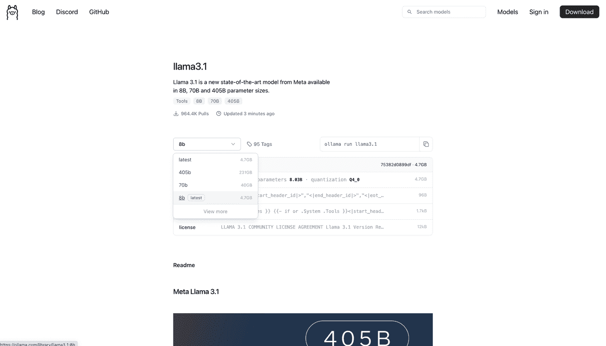
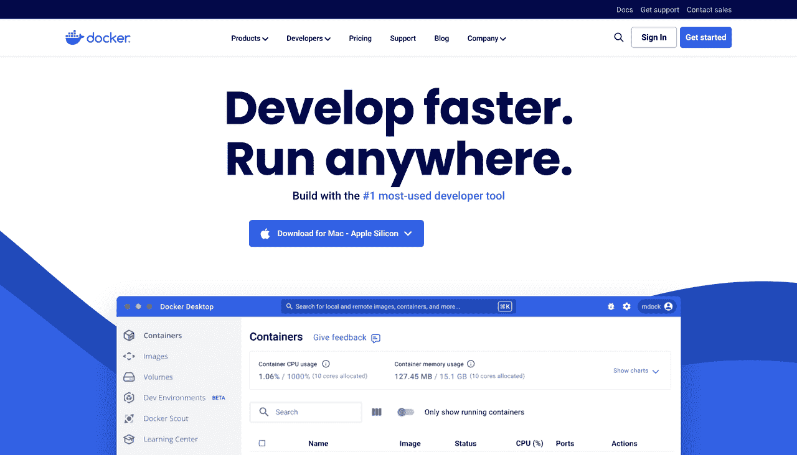
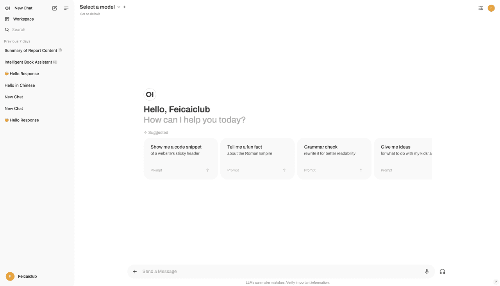
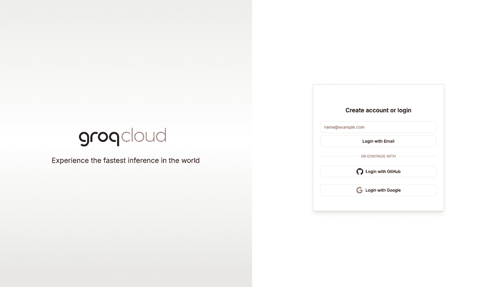
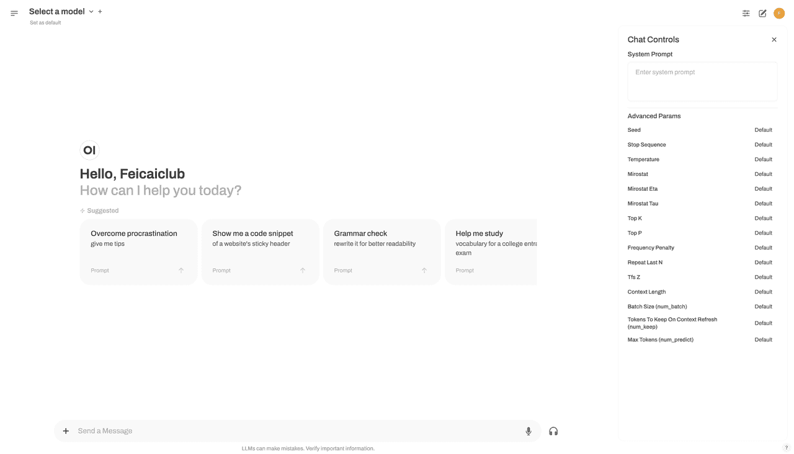

# 本地部署开源大模型Llama 3.1教程

> 来源：[https://feicaiclub.feishu.cn/docx/ZwDtdX0EsoHHu0xl0CTcHIOAnbc](https://feicaiclub.feishu.cn/docx/ZwDtdX0EsoHHu0xl0CTcHIOAnbc)

> **作者：废才**

# Llama 3.1使用教程：从安装到应用

> 注意：本文是视频教程的文字版。如果您更喜欢观看视频教程，请访问[ https://b23.tv/bHWya5W]。视频中包含了更直观的操作演示和详细解说。

# Llama 3.1简介

Llama 3.1是由Meta（Facebook）最新发布的开源AI模型系列，包括8B、70B和405B三个版本。这里的B代表十亿，意味着最大的模型拥有405十亿个参数。参数数量通常与模型的"智能"程度成正比，但关键在于这些参数的使用效率。

## 性能对比

## Llama 3.1在多项测试中表现出色：

+   通用知识测试（MMLU）：88.6分，与GPT-4 Omni（88.7分）和Claude 3.5 Sonnet（88.3分）旗鼓相当。

+   代码能力（HumanEval）：89.0分，略低于GPT-4 Omni和Claude 3.5 Sonnet。

+   数学能力（MATH）：73.8分，超过GPT-4（64.5分）和Claude 3.5 Sonnet（71.1分）。

## Llama 3.1的优势

1.  完全开源：用户可以自由研究、修改和开发基于Llama 3.1的应用。

1.  实际应用表现：

+   与GPT-4相比：23.3%情况下表现更好，52.2%情况下不相上下。

+   与Claude 3.5 Sonnet相比：24.9%情况下表现更好，50.8%情况下不相上下。

# 本地部署Llama 3.1（8B版本）

## 步骤1：安装Ollama

1.  访问Ollama官网 https://ollama.com/

1.  根据你的操作系统选择Windows或Mac版本。

1.  下载并安装Ollama。

## 步骤2：安装Llama 3.1（8B版本）

1.  在Ollama的Model专区找到Llama 3.1，选择8B版本（4.7GB）https://ollama.com/library/llama3.1

1.  复制安装指令。

1.  打开终端（Mac用户可使用Command+空格，输入Terminal）。

1.  将复制的指令粘贴到终端中，按回车执行。

1.  等待模型安装完成。

安装完成后，你可以在终端中与Llama 3.1 8B进行对话。

# 使用图形界面（Open WebUI）

## 步骤1：安装Docker

1.  访问Docker官网 www.docker.com

1.  下载并安装Docker（需要注册账号）。

## 步骤2：安装Open WebUI

1.  访问Open WebUI的Github项目页面 https://github.com/open-webui/open-webui

1.  找到安装说明，复制第一条安装指令。

1.  打开新的终端窗口，粘贴指令并执行。

1.  等待安装完成（可能需要几分钟，取决于网速）。

## 步骤3：使用Open WebUI

1.  在浏览器中输入 http://localhost:3000/ 。

1.  按提示注册账号并登录。

1.  在左上角选择Llama 3.1 8B模型。

1.  开始对话。

# 使用Groq云服务（70B版本）

## 步骤1：注册Groq账号

1.  访问GroqCloud官网并注册账号 https://console.groq.com/login

1.  登录后，在"API Keys"中创建新的API密钥。

1.  复制并安全保存API密钥。

## 步骤2：在Open WebUI中设置Groq

1.  在Open WebUI中，点击左下角头像，选择"Admin Panel"。

1.  进入"Settings"页面，选择"Connections"。

1.  在OpenAI API设置中：

+   将API域名改为：https://api.groq.com/openai/v1

+   在API Key中粘贴Groq API密钥。

1.  保存设置。

## 步骤3：使用Llama 3.1 70B版本

1.  返回Open WebUI主界面。

1.  在左上角模型选择菜单中选择Llama 3.1 70B。

1.  开始对话。

## 小技巧

在Open WebUI的右上角"Controls"按钮中，你可以调整模型的各种参数，如"Temperature"，以控制AI回答的创意性或精确性。

# 结语

Llama 3.1作为一个强大的开源AI模型，为用户提供了无限可能。无论是提高工作效率还是深入研究AI技术，Llama 3.1都是一个值得尝试的选择。希望这篇教程能帮助你充分利用Llama 3.1的潜力。

如果你想要更直观地了解安装和使用过程，欢迎观看我们的视频教程：[ https://b23.tv/bHWya5W]。视频中包含了更多细节和实际操作演示，可以帮助你更好地掌握Llama 3.1的使用方法。