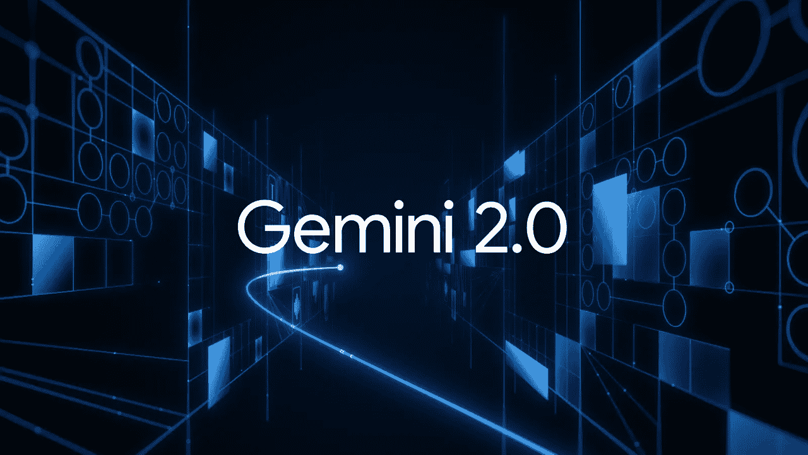
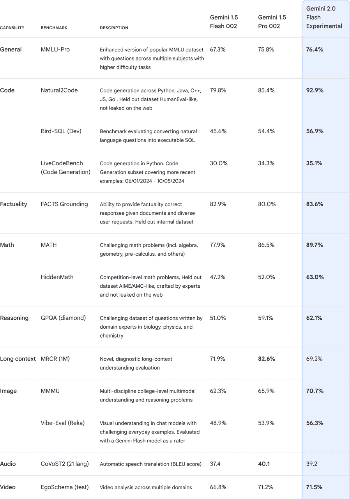

# Genimi 2.0：面向代理时代的全新AI模型

> 来源：[https://feicaiclub.feishu.cn/docx/DVs1d30CoooA4QxP8R1cJZQqnMe](https://feicaiclub.feishu.cn/docx/DVs1d30CoooA4QxP8R1cJZQqnMe)

2024年12月12日 By Google

# 来自谷歌和Alphabet首席执行官桑达尔·皮查伊的致辞：

信息是人类进步的核心。这也是为什么在过去的26年里，我们始终致力于我们的使命——组织全球信息，使其变得触手可及并发挥作用。正因如此，我们不断突破人工智能的边界，通过多种输入形式组织信息，并通过多样化的输出形式提供信息，使其真正对您有用。

去年12月，我们发布了Gemini 1.0，这正是这一愿景的体现。作为首个原生多模态模型，Gemini 1.0和1.5在多模态功能和长上下文理解方面取得了巨大进步，可以跨越文本、视频、图像、音频和代码理解信息，并处理更多内容。

如今，数百万开发者正在使用Gemini构建应用程序。它不仅帮助我们重新构想所有的产品，包括我们覆盖20亿用户的7大核心产品，还让我们能够开发全新产品。例如，NotebookLM就是多模态功能和长上下文能力的典范，并因此备受用户喜爱。

过去一年，我们一直致力于开发更具代理能力的模型，这类模型可以更好地理解您周围的世界，提前多步进行思考，并在您的监督下代表您采取行动。

今天，我们很高兴宣布这一新代理时代的下一个阶段：推出Gemini 2.0，这是我们迄今为止功能最强大的模型。它在多模态领域实现了新的突破——如原生支持图像和音频输出，并具备原生工具使用能力。这将帮助我们开发新的人工智能代理，更接近我们“通用助手”的愿景。

今天起，开发者和值得信赖的测试人员将率先接触Gemini 2.0。我们正迅速将其集成到我们的产品中，首批推出的包括Gemini和搜索产品。从今天开始，我们的Gemini 2.0 Flash实验模型将面向所有Gemini用户。此外，我们还推出了一项新功能“深度研究”（Deep Research），该功能利用高级推理和长上下文能力，作为研究助手帮助探索复杂主题并为您编写报告。目前，深度研究功能已在Gemini高级版中上线。

在所有产品中，搜索是受AI变革影响最深的。我们的AI概览功能（AI Overviews）已经惠及10亿用户，让他们能够提出全新的问题类型——迅速成为我们最受欢迎的搜索功能之一。下一步，我们将把Gemini 2.0的高级推理能力引入AI概览，以应对更复杂的话题和多步骤问题，包括高级数学公式、多模态查询和代码编写。本周我们已启动有限测试，并计划明年初广泛推出。未来一年内，我们还将继续把AI概览扩展至更多国家和语言。

Gemini 2.0的进步得益于我们十年来对AI创新的全栈方法的投入。它构建于定制硬件之上，例如第六代TPU——Trillium。TPU为Gemini 2.0的训练和推理提供了100%的算力支持。从今天起，Trillium也将全面开放给客户，供其使用。

如果说Gemini 1.0的使命是组织和理解信息，那么Gemini 2.0的使命则是让信息变得更加实用。我迫不及待想看到这个新时代将带来什么样的可能性。

——桑达尔·皮查伊

---

# 发布Gemini 2.0：面向代理时代的全新AI模型

作者：Demis Hassabis（Google DeepMind首席执行官）和Koray Kavukcuoglu（Google DeepMind首席技术官），代表Gemini团队

在过去的一年中，我们在人工智能领域取得了令人瞩目的进展。今天，我们正式发布Gemini 2.0系列模型中的首款模型：Gemini 2.0 Flash实验版。这款模型是我们技术前沿的核心工具，具有低延迟和增强性能，同时能够大规模运行。

我们还将展示Gemini 2.0原生多模态能力驱动的原型，分享我们在代理研究领域的最新成果。

# Gemini 2.0 Flash

Gemini 2.0 Flash延续了1.5 Flash的成功，后者是迄今为止最受开发者欢迎的模型。新版本在保持快速响应时间的同时进一步提升了性能。值得注意的是，2.0 Flash在关键基准测试中甚至超越了1.5 Pro，同时速度提升了两倍。

此外，2.0 Flash还引入了全新功能。在支持图像、视频和音频等多模态输入的基础上，2.0 Flash现在还支持多模态输出，包括原生生成的图文混合内容，以及可调节的多语言文本转语音（TTS）音频输出。

它还能够原生调用工具，例如Google搜索、代码执行，以及第三方用户定义的功能。

# 我们的目标是安全且快速地将模型带到用户手中

在过去一个月中，我们分享了Gemini 2.0的早期实验版本，并从开发者那里收到了宝贵的反馈。

## Gemini 2.0 Flash现已推出

作为实验模型，Gemini 2.0 Flash现已通过Gemini API在Google AI Studio和Vertex AI中面向开发者提供服务。所有开发者均可使用多模态输入和文本输出功能，而文本转语音（TTS）和原生图像生成功能则目前仅向早期访问合作伙伴开放。该模型将在明年1月迎来全面开放，并提供更多的模型尺寸选项。

为帮助开发者构建动态和交互式应用程序，我们还推出了一个新的多模态实时API（Multimodal Live API）。该API支持实时音频、视频流输入，并可结合使用多种工具。关于2.0 Flash和多模态实时API的更多信息，请参阅我们的开发者博客。

## Gemini 2.0可通过Gemini应用访问

从今天开始，全球Gemini用户可以通过桌面和移动端网页的模型下拉菜单选择使用经过优化的2.0 Flash实验版聊天模型。不久之后，这款新模型也将在Gemini移动应用中上线。通过这个新模型，用户将能够体验更加高效的Gemini助手。

明年年初，我们将把Gemini 2.0扩展到更多Google产品中。

---

# 借助Gemini 2.0解锁代理式体验

Gemini 2.0 Flash提供了原生用户界面操作能力，以及多模态推理、长上下文理解、复杂指令执行和规划、组合式函数调用、原生工具使用和改进的低延迟等功能。这些改进协同作用，为用户带来了一种全新的代理式体验。

人工智能代理的实际应用是一个充满可能性的研究领域。我们正通过一系列原型探索这一新前沿，帮助用户完成任务并实现目标。这些原型包括：

+   **Project Astra**的更新版本——一个研究原型，探索通用AI助手的未来能力；

+   **Project Mariner**——一个全新项目，专注于人机交互的未来，从浏览器体验开始；

+   **Jules**——一款AI驱动的代码代理，专为开发者提供支持。

尽管我们仍处于开发的早期阶段，但我们非常期待看到受信任的测试人员如何使用这些新功能，以及从中可以汲取哪些经验，以便未来将这些能力更广泛地集成到产品中。

---

# Project Astra：在现实世界中运用多模态理解的AI代理

自从我们在I/O大会上推出Project Astra以来，我们一直在从可信测试人员的使用反馈中学习，这些测试人员主要在Android手机上体验该项目。他们的宝贵反馈帮助我们更好地理解一个通用AI助手在实际操作中的工作方式，包括其在安全性和伦理方面的影响。基于Gemini 2.0构建的最新版本带来了以下改进：

+   **更优的对话能力**：
Project Astra现在支持多语言以及混合语言的对话，同时对口音和罕见词汇有更好的理解。

+   **新增工具使用能力**：
借助Gemini 2.0，Project Astra可以使用Google搜索、Google Lens和Google Maps，从而在日常生活中变得更加实用。

+   **更强的记忆功能**：
我们改进了Project Astra的记忆能力，同时确保用户始终掌控其数据。它现在可以拥有最多10分钟的会话内记忆，并能记住您过去与它的更多对话，从而实现更个性化的体验。

+   **改进的延迟**：
借助新的流媒体功能和原生音频理解，Astra的语言理解速度已接近人类对话的延迟水平。

我们正在努力将这些功能扩展到Google的其他产品中，例如Gemini应用程序（我们的AI助手），以及眼镜等其他设备形态。同时，我们也正在扩大可信测试计划的覆盖范围，包括一个即将开始使用原型眼镜测试Project Astra的小型用户群体。

---

# Project Mariner：帮助您完成复杂任务的AI代理

Project Mariner是一个基于Gemini 2.0构建的早期研究原型，探索人机交互的未来，起点是您的浏览器。作为一个研究原型，它能够理解并推理浏览器屏幕上的信息，包括像素和文本、代码、图像及表单等网页元素。然后，它通过一个实验性的Chrome扩展使用这些信息来为您完成任务。

在WebVoyager基准测试中（该测试评估代理在端到端真实网页任务中的性能），Project Mariner取得了83.5%的业界领先成绩，作为单代理设置运行。

虽然仍处于早期阶段，但Project Mariner展示了在浏览器内导航的技术可行性。尽管目前任务完成的速度较慢且准确性有待提升，但这些能力将迅速改进。

为了安全且负责任地开发，我们正在积极研究新型风险及其缓解措施，同时确保人类始终处于决策环节中。例如，Project Mariner只能在浏览器的活动标签页中进行输入、滚动或点击操作，并且在执行某些敏感操作（如购物）前会征求用户的最终确认。

可信测试人员现在已经开始使用实验性的Chrome扩展测试Project Mariner，与此同时，我们也开始与网页生态系统展开讨论。

---

# Jules：面向开发者的AI代理

我们正在探索如何通过Jules帮助开发者，这是一款实验性的AI驱动代码代理，可直接集成到GitHub工作流中。Jules能够在开发者的指导和监督下处理问题、制定计划并加以执行。这一尝试是我们实现长期目标的一部分，即构建能够在包括编程在内的各个领域提供帮助的AI代理。

---

# **游戏及其他领域中的代理**

Google DeepMind在利用游戏帮助AI模型提升规则遵循能力、规划能力和逻辑推理能力方面拥有悠久的历史。例如，就在上周，我们推出了Genie 2，这是一款AI模型，能够通过一张图片生成无尽多样的可玩3D世界。基于这一传统，我们开发了使用Gemini 2.0的代理，能够帮助用户在电子游戏的虚拟世界中导航。这些代理可以仅通过屏幕上的动作推理游戏逻辑，并在实时对话中提供下一步建议。

我们正在与领先的游戏开发公司（如Supercell）合作，探索这些代理的工作方式，并测试它们在不同类型游戏中的规则理解和挑战应对能力，例如战略类游戏《Clash of Clans》和农场模拟游戏《Hay Day》。

除了作为虚拟游戏伴侣，这些代理还可以利用Google搜索，将网络上的海量游戏知识与用户连接起来。

在探索虚拟世界代理能力的同时，我们还尝试通过Gemini 2.0的空间推理能力，将代理应用于机器人领域，以助力物理世界中的任务。虽然仍处于早期阶段，但我们对能够在物理环境中提供帮助的代理的潜力感到兴奋。

---

# **在代理时代负责任地构建**

Gemini 2.0 Flash和我们的研究原型使我们能够在AI研究前沿测试并迭代新功能，这些技术最终将使Google的产品更具帮助性。

在开发这些新技术的过程中，我们意识到自身的责任，以及AI代理在安全和保障方面提出的诸多问题。这也是为什么我们采取探索性和渐进式开发方法的原因，包括对多个原型进行研究、逐步实施安全训练、与可信测试人员和外部专家合作，并进行广泛的风险评估以及安全性和保障性评估。

例如：

+   **安全流程**：我们与责任与安全委员会（RSC）合作，这是一支长期存在的内部审核团队，用以识别和理解潜在风险。

+   **AI辅助红队测试**：Gemini 2.0的推理能力大幅提升了我们AI辅助红队测试的方法，从仅仅检测风险扩展到能够自动生成评估和训练数据以减轻这些风险。这使我们能够更高效地在大规模上优化模型的安全性。

+   **多模态复杂性管理**：随着Gemini 2.0多模态能力的提升，我们将继续对模型的图像和音频输入输出进行评估和训练，以提高安全性。

+   **隐私保护**：在Project Astra中，我们探索了防止用户无意间向代理共享敏感信息的可能缓解措施，并已经内置了隐私控制，方便用户删除会话数据。同时，我们继续研究如何确保AI代理充当可靠的信息来源，并避免在用户不知情的情况下采取意外行动。

+   **恶意提示注入防护**：在Project Mariner中，我们致力于确保模型优先执行用户指令，而不是第三方试图进行提示注入的行为。模型能够识别来自外部来源的潜在恶意指令，并防止被滥用。这可以避免用户因隐藏在邮件、文档或网站中的恶意指令而暴露于欺诈或网络钓鱼风险中。

我们坚信，构建AI的唯一方式是从一开始就负责任。我们将继续将安全和责任作为模型开发过程中的关键要素，推动模型和代理的不断进步。

---

# Gemini 2.0、AI代理及未来

今天的发布标志着Gemini模型迈入了新篇章。通过发布Gemini 2.0 Flash以及一系列探索代理可能性的研究原型，我们在Gemini时代达成了一个激动人心的里程碑。展望未来，我们将继续以安全的方式探索所有新的可能性，为构建通用人工智能（AGI）迈出坚实的步伐。