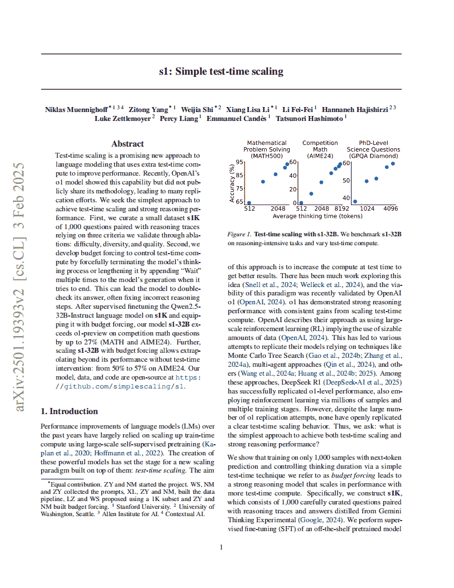

# 李飞飞 | s1: Simpletest-timescaling

> 来源：[https://feicaiclub.feishu.cn/docx/LTdxdtbD1o8A72xWwc8c4RZqnCc](https://feicaiclub.feishu.cn/docx/LTdxdtbD1o8A72xWwc8c4RZqnCc)

[李飞飞 S1推理模型论文.pdf](https://internal-api-drive-stream.feishu.cn/space/api/box/stream/download/all/EsjrbOhQUoTs3wx45a3cSJ0invd)

---

# 一、研究背景与意义

在近年来的语言模型发展中,训练时计算规模的扩大一直是提升模型性能的主要手段。然而,随着OpenAI的o1模型展示了测试时扩展(test-time scaling)的可能性,一个新的研究范式逐渐浮现。测试时扩展指的是通过增加测试阶段的计算来提升模型性能。尽管o1展示了这种能力,但由于其方法未公开,引发了大量的复制尝试。虽然DeepSeek R1等模型成功复制了o1级别的性能,但这些方法都需要数百万样本和多阶段训练,且都未能复现明确的测试时扩展行为。在此背景下,如何用最简单的方法同时实现测试时扩展和强大的推理性能成为一个重要的研究问题。

# 二、方法创新与技术实现

论文提出了两个核心创新。首先是构建了s1K数据集,这是一个包含1000个精心策划的问题及其推理过程的数据集。这些数据基于难度、多样性和质量三个经过验证的标准进行筛选,并从Gemini Thinking Experimental中提取。其次是提出了budget forcing技术,这是一种控制测试时计算的简单而有效的方法。该技术通过两种方式工作:当模型生成的思考tokens超过预设限制时,强制终止思考过程;或者当模型试图过早结束时,通过添加"Wait"标记来延长推理过程。这种方法不仅能让模型重新检查答案,还经常能帮助修正错误的推理步骤。

# 三、实验结果与性能表现

研究团队在Qwen2.5-32B-Instruct模型上使用s1K数据集进行微调,并应用budget forcing技术,得到了s1-32B模型。实验结果令人印象深刻:在竞赛数学问题上,该模型超过了o1-preview高达27%(在MATH和AIME24测试集上)。特别是在AIME24上,通过使用budget forcing进行扩展,模型的性能从50%提升到了57%。更值得注意的是,整个训练过程仅需在16块H100 GPU上运行26分钟就能完成,这显示了该方法极高的效率。

# 四、关键发现与技术细节

在数据效率方面,研究发现仅需1000个精心选择的样本就能达到竞争性能,这验证了数据选择标准的重要性。实验表明,随机选择样本、仅选择最长推理轨迹或仅考虑多样性都会导致性能显著下降,证实了综合考虑难度、多样性和质量三个维度的必要性。在技术实现上,s1K数据集的构建经过了严格的筛选过程,从初始的59K个问题中筛选出最终的1000个高质量样本,这些样本覆盖了从几何到数论等50个不同领域。

# 五、Budget Forcing的实现细节

Budget Forcing技术的实现包含两个主要方面:一是通过在生成的tokens超过限制时强制结束思考来控制最长思考时间;二是通过添加"Wait"标记并抑制结束标记的生成来延长必要的思考时间。这种双向控制机制既保证了计算资源的有效利用,也确保了推理质量的提升。实验结果表明,这种简单而有效的方法在不同任务上都展示了清晰的扩展趋势,证明了其作为测试时扩展技术的可行性。

# 六、数据策略与模型效果

数据集的构建过程展现了研究团队独特的策略眼光。他们首先从16个不同来源收集了59,029个问题,包括NuminaMATH、历史AIME问题以及OlympicArena等多个领域的数据。这种广泛的数据收集确保了初始数据池的多样性。随后,他们通过严格的筛选过程,最终选取了1,000个最具代表性的样本。这个筛选过程不仅考虑了问题的难度和多样性,还特别关注了数据质量,通过复杂的评估机制确保每个选中的样本都具有高质量的推理轨迹。

# 七、测试时扩展的创新机制

论文提出的budget forcing机制展现了显著的创新性。这种机制通过动态调整模型的思考时间,实现了对计算资源的精确控制。当模型倾向于过早结束推理时,系统会通过添加"Wait"标记来强制延长思考过程;而当推理过程过长时,则会适时终止以确保计算效率。这种双向调节机制不仅提高了模型的推理质量,还实现了计算资源的高效利用。研究结果表明,这种机制能够有效地将AIME24测试集上的性能从基准的50%提升到57%,证实了其在实际应用中的有效性。

# 八、实验验证与性能分析

研究团队进行了广泛的实验验证。在标准测试集上,s1-32B模型展现出卓越的性能,尤其是在竞赛数学问题上的表现尤为突出。模型在MATH500、GPQA Diamond和AIME24等具有挑战性的测试集上都取得了显著成果。特别值得注意的是,模型在某些任务上甚至超过了OpenAI的o1-preview模型,这一成就充分证明了简单方法在复杂问题上的潜力。

# 九、效率与可扩展性分析

该研究的一个重要特点是其高效性。整个训练过程仅需26分钟就能在16块H100 GPU上完成,这种高效率使得方法具有很强的实用价值。此外,模型展现出良好的可扩展性,能够通过增加测试时的计算资源来进一步提升性能。这种扩展性不仅体现在性能提升上,还体现在方法对不同类型任务的适应能力上。

# 十、研究局限与未来展望

尽管取得了显著成果,研究仍存在一些局限性。首先,当前的方法在某些特定类型的问题上可能效果不够理想。其次,budget forcing机制虽然有效,但可能还存在优化空间。未来的研究方向可能包括:探索更多样的数据选择策略、改进budget forcing机制的精确度、扩展方法在更广泛任务上的适用性等。

# 十一、研究意义与实践价值

这项研究的意义不仅在于其技术创新,更在于为语言模型性能提升提供了一个简单而有效的新思路。通过证明小规模精选数据集和简单控制机制的有效性,该研究为未来的模型优化提供了重要参考。同时,研究成果的开源特性也为整个领域的发展做出了重要贡献,使得更多研究者能够基于这些发现进行进一步探索。

这篇论文展示了在人工智能研究中,"简单而有效"的原则如何能带来突破性的进展。通过精心设计的数据策略和创新的控制机制,研究团队不仅实现了预期目标,还为未来的研究指明了方向。这种追求简单性的同时又能保持高效性的研究方法,值得整个领域借鉴和思考。