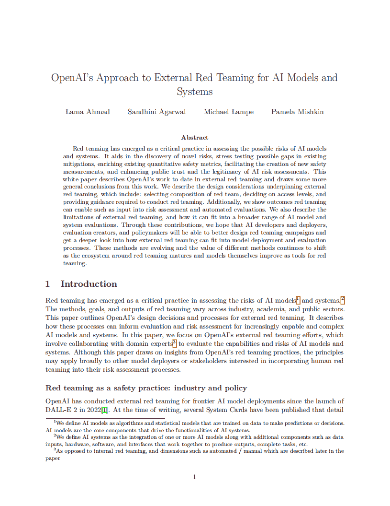

# OpenAI针对AI模型和系统的外部红队测试方法

> 来源：[https://feicaiclub.feishu.cn/docx/I5wCdzr9goEO84xA0j3cXDoYnte](https://feicaiclub.feishu.cn/docx/I5wCdzr9goEO84xA0j3cXDoYnte)

[openais-approach-to-external-red-teaming.pdf](https://internal-api-drive-stream.feishu.cn/space/api/box/stream/download/all/NPxNbs5YQojzcGxzsYrcFGbvniO)

---

2024年11月21日 by OpenAI

OpenAI的外部红队测试:保障AI系统安全的重要实践

随着GPT-4、DALL-E 3等大型AI模型的不断涌现,如何确保这些模型的安全性和可控性成为了一个重要课题。在这种背景下,OpenAI发布了一篇重要论文,详细阐述了他们在外部红队测试方面的方法论和实践经验。这种方法不仅帮助发现了模型中潜在的风险,还为整个AI行业的安全评估提供了有益借鉴。

红队测试在AI安全评估中的重要性早已得到认可。2023年美国发布的行政命令明确将其定义为"一种结构化的测试工作,旨在发现AI系统中的缺陷和漏洞,通常在受控环境中与AI开发者合作进行。"而OpenAI则从2022年DALL-E 2开始,就将外部红队测试作为评估模型安全性的重要手段。在后续GPT-4、GPT-4V、DALL-E 3等重要模型的发布过程中,这种方法都发挥了关键作用。

OpenAI的外部红队测试主要实现了四个目标:第一是发现新的风险,特别是那些由于模型能力提升、新模态引入或行为改变而产生的风险。例如在测试GPT-4o时,红队就发现了模型可能会无意中模仿用户声音的问题。第二是对现有防护措施进行压力测试,找出可能被绕过的漏洞。在DALL-E系统中,红队就识别出了一类可以绕过防止生成色情内容限制的"视觉同义词"。第三是引入领域专家知识来增强风险评估。比如在评估o1模型系列时,科学家们帮助评估了其在生物实验方案制定方面的能力和局限性。第四是提供独立评估,通过引入外部专家来增强评估结果的可信度。

这种方法在评估快速演进的AI模型时特别有价值。当模型出现重大能力提升(如o1系列的推理能力增强)、新的交互方式(如2022年DALL-E的图像修复)或新的工具和行为(如代码执行、函数调用)时,外部人工测试可以帮助识别潜在的风险领域和防护措施的不足之处,特别是在还没有可靠的基准测试或对新系统缺乏足够经验的情况下。

OpenAI在进行红队测试时采用了多种方法。手动测试由人类积极制作提示并与AI模型交互,模拟对抗场景并评估输出。自动化测试则使用AI模型或模板来生成模拟对抗使用的提示或输入。混合方法则是将两者结合使用,例如先通过手动测试创建种子数据集,再通过自动化方式扩展。这些方法各有优势,可以根据具体需求灵活选用。

此外,红队测试还可以分为内部和外部两种。内部红队由公司内部的专门团队进行,而外部红队则由外部利益相关者进行测试。在选择使用哪种方式时,需要考虑时间、专业知识和知识产权敏感性等因素。内部红队在设计外部红队测试活动的早期阶段可能更有用,可以提供有关重点领域和早期观察的基线指导。

然而红队测试也存在一些局限性。首先是资源密集型的特点,无论是操作时间还是财务成本都较高,这对资源有限的组织来说可能难以大规模采用。其次是对参与者和团队成员的潜在伤害,因为他们需要像对手一样思考并接触有害内容,这可能导致生产力下降或心理伤害。再次是信息泄露风险,特别是在测试前沿AI系统时,可能会暴露出一些可能被滥用的漏洞。此外还有早期获利者的问题,即红队成员可能会因为提前接触模型而在研究或商业项目上获得不公平优势。

总的来说,OpenAI的这篇论文为我们展示了一个系统化的AI安全评估框架。虽然外部红队测试并非万能良药,但作为AI风险评估实践的重要组成部分,它与自动化测试、既定安全基准、第三方评估等方法一起,共同构成了一个全面的AI安全保障体系。随着AI技术的不断发展,这些方法也将继续演进,为确保AI系统的安全性和可靠性提供重要支撑。