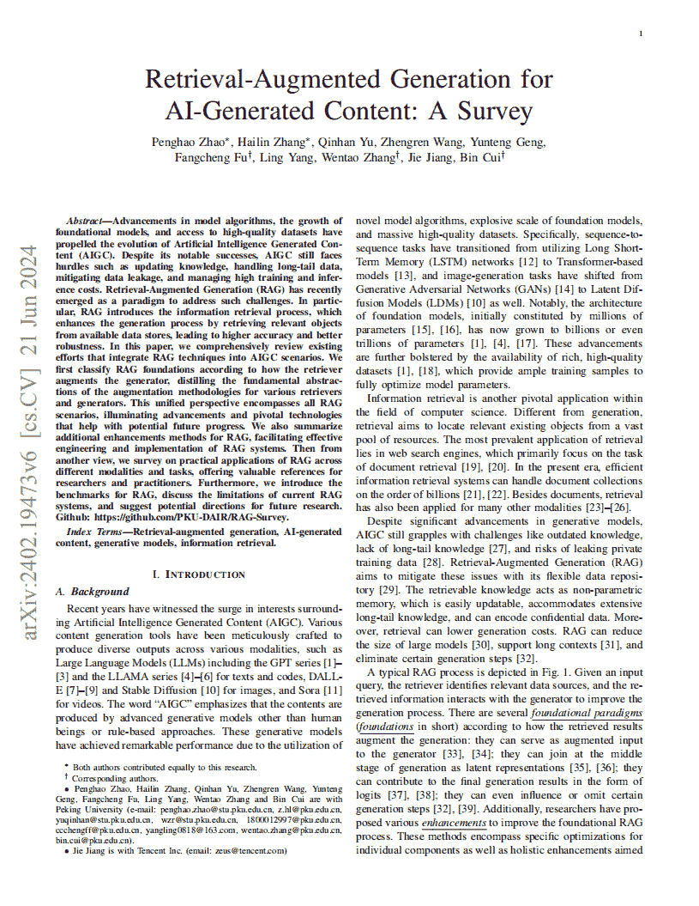

# RAG 面向AI生成内容的检索增强生成技术——调研

> 来源：[https://feicaiclub.feishu.cn/docx/HHw3dhIqGowYHVxi1dWcAXv7nTg](https://feicaiclub.feishu.cn/docx/HHw3dhIqGowYHVxi1dWcAXv7nTg)

[Retrieval-Augmented Generation for AI-Generated Content- A Survey.pdf](https://internal-api-drive-stream.feishu.cn/space/api/box/stream/download/all/DspFbwf2iobIqfxx9Z8cyjhmnwb)

---

# 论文总结：《Retrieval-Augmented Generation for AI-Generated Content- A Survey》

## 引言：

+   **人**工智能生成内容（AIGC）领域由于模型算法的改进、基础模型的发展和高质量数据集的利用，取得了显著的进展。

+   **模型算法的改进**：随着深度学习和神经网络的进步，模型算法变得更加复杂和高效，例如Transformer架构的出现极大地提升了自然语言处理和生成的能力。

+   **基础模型的发展**：基础模型如GPT系列、BERT等已经成为AIGC的基石，这些模型通过预训练在大规模数据集上获得丰富的知识，并能够在下游任务中进行微调。

+   **高质量数据集的利用**：大规模、高质量的数据集如Common Crawl、Wikipedia等为训练这些模型提供了丰富的语料，极大地提升了模型的性能。

+   **尽管取得了成功，AIGC仍面临一些挑战，如知识更新、处理**长尾数据、数据泄露以及高训练和推理成本。

+   **知识更新**：AIGC模型中的知识是基于训练时的数据，对于训练后发生的新知识无法及时反映，导致知识老化问题。

+   **处理长尾数据**：在数据分布中，一些不常见的长尾数据很难被模型捕捉和生成，影响了生成内容的全面性和准确性。

+   **数据泄露**：模型可能会在生成内容中无意泄露训练数据中的隐私信息，带来安全和隐私风险。

+   **高训练和推理成本**：训练和使用大规模模型需要大量计算资源和时间，尤其是当模型参数达到数十亿甚至数万亿时，这种成本变得尤为显著。

+   **检索增强生成（RAG）最近被提出作为应对这些挑战的一种方法。RAG引入信息检**索过程，通过从现有数据存储中检索相关对象来增强生成过程，从而提高准确性和鲁棒性。

+   **RAG的基本概念**：RAG结合了信息检索和生成模型，通过在生成过程中动态检索相关信息来辅助生成，从而弥补模型内部知识的不足。

+   **提高准确性和鲁棒性**：通过引入最新的外部知识和特定领域的信息，RAG能够生成更准确和上下文相关的内容，同时减少了模型的知识盲区。

## 主要内容：

+   论文对现有将RAG技术应用于AIGC场景的研究进行了全面回顾。

+   **全面回顾**：论文系统性地梳理和分析了RAG在AIGC不同应用场景中的研究进展和技术方法，提供了一个整体的视角。

+   **论**文首先根据检索器增强生成器的方式对RAG的基础进行了分类，提炼出各种检索器和生成器的增强方法的基本抽象。

+   **分类方法**：RAG基础被分为四种主要范式：基于查询的RAG、基于潜在表示的RAG、基于Logit的RAG和推测性RAG。

+   **增强方法的基本抽象**：每种范式代表了不同的检索和生成结合方式，例如基于查询的RAG将检索到的信息直接作为生成器的输入，而基于潜在表示的RAG则在生成过程中融合检索到的隐含特征。

+   **这种统一的视角涵盖了所有RAG场景，阐**明了有助于未来潜在进展的进步和关键技术。

+   **统一视角**：通过对不同RAG方法的抽象分类，论文提供了一个框架，使研究人员可以更好地理解和比较不同RAG方法的优缺点。

+   **未来进展和关键技术**：论文指出了一些关键技术和方法，如更有效的检索算法、生成模型的优化以及检索和生成的无缝结合，这些都是未来研究的重要方向。

+   论文还总结了RAG的额外增强方法，以促进RAG系统的有效工程和实施。

+   **额外增强方法**：包括输入增强、检索器增强、生成器增强和结果增强等，这些方法分别从不同环节优化RAG系统，提高整体性能。

+   **有效工程和实施**：通过这些增强方法，可以更好地实现RAG系统在实际应用中的工程化，提升其实际效果和应用价值。

+   **从另一视角，论文对RAG在不同模态和任务中的实际应用进行了调**查，为研究人员和从业者提供了宝贵的参考。

+   **不同模态和任务**：RAG不仅在文本生成中应用广泛，还在代码生成、图像生成、音频生成等多个模态中展现了其强大的能力。

+   **实际应用**：通过具体应用案例的分析，论文展示了RAG如何在不同领域和任务中发挥作用，为未来的研究和开发提供了重要参考。

+   **此外，论文介绍了RAG的基准，讨论了当前RAG系**统的局限性，并提出了未来研究的潜在方向。

+   **基准**：论文介绍了用于评估RAG系统性能的基准测试方法和数据集，为统一评价标准提供了基础。

+   **局限性**：如对大规模数据的依赖、实时性问题、跨领域泛化能力等，都是当前RAG系统需要克服的挑战。

+   **未来研究方向**：包括增强检索效率、提高生成质量、探索新型RAG架构等，都是未来研究的重要方向。

## 贡献：

+   **本综述全面概述了RAG，涵盖了基**础、增强、应用、基准、局限性和未来方向。

+   **全面概述**：论文系统性地覆盖了RAG的各个方面，提供了一个完整的视角，帮助研究人员全面了解RAG的现状和发展趋势。

+   **尽**管不同模态和任务中的检索器和生成器有所不同，我们提炼了RAG基础的核心原理，并将应用视为这些原理的适应。

+   **核心原理**：通过对不同RAG方法的抽象总结，论文提炼出了其共同的核心原理，为理解和发展RAG提供了理论基础。

+   **目标是为研究人员和从业者提供参考和指南，提供**有价值的见解以推进RAG方法和相关应用。

+   **参考和指南**：论文不仅总结了现有研究，还提供了具体的技术指南和实践建议，帮助研究人员和从业者在实际应用中更好地利用RAG技术。

+   **具体贡献包括：**

+   对RAG进行全面回顾，提炼各种检索器和生成器的RAG基础抽象。

+   调查RAG文献中的增强方法，详细阐述实现更高效RAG系统的技术。

+   **调查各种模态和任务中现有的结合RAG技术的AIG**C方法，展示RAG对当前生成模型的贡献。

+   讨论RAG的局限性和有前景的研究方向，揭示其未来发展的潜力。

## 研究方法：

+   **论文**从四个基础范式（Query-based、Latent Representation-based、Logit-based、Speculative RAG）介绍了RAG的基础，并详细描述了增强RAG有效性的方法。

+   **基础范式**：每种范式代表了不同的检索和生成结合方式，展示了RAG在不同场景下的多样性和灵活性。

+   **增强方法**：从输入增强、检索器增强、生成器增强和结果增强四个方面，详细描述了如何优化RAG系统。

+   **还**对RAG在文本、代码、知识、图像、视频、科学和音频等不同模态中的应用进行了全面调查，展示了RAG如何在各种生成任务中发挥作用。

+   **不同模态的应用**：通过具体应用案例的分析，论文展示了RAG在各个领域中的广泛应用和强大能力，为未来的研究和开发提供了重要参考。

## RAG基础范式：

+   **基于查询的RAG**：将用户的查询与检索到的信息结合，作为生成器的输入。这种方法常用于各种模态，如文本生成、代码生成、图像生成等。它的优点是灵活性高，能够快速整合预训练的组件进行部署。

+   **示例**：在文本生成中，REALM采用双BERT架构来简化知识检索和整合，结合预训练模型和知识提取器。Lewis等使用DPR进行信息检索，并使用BART生成器有效地增强生成效果。

+   **基于潜在表示的RAG**：将检索到的对象作为潜在表示嵌入到生成模型中，以增强模型的理解能力和生成内容的质量。这种方法适用于跨模态和任务的多种场景。

+   **示例**：FiD处理每个检索到的段落及其标题，与查询一起通过单独的编码器，然后将生成的潜在表示融合到单个解码器中，生成最终输出。

+   **基于Logit的RAG**：在解码过程中通过logit整合检索信息，通常通过简单求和或模型计算每步生成的概率。这种方法特别适合序列生成任务。

+   **示例**：kNN-LM在每步解码时，将语言模型的概率与检索到的相似前缀的距离概率结合。

+   **推测性RAG**：寻求使用检索代替纯生成，以节省资源和加速响应速度。REST使用检索代替小模型进行推测性解码，生成草稿。

+   **示例**：GPTCache构建了一个语义缓存来存储LLM的响应，以解决使用LLM API时的高延迟问题。

## RAG增强方法：

+   **输入增强**：包括查询转换和数据增强，通过修改输入查询或改进数据质量来提高检索效果。

+   **示例**：Query2doc通过生成伪文档来丰富查询信息，从而检索到更准确的结果。

+   **检索器增强**：通过递归检索、块优化、检索器微调、混合检索和重排序等方法提高检索质量。

+   **示例**：ReACT使用链式思维将查询分解进行递归检索，提供更丰富的信息。

+   **生成器增强**：通过提示工程、解码调优和生成器微调等方法提高生成器的能力。

+   **示例**：LLMLingua通过压缩查询整体长度来加速模型推理，减轻无关信息对模型的负面影响。

+   **结果增强**：通过输出重写等方法改进生成结果的质量。

+   **示例**：SARGAM使用特殊的Transformer对代码相关任务的输出进行细化，以更好地与真实世界的代码上下文对齐。

+   **RAG流程增强**：通过自适应检索和迭代RAG等方法优化整体流程。

+   **示例**：FLARE根据生成过程中的概率主动决定是否进行检索。

## RAG在不同模态中的应用：

+   **文本生成**：包括问答、事实验证、常识推理、人机对话、神经机器翻译、事件抽取和摘要等任务。

+   **示例**：FiD和REALM在问答任务中通过检索相关文本片段并将其与查询一起输入生成器来提高答案质量。

+   **代码生成**：涵盖代码生成、代码摘要、代码补全、自动程序修复和文本到SQL等任务。

+   **示例**：ReACC在代码补全任务中使用稀疏和密集检索，生成器结合之前生成的代码片段进行迭代生成。

+   **知识增强生成**：包括知识库问答、知识增强开放域问答和表格问答等任务。

+   **示例**：KG-FiD在开放域问答中使用融合在解码器的RAG方法，通过整合知识图谱中的实体和关系来生成高质量答案。

+   **图像生成**：通过GAN和扩散模型生成高质量图像，使用检索到的图像或图像-文本对作为生成的条件。

+   **示例**：RetrieveGAN通过检索图像补丁并在生成过程中整合这些信息，提高生成图像的质量。