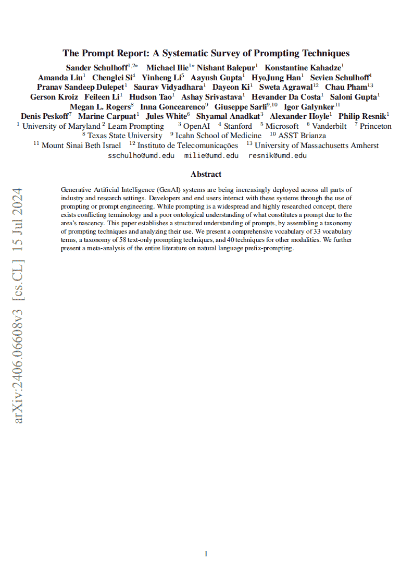

# 提示词报告：提示词技术的系统调研

> 来源：[https://feicaiclub.feishu.cn/docx/GOqYd5BGdoiMJUxgEUFc0gEEnWg](https://feicaiclub.feishu.cn/docx/GOqYd5BGdoiMJUxgEUFc0gEEnWg)

[The Prompt Report- A Systematic Survey of Prompting Techniques.pdf](https://internal-api-drive-stream.feishu.cn/space/api/box/stream/download/all/AJCQbcwEmoAZJ7xRWdDcecdhn5z)

---

### 论文总结: 《The Prompt Report: A Systematic Survey of Prompting Techniques》

### 摘要

生成型人工智能（GenAI）系统在各个行业和研究领域中被广泛部署。开发人员和最终用户通过提示或提示工程与这些系统交互。尽管提示是一种广泛研究的概念，但由于该领域的新兴性，术语不统一且本体理解不足。本文通过组建提示技术的分类法并分析其使用情况，建立了一种结构化的提示理解方法。我们提供了33个术语的全面词汇、58种纯文本提示技术的分类法和40种其他模态的技术。进一步对自然语言前缀提示的文献进行了元分析。

### 引言

生成模型在自然语言处理和图像生成方面取得了巨大成功，如ChatGPT和Midjourney的开发。提示技术在GenAI系统中起着至关重要的作用，提示的结构和评价直接影响模型的输出质量。本文旨在系统性地回顾提示技术，提供一个全面的资源和分类法，以便开发人员和研究人员快速实验和应用提示技术。

### 提示技术分类

#### 文本提示技术

1.  **上下文学习（ICL）**：通过在提示中提供示例和相关指令，使模型无需权重更新即可学习任务。

+   **少样本提示**：通过提供少量示例来完成任务。例如，Few-Shot Learning通过几个示例指导模型完成任务。

+   **零样本提示**：不使用示例，仅通过指令完成任务。例如，直接要求模型完成某个任务，而不提供任何示例。

1.  **零样本提示**：不使用示例，仅通过指令完成任务。例如，角色提示、风格提示和情感提示。

+   **角色提示**：为生成型AI分配一个特定角色或身份，以影响其输出风格。例如，让AI扮演“老师”或“科学家”。

+   **风格提示**：指定生成内容的风格、语气或体裁，以塑造AI的输出。例如，要求AI生成“正式”或“幽默”的文本。

+   **情感提示**：在提示中加入心理学上相关的短语，以提高模型在基准测试和开放文本生成任务中的表现。

1.  **思维生成**：包括链式思维（CoT）提示，通过在给出最终答案前表达思维过程来增强模型性能。

+   **链式思维提示**：通过提供一系列逻辑步骤或思维过程来引导模型得出最终答案。例如，通过示例展示问题的解决步骤。

+   **零样本链式思维提示**：在提示中加入激发思维的短语，如“让我们一步一步地思考”，以增强模型的逻辑推理能力。

+   **类比提示**：自动生成包含思维链的示例，用于数学推理和代码生成任务。

1.  **分解技术**：将复杂问题分解为简单子问题，如“从少到多”提示和“计划与解决”提示。

+   **从少到多提示**：将问题分解为多个子问题，然后逐个解决，最终得出答案。

+   **分解提示**：向模型展示如何使用特定函数，将问题分解为子问题，并分别解决这些子问题。

+   **计划与解决提示**：生成一个计划，然后按照计划逐步解决问题，以提高模型的推理能力。

1.  **集成技术**：使用多个提示解决同一问题，然后聚合这些响应生成最终输出。

+   **自洽性提示**：通过多次提示模型生成多个推理路径，然后通过多数投票选择最终答案。

+   **多样性推理专家（MoRE）**：使用不同的专门提示生成多种推理类型的答案，并选择最佳答案。

+   **提示并行化**：创建多个提示模板，生成多个响应，然后选择最优模板或通过多数投票选择最终响应。

1.  **自我批评**：让模型批评自己的输出，以改进答案。

+   **自校准**：模型先生成答案，然后重新审视并判断其正确性。

+   **自我优化**：模型生成初步答案后，自我提供反馈并改进答案，直到达到最佳结果。

+   **链式验证**：生成初步答案后，模型生成一系列相关问题进行验证，然后根据验证结果改进初始答案。

#### 跨语言和多模态提示

1.  **多语言提示**：研究如何在多语言环境中使用提示，如跨语言思维链（XLT）提示和跨语言一致性提示（CLSP）。

+   **跨语言思维链提示**：利用包含多种指令的提示模板，引导模型进行跨语言推理。

+   **跨语言自洽提示**：构建不同语言的推理路径，通过集成技术提高跨语言任务的性能。

1.  **多模态提示**：研究在不同模态（如图像、音频、视频）中使用提示的方法。

+   **图像提示**：使用图像作为提示，生成与图像相关的文本或其他内容。

+   **音频提示**：利用音频输入生成相关的文本描述或其他内容。

+   **视频提示**：通过视频内容生成文本描述或其他模态的输出。

### 提示工程和答案工程

+   **提示工程**：通过修改或更改提示技术来迭代开发提示的过程。

+   **自动提示工程**：使用自动化技术生成或改进提示模板，例如通过元提示生成或改进提示。

+   **提示优化**：使用多步骤过程改进提示模板，通过评估和选择最佳提示，改进模型输出。

+   **答案工程**：开发或选择算法，从生成的输出中提取精确答案。

+   **答案形状**：定义答案的物理格式，如单个词、词组或图像。

+   **答案空间**：定义答案可能的值域，如二分类任务中的两个可能值。

+   **答案提取器**：使用规则或独立模型从生成的输出中提取最终答案，例如正则表达式或独立LLM。

### 安全和对齐

+   **安全性**：设计提示时需要考虑安全措施，以减少对公司和用户的潜在危害。

+   **提示攻击**：识别和防止潜在的提示攻击，保护模型免受恶意输入的影响。

+   **硬化措施**：采取措施增强提示的安全性，减少模型输出有害内容的风险。

+   **对齐问题**：讨论提示的敏感性、过度自信和校准、偏见和文化等问题。

+   **提示敏感性**：研究提示对模型输出的影响，确保提示不会导致过度自信或错误答案。

+   **偏见和文化**：识别和减少模型输出中的偏见和文化敏感问题。

### 基准测试

在提示技术研究中，研究人员通常在多个模型和数据集上进行基准测试，以证明技术的有效性并检验其在不同模型中的迁移性能。

+   **模型和数据集**：识别和使用常见的基准模型和数据集，如GPT-3、BERT、MMLU、GSM8K等。

+   **技术比较**：通过比较不同提示技术在基准任务上的表现，评估其有效性和适用性。

### 结论

本文系统性地回顾了提示技术，涵盖了定义、分类、实际应用、安全性和未来研究方向。本文为研究人员和从业者提供了宝贵的参考，推动了提示技术的进一步发展和应用。通过全面的分析和详细的讨论，本文为提示技术的未来研究提供了坚实的理论和实践基础。