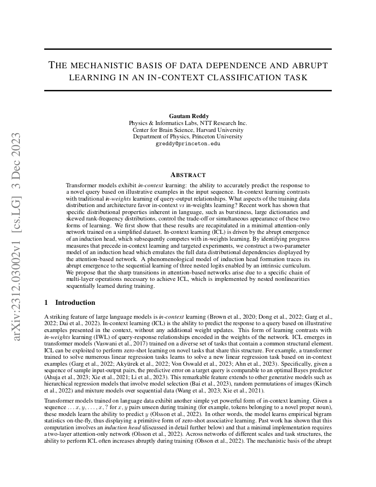

# 数据依赖和突发学习在上下文分类任务中的机制基础

> 来源：[https://feicaiclub.feishu.cn/docx/UmgrdambDoW92yxMM6HcCfmZncd](https://feicaiclub.feishu.cn/docx/UmgrdambDoW92yxMM6HcCfmZncd)

[2312.03002v1.pdf](https://internal-api-drive-stream.feishu.cn/space/api/box/stream/download/all/ZmtebELUToTySTx5ZgVcD8vTnsf)

---

### 论文总结: 《THE MECHANISTIC BASIS OF DATA DEPENDENCE AND ABRUPT LEARNING IN AN IN-CONTEXT CLASSIFICATION TASK》

### 摘要

Transformer模型表现出上下文学习（ICL）的能力，即在输入序列中基于示例准确预测新查询的响应。本文探讨了训练数据分布和架构特性如何影响上下文学习与权重学习（IWL）之间的权衡。通过简化的数据集和注意力网络，研究发现上下文学习是通过归纳头的突然出现驱动的，并与权重学习竞争。本文构建了一个两参数模型，模拟了完整的数据分布依赖关系，并揭示了嵌套非线性操作在注意力网络中的作用。

### 引言

+   **背景**：大型语言模型（LLM）展示了上下文学习的显著特性，即在输入上下文中提供示例即可解决新任务，而无需额外的权重更新。上下文学习与传统的通过调整权重学习查询-响应关系的方法形成对比。

+   **研究问题**：本文探讨了训练数据分布和架构特性如何促进上下文学习和权重学习，并通过简化模型和实验揭示其机制。

### 任务和网络架构

#### 任务结构

+   **任务描述**：网络训练任务是预测目标项的标签，给定一系列交替的项和标签序列。具体来说，网络接收一个交替序列，任务是预测目标项的标签。

+   **数据表示**：项和标签嵌入在特定维度空间中，前P维度编码位置信息，后D维度编码内容。位置通过一个P维的独热向量编码，内容通过D维的高斯混合模型生成。

#### 网络架构

+   **注意力网络**：输入通过两层注意力网络，然后通过分类器进行分类。每层注意力网络有一个注意力头，使用因果掩码。

+   **分类器**：分类器为三层MLP，使用ReLU激活和softmax层。分类器接收注意力网络的输出，并预测目标标签的概率。

#### 数据分布参数化

+   **参数化描述**：通过调整类别数量（K）、爆发性（B）、类内变异性（ε）等参数，研究数据分布对上下文学习和权重学习的影响。

+   **爆发性B**：输入序列中某个类别的项出现的次数。

+   **类内变异性ε**：同一类别内项的变异程度。

+   **其他参数**：类的数量K，标签的数量L，训练数据中爆发性序列的比例pB等。

### 结果

#### 数据分布依赖的再现

+   **观察结果**：通过简化的输入统计和网络架构，重现了先前研究中观察到的核心分布依赖关系。研究发现，增加类别数量（K）和爆发性（B）促进上下文学习，而减少权重学习。

+   **实验结果**：

+   **类别数量和爆发性**：增加类别数量（K）和爆发性（B）促进上下文学习，同时减少权重学习。

+   **类内变异性**：增加类内变异性（ε）促进上下文学习，减少权重学习。

+   **Zipfian分布**：使用Zipfian分布（α=1）可以同时促进上下文学习和权重学习。

#### 进度度量

+   **定义**：定义了四个进度度量（项-标签关联、目标-项-标签关联、上下文标签准确率、目标-标签关联）以量化网络学习过程中的变化。

+   **项-标签关联（ILA1）**：第一个注意力层中，项对其前一个项的注意力。

+   目标-项-标签关联（TILA2）：第二个注意力层中，目标对正确标签的注意力。

+   **上下文标签准确率（CLA）**：网络预测上下文中标签的准确率。

+   **目标-标签关联（TLA2）**：第二个注意力层中，目标对上下文中标签的总注意力。

+   **实验结果**：

+   **进度度量变化**：实验显示，上下文标签准确率和目标-标签关联在学习过程中的变化与上下文学习的突然转变密切相关。

+   **归纳头的形成**：归纳头的形成驱动了上下文学习的突然转变，通过特定的操作序列实现零样本复制。

#### 归纳头的形成驱动了上下文学习的突然转变

+   **归纳头操作序列**：归纳头通过以下操作实现零样本复制：

1.  一个标签对前一个项的注意力。

1.  第一个注意力层将项的内容写入标签的缓冲区。

1.  目标项通过匹配内容对标签的缓冲区注意。

1.  第二个注意力层将标签的内容写入目标项，分类器使用此信息预测标签。

+   **三参数模型**：构建了一个三参数模型，模拟了这些核心计算，并展示了进度度量的动态。

+   **模型参数**：模型参数包括注意力层的注意力权重（β1）、目标对标签缓冲区的注意力（α）、分类器的参数（ξ）。

+   **学习曲线**：通过梯度下降优化模型参数，重现了慢学习阶段和突然转变。

### 讨论

#### 摘要

+   **研究发现**：数据分布的特定特征（如大数量的稀有词）促进了上下文学习。通过简化模型和实验，揭示了归纳头在上下文学习中的关键作用，并通过嵌套非线性操作的学习过程解释了学习的突然转变。

#### 突然转变的机制

+   **嵌套非线性操作**：注意力网络中的一系列嵌套非线性操作创建了损失景观中的“悬崖”，导致训练过程中损失的突然跳跃。

#### 与先前工作的关系

+   **补充证据**：本文的结果补充了现有关于归纳头在上下文学习中的关键作用的证据。进一步的研究可以探索更复杂的上下文序列特征能否被小型Transformer模型学习，以及实现这些特征的机制。

#### 对LLM的影响

+   **内在课程设计**：研究表明，内在课程可能有助于克服浅梯度并引导网络实现上下文学习解决方案。未来的研究可以探索在LLM中加速上下文学习的课程设计。

### 结论

本文通过构建和实验验证了一个简化模型，揭示了上下文学习的机制，特别是归纳头的形成及其对学习过程的影响。研究强调了数据分布特征和注意力网络架构在上下文学习中的重要作用，并为未来的LLM研究提供了见解。