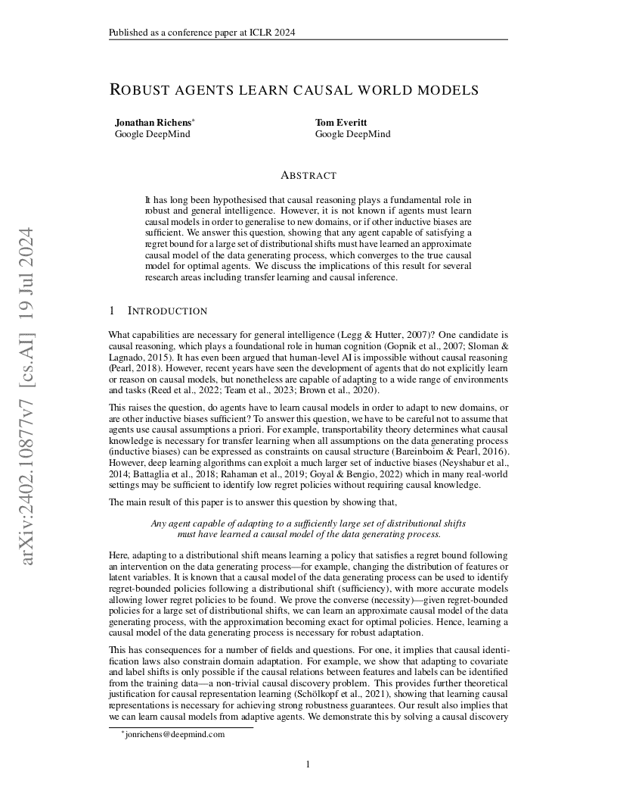

# 稳健智能体学习因果世界模型

> 来源：[https://feicaiclub.feishu.cn/docx/QnWOd4Emxoba4LxWAircELy8nnb](https://feicaiclub.feishu.cn/docx/QnWOd4Emxoba4LxWAircELy8nnb)

[ROBUST AGENTS LEARN CAUSAL WORLD MODELS.pdf](https://internal-api-drive-stream.feishu.cn/space/api/box/stream/download/all/JwIvb8vU2oBUN0xCQPecAtS3n0e)

---

### 论文总结: 《ROBUST AGENTS LEARN CAUSAL WORLD MODELS》

### 摘要

因果推理在稳健和通用智能中起着基础性作用。然而，尚不清楚代理是否必须学习因果模型才能适应新领域，还是其他归纳偏差足够。本文通过展示任何能够满足大量分布转变中的后悔界限的代理都必须学习一个近似的因果模型，回答了这个问题。对于最优代理，该模型将收敛到真实因果模型。我们讨论了这一结果对迁移学习和因果推理等多个研究领域的影响。

### 引言

#### 背景

+   **研究问题**：代理是否必须学习因果模型才能适应新领域，或者其他归纳偏差是否足够？

+   **目标**：展示能够满足大量分布转变的后悔界限的代理必须学习一个近似的因果模型。

#### 研究动机

+   **因果推理的基础性**：因果推理在人类认知中起着基础性作用，被认为是实现人类级别AI不可或缺的。

+   **现有方法的局限性**：许多现代代理不显式学习因果模型，但仍能适应广泛的环境和任务。

### 主要结果

#### 理论结果

+   **关键结论**：任何能够适应足够大量分布转变的代理都必须学习数据生成过程的因果模型。

+   **理论证明**：展示了在存在大量分布转变的情况下，满足后悔界限的策略必须学习并利用因果模型。通过数学证明，展示了代理必须识别出影响结果的关键因果因素。

+   **适应分布转变**：适应分布转变意味着学习一个满足干预后数据生成过程的后悔界限的策略。

+   **后悔界限**：定义了代理在不同分布下的表现和损失之间的关系，展示了代理需要一个因果模型来保持低后悔。

+   **证明方法**：展示了因果模型可以用于识别满足后悔界限的策略，并证明了反之亦然。

+   **双向证明**：通过构建满足后悔界限的策略并验证其因果模型的一致性，证明了两者的等价性。

#### 实验结果

+   **因果模型的学习**：通过观察在分布转变下满足后悔界限的代理策略，解决因果发现问题。

+   **实验设计**：利用合成数据集，模拟多个分布转变情境，验证代理是否能通过学习因果模型来适应这些变化。

+   **迁移学习的启示**：展示了在已知协变量和标签转变下适应，必须能够从训练数据中识别特征和标签之间的因果关系。

+   **应用场景**：展示了在不同任务和环境下，因果模型如何帮助代理更快、更准确地适应新情况。

### 相关工作

+   **因果推理与决策理论**：讨论了与因果推理和决策理论相关的概念，并展示了这些概念在本研究中的应用。

+   **因果推理**：展示了因果推理如何帮助代理理解和预测环境变化。

+   **决策理论**：讨论了决策理论中关于策略选择和优化的基本概念。

+   **传输理论**：涉及在已知假设下迁移学习中所需的因果知识。

+   **传输学习**：展示了如何通过因果模型实现高效的迁移学习。

### 实验与讨论

#### 实验设计

+   **设置**：使用合成数据集进行因果发现实验，观察在分布转变下满足后悔界限的代理策略。

+   **数据集设计**：设计多个具有不同因果结构和分布转变的合成数据集。

+   **实验步骤**：代理首先在一个固定分布下进行训练，然后在多个新分布下测试其适应能力。

+   **结果**：展示了通过观察代理的策略，可以成功地学习到数据生成过程的因果模型。

+   **性能评估**：评估代理在新分布下的表现，验证其因果模型的准确性和适应性。

#### 讨论

+   **因果表示学习**：展示了因果表示学习对于实现强鲁棒性保证的必要性。

+   **因果表示**：探讨了如何在代理的学习过程中嵌入因果表示，提高其适应能力。

+   **迁移学习的因果界限**：讨论了迁移学习中的因果约束，并展示了其与因果发现问题的关系。

+   **因果约束**：展示了如何利用因果约束改进迁移学习的效果。

+   **好调节器定理**：将本研究结果与好调节器定理联系起来，展示了稳健代理必须学习环境的因果模型。

+   **理论联系**：探讨了好调节器定理在因果推理中的应用，展示了其对稳健代理设计的启示。

+   **涌现能力**：讨论了因果模型在涌现能力中的作用，展示了广泛环境中的奖励最大化可以促使代理学习因果世界模型。

+   **涌现现象**：探讨了因果模型如何在复杂环境中支持代理涌现出更高级的智能行为。

### 结论

本文展示了因果推理对于稳健和通用AI的必要性，通过理论和实验结果展示了任何能够适应大量分布转变的代理都必须学习数据生成过程的因果模型。研究结果为因果表示学习提供了理论支持，并对迁移学习和因果推理等多个领域产生了重要影响。

### 未来研究方向

+   **扩展研究范围**：进一步探索在更复杂环境和任务中，因果模型学习的机制和效果。

+   **实际应用验证**：在实际应用中验证因果模型的有效性，特别是在机器人、自动驾驶等领域。

+   **跨学科合作**：结合认知科学和神经科学的研究成果，提升AI代理的因果推理能力。