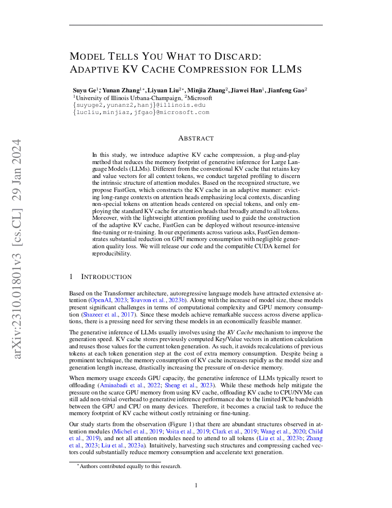

# 模型告诉你该舍弃什么：LLM的自适应KV缓存压缩

> 来源：[https://feicaiclub.feishu.cn/docx/DltxdVqJao07h0xoRZEclcUmnTg](https://feicaiclub.feishu.cn/docx/DltxdVqJao07h0xoRZEclcUmnTg)

[MODEL TELLS YOU WHAT TO DISCARD- ADAPTIVE KV CACHE COMPRESSION FOR LLMS.pdf](https://internal-api-drive-stream.feishu.cn/space/api/box/stream/download/all/M93Lbzr2ao4ymNxOztpciA1hnmf)

---

### 论文总结: 《MODEL TELLS YOU WHAT TO DISCARD: ADAPTIVE KV CACHE COMPRESSION FOR LLMS》

### 摘要

本文介绍了一种名为FastGen的自适应KV缓存压缩方法，用于在大语言模型（LLMs）的生成推理中减少内存占用。与传统KV缓存不同，FastGen根据注意力模块的内在结构进行有针对性的压缩：对于强调局部上下文的注意力头，淘汰长距离上下文；对于关注特殊标记的注意力头，保留这些特殊标记；对于广泛关注所有标记的注意力头，使用标准KV缓存。FastGen通过轻量级注意力分析指导自适应KV缓存的构建，无需资源密集型的微调或重新训练。在各种任务中，FastGen显著减少了GPU内存消耗，同时对生成质量影响微小。

### 引言

#### 背景

+   **大语言模型的成功**：基于Transformer架构的自回归语言模型在各类应用中取得了巨大成功，但随着模型规模的增加，其计算复杂度和GPU内存消耗也显著增加。

+   **KV缓存机制**：在生成推理过程中，KV缓存机制通过存储之前计算的Key/Value向量来提高生成速度，但随着模型规模和生成长度的增加，KV缓存的内存消耗迅速增加。

#### 研究动机

+   **内存消耗问题**：当内存使用超过GPU容量时，生成推理通常依赖于卸载技术，但这会增加推理性能的非微不足道的开销。

+   **目标**：提出一种无需昂贵的重新训练或微调，即可减少KV缓存内存占用的方法。

### 主要贡献

+   **FastGen方法**：提出FastGen，通过有针对性的分析识别注意力模块的结构，并自适应地压缩KV缓存。

+   **实验验证**：在多个任务中验证了FastGen的方法，有效减少了内存占用，且对生成质量影响微小。

### 方法

#### 生成推理

+   **提示编码**：当自回归Transformer模型生成第i个标记时，注意力模块需要从前面所有i-1个标记中收集上下文信息。这些标记的KV向量被存储在KV缓存中，以避免在生成后续标记时重复计算。

+   **标记生成**：在每一步生成过程中，模型需要编码之前步骤生成的新标记，并将其相关的KV向量添加到当前的KV缓存中。因此，KV缓存的大小随着生成的标记数量线性增加。

#### FastGen方法

+   **注意力分析**：在提示编码阶段，进行模型剖析以识别各种注意力头的行为，从而选择最适合的压缩策略。

+   **自适应KV缓存**：在标记生成阶段，基于选择的压缩策略管理KV缓存，而不是不加区分地附加新生成标记的KV向量。

#### KV缓存压缩策略

+   **特殊标记**：仅保留特殊标记（如句子开头标记<s>、指令标记[INST]等）。

+   **标点符号**：仅保留标点符号（如"."、":"、"?"等）。

+   **局部性**：淘汰长距离上下文，当上下文标记与当前标记的相对距离超过阈值时，淘汰该上下文标记的KV缓存。

+   **频率（重击者）**：监控每个标记的累计注意力得分，仅保留KV缓存中最频繁的标记。

### 实验

#### 性能与内存减少的权衡

+   **实验设置**：使用Llama 1模型，评估了在不同KV缓存预算下模型的生成质量。

+   **结果**：FastGen在内存减少和生成质量之间实现了良好的权衡。例如，在Llama 1-65B模型中，FastGen实现了44.9%的KV缓存压缩，同时保持了较高的生成质量。

#### 内存占用分析

+   **内存减少**：FastGen显著减少了所有模型规模的KV缓存内存占用，特别是在较大模型中。

+   **实验结果**：在Llama 1-65B模型中，FastGen可以实现大约40%的内存减少，而生成质量基本保持不变。

#### 端到端延迟改进

+   **延迟测试**：与全缓存设置和一个强模型加速基准进行比较，FastGen在所有生成设置中都实现了显著的端到端加速。

+   **结果**：在最小生成长度情况下，FastGen比HF基准减少了16.04%的延迟，在最大生成长度情况下减少了55.0%的延迟。

#### 剖析成本

+   **剖析时间**：剖析步骤的开销相对于总生成时间来说非常小，在测试的情况下最多占总时间的0.35%。

### 结论

本文提出了FastGen，一种利用轻量级模型剖析和自适应KV缓存显著提高LLM推理效率的方法，且生成质量无明显损失。未来研究方向包括将FastGen与其他模型压缩技术（如量化和蒸馏）相结合，以及探索其他高效的注意力架构。