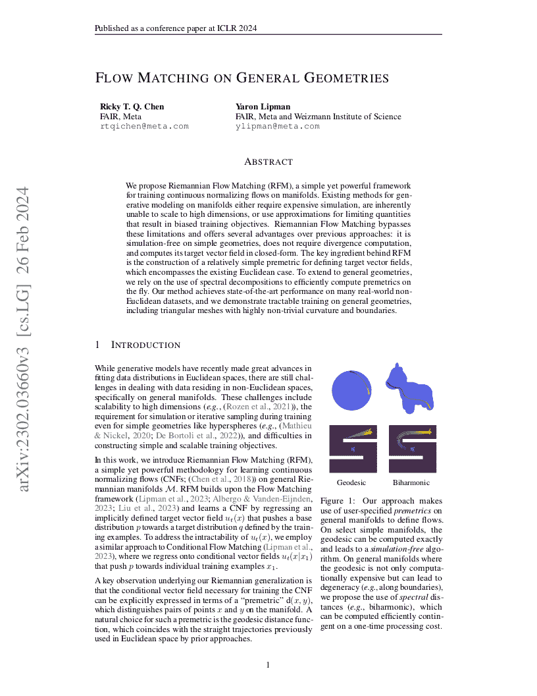

# 通用几何上的流匹配

> 来源：[https://feicaiclub.feishu.cn/docx/FlXVd71p7oEaqdx4Vu5cuqz9ntb](https://feicaiclub.feishu.cn/docx/FlXVd71p7oEaqdx4Vu5cuqz9ntb)

[FLOW MATCHING ON GENERAL GEOMETRIES.pdf](https://internal-api-drive-stream.feishu.cn/space/api/box/stream/download/all/FebcbO5zKoNSHMxL9XtcHuOJnVg)

---

### 论文总结: 《FLOW MATCHING ON GENERAL GEOMETRIES》

### 摘要

本文提出了Riemannian Flow Matching（RFM），一种在流形上训练连续正则化流（CNFs）的框架。现有的流形生成建模方法要么需要昂贵的模拟，要么无法扩展到高维度，或者使用近似值导致训练目标有偏差。Riemannian Flow Matching克服了这些限制，具有多项优点：在简单几何上无需模拟，不需要发散计算，并以闭式计算目标向量场。RFM在处理三角网格等复杂几何形状上实现了可行的训练，并在许多非欧几里得数据集上达到了最先进的性能。

### 引言

#### 背景

+   **挑战**：生成模型在处理非欧几里得空间中的数据时面临挑战，如高维扩展性、训练过程中需要模拟或迭代采样的问题。

+   **目标**：提出一种方法，可以在流形上有效地训练生成模型，避免上述挑战。

#### 研究动机

+   **现有方法的局限性**：现有方法在处理流形数据时要么需要昂贵的模拟，要么无法扩展到高维，或者训练目标有偏差。

+   **解决方案**：通过引入Riemannian Flow Matching，提供一种无需模拟且适用于一般几何形状的方法。

### 主要贡献

1.  Riemannian Flow Matching（RFM）：提出了一种新的方法，通过定义简单的预度量来计算目标向量场，适用于一般几何形状。

1.  **高效的计算**：利用谱分解在飞行中计算预度量，大大提高了计算效率。

1.  **实验验证**：在多个真实世界的非欧几里得数据集上验证了RFM的性能，并展示了在复杂几何形状上的可行性。

### 方法

#### Riemannian Flow Matching的定义

+   **目标**：学习一个连续的正则化流，使得基础分布p通过训练样本定义的目标分布q。

+   **关键思想**：通过回归隐式定义的目标向量场，构建一个简单的预度量来定义目标向量场。

#### 概率路径和流的定义

+   **概率密度路径**：定义在流形上的概率密度路径pt，由时间依赖的向量场ut生成。

+   **流的定义**：通过求解流形上的常微分方程（ODE），定义一个时间依赖的流ψt。

+

+   \frac{d\psi_t}{dt} = u_t(\psi_t) ] 其中，ψt\psi_tψt 是流，utu_tut 是时间依赖的向量场。

#### 条件流匹配

+   **条件概率路径**：定义每个样本的条件概率路径，从而生成总体概率路径。

+

+   p_t = \psi_t # p ] 其中，ψt#p\psi_t \# pψt#p 表示通过流ψt\psi_tψt 推动的分布。

+   **条件向量场**：利用条件向量场生成条件概率路径，保证流在t=1时将所有点映射到目标点。

+

+   u_t(\psi_t(x)) = \mathbb{E}[v(\psi_t(x),t) \mid x] ]

### 实验

#### 数据集与设置

+   **数据集**：包括地球和气候科学数据集、蛋白质结构数据集、高维环面和复杂的合成分布等。

+   **地球和气候科学数据集**：例如全球气温分布数据。

+   **蛋白质结构数据集**：蛋白质结构的三维坐标数据。

+   **高维环面数据集**：高维空间中的环面形状数据。

+   **合成分布**：人工生成的复杂几何形状数据。

+   **设置**：在不同几何形状下进行实验，评估RFM的性能。

+   **实验环境**：使用高性能计算平台进行大规模数据训练。

+   **评价指标**：使用生成质量、训练效率、计算复杂度等指标进行评估。

#### 结果分析

+   **与现有方法的比较**：RFM在多个数据集上表现优异，显著优于现有方法。

+   **生成质量**：生成样本的质量显著提高，接近真实数据分布。

+   **训练效率**：RFM方法在相同计算资源下，训练速度更快，收敛更稳定。

+   **高维扩展性**：RFM在高维情况下表现稳定，无需近似计算，性能没有显著下降。

+   **高维数据**：在高维环面数据集上，RFM能够有效生成高维结构样本。

+   **计算复杂度**：通过高效的谱分解算法，RFM在高维数据上的计算复杂度得到显著降低。

+   **复杂几何形状**：RFM在复杂几何形状上实现了高保真度的样本生成。

+   **复杂几何数据**：在蛋白质结构数据集和地球气候数据集上，RFM生成的样本高度保真，形状与真实数据一致。

+   **保真度评价**：通过定量指标（如Wasserstein距离）和定性指标（如视觉对比）评估生成样本的保真度。

### 结论

本文提出了Riemannian Flow Matching（RFM），一种在流形上训练连续正则化流的高效方法。通过理论分析和实验验证，RFM在处理非欧几里得数据时表现出色，具有广泛的应用前景。

+   **理论贡献**：通过定义简单的预度量和高效的计算方法，解决了现有方法在高维和复杂几何形状下的局限性。

+   **实际应用**：RFM在多个实际应用场景中验证了其有效性，展示了在地球科学、蛋白质结构建模等领域的广泛应用潜力。

### 未来研究方向

+   **进一步优化计算效率**：探索更高效的谱分解算法和并行计算技术，提高RFM在大规模数据上的训练效率。

+   **并行计算**：利用GPU和分布式计算平台，进一步加速RFM的训练过程。

+   **优化算法**：开发更加高效的优化算法，减少计算资源消耗。

+   **扩展应用领域**：将RFM应用于更多非欧几里得数据的生成和建模，如医学成像、天文学等领域。

+   **医学成像**：探索RFM在医学图像生成和诊断中的应用，提升医学成像的准确性和效率。

+   **天文学**：将RFM应用于天体物理数据建模，揭示宇宙结构的复杂性。

+   **结合其他生成模型**：与GANs、VAEs等其他生成模型结合，提升生成样本的多样性和质量。

+   **模型融合**：将RFM与生成对抗网络（GANs）、变分自编码器（VAEs）等模型结合，提升生成模型的综合性能。

+   **多模态生成**：探索RFM在多模态数据生成中的应用，提升生成样本的多样性和鲁棒性。