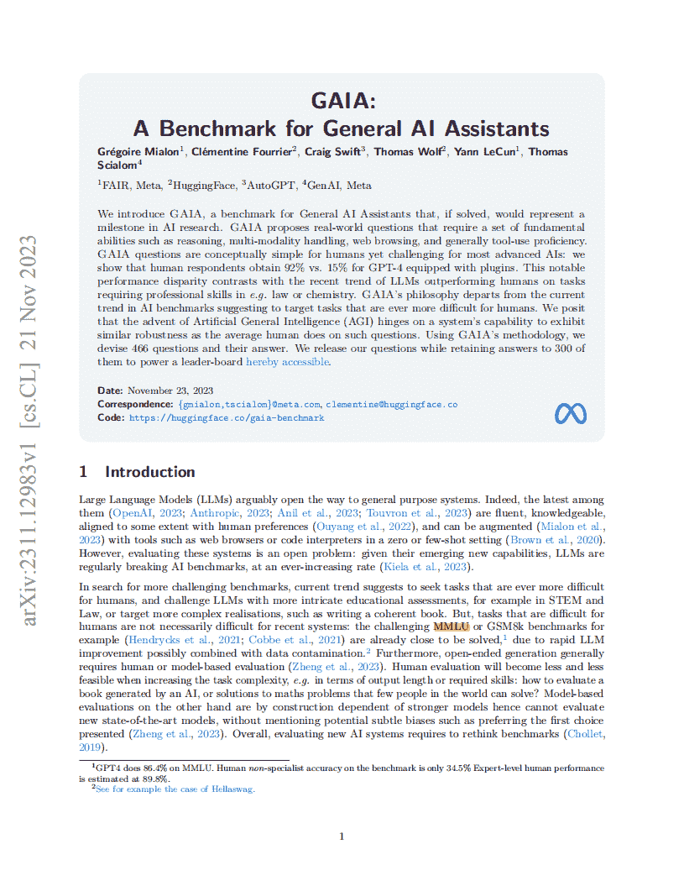

# GAIA：通用人工智能助手的基准

> 来源：[https://feicaiclub.feishu.cn/docx/TqwUd55F9oA3yix1DCtcNV2Vn6C](https://feicaiclub.feishu.cn/docx/TqwUd55F9oA3yix1DCtcNV2Vn6C)

[GAIA：通用人工智能助手的基准.pdf](https://internal-api-drive-stream.feishu.cn/space/api/box/stream/download/all/RMdobGT6Jo7nOSxE8FmcmocTnmc)

---

### 论文总结: 《GAIA：通用人工智能助手的基准》

### 摘要

《GAIA：通用人工智能助手的基准》由 Grégroire Mialon 等人撰写，文章提出了一个用于评估通用人工智能助手的基准 GAIA，通过设计和标注一系列现实世界中的问题，评估模型的推理、多模态处理、网络浏览和工具使用等基本能力。

### 1. 研究背景

+   大型语言模型（LLMs）的发展使得通用人工智能系统成为可能，但评估这些系统的能力是一个开放问题。

+   当前的LLMs基准存在一些局限性，如容易被模型饱和、难以评估模型的泛化能力等。

+   因此，需要一个新的基准来评估通用人工智能助手的能力。

### 2. GAIA 基准

+   GAIA 是一个用于评估通用人工智能助手的基准，包含466个精心设计的问题和答案。

+   这些问题涵盖了各种日常任务和科学知识，需要模型具备推理、多模态理解、工具使用等能力。

+   GAIA 的设计原则包括：针对现实世界中具有挑战性的问题、易于解释、鲁棒性、易用性等。

### 3. 评估方法

+   GAIA 的评估方法是自动、快速和事实性的，通过比较模型的答案和真实答案来衡量模型的性能。

+   评估指标包括准确率、召回率、F1值等。

+   为了确保评估的公正性和准确性，GAIA 采用了多种技术来避免数据污染和模型作弊。

### 4. 实验结果

+   作者使用 GAIA 基准评估了多种最先进的语言模型，包括 GPT-4、GPT-4 Turbo、AutoGPT 等。

+   实验结果表明，这些模型在 GAIA 基准上的表现不佳，尤其是在处理复杂问题和需要多步推理的问题时。

+   相比之下，人类在 GAIA 基准上的表现非常出色，平均准确率达到了92%。

### 5. 讨论

+   作者讨论了 GAIA 基准的优缺点，以及未来的研究方向。

+   GAIA 基准的优点包括：问题设计合理、评估方法简单、结果易于解释等。

+   GAIA 基准的缺点包括：问题数量有限、缺乏多样性、难以评估模型的创造力等。

+   未来的研究方向包括：增加问题数量、提高问题多样性、开发更有效的评估方法等。

### 6. 结论

+   GAIA 基准是一个有前途的评估通用人工智能助手的工具，可以帮助研究人员更好地了解模型的能力和局限性。

+   未来的研究需要进一步改进 GAIA 基准，以适应不断发展的人工智能技术。