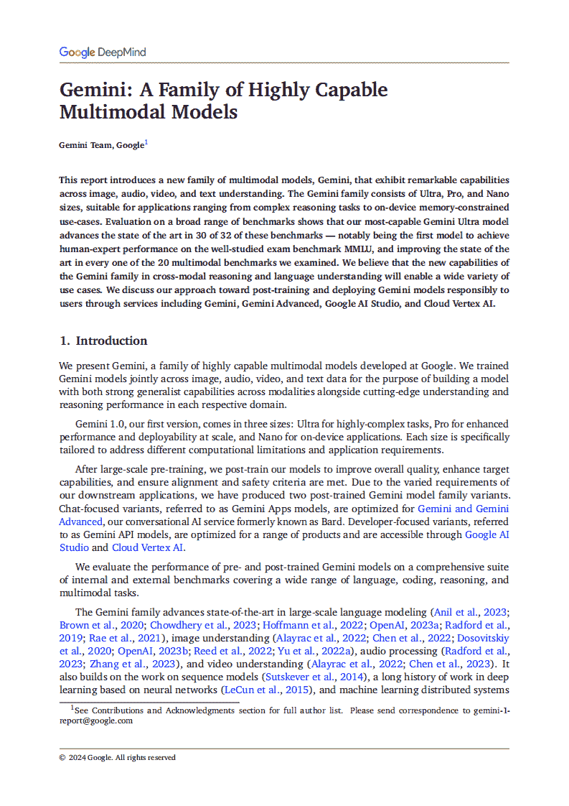

# Gemini：一系列功能强大的多模态模型

> 来源：[https://feicaiclub.feishu.cn/docx/VIz3dRJG5o4ITyxyyv3ci1Lfnwg](https://feicaiclub.feishu.cn/docx/VIz3dRJG5o4ITyxyyv3ci1Lfnwg)

[Gemini：一系列功能强大的多模态模型.pdf](https://internal-api-drive-stream.feishu.cn/space/api/box/stream/download/all/GedjbPp2ooH3d7xWP01cJOGnnFD)

---

### 文章总结: 《GAIA：通用人工智能助手的基准》

### 摘要

**《A Family of Highly Capabl**e Multimodal Models》

作者为 **Google DeepMind** 团队，文章介绍了 **Gemini** 这一新型多模态模型，展示了其在文本、图像、视频、音频等多模态任务中的强大性能。

+   **模型架构**：基于 **Transformer** 解码器，支持32k的上下文长度，并使用了高效的注意力机制，如多查询注意力。

+   **训练数据集****：使用了来自网络文档、书籍**、代码、图像、音频和视频的数据，使用 SentencePiece 分词器进行分词。

+   **预训练结果**：在多个基准测试中取得了显著的性能提升，包括语言理解、数学推理、图像识别、视频理解和音频理解等任务。

+   **微调结果**：通过对预训练模型进行微调，提高了模型在特定任务上的性能。

+   **负责任的部署**：在模型开发过程中，遵循了一套结构化的方法来识别、衡量和管理模型可能产生的下游社会影响，包括模型评估、安全政策制定、风险缓解和部署决策等环节。

+   **讨论与结论**：**Gemini** 模型在自然语言处理和多模态任务中取得了显著的进展，为解决智能、推进科学和造福人类做出了贡献。

本文还提供了模型评估的详细信息、实验结果以及代码示例，为进一步研究和应用多模态模型提供了有价值的参考。