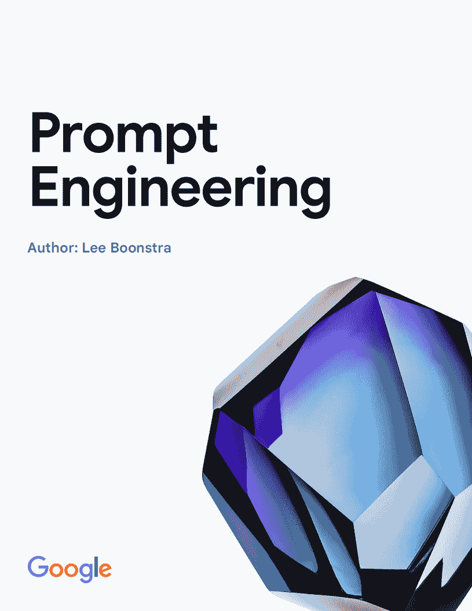

# Prompt Engineering by Google

> 来源：[https://feicaiclub.feishu.cn/docx/FFWydbaj8oVdEDxYrlzc8LXLnsc](https://feicaiclub.feishu.cn/docx/FFWydbaj8oVdEDxYrlzc8LXLnsc)

# **中文翻译版报告**

[22365_3_Prompt Engineering_v7_zh.pdf](https://internal-api-drive-stream.feishu.cn/space/api/box/stream/download/all/Bk8rbiwlDoXb5kxUX6LcQX56nrK)

---

# **英文原版报告**

[Prompt Engineering_v7.pdf](https://internal-api-drive-stream.feishu.cn/space/api/box/stream/download/all/OZZtbgfoXoiVpMx5DFJc6qd5nyh)

---

# 解析大语言模型与提示工程：从原理到实践

在人工智能快速发展的今天，提示工程已经成为企业充分利用AI能力的关键技能。谷歌首席软件工程师Lee Boonstra基于丰富的实践经验撰写了这份报告，深入探讨大语言模型的工作原理、提示工程面临的现实挑战，以及如何为企业选择和配置最合适的模型。

这篇报告，旨在帮助技术人员和决策者更好地理解这一领域，从而有效应对AI实施过程中的各种难题。

## 大语言模型：预测的艺术

大语言模型本质上是sophisticated的预测系统。与普通数据库不同，它们不是简单储存事实，而是通过统计模型进行运作。这些模型一次生成一个标记（token）——可能是一个词或词的一部分，然后预测接下来最可能出现的内容。经过海量数据训练后，这些模型能够敏锐把握词语间的复杂关系和语境。

使用大语言模型时，提示（prompt）实际上是给模型的指令，引导它如何进行预测。好的提示工程就像给人指路一样——指令越清晰具体，到达目的地的可能性就越大。

在实际应用中，精心设计的提示可以让模型执行各种任务：

+   将冗长文档浓缩为精炼摘要

+   从演讲中提取关键观点

+   解析合同条款并回答相关问题

+   识别内容类别（比如判断邮件是否为垃圾邮件）

+   完成多语言文档翻译

+   生成和解释代码

## 提示工程的现实挑战

乍看上去，编写提示似乎很简单，但创建真正有效的提示却是一项复杂工作。企业级提示工程需要兼顾多方面因素：

### 专业知识协作

领域专家的参与至关重要。这些专家了解特定领域的专业细节，能够评估模型生成内容的质量，并提供理想答案的标准。虽然工程团队常常忽视这一点，但它实际上是成功部署AI解决方案的基石。

### 精细参数调整

选择合适的AI模型并调整关键参数直接影响输出质量。这包括设定模型的创造性程度（温度参数）、内容安全限制，以及词语选择方法（如Top-K和Top-P）。每项设置都会对最终结果产生显著影响。

### 提示设计艺术

提示的表达方式极其重要——用词选择、表述顺序、指令给出方式、角色定位、上下文信息、示例提供以及约束条件，都会影响模型的响应表现。

与确定性系统不同，即使使用完全相同的提示，大语言模型有时也会给出不同的回答。这使得评估和比较结果变得更加复杂。

### 技术实施障碍

实际应用中还面临诸多技术挑战：

+   输出过长导致格式错乱（特别是使用JSON等结构化格式时）

+   安全过滤机制可能阻止合理内容的生成

+   系统资源和API调用限制

+   信息安全隐患

对普通用户而言，这些问题可能只需重新提问就能解决；但对企业应用来说，后果则严重得多。一个点错餐的订餐机器人可能永远失去客户；而医疗摘要或法律合同的错误解析则可能带来重大风险。

因此，系统性地跟踪和测试提示，并获取专业反馈，对企业应用至关重要。幸运的是，通过模型微调、提示优化或尝试不同模型，大多数问题都能得到有效解决。

## 选择理想模型的策略

为特定用例选择合适的模型需要权衡多个因素：

### 模型规模考量

模型规模直接影响性能和回答质量。小型模型响应迅速、成本低，但在处理复杂任务时表现有限；大型模型则能提供更多细微差别和更高质量的输出。比如，简单的文本分类可以用小型模型，而创意内容生成则需要大型模型的能力。

### 领域专精模型

某些特定领域的任务可能更适合使用针对该领域训练的专业模型。例如，Med-PaLM专为医疗应用设计，Sec-PaLM则专注于网络安全领域。企业应评估其应用场景是否能从这类专业模型中获益。

### 开源与商业选择

选择开源模型（如Gemma、LLaMA）还是商业模型（如Vertex AI上的Gemini、GPT系列或Claude）应基于多方面考量：定制需求、技术架构、资源可用性和成本结构。开源模型提供更大灵活性，但可能需要更多技术配置；商业模型则提供便捷的托管环境和更好的支持服务。

### 上下文容量与输出限制

上下文窗口决定了模型能处理的最大文本量，而输出标记限制则决定了生成内容的最大长度。处理长文档或复杂任务时，这些参数尤为重要。例如，总结冗长的法律合同需要充足的上下文窗口；而使用结构化输出格式时，要考虑格式本身占用的标记数量。

## 参数优化的艺术

选定模型后，精细调整各项参数同样重要：

### 输出长度控制

输出标记长度直接影响生成内容的量。更多标记意味着更高的计算需求和成本。值得注意的是，简单缩短输出限制并不会自动让模型生成更精炼的内容，它只会在达到限制时戛然而止。

处理结构化输出（如JSON）时，需特别留心标记限制，避免生成不完整的结构导致后续处理错误。

### 创意度平衡

大语言模型不是简单地逐词预测，而是计算所有可能词的概率分布，然后选择下一个词。温度、Top-K和Top-P等参数控制这一过程的随机性和创造性。

#### 温度调节

温度参数决定输出的创造性和意外性。较高的温度产生更随机、更有创意的结果，适合创意写作；较低的温度则生成更可预测的内容，适合需要准确性的任务。

温度值一般不应超过1，否则可能导致输出变得混乱，因为过高的温度会使词语选择变得过于随机。

#### 采样策略

Top-K和Top-P是两种限制词语选择范围的方法。Top-K只考虑概率最高的K个选项；Top-P则选择累计概率不超过设定值P的词语集合。

这两种方法可以单独使用或结合使用。实践表明，低温度（如0.1）通常与高Top-P值（如0.95）配合效果最佳。不同应用场景需要通过实验找到最合适的参数组合。

### 安全护栏设置

主流大语言模型通常提供安全设置和内容过滤功能。例如，Gemini模型具备可调节的安全设置，用于过滤潜在有害或不适当的内容。这些设置可以根据具体需求从完全关闭到严格过滤进行调整。

然而，这些安全机制并非万无一失，可能无法识别所有不适当内容。因此，人工监督和额外保障措施仍然必要，特别是在处理敏感领域时。

---

随着AI技术的飞速发展，掌握提示工程已成为企业数字化转型的关键能力。通过深入理解大语言模型的工作原理、有效应对实施挑战，并科学配置模型参数，企业可以充分挖掘AI的潜力，创造实质性的业务价值。

提示工程既是科学也是艺术，需要持续实践和优化。企业在这一领域的投入将直接影响其AI应用的质量，进而决定数字化转型的成效和竞争优势。