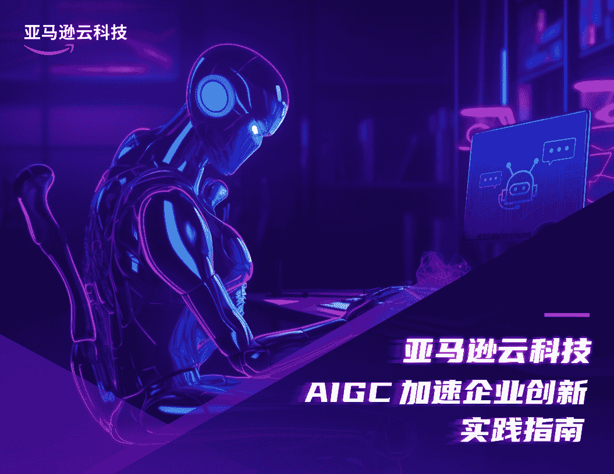

# 智能创造：机器学习与AIGC的创新与变革

> 来源：[https://feicaiclub.feishu.cn/docx/U1JMdC8iWomwpUxIhUOcKZMbnEf](https://feicaiclub.feishu.cn/docx/U1JMdC8iWomwpUxIhUOcKZMbnEf)

[智能创造：机器学习与AIGC的创新与变革.pdf](https://internal-api-drive-stream.feishu.cn/space/api/box/stream/download/all/CKS9bKUHcoOb2mx6s6TcU8RIn9j)

---

# **白皮书简介**

在人工智能发展的漫长历程中，如何让机器学会创作一直被视为难以逾越的天堑，“创造力”也因此被视为人类与机器最本质的区别之一。然而，人类的创造力也终将赋予机器创造力，把世界送入智能创作的新时代。采用机器学习的新范式赋能业务不断探索已经播种了几十年，但随着足够的可伸缩算力的就位、海量数据的爆炸，以及机器学习技术的快速进步，各行各业的客户开始对业务进行重塑。最近，智能对话类型的 AIGC 应用引起了广泛的关注，引发了诸多想象。我们正处在一个机器学习被大规模采用的转折点上，我们也相信人工智能将会重塑大量客户体验和应用程序。从机器学习到智能创造，从专业生产内容（PGC,Professional-generated Content) , 用户生产内容（UGC, User-generated Content）到人工智能生成内容 (AIGC, AI-generated Content)，我们见证了一场深刻的生产力变革，而这份变革也开始影响到我们工作与生活的方方面面，AIGC 也慢慢的演变成了一场技术和艺术碰撞的盛宴，不断释放人类创造力，提高艺术设计领域的数字化创新效率。

本白皮书将结合 AIGC 领域最新技术趋势和真实行业客户案例，向所有 AIGC 的决策者，开发者、创业者和使用者展示 AIGC 给各行各业带来的创新与变革，帮助用户更好的理解AIGC 带给企业的价值，以及如何借助亚马逊云科技的产品和服务快速高效地构建差异化的 AIGC 应用，增强企业在 AIGC 时代的敏捷性与竞争力。