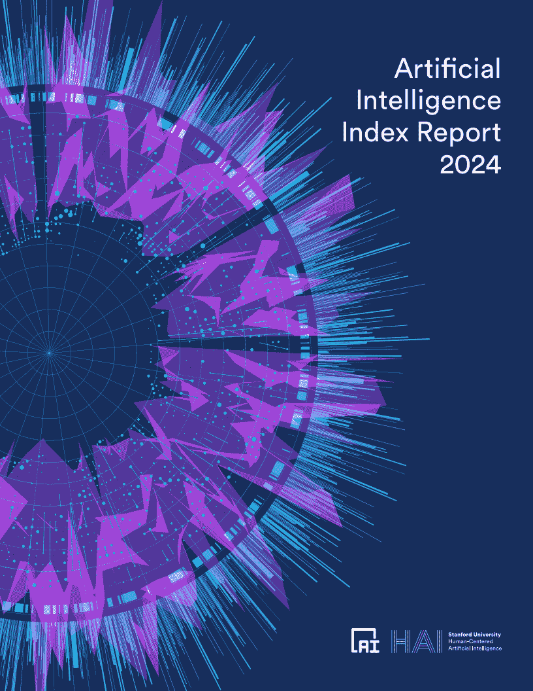

# 2024年人工智能指数报告

> 来源：[https://feicaiclub.feishu.cn/docx/BPlVd3r3boGfwcxI0ahc89Uhnqe](https://feicaiclub.feishu.cn/docx/BPlVd3r3boGfwcxI0ahc89Uhnqe)

[Artificial Intelligence Index Report 2024.pdf](https://internal-api-drive-stream.feishu.cn/space/api/box/stream/download/all/XpesbA82hobMNrxEzXbcYQVDnNh)

---

### 摘要

《2024年人工智能指数报告》是第七版AI指数报告，涵盖了技术进展、公共认知、地缘政治动态等重要趋势。报告引入了新的AI训练成本估算，深入分析了负责AI领域的情况，并新增了AI在科学和医学领域的影响章节。该报告被公认为关于人工智能数据和见解的权威来源。

### 引言

#### 背景

+   **重要时刻**：AI在社会中的影响力前所未有地显著，报告扩展了对技术进步、公共认知和地缘政治动态的覆盖。

+   **目标**：提供无偏、严格审查、广泛来源的数据，帮助政策制定者、研究人员、企业高管、记者和公众更全面地了解AI。

### 主要贡献

1.  **技术进展**：2023年发布的大型语言模型数量翻倍，三分之二为开源模型。最高性能模型来自于闭源系统，如Gemini Ultra首次达到人类水平的MMLU基准表现。

1.  **投资和经济**：尽管全球私人投资连续第二年下降，但生成性AI的投资激增，达到252亿美元。

1.  **政策和治理**：美国通过的AI相关法规创历史新高，公众对AI的关注度和担忧度也显著增加。

1.  **科学和医学**：AI加速了科学发现和医学进步，如AlphaDev提升了算法排序效率，GNoME促进了材料发现。

### 章节亮点

#### 研究与发展

+   **行业主导**：2023年，行业生产了51个重要的机器学习模型，而学术界仅贡献了15个。

+   **基础模型增加**：发布了149个基础模型，比2022年翻了一倍多，其中65.7%为开源模型。

+   **训练成本增加**：如OpenAI的GPT-4训练成本估计为7800万美元，Google的Gemini Ultra为1.91亿美元。

+   **美国领先**：美国贡献了61个重要的AI模型，远超欧洲和中国。

#### 技术性能

+   **多模态AI**：新型多模态模型（如GPT-4、Gemini）能够处理文本、图像，甚至音频。

+   **更难的基准**：为了应对AI在现有基准上的表现饱和，研究人员开发了更具挑战性的基准。

+   **机器人灵活性**：语言模型与机器人技术的融合，如PaLM-E和RT-2，使机器人系统更具灵活性。

#### 负责的AI

+   **缺乏标准化**：负责任的AI评估缺乏标准化，不同开发者使用不同的基准测试。

+   **政治Deepfake**：生成和检测政治Deepfake仍然是一个重大挑战。

+   **AI的法律问题**：生成性AI输出的内容可能包含受版权保护的材料，成为法律争议的焦点。

#### 经济

+   **投资激增**：尽管总体AI私人投资下降，但生成性AI的投资激增至252亿美元。

+   **美国领先**：2023年，美国的AI投资达到672亿美元，是中国的8.7倍。

+   **AI对劳动力的影响**：研究表明，AI提高了工作效率和工作质量，但也有研究警告未适当监督的AI可能降低性能。

#### 科学与医学

+   **科学进步**：AI推动科学发现，2023年发布了如AlphaDev、GNoME等重大应用。

+   **医学进展**：如EVEscape提升了流行病预测，AlphaMissence辅助AI驱动的突变分类。

#### 教育

+   **CS教育多样化**：美国和加拿大的计算机科学学士、硕士和博士生源种族多样性增加。

+   **AI博士流向行业**：越来越多的AI博士毕业生进入行业，而非学术界。

#### 政策与治理

+   **AI法规增加**：美国2023年通过的AI相关法规数量显著增加，达到25项。

+   **全球政策关注**：2023年，全球49个国家在立法程序中提到AI，显示出全球范围内对AI政策的高度关注。

#### 多样性

+   **性别差距**：欧洲信息学、计算机科学和信息技术毕业生的性别差距仍然显著。

+   **K-12 CS教育多样化**：美国K-12计算机科学教育中的性别和种族代表性增加。

#### 公共意见

+   **公众认知与担忧**：全球范围内，公众对AI潜在影响的认知和担忧增加。

+   **ChatGPT的广泛使用**：63%的受访者知道ChatGPT，其中一半每周至少使用一次。

### 结论

该报告全面监测了AI生态系统，为理解这项变革性的技术力量提供了重要资源。