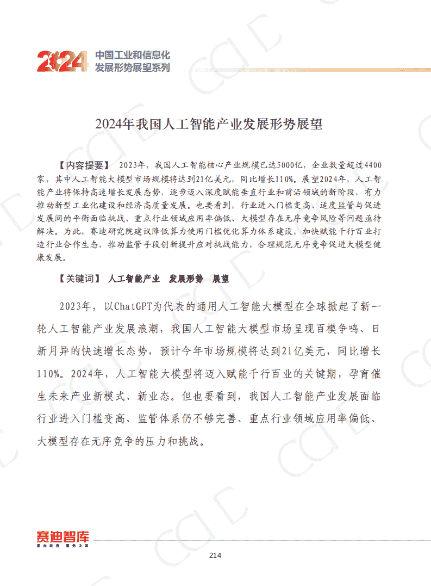

# 2024年我国人工智能产业发展形势展望

> 来源：[https://feicaiclub.feishu.cn/docx/IWSRd78xNoWRFDxQ8hTcksPcn3g](https://feicaiclub.feishu.cn/docx/IWSRd78xNoWRFDxQ8hTcksPcn3g)

[2024年我国人工智能产业发展形势展望.pdf](https://internal-api-drive-stream.feishu.cn/space/api/box/stream/download/all/Cd6eblZSRoW1jixuD6MclQX0nSg)

---

# 摘要

这份《2024年我国人工智能产业发展形势展望》报告主要分析了我国人工智能产业在2023年的发展情况，并对2024年的发展趋势进行了展望和预测。以下是详细总结：

### 一、2023年人工智能产业回顾

1.  **产业规模**：截至2023年，我国人工智能核心产业规模已达到5000亿元，企业数量超过4400家，投融资金额达到2499亿元，同比增长63.8%。特别是人工智能大模型市场增长显著，规模达到21亿美元，同比增长110%。

1.  **大模型的崛起**：2023年，国内涌现出大量人工智能大模型，形成百模争鸣的局面。这些大模型正在逐步赋能多个行业，如金融、医疗、制造和能源等，为行业带来显著的效率提升。

### 二、2024年人工智能产业发展趋势

1.  **持续增长的市场规模**：预计2024年，全球人工智能市场规模将达到6158亿美元，中国将突破7993亿元。特别是大模型将继续高速增长，市场规模预计达到216亿元，保持两位数以上的增速。

1.  **重点领域的赋能**：大模型将在更多垂直行业和前沿领域得到深度应用，如自动驾驶、具身机器人和科学研究等。AI for Science（人工智能驱动科学研究）将进一步推动科学领域的创新与突破。

1.  **人才培养的加速**：人工智能专业人才培养体系将进一步完善，跨学科融合的教学方式将得到推广。同时，人工智能伦理和法律教育也将加强，以培养具备社会责任感的专业人才。

1.  **揭榜挂帅机制的深入**：2023年启动的揭榜挂帅机制将在2024年持续推进，涵盖的重点赛道包括元宇宙、人形机器人、脑机接口和通用人工智能。该机制将加速前沿技术的产业化进程。

### 三、面临的挑战

1.  **算力需求和成本**：随着人工智能模型变得更大，算力需求和成本也显著增加。这使得行业的进入门槛变高，尤其是中小企业面临更大挑战。

1.  **监管与发展之间的平衡**：人工智能的快速发展带来了伦理、安全等方面的问题。如何在促进产业发展的同时，确保适度的监管以避免负面影响，是一个关键挑战。

1.  **行业应用率偏低**：尽管人工智能在多个领域有所应用，但整体普及率仍不高，特别是在制造业等传统行业，与欧美国家相比存在显著差距。

1.  **大模型无序竞争**：国内大模型数量众多，但同质化现象严重，且训练成本高昂，可能导致资源浪费和市场泡沫。

### 四、应对策略建议

1.  **优化算力体系建设**：建议通过技术创新降低算力需求，并通过算力券补贴支持企业应用人工智能，特别是在制造业等重点领域。

1.  **加强行业合作生态**：建议引导人工智能企业与行业领军企业开展合作，共同开发大模型应用，并建立对接平台促进技术和数据资源的共享。

1.  **创新监管手段**：应加强对人工智能技术发展的跟踪，推动相关治理手段的同步创新，提升监管人员的技术素养，确保人工智能产业的健康发展。

1.  **规范大模型发展**：建议建立大模型的备案机制，减少无序竞争，制定安全性和可靠性评估标准，确保大模型在应用中的稳定性和安全性。

### 结论

报告总结指出，2024年将是我国人工智能产业高速发展的关键一年，尤其是在大模型和垂直行业赋能方面将迎来重大突破。然而，产业发展也面临着技术、监管和市场应用等方面的挑战。通过合理的策略和政策支持，可以推动我国人工智能产业在全球竞争中占据有利位置。