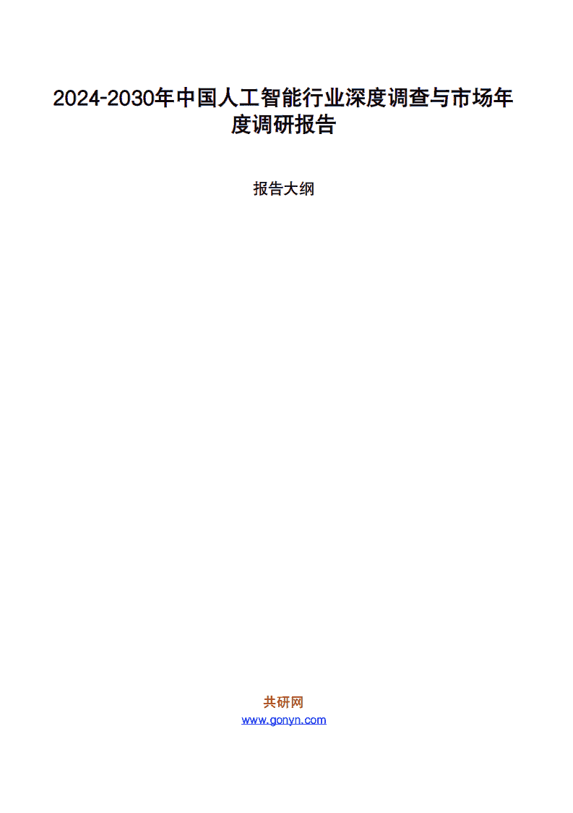

# 2024-2030年中国人工智能行业深度调查与市场年 度调研报告

> 来源：[https://feicaiclub.feishu.cn/docx/PLZpdSuNLo5zvlx6Litcy7lHnEb](https://feicaiclub.feishu.cn/docx/PLZpdSuNLo5zvlx6Litcy7lHnEb)

[2024-2030年中国人工智能行业深度调查与市场年 度调研报告.pdf](https://internal-api-drive-stream.feishu.cn/space/api/box/stream/download/all/AtESb4UsMokQP8xJ09FcnfPnnLh)

---

# 摘要

这份《2024-2030年中国人工智能行业深度调查与市场年度调研报告》提供了对中国人工智能行业的详细分析和市场预测，涵盖了行业现状、技术进展、市场趋势、竞争格局以及未来发展前景。以下是报告的详细总结：

### 一、报告概述

这份报告由共研网发布，旨在对2024-2030年中国人工智能行业进行深度调查和市场年度调研。报告共分为十五章，涵盖了行业的基本概述、市场环境、技术发展、应用领域、竞争格局、区域分析、重点企业研究，以及未来发展趋势和投资预测。报告的数据来源于国家统计局、海关总署、问卷调查数据、商务部等官方数据，以及来自企业和行业的市场调研数据。

### 二、市场环境分析

#### 1. **政治法律环境**

+   **行业管理体制**：分析了人工智能行业的管理体制，包括政府对AI技术的支持政策和监管框架。政府通过制定标准、法律法规来引导和规范行业发展。

+   **主要法律法规**：报告列举了对人工智能行业产生重大影响的法律法规，包括数据保护、隐私、安全等方面的法律，旨在确保人工智能技术的应用安全、合规。

+   **行业标准和发展规划**：重点讨论了国家和地方的人工智能发展规划，如《新一代人工智能发展规划》。这些规划为行业的长期发展设定了目标和方向，推动技术创新和产业化。

#### 2. **经济环境**

+   **宏观经济形势**：报告分析了中国当前的宏观经济形势，包括GDP增长、投资环境等因素如何影响人工智能行业的发展。经济环境的稳定性和增长潜力为人工智能产业提供了广阔的发展空间。

+   **经济环境对行业的影响**：探讨了经济周期、货币政策等对人工智能行业的影响，强调了经济增长与科技发展的相互促进作用。

#### 3. **社会环境**

+   **人口环境**：报告分析了中国的人口结构变化，包括人口老龄化、城镇化进程对人工智能技术需求的影响。人工智能在智慧养老、智能健康等领域的应用日益重要。

+   **教育和文化环境**：分析了中国的教育水平和文化背景如何影响人工智能技术的接受度和普及率。高素质的人才储备为AI行业的发展提供了重要支撑。

+   **社会环境对行业的影响**：人工智能技术的广泛应用正在改变社会结构和人们的生活方式，对社会发展产生深远影响。

#### 4. **技术环境**

+   **技术发展水平**：报告详细介绍了人工智能技术在中国的发展现状，包括深度学习、自然语言处理、计算机视觉等核心技术的进展。

+   **技术差距与发展动态**：分析了中国人工智能技术与国际先进水平的差距，并回顾了2018-2023年间技术进步的关键节点，指出了未来技术发展的重点领域。

### 三、全球市场分析

#### 1. **全球人工智能市场现状**

+   **发展阶段**：报告将全球人工智能市场的发展分为不同阶段，分析了当前市场处于哪个阶段，以及未来的发展方向。

+   **市场布局**：分析了全球主要国家和地区的人工智能市场布局，讨论了中美、欧洲、日本等区域在AI技术研发和产业化方面的领先优势和市场潜力。

+   **投资现状**：报告探讨了全球人工智能市场的投资现状，特别是在AIGC（生成式人工智能）、自动驾驶、智能制造等领域的投资增长情况。

#### 2. **区域市场分析**

+   **美国市场**：报告详细分析了美国在人工智能领域的市场规模、企业数量、技术发展和投资状况，特别是其在自动驾驶、医疗健康等领域的领先地位。

+   **欧洲市场**：讨论了欧洲的人工智能市场特点，包括欧盟的政策支持、企业增长和市场应用。欧洲在AI伦理和法规方面的领先优势也是一大亮点。

+   **日本市场**：分析了日本在人工智能技术开发和应用上的独特之处，特别是在机器人和制造业中的应用。

### 四、中国市场分析

#### 1. **行业发展现状**

+   **市场规模**：中国的人工智能市场规模在2024年将继续扩大，预计到2030年将有显著增长。报告提供了详细的数据分析，显示了不同领域的市场份额和增长趋势。

+   **需求分析**：分析了各个行业对人工智能技术的需求，包括金融、医疗、制造业等领域的需求动态。随着技术的成熟和应用场景的扩大，这些领域的需求将持续增长。

#### 2. **行业生态格局**

+   **基本架构**：报告介绍了中国人工智能行业的生态系统，包括基础资源层、技术实现路径层和应用实现路径层。每一层都有多个关键参与者，形成了一个完整的产业链。

+   **区域布局**：详细分析了中国各地区的人工智能产业发展情况，包括北京、上海、深圳等主要城市的产业集群特点和发展战略。

#### 3. **市场竞争分析**

+   **市场格局**：报告采用五力竞争模型分析了中国人工智能市场的竞争强度，探讨了新进入者、替代品、供应商、客户和现有竞争者之间的动态关系。

+   **竞争趋势**：预测了未来几年中国人工智能市场的竞争趋势，指出市场整合、技术突破和创新将是主要驱动力。

### 五、产业链结构

#### 1. **产业链架构**

+   **基础技术提供平台**：分析了IaaS、PaaS和SaaS等基础技术提供平台的功能和市场竞争状况。这些平台为人工智能技术的开发和应用提供了关键支持。

+   **技术平台**：讨论了人工智能技术平台的主要功能、涉及领域及其代表企业。这些平台在推动技术创新和商业化方面起着重要作用。

#### 2. **应用领域分析**

+   **计算机视觉**：报告详细分析了计算机视觉技术的研究方向、市场规模和竞争态势。计算机视觉在安防、医疗、自动驾驶等领域的应用前景广阔。

+   **语音识别**：分析了语音识别技术的发展现状、研究方向和市场前景，特别是在智能家居和移动设备中的应用。

+   **智能机器人**：探讨了智能机器人在工业自动化、医疗护理、教育等领域的应用，预测了未来的发展趋势。

### 六、应用领域分析

#### 1. **工业领域**

+   **智能制造**：报告探讨了人工智能在制造业中的应用，包括智能生产、质量控制、供应链优化等方面的应用案例和前景。AI技术正在推动传统制造业向智能化、数字化方向转型。

+   **智能工厂**：AI技术正在改变工厂的生产模式，智能工厂的建立使得生产效率大幅提升，生产成本降低，产品质量得到保障。

#### 2. **医疗领域**

+   **医学影像**：AI在医学影像分析中的应用极大地提高了诊断的准确性和效率，特别是在肿瘤检测、影像分类等方面的应用。

+   **药品研发**：人工智能正在加速药品研发过程，通过大数据分析和机器学习技术，药品研发周期得以缩短，研发成本也大幅降低。

#### 3. **智能家居**

+   **智能家居的AI应用**：人工智能正在成为智能家居系统的核心，推动家庭生活向自动化、个性化方向发展。AI技术在智能家电、家庭安全、环境控制等方面的应用前景广阔。

#### 4. **安防领域**

+   **生物识别技术**：报告分析了生物识别技术在安防领域的应用，包括人脸识别、指纹识别等技术，指出这将成为未来安防领域的重要方向。

+   **巡逻机器人**：巡逻机器人作为人工智能与安防技术结合的产物，正在逐步普及，特别是在大型公共场所和关键设施的安全管理中。

#### 5. **无人驾驶**

+   **自动驾驶技术**：报告探讨了自动驾驶技术的发展进程和市场前景，分析了中国在这一领域的竞争优势和挑战，预测了未来几年内自动驾驶汽车的量产和普及。

#### 6. **教育领域**

+   **AI在教育中的应用**：报告分析了人工智能在教育领域的应用前景，包括智能教学、个性化学习和教育管理等方面。AI技术将推动教育模式的变革，提高教学效率和质量。

### 七、技术发展与挑战

#### 1. **深度学习和自然语言处理**

+   **技术进展**：深度学习和自然语言处理（NLP）是当前人工智能研究的核心方向。报告详细介绍了这两项技术的最新进展及其在不同领域的应用。

+   **技术挑战**：尽管取得了显著进展，但人工智能在理解复杂语境、处理多模

态数据等方面仍然面临挑战，特别是在模型的可解释性和安全性方面。

#### 2. **技术障碍**

+   **算法和算力的瓶颈**：报告指出，当前人工智能技术的发展在算法复杂性和算力需求上遇到瓶颈。要解决这些问题，既需要在基础算法上取得突破，也需要硬件设施的进一步发展，如量子计算的普及应用。

#### 3. **伦理问题**

+   **AI伦理与安全**：报告探讨了人工智能技术在隐私保护、决策公正、算法偏见等方面的伦理问题，强调了制定行业标准和法规的重要性，以确保AI技术在安全和可控的环境下发展。

### 八、竞争格局分析

#### 1. **区域市场分析**

+   **长江三角洲**：长三角地区作为中国人工智能产业的核心区域，凭借其强大的科研能力和产业基础，正在引领全国人工智能技术的发展。

+   **珠江三角洲**：珠三角地区则依托其成熟的制造业基础和良好的营商环境，成为人工智能应用的重要试验场。

+   **环渤海地区**：环渤海地区在政策支持和技术研发方面也有显著优势，尤其是在智能制造和智能交通领域。

### 九、重点企业分析

报告深入分析了国内外多家人工智能领域的重点企业，包括：

+   **百度**：作为中国人工智能技术的领导者之一，百度在大数据、深度学习、自然语言处理等方面具有显著优势，特别是在自动驾驶和智能语音领域的领先地位。

+   **腾讯**：腾讯依托其强大的社交网络和数据资源，在人工智能技术的研发和应用上取得了显著成果，尤其是在AI+社交、AI+金融等领域。

+   **阿里巴巴**：阿里巴巴在人工智能领域的布局涵盖了电商、金融、云计算等多个领域，其云计算平台阿里云在全球市场中占有重要地位。

+   **国际企业**：微软、谷歌、IBM等国际企业在人工智能技术研发和产业化应用方面处于全球领先地位，特别是在云计算、自动驾驶、智能语音等领域。

### 十、未来前景及投资预测

#### 1. **市场发展前景**

+   **技术趋势**：报告预测，2024-2030年，人工智能技术将进一步向更高层次发展，尤其是在大数据、云计算、物联网与人工智能的融合应用上，技术创新将推动更多应用场景的落地。

+   **市场规模预测**：中国人工智能市场规模将持续扩大，2024-2030年期间年均复合增长率预计将保持在两位数以上，市场规模到2030年可能达到数万亿元。

#### 2. **投资建议**

+   **重点投资领域**：报告建议投资者重点关注以下几个领域：生成式人工智能、大模型、自动驾驶、智能制造、医疗人工智能等。这些领域不仅技术前景广阔，而且市场需求旺盛。

+   **区域投资机会**：随着政策支持和产业集群效应的加强，长三角、珠三角和环渤海地区将成为人工智能投资的热点区域。

+   **风险管理**：在投资过程中，需重点关注技术发展的不确定性和政策变化对市场的影响，特别是在数据隐私保护、伦理法规等方面的政策变化可能带来的风险。

### 结论

报告总结指出，中国的人工智能行业将在未来十年内经历快速发展，并将在全球范围内占据越来越重要的地位。然而，行业也面临着技术创新、伦理挑战、市场竞争等多重挑战。通过持续的技术研发、政策支持和市场化应用，人工智能将在更多领域创造价值，为中国经济转型升级提供强大动力。对于企业和投资者而言，把握技术趋势、合理布局资源，将是获取未来市场先机的关键。