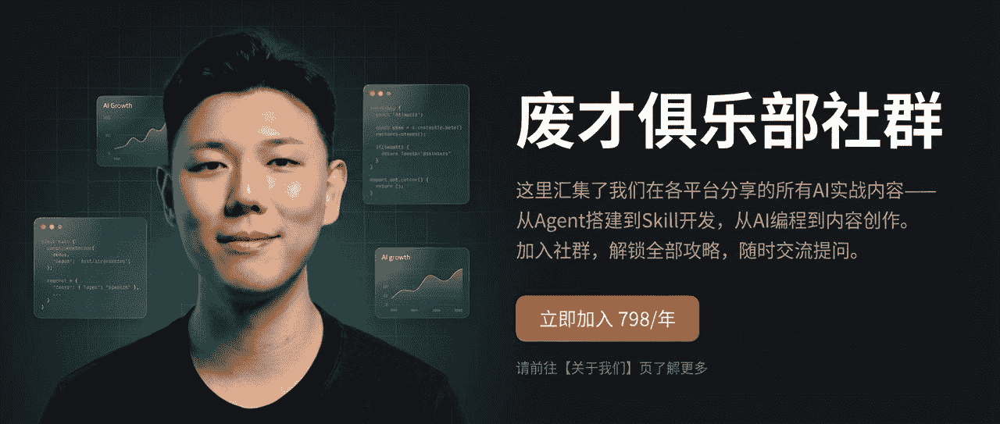
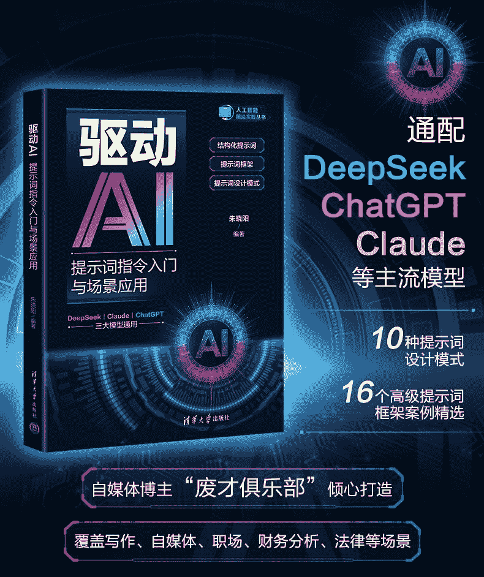
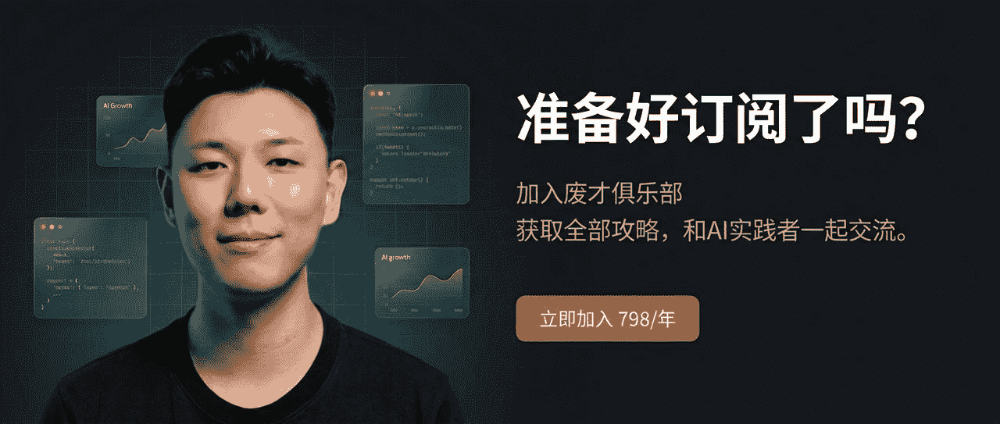

# 关于我们

> 来源：[https://feicaiclub.feishu.cn/docx/RaNpdZxc4oFaBux15zxcEPFenRc](https://feicaiclub.feishu.cn/docx/RaNpdZxc4oFaBux15zxcEPFenRc)

> **建议使用电脑端浏览器访问。否则部分页面会遇到“该内容不支持显示 或 **Sorry, the item is not availiable yet”情况

# **👏🏻 欢迎来到废才俱乐部！**

> **废才俱乐部是什么？**

> 这是一个专注AI实战应用的付费社群。

>

> **你是不是也遇到这些问题？**

+   **不懂上下文工程：**想让AI稳定高效完成任务，但写不出系统性的结构化上下文工程提示词框架

+   **缺乏深度教程：**想学习搭建 Agent 或者设计 Agent Skills 但网上都是浅层教程，缺乏实战指导

+   **孤军奋战：**遇到问题希望与其他人交流，但身边没有专业圈子

+   **试错成本高：**自己摸索浪费大量时间，网上免费资源质量参差不齐

+   **缺乏专业化：**通用提示词无法满足具体业务场景

+   **学习无体系：**零散学习，没有系统性的知识框架和成长路径

>

> **我们会在这里持续分享：**

> 🤖 Agent与Sub-Agent搭建攻略

> ⚡ Skill开发实战教程

> 🚀 前沿AI应用方案

> 📦 每期视频的完整配套资料

>

> **加入社群，你将获得：**

> ✅ 全部AI实战攻略（持续更新）

> ✅ 每期视频的完整资料

> ✅ 社群交流，随时提问

---

# **社群内容导览**

## **📍 废才俱乐部**

> 社群首页，浏览全部内容

> → [AI实战攻略集合](https://feicaiclub.feishu.cn/wiki/LTZfw7jiKi6vj5kt3vNcJu3nn6d?from=from_copylink)（点击进入）

>

## **📍 更新日志**

> 查看最新更新

> → [更新日志传送门](https://feicaiclub.feishu.cn/wiki/RlFOwBhqTikLiCkasSPc3Z4Kn9d?from=from_copylink)（点击进入）

>

## **📍 社群资料库**

> 社群会员的内容中心，按分类查找

> → [年度会员专区](https://feicaiclub.feishu.cn/wiki/InhvwaVcii8LO1kEBuCcz6HPn4f?from=from_copylink)（点击进入）

>

## **📍 其他资源**

> • [《驱动AI提示词指令入门与场景应用》](https://feicaiclub.feishu.cn/wiki/Fa0mw6df5i4kpAkew8nc0uDlnaf?from=from_copylink)

> • [社群热门文章](https://feicaiclub.feishu.cn/wiki/M4iqw4tmviT3sJk2i2RcyRVhn38?from=from_copylink)

> • [大模型专区](https://feicaiclub.feishu.cn/wiki/AWR2wvEqIieBTXkCMfocMvQynWb?from=from_copylink)

> • [AI人工智能论文区](https://feicaiclub.feishu.cn/wiki/Pyrcwp2aiiIyZLk5hCwcnQ2Jnwf?from=from_copylink)

> • [AI人工智能行业报告区](https://feicaiclub.feishu.cn/wiki/AxWRwcgw8ibC01kPSbScWGUOnZd?from=from_copylink)

---

# **图书上新**

> 《驱动A**I提示词指**令**入门与场**景应用》这本书是废才俱乐部与清华大学出版社一起精心打磨的AI教学指导图书

> [《驱动AI提示词指令入门与场景应用》](https://feicaiclub.feishu.cn/wiki/Fa0mw6df5i4kpAkew8nc0uDlnaf?from=from_copylink)**（◀️ 下单戳这里）**

---

# **常见问题 FAQ**

> **Q: 怎么加入社群？**

> A: 点击【加入社群】，完成 ¥798 付费即可解锁全部内容。

>

> **Q: 加入后怎么进群交流？**

> A: 在「社群资料库」找到「社群入口」，扫码即可加入微信群。

>

> **Q: 内容会持续更新吗？**

> A: 会！每期视频发布后，配套资料会同步更新到社群资料库。

>

> **Q: 社群里有什么内容？**

> A: 主要是AI实战攻略，包括Agent搭建、Skill开发、AI编程、内容创作等，持续更新中。

>

> **Q: 可以退款吗？**

> A: 虚拟内容付费后**不支持退款**，请谨慎购买。

>

> **Q: 如何联系废才老师？**

> A: 加入社群后，在企业微信群里直接 @废才UP 提问。

---

> **点击前往 **[社群资料库](https://feicaiclub.feishu.cn/wiki/InhvwaVcii8LO1kEBuCcz6HPn4f?from=from_copylink)**立即加入**（戳这里）

---

# **🏛️ 知识产权声明**

欢迎使用废才俱乐部学堂（以下统称“学堂”）。本学堂提供的文档、提示词及其他内容（以下统称“内容”）旨在促进用户及粉丝之间的交流与学习。请您注意，除非得到废才或其关联公司的明确书面授权，否则您不得将这些内容用于任何商业目的。

**授权请求：** 若您希望出于非个人学习目的使用任何内容，必须事先联系原作者或废才获取书面授权。未经授权而使用的行为，可能会侵犯作者或其关联方的知识产权。

**权利所有：** 本学堂中提供的所有内容，包括但不限于产品描述、软件、技术方案、网页设计、文本、图片、图形、音频、视频及图表等，其版权、商标权、专利权、商业秘密以及其他相关的所有权利，均归废才或其关联方所有。未经废才明确书面许可，任何个人或实体不得将这些内容用于商业目的。

**法律责任：** 任何违反本声明的行为，如未经授权使用废才内容、商标或其他标识，造成废才、原作者或任何第三方损失的，违反方将承担全部法律责任。

**总结：** 我们鼓励和支持内容的分享与学习，但必须在尊重原创权和知识产权的前提下进行。对于任何商业用途的使用，我们强烈建议您首先获取相应的授权，以避免法律风险。