# 废才俱乐部首页

> 来源：[https://feicaiclub.feishu.cn/docx/ZN8xdbqOKoapi3xPJ4LcYQm8nCc](https://feicaiclub.feishu.cn/docx/ZN8xdbqOKoapi3xPJ4LcYQm8nCc)

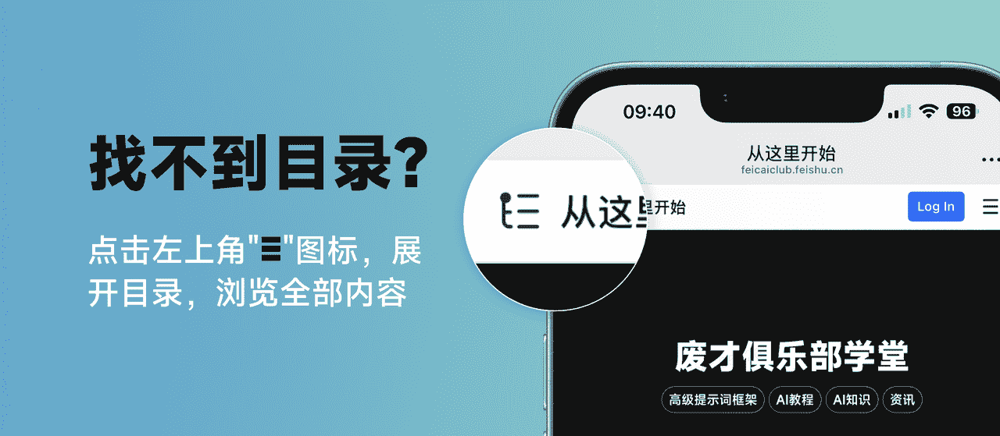

> **建议使用电脑端浏览器访问。否则部分页面会遇到“该内容不支持显示 或 **Sorry, the item is not availiable yet”情况

> **废才俱乐部是什么？**

> 这是一个专注AI实战应用的付费社群。

>

> **我们会在这里持续分享：**

> 🤖 Agent与Sub-Agent搭建攻略

> ⚡ Skill开发实战教程

> 🚀 前沿AI应用方案

> 📦 每期视频的完整配套资料

>

> **加入社群，你将获得：**

> ✅ 全部AI实战攻略（持续更新）

> ✅ 每期视频的完整资料

> ✅ 社群交流，随时提问

> **准备好订阅了吗？前往 **[社群资料库](https://feicaiclub.feishu.cn/wiki/InhvwaVcii8LO1kEBuCcz6HPn4f?from=from_copylink)**立即加入**（戳这里）

---

# **最新更新**

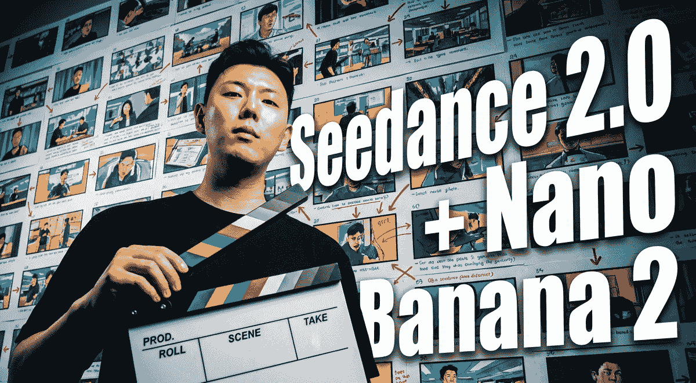

[AI 短剧 | Seedance 2.0 分镜师团队，Agent + Skill 方法](https://feicaiclub.feishu.cn/wiki/TcDDwsdYGibLdqkgi15c7rBTnch?from=from_copylink)

这期内容解决一个问题：怎么高效、高质量地自动化生成 Seedance 2.0 影视级提示词。不是拿到剧本就硬写提示词、全靠人肉反复调参，而是把导演讲戏、服化道设计、分镜编写的方法论写进七个Skill，通过三阶段流程加两步审核，充分调动 Seedance 2.0 的分镜编导能力，让每条提示词都经得起专业标准检验。

---

# **全部攻略**

> **按更新时间顺序排列**

[AI 短剧 | Seedance 2.0 分镜师团队，Agent + Skill 方法](https://feicaiclub.feishu.cn/wiki/TcDDwsdYGibLdqkgi15c7rBTnch?from=from_copylink)

[AI Agent｜文章编辑部 Agent Teams](https://feicaiclub.feishu.cn/wiki/Yo9ywYguYiqMnikcCU6cQVwVnkh?from=from_copylink)

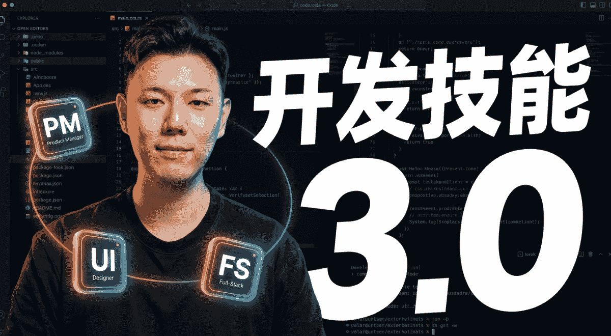

[AI 编程 | 产品经理开发技能 3.0 ](https://feicaiclub.feishu.cn/wiki/VXxKw0LToiJJn7kxFNDc3q7tnJg?from=from_copylink)

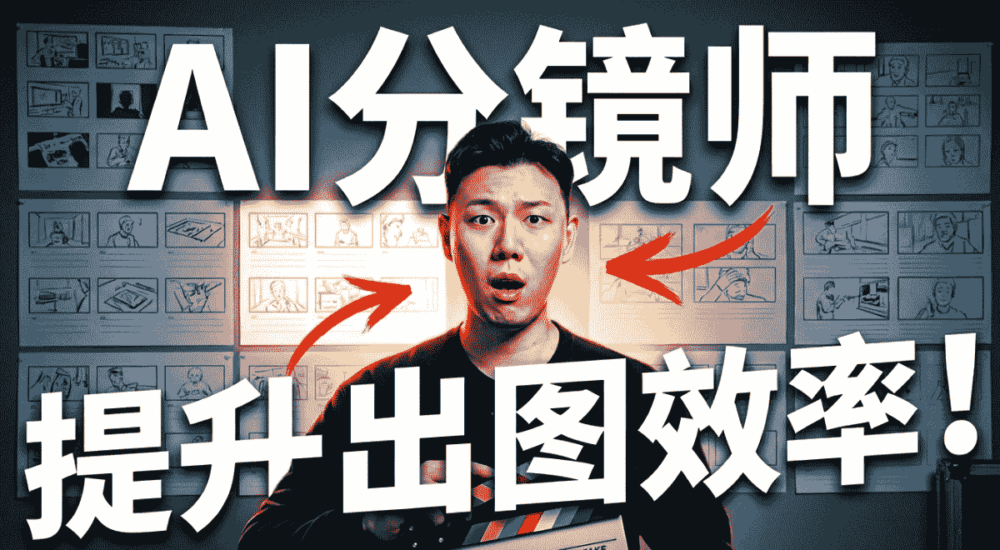

[AI 短剧 | AI分镜师 Agent，Claude Agent+Skill方法](https://feicaiclub.feishu.cn/wiki/DfU3wSLDci3ZhXkcTfwc48pOn9d?from=from_copylink)

[2025年终总结：开发 AI Agent 产品的实战方法](https://feicaiclub.feishu.cn/wiki/Gl2IwF4CzihLXikAPsUcztYfnTe?from=from_copylink)

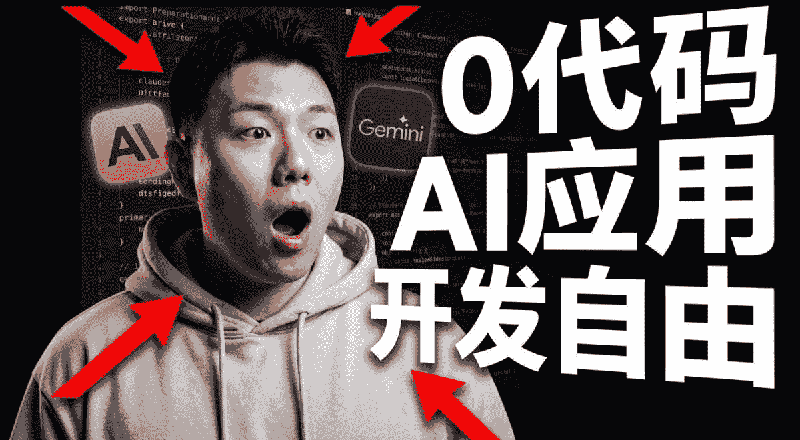

[AI 编程 | 0代码，如何用Gemini 3.0开发AI产品](https://feicaiclub.feishu.cn/wiki/QaRMw4aOSib9AKkdDtWcMVkEnac?from=from_copylink)

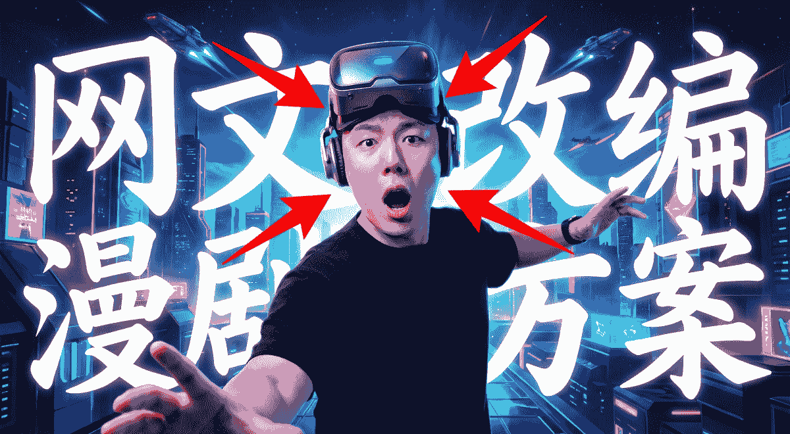

[漫剧 | 网文改编漫剧 Claude Agent+Skill方法](https://feicaiclub.feishu.cn/wiki/KP4OwdAsyiON2MkeVFXclVybn2d?from=from_copylink)

[漫剧 | 末世重生类 漫剧剧本创作 Claude Skill](https://feicaiclub.feishu.cn/wiki/JQ8bwixhSimnGFkWTUOcl3jZnBf?from=from_copylink)

[漫剧 | 玄幻类 漫剧剧本创作 Claude Skill](https://feicaiclub.feishu.cn/wiki/GqVLwFcx0iOghhkKZvIcI3dJnBh?from=from_copylink)

[AI 剧本 | Claude Code 搭建短剧编剧团队](https://feicaiclub.feishu.cn/wiki/EAPpwh0MvicGX5kc09GcEwovnDo?from=from_copylink)

[AI Agent | 如何用Agent Skill创建技能以及技能包](https://feicaiclub.feishu.cn/wiki/RZDGw7z1ViOskTkEK8WcAcjGnGd?from=from_copylink)

[AI 短剧｜Nano Banana 分镜图生成全攻略](https://feicaiclub.feishu.cn/wiki/TnUHwRqbsi7lY8ku7hVcfOk6nEc?from=from_copylink)

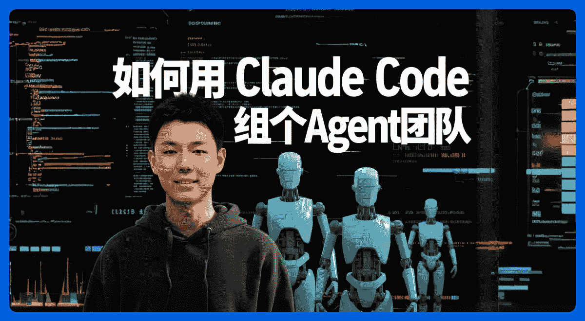

[AI Agent ｜如何用 Claude Code 搭建 Agent 团队](https://feicaiclub.feishu.cn/wiki/TWoWwqnwSiMFv7kW0YicnH6qnSb?from=from_copylink)

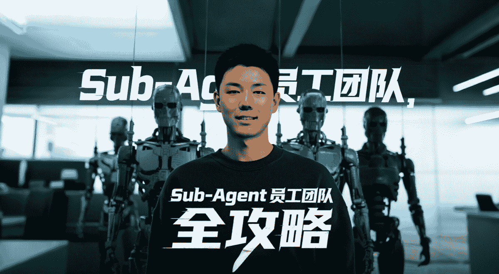

[AI Agent | 如何用 Claude Code 搭建 Sub Agent 员工团队](https://feicaiclub.feishu.cn/wiki/QGCzwTt8nipBXAk0VaWcwh0pnxh?from=from_copylink)

[AI Agent | 项目记忆管理 - Progress Recorder Agent](https://feicaiclub.feishu.cn/wiki/DqRcwvHrSigDd5kZluPcLon4nkc?from=from_copylink)

[AI Agent ｜n8n AI Agent 工作流设计提示词框架](https://feicaiclub.feishu.cn/wiki/DsMmwAbtKibq54kf1CmcGykhnnd?from=from_copylink)

[小说 | 古代权谋类 短篇小说创作 Claude Skill](https://feicaiclub.feishu.cn/wiki/QvAhwkSClivoEmktuYDcqs5Vn2d?from=from_copylink)

[小说 | 现代言情类 短篇小说创作 Claude Skill](https://feicaiclub.feishu.cn/wiki/I6r3wWSrrihoL4ku0Y8cmOl7nrg?from=from_copylink)

[小说 | 现实题材类 短篇小说创作 Claude Skill](https://feicaiclub.feishu.cn/wiki/M16vwH6P4iVGEvk7rlScpdptncx?from=from_copylink)

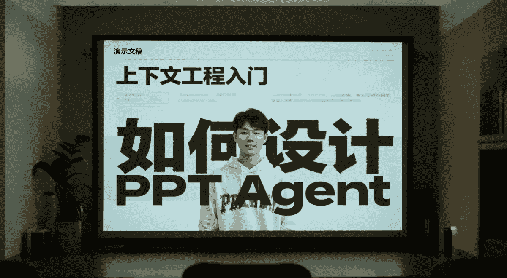

[AI Agent | 如何开发生成定制化 PPT 的 Agent](https://feicaiclub.feishu.cn/wiki/RUZhwbrmfiO1MOkhhPTc7j4Ynpc?from=from_copylink)

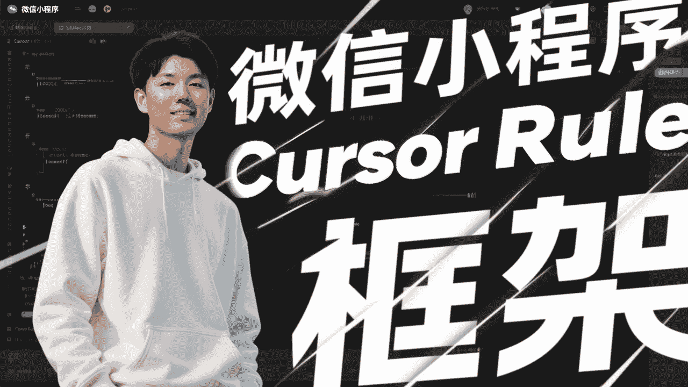

[AI 编程 | 🛰️小程序 Cursor Rule 框架](https://feicaiclub.feishu.cn/wiki/FvSLwJCf6iIMt8k9tS9cj7fxnjc?from=from_copylink)

[新闻媒体 ｜ 新闻稿件提示词框架 - 通用](https://feicaiclub.feishu.cn/wiki/T837wTqpxiHxLykJakTcnIkEn9e?from=from_copylink)

[行业分析｜行研报告可视化提示词框架](https://feicaiclub.feishu.cn/wiki/Mzh5wIuz3icdG2kdtjkchrRRnNG?from=from_copylink)

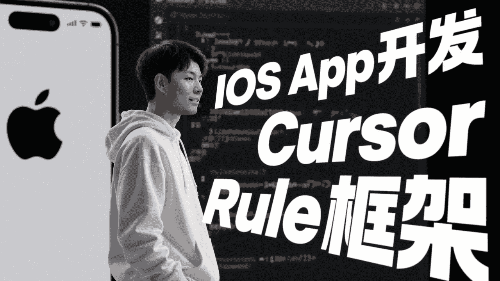

[AI 编程 ｜ IOS App开发Cursor Rule框架](https://feicaiclub.feishu.cn/wiki/XUbqwajFtiSrkkkCjWhc1AJNn0c?from=from_copylink)

[知识付费 | 读书拆书提示词框架](https://feicaiclub.feishu.cn/wiki/D986wUgsmiDU6TkAtrucwWImnAd?from=from_copylink)

[电商 | 抖音直播带货话术提示词框架 - 通用](https://feicaiclub.feishu.cn/wiki/FTHgwRP7xixeRjkQ6XKc5bA7n5f?from=from_copylink)

[AI 设计 | 高质量海报设计提示词框架 - ChatGPT 4o专用](https://feicaiclub.feishu.cn/wiki/WszTwg2ASigtBrke6oCcbH4mnoh?from=from_copylink)

[AI 编程 | 产品UI设计提示词框架 - 暗黑模式科技风](https://feicaiclub.feishu.cn/wiki/ZuYSwBOKqib54nkOXwtcWRSvnYc?from=from_copylink)

[自媒体 | 🛰️👸号文章生成提示词框架](https://feicaiclub.feishu.cn/wiki/UyumwOUisivFVckYxjgcoHWDnHb?from=from_copylink)

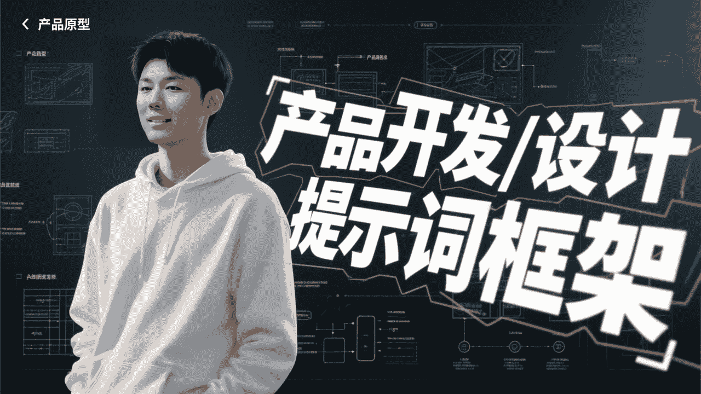

[AI编程 | 产品开发/设计提示词框架](https://feicaiclub.feishu.cn/wiki/V43LwJrOWiqnYZkWewPcgaVZnC0?from=from_copylink)

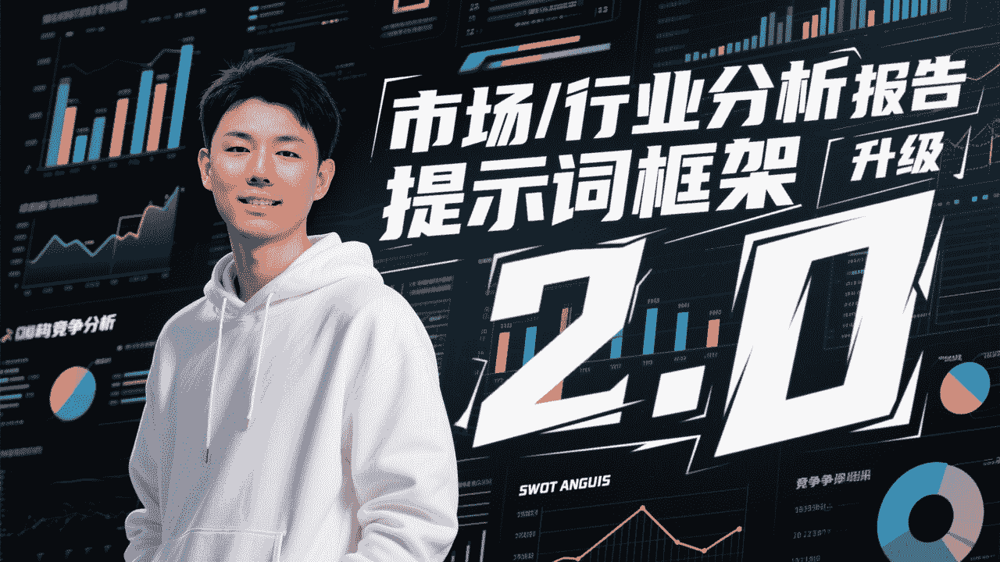

[行业分析 | 市场/行业分析报告提示词框架 2.0](https://feicaiclub.feishu.cn/wiki/NEo3wVukji7fpmkYWsPcAUO8nRf?from=from_copylink)

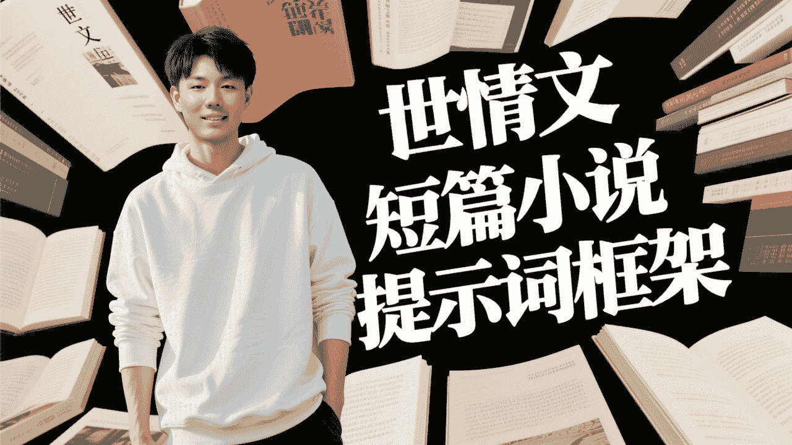

[小说 | 世情文短篇小说提示词框架](https://feicaiclub.feishu.cn/wiki/XGuowBzliiqlZxkaCYLc6uornOd?from=from_copylink)

[自媒体 | 适用于DeepSeek口播文案提示词框](https://feicaiclub.feishu.cn/wiki/GAuLwmDSoit1tJkfjPBc2VXYnqb?from=from_copylink)

[AI 剧本 | 网文改编短剧提示词框架](https://feicaiclub.feishu.cn/wiki/DHN1wznEeif0HZk7RbGcOG7cnHh?from=from_copylink)

[AI 剧本 | 爽文短剧提示词框架](https://feicaiclub.feishu.cn/wiki/UiM8wiveFiN2vYkKTP0cYUGCnXX?from=from_copylink)

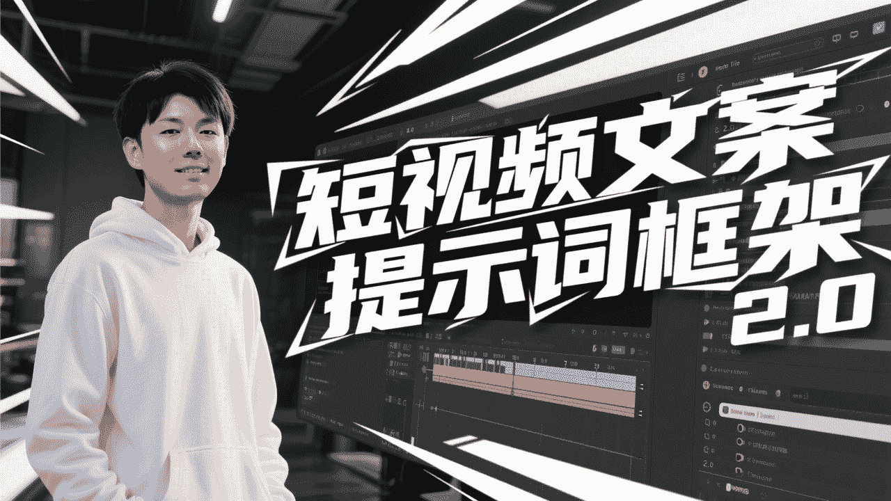

[自媒体 | 短视频文案提示词框架 2.0](https://feicaiclub.feishu.cn/wiki/Y7mcw7GB8iBwtCkc8odcCRjZnmg?from=from_copylink)

[小说 | 网文小说提示词框架 2.0](https://feicaiclub.feishu.cn/wiki/NyeQwft0riLX2skpSIEcz4PQnne?from=from_copylink)

[自媒体 | AI播客脚本提示词框架](https://feicaiclub.feishu.cn/wiki/FByLwTtl4iVVFLkQn4mcKMvGnBW?from=from_copylink)

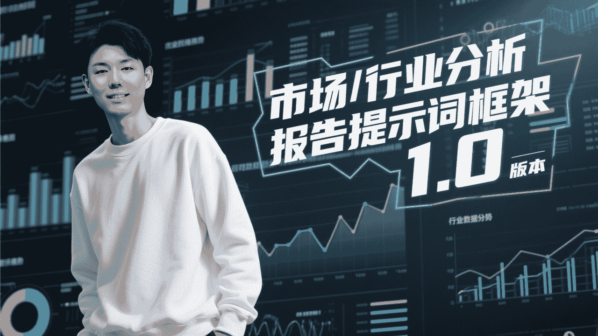

[行业分析 | 市场/行业分析报告提示词框架 1.0](https://feicaiclub.feishu.cn/wiki/ZtlYw2ghWiCoHskzf4rcMeEEnbg?from=from_copylink)

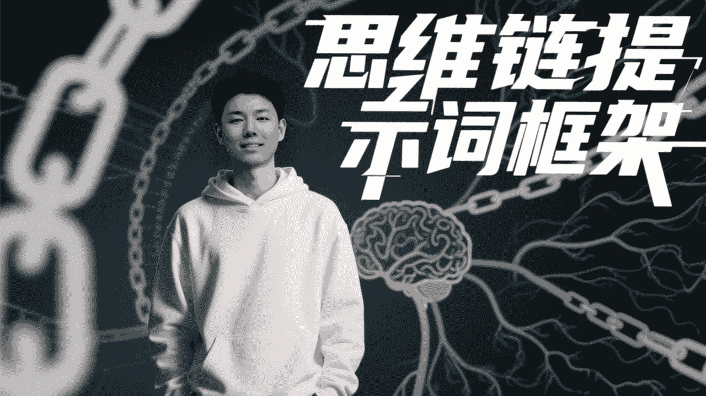

[慢思考 | 思维链提示词框架](https://feicaiclub.feishu.cn/wiki/HG7VwksR3iFRB5koTiAcVaZOnFf?from=from_copylink)

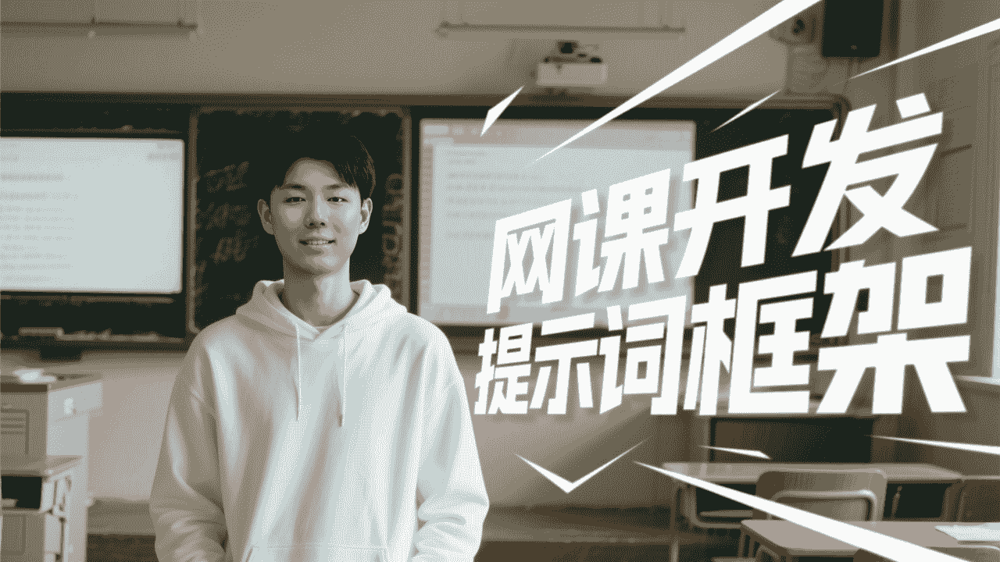

[知识付费 | 网课开发提示词框架](https://feicaiclub.feishu.cn/wiki/JzUbwnCwviyzOYkJagJckhNynQL?from=from_copylink)

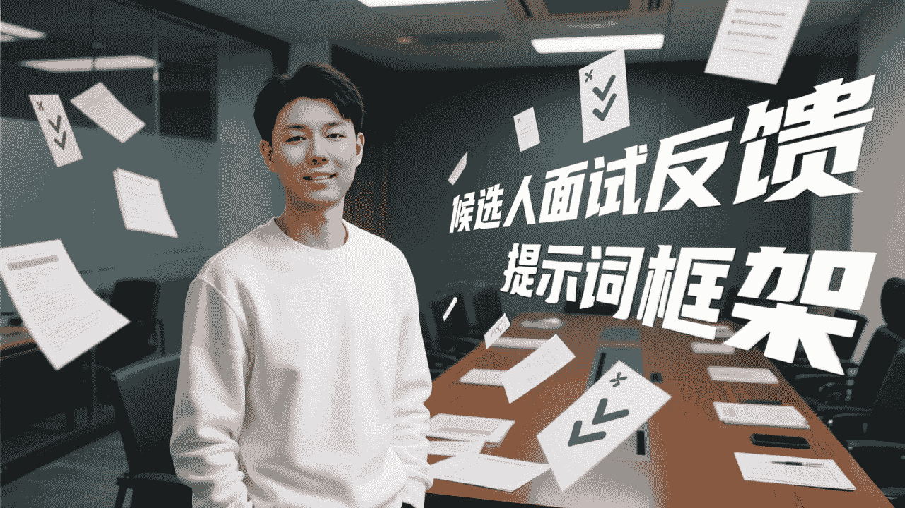

[职场 | 候选人面试反馈提示词框架](https://feicaiclub.feishu.cn/wiki/QnC9w4aALin6jSkzCoScYzlenYg?from=from_copylink)

[小说 | 网文小说提示词框架 1.0](https://feicaiclub.feishu.cn/wiki/JmPGwC7E9izf3GkIFRdcFYaVn2b?from=from_copylink)

[自媒体 | 短视频逐字稿文案撰写提示词框架](https://feicaiclub.feishu.cn/wiki/UAV3wQSkjiXyYkkpznBcGsu7nHz?from=from_copylink)

[ AI 剧本 | 影视编剧助理提示词框架](https://feicaiclub.feishu.cn/wiki/SLKtwl3fai0EywkP72QcL8u1nmc?from=from_copylink)

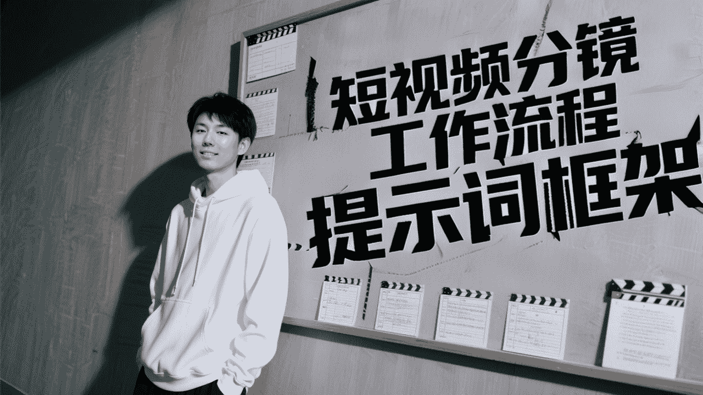

[自媒体 | 短视频拍摄分镜工作流程提示词框架](https://feicaiclub.feishu.cn/wiki/CCQEwIiPCi89aAkmPBUcU9TInnb?from=from_copylink)

[自媒体 | 视频逐字稿风格仿写提示词框架](https://feicaiclub.feishu.cn/wiki/Vb2dwmZOViJZpUktbI7ctiolnVb?from=from_copylink)

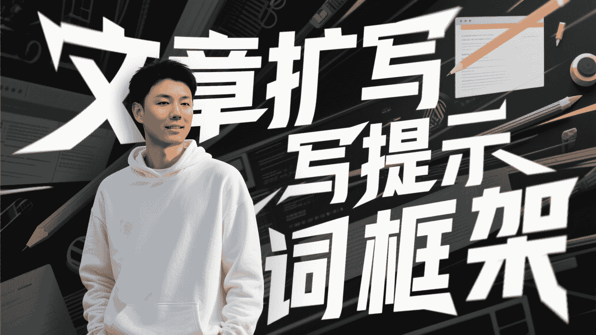

[写作 | 文章扩写提示词框架](https://feicaiclub.feishu.cn/wiki/VleVwM5bzigpaukSlaVczwlWncd?from=from_copylink)

---

# 免费体验

# **免费内容**

> [免费 | AI短剧 ｜ 分镜脚本提示词框架](https://feicaiclub.feishu.cn/wiki/XLu5wolRViSXs1kezX3ckq2ynog?from=from_copylink)

> [免费 | 翻译 | 中英翻译提示词框架](https://feicaiclub.feishu.cn/wiki/UH3fw6qcYiOaEKk4OFNcQkiDnDd)

> [免费 | 财务分析 | 财务比率分析提示词框架](https://feicaiclub.feishu.cn/wiki/VQbWwUsl0id5m0k8J8bceaamnJc)

> [免费 | 写作 | 体制内公文写作助手提示词框架](https://feicaiclub.feishu.cn/wiki/SKwpwdAzYin4yjkdFTbcZRLrnwh)

> [免费 | 自媒体 | 账号分析提示词框架](https://feicaiclub.feishu.cn/wiki/UPISw5sY8imH1CkEuA0cNUmLnKf)

> [免费 | 占卜 | 塔罗牌占卜师提示词框架](https://feicaiclub.feishu.cn/wiki/CM9owvI1OiXiickT5gocuyBknYf)

> [免费 | 职场求职 | 裁员赔偿助手提示词框架](https://feicaiclub.feishu.cn/wiki/Bz2Iw2GxUigbKQk1sX2cwgxFn6g)

> [免费 | 职场求职 | 简历修改提示词框架](https://feicaiclub.feishu.cn/wiki/VbrYwbAQ5iNW6ikWDMpc1hLJnnf)

> [免费 | 法律 | 法律案例拆解提示词框架](https://feicaiclub.feishu.cn/wiki/ROVbwkl46iXUankA64jcbzvXnoe)

> [免费 | 产品经理 | 商业需求文档撰写提示词框架](https://feicaiclub.feishu.cn/wiki/Lh9QwubvQiIvvAk9smtcJ6TNndb)

> [免费 | 产品经理 | 产品需求文档撰写提示词框架](https://feicaiclub.feishu.cn/wiki/FeagwyNmbimMX7kirWDcrYZlnvb)

> [免费 | 行业分析 | PPT及演讲稿构思提示词框架](https://feicaiclub.feishu.cn/wiki/QrB2w5W5jiKFYMkv8eRcgM45n0b)

> [免费 | 行业分析 | 行业分析提示词框架（1）](https://feicaiclub.feishu.cn/wiki/GtmOwXm7IiMKyxkQGQXcerCInSg)

> [免费 | 行业分析 | 行业分析提示词框架（2）](https://feicaiclub.feishu.cn/wiki/EWVVwt0X9ilagHkXfLJcbb1qnac)

> [免费 | 行业分析 | 公司分析提示词框架 (3)](https://feicaiclub.feishu.cn/wiki/XR2kwglj4itFtlkqgINc3ijjn9i)

> [免费 | 行业分析 | SWOT模型分析提示词框架 (1)](https://feicaiclub.feishu.cn/wiki/C5tYwRYPTi7RuwkbWIjcfku1n7b)

> [免费 | 行业分析 | SWOT模型分析提示词框架（2）](https://feicaiclub.feishu.cn/wiki/ALbkwO5MqiER9VkxlxIcplxCnSR)

> [免费 | 行业分析 | 波特五力模型分析提示词框架](https://feicaiclub.feishu.cn/wiki/L0tswISLQiZWHtk6ObVcxweUnIg)

> [免费 | 行业分析 | 行业分析报告大纲提示词框架](https://feicaiclub.feishu.cn/wiki/G8lzwW5mciSoLFkO7Pncwuo0nQf)

> [免费 | 行业分析 | PEST模型分析提示词框架](https://feicaiclub.feishu.cn/wiki/JoFAwZo75i97HjkucEScDyeMnDg)

> [免费 | 旅游 | 旅游行程制定提示词框架](https://feicaiclub.feishu.cn/wiki/ZHLPw1oMeiEuepk5n9Ucd3rRnjf)

> [免费 | 财务分析 | DCF企业价值评估提示词框架](https://feicaiclub.feishu.cn/wiki/CKN7w5QYCis4rkkV2k9cvOMCnQ8)

> [免费 | 财务分析 | 上市公司财务报告分析提示框架](https://feicaiclub.feishu.cn/wiki/X6s5wifOsiniZYkI3ZycnLYCnwb)

> [免费 | 财务分析 | 杜帮分析法提示词框架](https://feicaiclub.feishu.cn/wiki/X4jkwR8FFiKcqckdnoWckfeinZc)

> [免费 | AI绘画 | Midjourney提示词框架](https://feicaiclub.feishu.cn/wiki/YNiiwc1A8iPpaskT011crJRonKc)

---

> **准备好订阅了吗？前往 **[社群资料库](https://feicaiclub.feishu.cn/wiki/InhvwaVcii8LO1kEBuCcz6HPn4f?from=from_copylink)**立即加入（戳这里）**