# Ai绘画-Midjourney

> 来源：[https://keenchase.feishu.cn/docx/Ehg5dQwKwo0oulxmdFqcJjijnZg](https://keenchase.feishu.cn/docx/Ehg5dQwKwo0oulxmdFqcJjijnZg)

> 点我返回👉【杰夫AI知识库｜首页】

> [**点我跳转👉【AI工具库】**](https://keenchase.feishu.cn/wiki/TSyWwNmPsi2CZTk4fqMc2XQgnkd)

> 适用人群：学习AI绘画、设计师、插画师、摄影师、美术爱好者等

> **内容出品人：**** **

> **内容出品方：数字资产Jeff**

> **使用建议：**如果需要快速定位到精确内容，可以使用快捷键 Ctrl +F/Command +F 的形式，搜索关键字/词，查找你想要的内容，PC 端查看学习效果更好。

> **特别说明：**飞书手册的创作经过了精心构思与整理，凝聚了诸多心血，在此温馨提醒大家请勿直接抄袭复制其中的内容。本手册会持续更新 MidJourney 绘画在资讯动态、研究报告、赚钱案例以及实用场景等多个板块的信息。所有内容均支持永久免费在线查阅，您可以放心浏览。如果您觉得这些内容对您有所帮助，欢迎收藏以便后续查看，并转发给更多有需要的人，感谢您的支持与配合。

# 一、基本介绍

## 平台介绍

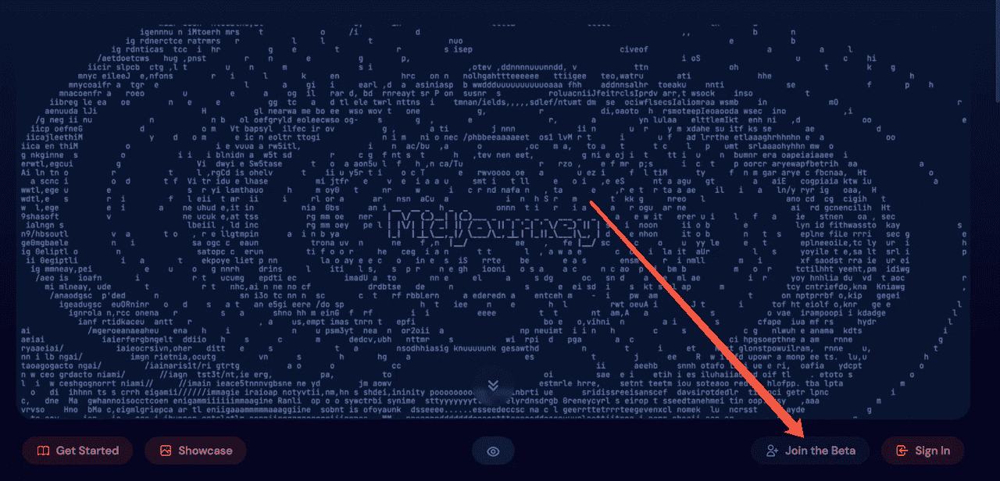

Midjourney 是一个由同名研究实验室开发的人工智能程式，只要输入想到的文字，就能通过人工智能产出相对应的图片，耗时只有大约一分钟，其于 2022 年 7 月 12 日进入公开测试阶段，使用者可透过 Discord 的机器人指令进行操作。该研究实验室由 Leap Motion 的创办人大卫·霍尔兹负责领导，2023 年 4 月，入选《福布斯 2023 年 AI 50 榜单：最有前途的人工智能公司》。

## **官方网站**

**传送门：**https://www.midjourney.com/home

## 常见用途及使用场景

**广泛应用场景：**MidJourney 堪称创意灵感的百宝箱，在壁纸、插画、漫画等视觉创作领域大显身手，为平面设计、logo 与 APP 图标雕琢、游戏 UI 构建、建筑室内规划、服装设计摄影及平面包装打造，源源不断地输送独特创意思路，革新传统设计流程。

**多元适配人群：**其面向人群极为广泛，设计师、插画师、美术指导、创意总监等专业创意骨干可借此提升效率与创意水准；自媒体人能丰富内容呈现；创意与视觉行业从业者觅得灵感源泉；内容创作者、AI 爱好者及行业投资人也能各取所需，深度探索 AI 创意价值。

**新兴职业拓展：**MidJourney 的兴起催生出一系列新兴职业路径，AI 图像生成师专注于精美图像产出，AI 视觉创意指导把控整体视觉风格与创意方向，AI 艺术家则在这一前沿领域深入挖掘，用 AI 技术诠释独特艺术表达，重塑艺术创作生态。

# 玩好 Midjourney 需要具备的能力

> **英语：**Midjourney 是纯英文操作，输入英文关键词进行 AI 绘图，需要你至少英语 4 级水平，能看懂基本的英语指令，输入英语关键词，进行 AI 绘画创作。

> **知识管理：** 关键词决定了你输图的质量，需要你具备知识管理能力，建立积累关键词资源库的能力，比如用印象笔记，EXCEL 表格 等工具建立自己的专属图库。

> **艺术鉴赏：** 你至少应该懂得基本的绘画风格，摄影参数， 光影效果，3D 技术，超现实主义，波普艺术，立体主义，达达主义，未来主义，现实主义，极简主义，抽象派，新艺术，超现实主义，表现主义，构成主义 各种等各种艺术风格流派

> **修图能力：**在 AI 绘画的基础上能修图改图，二次创作创新。青出于蓝而胜于蓝。

> **搜索能力：**能够熟练使用 google wiki chatgtp 搜索，谷歌翻译等 创建关键词词库。

> **逻辑思维：**兵器是身体的延伸，AI 是思维的衍生，需要你具备逻辑树形思维创建图像

> **创意思维：**需要你脑洞打开，无远弗届，创意--创造--创世。

## MJ 中国市场

MJ 官方目前在和腾讯官方合作，MJ 官方 🐧 频道，🐧 扫码可以加，如果过期，可以自行去 🐧 频道搜索加入，目前已经满人了，何时开放等通知。

## 常见问题答疑

### Q1：Midjourney 国内能用吗？

A：Midjourney 官网国内是可以打开注册的，但是使用不是在官网，而是在 discord 频道，这个就需要🪜。

### Q2：Midjourney 免费版怎么用？怎么无限免费试用？

A：3 月底官方已经关闭了免费试用，以前新用户可以免费试画 25 张图，后面因为薅羊毛的太多，就关闭了。现在必须付费才能开始使用，当然官方不定期也会开放免费体验的活动。

# 二、注册方法

## 注册 Discord

这里首先要知道 Discord，这是一款专为社群设计的免费通讯社交软体，类似于 LINE 或 Slack，但功能更为强大，自带机器人与各种程式功能，能够在上面发开自己工具，有网页版与手机版 APP。由于 Midjourney 现在依托 discord 来完成图片生成功能，discord 就相当于🛰️，而 Midjourney 可以理解为🛰️小程序，所以我们可以把 Midjourney 看成是 discord 上的一个小程序。

1.  第一步：下载 Discord，https://discord.com/ ，打开网址注册，或者下载 windonss/MAC 版本 Discord。

1.  第二步：注册 Discord，下载安装之后，打开，选择注册账号，填写你的邮箱和密码这些资料，邮箱注册之后还要验证，我们点击左边的 +1 去选择号码，搜索中国，然后输入我们的号码进行验证，手机验证通过之后，还有一个邮箱要验证。

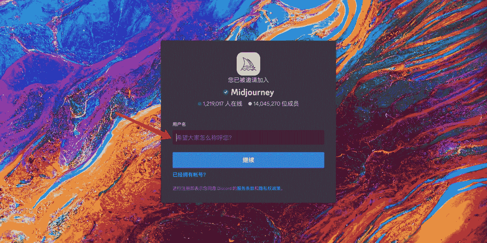

1.  第三步：打开我们的邮箱，里面会有一封 Discord 的邮件，我们进行验证一下就完成注册了，创建完账号之后，需要验证邮箱和手机号，按提示操作就行了。

**附：**

[**Discord 新手指南**](https://support.discord.com/hc/zh-tw/articles/360045138571)

手机版 Discord 新手指南

## 创建自己的服务器

推荐大家创建自己的服务器，首先点击最左边的“+”，再点击“亲自创建”一点击“仅供我和我的朋友们使用”一一点击“创建”。

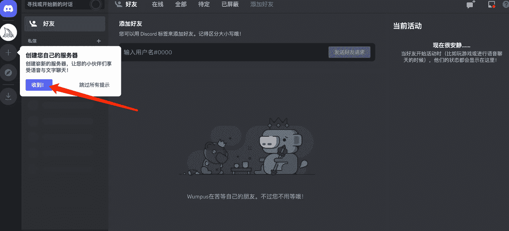

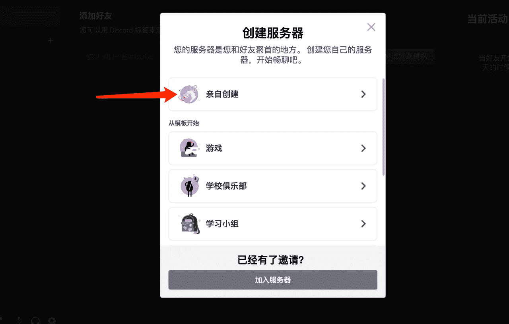

自己的服务器已经创建好了，这时还不能使用Midjourney绘图功能，Midjourney是通过机器人回答的形式绘图，下一步我们去邀请机器人到我们的服务器

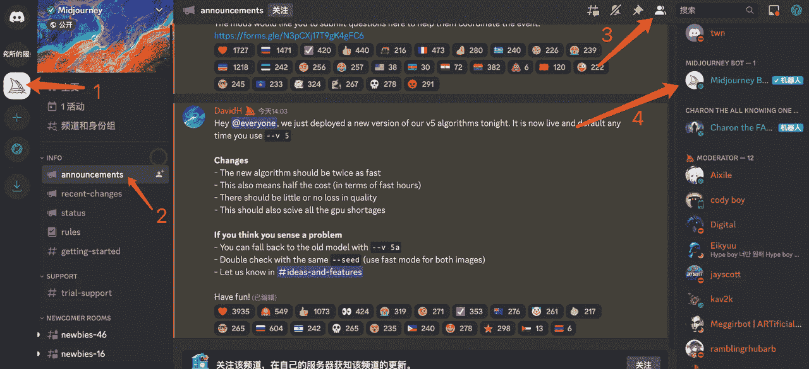

邀请Midjourney机器人加入到自己的服务器

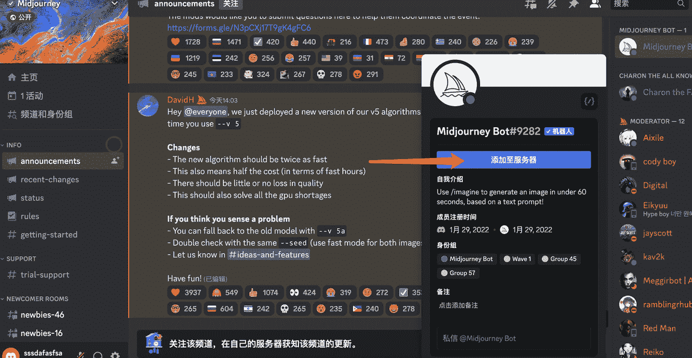

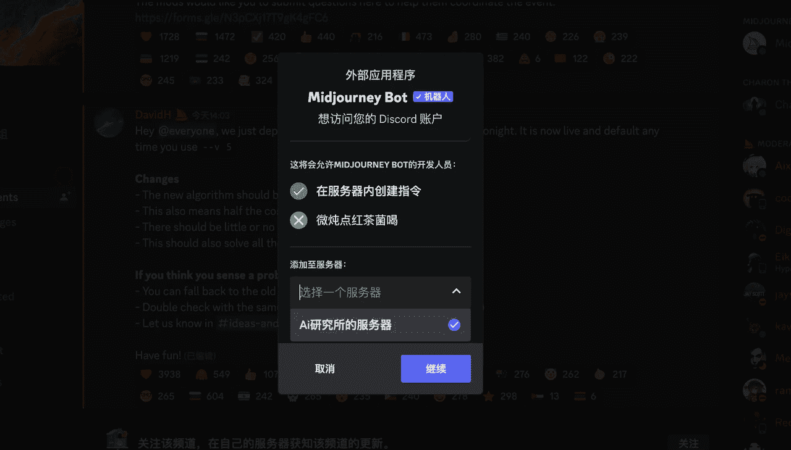

给机器人授权

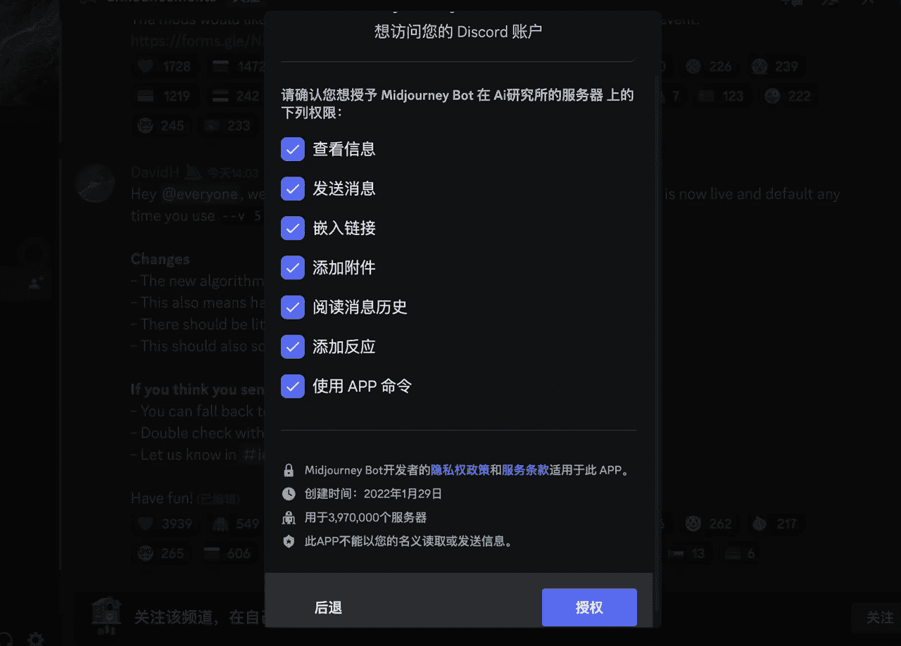

## 开会员教程

目前没有免费使用额度，需要点击”Open subscription page“按钮充点钱

点击按钮后会跳到 Midjourney 的官网，我们点击右下角的”Sign in“登录：

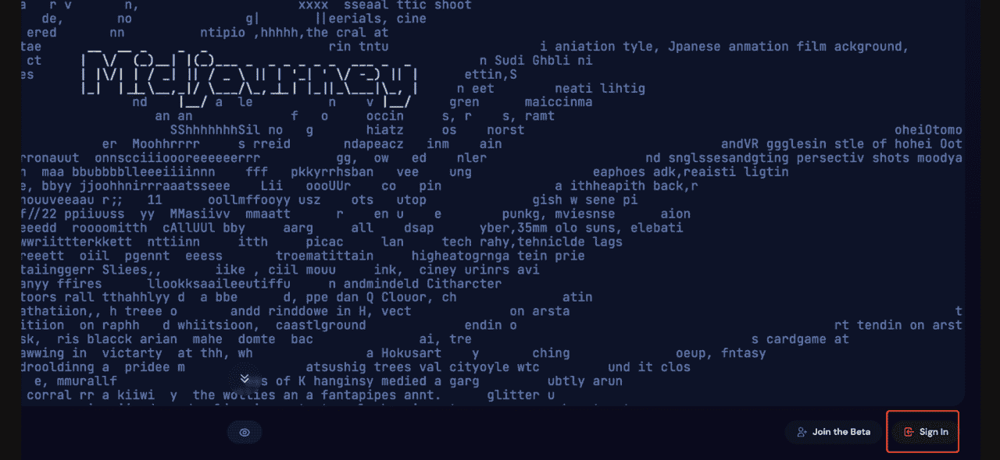

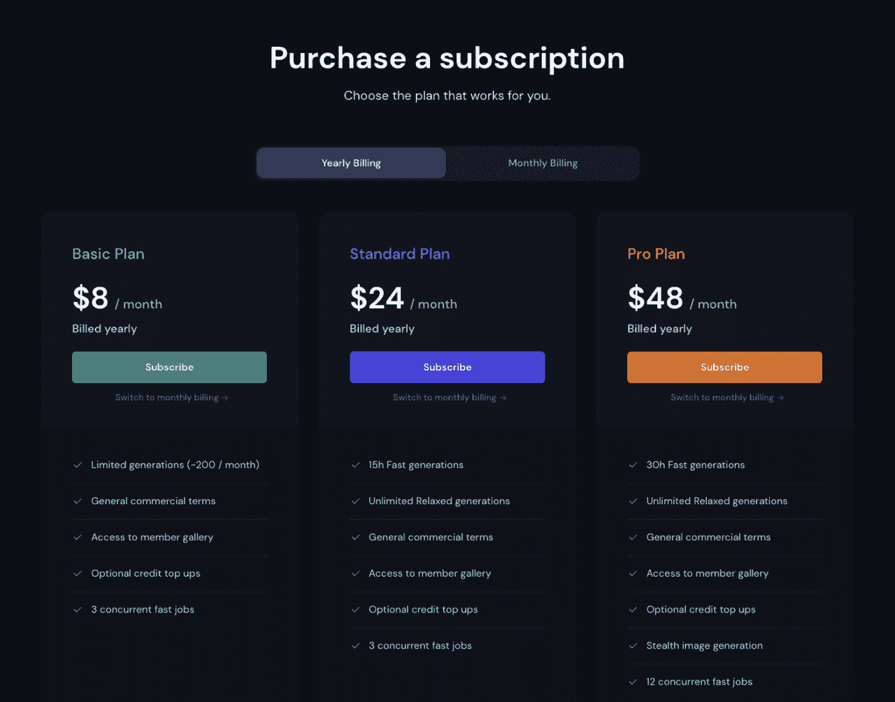

这里有三档：**基本、标准和高级**，每一档可以包年也可以包月，这里建议先选择包月的体验一下。

后就是填信用卡信息付款了，国内的信用卡和支付宝也可以用，按照提示付款就行了：

付完款后，显示这个页面就是成功了！

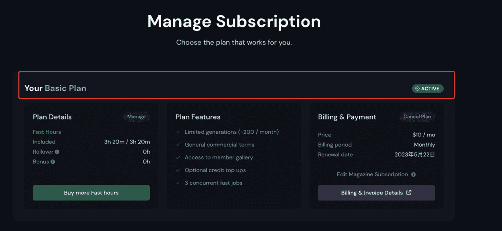

回到 discord 页面，在底部输入”/imagine“，然后输入提示符，终于可以画图了！

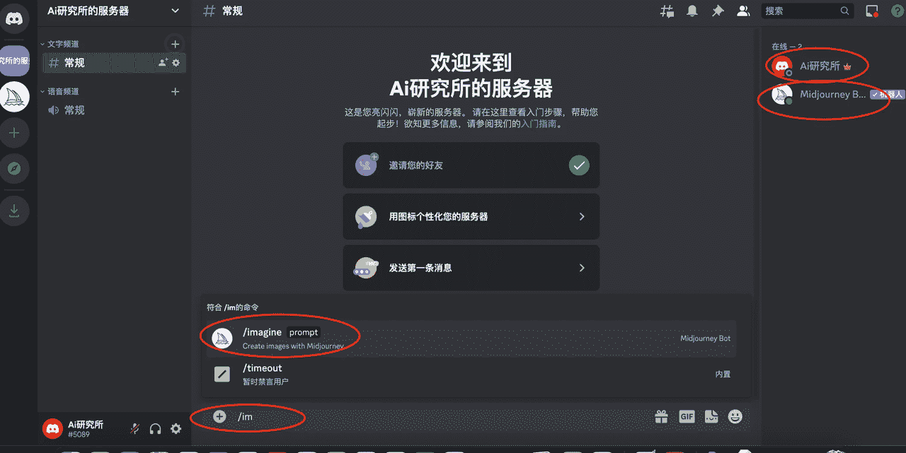

## 常见问题答疑

### Q1：Midjourney 生成图片是免费的吗？

A：目前已经取消免费体验。会员分 10 美刀和 30 美刀两种方式。

10 美刀：每月可以生成 200 张图片，适合轻度使用者。

30 美刀：每月生成的图片无限制，每月 15 小时的 fast 使用时长。

### Q2：fast 模式和 relax 模式有何区别？

A：在输入框输入/fast 或者/relax 即可切换模式，默认是快模式。

fast 模式：无需排队，一发送描述语到公屏上，立马生成。

relax 模式：需要在服务器排队，有时快有时慢，排队完成自动生成。

### Q3：Midjourney 有什么变现的方法？

A：条条大路通罗马，一个新生的行业，一般都是红利的开始，做壁纸下载广告收益、引流私域或者收徒都是不错的选择，我会另外写篇文章专门讲这个事，敬请关注。

### Q4：Midjourney 怎么充值会员？

A：Midjourney 目前只支持信用卡和支付宝，具体教程参考本飞书文档的会员开通教程，没有这些信用卡的小伙伴也无需担心，可以找淘宝。

### Q5：如何关闭 MJ 的自动续费？

A：见下图流程：

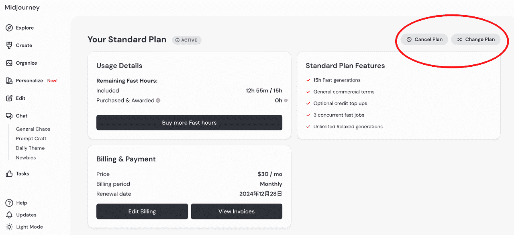

充值完成后在频道内发送/info 可查询会员到期日和余量，如果决定长期玩，可以以年为单位，八折购置 PRO 套餐，pro 带有隐私功能，且有双倍的 FAST 时间。

### Q6：Midjourney 官网苹果版和安卓版下载地址是？

A：idjourney 在网页上使用就好，不需要安装任何软件，所以苹果/windows/安卓所有系统直接用浏览器即可。

### Q7：Midjourney 中文版下载地址是？

A：Midjourney 默认是英文界面，如果希望界面是中文版，可以安装一个谷歌翻译插件，右键选择翻译成中文即可。或者下载 Discord 中文版本。

# 三、操作教程

## 第一章：入门详解（基础）

### 出图操作流程

#### **关键词生成图片**

回到我们的服务器，然后在下面的输入框输入“/”，它会弹出一系列的命令（如果没弹窗，退出重新登录即可），我们先点击“/imagine”（这个参数我后面再做详细解释），然后会出现如下画面：

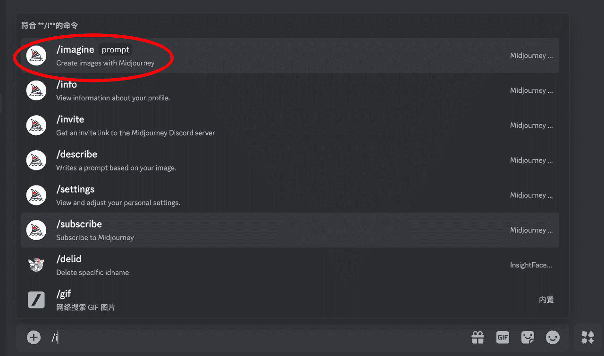

输入一组关键词，切记：一组关键词的后面需要加上英文的逗号“，”然后按空格键，空一格就行，看我下面这组关键词：

Retro old comic style, a 25-year-old young woman, sitting in the back seat, expression happy and cheer , side view, next to a city street, 8K

复古老漫画风格，一个 25 岁的年轻女人，坐在后座，表情高兴和欢呼，侧视图，旁边是城市街道，8K

等待一会就会出图

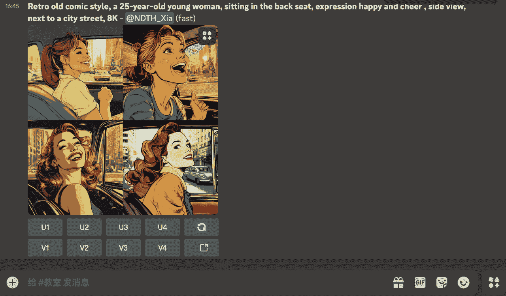

#### **图片指令及导出图片**

生成完成后，会出现两排按钮

U 的意思放大图片，U1/U2/U3/U4 分别指的是放大四张图片中的某一张

V 的意思采用图片的构图形式，重新生成一组类似的图片，V1/V2/V3/V4 的顺序与 U 的顺序一样，如图

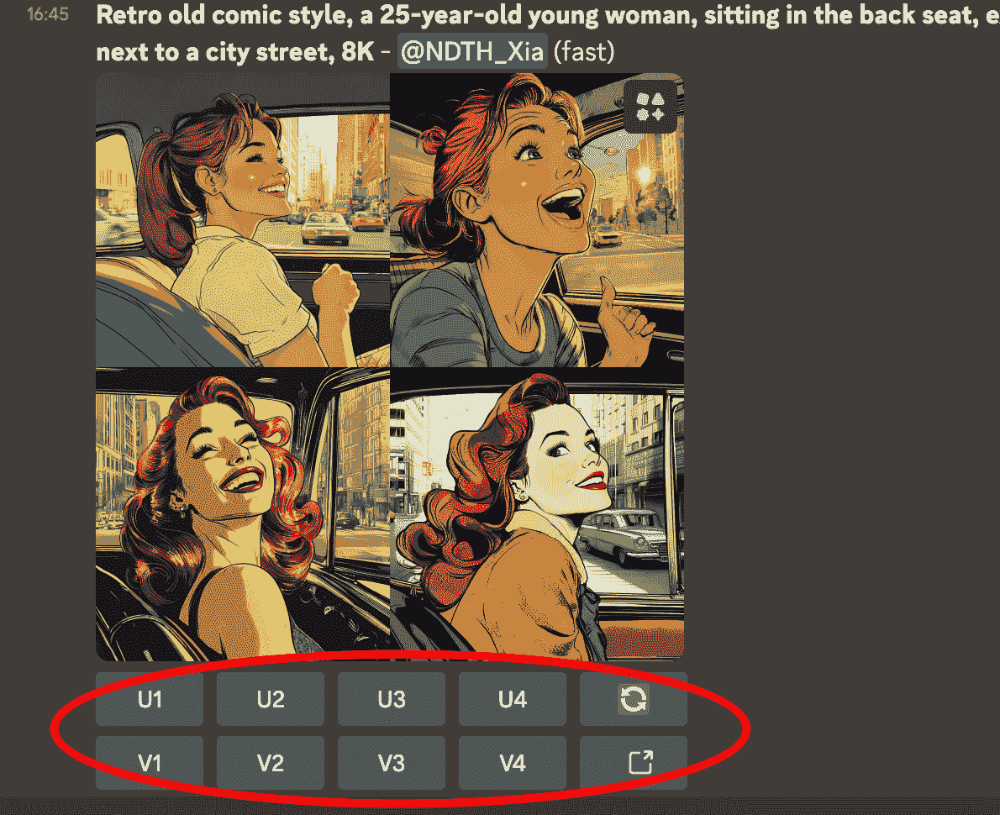

举个例子，比如我想要导出第一张图片，那么我们点击 U1 就好了（等待机器出图）

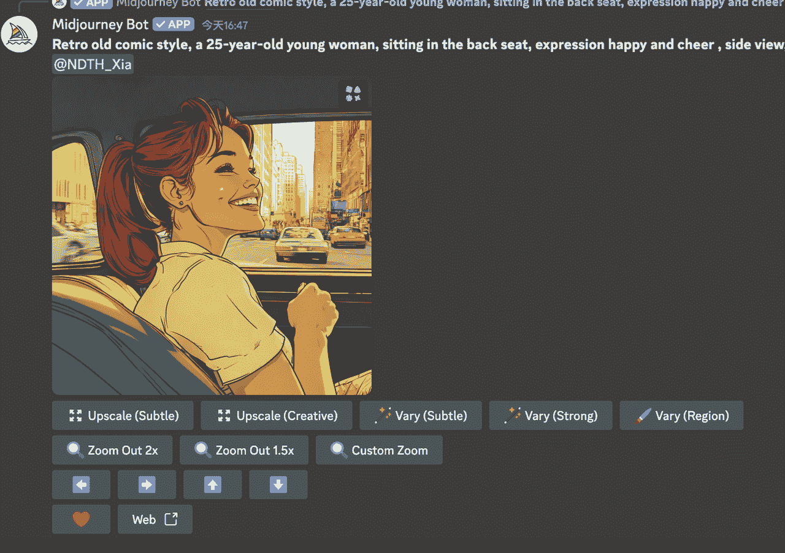

然后咱们点击图片，点击在浏览器中打开，然后保存图片，这张图片就被下载了（一定要用浏览器打开再保存图片，不然图片的尺寸会很小，会模糊的）

换个例子，我觉得第一张图片还行，构图风格还不错，就是差点细节，想要再优化下，那我们就点击 V1，接下来的操作就与上面一样啦，是不是很简单。

一般情况下，我们可以把同一组关键词多生成几组图片，这里可以点击“重复”按钮，然后你就会看见多条生成图片的消息，等待机器人作图，然后找到你喜欢的几张图片进行挑选即可。

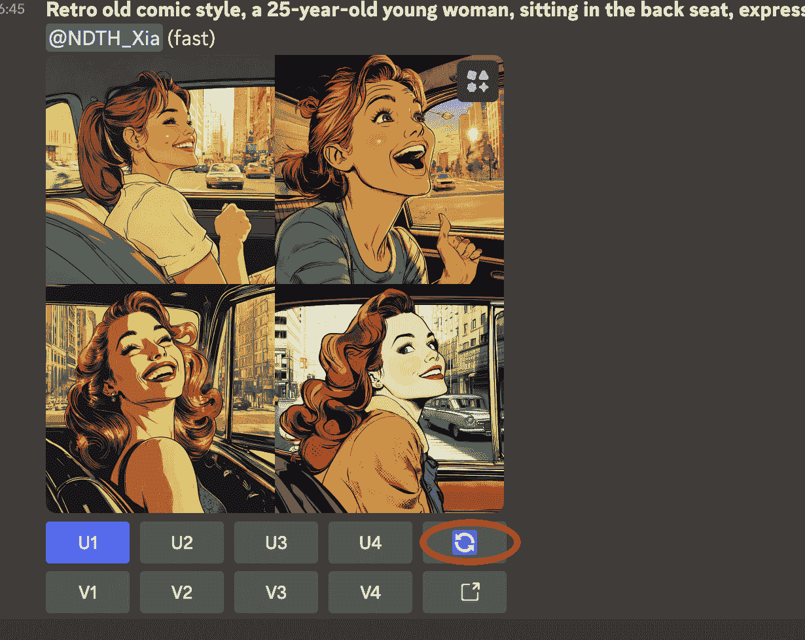

#### Midjourney 的尺寸和分辨率

所有尺寸默认均为正方形 1:1 的长宽比。

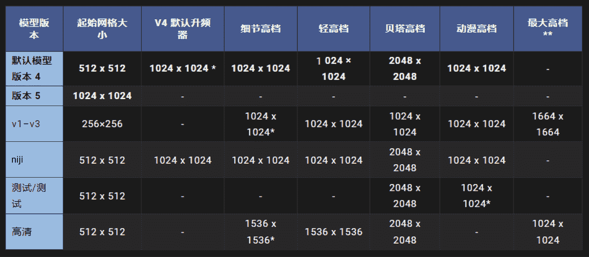

每个 Midjourney 版本模型的默认升频器。

#### 使用高档重做按钮

升级图像（U1、U2、U3、U4）后，你会在图像下方看到一行按钮，可让您使用不同的升级器模型重新进行升级。

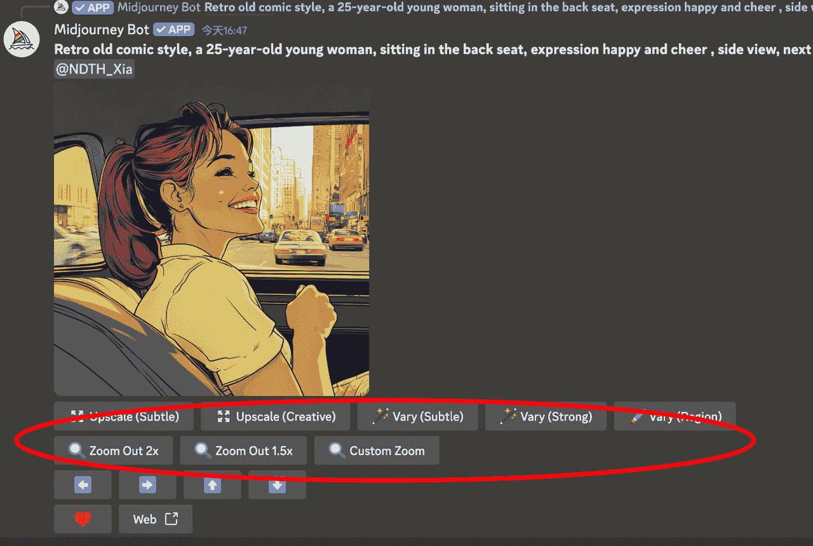

点击重做，Midjourney 会在原图的基础上优化和调整细节，有些情况重做的效果不如原效果，根据情况调整。

## 第二章：参数详解（基础）

### Imagine 关键词后缀参数

参数是添加到提示中的选项，可更改图像的生成方式。参数可以更改图像的纵横比、在 Midjourney 模型版本之间切换、更改使用的 Upscaler 等等。

参数总是添加到提示的末尾。您可以向每个提示添加多个参数。

#### 基本参数

+   纵**横比（aspec**t **rati**os）--aspect，或--ar调整图片的比例；

+   **混乱（chaos）**--chaos <number 0–100>改变结果的多样性。较高的值会产生更多不寻常和意外的世代；

+   **负面提示（no）****--no**负面提示，在提示词末尾加上 --no 可以让画面中不出现某些内容；

+   **生成质量（quality）**--quality <.25, .5, 1, or 2>，或--q <.25, .5, 1, or 2>您要花费多少渲染质量时间。默认值为 1。值越高渲染时间越高，值越渲染时间越低。

+   **种子（seed）****--seed <integer b**etween 0–4294967295>用过 Midjourney 的同学会发现在发送提示词后，MJ 最开始的图像里会有一个非常模糊的噪点团 ，然后逐渐变得具体清晰，而这个噪点团的起点就是“Seed” 种子编号是为每个图像随机生成的，但可以使用 --seed 或 --sameseed 参数指定。使用相同的种子编号和提示将产生相似的结束图像。

+   **停止（stop）**--**stop <**integer between 10–100>使用--stop参数在流程中途完成作业。以较早的百分比停止作业会产生更模糊、更不详细的结果。

+   **平铺（tile）****--tile**参数生成可用作重复拼贴的图像，以创建织物、壁纸和纹理的无缝图案；

+   **版本（version）**用**--version**或**--v**参数或使用**/settings**命令并选择型号版本来使用其他型号。不同的模型擅长处理不同类型的图像。

+   **风格（style）**--style <4a, 4b or 4c>在 Midjourney 模型版本 4 的版本之间切换

+   **程序化（stylize）**--**stylize <num**ber>，或--s <number> 参数会影响 Midjourney 的默认美学风格应用于 Jobs 的强度。

+   **聚光灯（uplight）****--uplight**选择 U 按钮时使用替代的“轻型”升频器。结果更接近原始网格图像。放大后的图像细节更少，更平滑。

+   **乌贝塔（upbeta）****--upbeta**选择 U 按钮时使用替代的 beta 升频器。结果更接近原始网格图像。放大后的图像添加的细节明显更少。

#### 模型版本参数

+   **--niji**另一种模型专注于动漫风格的图像；

+   **--hd**使用早期的替代模型来生成更大、更不一致的图像。该算法可能适用于抽象和风景图像；

+   **--test**使用 Midjourney 特殊测试模型；

+   **--testp**使用 Midjourney 特殊的以摄影为重点的测试模型；

+   --version <1, 2, 3, 4, or 5>或者--v <1, 2, 3, 4, or 5> 使用不同版本的 Midjourney 算法。当前算法 （V4） 是默认设置。

#### 其他参数

+   **--creative**修改**test**和**testp**模型更加多样化和创造性；

+   **--iw**设置相对于文本权重的图像提示权重。默认值为 --iw 0.25；

+   **--sameseed**种子值创建一个大的随机噪声场，应用于初始网格中的所有图像。当指定 --sameseed 时，初始网格中的所有图像都使用相同的起始噪声，并将生成非常相似的生成图像；

+   **--video**保**存正在生成的初**始图像网格的进度视频。表情符号使用 ☉️ 对完成的图像网格做出反应，以触发将视频发送到您的直接消息。--video放大图像时不起作用。

### 常用后缀参数详解

#### Aspect Ratios（纵横比）

--aspect参数--ar更改生成图像的纵横比。宽高比是图像的宽高比。它通常表示为用冒号分隔的两个数字，例如 7:4 或 4:3。

正方形图像具有相等的宽度和高度，描述为 1:1 的纵横比。图片可以是 1000px × 1000px，或者 1500px × 1500px，纵横比仍然是 1:1。计算机屏幕的比例可能为 16:10。宽度是高度的 1.6 倍。所以图像可以是 1600px × 1000px、4000px × 2000px、320px x 200px 等。

> 默认纵横比为 1:1。

> **--aspect**必须使用整数。使用 139:100 而不是 1.39：1。

> 纵横比影响生成图像的形状和组成。

> 放大时，某些宽高比可能会略有变化。

**最大纵横比**

不同的 Midjourney 版本模型具有不同的最大纵横比。

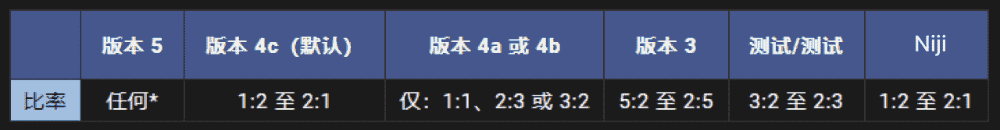

该**--ar**参**数将接受从 1:1**（正方形）到每个模型的**最大纵**横比的任何纵横比。但是，在图像生成或放大过程中，最终输出可能会略有修改。示例：提示使用--ar 16:9（1.78） 创建具有7:4（1.75） 纵横比的图像。

大于 2:1 的宽高比是实验性的，可能会产生不可预测的结果。

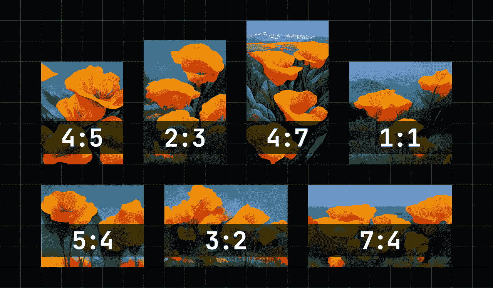

提示示例：**imagine/ prompt** vibrant california poppies --ar 5:4

**常见的纵横比**

**--aspect 1:1**默认纵横比。

**--aspect 5:4**常见的框架和打印比例。

**--aspect 3:2**印刷摄影中常见。

**--aspect 7:4**靠近高清电视屏幕和智能手机屏幕。

#### **Chaos（混乱）**

参数影响初始图像网格--chaos的--c变化程度。高--chaos值将产生更多不寻常和意想不到的结果和组合。较低的--chaos值具有更可靠、可重复的结果。

**--chaos**范围值 0–100。

默认**--chaos**值为 0。

**chaos 的生成的效果**

低值**--chaos**

使用较低的 **--chaos**值或不指定值将生成每次运行作业时略有不同的初始图像网格。

提示示例：**imagine/ prompt** watermelon owl hybrid

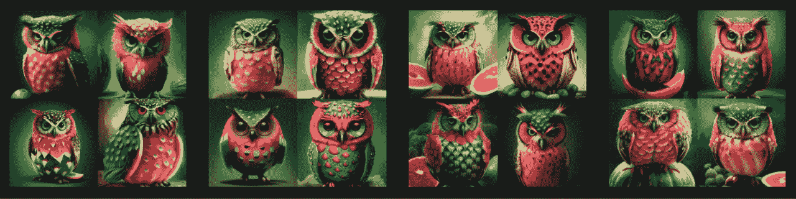

高值**--chaos**

**--chaos**每次运行作业时，使用较高的值将产生更多变化和意外的初始图像网格。

提示示例：**imagine/ prompt** watermelon owl hybrid --c 50

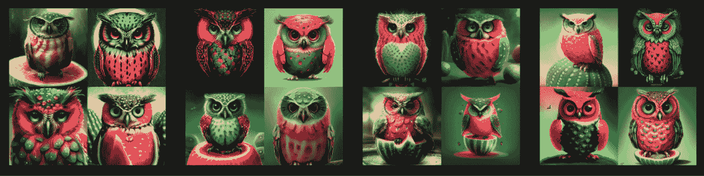

非常高的值**--chaos**

**--chaos**每次运行作业时，使用极高的值将产生不同的初始图像网格，并且具有意想不到的构图或艺术媒介。

提示示例：**imagine/ prompt** watermelon owl hybrid --c 100

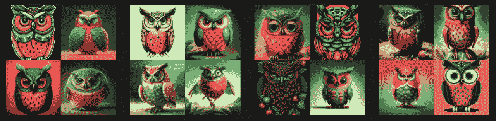

**如何改变 Chaos 值**

添加**--chaos <value>**或**--c <value>**到提示的末尾。

#### **Quality（质量）**

参数更改生成图像所花费--quality的--q时间。更高质量的设置需要更长的时间来处理并产生更多的细节。更高的值还意味着每个作业使用更多的 GPU 分钟数。质量设置不影响分辨率。

> 默认**--quality**值为 1。较高的值会使用更多订阅的 GPU 时间。

> **--quality**接受以下值：默认模型的 。25、.5 和 1。较大的值将向下舍入为 1。

> **--quality**仅影响初始图像生成。

> **--quality**适用于模型版本 1、2、3、4、5 和 niji。

**质量设置**

更高的**--quality**设置并不总是更好。有时较低的**--quality****设置可以产生更好的****结果——这取决于您**尝试创建的图像。较低的--quality设置可能最适合手势抽象外观。较高的--quality值可以改善受益于许多细节的建筑图像的外观。选择与您希望创建的图像类型最匹配的设置。

提示示例：**/imagine prompt** woodcut birch forest --q .25

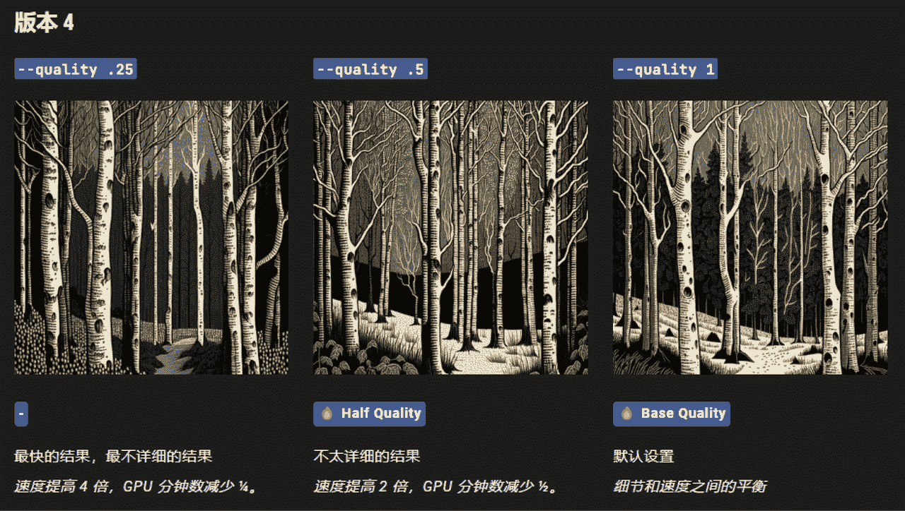

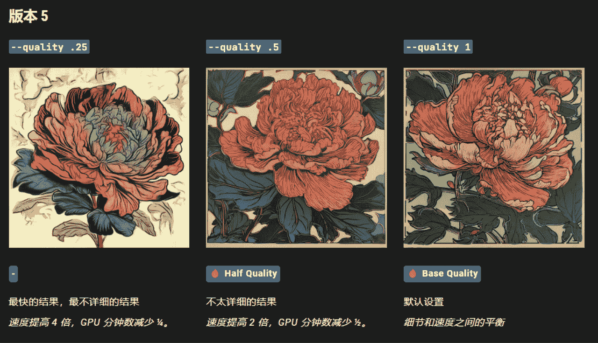

**使用****--quality****或****--q****参数**

添加-**-quality <v**alue>或--q <value>到提示的末尾。

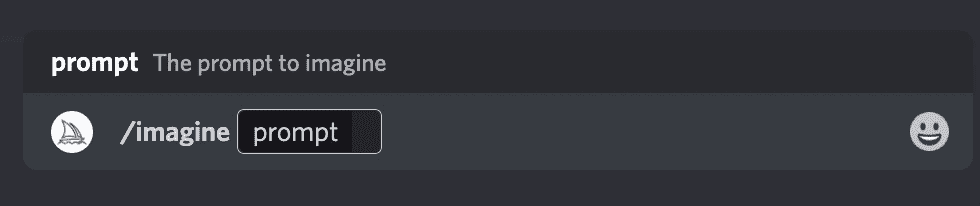

**使用设置命令**

从菜单中**/settings**选择您的首选值。**quality**

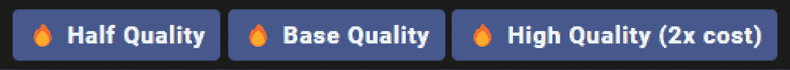

#### **Seed（种子）**

用过 Midjourney 的同学会发现在发送提示词后，MJ 最开始的图像里会有一个非常模糊的噪点团 ，然后逐渐变得具体清晰，而这个噪点团的起点就是“Seed” 种子编号是为每个图像随机生成的，但可以使用 --seed 或 --sameseed 参数指定。使用相同的种子编号和提示将产生相似的结束图像。

> **--seed** 接受整数 0–4294967295。

> **--seed**值仅影响初始图像网格。

> **--seed**值模型版本 **1**、**2**、**3**、**test**和**testp**是不确定的，将产生相似但不相同的图像。在模型版本中使用相同的**提示+种子+**参数 ，将产生相同的图像。 45niji

**seed 参数**

如果未指定种子，Midjourney 将使用随机生成的种子编号，每次使用提示时都会生成多种选项。

**使用随机种子运行 3 次**

提示示例：**/imagine prompt** celadon owl pitcher

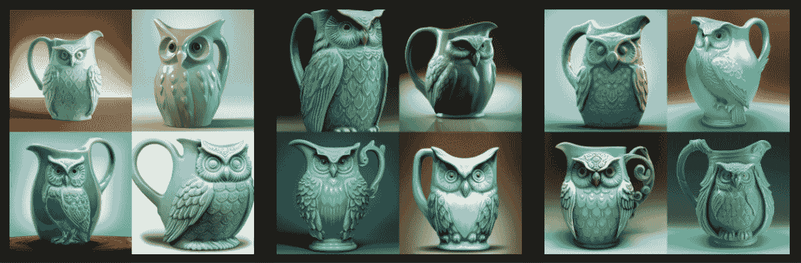

**使用指定种子运行 3 次**

提示示例：**/imagine prompt** celadon owl pitcher --seed 123

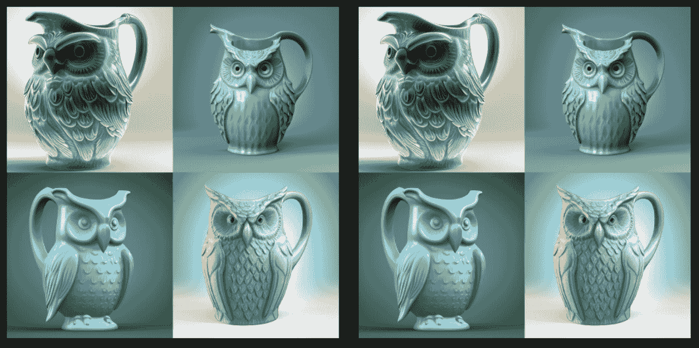

**同数值参数**

**--seed****值创建一个大的随机噪**声场，应用于初始网格中的所有图像。指定时--sameseed，初始网格中的所有图像都使用相同的起始噪声，并将生成非常相似的生成图像。

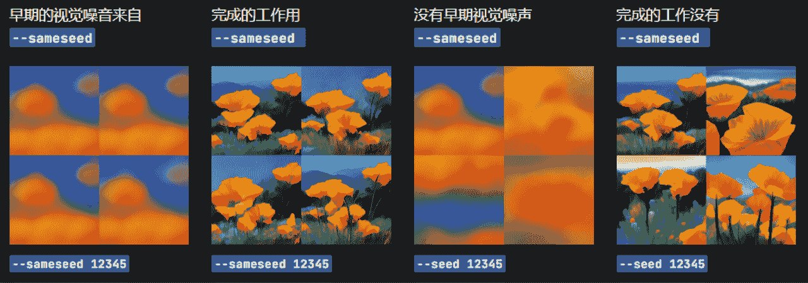

**如何查找工作的种子编号**

使用 Discord 表情符号反应，通过对工作使用 ☉️ 信封表情符号做出反应，在不和谐中找到工作的种子编号。

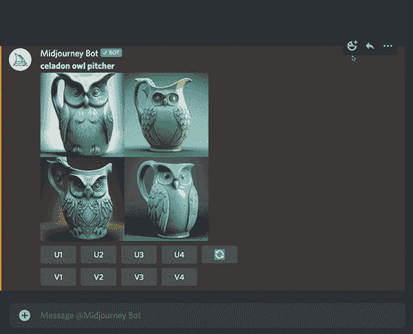

**如何更改种子编号**

使用 **--seed**或**--sameseed**参数，添加**--seed <value>**或--sameseed <value>到提示的末尾。

#### Shop（停止）

使用--stop参数在流程中途完成作业。以较早的百分比停止作业会产生更模糊、更不详细的结果。

> **--stop**接受值：10–100。

> 默认**--stop**值为 100。

> **--stop**时不起作用。

**不同 Shop 的对比**

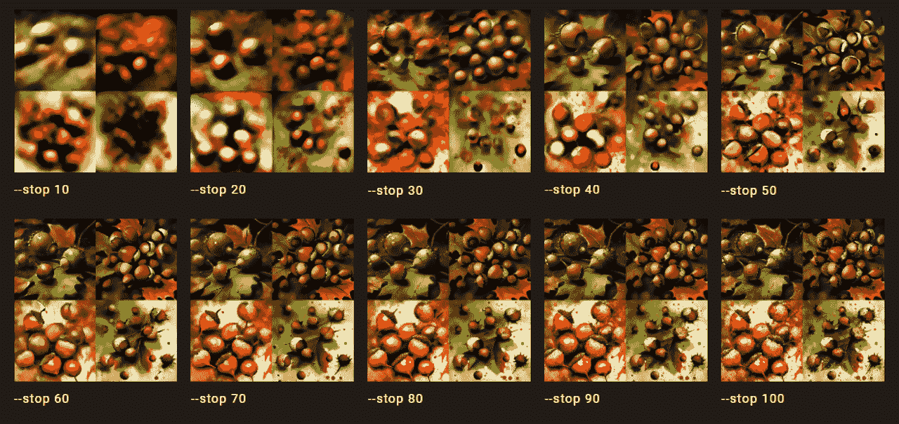

shop 和 Beta Upscale

放大时，该**--stop**参数不会影响作业。但是，停止会产生更柔和、细节更少的初始图像，这将影响最终放大结果的细节水平。下面的放大图像使用了 Beta Upscaler。

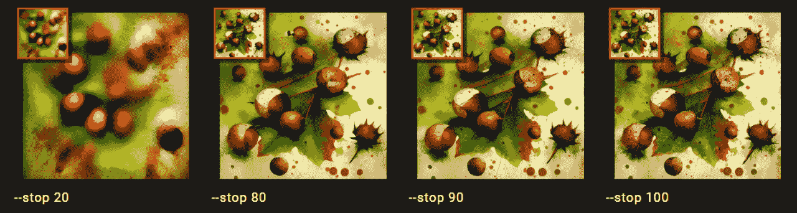

**使用****--stop****参数**

添加**--stop <value>**到提示的末尾。

#### Stylize（程序化）

Midjourney Bot 经过训练可以生成有利于艺术色彩、构图和形式的图像。或参数影响该训练应用--stylize的--s强度。低程式化值生成的图像与提示非常匹配，但艺术性较差。高程式化值创建的图像非常具有艺术性，但与提示的联系较少。

> **--stylize**的默认值为 100，并且在使用默认 [V4 模型] 时接受 0-1000 的整数值。

不同的 Midjourney 版本模型具有不同的风格化范围。

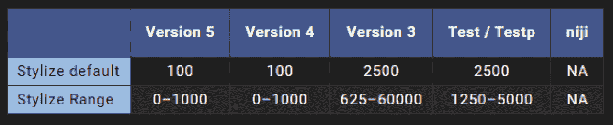

**通用风格化设置**

V4 模型

提示示例：**/imagine prompt** illustrated figs --s 100

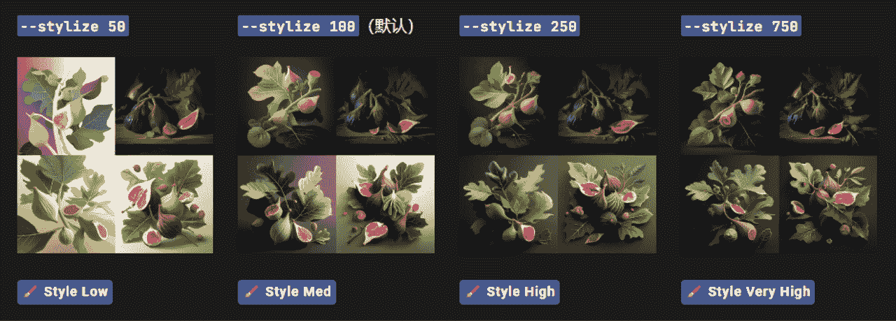

V5 模型

提示示例：**/imagine prompt** colorful risograph of a fig --s 100

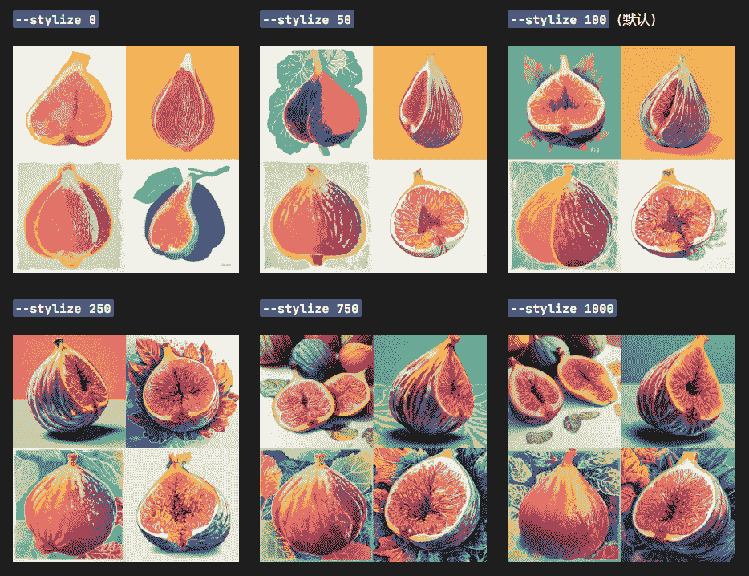

**使用 stylize 参数**

添加-**-stylize <v**alue>或--s <value>到提示的末尾。

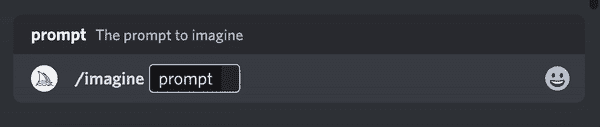

**使用设置命令**

**/settings**从菜单中键入并选择您喜欢的风格化值。

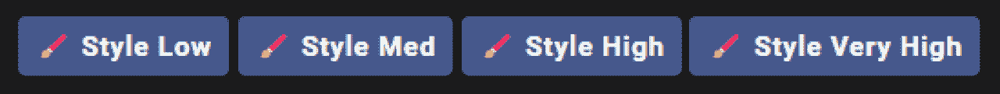

#### Tile（平铺）

--tile参数生成可用作重复拼贴的图像，以创建织物、壁纸和纹理的无缝图案。

> **--tile**适用于模型 版本 1、2、3、5

> **--tile**只生成一个 tile。使用像这种无缝模式检查器这样的模式制作工具来查看拼贴重复。

**Tile 示例**

使用 Midjourney 的模型测试/Testp

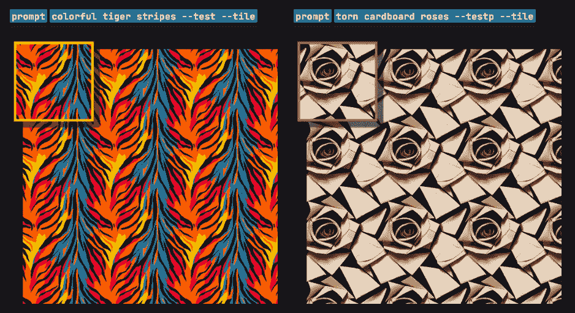

使用 Midjourney 模型 5

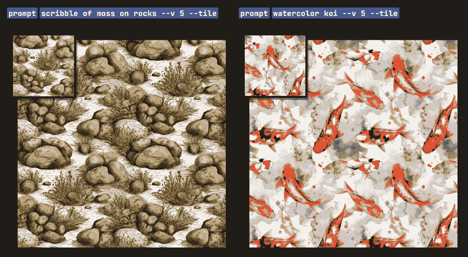

**如何使用 tile 参数**

添加**--tile**到提示的末尾。

#### Version（版本）

Midjourney 定期发布新模型版本以提高效率、一致性和质量。默认为最新型号，但可以使用--version或--v参数或使用/settings命令并选择型号版本来使用其他型号。不同的模型擅长处理不同类型的图像。

> **--version**接受值 1、2、3、4 和 5。

> **--version**可以缩写**--v**

**模型版本 6.1 **

版本 6.1 于 2024 年 7 月 30 日发布，作为新的默认模型。它可生成更连贯的图像，具有更精确的细节和纹理，并且生成图像的速度比版本 6 快约 25%。

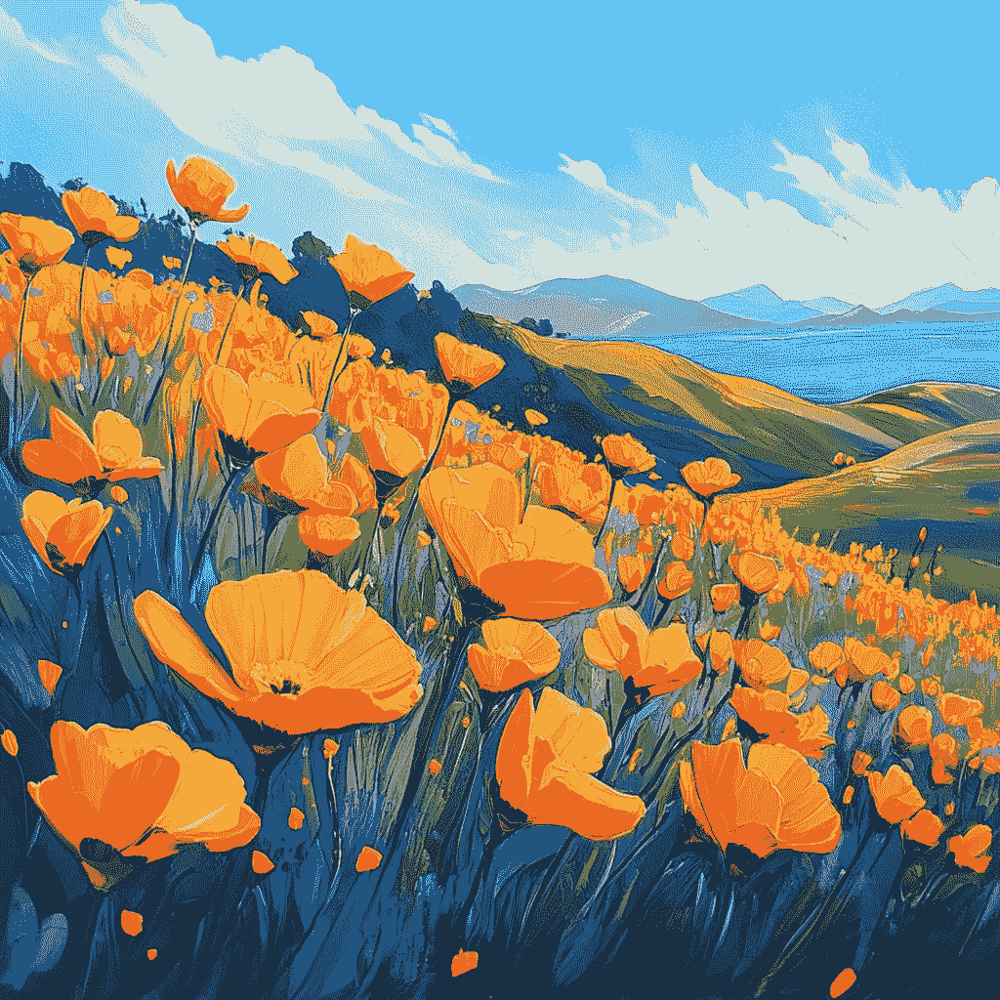

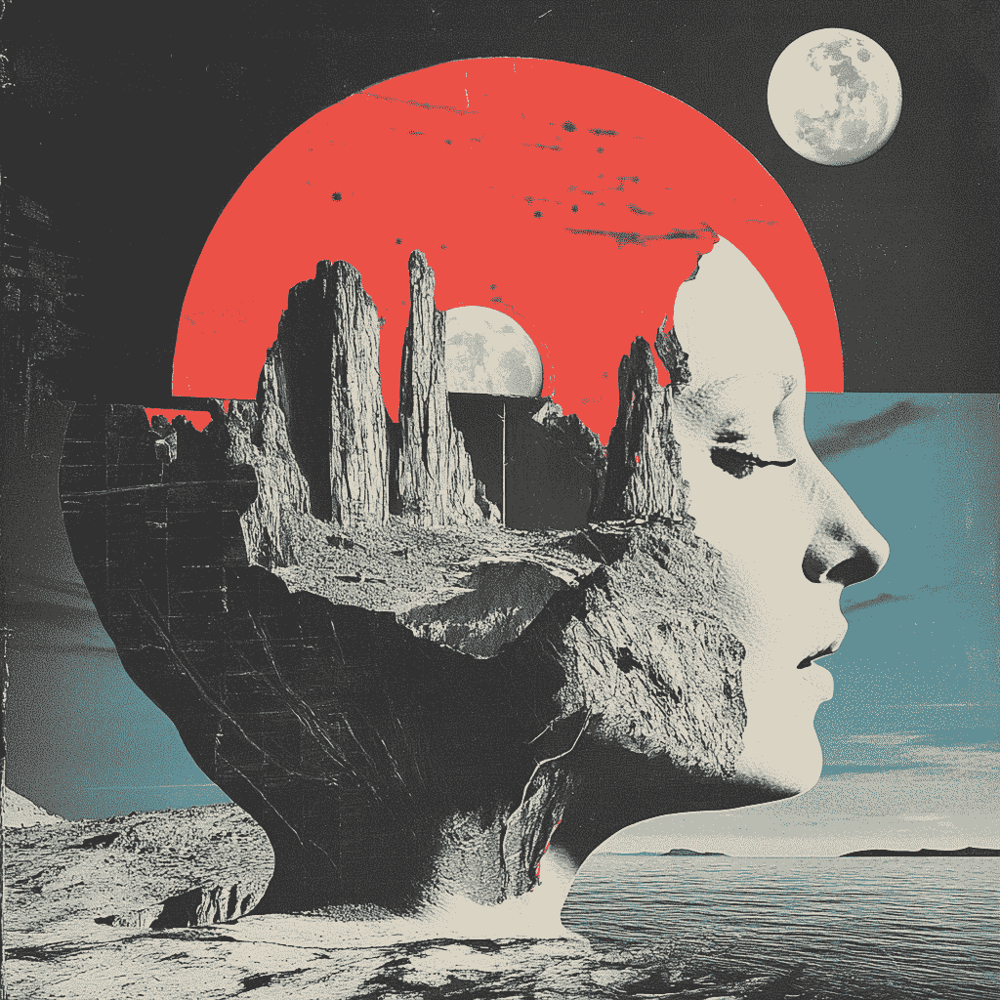

**模型版本 6**

Midjourney 模型版本 6 增强了较长输入的提示准确性、提高了连贯性和知识性，并增强了图像提示和混音功能。Midjourney 模型版本 6 于 2023 年 12 月 20 日发布，并于 2024 年 2 月 14 日至 7 月 30 日期间作为默认模型。

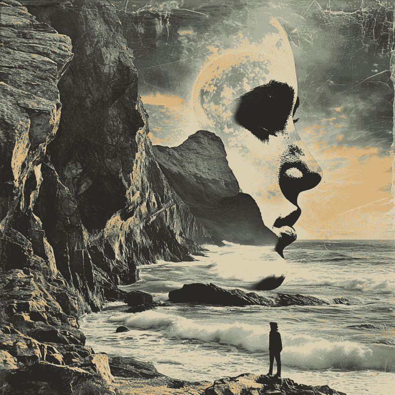

**最新模型（V5）**

M**idjou**rney V5 模**型是最新最先进的模**型，于 2023 年 3 月 15 日发布。要使用此模型，请将参数添加--v 5到提示末尾，或使用/settings命令并选择5️⃣ MJ Version 5

该模型具有非常高的 Coherency，擅长解释自然语言提示，**分辨率更高，**并支持高级功能，例如重复模式--tile

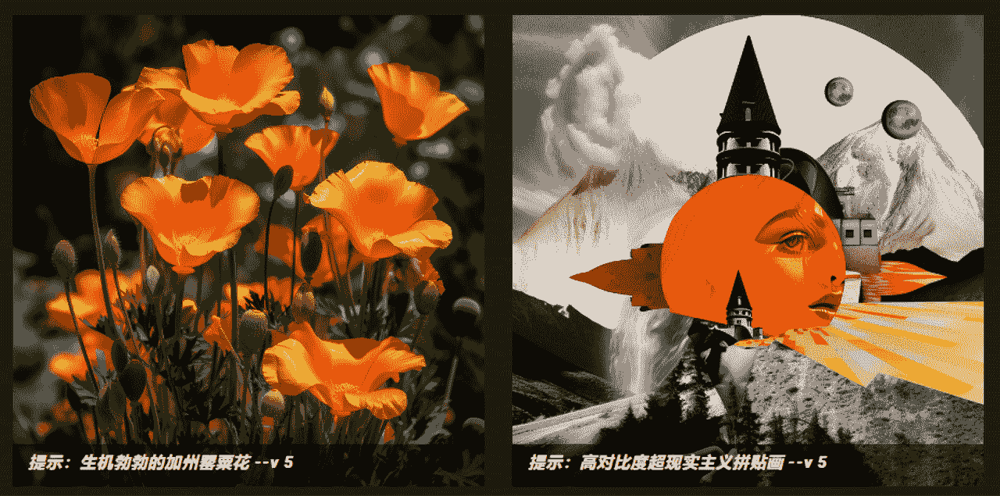

**V4 模型**

Midjourney V4 模型是由 Midjourney 设计并在新的 Midjourney AI 超级集群上训练的全新代码库和全新 AI 架构。最新的 Midjourney 模型拥有更多关于生物、地点、物体等的知识。它更擅长正确处理小细节，并且可以处理包含多个角色或对象的复杂提示。第 4 版模型支持图像提示和多提示等高级功能。

该模型具有非常高的 Coherency 并且在 Image Prompts 方面表现出色。

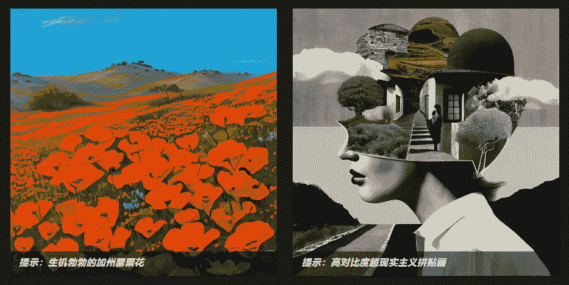

V4 的 样式 4a、4b 和 4c

M**idjourney **M**odel Versi**on 4 具有三种**略有不同的“风格”，**对模型的风格调整进行了细微调整。通过在 V4 提示末尾添加--style 4a、--style 4b或来试验这些版本。--style 4c

--v 4 --style 4c是当前默认值，不需要添加到提示末尾。

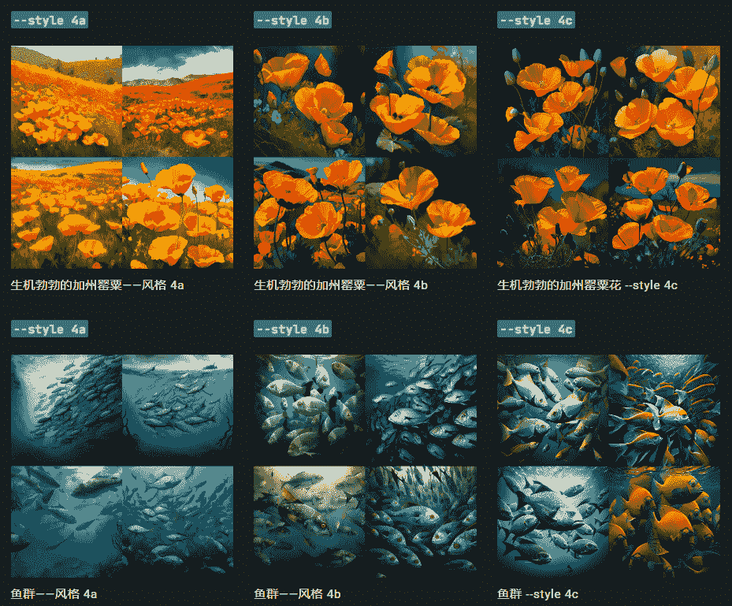

**以前的模型**

您可以使用**--version**或**--v**参数或使用**/settings**命令并选择模型版本来访问更早的 midjourney 模型。不同的模型擅长处理不同类型的图像。

提示示例：**/imagine prompt** vibrant California poppies --v 1

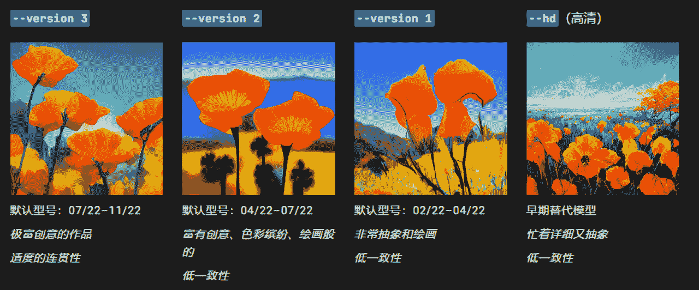

**Niji 模型**

**该模型是** Midjourney 和 Spellbrushniji之间的合作，经过调**整可以制作动**画和插图风格。该模型对动漫、动漫风格和动漫美学有更多的了解。一般来说，它在动态和动作镜头以及以角色为中心的构图方面表现出色。--niji

提示示例：**/imagine prompt** vibrant California poppies --niji

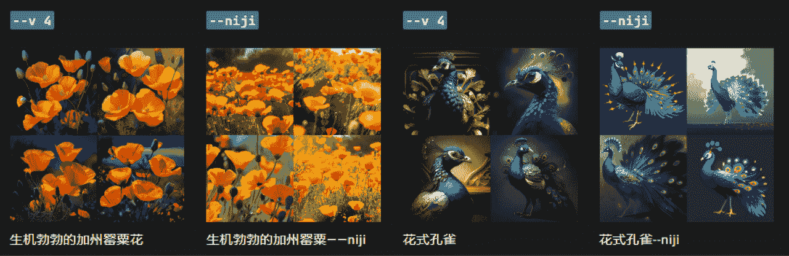

**--niji**型号 说明

Niji 不支持**--stylize**参数。使用**/settings**命令并选择**Style Med**重置为所有**--niji**提示的默认样式设置。Niji 支持多提示或图像提示。

**使用设置命令**

输入**/settings**并从菜单中选择您喜欢的版本。

#### Video（视频）

使用该--video参数创建正在生成的初始图像网格的短片。使用信封 ☉️ 表情符号对完成的工作做出反应，让 Midjourney Bot 将视频链接发送到您的直接消息。

**--video**仅适用于图像网格，不适用于高档。

**--video**适用于模型版本 **1**、**2**、**3**、**test**和**testp**。

**如何获取视频链接**

提示示例：**/imagine prompt** Vibrant California Poppies --video

添加**--video**到提示的末尾；

2、作业完成后，单击添加反应；​

3、选择 ☉️ 信封表情符号；

4、Midjourney 机器人会将视频链接发送到您的直接消息；​

5、单击链接可在浏览器中查看您的视频。右键单击或长按以下载视频；​

**如何使用视频参数**

添加**--video**到提示的末尾。

