# Ai绘画-SD

> 来源：[https://keenchase.feishu.cn/docx/TOrgdyCw2o3BJlx1GCQcD4uUnMX](https://keenchase.feishu.cn/docx/TOrgdyCw2o3BJlx1GCQcD4uUnMX)
>
> 点我返回👉【杰夫AI知识库｜首页】
>
> [点我跳转👉【AI工具库】](https://keenchase.feishu.cn/wiki/TSyWwNmPsi2CZTk4fqMc2XQgnkd)

## Stable Diffusion 学习手册更新日志

## 一、基本介绍

### 平台介绍

### 官方网站

Stability AI 官网地址：`https://stability.ai/`

Stablediffusionweb 官网地址：`https://stablediffusionweb.com`

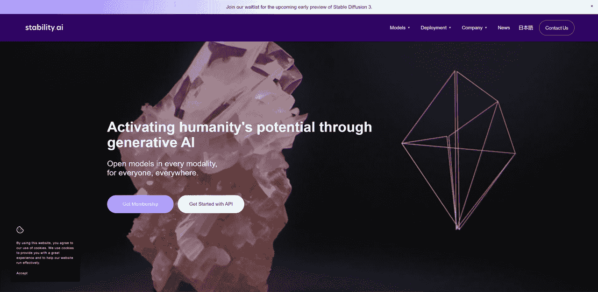

### 知识科普

#### Stable Diffusion 和 Stable Diffusion Web UI 的简介

Stable Diffusion 是 2022 年发布的深度学习文本到图像生成模型。它主要用于根据文本的描述产生详细图像，也以应用于其他任务，如内补绘制、外补绘制，以及在提示词（英语）指导下产生图生图的翻译。它是一种潜在扩散模型，由慕尼黑大学的 CompVis 研究团体开发的各种生成性人工神经网络。它是由初创公司 StabilityAI，CompVis 与 Runway 合作开发的，并得到 EleutherAI 和 LAION（英语）的支持。Stable Diffusion 的代码和模型权重已公开发布，可以在大多数配备有适度 GPU 的电脑硬件上运行。而以前的专有文生图模型（如 DALL-E 和 Midjourney）只能通过云计算服务访问。StableDiffusion 可以在本地计算机上使用，也可以在云服务器上运行。

Stable Diffusion Web UI 是一个基于 Web 的用户界面，用于使用 Stable Diffusion 进行图像生成和其他任务。由 AUTOMATIC1111 开发，并开源上传至 Github，也是目前使用最多的 WebUI 版本。(Shout to AUTOMATIC1111). WebUI 提供了易于使用的图形界面，可以帮助用户更直观的了解和使用 StableDiffusion 的功能，并在基本不需要编写代码的情况下启动和监视训练过程。

对这些不感兴趣的朋友可以不管这些专业性术语直接跳过，对编程、算法感兴趣的朋友可以自行搜索去了解更多关于 StableDiffusion 的专业信息。

### 使用场景

1. **艺术创作**： 艺术家和设计师可以使用 Stable Diffusion 生成独特的视觉作品，探索新的艺术风格和概念。

2. **内容创作**： 内容创作者，如作家、博客作者和社交媒体影响者，可以利用它为他们的故事或文章生成视觉插图，增加内容的吸引力。

3. **游戏和虚拟现实**： 游戏开发者可以使用 Stable Diffusion 创造游戏资产，如角色、环境和物品，以及为虚拟现实世界创建视觉内容。

4. **设计和原型制作**： 产品设计师和建筑师可以利用它快速生成设计概念和视觉化想法，加速迭代过程。

5. **广告和营销**： 营销专业人员和广告代理可以使用 Stable Diffusion 生成创意广告素材和视觉内容，以吸引潜在客户。

6. **教育和研究**： 教育工作者和研究人员可以使用它作为一个工具，以提高学习材料的可视化质量，或探索 AI 技术的前沿应用。

### 主要优点

#### （1）免费开源

Midjourney 需要开魔法使用，免费额度用完之后付费才能继续，最低 10 美元/月。而 SD 在 B 站上有大神整理好的整合安装包，不用魔法，免费下载一键安装。安装到本地的 SD 随开随用，生成的图片只有自己能看到，保密性更强。

#### （2）拥有强大的外接模型

由于开源属性，SD 有很多免费高质量的外接预训练模型（`fine-tune`）和插件，比如可以提取物体轮廓、人体姿势骨架、画面深度信息、进行语义分割的插件 `Controlnet`，使用它可以让我们在绘画过程中精准控制人物的动作姿势、手势和画面构图等细节；插件 `Mov2Mov` 可以将真人视频进行风格化转换；SD 还拥有 `Inpainting` 和 `Outpainting` 功能，可以对图像进行智能局部修改和外延，这些都是目前 Midjourney 无法做到的。

推特网友@Toyxyz3 通过分别渲染手部网格深度和开放姿势骨骼的方式，在 SD 内实现对人物手指和姿势的精准控制。

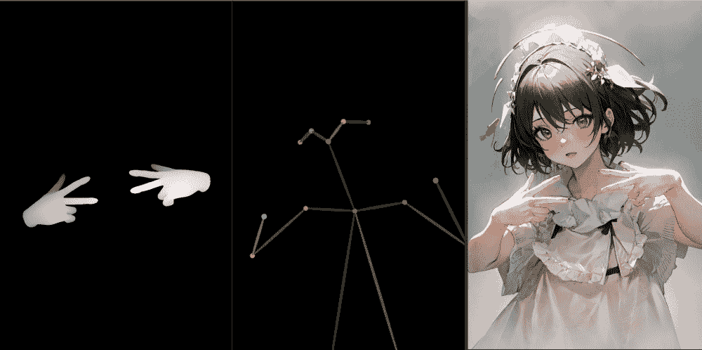

推特网友 @Claude 利用带有 controlnet 和 mov2mov 功能的 SD webUI，将真人视频转换为动画风格。

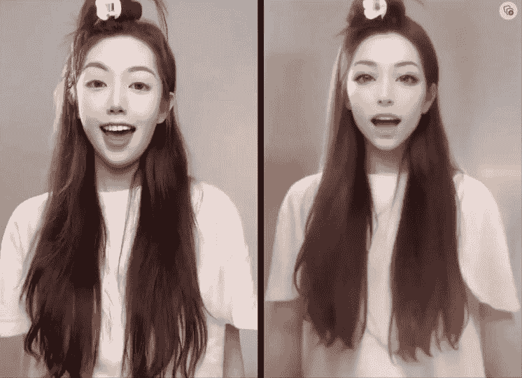

[Stable Diffusion 学习手册 - 飞书云文档.mp4](https://internal-api-drive-stream.feishu.cn/space/api/box/stream/download/all/Q24sblkbhotk19xkOR4ceUEknPc)

#### 3）训练自己的模型

我们可以用 SD `LORA` 或者 `Dreambooth` 将自己喜欢的人物形象或者画风训练生成模型，打造自己的专属 AI 绘画工具，也有画师和设计师用自己的原创作品训练模型，之后有灵感了就之后用文字描述出来，让 SD 帮自己快速出各种概念草图。

### 主要缺点

#### （1）对电脑配置有要求

在本地用 SD 生成图像和训练模型都需要显卡做支撑，所以 SD 对电脑显卡有要求。最好是 Nvidia 的显卡（N 卡），显存至少 4G，不然图像的生成速度非常非常非常慢（不是夸张），也容易出现报错或系统崩溃。如果你想自己训练模型，最好用高配置的台式机，显卡选 40 系列及以上，显存最低 12G，CPU 选 Intel i7 或者以上，内存越大越好。

> 检查电脑显存的方法（windows）：
>
> 鼠标放在工具栏，单击右键打开“任务管理器”，选择顶部的“性能”，进入后下拉查看 GPU 的部分，找到“专用 GPU 内存”，下面对应的数字就是电脑的显存。下图显示的电脑显存是 2G，生成一张最低配置的 `512*512px` 的图像需要 8 分钟，而 32G 显存的生成速度只需几秒，所以显存低的电脑不适合运行 Stable Diffusion。

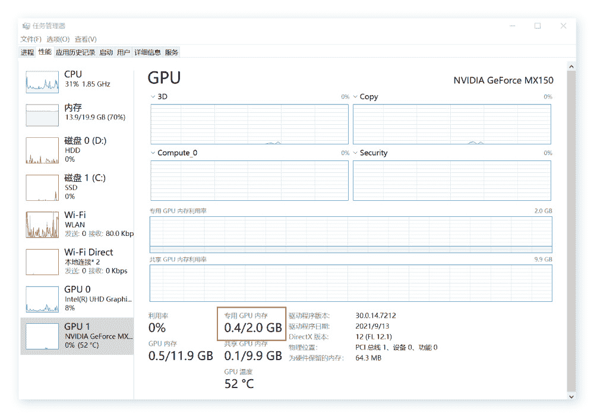

#### （2）需要较大的硬盘空间

因为 SD 所有文件都是安装在本地电脑上，而且生成不同的风格图像需要下载不同的模型，一个大模型至少 2G，假设你想要尝试 10 种风格，那 10 个大模型可能就要 30G 的空间。一般要求装 SD 的那个盘要有 100G 的剩余空间，最低不小于 40G，且最好不要安装在 C 盘。

#### （3）入门学习难度更高

SD WebUI 的各种参数比 Midjourney 要复杂，而且很多功能都需要通过额外安装插件和模型来实现，因此我们需要了解各种参数的含义，不同的模型插件的使用方法，可能还需要了解背后的原理知识，因此入门学习的难度比 Midjourney 高。

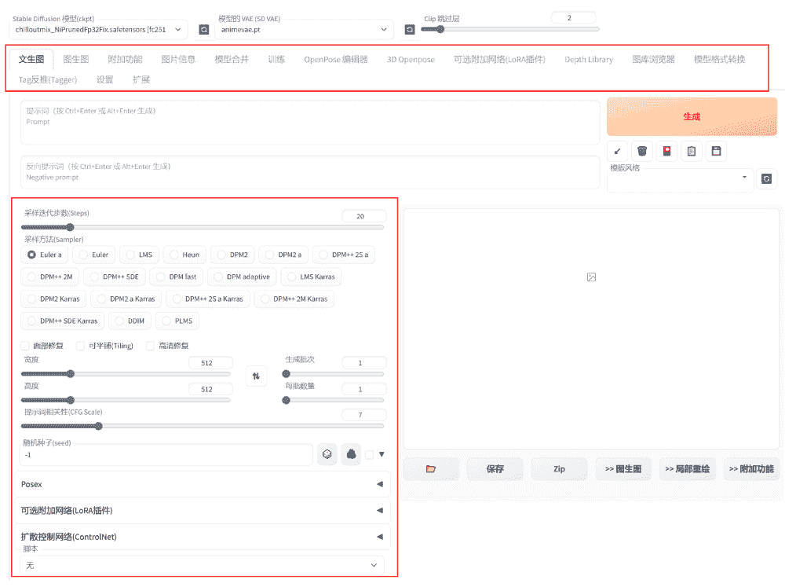

图：一个功能配置较完整的 SD webUI 汉化操作界面

#### （4）高质量风格有局限性，不够灵活

SD 目前的高质量的图像生成模型多集中在真人、游戏和二次元插画方面，而且换一个风格就需要下载一种模型；而 Midjourney V5 可以仅通过文本提示词就快速生成各种类型和风格的高质量图像。

### 模型原理

Stable Diffusion 模型和 GAN 模型一样，是生成式模型，了解 GAN 模型的朋友都知道，生成式模型能够生成和训练集分布相似的输出结果（拟合数据分布），在计算机视觉领域是图片，在自然语言处理领域是文字。下面是主流生成式模型各自的生成逻辑：

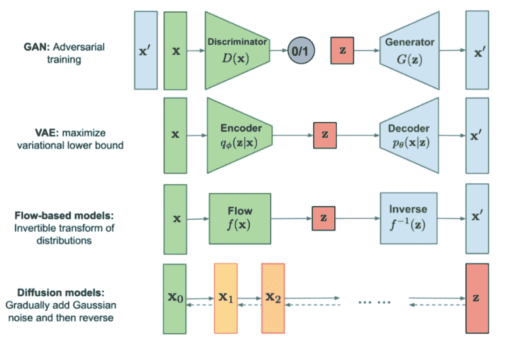

生成式模型的主流架构

在这里拿 GAN 详细展开讲讲，由于篇幅原因，VAE 和 Flow-based models 这里就不过多介绍。GAN 由生成器和判别器组成。其中，生成器主要负责生成相应的样本数据，输入一般是由高斯分布随机采样得到的噪声。而判别器的主要职责是区分生成器生成的样本与样本，输入一般是样本与相应的生成样本，我们想要的是对样本输出的置信度越接近越好，而对生成样本输出的置信度越接近越好。与一般神经网络不同的是，GAN 在训练时要同时训练生成器与判别器，所以其训练难度是比较大的。我们可以将 GAN 中的生成器比喻为印假钞票的犯罪分子，判别器则被当作警察。犯罪分子努力让印出的假钞看起来逼真，警察则不断提升对于假钞的辨识能力。二者互相博弈，随着时间的推移，都会越来越强。在图像生成任务中也是如此，生成器不断生成尽可能逼真的假图像。判别器则判断图像是图像，还是生成的图像。二者不断博弈优化，最终生成器生成的图像使得判别器完全无法判别真假。好的，讲完 GAN，让我们回到 SD 模型。SD 模型有两个最基本也是最经典的应用，分别是文生图（`txt2pic`）和图生图（`pic2pic`）。

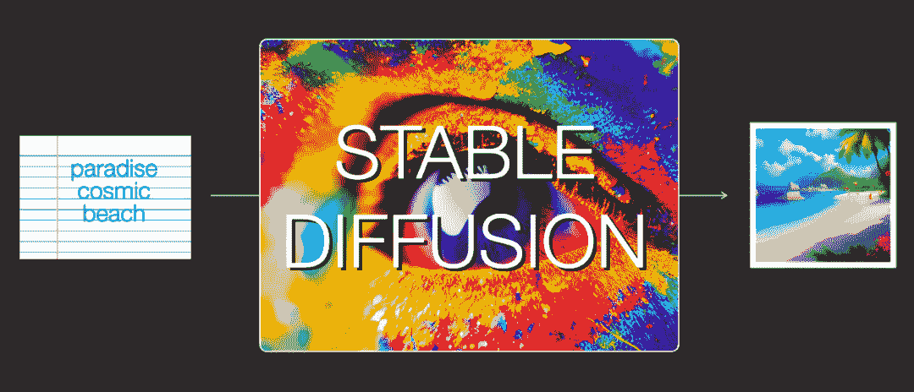

SD 文生图过程

文生图是指将一段文字输入到 SD 模型中，经过一定的迭代次数，SD 模型输出一张符合输入文字描述的图片。比如上图中输入了“天堂，巨大的，海滩”，于是生成了一个美丽沙滩的图片。

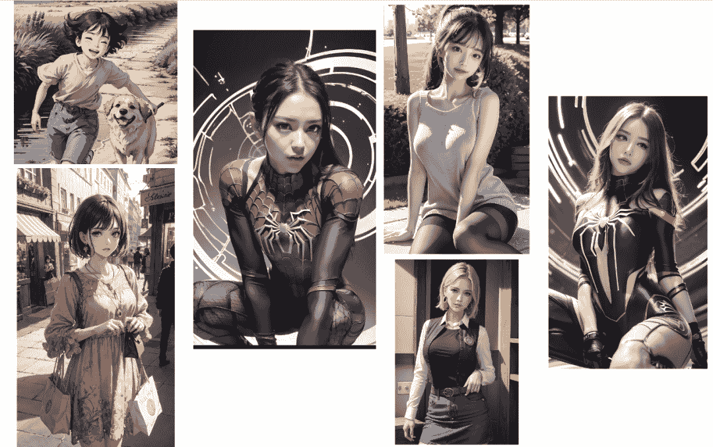

感受了 SD 模型强大的生成能力，大家可能会想到生成式领域上一个霸主模型 GAN，与 GAN 模型不同的是，SD 模型是属于扩散模型，并且是基于 `latent` 的扩散模型。什么是扩散模型呢？用通俗的话来讲，就是将图像的生成过程分多步进行，逐步完善图像内容，经过 20-50 次的“扩散”循环，最终输出精致的图像。下面是一个直观的例子，将随机高斯噪声矩阵通过 SD 模型的 `Inference` 过程，逐步去噪，最后生成一个小别墅的图片

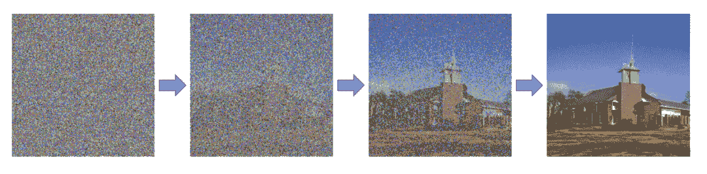

SD 模型的 `Inference` 过程

那 `latent` 又是什么呢？基于 `latent` 的扩散模型可以在低维度的隐空间上进行“扩散”过程而不是在实际 `pixel` 空间，这样一来大大降低了内存占用和计算复杂性，这是常规扩散模型和 `latent` 扩散模型之间的主要区别。同样的，在训练中，`latent` 扩散模型也将训练过程聚焦在 `latent` 空间中。举个例子，如果 SD 模型中将数据矩阵缩小的倍数设为，那么原本尺寸为的数据矩阵就会进入的 `latent` 隐空间中，内存和计算量直接缩小倍，整体效率大大提升。到这里，大家应该对 SD 模型的基本概念有一个清晰的认识了，总结一下：

1. SD 模型是生成式模型，与 GAN 模型有很多相似的地方，输入可以是图片，也可以是文字，输出是图片。

2. SD 模型属于扩散模型，扩散模型的整理逻辑是生成过程分步化与迭代化，这给整个生成过程引入更多约束与优化提供了可能。

3. SD 模型是基于 `latent` 的，将生成空间压缩到 `latent` 空间中，比起常规扩散模型，大大提高计算效率的同时，降低了内存占用，成为了 SD 模型爆发的关键一招。

4. 将维度拉到最高维，认为 SD 模型的整体流程是一个优化噪声的艺术。

**参考文章：**深入浅出解析 Stable Diffusion 完整核心基础知识

### 常见问题

主要是官网的内容：

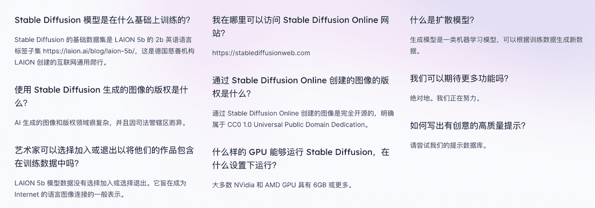

## 二、安装教程

### 本地部署

**电脑配置最核心的关键点：**看显卡、看内存、看硬盘、看 CPU。其中最重要的是看显卡。N 卡（英伟达 Nvida 独立显卡）首选，效率远超集显/AMD/Intel 显卡和 CPU 渲染，最低 10 系起步，体验感佳用 40 系，显存最低 4G，6G 及格，上不封顶；内存最低 8G，16G 及格，上不封顶；硬盘可用空间最好有个 500G 朝上，固态最佳。

**系统要求：**支持 Win10/Win11/macOS（仅限 Apple Silicon，Intel 版本的 Mac 无法调用 Radeon 显卡）和 Linux 系统，苹果版 SD 兼容的插件数量较少，功能性不及 Windows 与 Linux 电脑。

如果身边没有合适的电脑可以考虑购买云主机，比如腾讯 GPU 云服务器。若无法使用独立显卡和云服务，亦可修改启动配置，使用 CPU 渲染（兼容性强，出图速度慢，需要 16G 以上内存）。

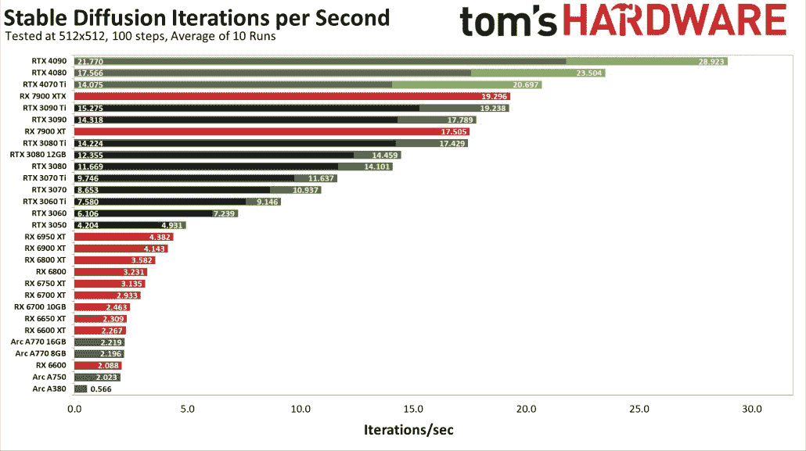

从图中可看出，与 AMD 或英特尔的任何产品相比，Nvidia 的 GPU 提供了卓越的性能--有时是以巨大的优势。随着 `Torch` 的 DLL 修复到位，RTX 4090 的性能比带有 `xformers` 的 RTX 3090 Ti 高出 50%，而没有 `xformers` 的性能则高出 43%。生成每张图片只需要三秒多。

**视频讲解：**5 分钟搞定 Stable Diffusion 环境配置

#### Stable Diffusion 电脑配置要求

**配置要求：**需要使用 N 卡（NVIDIA 显卡），显卡的显存至少需要 4GB 以上显存才能在本地运行。最低配置需要 4GB 显存，基本配置 6GB 显存，推荐配置 12GB 显存或者以上。（言川小知识：stable diffusion Ai 绘画主要是运行显卡，算力越强，出图越快。显存越大，所设置图片的分辨率越高）

“推荐使用 RTX4090 显卡哦，” -----来自一个 3080 显卡玩家

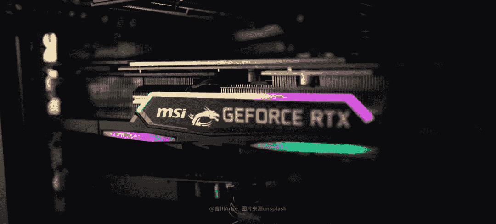

还有一点的就是硬盘空间要大，SD 出图主要依赖模型，网上下载的模型资源一般都很大（一个模型在 2G 以上）批量跑图也是很占内存的，这边建议 60GB 以上的硬盘空间。

**网络要求：**大家都懂哈，咱也不说。

**操作系统：**需要是 Win10 或 Win11。

满足以上条件基本上就可以用 SD 跑图啦。

#### Stable Diffusion 安装

SD 的安装我们就不要整的很复杂了，直接用大佬制作的一键安装/启动包就行，我们把时间用在刀刃上。

自己手动安装需要上 Github 下载文件，还要下载 Ptthon 等工具，一般第一次手动安装会出现各种奇怪的报错，总之很复杂，我之前自己安装过，真就花了一上午都还没安装好。所以我不建议也不教大家手动安装了。（如果你要硬上，可以在网上看看别的使用教程）

上黑科技！！！咱直接去使用 大佬的免费启动器和安装包。

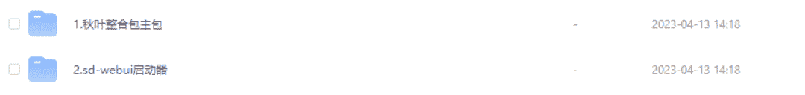

注意：下载的文件一定要放在空间比较大的盘里

**来看下具体操作：**

1、安装一下这个“启动器运行依赖”。

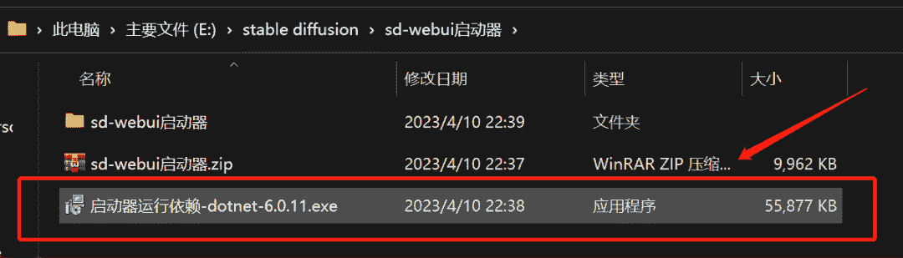

2、打开“`novelai-webui-aki-v3`”文件夹

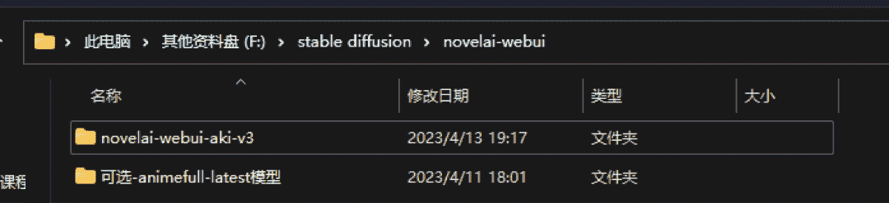

3、然后下拉下拉...找到这个启动器，双击就完事了。

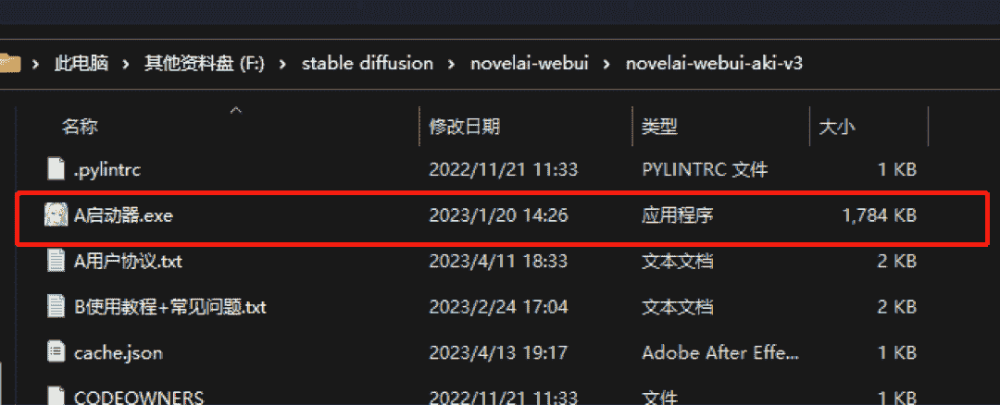

4、然后就打开啦，一键启动就好了。

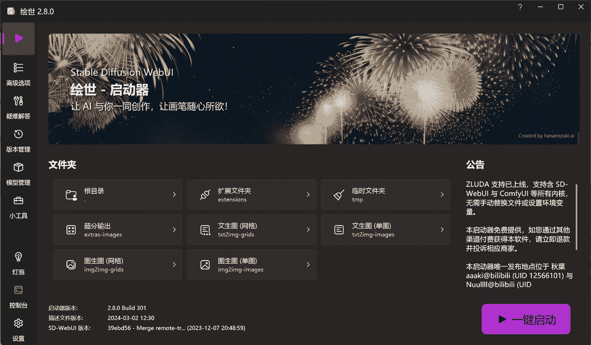

#### Mac 版本

DiffusionBee 提供了一个基于 stable diffusion 的应用程序，无需复杂部署，正常安装就可以使用。完全免费

**官网地址：** `https://diffusionbee.com/`

**安装及使用流程参考：**

**硬件要求参考：**

1、建议：8GB M1 MacBook Air 以上

2、DiffusionBee 适用于基于 Intel 的机器。如果你没有专用的图形芯片，它与 M1 机器相比非常慢。

3、DiffusionBee 需要更高版本的 macOS 12.5.1，推荐使用 Apple 芯片的机器

### 云端部署

[有手就行，国内免费使用的stable diffusion云平台](https://alwn6vlogx.feishu.cn/docx/Ixg8dob9Po0oFOxcc0GczvpznGa)

2.网页版 （免安装，点击即用）

**点击访问：** `https://shorturl.at/kvyNY`

无需魔法，国内可用，注册后即可免费试用非常适合新手尝鲜 （没有任何设备要求和安装过程，登录即可使用）

100%原版 stable difusionwebUI，目前网上有的插件，官方都会测试优化好后陆续添加进去，比如 `openpose3d`，`mov2mov` 等等，好处就是不需要自己部署和维护，随便到哪，甚至用手机和平板就可以畅享 A10 工业显卡级别的作图体验里面已经有非常多的大模型和 `LORA` 模型，并且有程序员大大在进行 BUG 维护。

**3.**[stable diffusion腾讯云部署](https://hcb97zmcrv.feishu.cn/docx/KHTedk3vVoP4Xvx0tmXc33aUn2f)

[全网最简单的 stable diffusion 腾讯云部署教程（视频版）](https://www.bilibili.com/video/BV1cV4y1Z7iw/?spm_id_from=333.337.search-card.all.click&vd_source=05604b6063f398633af513a2e9a7c804)

# 4.Stable Diffusion 阿里云云端部署教程（视频版）

[**5.【AI 制图】5 分钟 Colab 云端部署**](https://www.bilibili.com/video/BV15j411c7fE/?spm_id_from=333.337.search-card.all.click&vd_source=05604b6063f398633af513a2e9a7c804) stable diffusion 教程

**附件：**[Colab 快速部署Stable Diffusion](https://hesn0bipt0.feishu.cn/docx/VrTHdeIm5oKT9AxzI7CcRxqjnTh)

## 版本汉化

### Stable Diffusion WebUI 汉化

1. 安装中文扩展插件：点击 `Extensions` 选择 `Install from URL`，输入 `https://github.com/VinsonLaro/stable-diffusion-webui-chinese`，点击 `Install`，并重启 `WebUI`。

2. 切换到中文模式：在 `Settings` 面板中，将 `User interface` 中的 `Localization` 设置成 `Chinese` 中文模式，重启 `WebUI` 即可切换到中文界面。

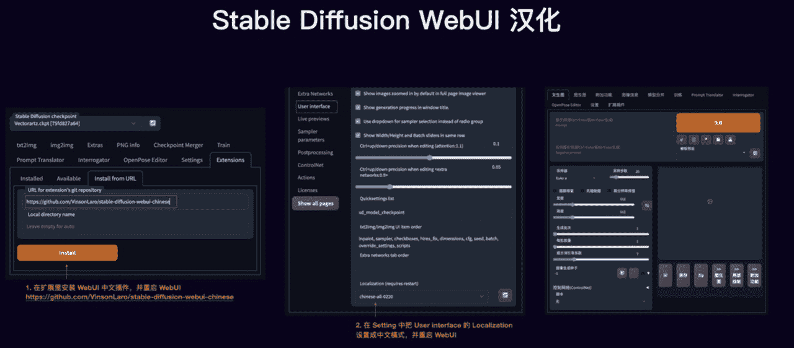

## 三、使用教程

> **以下文章教程均属于智设团队**创作，点击链接蓝色标题可跳转原文

### 第一讲：基本功能及基础操作

#### 1.1 大模型的切换

首先是这个界面左上角，在这里可以切换你所安装的模型

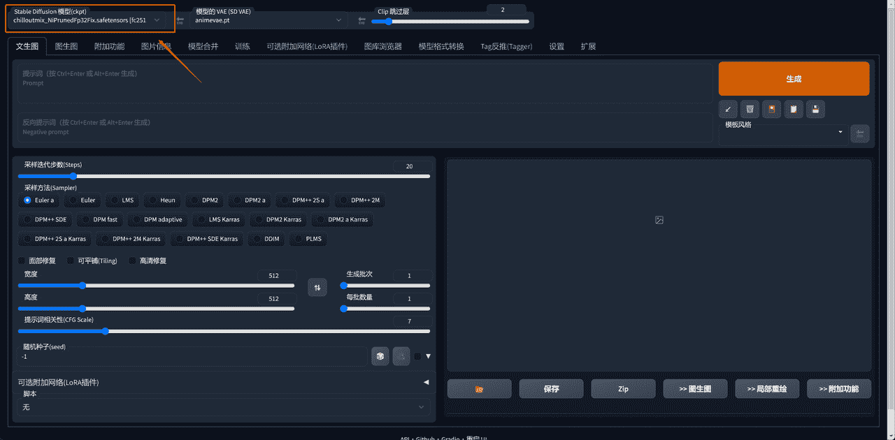

这里我先推荐一下我常用的模型网站：C 站：`https://civitai.com/`

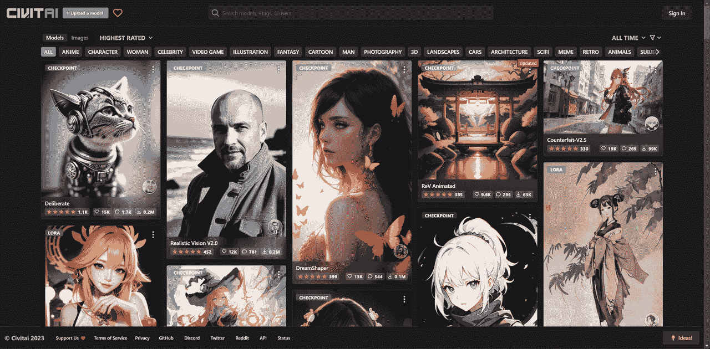

然后我们在 C 站上下载一些模型，下载需要网络哦。

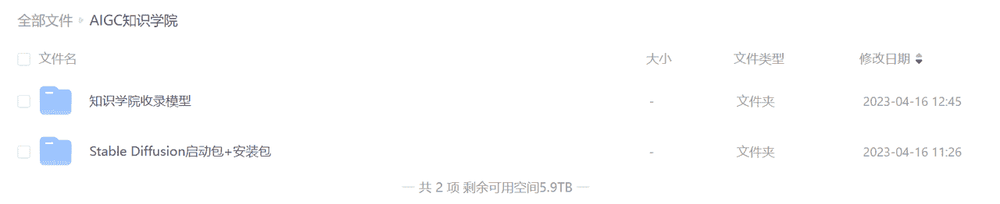

接下来就是安装了，很简单，把下载的模型放到这个路径文件夹中。然后刷新 `WebUI` 界面（就是 SD 操作界面）

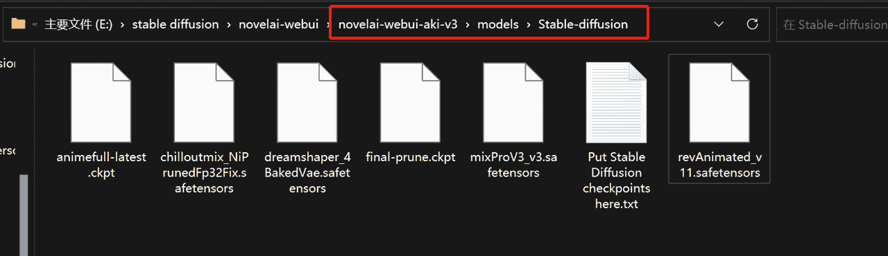

#### 1.2 模型的 VAE（Sd 的 VAE）

`VAE` 的全称是 `Variational Auto-Encoder`，翻译过来是变分自动编码器，本质上是一种训练模型，`Stable Diffusion` 里的 `VAE` 主要是模型作者将训练好的模型“解压”的解码工具。

这里可以切换 `VAE`。一般情况下我们就选择第一个自动就行了。

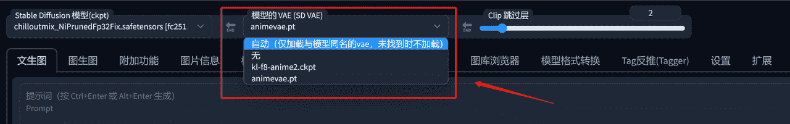

在 C 站（`stable diffusion`）下载模型，在下载页面会有文件显示，如图。

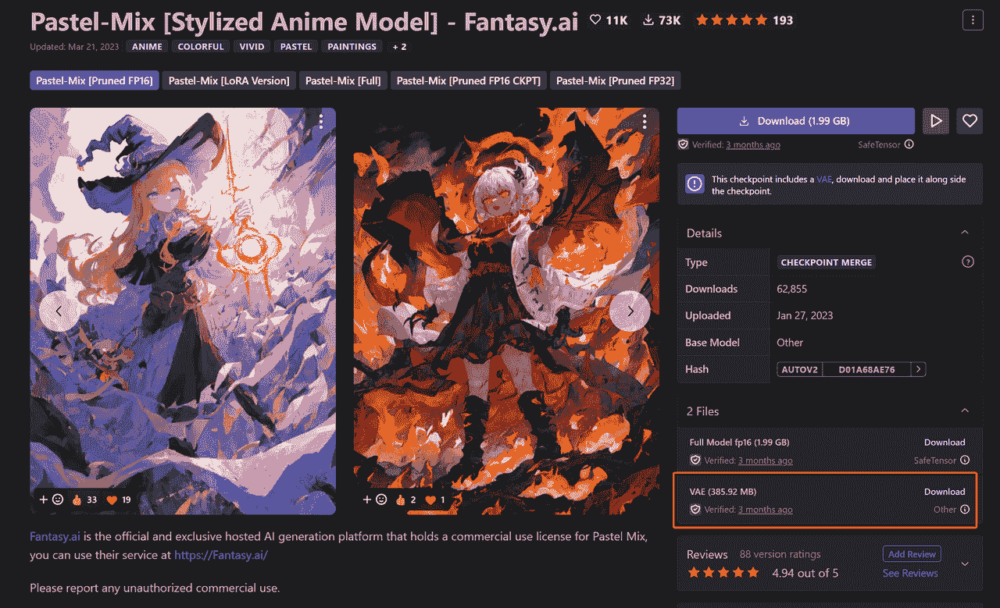

`VAE` 的安装路径看我这里，把下载的文件复制粘贴，然后把 `WebUI` 界面刷新一下（就是 SD 操作界面）​

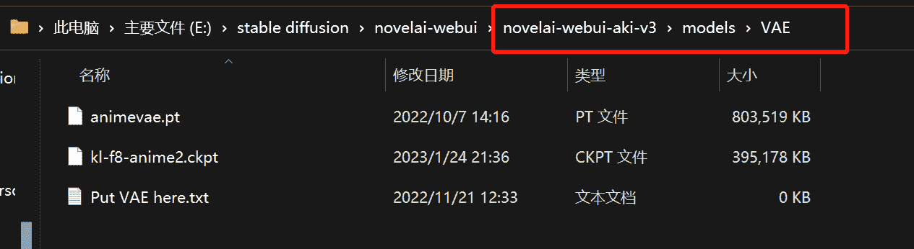

**言川总结：**

1、总的来说就是你在 C 站上下载的模型有些内置就有 `VAE` 的属性（不需要下载 `VAE` 文件），有些没有内置下载的时候我们就把 `VAE` 文件下载。（`VAE` 文件一般大小在几百兆左右）​

2、`VAE` 的作用就是没有加载 `VAE` 的图片是灰灰的，加载之后就是会产生一个润色的效果，色彩更加丰富。

#### 1.3 功能选项

这里我挑选几个重要的功能讲解下。

**文生图，**这里与 `Midjourney` 不同的是，`SD` 有一个反向关键词（意思是不要图片出现什么），文生图的关键词格式与 `Midjourney` 基本一致，不知道的朋友可以去看我的往期文章《奶奶看了都会的 `Midjourney` 入门教程！！》

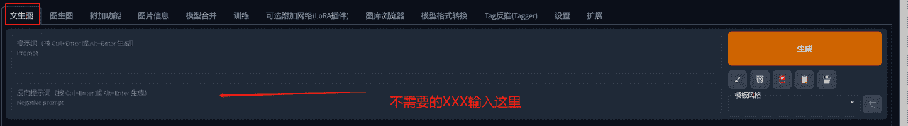

下面这块参数就是设置图片的一些基本参数，分辨率、尺寸等等，具体参数见下文

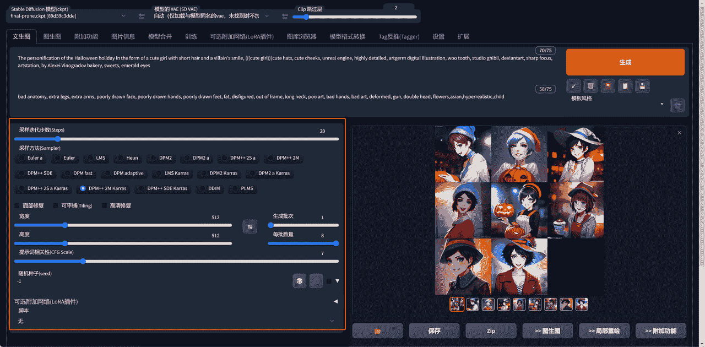

**图生图，**这个也很好理解，放参考图然后输入提示词，与其他 AI 绘画软件一致。

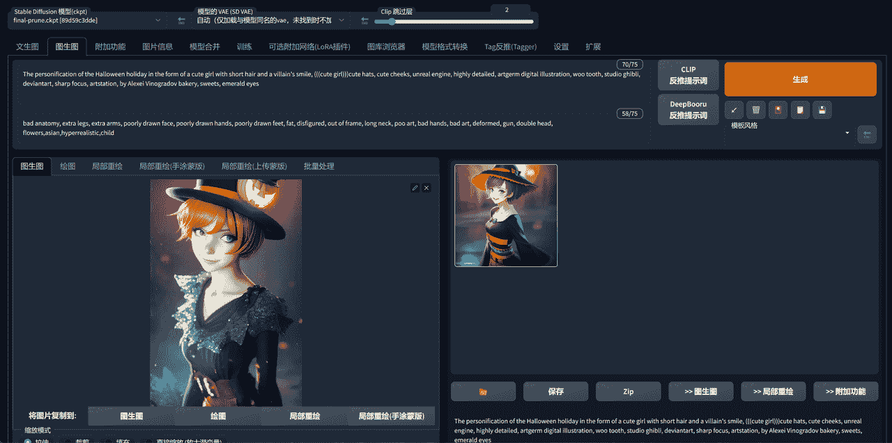

**图片信息，**意思是你用 `SD` 画的图，放在这里来，右边会显示这个图片的一些参数，包括关键词。

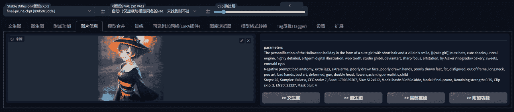

然后你可以选择右下角的一些功能，比如“文生图”。

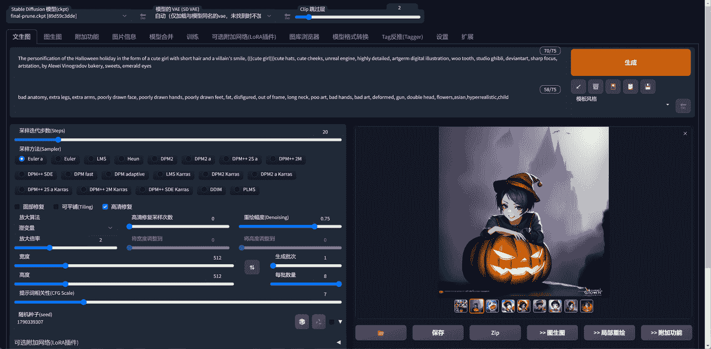

**模型合并，**这个功能很厉害，后面我出一篇关于这个功能的教学，大致就是把多个模型混合起来。

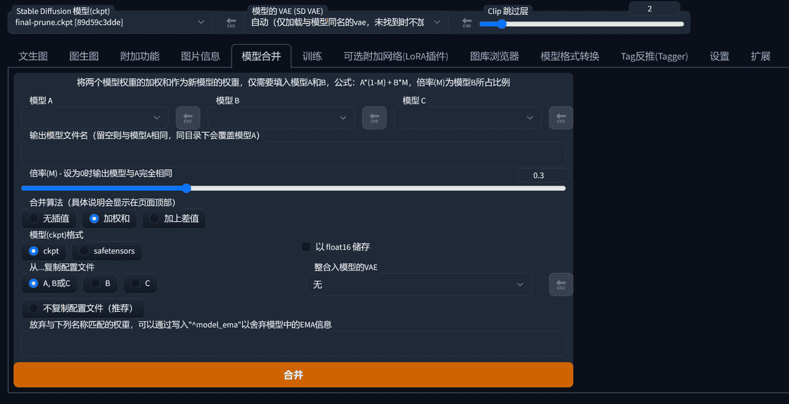

**训练，**这个就是训练自己的模型，新手用的比较少，后面可用作工作流的部署。（这个才是我推荐的核心哦）

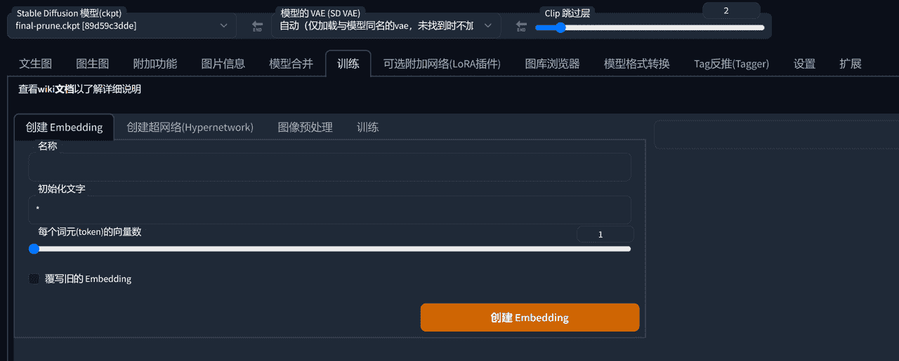

**设置，**然后就是设置，大家自己去研究下就好了。

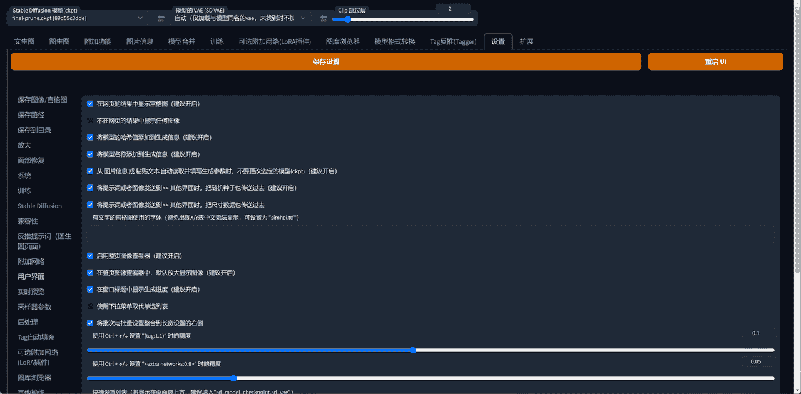

**扩展，**这个就是跟插件扩展相关的了，后面再讲。

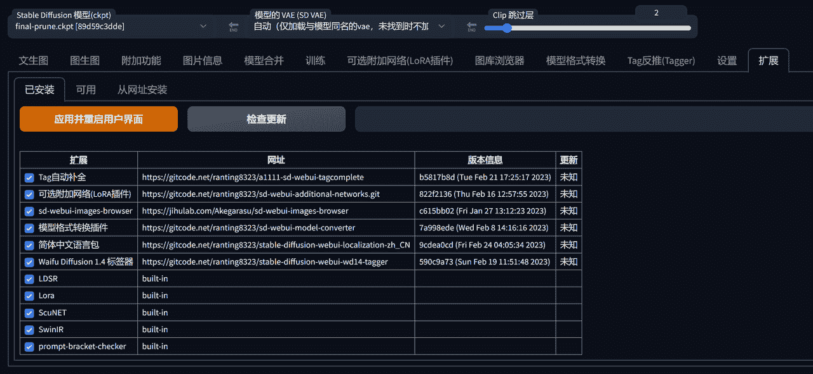

#### 6.4 提示词和反向提示词

**言川提示：**

提示词内输入的东西就是你想要画的东西，反向提示词内输入的就是你不想要画的东西。

提示框内只能输入英文，所有符号都要使用英文半角，词语之间使用半角逗号隔开。

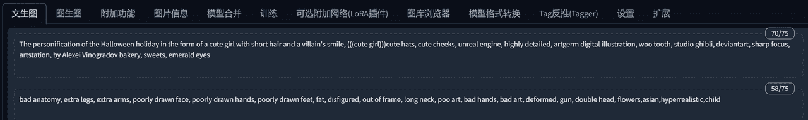

一般来说越靠前的词汇权重就会越高，比如我这张图的提示词：

The personification of the Halloween holiday in the form of a cute girl with short hair and a villain's smile, (((cute girl)))cute hats, cute cheeks, unreal engine, highly detailed, artgerm digital illustration, woo tooth, studio ghibli, deviantart, sharp focus, artstation, by Alexei Vinogradov bakery, sweets, emerald eyes.

万圣节假期的拟人化形式是一个留着短发和恶棍笑容的可爱女孩，可爱的帽子，可爱的脸颊，虚幻的引擎，高度详细，艺术种子数字插图，woo tooth，吉卜力工作室，deviantart，锐利的焦点，artstation，由 Alexei Vinogradov 面包店，糖果，绿宝石般的眼睛。

第一句关键词词组：万圣节假期的拟人化形式是一个留着短发和恶棍笑容的可爱女孩。那生成的图片主体画面就会是万圣节短发可爱笑容女孩

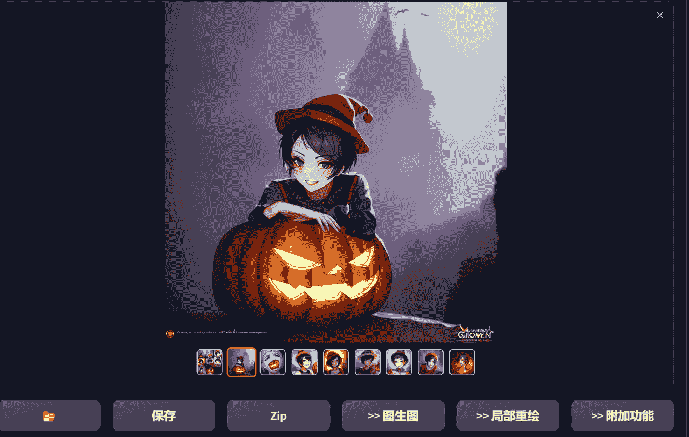

这里可能有用过 `Midjourney` 的小伙伴们就有疑问了，`（（（cute girl））`是什么意思，为啥有这么多括号，我来为大家解答下，这个是权重调节，类似 `Midjourney` 的 `::`

1、最直接的权重调节就是调整词语顺序，越靠前权重越大，越靠后权重越低，上面说过。

2、可以通过下面的语法来对关键词设置权重，可以通过选中词汇，按 `ctrl+↑↓`来快速调节权重，每次调节为 `0.1`，也可以直接输入。

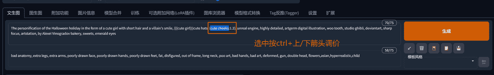

3、加英文输入的（），一个括号代表这组关键词的权重是 `1.1`，两个括号是 `1.1*1.1` 的权重，不要加太多了哈。可以结合第二点固定权重，比如 `（（（cute girl:1.2））`，那这个关键词的权重就很高了。

#### 6.5 功能按钮

我们来介绍下右边这几个功能，生成就不说了，输入关键词生成就跑图了

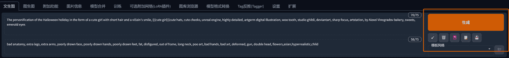

第一按钮的意思是读取你上一张图的所有参数信息（包括关键词），比如你画一张图之后，关掉了软件，再次启动点击这个就会把参数复制进来。

第二个按钮就是删除了，清空关键词；这里可以和第一个按钮结合用哦

第三个按钮就是模型选择管理

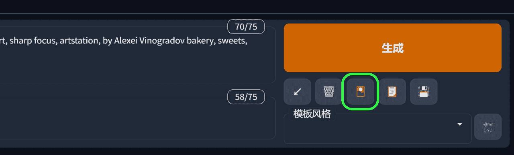

这个按钮就是点击就会出现这些功能，你安装的模型和 `Lora` 都可以在这边调整。

言川小知识：这里可以把你生成的图片添加到模型的封面上，方便你后面看这个模型的效果，看我怎么做：​

找到这个模型的名称，然后我这里是跑出来一张图片的，点击这个按钮（`lora` 一样）

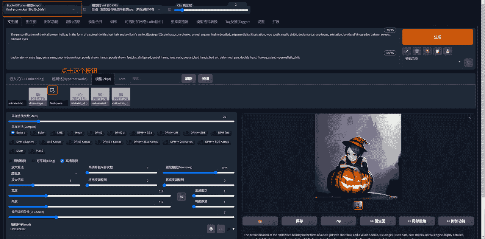

最终效果：

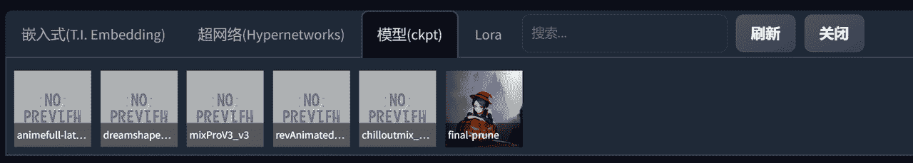

后面两个就是一个提示词模板功能：

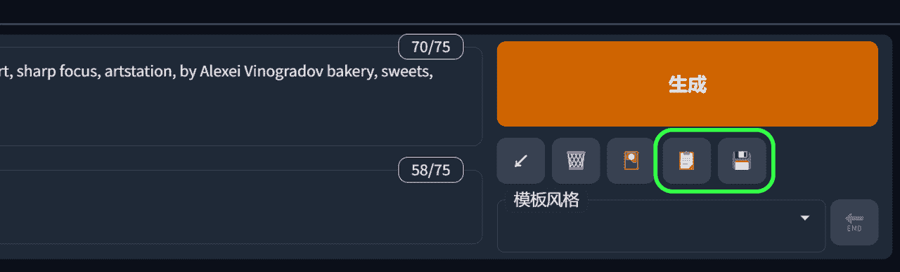

我们可以先点最后一个按钮，把现在的关键词创建一下，取个名字

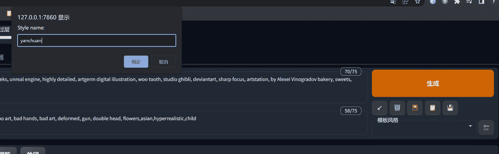

然后在模板风格这里选中我们刚刚创建的模板（可以多选）

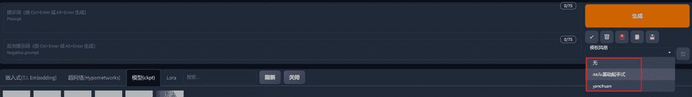

选中之后按一下第四个按钮，我们创建的关键词就被填入进去了，这块收工！

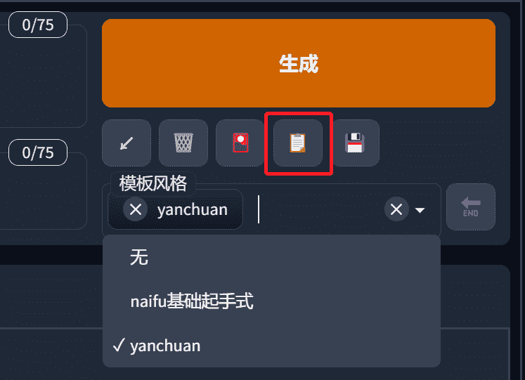

#### 6.6 采样步数

一般来说大部分时候采样部署只需要保持在 `20～30` 之间即可，更低的采样部署可能会导致图片没有计算完全，更高的采样步数的细节收益也并不高，只有非常微弱的证据表明高步数可以小概率修复肢体错误，所以只有想要出一张穷尽细节可能的图的时候才会使用更高的步数。（加大这个会导致出图变慢）

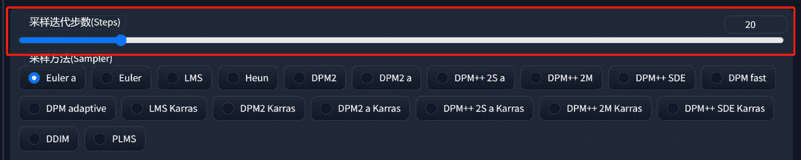

#### 6.7 采样方法

`Stable diffusion WebUI` 是 `Stable diffusion` 的 `GUI` 是将 `stable diffusion` 实现可视化的图像用户操作界面，它本身还集成了很多其它有用的扩展脚本。

`SD` 的采样方法有很多，大家有兴趣了解的可以去知乎看看@刘登宇的一篇文章《`stable diffusion webui` 如何工作以及采样方法的对比》。这里我们只介绍两个种常用的。

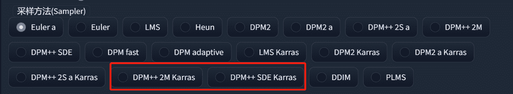

这里的采用方式有很多，但是我们常用的就那几个，我们可以去设置里面把不需要用到的关掉，不展示在这个界面中。然后点击右边的重启 `UI` 就好了。

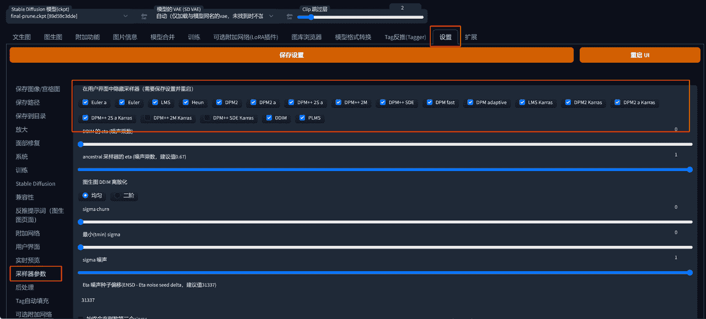

#### 6.8 高清修复和图片尺寸参数

前面两个做个简单的介绍，面部修复对写实的风格有点效果，可平铺就不要用了，生成的图片很奇怪，可以自己试试。

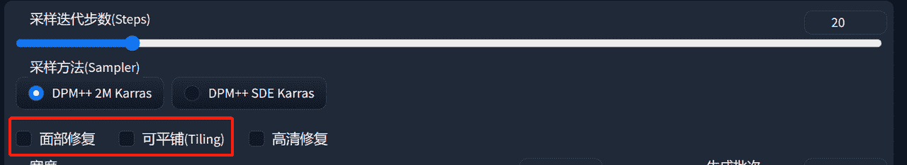

我们说说高清修复，高清修复的意思是把基础生成的图片，按照你选择放大的倍率放大到指定分辨率之后再重新绘制图片，受到你重复幅度调节的数值影响。

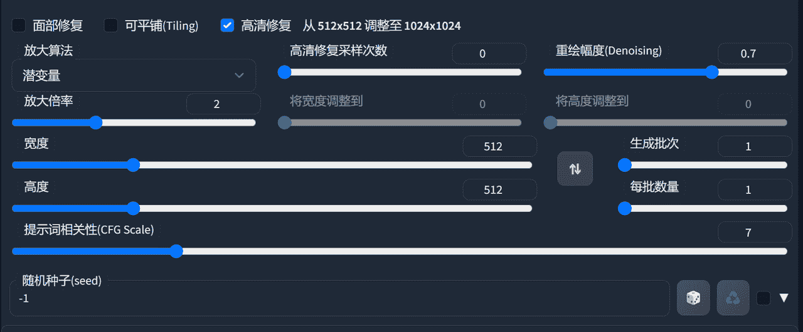

宽度、高度就是图片的长宽比，很容易理解，生成批次和数量就是几批，一批几张图，配置好的可以直接拉满，增加效率哦。

提示词相关性：图像与你的提示的匹配程度。增加这个值将导致图像更接近你的提示（根据模型），但它也在一定程度上降低了图像质量。可以用更多的采样步骤来抵消。

默认未选中高清修复是这样的，当前图片的参数。

#### 6.9 随机种子（`seed`）

这个功能与 `Midjourney` 的 `Seed` 功能一样。

随机数的起点。保持这个值不变，可以多次生成相同（或几乎相同，如果启用了 `xformers`）的图像。没有什么种子天生就比其他的好，但如果你只是稍微改变你的输入参数，以前产生好结果的种子很可能仍然会产生好结果。

输入不同的种子，生成的图片不一样，`seed` 值一样，那生成的图片也是一样。

差异随机种子，需要勾选这个按钮

这个功能是固定一个种子，然后调整差异强度来生成图片，因为是固定的 `seed` 值，所以生成的图风格都是类似的。

直接看图吧。

---

> **以下插件教程均为长篇文章**，大家需点击链接跳转至原文地址查阅。

## 第二讲：主流的插件介绍（进阶）

[姥姥看了都会的 `Controlnet` 插件功能教程](https://keenchase.feishu.cn/wiki/FurMwi0rEimtm5kc7vwcD0SXnOg)

[一键生成多种风格图片，自动填充关键词插件 `Dynamic Prompt`](https://keenchase.feishu.cn/wiki/Jgybw0SCbir6rek8l4dcmP02n8g)

---

> **以下商业设计教程均为长篇文章**，大家需点击链接跳转至原文地址查阅。

## 第三讲：商业设计实战

[`StableDiffusion` 在多个设计场景中的探索与应用](https://keenchase.feishu.cn/wiki/Z4KLwUqNGi9Tlfk3DCEcNIVDnKc)

[`StableDiffusion` 如何实现模特精准换装以及如何替换模特](https://keenchase.feishu.cn/wiki/EcjjwPErhigvP4khOuwcDvFonWd)

## 四、绘画提示词

### 提示词网站

#### Lexica

**简介：**`Lexica` 是一个专注于 `Stable Diffusion` 模型的 `prompt` 搜索引擎，其搜索方式非常简单，集搜索、绘图、关键词为一体 `AI` 的绘画工具。除此之外，`lexica` 还提供了 `AI` 图像生成功能，用户可以对图片的 `prompt` 进行重新编辑并生成新的图片，注：每月有 `100` 张免费可供作画。

**传送门：**`https://lexica.art/`

#### Prompthero

**简介：**提示工程排名第一的网站。通过 `Stable Diffusion`、`Midjourney` 等模型搜索数百万 `AI` 艺术图像。

**传送门：**`https://prompthero.com/`

#### PromptoMANIA

**简介：**人性化的提示生成器将为您提供帮助。您也可以尝试使用其他扩散模型，例如 `DALL-E 2`、`Disco Diffusion`、`WOMBO Dream` 或任何扩散模型。

**传送门：**`https://promptomania.com/stable-diffusion-prompt-builder/`

### Prompt 中文输入

1. 下载提示词中文扩展插件：`https://github.com/butaixianran/Stable-Diffusion-Webui-Prompt-Translator` ，将项目作为 `zip` 文件下载，解压后放到 `stable-diffusion-webui/extensions` 目录中，重启 `WebUI`

2. 调用百度翻译 API：去 `api.fanyi.baidu.com` 申请一个免费 `API Key`，并将翻译服务开通。在管理控制台的开发者信息页中确认 `APP ID` 和 `密钥`

3. 在 `Stable Diffusion WebUI` 的 `Prompt Translator` 面板中，选择百度翻译引擎，并将申请的 `APP ID` 和 `密钥`填写进去，点击保存

4. 使用：在 `Stable Diffusion WebUI` 页面顶部会出现一个翻译工具栏，我们在提示词输入框中输入中文，点击工具栏中的翻译就能自动把提示词替换成英文

### 提示词类型

提示词也就是我们对 `AI` 的指令。

## 提示词基础

1. 正向提示词：即对画面的描述，例如，一个女孩，月亮，吉他，沙发等

2. 反向提示词：指你不想在画面中出现的元素或属性。例如，低质量，畸形的手等

## 提示词结构化

Prompt 提示词可以分为 4 段式结构：画质画风 + 画面主体 + 画面细节 + 风格参考

1. 画面画风：主要是大模型或 LoRA 模型的 Tag、正向画质词、画作类型等

2. 画面主体：画面核心内容、主体人/事/物/景、主体特征/动作等

3. 画面细节：场景细节、人物细节、环境灯光、画面构图等

4. 风格参考：艺术风格、渲染器、Embedding Tag 等

## 提示词语法

1. 提示词排序：越前面的词汇越受 AI 重视，重要事物的提示词放前面

2. 增强/减弱：`(提示词:权重数值)`，默认 1，大于 1 加强，低于 1 减弱。如 `(doctor:1.3)`

3. 混合：`提示词 | 提示词`，实现多个要素混合，如 `[red|blue] hair` 红蓝色头发混合

4. `+` 和 `AND`：用于连接短提示词，`AND` 两端要加空格

5. 分步渲染：`[提示词A:提示词B:数值]`，先按 `提示词A` 生成，在设定的数值后朝 `提示词B` 变化。如 `[dog:cat:30]` 前 30 步画狗后面的画猫，`[dog:cat:0.9]` 前面 90%画狗后面 10%画猫

6. 正向提示词：`masterpiece`、`best quality` 等画质词，用于提升画面质量

7. 反向提示词：`nsfw`、`bad hands`、`missing fingers`……，用于不想在画面中出现的内容

8. Emoji：支持 emoji，如 😍 形容表情，🖐 修饰手

## Prompt 规则细节

①越靠前的 Tag 权重越大。

②生成图片的大小会影响 Prompt 的效果，图片越大需要的 Prompt 越多，不然 Prompt 会相互污染。

③Stable-diffusion 中，可以使用括号人工修改提示词的权重，方法如下：

`(word)` - 将权重提高 1.1 倍

`((word))` - 将权重提高 1.21 倍（= 1.1 * 1.1）

`[word]` - 将权重降低至原先的 90.91%

`(word:1.5)` - 将权重提高 1.5 倍

`(word:0.25)` - 将权重减少为原先的 25%

请注意，权重值最好不要超过 1.5

④Prompt 支持使用 emoji，可通过添加 emoji 达到表现效果。如😍形容表情，🖐可修手。

⑤`+`、`AND`、`|` 用法：`+` 和 `AND` 都是用于连接短 Tag，但 `AND` 两端要加空格。`+` 约等于 `and`；“`|`” 为循环绘制符号（融合符号）`(Prompt A: w1)` | `(Prompt B: w2)`

以上表达适用于 WebUI，`w1`、`w2` 为权重。AI 会对 A、B 两 Prompt 进行循环绘制。可往后无限加入 Prompt。

⑥tag 不一定是多么充满细节，只要模型稳定。小图+`高分辨率重绘`。800*400 的图变成 1600*800，初识小图减少崩坏概率。

⑦关键词最好具有特异性，譬如 Anime（动漫）一词就相对泛化，而 JoJo 一词就能清晰地指向 JoJo 动漫的画风。措辞越不抽象越好，尽可能避免留下解释空间的措辞。

## 学习文章

[1、手把手教你用 Stable Diffusion 写好提示词](https://keenchase.feishu.cn/wiki/OCR7wHfixiEzhxk4ENDcv0jpnOd)

[3.【炼丹秘籍】Stable Diffusion 咒语语法和参数介绍](https://keenchase.feishu.cn/wiki/AsybwuVmzij2EhkUthpcl0Ahn6e)

## 提示词库

### 1.基础关键词
