# 姥姥看了都会的 Controlnet 插件功能教程

> 来源：[https://keenchase.feishu.cn/docx/QpKmd9DpDowJxPxid2lcBEzQn7b](https://keenchase.feishu.cn/docx/QpKmd9DpDowJxPxid2lcBEzQn7b)

# Stable Diffusion教程丨姥姥看了都会的Controlnet插件功能教程

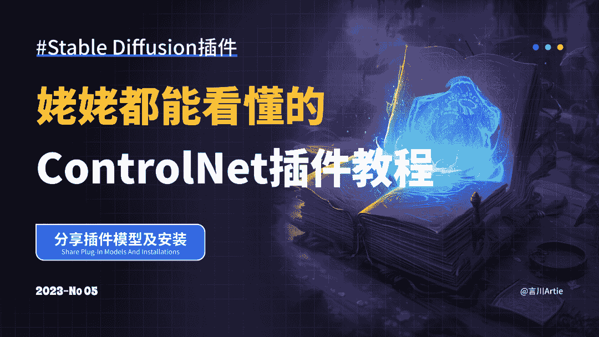

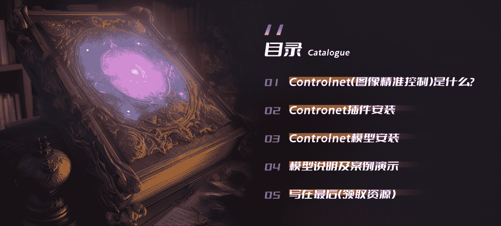

# 前言

Hello，大家好，jeff又来写教程啦！！这是一篇继《外婆都能看懂的Stable Diffusion入门教程！！！AIGC》教程之后的一篇文章，如果你还没有安装并了解stable diffusion这个软件，那么你一定要先去看看入门教程的文章，然后安装stable diffusion。

这篇是stable diffusion进阶教程，然后这篇文章的点赞收藏数据可能不会很好（毕竟需要入门一下），大家点开这篇文章的小伙伴就不要吝啬手中的赞啦~ 看到就是缘分，3连就是爱呀，看过我往期文章的小伙伴们都知道，我真是很认真的写教程，就怕你们学不会，不然我也不会取个 奶奶都会、爷爷都能看懂......的标题，话不多说了，诸君慢赏。（提一嘴，stable diffusion的一键启动包我放在群公告的，大家加我自取哈，还有很多很多很多的AIGC资源，供各位白嫖...)

## 一、Controlnet（图像精准控制）是什么？

ControlNet 是一个用于控制 AI 图像生成的插件。它使用了一种称为"Conditional Generative Adversarial Networks"（条件生成对抗网络）的技术来生成图像。与传统的生成对抗网络不同，ControlNet 允许用户对生成的图像进行精细的控制。这使得 ControlNet 在许多应用场景中非常有用，例如计算机视觉、艺术设计、虚拟现实等等。总之，ControlNet 可以帮助用户精准控制 AI 图像的生成，以获得更好的视觉效果。

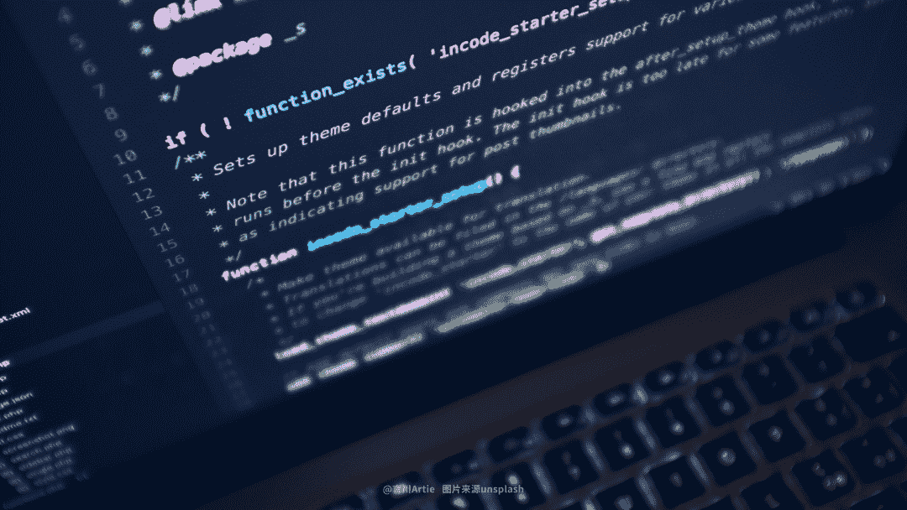

看着有点复杂是不是，没关系，我给你们总结一下：

在 ControlNet 出现之前，我们在生成图片之前，永远的不知道AI能给我们生成什么，就像抽卡一样难受（问个问题，Midjourney是不是跟我描述的一样，哈哈哈哈，狗头保命）。

ControlNet出现之后，我们就能通过模型精准的控制图像生成，比如：上传线稿让AI帮我们填色渲染，控制人物的姿态、图片生成线稿等等。

这下看懂了吗，就很哇塞，大家可能网上看到一些线稿生成的图片，就是用到的这个ControlNet，Stable Diffusion必装的插件之一。

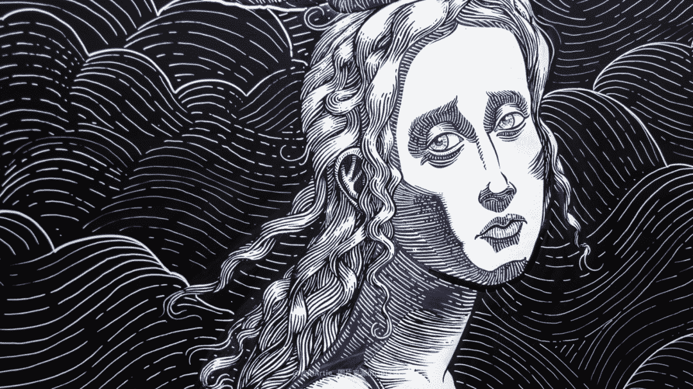

# 二、Controlnet插件安装

1、首先，咱们先打开秋叶大佬的启动器，并且点击更新（切换）到最新版本，这一步的目的是为了防止出现奇奇怪怪的报错。

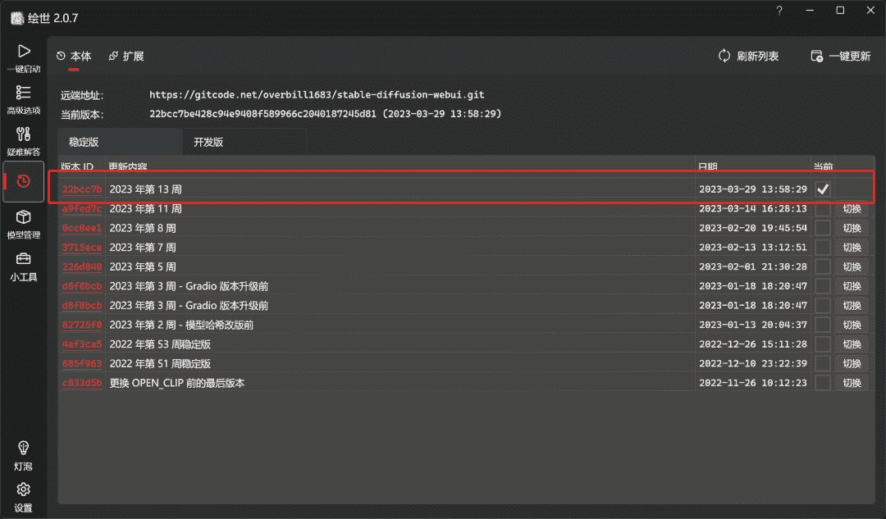

2、然后我们启动 "web-UI"，打开扩展，并在这里输入该网址：https://jihulab.com/hanamizuki/sd-webui-controlnet ，然后点击安装等待一会...(安装没反应或者错误的注意网络问题，网上还有别的办法，我测试了下，这个是成功安装的）

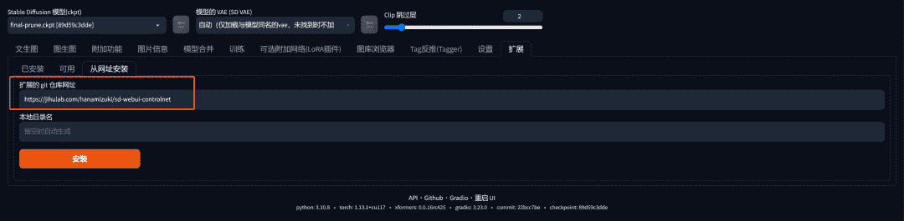

3、等待一会，在这边底部就有一个信息提示，实际上就是告诉你安装的地址，这里我已经提前安装了，所以显示的可能跟大家不一样。

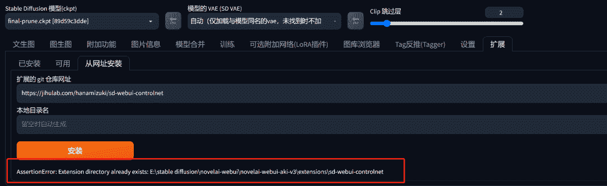

4、然后回到”已安装“这里，可以看到下面就出现了扩散控制网络（Controlnet插件）了，然后点击”应用并重启用户界面"。

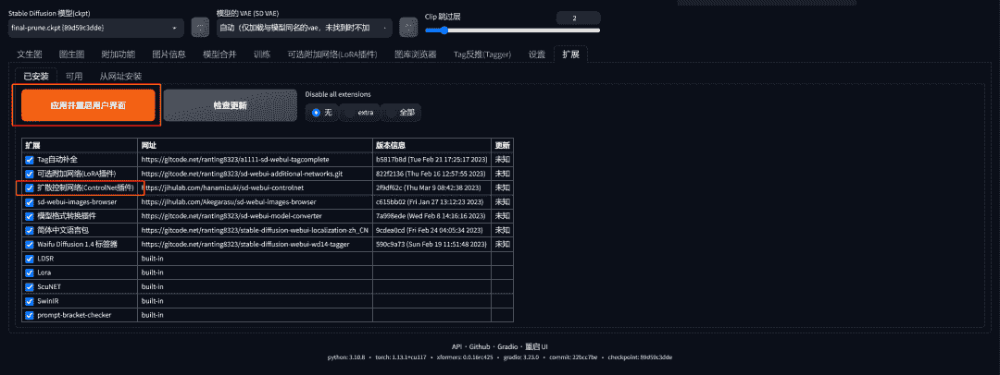

5、回到”文生图“这里，就看到Controlnet已经成功安装了，看到这里，你还不给我点个3连一下吗？不点那我们继续往下看，我相信你一定会点的。（疯狂自恋中...)

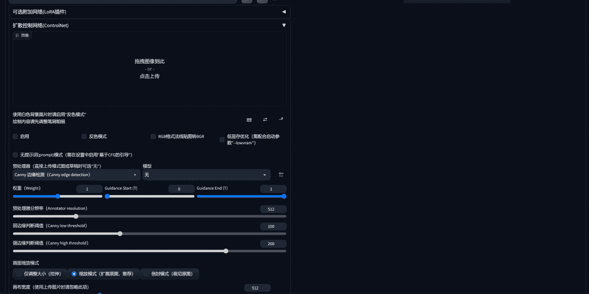

## 三、Controlnet模型安装

1、插件安装完成之后，还没完，我们需要安装下模型，跟着我做，首先去这个链接下载（需要网络）：https://huggingface.co/lllyasviel/ControlNet/tree/main/models

网速好的朋友可以直接去上面链接下载，网速不好的朋友可以加我咨询下我们知识学院收录的模型。

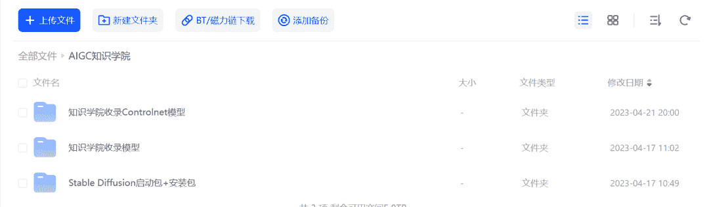

2、把下载的模型全部选中复制（ctrl+c）一下，我们需要移动到对应文件夹中。

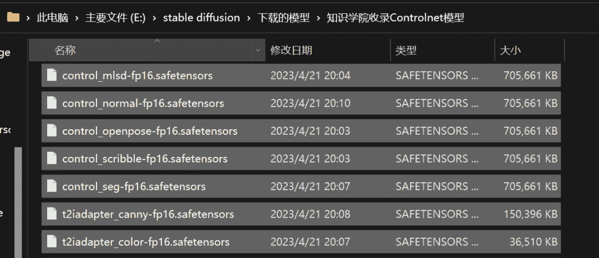

3、看我的文件路径，别搞错了，把文件复制到这里来(一定不要复制到Stable Diffusion模型中去了）

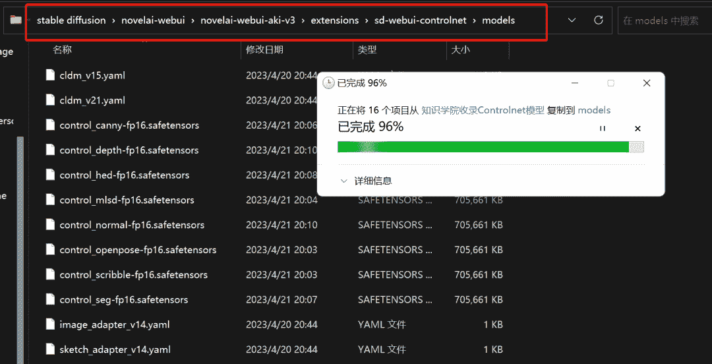

4、重启UI，耐心等待一下......等待时间点点赞？？

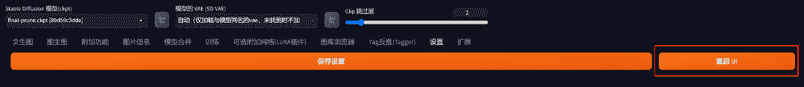

5、look，这就是成功安装的样子，很可爱呢~如果你没有，那说明你模型没安装到位置，仔细检查下吧。

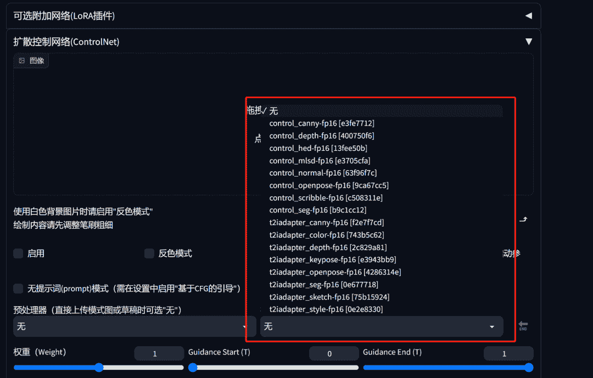

## **四、模型说明及案例演示**

介绍几个常用的controlnet模型教程，注意看哦。跟着我一步步的操作就没什么问题的，加油！

#### 4.1  Canny边缘检测 (Canny edge detection)

#### canny 用于识别输入图像的边缘信息。从上传的图片中生成线稿，然后根据关键词来生成与上传图片同样构图的画面。

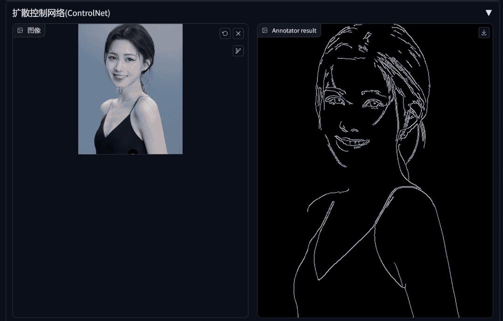

1、来跟着我的操作来一遍，（为了让大家更快的入手Stable Diffusion，教程中的素材案例我会放在群公告里面，大家需要自取）

首先我们把模型和lora选择好，因为我这里上传的是一个真实的模特，所以像最大程度的还原，模型一定要对。这里我用到的是这两个模型。

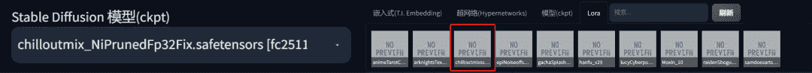

2、然后输入关键词：

1girl, solo, smile, realistic, grin, looking at viewer, brown eyes, brown hair, ponytail, upper body, simple background, small breasts, breasts, blue background, teeth, lips, bare shoulders, long hair, black hair

> 女孩，独奏，微笑，现实，咧嘴笑，看着观众，棕色的眼睛，棕色的头发，马尾辫，上身，简单的背景，xxx，xx，蓝色的背景，牙齿，嘴唇，裸露的肩膀，长发，黑发

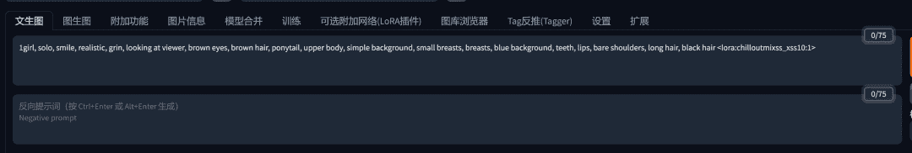

3、打开Controlnet，选择Canny边缘检测，模型选择对应的canny模型。

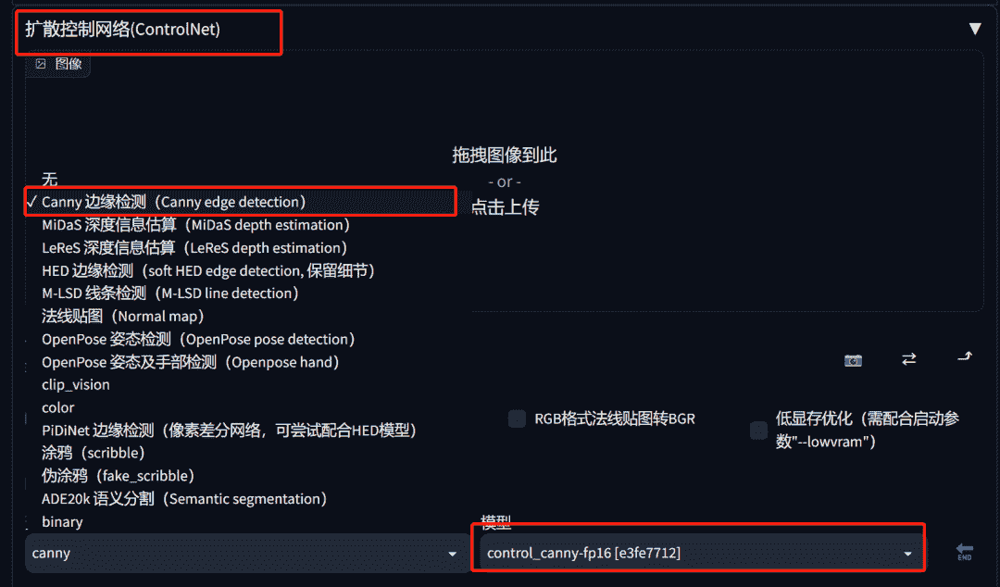

4、上传图片，并勾选启用。

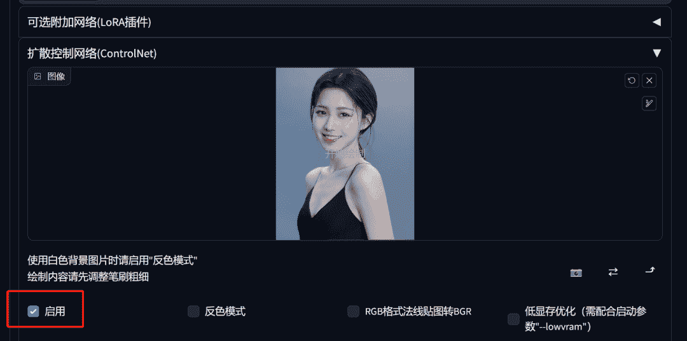

5、点击下方的“预览预处理结果”这一步是生成线稿。然后就会出现上面那张线稿图。

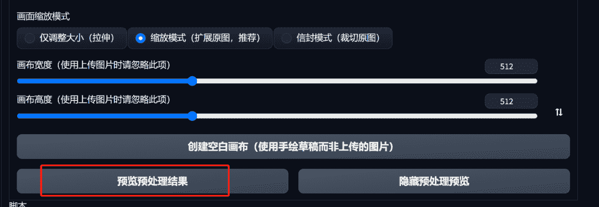

6、最后我们勾选下“DPM++SDE Karras”，开始生图

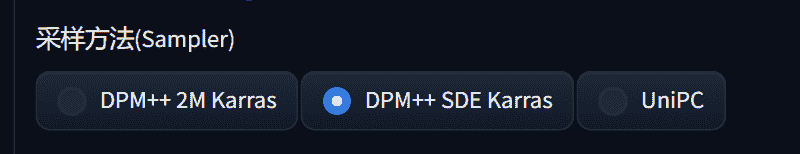

7、来看下原图和生成图片的对比，姿态构图基本一致。如果你想换头发颜色、面部细节、服装等等，就可以通过关键词来控制。这个功能学会了吧，那咱们讲下一个。

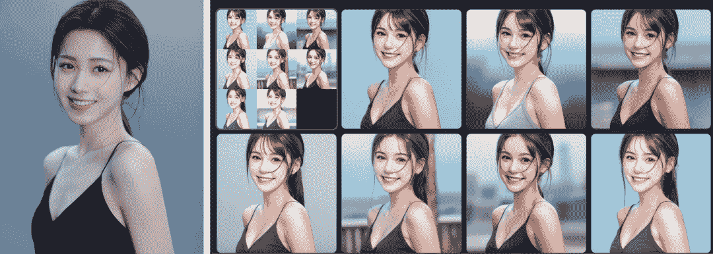

**言川小知识：**

1、可以看到上面生成的模特脸部头发丝有点乱，可以调整这个预处理器分辨率（下面两个同样也是调整线稿的精细层度），越高生成的效果与原图越相像，同样也会越吃显存，小心使用。

2、下面这2个也是同样的做法，它们的主要区别是边缘检测算法不同，具体选择哪个各位去尝试一下，玩法基本一致，我这里就不做演示了。（注意右侧的模型要选择对应的预处理器。）

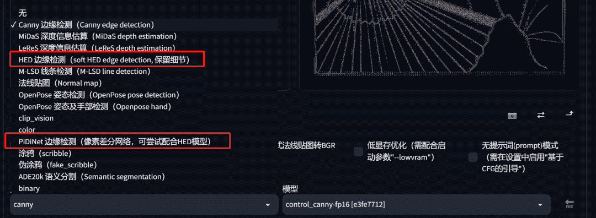

#### 4.2 M-LSD （建筑物绘制）

#### 通过分析图片中的线条结构和几何形状，可以构建建筑物的外框，适合建筑、室内设计的朋友使用。

#### 1、切换预处理器和相应模型。

2、上传一张室内设计的图片，然后点击“预处理结果”，（第一次用这个，控制台会更新一段时间）。

3、输入关键词，关键词可以在一些网站上找到，网站私信我可以发给你们。

pearl white walls, windsor gray floors, bedroom, Natural lighting, earthly tones, simple and clean, trending on interior design, digital artwork by Audrey kawasaki, Smooth, Detailed, Artstation, Neutral colors, elegant

> 珍珠白的墙壁，温莎灰色的地板，卧室，自然光，朴实的色调，简单干净，室内设计的趋势，由Audrey kawasaki设计的数字艺术品，光滑，细节，艺术站，中性色，优雅

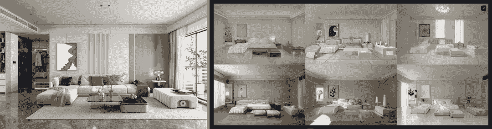

可以看到，图片生成的效果还是不错的，跟原图的构图基本一致，当然还有更多的细节需要调整，大家可以调整这块的参数即可。

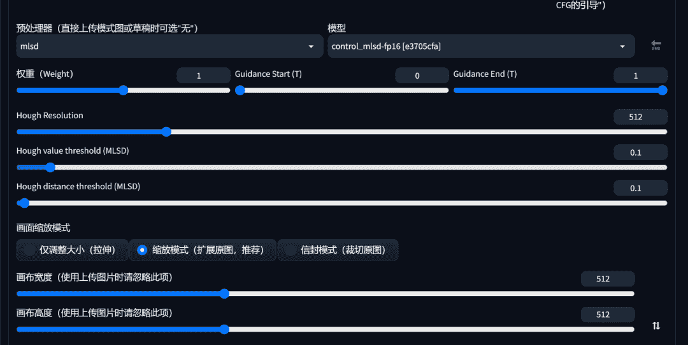

#### 4.3 法线贴图 (Normal map)

#### 从原图中提取 3D 物体的法线向量，绘制的新图与原图的光影效果完全相同。

#### 1、切换预处理器和模型

2、上传一张图片，然后点击“预览预处理结果”，然后就会给你生成一张法线图（懂3维的小伙伴应该都知道这个）

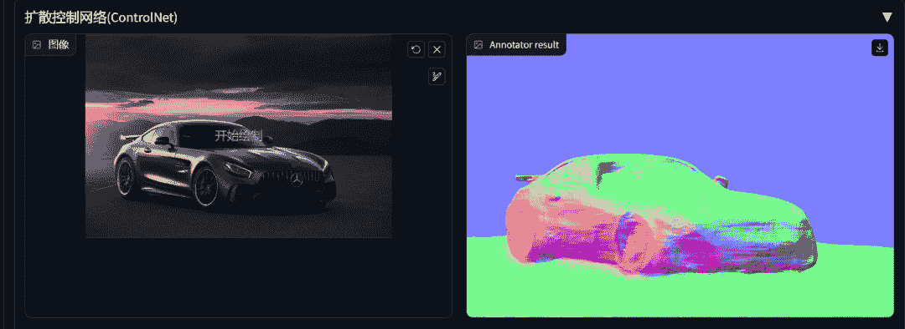

3、继续输入关键词，等待生图....

Mercedes-Benz AMG GT, staring out of the window with regal air, Moody lighting, High detail, realistic fur texture, Digital painting, trending on artstation

> 梅赛德斯-奔驰AMG GT，凝视窗外的皇家空气，穆迪照明，高细节，逼真的皮毛纹理，数字绘画，艺术站的趋势

怎么说呢，就是牛！！！背景细节等都可以通过关键词来控制，其他调整参数与上面一样。

**言川小知识：**这个模型主要是通过RGB颜色通道来标记表示凹凸，生成的图片立体感很强。

可以看到，图片生成的效果还是不错的，跟原图的构图基本一致，当然还有更多的细节需要调整，大家可以调整这块的参数即可。

#### 4.4 OpenPose 姿态检测

#### “控制你的女友”，通过姿势识别实现对人体动作的精准控制，不仅可以生成单人的姿势，还可以生成多人的姿势。

此外，由于AI生成的手部有问题，OpenPose还有一个手部检测模型，大大改善了奇奇怪怪的手。

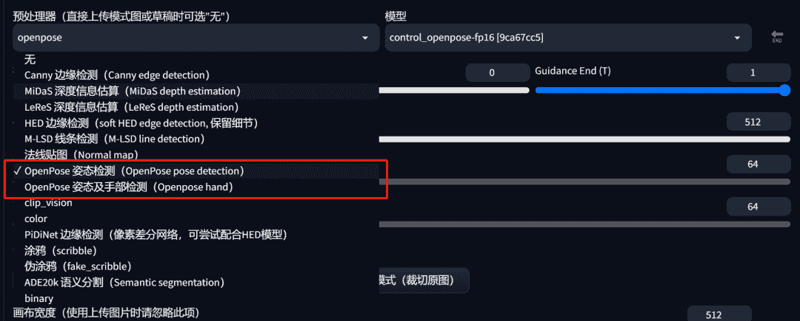

1、切换预处理器和模型。

2、上传一张图片，然后点击“预览预处理结果”，注意，第一次选中这个模型开始预处理的时候，会更新一段时间，可以在“控制台”查看更新进度，更新完成之后再次点击“预处理”就可以看到AI识别的图了。

看看预处理结果：

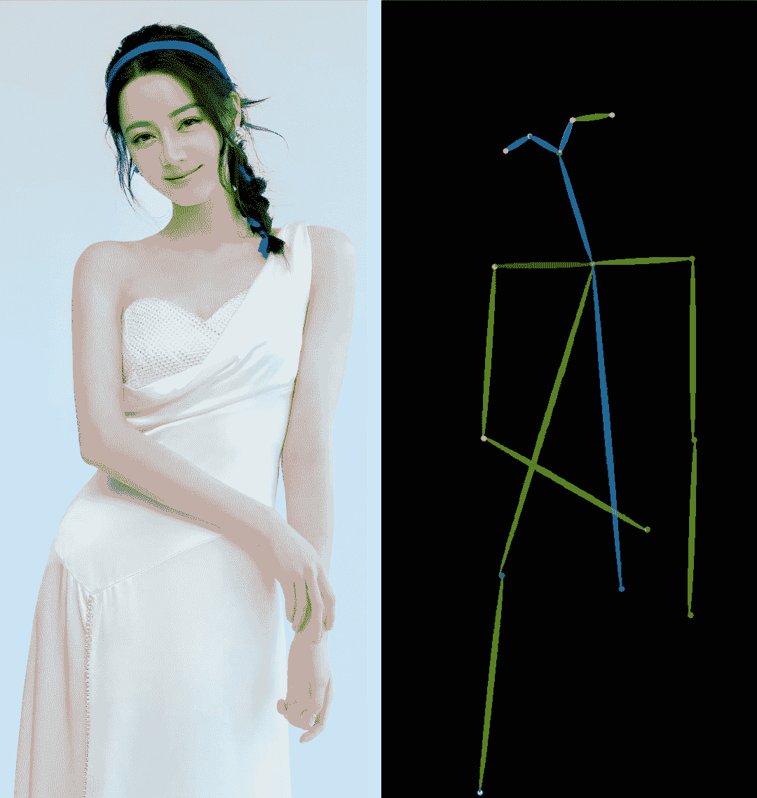

3、输入关键词，等待生图....

1girl, solo, dress, braid, hairband, earrings, smile, brown eyes, white dress, realistic, jewelry, long hair, black hair, looking at viewer, bare shoulders, lips, blue hairband, single braid, brown hair, simple background

> 女孩，独奏，连衣裙，辫子，发带，耳环，微笑，棕色眼睛，白色连衣裙，现实主义，珠宝，长发，黑发，看着观众，裸露的肩膀，嘴唇，蓝色发带，单发带，棕色头发，简单的背景

唉，这手奇奇怪怪的，没事，可以试试OpenPose手部检测模型，操作是一样的，自己去尝试哈，细节调起来操作很多，一点点尝试，肯定能成功的。

#### 4.5 Scribble （涂鸦）

#### **使用 Scribbles** 模型，可以根据草图（涂鸦）绘制出精美的图片，对于那些没有接受过美术训练或缺乏绘画天赋的人来说，这是非常棒的。

#### **1**、切换预处理器和模型。（第一次用这个，控制台会更新一段时间）

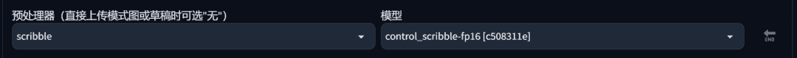

2、点击“创建空白画布”。

3、然后在这里画线稿，这里我画一盏煤油灯，我是用的鼠标绘制的，画的不好，做个演示。有手绘板的同学可以用手绘板绘制一下。

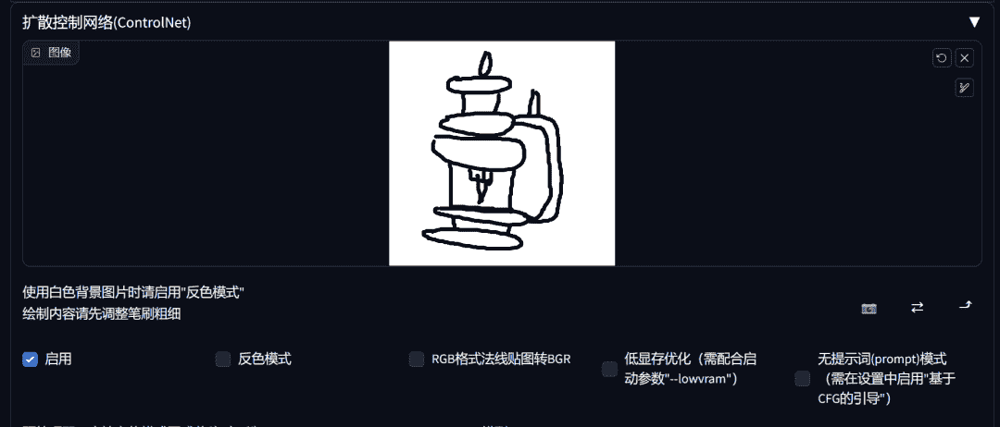

4、输入关键词：

old electronic kerosene lamp in anthracite blue metal, warm orange metal reflections, Intricate, Highly detailed, Warm lighting, Sharp focus, Digital painting, Artstation, Concept art, trending, inspired by art by Zdenek Burian and frederick catherwood

> 旧电子煤油灯在无烟煤蓝色金属，温暖的橙色金属反射，错综复杂，高度详细，温暖的照明，锐利的焦点，数字绘画，艺术站，概念艺术，趋势，灵感来自艺术zdenek burian和frederick catherwood

我画的不标准哈，做个演示，这个模型是根据你绘画的线稿精准控制物体的构图、构造。细节根据关键词来控制。

这里可能就有小伙伴疑问了，在SD里面直接绘制不是很方便，能不能通过其他软件绘制之后上传线稿生图呢，of course，看下面：

1、上传线稿图，点击“预览预处理器结果”。

2、输入上面的关键词，然后生成图片：

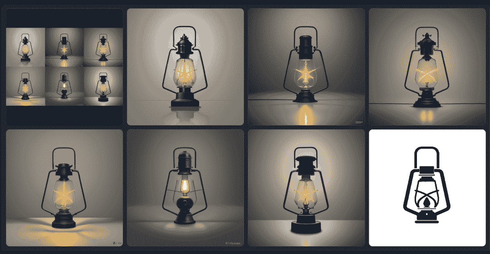

完事，同样细节需要你们自己去调整，点赞解锁剩余内容😏

#### 4.6 fake-scribble（伪涂鸦）

#### 这个是不需要我们绘画的，上传一张图片，它会帮我们生成涂鸦效果。

#### 1、切换预处理器，模型不用切换。

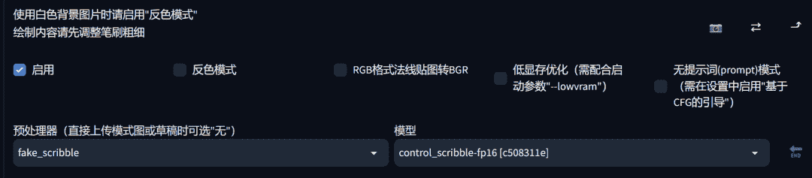

2、上传图片，然后点击“预览预处理器结果”。（第一次用这个，控制台会更新一段时间）

说实话，画的还不如我呢...

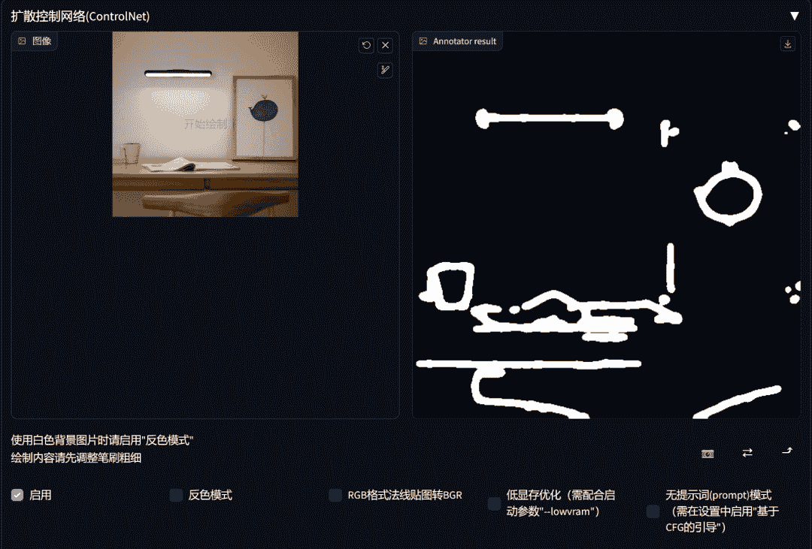

3、输入关键词：

Espresso, set in a cozy office space with warm lighting, surrounded by office plants, books, and a cup of coffee on the desk, Detailed, Intricate, Smooth, Trending on Artstation, by artists such as loish and rossdraws and sam yang

> 意式浓缩咖啡，设置在一个舒适的办公空间，温暖的照明，周围的办公植物，书籍，和一杯咖啡在桌子上，详细，复杂，流畅，在Artstation趋势，由艺术家如loish和rossdraw和sam yang

效果嘎嘎棒！！！

#### 4.7 Semantic Segmentation（语义分割绘制）

#### Semantic Segmentation 语义分割是一种深度学习算法，重点关注 语义 一词，这种算法将一个标签或类别与图像联系起来，被用来识别形成不同类别的像素集合。具体还是看我的操作：

#### 1、切换预处理器和模型

2、上传图片，然后点击“预览预处理器结果”。

可以看到，预处理阶段生成了一张五颜六色的图片，这就是语义分割图，这图中的每一种颜色都代表了一类物品，比如紫色（#cc05ff）代表床（bed），橙黄色（#ffc207）代表垫子（cushion），金黄色（#e0ff08）代表台灯（lamp）。

这里我在群公告分享一份色值的表格，大家加我自取！！！

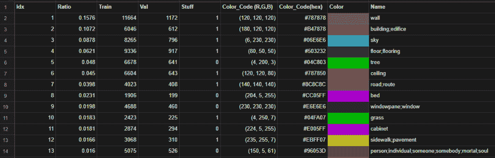

3、这里我就不输入关键词了，让sd自由发挥

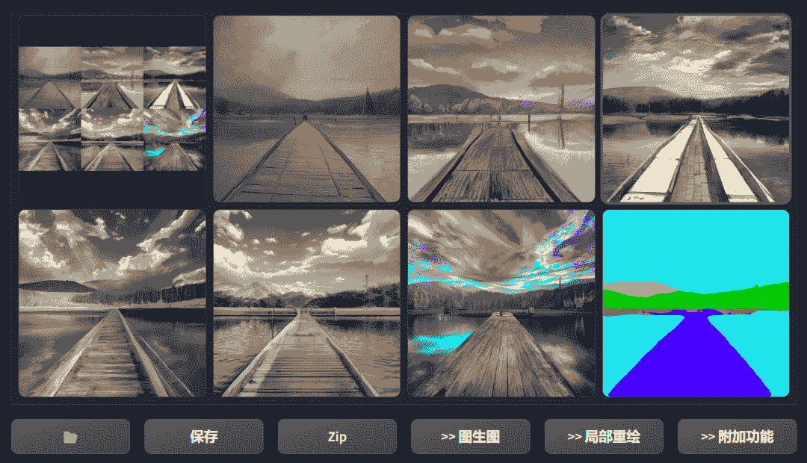

**言川小知识：**可以在ps上绘制一个色块的物体（比如人，放在这个桥上，对应官方的色值），然后导入到语义分割这里来，输入相应的关键词，就可以精准控制图像的效果了。后续给大家出详细教学，注意在群里关注我的动态哦。

#### **注意看注意看：**

这里我讲下这个小功能，前面两个是打开摄像头的功能，我没试过，你们想玩可以试一下啊。主要讲一下后面的那个小箭头。

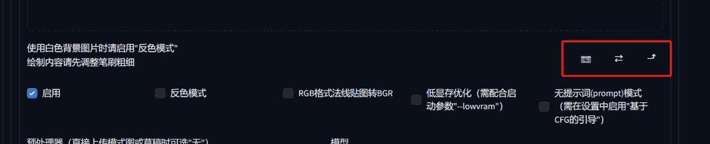

这个箭头的功能是把你上传图片的分辨率，自动填充上去。

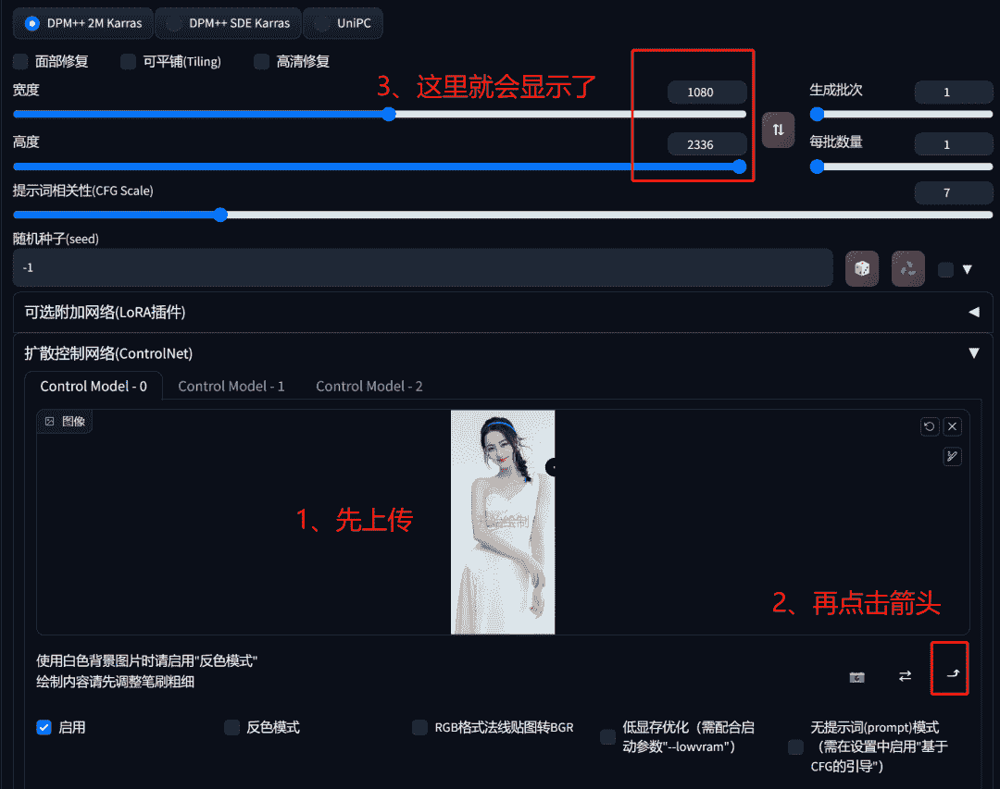

（本文部分图片素材来自网上）

# **七、写在最后**

## **以**上就是这篇Controlnet插件的基础教程啦，当中还有很多高级的玩法，我会在后续一步步的分享给大家。

如果觉得对你有帮助，3连（点赞、收藏、分享）一下吧，大家的支持才是我的动力，祝大家生活愉快😊

Stable Diffusion一键安装包和教程素材我放在群公告中了，大家需要联系我获取。

模型、插件等资源更新在《AIGC知识学院》了，联系我加入哦！！