# StableDiffusion 在多个设计场景中的探索与应用

> 来源：[https://keenchase.feishu.cn/docx/PkuQdEyCSoEnXYxW1QZc7ir5nVb](https://keenchase.feishu.cn/docx/PkuQdEyCSoEnXYxW1QZc7ir5nVb)

# 一、前言

大家好！在当今数字化时代的设计领域，技术的发展不断引领着创新的方向，而StableDiffusion作为一款融合了人工智能与艺术的绘画软件，正为我们带来前所未有的设计可能性。我们每天都在与图像和文字打交道，而如何让它们更生动、更吸引人，正是设计师们的永恒追求。在这个背景下，StableDiffusion扮演着一个重要的角色，为我们提供了一把开启创作新境界的钥匙。

本文将深入解析StableDiffusion在多个设计场景中的探索与应用，尤其关注如何利用其制作多种商业落地案例。通过学习这些实际案例教程，我们将看到StableDiffusion的魅力，以及如何充分发挥其与Controlnet插件相结合的威力，为我们的创作注入新的活力。

# 二、品牌超级符号

本次品牌符号案例使用【抖音LOGO】演示创作，并进行后续的海报设计延展，操作很简单，如果你把我上一篇《StableDiffusion制作中文字效工作流揭秘与画质提升的多种方法》文章吸收完之后，你会发现我接下来的操作都很简单，开始：

**2.1 前期准备**

记住一点：只要是做品牌符号、字体设计之类的图片，那么就脱离不了Controlnet插件，重点在于精准控制。

我们先准备下模型、lora以及相关素材：

1、Stable Diffusion 模型：ReV Animated v1.2.2 （最新版本）

2、Lora模型：梦幻3D场景

3、controlnet插件模型以及黑白文字图片

模型下载推荐使用civitai（国外）以及哩布哩布AI（国内），前者需要特殊网络，下载也比较慢，但是模型丰富，数量极其的多。后者下载速度很快，我一般是在【civitai】上找到模型然后去【哩布哩布AI】上搜，如果有需要的模型，那就直接在【哩布哩布AI】上下载。

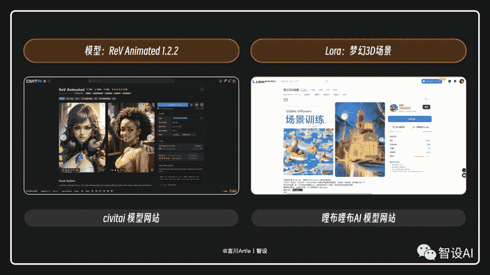

Controlnet插件一般用活菩萨秋叶的启动包就会自带，不过模型需要自己安装一下，在往期文章我有专门介绍过Controlnet的插件安装教程以及模型的下载方式，此处不多做说明。

图中为[【智设AIGC社区】](http://mp.weixin.qq.com/s?__biz=Mzg2NTkxNDM2NA==&mid=2247489299&idx=2&sn=795406874ad867cd0ad6da5920444b1e&chksm=ce538b80f9240296fab55c1da6f6dd8a61d9d4e93e54540dcf87fb52ba36f90fe5079491d8cf&scene=21#wechat_redirect)，整理了AI绘画的教程及其相关资源，本文所用到的模型素材都提供在里面。

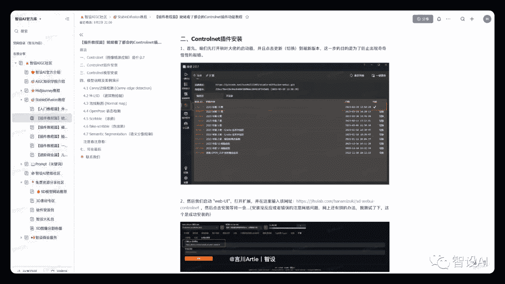

准备一张抖音logo白底的图片，注意以下几点：

1、在这一步就把图片尺寸设置好；2、等比缩放尺寸，把这张图片的尺寸缩小，方便后续的操作；3、图片要求为白底黑LOGO。

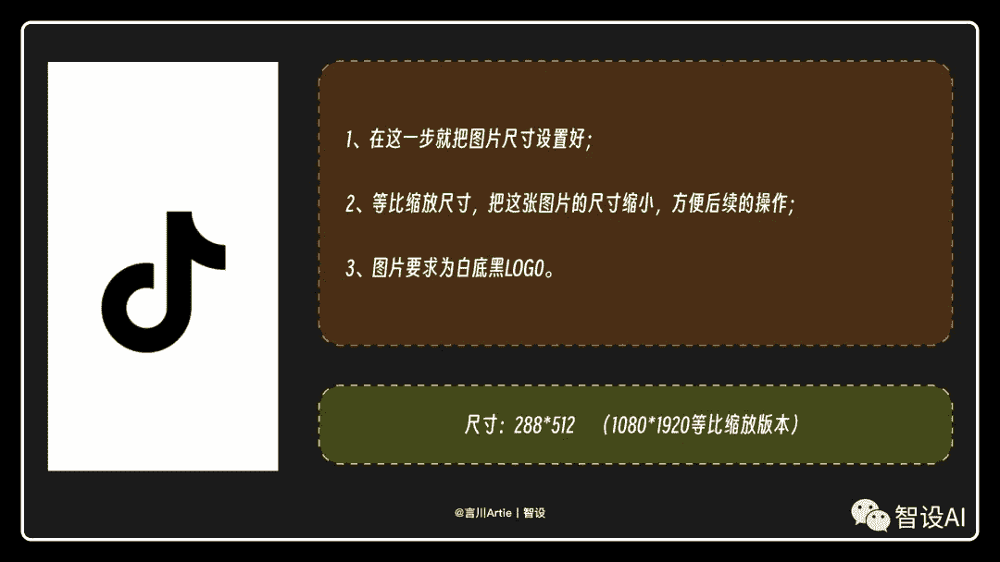

**2.2 关键词描述**

**正向关键词：**

changjing_3d,((best quality)),((masterpiece)),no_humans,water,sky,day,ocean,blue_sky,cloud,outdoors,bubble,flower,

Changjing_3d，((最佳画质))，((杰作))，no_human，水，天空，天，海洋，蓝天，云，户外，泡泡，花，

其中【changjing_3d】为该Lora的触发词。

反向关键词（通用关键词，哪哪都可用）：

(worst quality:2),(low quality:2),(normal quality:2),lowres,bad anatomy,bad hands,text,error,missing fingers,extra digit,fewer digits,cropped,jpeg artifacts,signature,watermark,username,blurry,bad_pictures,DeepNegativeV1.x_V175T,nsfw,

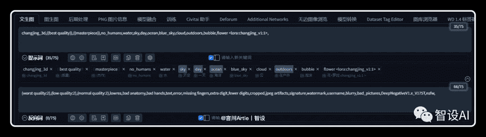

2.3 设置Controlnet各项参数

Controlnet我们需要使用两个预处理器及模型：【canny】和【depth】。

【canny】来控制LOGO形态不被破坏，【depth】控制LOGO的深度信息。

【canny】的权重可以保持默认 1，【depth】的权重设置为0.8（比canny权重小一点即可）。

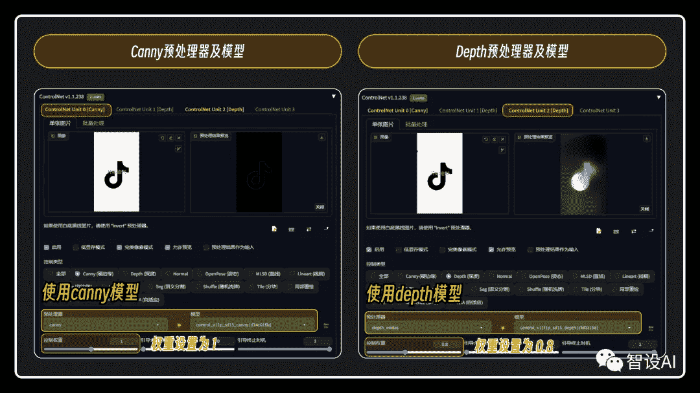

回到上面，使用 Euler a 采样方法，迭代步数为 30，尺寸与上传的图片一致。

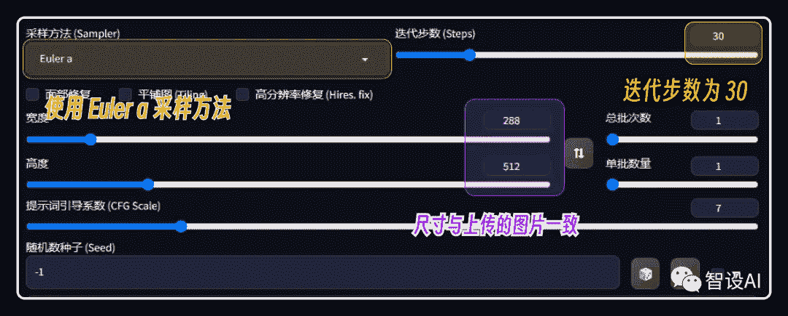

**2.4 初步跑图（批量）**

把上述的参数调整好了之后，我们就可以进行初步的跑图了，可以调整总批次数量（显卡一般的控制在4左右）。

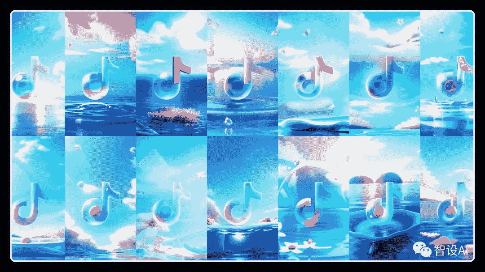

批量跑图后你会发现几个问题：

1、图片分辨率低，不清晰；

2、细节之处处理的不行。

其实是没关系的，我们只需要在初步跑图的时候确定大体风格即可，细节之处可以通过放大分辨等方式解决，接着看：

2.5 Controlnet高清修复

在上述跑出的初稿选一张自己满意的图片，接下来我们使用【Controlnet插件】和【Tiled Diffusion插件】来对图片进行放大及修复，我在上期教程中说过这个方法的详细介绍，这里不多解释。

启动【Controlnet插件】，预处理器及模型选择【Tile】 ，权重调整为1.2。【Tiled Diffusion 和 Tiled VAE】都都选上，并在这个插件下控制最终生图尺寸，在 288*512基础上乘以3倍，即【864*1536】。

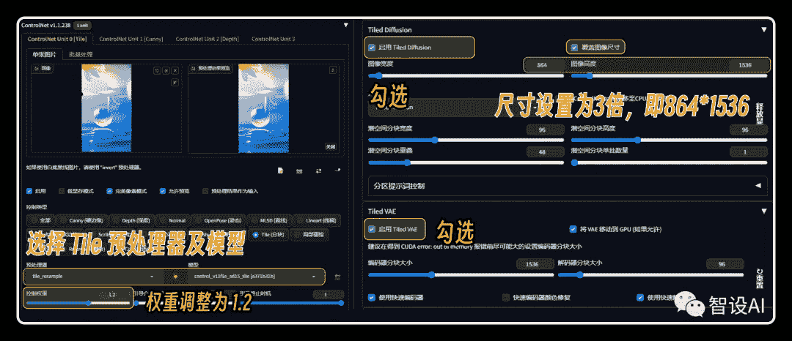

在漫长的等待之后，我们就得到了一张被放大之后的图片，并且这张图片的细节之处更加丰富。这一步完成之后，SD就可以暂退了，下一步我们结合【PS Beta】略微修复下细节。

**2.6 后期微调+排版**

使用PS Beta等工具，进行后期的微调处理，再加上排版，一张抖音开屏页海报即可完成。其他品牌符号也可用这个案例的思路创作，方法是一致的，看会了就去试试吧。

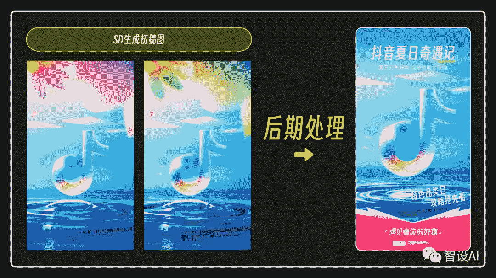

# 三、文字海报设计

这个案例的操作方法与上面的【品牌超级符号】有异曲同工之妙，同样是使用Controlnet来对主体画面进行控制，再通过高清修复等功能优化图片细节，达到可落地项的地步，下面还是通过案例演示的方式来分享我的想法。

**2.1 找参考确定风格**

在设计前期我们首先需要确定视觉风格，可以找一些设计参考，这一步的准备也是在后续通过SD关键词反推中使用，你没听错，SD也可以图生文。

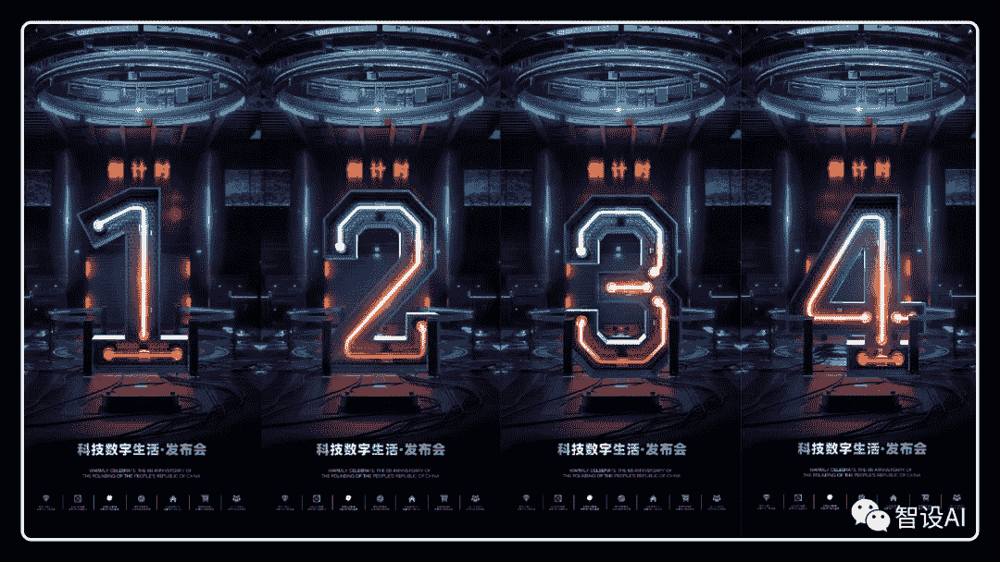

**2.2 前期准备**

我们准备下模型、lora以及相关素材，Lora是根据上一步风格参考去找到符合这种风格的lora（科技感）：

1、Stable Diffusion 模型：ReV Animated v1.2.2 （最新版本）

2、Lora模型：light effect sci-fi scene

3、controlnet插件模型以及白底黑字图片。

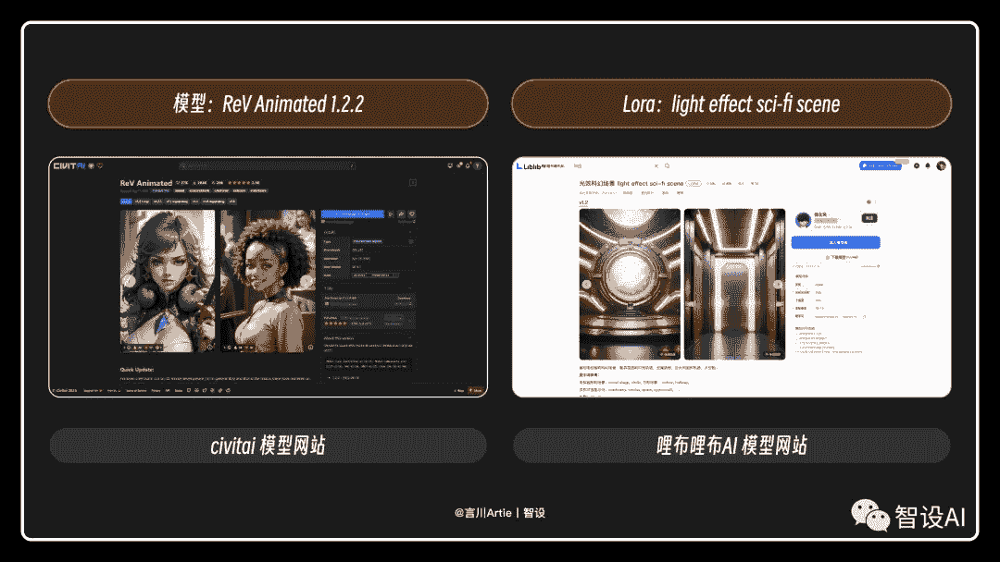

这个案例的墨稿图有点特殊，因为我是需要做一个数字的中间是镂空的效果，所以在数字上采取描边的形式来到控制后续的生图精准度。

**2.3 关键词反推**

把参考图的文字清除掉，然后放到【WD 1.1标签器】里进行图生文。

点击【发送到 文生图】即可（简单三步搞定）。

关键词：no humans, science fiction, cable, scenery, indoors（没有人，科幻小说，有线电视，风景，室内）

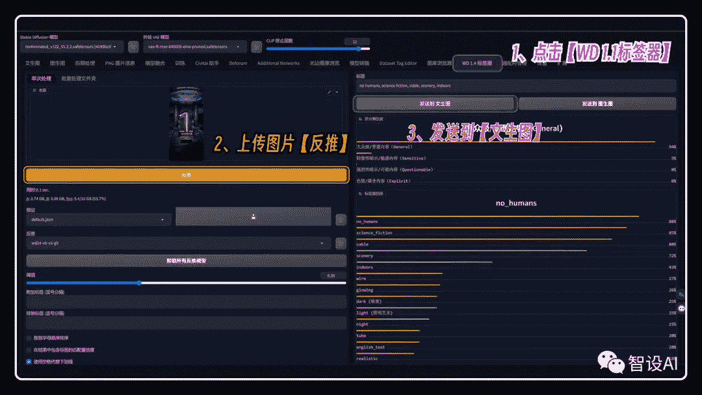

**2.4 补充关键词**

正向关键词加上lora触发词及lora，补充一些风格画质的关键词即可：

no humans,science fiction,cable,scenery,indoors,(masterpiece, best quality:1.3),hd,8k,super details,science fiction,scenery,round stage,,

无人、科幻、有线、风景、室内、(杰作、最佳画质:1.3)、高清、8k、超细节、科幻、风景、圆舞台

反向关键词（通用关键词，哪哪都可用）：

(worst quality:2),(low quality:2),(normal quality:2),lowres,bad anatomy,bad hands,text,error,missing fingers,extra digit,fewer digits,cropped,jpeg artifacts,signature,watermark,username,blurry,bad_pictures,DeepNegativeV1.x_V175T,nsfw,

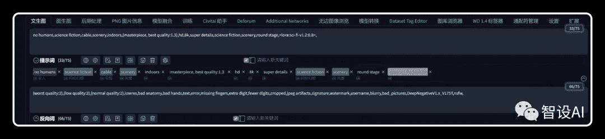

2.5 设置Controlnet各项参数并跑图

使用Controlnet插件上传黑字白底图，预处理和模型选择【canny】即可，老生常谈的东西了。

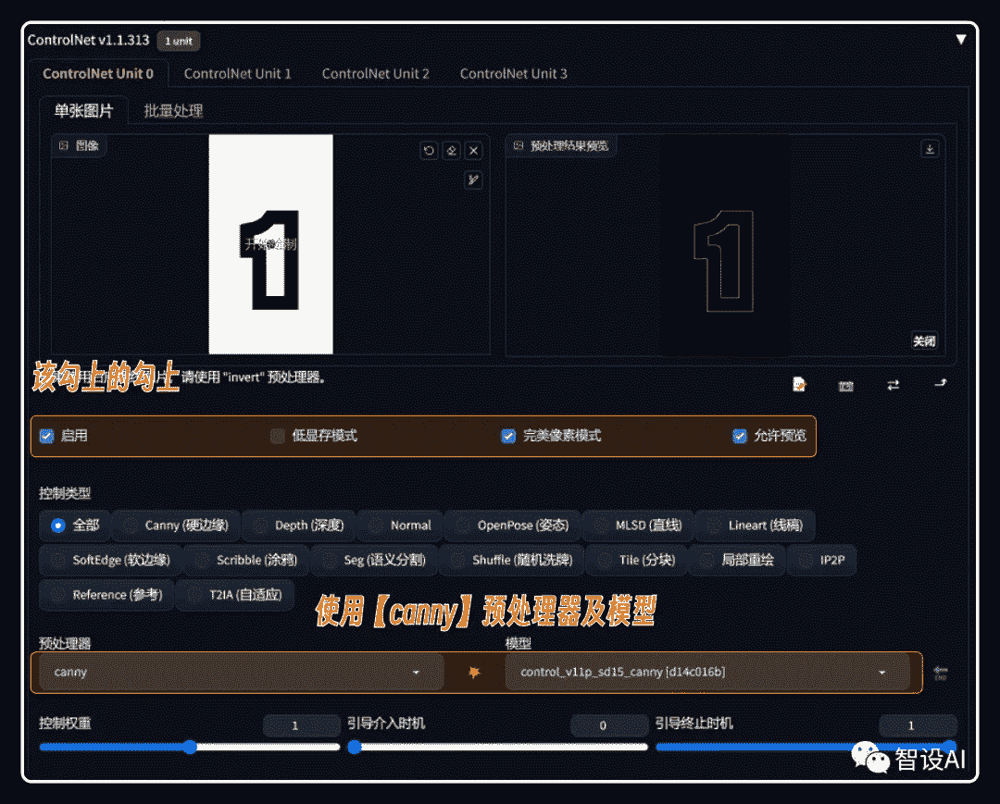

其他的参数如下：

采样方法：DPM++2M Karras。迭代步数：30。

重点：尺寸比例与上传的图片一致。然后就可以批量跑图了。

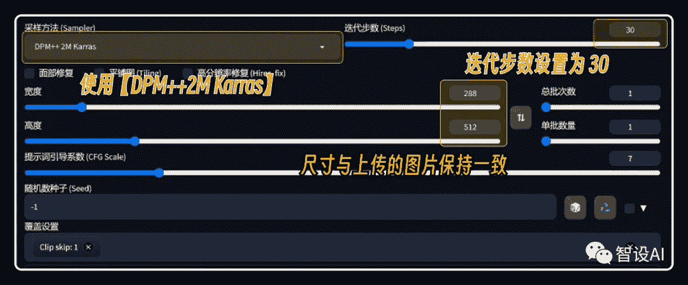

在初步的低分辨率跑图的情况下，我们得到了一大批图片，其实大家可以看到，有几张图效果是ok的。接来下就把合适的图片进行分辨率放大即可。

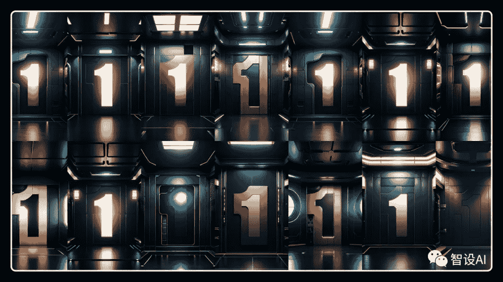

**2.6 高清修复**

选中一张低分辨率图片，固定Seed值，点击绿色的按钮即可。

打开高清修复，放大算法选择【R-ESRGAN 4X+】，放大倍数调整为 3倍，重绘幅度 0.5。

重绘幅度不能过大，不然会导致主体数字变形，大概在0.5~0.7之间。

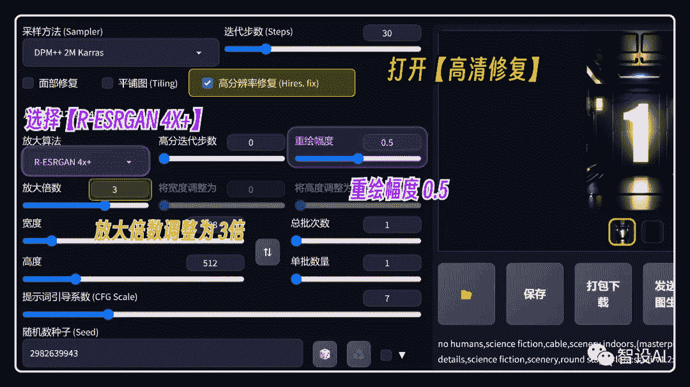

**2.7 后期微调+排版**

最后根据需求信息进行排版即可，运用这种操作方法，我们只需要更换controlnet的白底黑字图即可做出倒计时海报的延展图，完事！

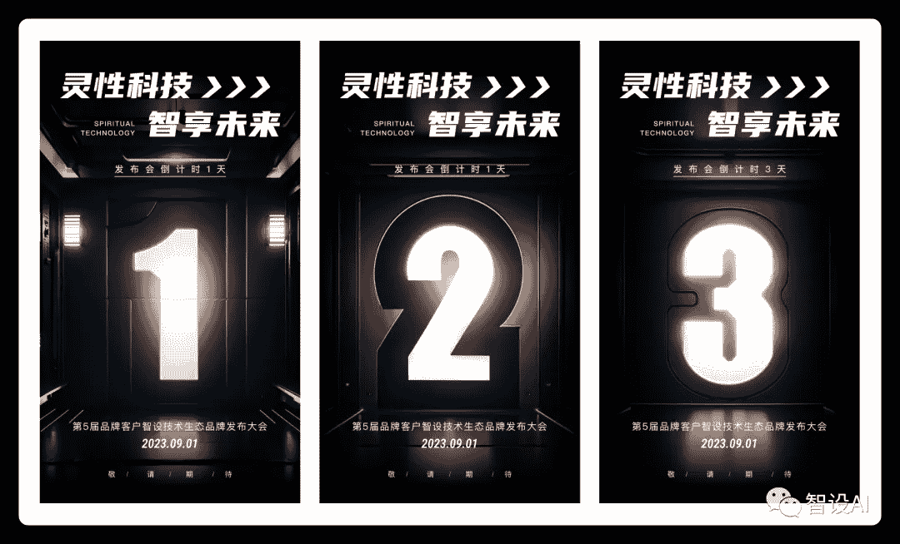

# 四、电商场景设计

在前面几期文章我也说过几个电商产品设计的案例，每次的制作思路不一样，这次也是经过我探索出一个新的SD出电商产品海报的方法，全程StableDiffusion操作，操作方法很简单，明白了一些参数原理之后，你也能很容易上手操作，展示：

**2.1 前期准备**

还是一样，先准备模型和lora，基本上写实风格的图片无脑用【ReV Animated v1.2.2】即可，在Lora的选择上可以去找到专门生成电商场景的模型。

1、Stable Diffusion 模型：ReV Animated v1.2.2 （最新版本）

2、Lora模型：C4D几何背景geometry-bg

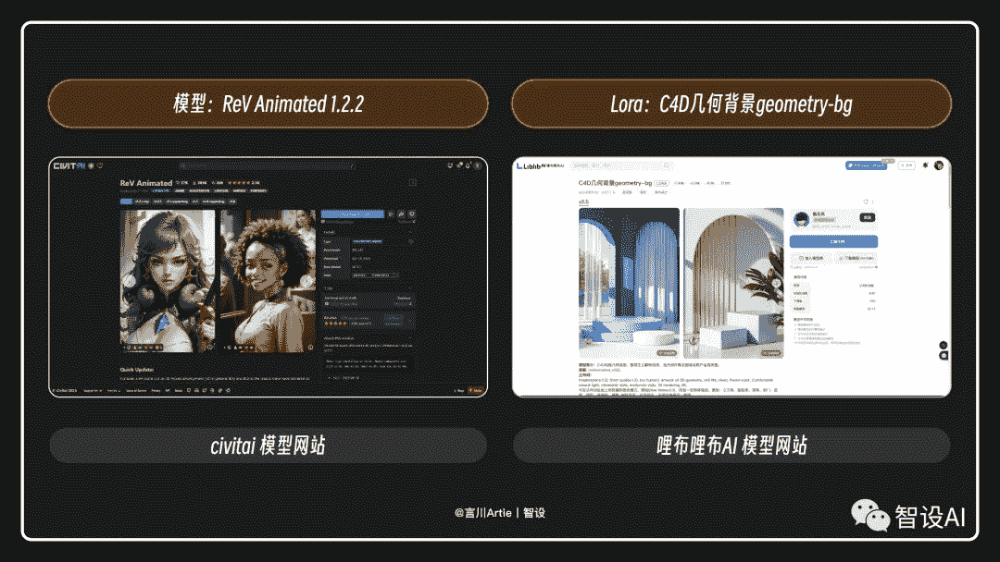

**2.2 关键词及各项参数**

写上正反关键词，这些关键词我是直接在Lora作者提供的效果图上获取的，我们可以在作者的基础上增减关键词即可，这样关键词就比较容易写。

**正向关键词：**

(masterpiece:1.3),(best quality:1.3),(no human),artwork of 3D geometry,still life,clean,Pastel color,Comfortable natural light,minimalist style,modernist style,3d rendering,8K,A cylinder in the middle,Sphere,Curtains,Arch background,Plants,leaves,.,,

(杰作:1.3)，(最佳品质:1.3)，(无人)，艺术品三维几何，静物，干净，柔和的颜色，舒适的自然光，极简风格，现代主义风格，3D渲染，8K，中间圆柱体，球体，窗帘，拱门背景，植物，树叶

反向关键词（通用关键词，哪哪都可用）：

(worst quality:2),(low quality:2),(normal quality:2),lowres,bad anatomy,bad hands,text,error,missing fingers,extra digit,fewer digits,cropped,jpeg artifacts,signature,watermark,username,blurry,bad_pictures,DeepNegativeV1.x_V175T,nsfw,

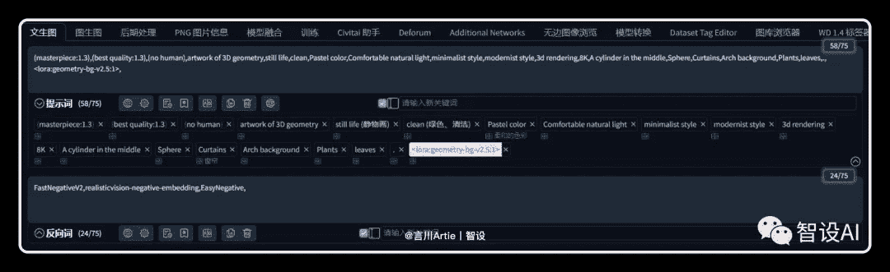

把以下参数设置上，尺寸设置上我的思路就是设置的越低越好，低质量图批量且快速的出图，选好合适的图片在进行分辨率放大操作，被显卡所限制的朋友可以按我这种方式做。

采样方法：【DPM++ 2S a Karras】【迭代步数 20】 【图片尺寸：256*384】

出图批次大家随意调整，之后就开始跑图即可。

**2.3 图片分辨率放大**

下面是我们初步暴力抽卡的图，这一步我们不用看质量，看构图、色彩搭配、元素等：

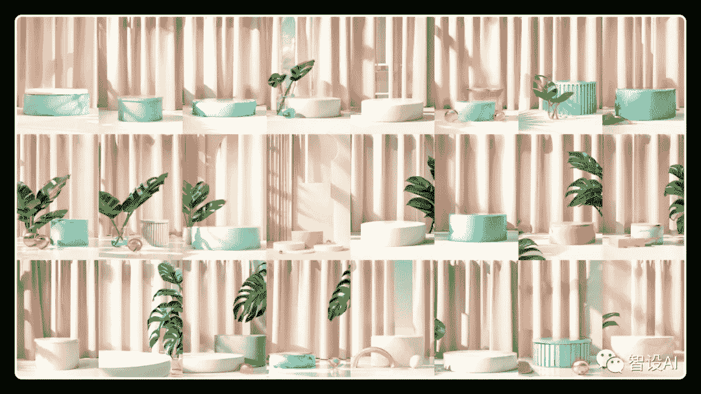

接下来就是从大量的图中挑选我们的幸运观众。

先把该图片的seed值固定，选择高清修复，放大算法【R-ESRGAN 4X+】。

重点！！！！下面两个很重要：

1、放大倍数直接拉满4倍，也就是最终是【1024*1,536】。

2、重绘幅度也要大一点，取决于低分辨率图的细节之处，细节不好重绘幅度开大一点。细节还行，开小点。

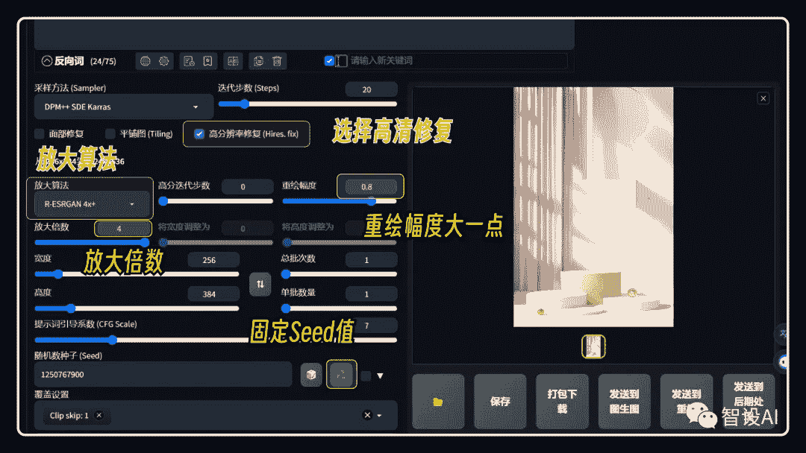

**2.4 准备产品图以及蒙版图**

如果你按我的步骤来，并且很顺利的话，那么你就会得到一张不错的场景图了。接下来就是融入我们的产品进去，接着往下看：

下面的操作我会结合【图生图的蒙版重绘】以及【controlnet】来操作。这两个功能都是我前面讲过的，你可以把接下来的操作看作为进阶的玩法。

你需要准备下面两张图，一张产品场景图以及一张产品的黑白蒙版图。

这里也要注意！

1、产品在场景摆放的位置要调整好，虽然不需要做光影融合，但是也不要随便放，这一步就定性了；

2、黑白蒙版图的黑色产品区域是与产品图的产品位置一样的，会PS的朋友都知道哈，不再啰嗦了。

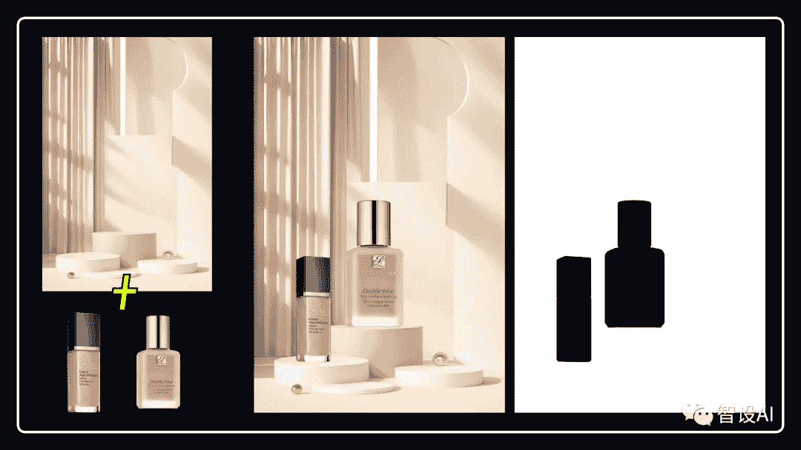

2.5 图生图以及Controlnet设置

在【文生图】这里，把生成的高分辨图片发送到【图生图】，我这么做的目的只是想让【图生图】板块继承【文生图】的参数信息（这点我要说下，不然你们可能后面会懵）。

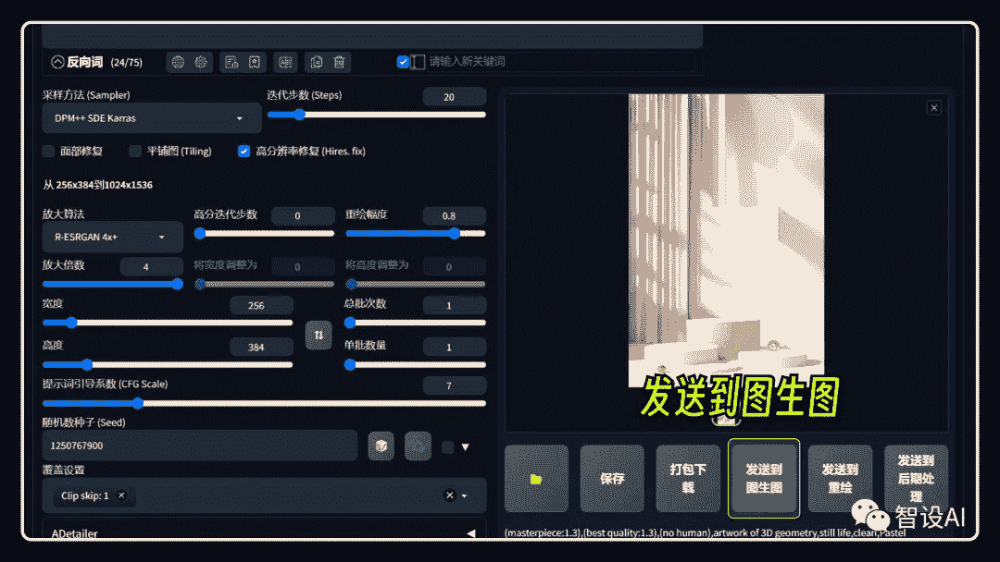

接下来点击【上传重绘蒙版】，上传准备好的场景图以及蒙版图。其他参数默认即可，采样方法与【文生图】使用一致即可，分辨率可以在此处再次放大，看大家需要调整。

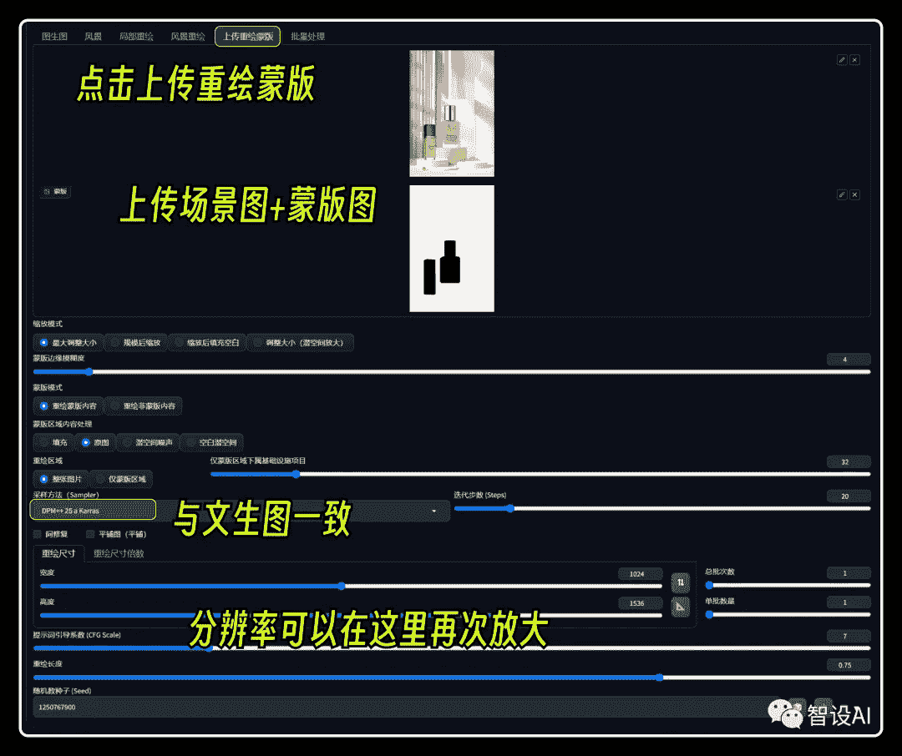

生成之后可以看下对比，在产品周围，SD会自动把产品融合到场景中去，可以调整【蒙版边缘模糊度】的值控制产品边缘的融合度，建议不要太高，不然产品会出现变形。

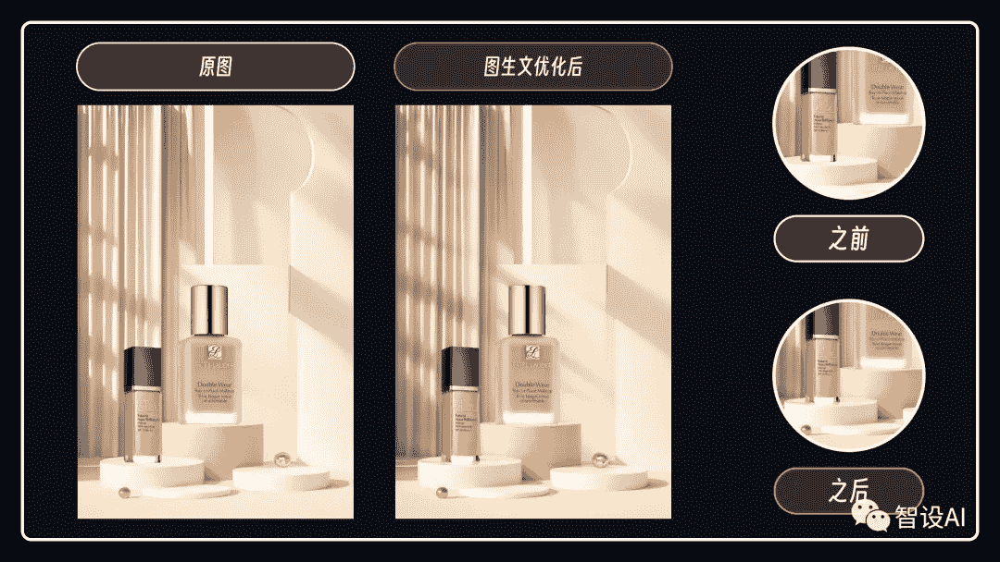

# 五、总结

正如上述3个商业案例所示，StableDiffusion为设计师带来了前所未有的创作方式。通过控制Controlnet插件，我们精准引导AI输出，使每个创意完美呈现。这种融合人工智能和创意的力量，不仅增加设计的灵活性，也提升创作的准确性和独特性。好啦，本篇文章就先到这了，后续继续更新AI商业案例教程。

---