# StableDiffusion 如何实现模特精准换装以及如何替换模特​ ​

> 来源：[https://keenchase.feishu.cn/docx/BUsGdyf0noZuA4xxJlrcyCdbnje](https://keenchase.feishu.cn/docx/BUsGdyf0noZuA4xxJlrcyCdbnje)

# 一、前言

来了来了，之前给大家承诺的模特换装教程它来了！本篇教程主要运用StableDiffusion这个工具来进行操作，下面会通过几个小案例，给大家展示不同需求下，我们该如何使用StableDiffusion来辅助我们完成服装效果展示。本教程适用于电商设计场景、摄影场景等多个运用人物设计的实战中，全程干货，需要大家慢慢吸收，学会后轻松拿捏模特换装，let’s go！

# 二、更换模特

**2.1 不一样的设计需求！**

换个不一样的需求单，简单粗暴，直达灵魂最深处（本篇文章随性而为😎）

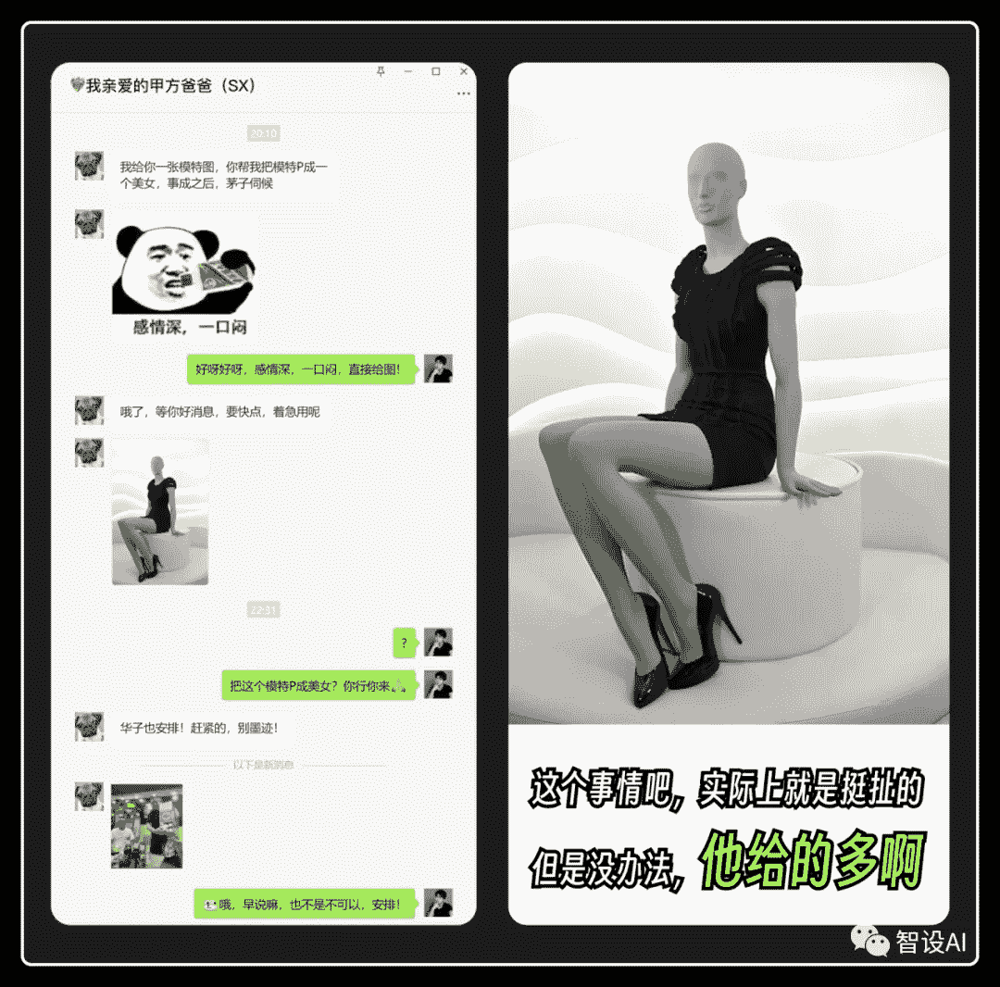

**2.2 前期准备**

老样子，我们先把模型以及素材准备好：

1、Stable Diffusion 模型：majicMIX realistic 麦橘写实_v6

2、controlnet插件模型以及黑白蒙版图

在大模型选择上，大家可以灵活点，用上一些主流的写实模型即可，后续我给大家分享一下Stable Diffusion一些主流模型及下载地址，后续大家可以在我的小圈子中看到（看主页）。

Controlnet插件一般用活菩萨秋叶的启动包就会自带，不过模型需要自己安装一下，在往期文章我有专门介绍过Controlnet的插件安装教程以及模型的下载方式，此处不多做说明。

图中为【智设AIGC社区】，整理了AI绘画的教程及其相关资源，本文所用到的模型素材都提供在里面。

准备一张黑白蒙版图片，注意以下几点：

1、用PS把“假人模特”部分填充黑色（即后续需要生成真人模特部分）

2、等比缩放尺寸（与原图比例一致），把这张图片的尺寸缩小，方便后续的操作；

3、白色区域为蒙版内容，黑色为非蒙版内容（SD内的蒙版原理）

**2.3 关键词描述**

**正向关键词：**

Best quality,masterpiece,ultra high res,(photorealistic:1.4),raw photo,1girl,long hair,

最佳质量，杰作，超高分辨率，(逼真度:1.4)，原始照片，1个女孩，长发，

反向关键词（通用关键词，哪哪都可用）：

(worst quality:2),(low quality:2),(normal quality:2),lowres,bad anatomy,bad hands,text,error,missing fingers,extra digit,fewer digits,cropped,jpeg artifacts,signature,watermark,username,blurry,bad_pictures,DeepNegativeV1.x_V175T,nsfw,

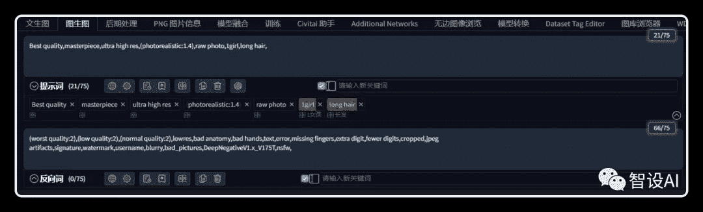

**2.4 图生图-上传重绘蒙版**

重点来了，本案例的核心部分，就是使用图生图的【重绘蒙版】来进行模特的重新绘制。

如图所示，选择【图生图】，把上述的模型以及关键词加上，点击【上传重绘蒙版】，上传原图及蒙版图。

注意：原图及蒙版图尺寸要一致哦~

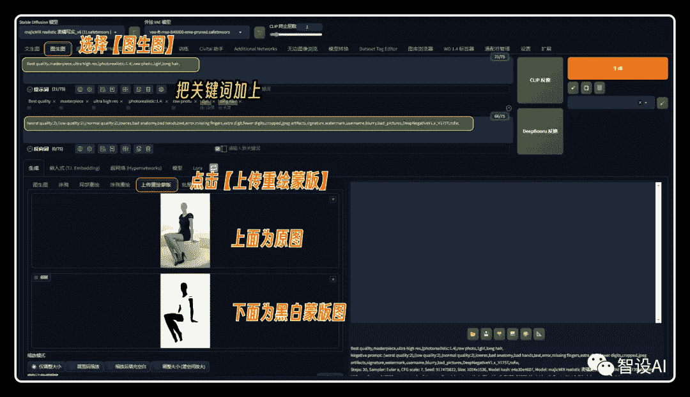

下面的参数直接抄作业即可，说几个重点参数：

1、蒙版边缘模糊度需要调整为0，这个参数类似于PS的羽化，把蒙版边缘进行模糊度处理。这里我用ps经过精准的抠图绘制成蒙版，所以不需要这个参数起作用，不然边缘会有原图的灰色在里面；

2、蒙版模式设置为【重绘非蒙版内容】，前面说过白色区域为蒙版内容，黑色为非蒙版内容，大家灵活往里面带入，黑白是可以切换的，后续调整【蒙版模式】即可；

3、重绘倍数选择2倍放大，我测试1倍图生成的效果不好，后期调整区间很大；

4、【重绘幅度】为0.5，太高会生成的乱七八糟。

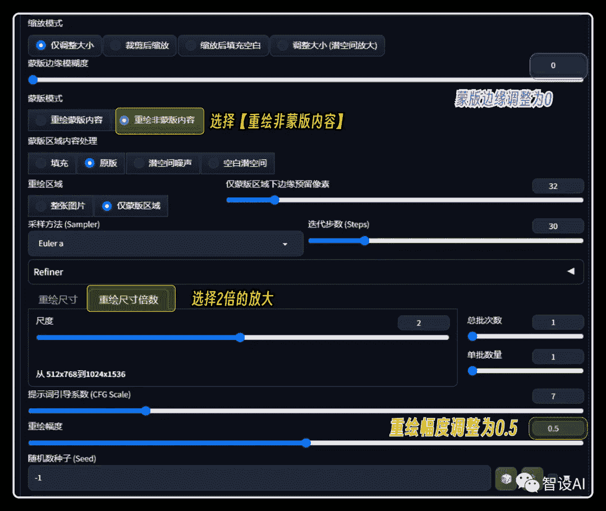

**2.5 初步跑图（批量）**

把上述的参数调整好了之后，我们就可以进行初步的跑图了，可以调整总批次数量（显卡一般的控制在4左右）。

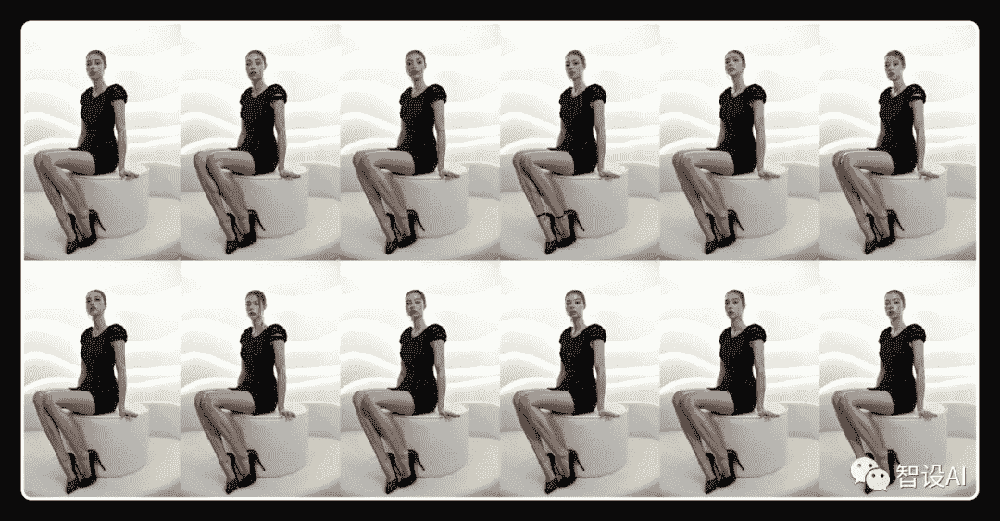

到这一步基本上就差不多了，挑选一张相对满意的图片，可以进行细节上的优化，比如手部及脸部等。

**2.6 局部重绘细节处**

把选中的图片上传到【局部重绘】中，用画笔涂抹需要修改的地方，把下方的蒙版模式改为【重绘蒙版内容】，点击生成即可。

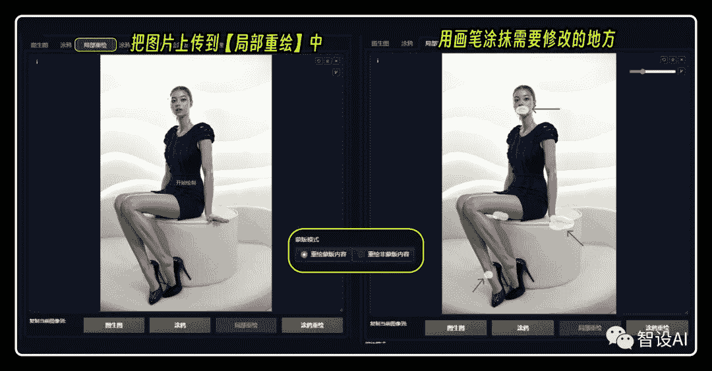

可以重复多次使用局部重绘功能，把脸部和手部分开重绘，效率会更高点，同时，也可以通过修改正向关键词，来重绘涂抹地方，比如加上长发等等。

这个案例就说到这里，后期还有优化空间，大家会这个操作方法才是本次案例的核心，来看看对比吧~

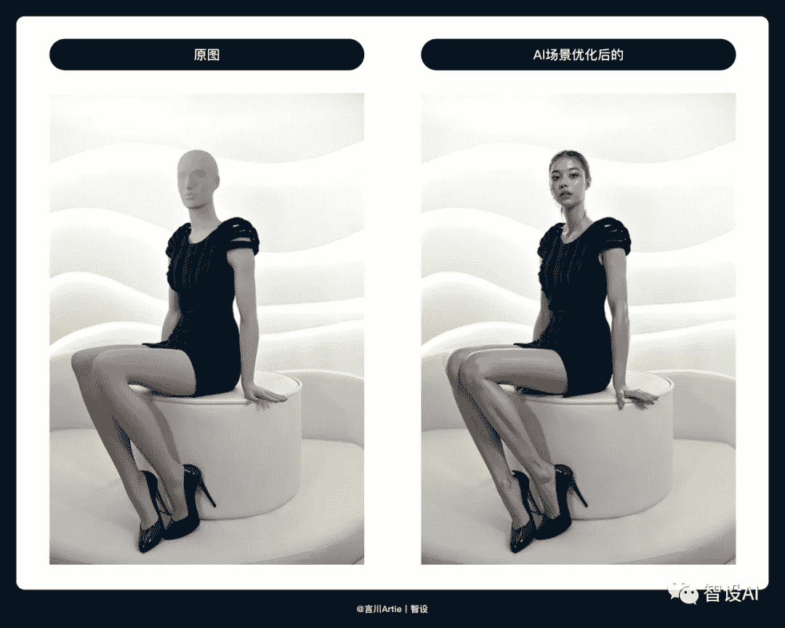

# 三、inpaint anything插件

上一个案例我们是ps手动绘制蒙版的，有没有自动且更便捷的方式呢，当然有，就是使用这个【inpaint anything插件】：

使用 Segment Anything，用户可以通过简单地指向所需区域来指定蒙版，而不是手动填充它们。这可以提高蒙版创建过程的效率和准确性，从而可能获得更高质量的修复结果，同时节省时间和精力。

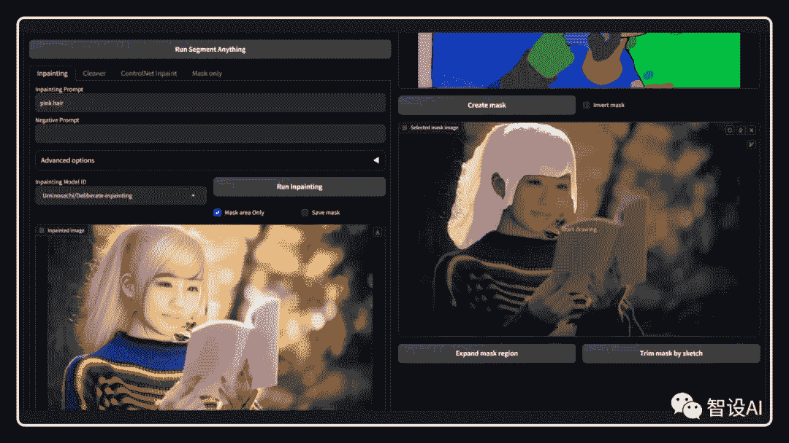

3.1 inpaint anything安装

插件安装方法一直都是如此，相信看到本篇教程的你也绝不是小白了，我就简单带过，另一种方法可以通过网址下载：https://github.com/Uminosachi/sd-webui-inpaint-anything

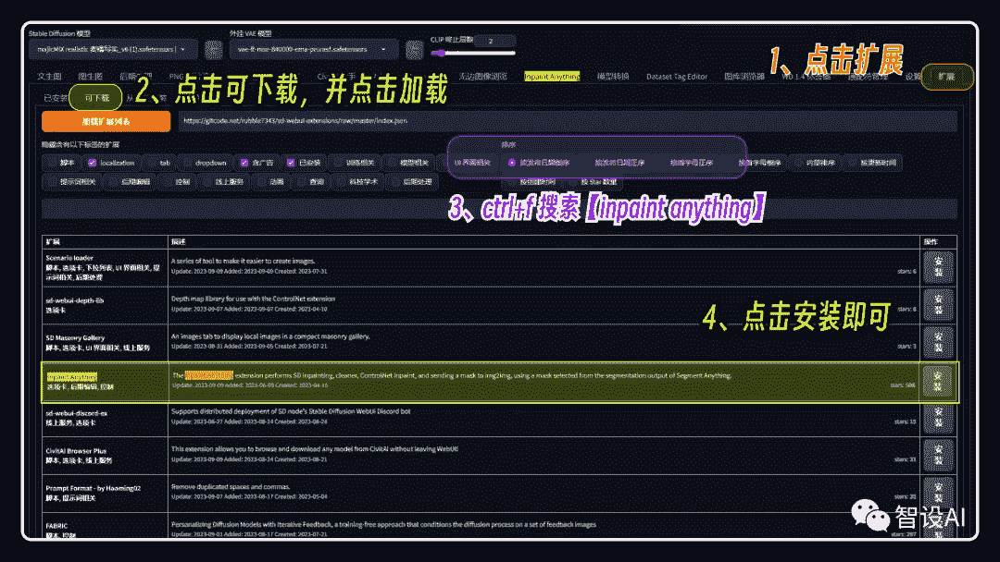

安装完成后刷新【web-ui】即可看到这个插件，之后下载模型，这个插件就不做详细介绍，看操作路径即可。

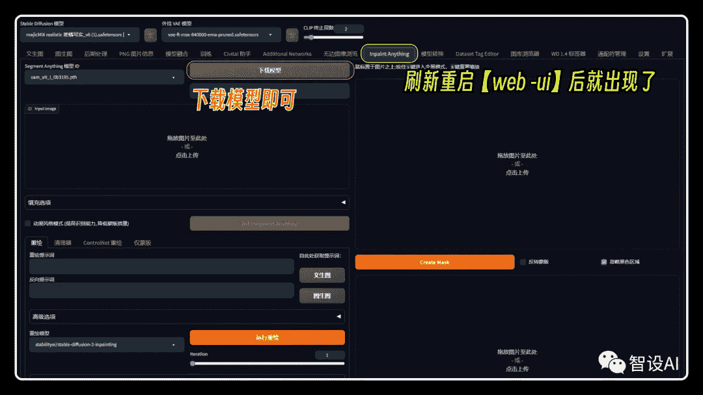

**3.2 生成蒙版图**

先准备一张模特图片，上传到【Input image】中，点击运行。

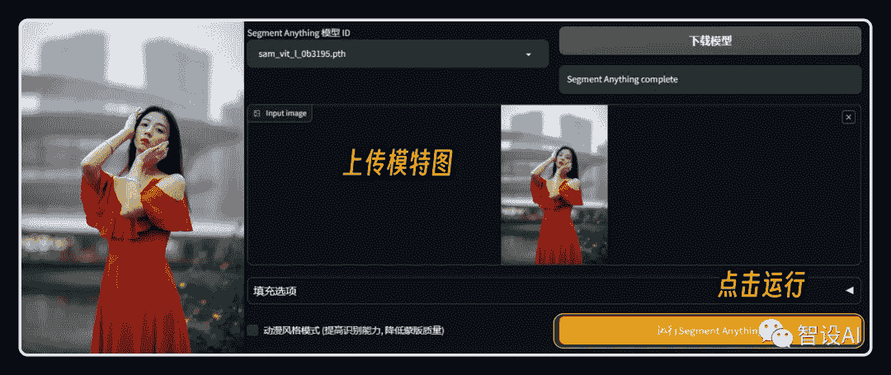

如图所示，右侧会出现【语义分割色块图】，按照下方步骤操作。

说明一下：我们选中的区域，它会给我们在下方高亮显示，选中的部分在后面会给我们生成黑白遮罩图。

之后在左侧找到以下的选项，按步骤操作，你就会得到一张蒙版图，最后发送到图生图中~

后面的操作是不是很熟悉了，就是第一个案例的操作，这个插件就是为我们生成蒙版图。

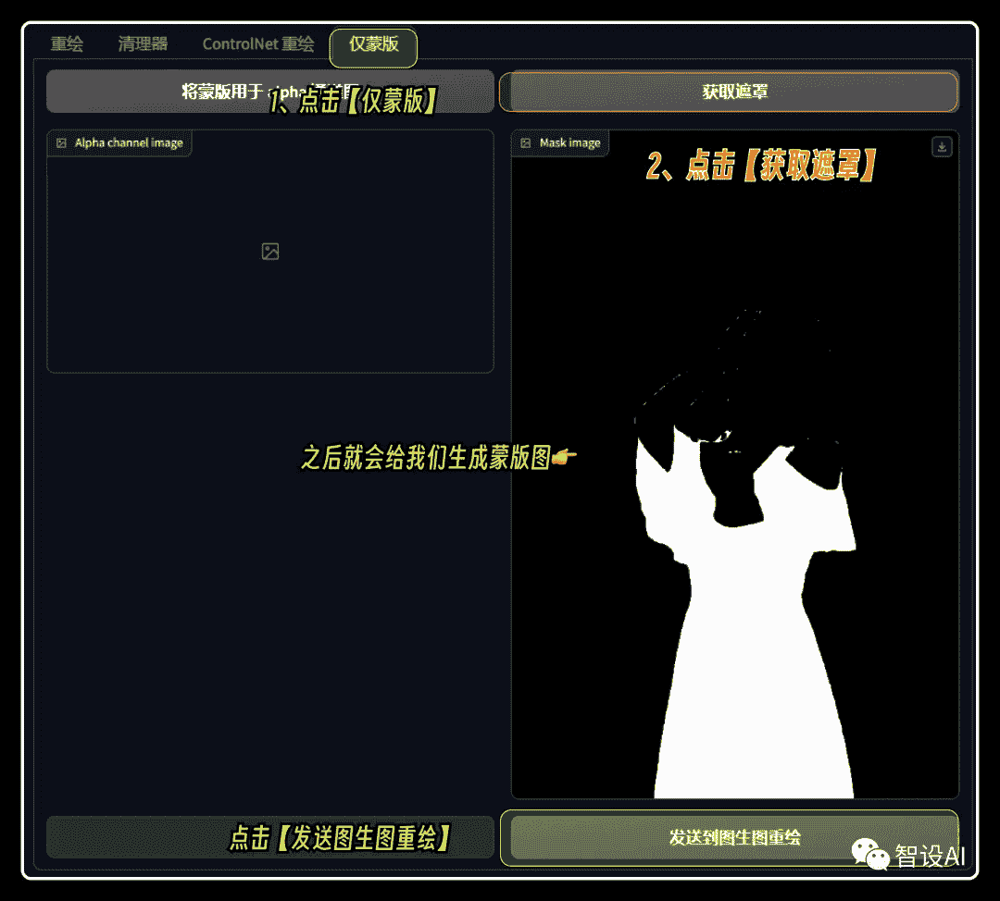

**3.3 换个模特吧**

回到图生图，模型及关键词用第一个案例的，无需做出任何改动，下方的参数也不需要动，只需要把尺寸调整下，与上传图片的尺寸一致即可。

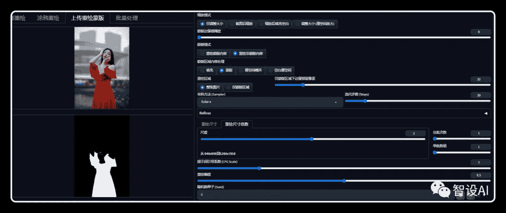

搞定了，就这么简单，有问题的地方发送到【局部重绘】中，修正调整即可。

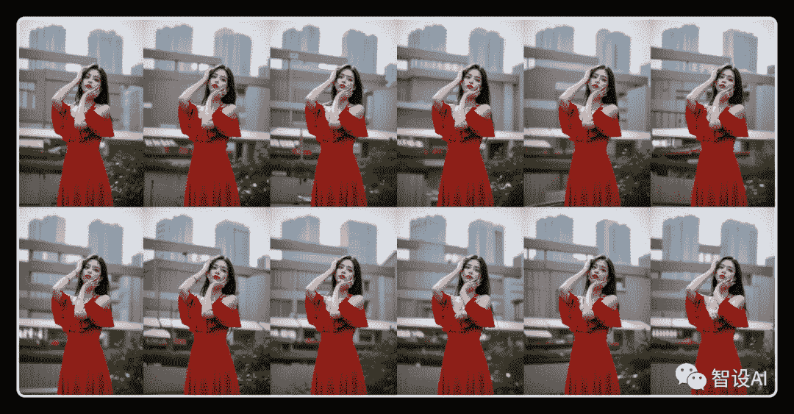

来看一下对比：

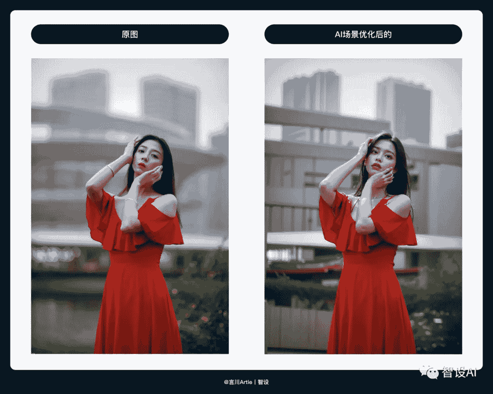

我们还可以扩展一下，只能换人吗？我们换个衣服试试。

**3.4 换件衣服吧**

上面是保持衣服不变，更换人物。生图原理就是利用图生图蒙版功能，大家应该知道怎么做了吧，我们只需要把蒙版模型改动一下即可。

我们先把正向关键词改动下吧，把关于人物的描述删掉，更换成【yellow clothes】黄色衣服试试：

Best quality,masterpiece,ultra high res,(photorealistic:1.4),raw photo,(((yellow clothes))),

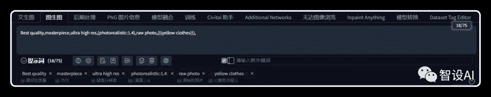

下面参数有两个点需要注意：

1、蒙版模式改为【重绘蒙版内容】；

2、重绘幅度调大一点，之前是0.5，现在我们改成0.7，不然衣服颜色是黄色+红色相结合的颜色。

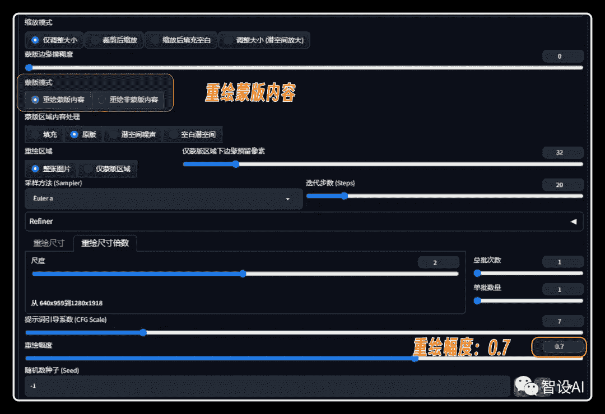

然后生成一批图试试~先埋个坑，哈哈哈！

怎么样，还可以吧😏，是不是发现这动作不对，胳膊乱飞~那咱们就继续往下看。

3.5 Openpose姿势控制

其实大家做图的时候要灵活运用功能，就上述生成的姿势是有问题的，解决这个问题方法就可以用openpose，提取原图的姿态。

使用方法如下图，没什么难度，抄作业即可。

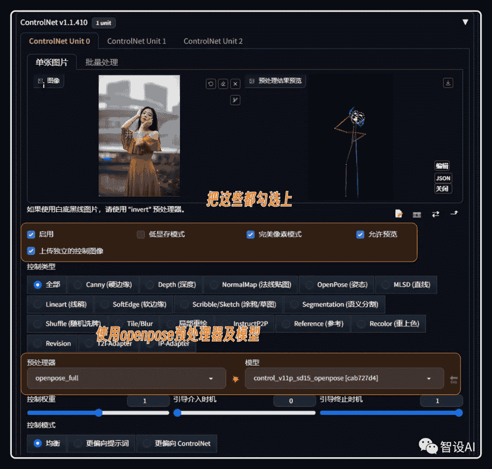

再次生成，模特的姿势就成功的还原了，很完美！可以通过修改关键词来调整衣服的颜色以及款式，完事~

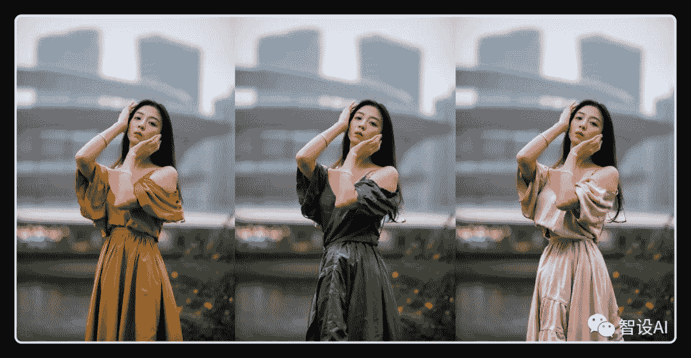

# 四、自定义模特

换个一个场景，上面两个案例都是有模特的素材，如果没有模特只有一件服装可以生成模特图吗，也是可以的，我们往下看：

**4.1 准备素材**

当我们有一张服装图时，还需要准备两张应用在stablediffusion的素材图：

1、一张服装白底图（应用在controlnet上）；

2、黑白蒙版图（应用在重绘蒙版上）。

注：黑白蒙版图可以用上面提到的插件做哦，别忘记用了。

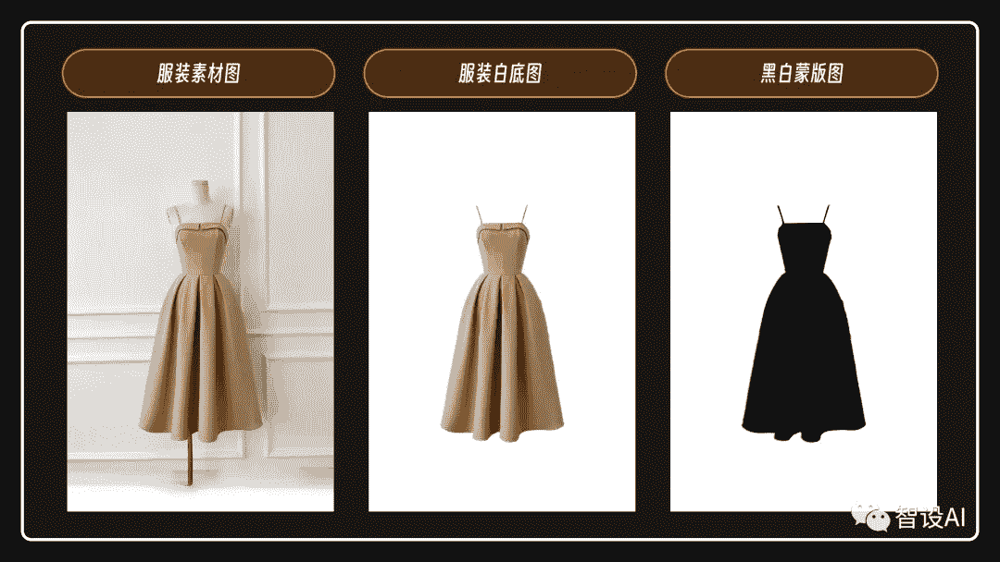

4.2 安装3D 骨架模型编辑 (3D Openpose)

先说下思路，当我们只有服装时，我们需要在服装基础上创建一个人物，stablediffusion是无法精准的基于服装生成人物，所以我们需要使用【3D Openpose】这个插件来创建一个人物骨架图，然后运用【controlnnet】插件来精准控图。

安装插件跟上面一样，在扩展中安装即可，如果扩展安装不了那就是用本地安装，网址在这：

https://github.com/nonnonstop/sd-webui-3d-open-pose-editor/tree/main

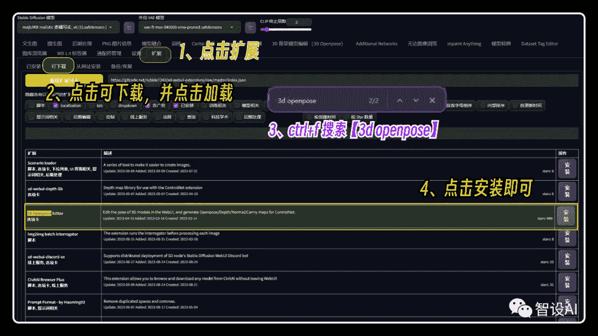

安装完成后，重启【web-ui】即可在这看到【3D Openpose】，关于这个怎么用很简单，大家尝试着用用，熟悉一下即可（我个人觉得不是很好操作）

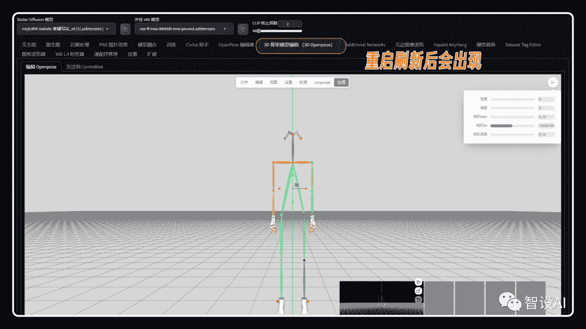

**4.3 创建人物骨骼图**

进入到【3D Openpose】，把原图放进来，然后调整骨架与图片的对应位置，可以根据自己的想法调整骨架姿势，需要多尝试用几遍。注意：图片尺寸一定要设置好，一定！

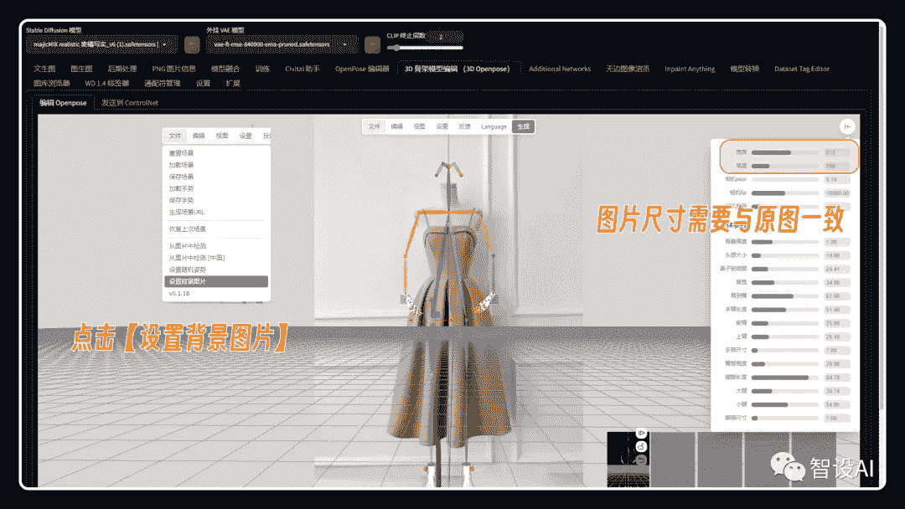

调整完之后，点击【生成】，点击【发送到controlnet】，点击【发送到图生图】即可。

注意：基于写本篇教程的sd版本，我们需要先到【图生图】模块把controlnet先勾选启用，发送才有效！

4.4 设置controlnet及重绘蒙版

回到【图生图】的controlnet中，我们需要使用两个controlnet插件，第一个就是【openpose】，其次是【canny】。

1、【openpose】只需选择该模型即可，预处理器不用选择；

2、【canny】目的是控制服装边缘，上传前面准备的白底图，如果你前面蒙版图没有抠细致，这一步很重要。

重绘蒙版与前面两个案例一样，包括模型与关键词，一模一样即可。

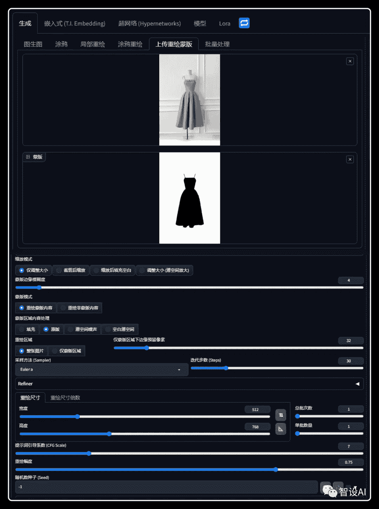

**4.5 跑图完成**

上述参数设置完成后，跑图即可，剩下的细节之处本教程就不做演示了，与第一个案例一样，细节之处有问题的地方使用【局部重绘】修正即可，或者是PS处理下（话说PS Beta好像不能用了😒）

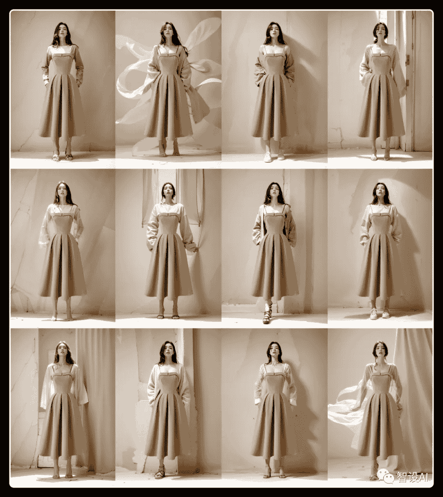

怎么样，应该都看会了吧😏又是一波收藏夹吃灰教程，来看看【智设AIGC社区】吧，全是超干教程及资源，免费分享给大家哦，主页or评论区见~

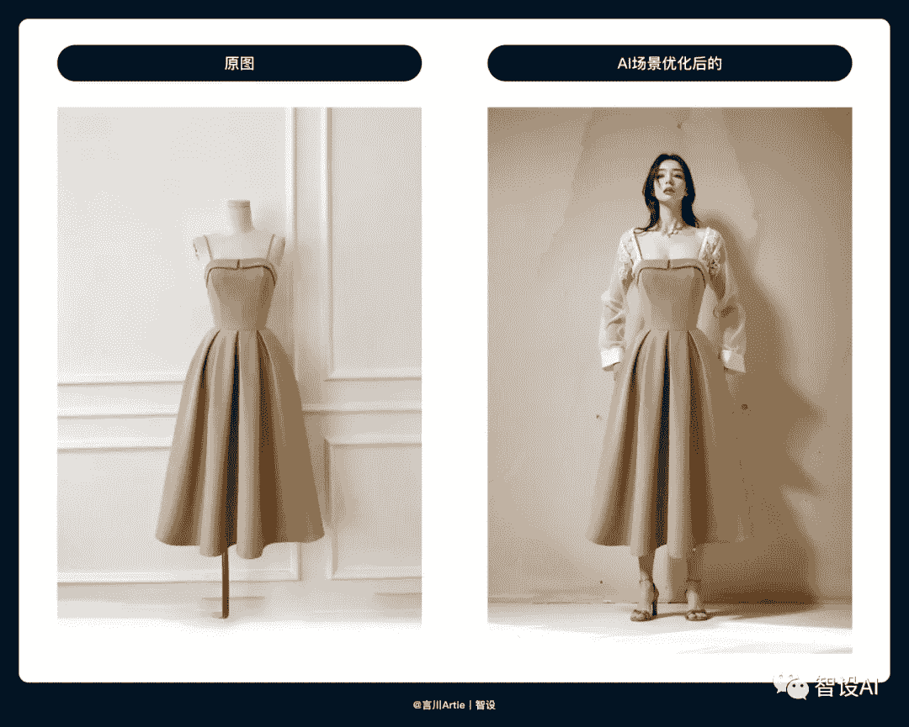

# **五、总结**

本教程详细介绍了如何使用StableDiffusion实现模特精准换装以及换模特。通过几个实际案例，展示了StableDiffusion在不同场景下的应用，通过学习本教程，您可以轻松掌握模特换装的技巧，提高工作效率，完事了，下课，我们下期见（不要忘记来领xx哦）。