# 1、手把手教你用 Stable Diffusion 写好提示词

> 来源：[https://keenchase.feishu.cn/docx/BbLGdGIkTo0ycExYNKacJMCint6](https://keenchase.feishu.cn/docx/BbLGdGIkTo0ycExYNKacJMCint6)

### **导语**

Stable Diffusion 技术把 AI 图像生成提高到了一个全新高度，文生图 Text to image 生成质量很大程度上取决于你的提示词 Prompt 好不好。本文从“如何写好提示词”出发，从提示词构成、调整规则和 chatGPT 辅助工具等角度，对文生图的提示词输入进行归纳总结。

### **一 背景介绍**

St[**ab**](https://km.woa.com/articles/show/574286)le Diffusion 是一种文生图 AI 模型，由互联网上数百万图像和文本描述对训练而来，通过理解文本描述与图像信息的内在关联，不断利用扩散过程进而得到满意的生成图片[1]。

比如，通过一串提示词，midjourney 会输出这样的情侣合照：

```
A **pa**ir of young Chinese lovers, wearing jackets and jeans, sitting on the roof, the background is Beijing in the 1990s, and the opposite building can be seen —v 5 —s 250 —q 2.
一对年轻的中国情侣，穿着夹克和牛仔裤，坐在屋顶上，背景是20世纪90年代的北京，可以看到对面的建筑
```

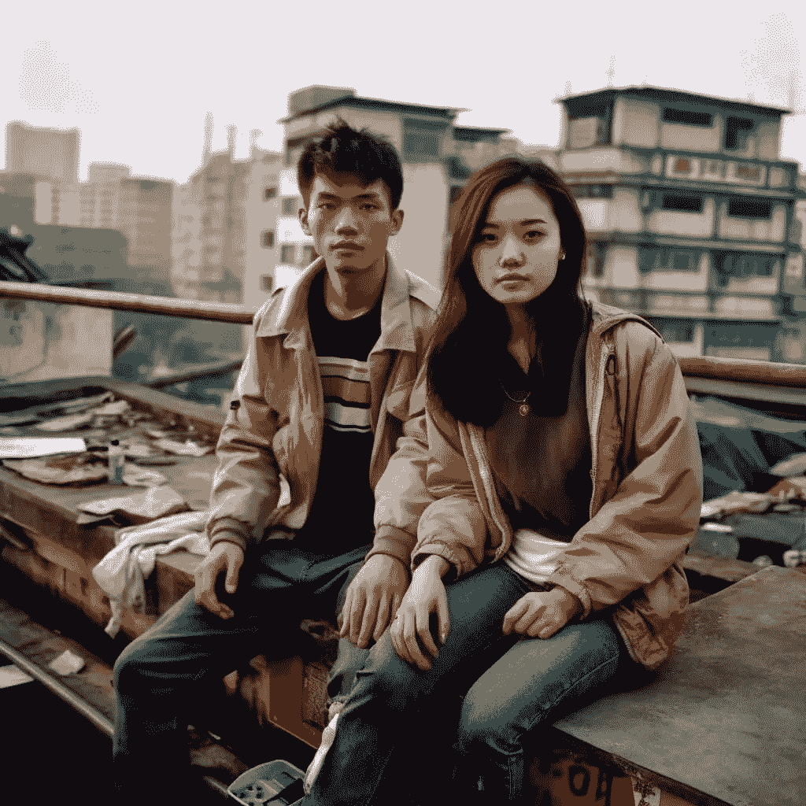

图1 用midjourney v5生成的情侣图

没错，这两位并不是真人，而是由 AI 一键生成的，毫无违和感！你可能会想这有什么了不起的，随手一搜就有好几 G 嘛。这项技术的有趣之处在于，还可以让模型生成一些先前不存在具有组合元素的高质量图像。比如说，你可以生成不同画家风格的明星照片，下面以 19 世纪印象派画家 Vincent van Gogh 和 19 世纪美国画家画家 John Sargent 风格来画下 Emma Watson 肖像画（Emma Watson 是《哈利波特》中赫敏的饰演者）

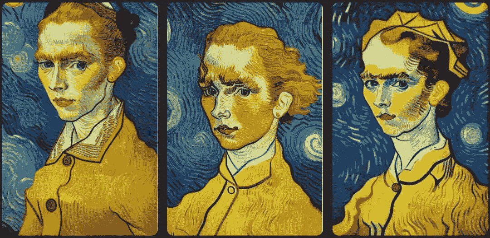

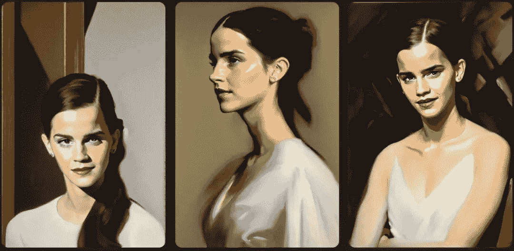

图2 不同画家风格下的Emma Watson肖像

prompt1: Vincent van Gogh’s painting of Emma Watson; prompt2: John Sargent’s painting of Emma Watson

从图 2 可以看到，生成图片对面部和阴影控制得比较好，整体艺术风格还是比较协调的，能把画师风格和具体人物以一种比较和谐的方式融合到一起。

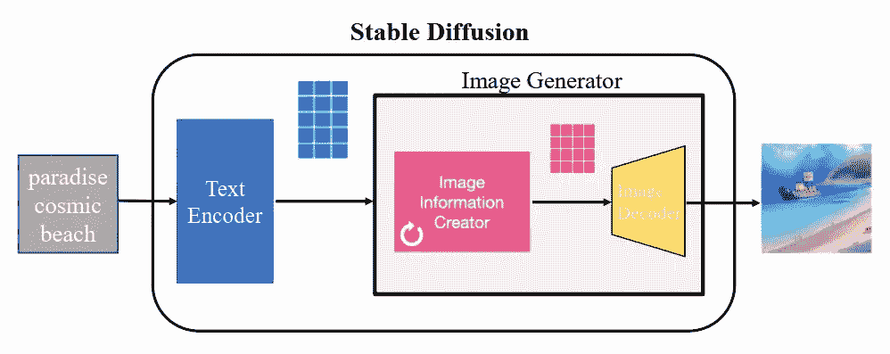

图3 Stable Diffusion组成结构

那计算机是如何理解输入文字呢？图 3 给出了 stable diffusion 整体结构示意图，利用文本编码器 text encoder（蓝色模块），把文字转换成计算机能理解的某种数学表示，它的输入是文字串，输出是一系列具有输入文字信息的语义向量。有了这个语义向量，就可以作为后续图片生成器 image generator（粉黄组合框）的一个控制输入。stable diffusion 更多技术介绍和文本编码器工作原理可以查看《【AI 绘画】十分钟读懂 Stable Diffusion 运行原理》。要想生成出满意照片，输入合适提示词就变得非常重要，接下来就从“如何写好提示词”出发，对文生图的提示词输入方法进行归纳总结。

### **二 如何写好提示词？**

写出一份比较好的提示词是文生图技术的关键。但是，写出一份好的 prompt 并不容易，下面针对“如何写好提示词”这个问题，从提示词构成、调整规则和 chatGPT 辅助等角度，来介绍下如何优化输入提示词。

#### **1 正面提示词**

要写好一份提示词，遵循原则为尽可能详细并且具体，从不同角度进行详细描述。下面从 9 个角度来介绍输入关键词。

常用的关键词类别包括如下：

(1) 主体 subject

(2) 媒介 medium

(3) 风格 style

(4) 画家 artist

(5) website

(6) 分辨率 resolution

(7) 额外细节 additional details

(8) 色调 color

(9) 光影 lighting

当然，输入提示词时，不需要包括到每个类别，只需作为一个列表检查下哪些可以用到。下面通过添加每个类别的关键字来生成一些图像，来说明和介绍下每个类别。为单独观察提示词效果，实验时不会使用负面提示词（在下个模块会更详细介绍）。

##### **(1)** **主体**

主体 subject，是指想在图像中看到的主体，要尽可能详细描述以避免出现描述不足的问题。假如要生成一个在施法的女巫，新手可能会这么写：

```
A sorceress
```

这个描述词也太简单了吧，要提到女巫长什么样，增加她形象相关的描述词，比如说她穿了什么？在施什么魔法？是站着，跑着，或者飘浮在天上？主体背景在哪里？

Stable diffusion 并不能猜到这些内容，我们要更详细地表达各个元素信息。画人物对象的一个常用技巧是使用名人的名字，名人由于在训练集中出现频次较大而训练充分，是控制生成人物形象的一种好办法。

作为演示，把女巫形象设置成 Emma Watson 的样子，她因饰演《哈利波特》中的赫敏一角红遍全球，也是 stable diffusion 里最常使用的一个关键词。把她想象成一个会使用闪电的神秘女巫，并增加一些形象要求，提示词如下：

```
Emma Watson as a powerful mysterious sorceress, casting lightning magic, detailed clothing
```

对应的生成图如下：

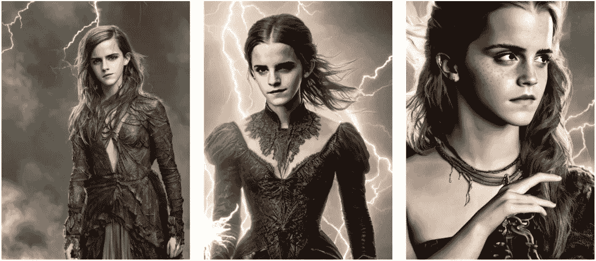

图4 Emma Watson女巫图

利用名人名字来控制人物形象，直接原因就是训练时用到了一定量样本，包括不同角度和不同场景，使 Emma Watson 得到了充分训练。要是使用更早些或者小众点的演员，效果就不一定这么好了。

##### **(2)** **画风**

画风 medium，是指生成图片的画风，包括插画 illustration、油画 oil painting 或摄影风 photography 等。这类描述词影响力很大，单独一个画风描述词就能很大程度地改变风格。比如添加下关键字“digital painting(数字绘画)”，

```
Emma Watson as a powerful mysterious sorceress, casting lightning magic, detailed clothing, digital painting
```

对应的生成图如下：

图5 Emma Watson女巫图+画风

可以看到，这些图像的画风从普通照片变成了数字绘画风。这里也列出一些常用画风，

##### **(3)** **风格**

风格 style，是指主体形象的艺术风格，比如印象派、超现实主义、波普艺术等。

通过添加一些风格描述词"hyperrealistic, fantasy, surrealist, full body"，

```
Emma Watson as a powerful mysterious sorceress, casting lightning magic, detailed clothing, digital painting, hyperrealistic, fantasy, Surrealist, full body
```

对应的生成图如下：

图6 Emma Watson女巫图+风格

这里感觉又多了一些变化，前面关键字已经包含了部分风格关键字导致变化不大，但是保留这些风格提示词也可以。这里也列出一些常用风格。

##### **(4)** **画家**

画家 artist，类似于强修饰符，是指用特定画家作为参考来生成他们风格的图像。当然也可以使用多个画家名字来生成混合风格。

继续在提示词里再加上 19 世纪的超级英雄漫画家 Stanley Artgerm Lau 和肖像画家 Alphonse Mucha

```
Emma Watson as a powerful mysterious sorceress, casting lightning magic, detailed clothing, digital painting, hyperrealistic, fantasy, Surrealist, full body, by Stanley Artgerm Lau and Alphonse Mucha
```

对应的生成图如下：

图7 Emma Watson女巫图+不同画家

这里看到，把两位画家的风格融合到一起，效果还不错。这里也列出一些常用画家，

##### **(5)** **网站**

有一些小众图片网站，比如说[**Artstation**](https://www.artstation.com/)和 Deviant Art 这样的网站收集了许多画风独特的图像。在提示词中添加网站名称，也可以把图像引向这些风格。

试下在提示词里再加上“artstation ”，

```
Emma Watson as a powerful mysterious sorceress, casting lightning magic, detailed clothing, digital painting, hyperrealistic, fantasy, Surrealist, full body, by Stanley Artgerm Lau and Alphonse Mucha, artstation
```

对应的生成图如下：

图7 Emma Watson女巫图+网站

图片变化不是很大，但看起来有点像 Artstation 网络下载下来的了。

##### **(6)** **分辨率**

分辨率 Resolution，表示生成图像的清晰度和细节程度。继续添加这方面关键字“highly detailed, sharp focus”，

```
Emma Watson as a powerful mysterious sorceress, casting lightning magic, detailed clothing, digital painting, hyperrealistic, fantasy, Surrealist, full body, by Stanley Artgerm Lau and Alphonse Mucha, artstation, highly detailed, sharp focus
```

对应的生成图如下：

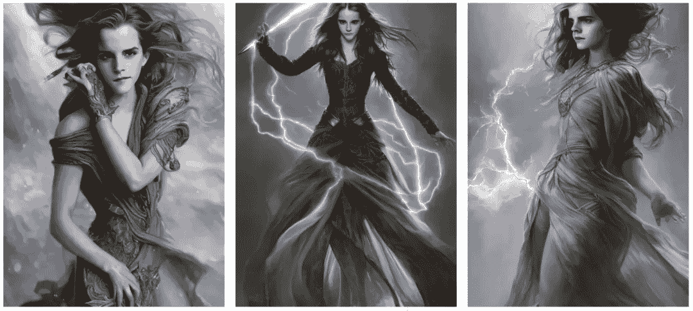

图8 Emma Watson女巫图+分辨率

看起来变化不大，因为前面生成图片已经非常清晰了，但补充一下也无妨。

##### **(7)** **额外细节**

额外细节 additional details，可以继续用来修改图片。继续添加这方面关键字“sci-fi, stunningly beautiful, dystopian”，

```
Emma Watson as a powerful mysterious sorceress, casting lightning magic, detailed clothing, digital painting, hyperrealistic, fantasy, Surrealist, full body, by Stanley Artgerm Lau and Alphonse Mucha, artstation, highly detailed, sharp focus, sci-fi, stunningly beautiful, dystopian
```

对应的生成图如下：

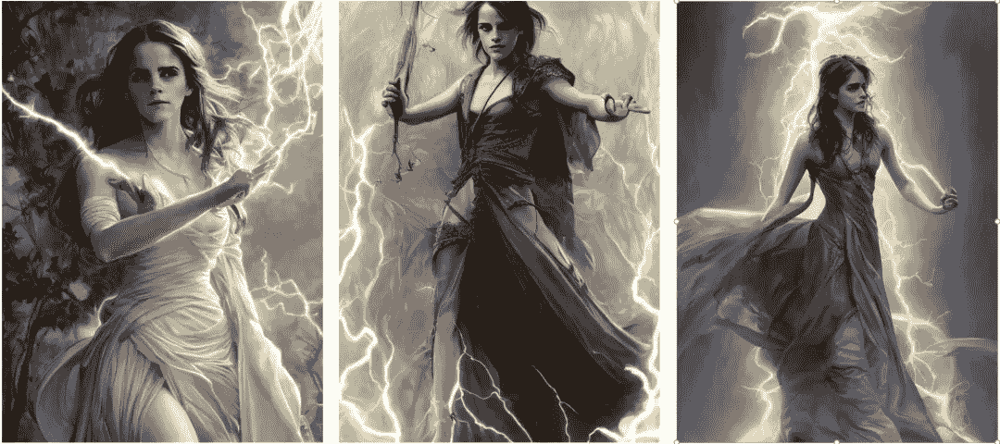

图9 Emma Watson女巫图+额外细节

##### **(8)** **色调**

色调 color，是指通过添加颜色关键字来控制图像整体颜色，可以把颜色应用到某个物品上或者是整体色调。

利用关键字"iridescent gold"让整张图片黄一点，

```
Emma Watson as a powerful mysterious sorceress, casting lightning magic, detailed clothing, digital painting, hyperrealistic, fantasy, Surrealist, full body, by Stanley Artgerm Lau and Alphonse Mucha, artstation, highly detailed, sharp focus, sci-fi, stunningly beautiful, dystopian, iridescent gold
```

对应的生成图如下，看起来就很黄了！

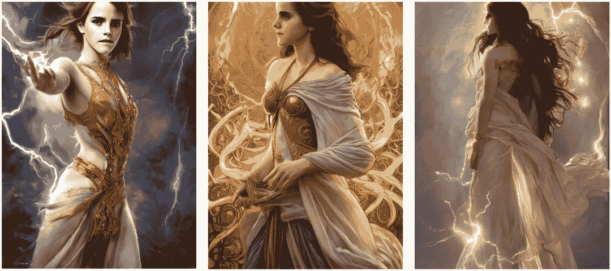

图10 Emma Watson女巫图+色调

##### **(9)** **光照**

光照 lighting，是指图像里的光照描述，改变光照可以对图像效果产生巨大影响。试试添加关键字“cinematic lighting, dark”，

```
Emma Watson as a powerful mysterious sorceress, casting lightning magic, detailed clothing, digital painting, hyperrealistic, fantasy, Surrealist, full body, by Stanley Artgerm Lau and Alphonse Mucha, artstation, highly detailed, sharp focus, sci-fi, stunningly beautiful, dystopian, iridescent gold, cinematic lighting, dark
```

对应的生成图如下，影视光照就出来了！

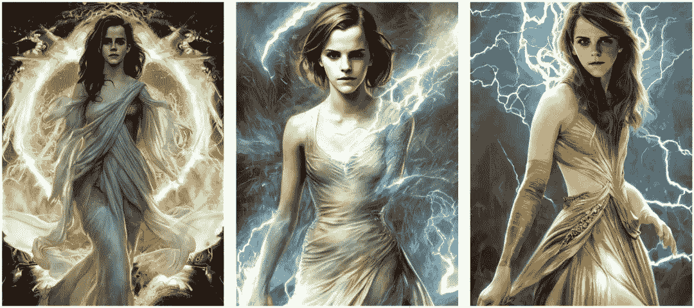

图11 Emma Watson女巫图+光照

总结下，图片生成时针对主体添加一些关键字，就能够得到比较不错的图片；通常不需要填写很多提示词来获得高质量图片，比如画家、网站和风格在一定程度上是有些重合的。也可以借助一些 stable diffusion 提示词网站来获取更多灵感 Ai 画廊 - AI 关键词生成器

#### **2 负面提示词**

负面提示词和正面提示词是同等重要的，使用负面提示词也是生成迭代过程的一个重要环节。要解释负面提示词的工作原理，这里需要先理解不使用负面提示词时采样是如何工作的

**不使用负面提示词的采样过程**

在 stable diffusion 采样阶段，① 首先用文本提示词作为指导条件，利用条件采样对图像进行去噪；② 采样器使用无条件采样对同一图像进行去噪，这里不使用文本指导，但它仍然会扩散到某一个图像，比如说下面的篮球或者红酒杯（它可以是任何随机主体）；③ 扩散过程中实际上是计算条件采样和无条件采样的差异，并按照采样步数重复这个过程。

图12 不使用负面提示词的采样过程

**使用负面提示词的采样过程**

负面提示词是通过影响无条件采样实现的。利用负面提示词，在上面第 ② 步里就不是使用空提示来生成随机对象了。从技术上说，正面提示词会引导采样过程生成与文本相关的图像，负面提示词则会在采样过程来引导远离相关图像。需要说明，扩散过程是发生在隐空间 latent space 里，而不是图像空间，这里仅作为技术示意。

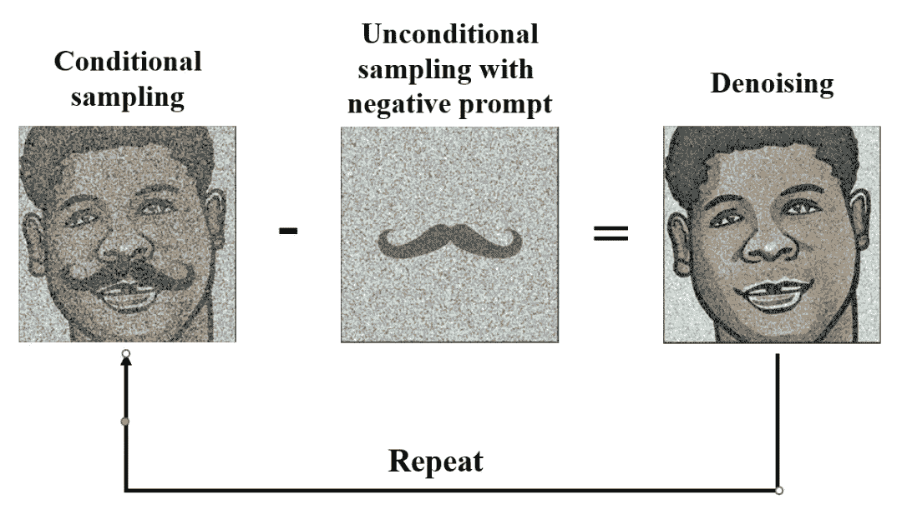

图13 使用负面提示词的采样过程

负面提示词，即填入不想要的主体或者身体部位，以在采样过程中避免出现。比如说，sd v1 版本不擅长生成手，就可以在负向提示词里输入“hand”或者“extra limbs”来隐藏或修正。下面会从 4 个角度来介绍可以使用负面提示词的应用场景，分别是：

(1) 移除物体 removing things

(2) 修改图片 modifying images

(3) 关键词切换 keyword switching

(4) 修改风格 modifying styles

##### **(1)** **移除物体**

负面提示词的第一个直接用法是移除任何不想在图片中看到的内容。比如，在提示词输入“Portrait photo of a man”，得到下面两张图片，都看起来比较严肃。

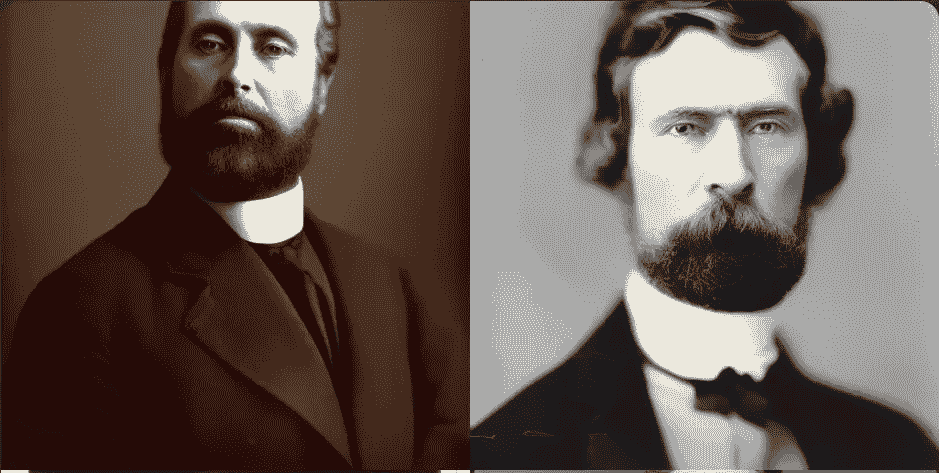

图14 提示词输入“Portrait photo of a man”的生成图片

接下来试着去掉他们胡子，看起来更年轻一点，因此在负向提示词里输入“mustache”，就可以生成一些没有胡子的男人，如图 15 所示。当然，要想完全去除右边男人的胡子，可通过增强负向提示词“(mustache:1.3)”来告诉采样过程去除胡子操作的重要度提高 30%。

图15 在负向提示词里添加“mustache”的生成图片

##### **(2)** **修改图片**

负向提示词也可以用于在得到较满意图像时，利用负面提示词进行微调。这里不需要移除任何东西，而只需要对主体做一些细微修改。

比如，利用下面提示词得到一张比较满意的唯美照片后，发**现可能由于刮风导致头发都飘起**来了，就可以添加负面提示词“windy”让头发正常下垂。

正面提示词输入如下，

```
emma watson as nature magic celestial, top down pose, long hair, soft pink and white transparent cloth, space, D&amp;D, shiny background, intricate, elegant, highly detailed, digital painting, artstation, concept art, smooth, sharp focus, illustration, artgerm, bouguereau
```

图16 添加负面提示词“windy”后的左右变化，右边为修改后图片

要是不想调整头发，而是想让头发遮住耳朵呢？通过添加带有不同强度的负面提示词“ear”来调整隐藏强度。下面是强度分别为 1.3、1.6 和 1.9 的效果，由于 ear 在强度为 1 时已被大比例遮住，继续增大时变化不多。但负面强度设置为 1.9 时，图像组成也发生了变化，这说明负面提示词对扩散过程的影响是比较大的。

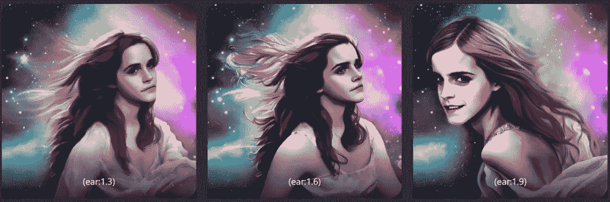

图17 负面提示词“ear”不同强度的生成图片

##### **(3)** **关键词切换**

要是真的想使用强度为 1.9 的负向提示**词，有什么不改**变图片总体结构的方法呢？用关键词切换技术，先使用一个无意义的单词作为负面提示词，再在后面的采样步骤里切换到(ear:1.9)。

比如，使用“the”作为无意义的负面提示词，可以把它放在负面提示词里先验证下它的无用性。在验证添加“the”的生成图像跟没有添加时几乎一样后，就可以使用这个“the”单词作为负面提示词，

```
the: (ear:1.9): 0.5
```

由于采样步数设置了 20，意味着在第 1~10 步时使用负面提示词“the”，第 11~20 步使用负面提示词“(ear:1.9)”。这是因为，扩散过程的初始阶段是确定图片主体结构，后面步骤只是在对细节进行更精细调整，比如用头发遮住耳朵。

图17 负面提示词“the: (ear:1.9): 0.5”的生成图片

通过这种方式，就对负面提示词使用更大强度 1.9，且不改变图片组成，得到了接近原始图像的微调图像，并且把耳朵用头发遮得更严实。

##### **(4)** **修改风格**

负面提示词不仅能用来修改图片内容，也可以用来修改图片风格。为什么要用负面提示词来修改图片风格？在正面提示里添加过多单词也会混淆扩散过程，把一部分信息放在负面提示词里的效果会更明显。

操作 1 Sharpening。为了让图片更清晰，除了在正面提示词里使用关键字“sharp”或者“focused”，也可以在负面提示词里使用“blur”，来让图片更为清晰。

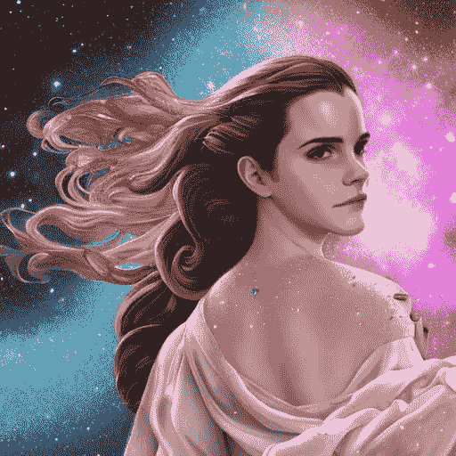

图18 添加负面提示词“blurry”的生成图片

操作 2 “Photorealistic”。使用负面提示词“painting”或者“cartoon”，使生成图片更倾向写实主义。当然，要是想保持原有图片结构，可继续使用前面提到的关键词切换，使用负面提示词“the: (painting cartoon:1.9): 0.3”，可得到图 19 中更接近原始图像但增加了写实主义风格的生成图像。

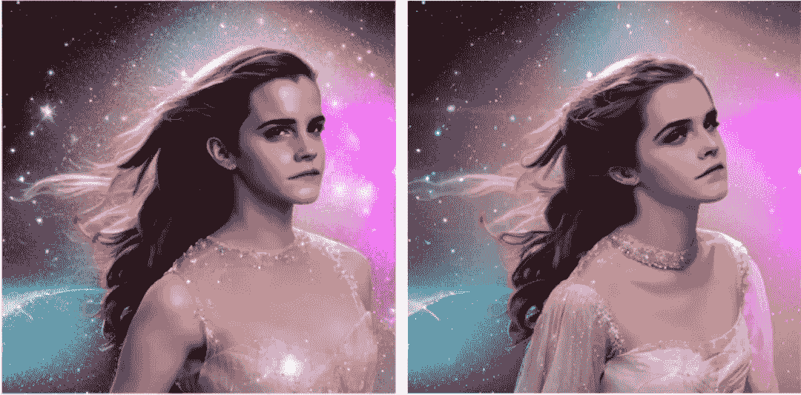

图19 负面提示词“the: (painting cartoon:1.9): 0.3”的生成图片

下面给出了一份通用的负面提示词，可以复用到你的场景，这些负面提示词可以让图片主体更突出，具有层次感。

```
ugly, tiling, poorly drawn hands, poorly drawn feet, poorly drawn face, out of frame, extra limbs, disfigured, deformed, body out of frame, bad anatomy, watermark, signature, cut off, low contrast, underexposed, overexposed, bad art, beginner, amateur, distorted face, blurry, draft, grainy
```

总结下，负面提示词也扮演着十分重要的作用，用负面提示词在采样过程引导远离相关图像。如上面介绍，可以用来微调生成图片，如移除物体、修改图片，或者修改风格等一系列操作。

#### **3 微调提示词**

利用正面和负面提示词还不能生成很满意的照片，还需要做进一步细节调整？还有一些提示词调整技巧，下面会从 3 个用法角度来介绍如何微调提示词，

(1) 关键词权重

(2) ()和[]语法

(3) 关键词混合

##### **(1) 关键词权重**

关键词权重，是指通过语法“(keyword: factor)”来调整关键词权重，其中 factor 为权重值，小于 1 表示减低重要度，大于 1 表示增大重要度。

下面这个例子调整了关键字“dog”的权重值。如下图所示，增大“dog”权重一般会生成更多狗，减少权重则降低了生成狗的数量。这种技术也可以应用到风格 style 或者光照 lighting 调整。

```
dog, autumn **in** paris, ornate, beautiful, atmosphere, vibe, mist, smoke, fire, chimney, rain, wet, pristine, puddles, melting, dripping, snow, creek, lush, ice, bridge, forest, roses, flowers, by stanley artgerm lau, greg rutkowski, thomas kindkade, alphonse mucha, loish, norman rockwell.
```

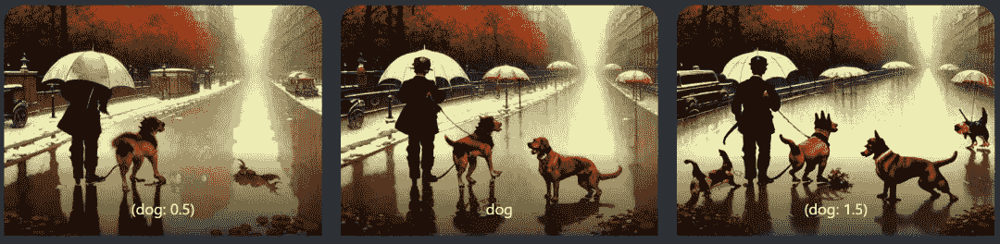

图20 不同权重提示词“dog”的生成图片

##### **(2)** **()和[]符号**

调整关键词强度的另一种等效方法是使用()和[]符号。(keyword)把关键词强度增加到 1.1 倍，与“(keyword:1.1)”效果一致；[keyword]把关键词强度降低到 0.9 倍，与“[keyword:0.9]”效果一致。

这里可以使用多个，跟数学里的连乘操作是一样的。

```
(keyword): 1.1
((keyword)): 1.21
(((keyword))): 1.33
```

##### **(3) 关键词混合**

这里还可以通过混合两个关键词来实现更有趣效果，使用语法为“[keyword1 : keyword2: factor]”，其中 factor 值控制了把 keyword1 切换到 keyword2 的步骤值，是一个介于 0 到 1 之间的数字。

举个例子，输入提示词“Oil painting portrait of [Joe Biden: Donald Trump: 0.5]”，采样步数设置为 30。这里指的是，第 1~15 步，提示词为“Oil painting portrait of Joe Biden”；第 16~30 步，提示词为“Oil painting portrait of Donald Trump”。解释一下，factor 值决定了关键词的切换节点，设置为 0.5 时指的是在 30*0.5 = 15 步时切换。

关键词融合技术还能用于生成高度相似的图片编辑。下面是使用相同提示词生成了两张图片，随机种子和迭代步数保持不变，只修改了[apple: fire: factor]里的 factor 权重。这背后的工作理论是，生成图片的总体组成是由早期扩散过程决定的，后面的一些关键词调整不会对图像整体产生很大影响，只会改变一小部分。

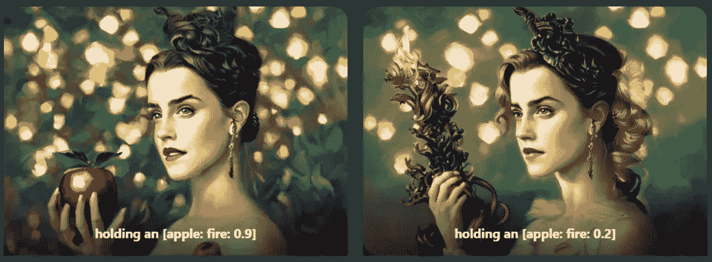

图22 关键词混合[apple: fire: factor]的生成图片

#### **4 用 chatGPT 生成**

手动改 prompt 很麻烦？能不能用 chatGPT 生成高质量提示词来实现稳定扩散？答案是可以的，但需要用一些技巧来引导。chatGPT 是 openAI 在 2022 年 11 月发布的聊天机器人，在 GPT3.5 大语言模型的基础上进行了微调。GPT3 系列使用了千亿级别文本训练出来的，chatGPT 还进一步引入了 RLHF 强化学习来学习人类偏好。因此，chatGPT 包含了大量人类知识，可以生成文章、诗歌、小说甚至是各种计算机代码。

那 chatGPT 了解 stable diffusion 技术吗？答案是不了解，因为它的训练数据只截止于 2021 年 9 月。幸运的是，它了解什么是文生图 text-to-image 和 DALL-E 模型，可以利用这块知识构建提示词工程。

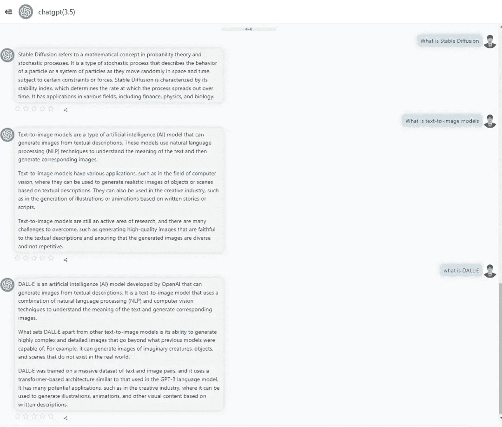

图23 chatGPT是否了解stable diffusion、text-to-image和DALL-E技术？

如何调用 chatGPT 呢？最直接的方式是上chat.openai.com使用，内网也有一些中转方式，比如用企微里的 chatGPT 机器人或者搭建一些内部平台，这里不过多介绍。下面介绍使用 chatGPT 来生成一个人物特写照片，这是比较难的一个任务。

让 chatGPT 生成高质量提示词，也是需要一些技巧的，包括以下三点：(1) 指定图片画风，比如 oil-painting 油画风等；(2) 确定图片主体，如前面提到用一个明星名字是个不错选择；(3) 给出具体例子的话往往学的更快。

综合一下，输入 ChatGPT 的提示词如下：

```
**Exa**m**ple**s of high quality prompt for stunning close-up photorealistic illustration of Ana de Armas for text-to-image models (Stable Diffusion, midjourney or Dalle2) are
– portrait of beautiful happy young ana de armas, ethereal, realistic anime, trending on pixiv, detailed, clean lines, sharp lines, crisp lines, award winning illustration, masterpiece, 4k, eugene de blaas and ross tran, vibrant color scheme, intricately detailed
– alberto seveso and geo2099 style, A highly detailed and hyper realistic portrait of a gorgeous young ana de armas, lisa frank, trending on artstation, butterflies, floral, sharp focus, studio photo, intricate details, highly detailed, by Tvera and wlop and artgerm
Give me more examples.
```

chatGPT 的回复为：

```
A** p**hotorealistic, highl**y **detailed illustration of Ana de Armas in a vintage Hollywood style, reminiscent of the golden age of cinema, with a focus on glamour and elegance.
A close-up illustration of Ana de Armas in a neo-noir style, reminiscent of the film noir genre, with a focus on shadows, contrasts, and a sense of danger.
```

把这些提示词输入到 stable diffusion v1.5 里，使用 DPM++ 2M Karras 采样器，迭代步数为 25，图片分辨率为 502×704。负面提示词使用上面提到的通用版本。

chatGPT 提示词 1：

```
A** p**hotorealistic, highly detailed illustration of Ana de Armas in a vintage Hollywood style, reminiscent of the golden age of cinema, with a focus on glamour and elegance.
```

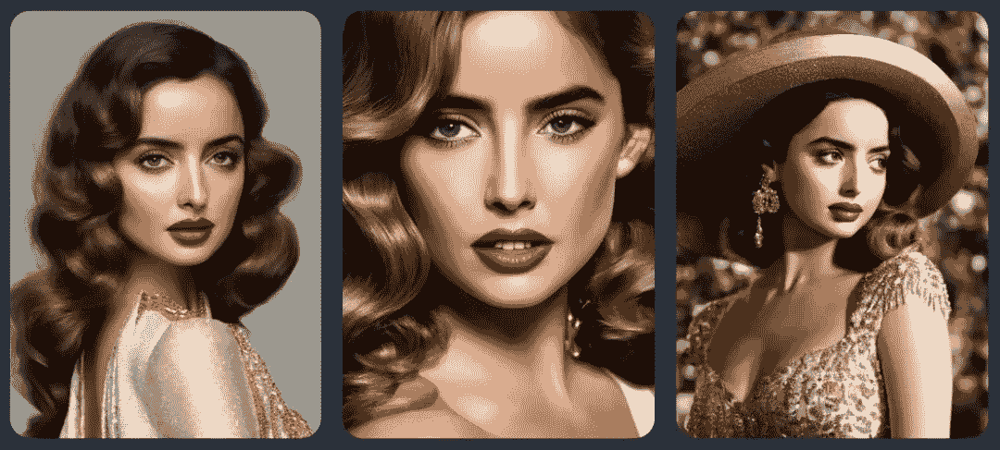

图24 chatGPT提示词1的生成图片

chatGPT 提示词 2：

```
A close-up illustrat**io**n of Ana de Armas in a neo-noir style, reminiscent of the film noir genre, with a focus on shadows, contrasts, and a sense of danger.
```

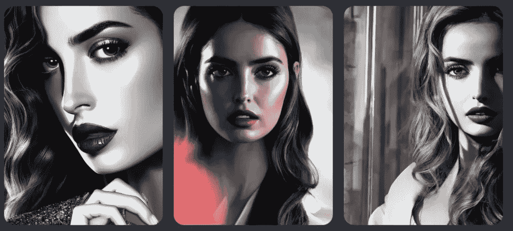

图25 chatGPT提示词2的生成图片

这里只进行了初步尝试，生成效果看起来还不错，可以后续进一步深入挖掘。

此外，还可以使用 magicPrompt 模型。基于 GPT-2 模型，它使用了大约 8 万条 stable diffusion 优质提示词训练而来，旨在为 stable diffusion 生成完善提示词。只要输入图片主体，就能补全各种细节，体验网址如下：

[**M**](https://huggingface.co/spaces/Gustavosta/MagicPrompt-Stable-Diffusion)agicPrompt Stable Diffusion - a Hugging Face Space by Gustavosta

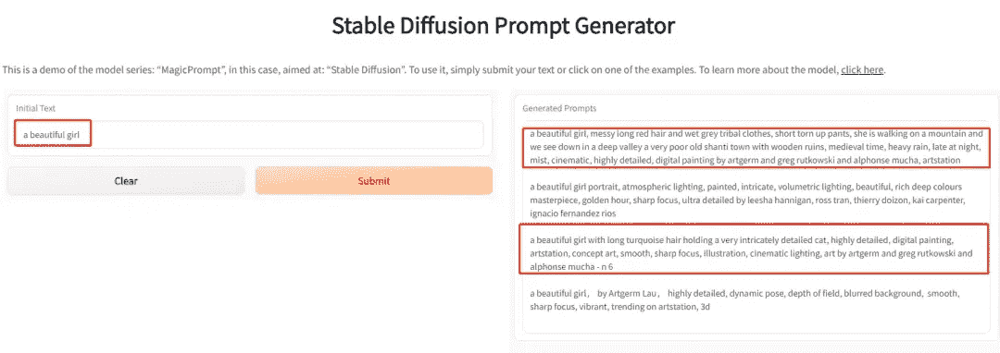

图26 magicPrompt功能示例

### **三 本文小结**

AI 绘画各种技术和应用不断涌现，也很大程度上提高了不少行业产出效率。这篇文章主要介绍 stable diffusion 里的提示词 prompt，从提示词构成、调整规则和 chatGPT 辅助等角度出发，介绍如何更好地输入提示词，才能更好地控制 AI 绘画生成。

#### **参考链接**

1、[**GitHub - CompVis/stable-diffusion**](https://github.com/CompVis/stable-diffusion): A latent text-to-image diffusion model

2、 [**Denoising Diffusion **](https://arxiv.org/abs/2006.11239)Probabilistic Models

3、[**How to come up with good prompts for**](https://stable-diffusion-art.com/how-to-come-up-with-good-prompts-for-ai-image-generation/) Stable Diffusion - Stable Diffusion Art