# Sora 学习手册（行业首发&持续更新 ing...

> 来源：[https://keenchase.feishu.cn/docx/BGszd3afRoidhpxUonVcVBq3nse](https://keenchase.feishu.cn/docx/BGszd3afRoidhpxUonVcVBq3nse)

# 一、基本介绍

在 20**2**4 年 2 月 16 日，Open AI 宣布推出全新的生成式人工智能模型“Sora”。据了解，通过文本指令，Sora 可以直接输出长达 60 秒的视频，并且包含高度细致的背景、复杂的多角度镜头，以及富有情感的多个角色。

这意味着，继文本、图像之后，OpenAI 将其先进的 AI 技术拓展到了视频领域。OpenAI 亦表示，Sora 是能够理解和模拟现实世界的模型的基础，这一能力将是实现 AGI（通用人工智能）的重要里程碑。

对于 OpenAI 视频生成模型的出现，业内其实早有预期，但仍有人评价称“比想象中来得更快”，亦有人振奋地表示“我们真的看到新工业革命来临”。

> Sora 的 60 秒视频基本上展示了它解决了以下 3 个 AI 视频技术难题：​

>

> **（1）真实物理世界的逼真模拟 **

> **（2）角色的一致性 **

> **（3）长镜头的稳定性**

**Sora 官方网址：**

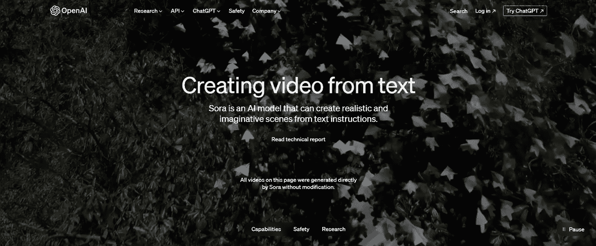

官方 Youtube 介绍视频：

[https://www.youtube.com](https://www.youtube.com/watch?v=HK6y8DAPN_0)/watch?v=HK6y8DAPN_0

**Sora 论文网址：**

[h](https://openai.com/research/video-generation-models-as-world-simulators)ttps://openai.com/research/video-generation-models-as-world-simulators

> **目前 OpenAI 官网上已经更新了 48 个 Sora 生**成的视频 demo，色彩艳丽，效果逼真。

> **官方网站：**[https://openai.com/sora?](https://openai.com/sora?open_in_browser=true)open_in_browser=true

>

> 2024 年的真正红利点：文生视频。

>

> **友情提示：****目前** sora 没有对外开放，也没有内测申请，请不要相信任何账号买卖，课程培训！本文档多转一次，就会少一批人被割韭菜！在此一并鸣谢帮助我们转发的大 V，自媒体人和团队负责人，以及千千万万的读者。

## 正式发布

官方正式网址：[sora.com](http://sora.com/)

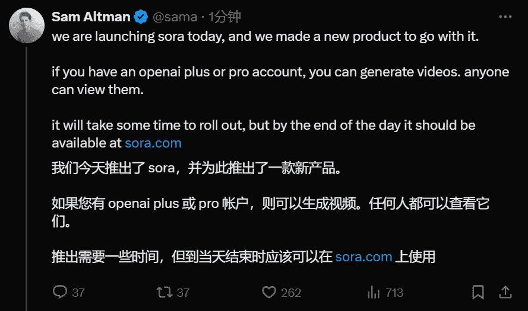

**OpenAI 推出文生**视频模型 Sora 的新版本 Sora Turbo，称其比 2 月预览的 Sora 模型快得多。

Sora 可生成最高** 1080p **分辨率、最长** 20 秒**、16:9 / 1:1 / 9:16 画面比例的视频，支持用户输入文字或上传图像，并上线全新 UI 界面，以便对生成视频进行修改、创建、扩展、循环、混合，或用文本生成全新的内容。

> OpenAI 在 [Sora.com](http://sora.com/) 上发布一个独立产品，免费提供给 ChatGPT Plus 和 Pro 用户。

> Plus 用户每月最多可以生成** 50 个 480p **分辨率视频，或**更少的 720p **分辨率、**5 秒**视频，对应月费 20 美元（折合人民币 145 元）。

> Pro 订阅者则最多可生成** 500 个**视频，并支持** 20 秒**时长、**1080p **分辨率，可下载无水印版视频，对应月费 200 美元（折合人民币 1450 元）。

> 平摊下来生成一个视频花 2.9 元。

> 有网友发现，同为付费用户，**ChatGPT Plus并不能生成带有人物**的视频，只有ChatGPT Pro才可以。

ChatGPT Plus 和 Pro 每月分别为用户提供 1000 和 10000 积分。其中 480p 视频需要 20-150 个积分，720p 视频需要 30-540 个积分，1080p 视频需要 100-2000 个积分。Pro 用户则享受无限量的 relaxed 视频。

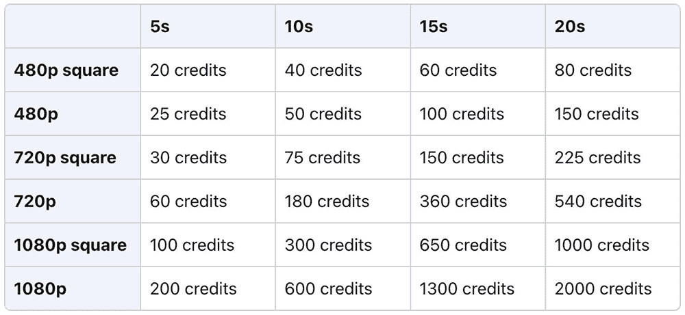

OpenAI 正在为不同类型的用户制定不同定价，计划于明年初推出。

# 正式发布时间12月10日

【Sora 团队负责人：Sora 还不是一个产品 短期不会向公众开放】

3 月 13 日，Sora 核心团队三位负责人露面接受了专访。他们在采访中透露，Sora 目前还处于反馈获取阶段，还不是一个产品，短期内不会向公众开放。

除了这个发布时间之外，Mira 还披露了 Sora 的其他几个关键信息：​

•关于 Sora 生成视频的时间：对于 720P 分辨率或 20 秒长视频，生成时间大概在几分钟，这取决于提示的复杂性。

•目前视频依然没有声音，但未来 Sora 可能会支持视频音效。

•在 Sora 的训练之中，Sora 的数据源是大家颇为关心的问题。当被问及 Sora 训练的素材是否包括 YouTube、Instagram 和 Facebook 上的视频时，Mira Murat 的回答是不确定的。她没有明确确认这些平台的视频是否被用作训练数据，称 Sora 的训练数据来自公开可用和授权的数据，最后结束后确认训练数据包括 Shutterstock 的内容。

•计算资源：Sora 的生成过程相比之前 ChatGPT 需要更多的计算资源，OpenAI9 正在致力于优化技术，相信未来应该也会和此前 Altman 所讲的 GPT 一样，成本得到大幅降低，最终能够极大地便于公众使用。

•安全性和可靠性：Sora 目前正在进行红队测试（测试工具的安全性、可靠性和缺陷），以识别潜在的漏洞、偏见和其他有害问题

•内容限制：与 DALL-E 类似、Sora 在生成内容时也会有一些限制、例如不生成公众人物的图像（但 DALL-E 很神奇的是能够生成公司 logo），以避免误导和滥用。

•裸露内容：关于裸露内容的处理，提到 OpenAI 正在与艺术家和创作者合作，以确定工具应该提供的灵活性水平和合理的限制，但没有具体提到如何区分艺术和色情的内容

•正在研究对视频进行水印标记，但是相对于水印，视频内容的审核限制更为重要、因为随着生成的视频更加真实、用户将无法分辨视频内容的真实性，防止生成误导内容。

# 央视报道

中国首部 AI 动画片《千秋诗颂》

2 月 23 日晚上举行的中国首部 AI 动画片《千秋诗颂》启播暨中央广播电视总台人工智能工作室揭牌仪式上，上海人工智能实验室研发的文生视频大模型“书生·筑梦”亮相。这个 AI 模型已经开源，授权用户单位免费商用。它的参数量超过 30 亿，可根据输入的提示词生成有故事性、含多镜头的分钟级视频，具有转场流畅、故事连贯、画质高清等特点

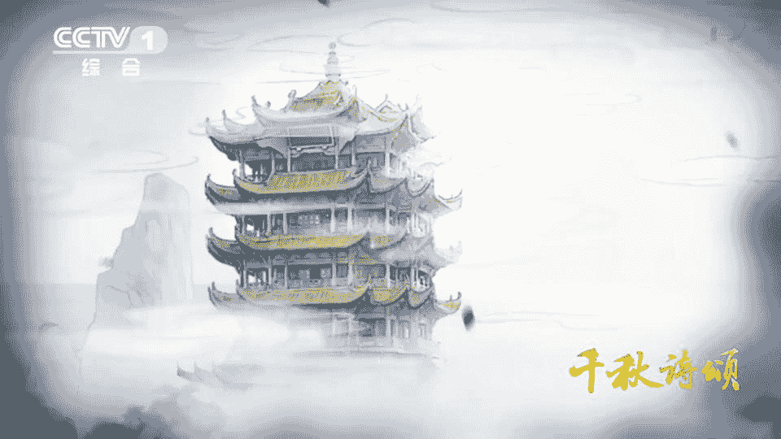

[p.mp4](https://internal-api-drive-stream.feishu.cn/space/api/box/stream/download/all/SwwgbYZSxoTvsgx55Q1cBErcnkf)

由于数据、算力等资源限制，'筑梦’在视频生成能力、时长、质量上与 Sora 还存在差距。”上海人工智能实验室领军科学家林达华博士说，“但另一方面，随着同总台的深度合作，实验室研发的型在对中华文化的理解表现，以及与媒体编创实际生产流程的融合上，逐渐显露出特色优势。这类产研结合的新技术发展模式，将使我国 AI 技术发展走出差异化道路，并形成我们的文化特色。

# 博主解读

全网最详细 Sora 解析，OpenAI 又一王炸！【Git 源宝】

### [关于Sora，我有十个小白问题](https://keenchase.feishu.cn/wiki/LMUGwHaaSi8FyjkyLN0cvWY9nMe)

## ora 怎么申请使用

**渠道一（非官方）：**

需要强调给大家的一点是，截止至 2024 年 2 月 18 日，Sora 目前没有公开测试，也没有内测申请渠道，国内是没有渠道可以去尝试的，下面这个信息源不一定真实，大家仅供参考。

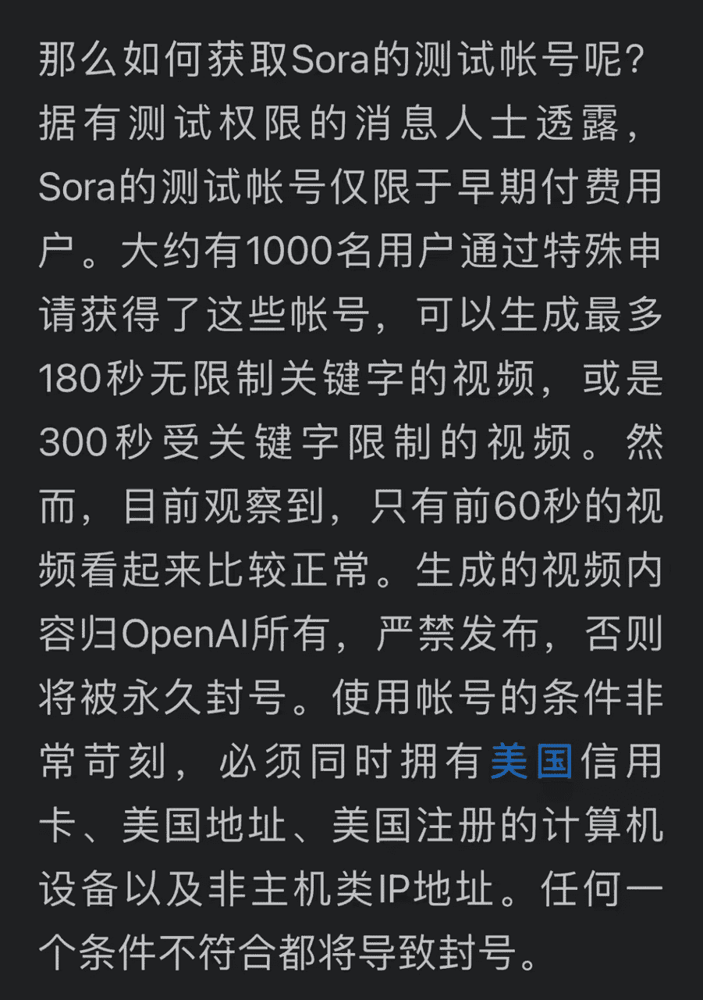

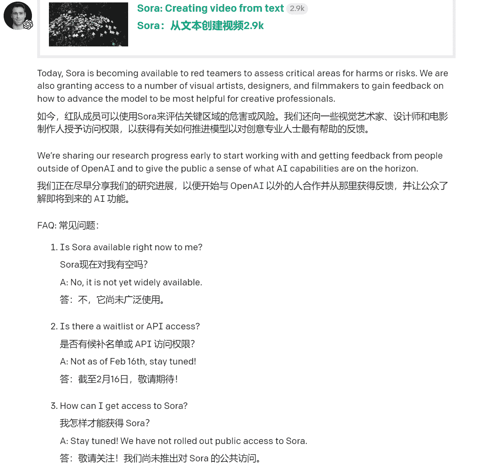

**渠道二（官方）：**

https://forum.openai.com

OpenAl 的官方论坛，据消息透露加入论坛有机会获得内测资格

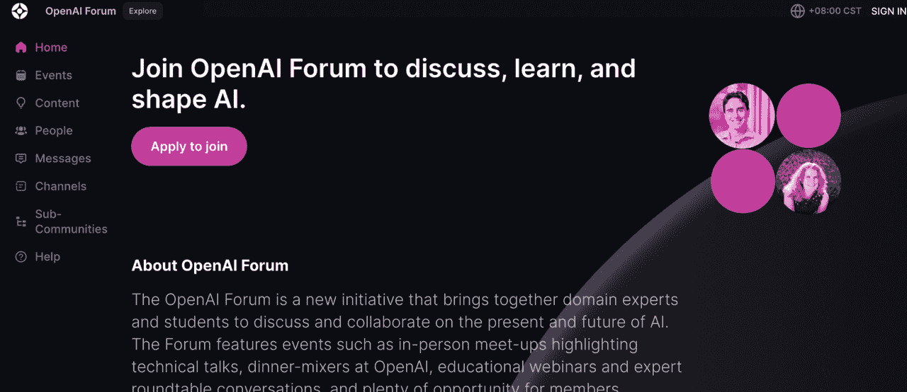

**渠道三（官方）：**

R[ed Team 开始公开招募了，要求比较高。S](https://openai.com/form/red-teaming-network)am 之前说过，如果进入到红队，可以有 Sora 的内测机会 https://openai.com/form/red-teaming-network

# 模型效果对比

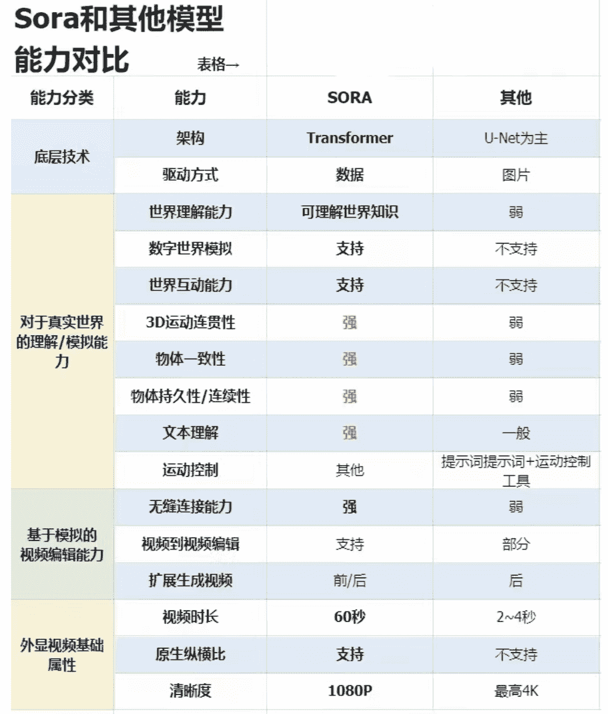

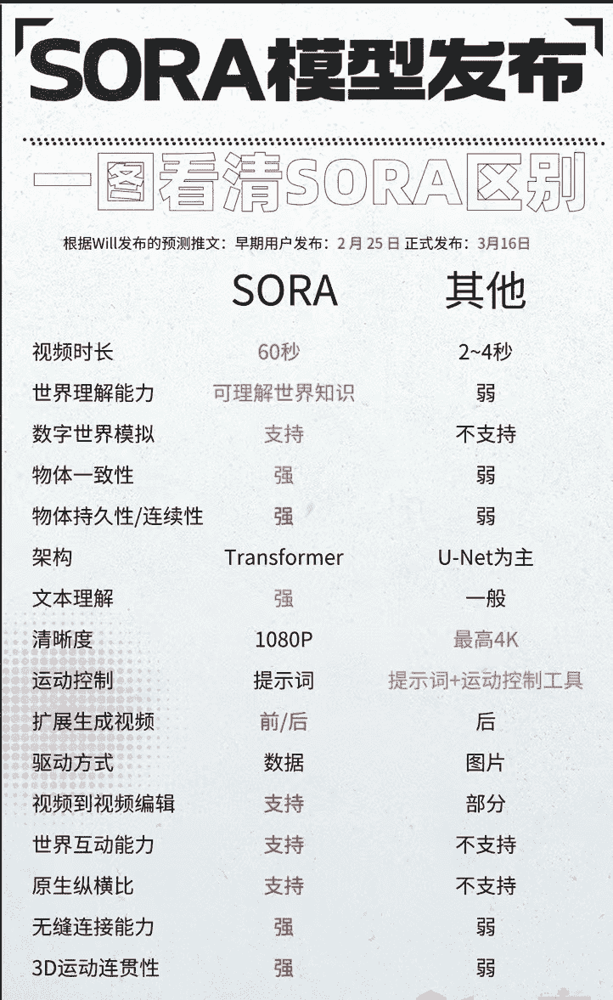

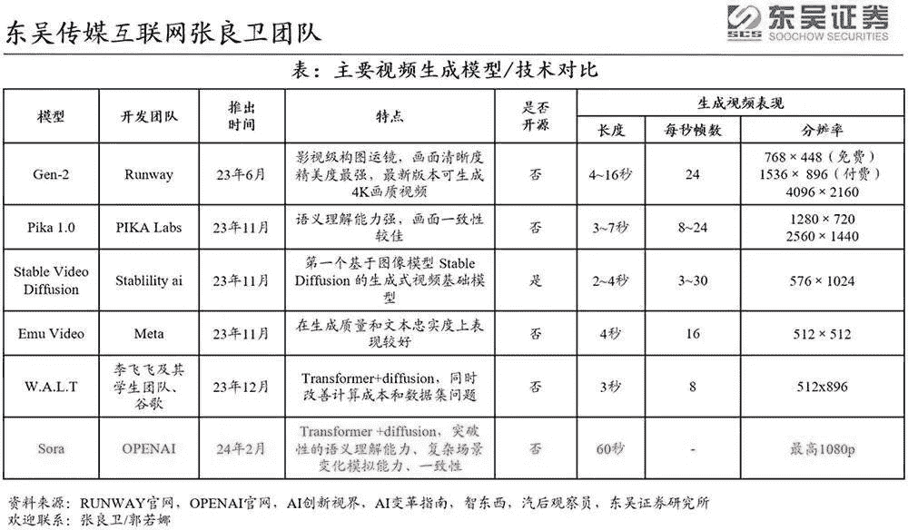

## AI 视频玩家盘点

据不完全统计，过去一年来全球 AI 生成视频类赛道的融资已经超过数 10 亿美元，其中大部分的公司都以种子轮、A 轮为主。就在今年 1 月底，A16Z 还专门针对 AI 视频生成领域做了一个全面的回顾和展望，并盘点了市场上超过 20 个明星产品

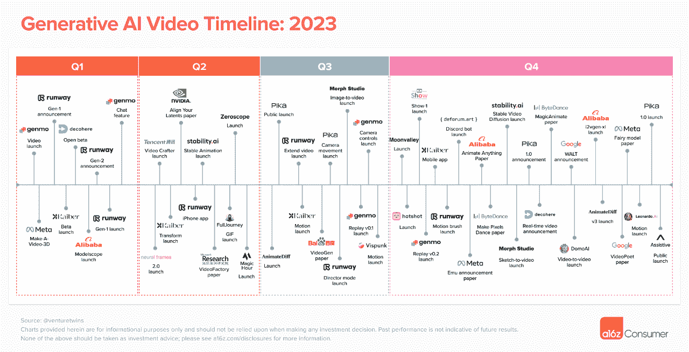

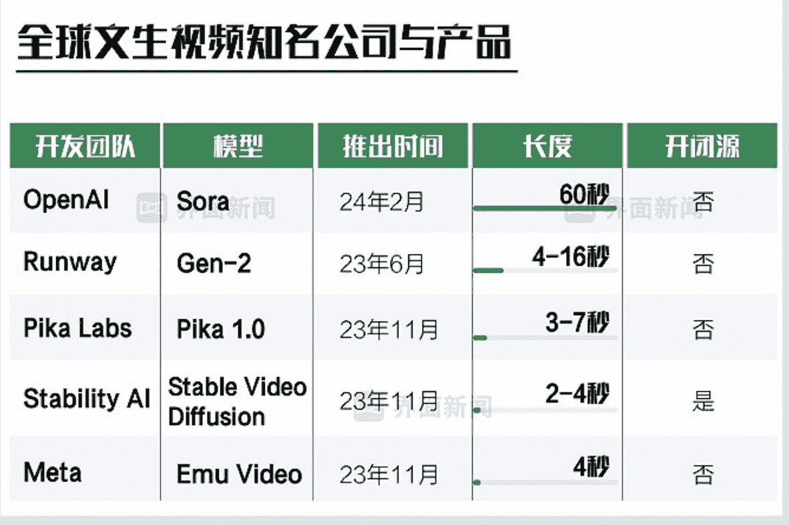

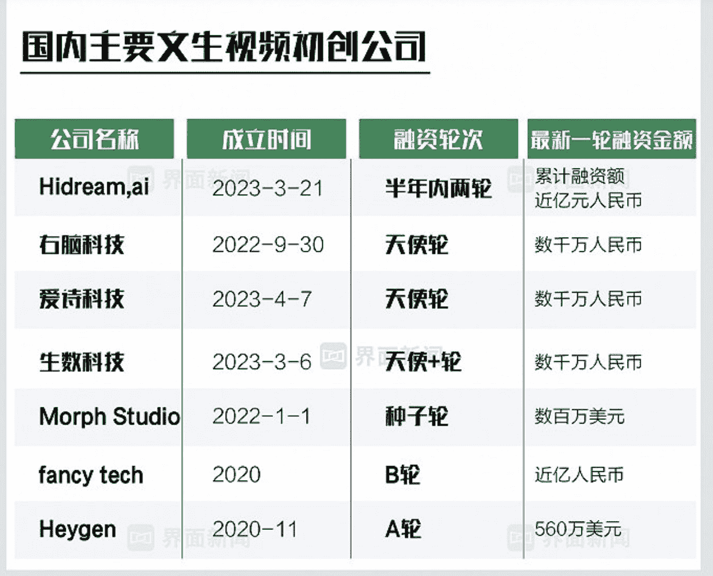

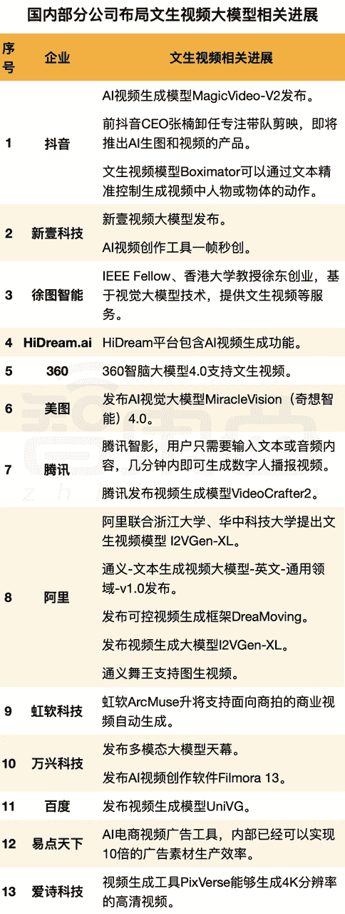

大厂文生视频布局动态

大厂在视频领域的动作不断，基本上在推进语言模型业务的同时也布局了视频业务：​

•字节旗下剪映最近动作频频，目前，剪映已经在邀请一些博主内测旗下 AI 创作平台 Dreamina 的视频生成功能。

•阿里通义实验室目前开发了开源视频生成模型和代码系列 VGen。去年年底，阿里发布了最新 AI 应用：Animate Anyone，可以根据一张人物照片，生成人体动画视频。

•百度在年初推出了一款视频生成模型 UniVG，能够处理各种文本和图像的组合输入。

•腾讯在 2023 年 12 月与北大和香港科技大学联合发布了视频生成模型 AnimateZero，并在今年发布了一个可以提升视频质量的视频处理工具 VideoCrafter2

## 中泰证券：文生 3D——人工智能的下一站

中泰证券表示，以大模型、生成式为代表的新一代人工智能技术与产业变革如火如荼，从 Chat GPT 代表的文生文，到 DALL·E 代表的文生图，再到 Sora 代表的文生视频，“暴力美学”在持续突破技术的天花板，多模态也成为了共识的发展趋势，继文本、代码、图片、视频之后，中泰证券认为下一个有可能实现突破的模态大概率是 3D。目前海外在 AI+3D 技术上主要分为工业场景探索与非工业场景探索。非工业场景应用探索主要以谷歌的 DreamFusion 和英伟达的 Magic3D 为代表，主要面向游戏、元宇宙中的 3D 资产设计；工业场景应用则主要以衍生式设计软件为主，如 PTC 的 Creo 以及 Autodesk 的 Fushion 360 均提供衍生式设计能力。投资建议：产业视角建议持续跟踪关注文生 3D 建模领域的进展。

## Sora 的 6 大优势

《每日经济新闻》记者经过对官方技术报告的梳理，总结出了 Sora 的 6 大优势：​

**（1）准确性和多样性：**Sora 的显著特征之一是能够准确解释长达 135 个单词的长提示。它可以准确地解释用户提供的文本输入，并生成具有各种场景和人物的高质量视频剪辑。这一新工具可将简短的文本描述转化成长达 1 分钟的高清视频。它涵盖了广泛的主题，从人物和动物到郁郁葱葱的风景、城市场景、花园，甚至是水下的纽约市，可根据用户的要求提供多样化的内容。

**（2）强大的语言理解：**OpenAI 利用 Dall-E 模型的 re-captioning（重述要点）技术，生成视觉训练数据的描述性字幕，不仅能提高文本的准确性，还能提升视频的整体质量。此外，与 DALL·E 3 类似，OpenAI 还利用 GPT 技术将简短的用户提示转换为更长的详细转译，并将其发送到视频模型。这使 Sora 能够精确地按照用户提示生成高质量的视频。

**（3）以图/视频生成视频：**Sora 除了可以将文本转化为视频，还能接受其他类型的输入提示，如已经存在的图像或视频。这使 Sora 能够执行广泛的图像和视频编辑任务，如创建完美的循环视频、将静态图像转化为动画、向前或向后扩展视频等。OpenAI 在报告中展示了基于 DALL·E 2 和 DALL·E 3 的图像生成的 demo 视频。这不仅证明了 Sora 的强大功能，还展示了它在图像和视频编辑领域的无限潜力。

**（4）视频扩展功能：**由于可接受多样化的输入提示，用户可以根据图像创建视频或补充现有视频。作为基于 Transformer 的扩散模型，Sora 还能沿时间线向前或向后扩展视频。从 OpenAI 提供的 4 个 demo 视频看，都从同一个视频片段开始，向时间线的过去进行延伸。因此，尽管开头不同，但视频结局都是相同的。

**（5）优异的设备适配性：**Sora 具备出色的采样能力，从宽屏的 1920x1080p 到竖屏的 1080x1920，两者之间的任何视频尺寸都能轻松应对。这意味着 Sora 能够为各种设备生成与其原始纵横比完美匹配的内容。而在生成高分辨率内容之前，Sora 还能以小尺寸迅速创建内容原型。

（6）场景和物体的一致性和连续性：Sora 可以生成带有动态视角变化的视频，人物和场景元素在三维空间中的移动会显得更加自然。Sora 能够很好地处理遮挡问题。现有模型的一个问题是，当物体离开视野时，它们可能无法对其进行追踪。而通过一次性提供多帧预测，Sora 可确保画面主体即使暂时离开视野也能保持不变。

## **Sora 可能带来的影响**

如果 Sora 能够真正意义上实现文生视频，可能会带来哪些影响呢？​

1、没有演员的影视作品出现，对演员来说是个小挑战，将出现真正的“虚拟偶像”，此前的二次元人物并没有真正达到“偶像”的级别。

2、利好编剧行业，剧本、文本创作力成为核心竞争力。

3、Sora 可能才是真正的文生视频，此前的文生视频大多只有 2 秒，仅仅是对象的小幅度移动。

4、OpenAI 继续拉大领先程度，对众多还在进行大模型测试打分 pk 的厂商，构成压力。

5、直接的影响是影视行业，特别是特效行业。使用 AI 来制作一些特效和高风险的镜头，可以大幅降低拍摄成本，也可以避免很多危险。

6、摄影师行业也会受到影响，用文本来生成一些视频，可以省去很多拍摄工作。

7、短视频流行开以后，视频剪辑师也随之成为一个热门职业。如果视频剪辑的工作可以用 AI 来代替，可能会有很多视频剪辑师失业。

8、对于很多短视频创作者来说，用 AI 来替代繁琐的剪辑工作，可以大幅提高工作效率。

9、很多歌手拍摄 MV 都是大成本制作，如果可以用 AI 来生成所需要的 MV 画面，也可以省去很大一部分制作成本。

10、另外，如果真正意义上的文生视频得以实现，可能会有不法份子利用这项技术实施新手段的违法犯罪。

不过，从 Sora 官网目前展示的视频画面效果来看，效果还没那么逼近真实，短期内不会产生让行业失业，但会有辅助作用，做个动画片应该问题不大。

在 Sora 官网，OpenAI 表示，Sora 是能够理解和模拟现实世界的模型的基础，OpenAI 相信这一能力将是实现 AGI 的重要里程碑。

至于 Sora 文生视频到底能带来多大影响，会不会翻车，还需要“让子弹飞一会儿”。

# 关联阅读

[Sora 降世，5 大行业一夜变天！](https://keenchase.feishu.cn/wiki/WFvQwUx8cidh4SkkdcMcx7Ysn2d)

[Sora 来了，哪些行业将受冲击？](https://keenchase.feishu.cn/wiki/RdlKwsZHZitYe6kaI7ZcGMMonSk)

[Sora 横空出世，会颠覆哪些行业？](https://keenchase.feishu.cn/wiki/AoGlwQnhwiRFmzkqLvkcPC1cnqg)

[大模型 Sora 对影视创作的影响](https://keenchase.feishu.cn/wiki/DsK5wls6AiFNv7kkdBVcBXonn2e)

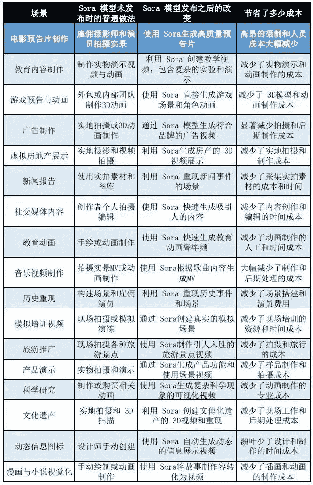

## 对投资市场的机会

### 1.Sora 将为 AI 赛道带来的投资机会

**止于至善投资总经理何理：**Sora 的发布有望再度掀起 AI 上涨热潮。尽管 Sora 的视频时间仅有一分钟，但按照 OpenAI 的迭代速度，生产出几十分钟的 A**I** 视频也不远了。未来数年内，将对整个影视制作和短视频行业带来颠覆性冲击。目前 AI 热潮已进入第二阶段，重点在于产品层面的 AI 创新以及数据层面的业绩检验。未来行情的爆发属于应用端与基建端并举，应用端重点关注与 AI 融合较好的 TOB 端应用，基建端主要关注 GPU、光模块、液冷、数据要素等。

**中信建投证券：**A**I** 仍然是当前科技投资的主线，海外 AI 大模型和应用保持较快迭代速度，随着 Sora、Gemini 1.5 Pro 等大模型的发布，多模态能力显著增强，应用场景进一步拓宽，这将带动算力基础设施的投资，建议关注光模块、ICT 基础设施等板块。

**申万宏源：**对于短视频 UGC 平台，借助 AI 升级剪辑工具拉动创作者经济的进一步发展，但也需关注是否会有竞争的变化。对于深度内容受益，IP 价值**提**升，对浅显低门槛内容竞争加剧。对创意工具，应对竞争的要素是 B 端客户粘性和版权库积累。AI 造假或影响新闻生产和传播，识别 AI 视频将是内容审核关键环节。可关注光通信产业链、算力设备产业链、多模态算法布局、有丰富 IP 储备的深度内容创作、商业化 AI 应用场景的美图等方向。

**招商基金：**AI 赛道大概率仍是未来一段时间的主线之一，后续仍可重点关注 AI 产业链内算力与应用的配置机会。

**博时基金：****受**海外 AI 应用取得突破性进展的催化，AI 板块走势强劲。当前 AI 板块的产业逻辑较为顺畅，后续的增长持续性或有望提升，业绩也有可能超预期，相对看好其未来表现。

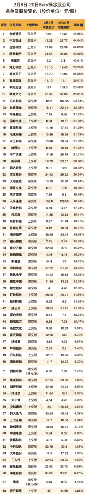

### 2.上市公司反应

**据财**联社不完全统计，截至发稿，包括岭南股份、名臣健康、因赛集团、首都在线、中科信息、萤石网络、凌云光、芒果超媒、华是科技、东港股份、实丰文化、世纪天鸿、天创时尚、创源股份、巨人网络、会畅通讯、千方科技、北信源、智微智能和掌阅科技在内的 20 家上市公司近两日在互动平台回复 Sora 相关情况。其中，北信源表示，公司与 Open AI 已对接完成文生图的技术研究工作，Sora（文生视频）是 Open AI 最新发布的技术，目前公司正在做技术相关方面对接和研究。

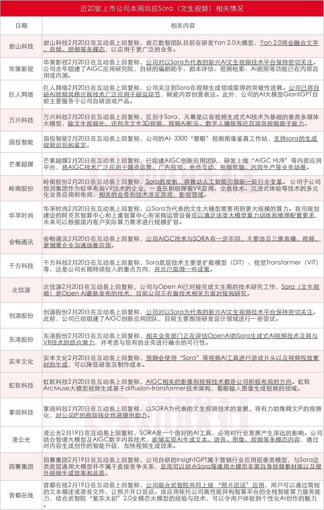

此外，因**赛集团、云从科技、当虹科技**、易点天下、汉王科技、博汇科技、海康威视等上市公司还通过其他方式回复 Sora 相关情况。其中，据媒体报道，因赛集团工作人员表示，按计划，公司 AIGC 项目团队将在三月进行文生视频功能的开发，等待时机成熟后投入公测。另据科创板日报报道，当虹科技相关负责人表示，文生视频技术已取得一定进展，在生成视频时长和效果方面，还在逐渐突破。

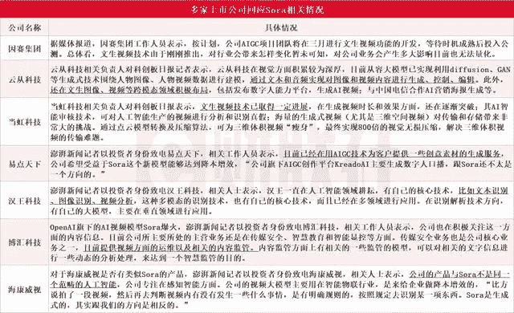

【**蓝色光标：预计 2024 年由 A**I 驱动的收入有望实现 10 倍以上增】

财联社 2 月 22 日，近期，文生视频模型 Sora 引发市场极大关注，蓝色光标 CEO 潘飞在接受财联社记者采访时表示，蓝色光标在去年已经在大量实践用 AI 的方式生成视频，团队已能熟练运用包括 Runway、Pika、Wonder Studio 在内的多种模型，根据内容需要生产 AI 视频。Sora 全面应用后，一定会让视频创作得到新的智能涌现，视频案例也将呈现井喷式发展。公司已有过千个案例（含出海业务）是通过生成式 AI 赋能创造出来的，其中深度驱动并带来规模化收入的案例约在 1/3 以上，AI 驱动的收入在 1 个亿以上。预计 2024 年由 AI 驱动的收入有望实现 10 倍以上的增长。（财联社记者 崔铭）​

【**中文在线：公司海量 IP 未来或可运用** Sora 或类似应用生成短剧/短视频】

财联社 2 月 21 日，中文在线接受调研时表示，Sora 是 OpenAI 发布的人工智能文生视频大模型。公司拥有海量的文字 IP，以及 IP 衍生开发的成熟商业化链条。从目前公开信息来看，Sora 在相当程度上会进一步提高生产效率、降低制作成本，公司拥有海量的 IP 未来或可运用 sora 或类似应用生成短剧/短视频，通过公司现有成熟短剧或短视频营销等商业路径进行规模化、商业化的变现。

【华策影视：目前技术储备已可实现 4 秒时长的文生视频】

财联社 2 月 21 日，华策影视在互动平台表示，公司高度重视各类 AI 技术的研发和应用，对以 Sora 为代表的新兴 AI 文生视频技术平台保持密切关注。公司去年组建了 AIGC 应用研究院，自研的编剧助手、剧本评估、视频检索、AI 剧照等功能已在内部应用或内测。通过对开源技术的学习吸收和消化，目前技术储备已可实现 4 秒时长的文生视频。公司将积极探索文生视频等新兴 AI 技术在传媒领域的落地应用与业态创新。公司在 AI 领域的技术储备短期内不会直接贡献业绩。

【**国投智能：公司 AI-3300“慧眼”视频图**像鉴真工作站可鉴别 Sora 文生视频】

财联社 2 月 20 日，有投资者提问国投智能：“公司的 AI-3300 慧眼视屏鉴真工作站能否鉴别 Sora 文生视频，并出鉴定报告？”对此，国投智能在互动平台表示，公司的 AI-3300“慧眼”视频图像鉴真工作站，可以鉴别该类视频，并支持出具鉴定报告文书。国投智能还表示，该产品已经向客户销售。

**目前 AI** 视频有两个较大的门槛，一是算力的掣肘，视频领域对算力需求更高；另一方面是**竞争环境的激烈，当前头部科技**巨头基本都已入局，只**是产品尚未全面公测。值得注意**的是，从 W.A.L.T 模型的例子来看，不能忽视算法的演进对 AI 视频领域的影响，曹旭特建议重点关注：视觉算法领先的虹软科技、当虹科技、格灵深瞳。同时可关注应用侧的金山办公、万兴科技、福昕软件等。

据不完全统计，涉及 AI 视频视觉算法相关业务的上市公司有当虹科技、虹软科技、深科达、格灵深瞳、天准科技、博杰股份等，具体情况如下：

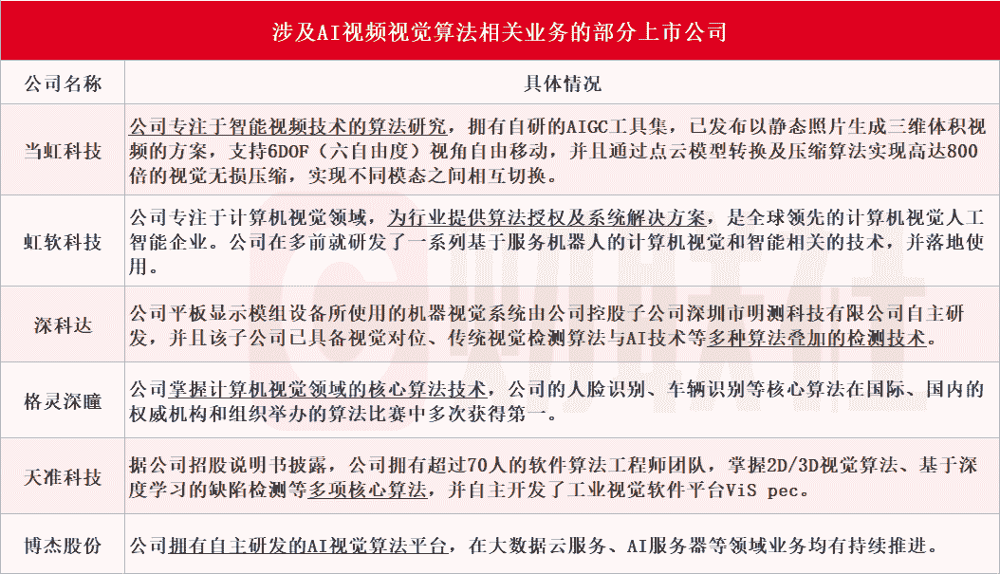

### 3.国内人工智能 AI 大模型发展

2024 年 2 月 19 日，国内 AI 创业公司北京月之暗面完成新一轮超 10 亿美金融资的信息传出，业界震惊。

这是自 ChatGPT 掀起全球浪潮以来，国内 AI 大模型公司迄今获得的单轮最大金额融资。

投资方包括红杉中国、📕、美团、阿里，月之暗面也因此离跻身全球最顶流 AI 公司更进一步。

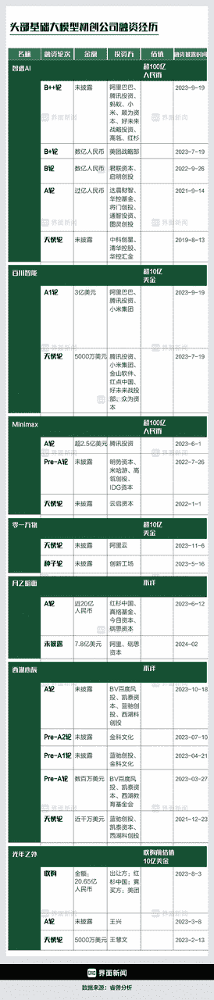

## Sora 团队信息资料

**So**ra 模型背后的开发团队备受瞩目，团队成立不到 1 年，核心团队 15 人，包括来自伯克利的研发负责人 Tim Brooks 和 Bill Peebles，团队亦不乏华人身影。

### **1、团队成员**

公开资料显示，两位研发负责人 Tim Brooks 和 Bill Peebles 均博士毕业于伯克利人工智能研究所，导师同为 Alyosha Efros。

Tim Brooks 在伯克利期间发明了 InstructPix2Pix，曾在谷歌从事为 Pixel 手机摄像头提供支持的人工智能工作，并在英伟达从事视频生成模型的工作。同时，他也是 OpenAI 文生图模型 DALL·E 的主要研究员。

Tim Brooks

除了技术，Tim Brooks 的摄影作品曾获得国家地理、自然的最佳摄影和国家野生动物联合会的奖项。此外还在纽约百老汇的灯塔剧院演出过，还曾获得 Beatbox 的国际奖项。

他表示：“我对人工智能充满热情，幸运的是，它与我对摄影、电影和音乐的热爱融为一体。”​

William （Bill） Peebles（Bill 系 William 昵称）本科毕业于麻省理工学院，师从 Antonio Torralba，曾在 Adobe 和英伟达有过实习经历。

而在开发团队里面，不仅仅是 00 后不少，还有包括北大校友在内的几位华人研究员，以及 20 岁就加入 OpenAI 的天才工程师。

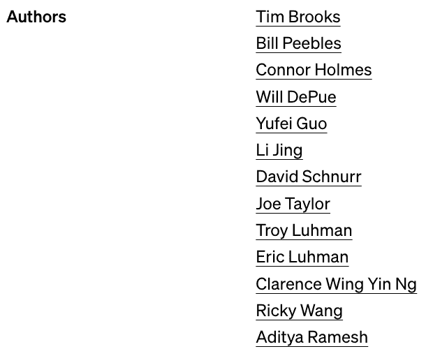

其中 Li Jing 是 DALL-E 3 的共同一作，2014 年本科毕业于北京大学物理系，2019 年获得 MIT 物理学博士学位。在 Meta 做了 2 年多博士后之后，Li Jing 于 2022 年加入 OpenAI。

2010 年，靖礼代表中国队参加第四十一届国际奥林匹克物理竞赛斩获金牌，并与其他三位金牌选手（俞颐超，吴俊东，张涌良）一起保送至北京大学（除吴俊东入读信息学院外，其余均被物理学院录取）。2014 年本科毕业后，赴麻省理工学院攻读物理学博士学位。

据悉，靖礼曾在 Meta 工作两年，并于 2022 年 10 月加入 Open AI 从事研究工作，研究领域包括多模态学习和生成模型，曾参与 DALL·E 3 的开发。2019 年，靖礼以 Lightelligence 联合创始人的身份，入选 2019 福布斯中国 30 位 30 岁以下精英榜。

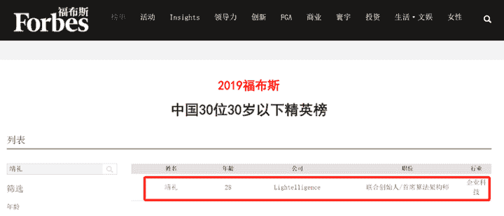

华人作者中还有 Ricky Wang，今年一月刚刚从 Meta/Instagram 跳槽到 OpenAI。

[解密 Sora 13 人团队：北大校友在内 3 名华人，应届博士带着 21 岁天才少年](https://keenchase.feishu.cn/wiki/JwtSwhCzniJfUYk3qlccl4OGnmd)

**

2、谢赛宁辟**谣

而之前有部分自媒体传的“Sora 作者之一”的上交大校友谢赛宁，也发文紧急辟谣。

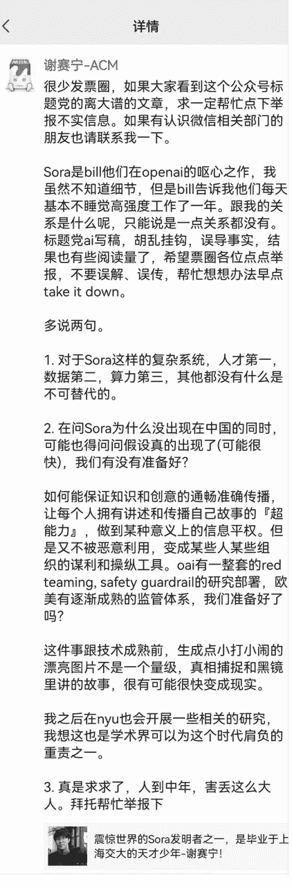

虽然谢赛宁并非 Sora 的研发团队成员，不过 Sora 技术报告中引用的一项研究成果 Dit 模型，正是谢赛宁与 Bill Peebles 合著。

从这个辟谣的细节也可以看出 Sora 开放领队 Bill Peebles 的团队工作状态，基本不睡觉高强度工作了近一年，这也从侧面否定了之前传闻猜测“Sora 早就开发完成”，Sora 是 OpenAI 实打实的最新研究成果。

只不过 Sam Altman 特地挑 Gemini 1.5 Pro 发布后 2 小时，公布 Sora，这绝对是进行策划的。

要知道本次 Gemini 1.5 Pro 的文本长度几乎无限（最多可达 1 千万 tokens，付费用户可以使用 100K 的 Tokens），这绝对是非常强大的功能。

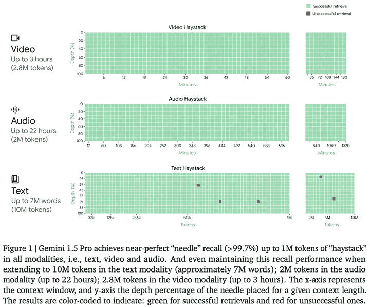

本以为有如此王炸级别的更新，Google 志得意满想要收获热搜，没想到才过几小时，Sora 不可思议的视频进步，占据了整个社交媒体的热搜。

这种情况，很难认为这是碰巧。

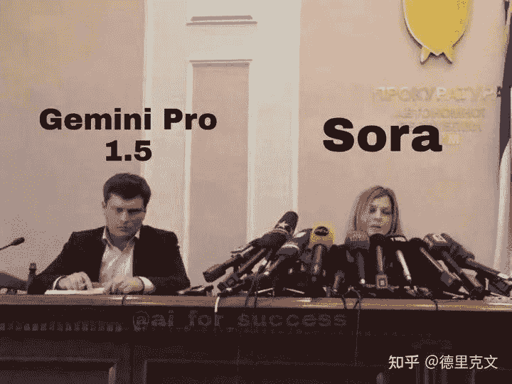

事实上，Sam 精于此道，据说 ChatGpt 的火爆，正是他得知竞争对手 Anthropic 准备推出 Chatbot，他敏锐意识到这一类人工智能聊天工具的趋势，于是让所有的员工都停下手头工作，整合之前的研究成果，在 2 周内迅速调整并赶出了 ChatGPT 3 并进行发布，迅速占领了舆论并促成了 ChatGPT 的火爆。

### **3、Open AI 的工作状态**

而这一群优秀的科学家和工程师，他们的工作状态也是十分拼的，优秀的人会按照自己的意愿行事，下面是推特上一位 OPENAI 技术人员自述一天的状态：

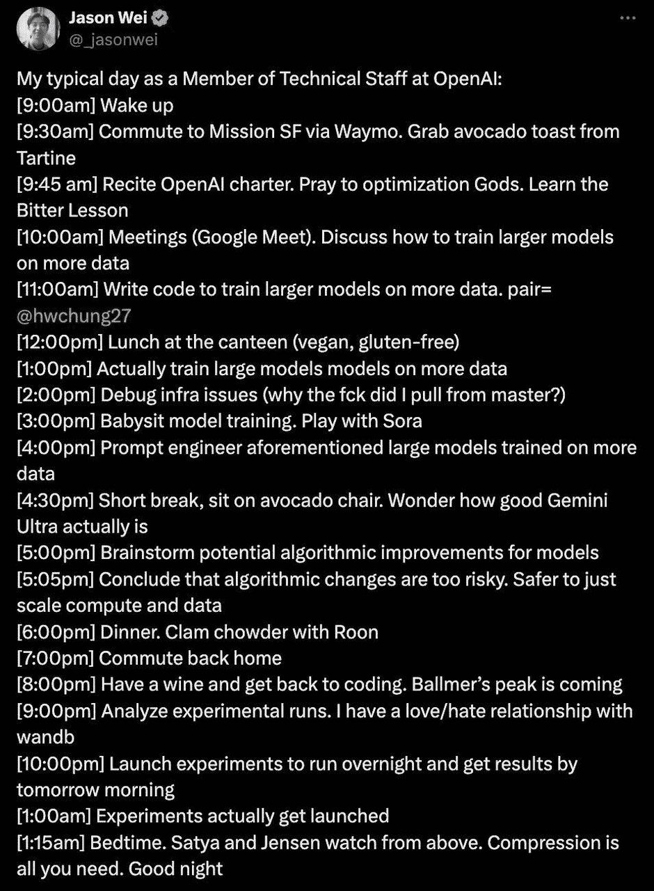

我们先来看下 Jason Wei 的作息时间：​

[9:00am] 起床；​

[9:30am] 搭乘 Waymo 前往 Mission SF，途中在 Tartine 买个牛油果吐司；​

[9:45am] 背诵 OpenAI 章程，向优化之神祈祷，学习《The Bitter Lession》；​

[10:00am] 在 Google Meet 上开会，讨论如何在更多数据上训练更大的模型；​

[11:00am] 敲代码，在更多数据上训练更大的模型；​

[12:00pm] 去食堂吃午饭（素食，无麸质）；​

[1:00pm] 真正开始在大量数据上训练大模型；​

[2:00pm] 调试基础设施问题；​

[3:00pm] 监控模型训练进度，顺便玩一下 Sora；​

[4:00pm] 对前面提到的训练的模型进行提示工程；​

[4:30pm] 短暂休息，坐在牛油果椅子上，思考 Gemini Ultra 的性能到底有多强；​

[5:00pm] 头脑风暴，思考改进模型的潜在算法；​

[5:05pm] 得出结论：修改算法风险太高，只扩展计算和数据更安全；​

[6:00pm] 吃完饭；​

[7:00pm] 通勤回家；​

[8:00pm] 喝一杯酒，继续写代码，鲍尔默峰即将到来；​

[9:00pm] 分析实验结果；​

[10:00pm] 启动实验，让其运行一晚上，第二天查看结果；​

[1:00am] 实验真正开始运行；​

[1:15am] 上床睡觉；在纳德拉和黄仁勋的守护下入梦。压缩才是关键。晚安

单从时间来看，Jason Wei 从起床到睡觉，横跨了 16 个小时多，除了吃饭、通勤、睡觉，都在说工作，称其“卷”并不过分。

# 二、技术拆解

Sora 模型基于 Transformer 架构，建立在 DALL·E 3 和 GPT 模型之上，使用文本到视频的合成技术，按文本提示生成视频。这种技术将自然语言转换为视觉表示形式——图像或视频。

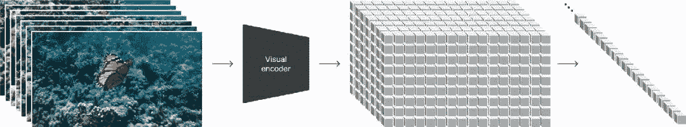

OpenAI 在官网展示 Sora 的生成逻辑

深度神经网络依然是 Sora 的基础，它是一个带有 Transformer 骨架的扩散（Diffusion）模型，AI 从数据中学习并执行复杂的任务。Sora 就是从“学习”的大型视频数据集里学会了各种风格、主题和流派。

Transformer 模型本质是一个编码器-解码器，输入原始语言，生成目标语言。扩散模型的原理是先给数据添加高斯噪声，再反向去除，从中恢复数据本貌。

简单粗暴地理解 Sora 的原理，就是翻译器+搜索引擎+概率制作（内容）。

首先，拿到提示词后，Sora 先分析文本，提取关键字，比如主题、动作、地点、时间和情绪，再从它的数据集里搜索与关键字匹配的、最合适的视频。

其次，Sora 将数据集里合适的视频混合在一起，重新创建一个符合要求的视频。在“创造”的过程中，它要“知道”场景中有哪些对象和角色，它们的外形，它们如何运动，对象如何交互，以及受到环境影响后如何表现。

根据用户的喜好，Sora 会修改视频的风格。假如用户想要一个 35 毫米胶片样式的视频，Sora 会调整效果，更改图像的亮度、色彩和摄像机角度。这一点和 Midjourney 等“文生图”应用类似。

Sora 可以生成分辨率 1920x1080 的视频，也可以基于静止图片创建视频，使用新素材扩展现有素材。比如用户给它一张森林图片，它可以帮你加上鸟、兽、人。给它一张汽车行驶图，它能加上道路、交通灯、沿途建筑物和风景。

Sora 将两段视频结合后产生的奇幻景象/OpenAI

# 技术解读（思维导图版）

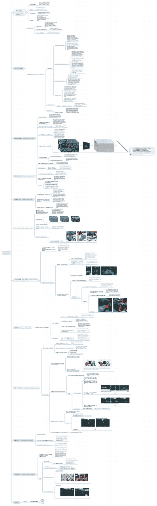

# 三、研究报告

# 券商报告

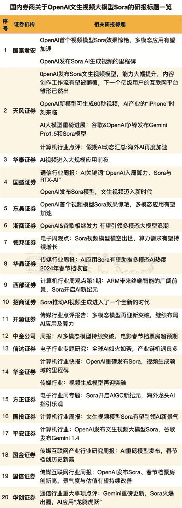

# 四、演示案例

## **视频案例合集**

**传送门：**http://mianfei.chat/sora

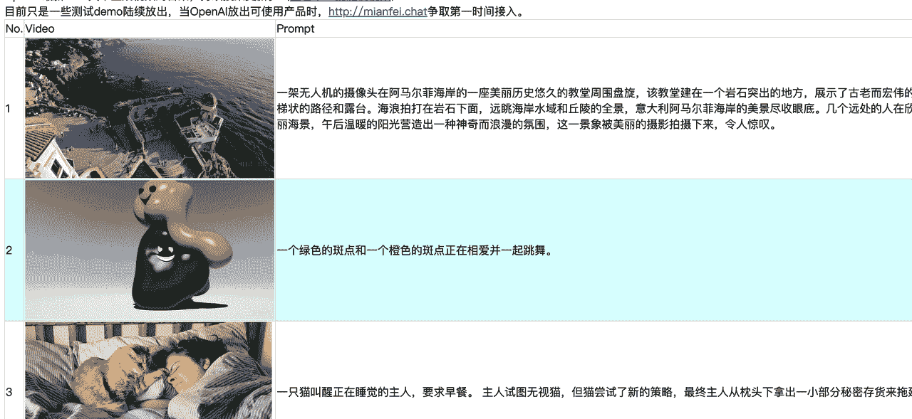

**传送门：**https://www.aisora.org/

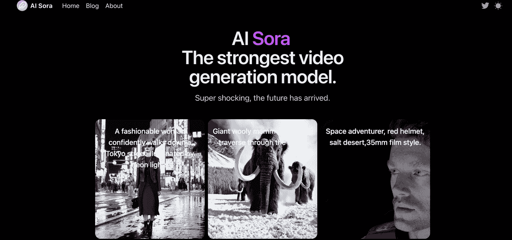

**传送门：**https://sorahub.video/

每天自动抓取网络上的 Sora 视频，支持下载视频，涵盖视频提示词！​

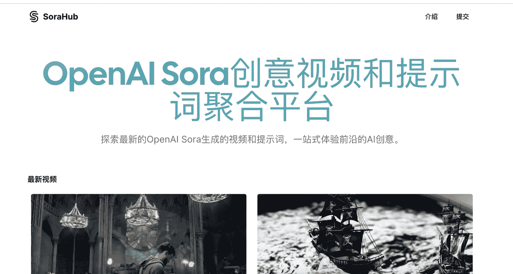

# 五、赚钱方法

## 1、搞流量

流量=钱，AI 领域新产品的出现总会伴随着所有人的关注，Sora 在视频生成领域的出现不亚于大语言模型的 GPT-4.0，此时的流量生意总是能最先拿到结果的生意，现在大把的 Sora 👸号爆文，爆款短视频，用来获取流量非常可观，咱们先不管是捧还是骂，话题度在。

## 2、卖**账号**

目前的 Sora 模型还没有对普通用户开放，不过大家都已经迫不及待了。就像当年的 ChatGPT 一样，OpenAI 的账号销售一定能继续大卖。只是国内的大语言模型和国外的相比，许多普通人并不能进行完整地分辨，等到文生图的时候，差距逐渐显现，等到真正 Sora 对普通用户开放的时候，国内外的差距就比较明显了。这个时候，会有更多的人想用上 Sora。

## 3、卖**课程**

课程永远是 AI 行业不缺的赚钱渠道，目前 AI 行业做课程赚的最多的当属李一舟，据说年入 5000 多万，而 Sora 还没开放账号，已经有课程上线了，这就是“搞钱”的原动力！AI 工具使用的课程会长期成为 AI 行业的赚钱赛道，也算是先行者的付费布道，课程要在有产品以后发布。

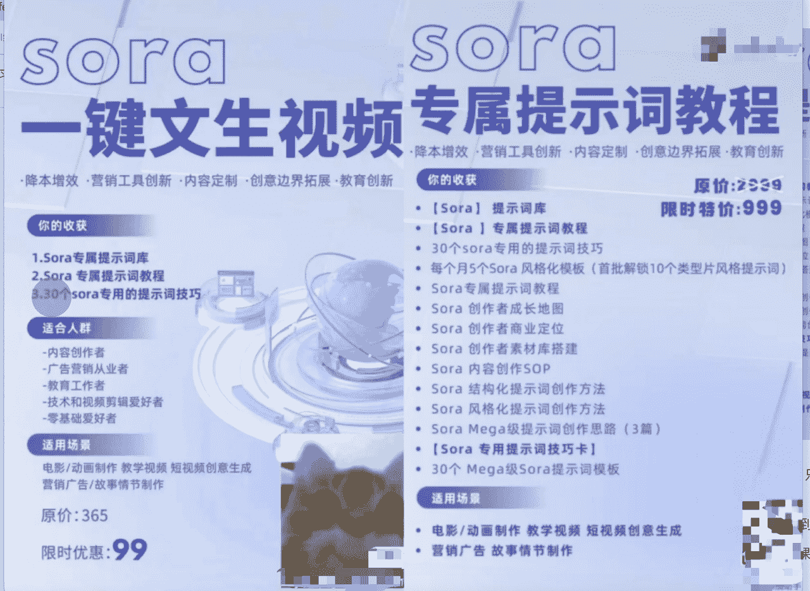

**友情提示：仅示例，请勿购买**

## 4、**套壳**

众所周知的原因，国内乃至全国的套壳网站和应用众多，只要你有一定的流量或者推广渠道，套壳网站会为你持续带来收益。目前 Sora 的推出，已经有人开始通过套壳网站赚到第一笔年费了。

目前的套路是注册含有关键词 sora 的域名，同时应用商店提交 Sora 相关的 app，同时接入 Runway 等产品的 API，先把流量跑出来，等到 Openai 发布 Sora API 的时候，再进行切换，从而丝滑过渡。

## 5、**投资**

如果你是二级市场投资客，那么关注 AI 行业一定能让你赚到（中国股市可能除外），Sora 的推出，利空哪家公司呢？​

Adobe!

受 Sora 发布的影响，Adobe2 月 16 日当日跌幅达到 7.41%。如果此前做空 Adobe，那是要赚上一笔了

## 6、**提示词交易**

去年的 AI 绘画提示词交易很火，今年 AI 文生视频的提示词一定也会有市场，从提示词打包交易到提示词交易平台。

日光之下并不新事。

## **7 、剧本创作**

文生视频提示词的升级是视频的剧本创作，无论是长视频还是短视频，更依赖剧本的创作，这更依赖于创作者。

从这个角度来看，Sora 的发布是非常利好内容创作者。如果把未来的视频创作比如电影创作的话，那么编剧的权重在进一步强化，或者是编剧、导演和制片在进一步融合。大团队面临挑战，而小团队的机会在进一步上升。

## **8、视频制作**

视频生成这个业务勿庸多言，Sora 就是干这个的，大家只要充分地学习和试错，做出更好的视频（质量和数量），赚钱的机会一定有。在 AI 绘画时代已经切入的团队和个体会更有机会，毕竟前期的铺垫已经足够了，学习成本很低。

## 9、** 原业务优化**

AI 工具对生产力的提升是毋庸置疑的，如何直接用 AI 工具进行商业变现，不如考虑在原有的业务上进行 AI 化。

商业的竞争说到底还是生产率的竞争，成本打下来了，自然就有价格调整的空间了，也就有更大的获客和竞争优势了。只要是涉及视频类的公司（我说的是“涉及”，这与 08 部分并不一致），都应该重视 Sora 的使用，考虑如何将其融入进原业务。

## **10、 企业服务**

部分做传统行业的公司并没有自我 AI 化的能力，那么就可以有相关的 AI 团队来进行咨询服务，从做事的本质上来讲有点像以前的咨询公司，只是这样的咨询公司对 AI 理解和使用更深入，同时这样的咨询公司一定是高度关注和践行 RPA（机器人流程自动化）。

除此以外，企业服务的另一种商业化形式就是商业化的软件工具，在行业领域内融合专业知识和生产流程，再利用像 Sora 这样的 API 实现相应的生产功能，最终商业变现。

## 11.Sora+电商

用 Sora 生成各类电商产品宣传视频投流，或者制作各类短视频，嵌入产品进行推广，参考 AI 模特变装、虚拟试衣等。

## 12.开发与 Sora 相关的网站或工具

针对具备技术背景的人士，开发与 Sora 相关的网站或工具，如导航网站或 AI 写真工具，以此获取收益，当然也可以储备 Sora 相关的域名。