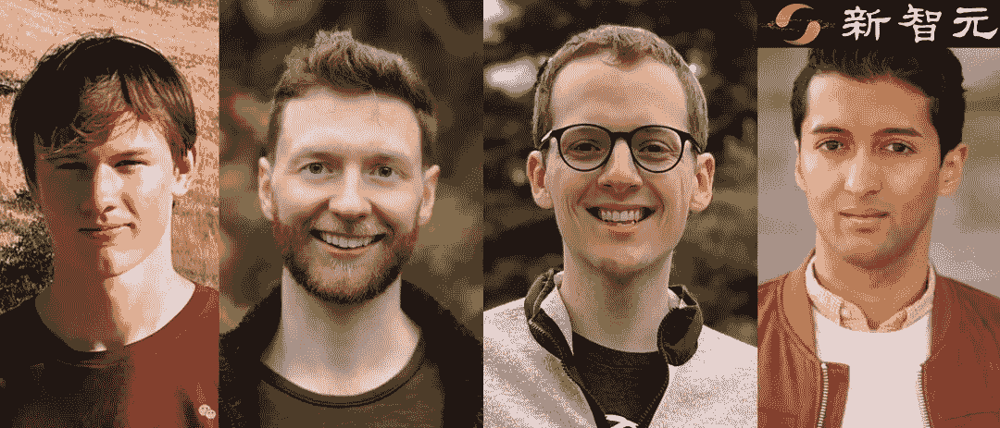
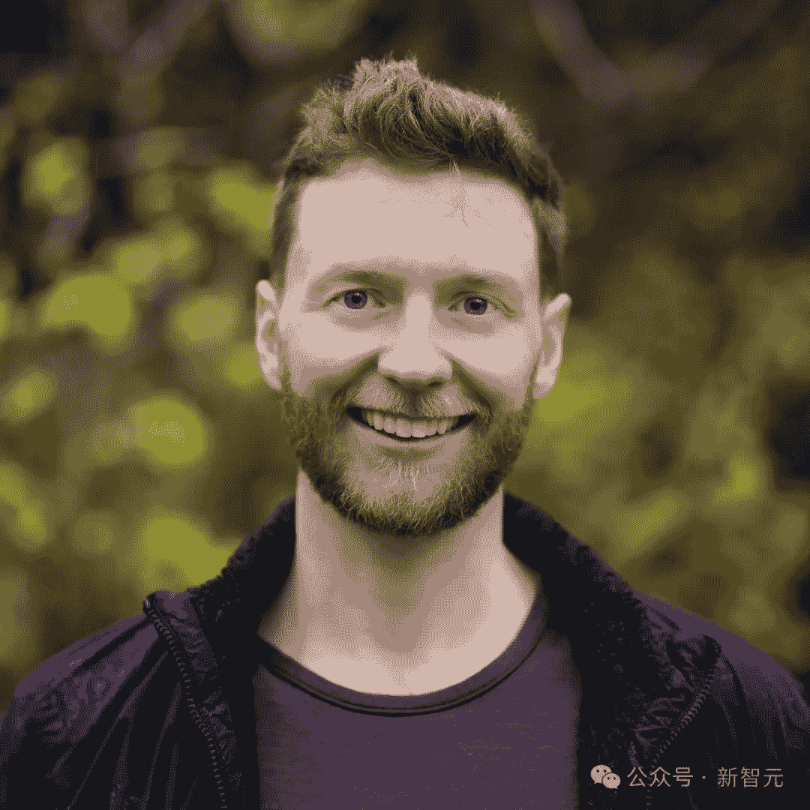

# 解密 Sora 13 人团队：北大校友在内 3 名华人，应届博士带着 21 岁天才少年

> 来源：[https://keenchase.feishu.cn/docx/AYYvdTqw9oC5pLxjY5WcLzSKn3e](https://keenchase.feishu.cn/docx/AYYvdTqw9oC5pLxjY5WcLzSKn3e)

**延展阅读：**

---

###   新智元报道

编辑：编辑部

##### **【新智元导读】**Sora团队，除了由伯克利应届生带队，有多名LeCun学生参与。其中还有包括北大校友在内的3位华人研究员，以及20岁就加入OpenAI的天才工程师。

OpenAI用Sora震惊了世界。到底是什么样的天才团队，能开发出这样的旷世大作？结果一看OpenAI的作者团队只有13个人，应届博士带队，00后参与，团队包括3名华人，有一名北大校友。

**Tim Brooks**

Tim Brooks在OpenAI共同领导了Sora项目，他的研究重点是开发能模拟现实世界的大型生成模型。

这位小哥在伯克利AI研究中心获得博士学位，博士导师是Alyosha Efros。读博期间，他提出了名为InstructPix2Pix的技术。

在加入OpenAI之前，他曾在谷歌参与开发Pixel手机相机的AI技术，还在英伟达研究过视频生成模型。

同时，他还是DALL·E 3的主要研究员。

而他的另一部分履历，就实在令人大呼精彩了——摄影作品获得了「国家地理」、「Nature's Best Photography」和「National Wildlife Federation」的大奖。

他拍摄的动物照片：

他还曾经在纽约市百老汇的Beacon Theatre表演，还在国际无伴奏口技比赛中获奖。

网友们纷纷表示，羡慕他拥有这种自由。

最后，Tim Brooks在简历中颇为「凡尔赛」地表示：「我对AI充满热情，幸运的是，这种热情与我对摄影、电影和音乐的爱好完美融合。」看来，不喜欢摄影的演员是做不了OpenAI的科学家的🐶

**Bill Peebles**

共同领导Sora项目的另一位科学家Bill Peebles，专注于视频生成和世界模拟技术的开发。

这位小哥和Tim Brooks的履历类似，也同样在伯克利AI研究中心完成博士学位，师从Alyosha Efros。而他的本科是在MIT读的，指导教师是Antonio Torralba。他在FAIR、Adobe Research和英伟达也都有过实习经历。他在FAIR实习期间，曾经和现NYU华人教授谢赛宁一起发表了论文Scalable Diffusion Models with Transformers，论文中提出了Sora的基础架构。

他从伯克利毕业之后，加入了OpenAI，带领OpenAI的团队几乎不睡觉地工作了一年多之后，Sora面世了。

**Connor Holmes**

Connor Holmes在微软实习了几年后，成为微软的正式员工，随后在去年年底跳槽到了OpenAI，之后就遇到了Sora这样的大事。

他一直致力于解决在推理和训练深度学习任务时遇到的系统效率问题。在LLM、BERT风格编码器、循环神经网络（RNNs）和UNets等领域，他都拥有丰富的经验。

同样，他也在自己的Linkedin上标注了自己的业余爱好——游泳，还曾经兼职干过游泳救援队的活。

而他从本科到研究生一直都就读于科罗拉多矿业大学。

虽然学校排名不高，但是他依然凭借自己出色的能力成为了OpenAI的研究员，参与了Sora，DALL·E 3等项目。

**Will DePue**

不得不感叹，也许只有在OpenAI这样的地方，00后研究员才能挑起大梁，在如此重要的项目中发挥关键作用。

看了他的简历，他本科毕业就能加入OpenAI成为研究员，这一成就似乎已经很令人咋舌了。

但是看到他在高中时候就已经自己成立了一个公司，只能感叹牛人确实不分年龄。

差不多在半年前，他在Youtube上的一个节目中分享了自己如何在如此年轻的年纪就能取得这么多令人瞩目的成就。

访谈链接：https://www.youtube.com/watch?v=q0cjcw3af_k大家感兴趣的话可以戳上边的链接看看他是怎么描述自己人生的前20年的。

**Yufei Guo**

这位华人研究者非常神秘，虽然没有留下履历，但在OpenAI最近的两个大项目里，他都有留名。

GPT-4技术报告：

DALL·E 3技术报告：

**Li Jing**

Li Jing本科毕业于北京大学，然后在MIT取得了物理学的博士学位。

现在他在OpenAI从事研究工作，研究领域包括多模态学习和生成模型，曾经参与了DALL·E 3的开发。

DALL·E 3技术报告在此之前，他在FAIR与Yann LeCun合作进行了博士后研究。

**David Schnurr**

这位是AI赛道的老兵了，他2012年加入了后来被Amazon收购的Graphiq，带领团队做出了现在Alexa的原型。

2016年跳槽到了Uber，3年之后加入了OpenAI，工作至今。

他也是团队中不多的本科学历就能加入OpenAI的大牛。

**Joe Taylor**

Joe Taylor之前的工作经历涵盖了 Stripe、Periscope.tv/Twitter、Square以及自己的设计工作室 Joe Taylor Designer。

他在 2004 至 2010 年期间，于旧金山艺术大学（Academy of Art University）完成了新媒体/计算机艺术专业的美术学士（BFA）学位。

从他的学历和工作背景来看，与其说他是工程师，他似乎更像一名艺术家。他在包括用户界面设计、网页设计、艺术指导等多方面拥有很强的专业技能。

在加入Sora团队之前，他曾经在ChatGPT团队工作过。

**Eric Luhman**

Eric Luhman是一位对人工智能充满热情的研究爱好者，专注于开发高效和领先的人工智能算法。

他的研究兴趣主要在生成式建模和计算机视觉领域，尤其是在扩散模型方面。他的多篇论文都是和扩散模型等视觉模型有关的。

**Troy Luhman**

而这位和Eric Luhman名字很像的研究人员，全网都几乎没有他的信息。只有在他自己真名的X账户之下，有一条关于和Sam Altman当时离职风波相关的转发。

Clarence Wing Yin NG

这位作者更加神秘，网上几乎完全找不到任何相关的信息。

只有在美国专利信息中有一条疑似他之前在Amazon工作时相关的专利记录。

**Ricky Wang**

这位华裔工程师，曾经在Meta工作多年。

今年1月加入了OpenAI。

本科毕业于UC伯克利：

**Aditya Ramesht**

他是OpenAI的一名元老了，曾经领导过DALL·E 2和DALL·E 3。

而这样一位主导DALL·E 3，如今又领导Sora团队的大牛，却也只有本科学历。Aditya本科就读于纽约大学，并在LeCun实验室参与过一些项目。毕业后直接被OpenAI留下。

就是这样一个由年轻人主导，不问出处只看产出的团队，让OpenAI在2024年开年再次震惊了世界！参考资料：https://www.wpeebles.com/https://www.timothybrooks.com/about/

修改于2024年02月19日

#

微信扫一扫

关注该公众号