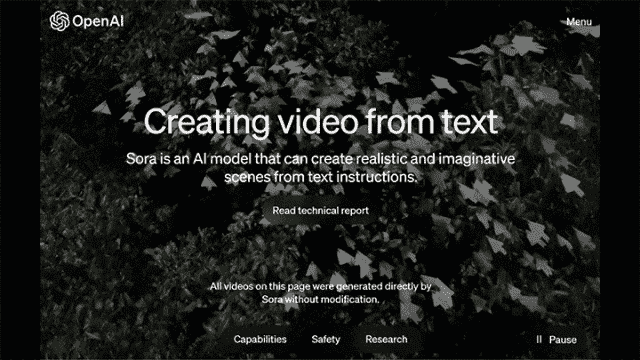
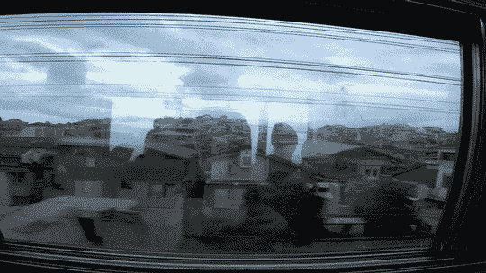
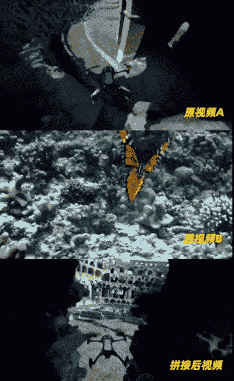
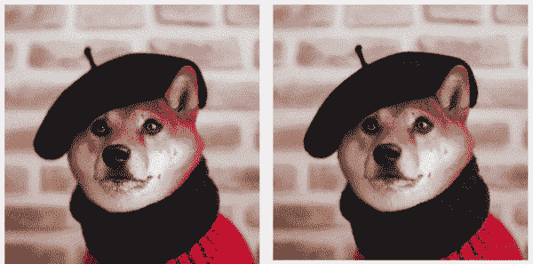
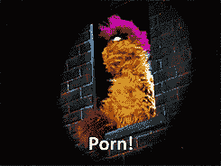
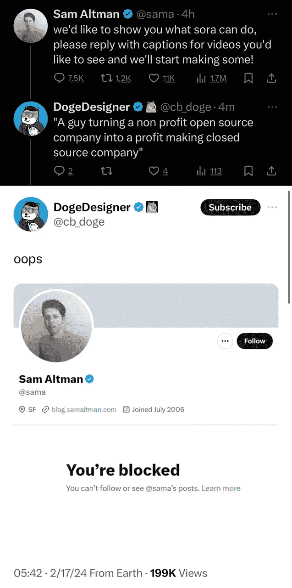

# 关于Sora，我有十个小白问题

> 来源：[https://keenchase.feishu.cn/docx/VcHTdlGecoOFtTxBwJFcpdzpnkf](https://keenchase.feishu.cn/docx/VcHTdlGecoOFtTxBwJFcpdzpnkf)

# 关于 Sora，我有十个小白问题

原创 malt 果壳 2024年02月18日 20:18 四川

1.  Sora？是啥意思？有啥含义没？

Sora 在日语中是**“天空”**的意思，引申含义还有**“自由”**。

Sora 介绍页丨OpenAI

在 Sora 官方介绍页里，你能看到在无数空中自由飞翔的纸飞机。它们看起来行动自主、探索自由，如果 OpenAI 最终造成 AGI（通用人工智能），应该就是如此希冀的吧。

**Sora 是一个 AI 视频模型，你光打一串文字，就能生成一个以假乱真的**纯 AI 原创视频。除此之外，你还可以输入图片转成视频，用视频再转成新的视频……

仅仅只有 AI 生成视频样片以及技术论文的释出，Sora 已经在传播层面引发“地震”，不少人高呼影视行业变天了，有人甚至把美国电影工业的象征好莱坞改成了这样：

1.  人们吹爆它“炸裂”、“史诗级”、“现实不存在了”，根据是啥？

最直观的，有些样片太真实了——**人物的脸没那么“恐怖谷”，物体运动轨迹也很自然，画面的清晰度**和顺畅程度，都像我们用手里的设备拍出来：

这太像我们用 GoPro 手持拍摄的画面了丨Sora

相比竞品，Sora 是“灭**霸”级别。之前主流的 AI** 生成视频都在 4 到 16 秒，还“卡成 PPT”，而 Sora 弯道超车，直接将时长拉到 60 秒。后者的画面表现，已经媲美视频素材库，放进视频当空镜完全可行。

这让人们懵圈，只能感慨技术的发展有迹可循，技术的突破节点却较难预测。

1.  都嚷嚷着行业变天，人类下岗，Sora 除了第一眼好，还有啥惊人玩法？

**多机位：**

Sora 生成

**自然融合两种完全不相干的场景：**

Sora 生成

视频还可以**往前扩展，向后扩展**；如果你对视频的**局部（比如背景）**不满意，**直接更换**就可以了。

**Sora 还能直接**以文生图，甚至还可以将图片转成动态视频，而且还不是目前流行的“小动物跳舞”呈现的粗糙效果：

Sora 生成

1.  把《三体》输进去，能直接出片吗？

我知道你很急，但你先别急。

首先，目前就 Sora 所呈现的，虽然有多机位效果，但都是单一情节单一镜头。

而《三体》有多人视角，叙事复杂，靠 AI 生成一条龙搞定并不现实。据一些影视行业从业者所说，目前 AI 生成虽然高效，但可控性不够，目前主要用在 demo 制作、概念设计、分镜编排等环节。

1.  看到这里，你有一个大胆的想法？

打住！

OpenAI 正在评估 Sora 被滥用的风险，所以目前还没开放给公众，只给一批在误导信息、仇恨内容和偏见等领域的专家，以及创意人士使用。

1.  每次技术狂潮，打工人都最先焦虑，这次咋整？

记住一点，贩卖焦虑的，都是为了赚你的钱。虽然 Sora 都还没公测呢，但已经有人开始卖付费教程了。

目前的 Sora 也有“翻车”生成，如果这个能安慰到你的话丨Sora

A**I 技术推陈出新太快**了，你刚在 Pika 上学了几个月怎么写提示词，结果“灭霸”Sora 出现，此前积累的工具经验可能瞬间失效……既然如此，不如先别沉迷研究工具，而是在底层创作上多加操练？

1.  我对被取代恐惧，对 AI 变得更黑箱也害怕

继文字（GPT 系列）以及画像（DALL·E）后，OpenAI 这次又在视频赛道“遥遥领先”……但这家将 AI 安全奉为初心的公司，在技术公开上却越来越不 open 了，有人戏称其为“ClosedAI”。

这次 Sora 发布，OpenAI 现任 CEO Sam Altman 在 X 上“在线接单”，帮网友生成视频，结果有人给了这样的提示词，guess what，Sam 拉黑了他。

1.  以后真分不清现实和 AI 生成了吗？

眼下有人让 Gemini 1.5 观看并分析以下这个 Sora 生成视频，Gemini 指出：

Sora 生成

+   樱花一般在春天开放，那时不下雪；

+   雪下得太均匀了；

+   虽然是下雪天，但人穿得很单薄。

**于是，AI 判定这**个不是真实影像。还得用魔法打败魔法啊！

1.  为什么就 OpenAI 做出来了？

因为 OpenAI 有 GPT 和 DALL·E 的成功经验，在以往的技术范式之上，他们做出了新东西：不仅可以理解用户在提示中提出的要求，还能理解它们在物理世界中的存在方式。

生成视频效果如此好，也因为 Sora 能更好地理解用户给的提示词，OpenAI 是怎么做的呢？根据官方的说法，他们利用 DALL·E 3 的 re-captioning 功能，给训练用的视频素材都加上了高质量文本描述，表示这样可以提高输出视频的整体质量。另外，你给的简短描述词，AI 收到后会进一步扩写，再交由 Sora 生成。

更重要的是，Sora 是一个 Diffusion Transformer，Transformers 被证明可以在语言建模、计算机视觉和图像生成等都能有极好性能。

1.  视频模型的训练很烧算力吧，OpenAI 耗得起吗？

大概一周前，Sam Altman 宣布 OpenAI 启动“造芯”计划，因为目前 OpenAI 每天生成约 1000 亿个单词，需要大量的 GPU（图形处理器）芯片进行训练计算。

他希望筹得 7 万亿美元。

Unsplash

这个天文数字，不仅相当于全球 GDP 的 10%，等同于 2.5 个微软、3.75 个谷歌、4 个英伟达、7 个 Meta，以及 11.5 个特斯拉的市值。