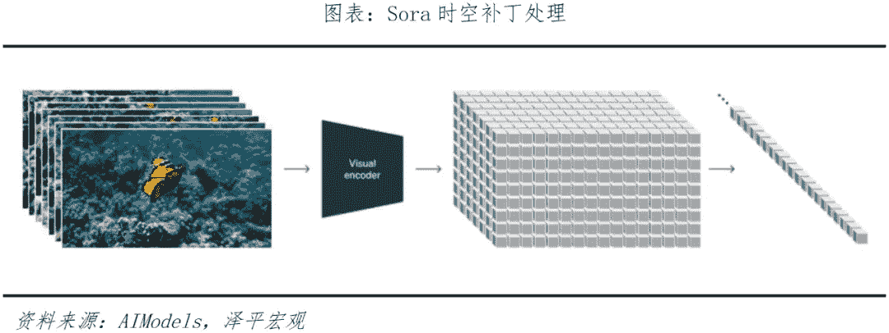
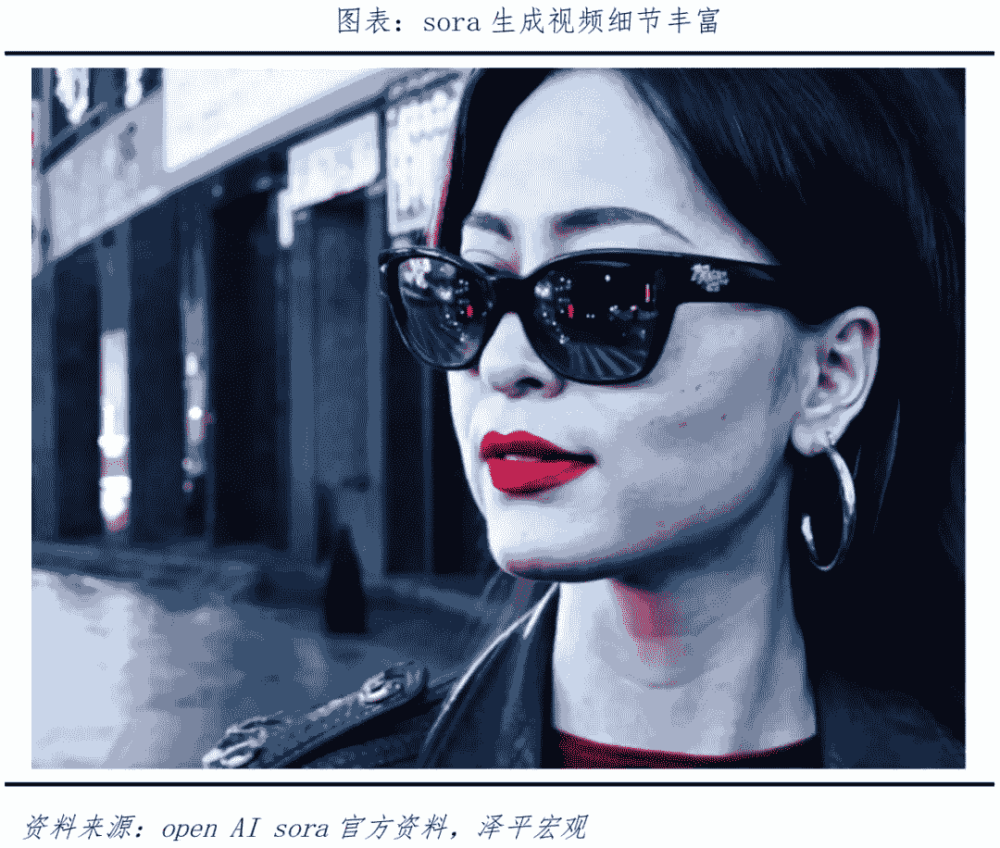
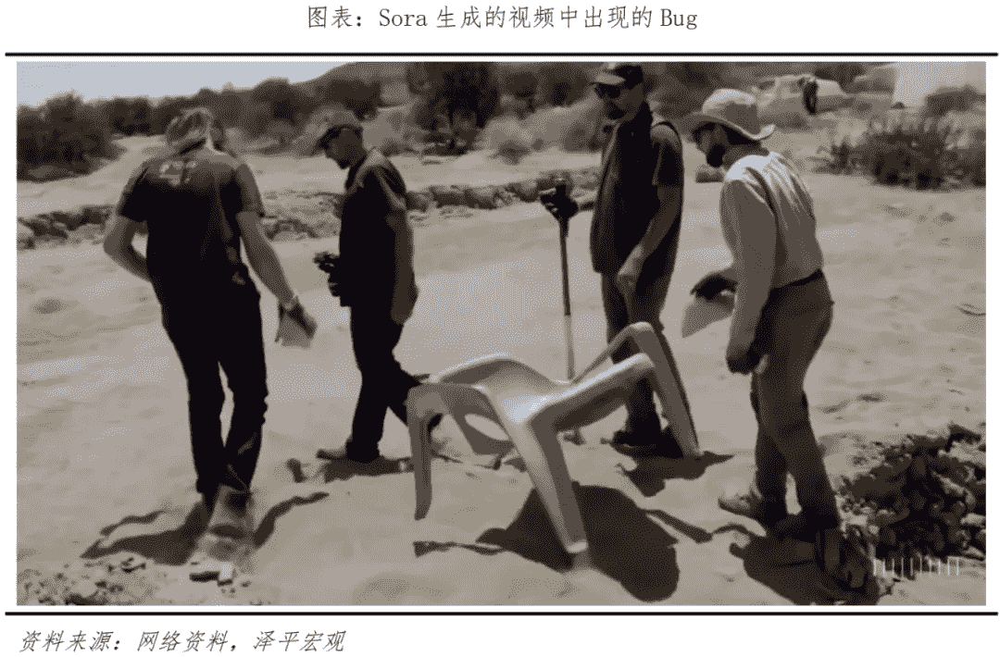

# Sora 横空出世，会颠覆哪些行业？

> 来源：[https://keenchase.feishu.cn/docx/T5YNdVlyjodgrixL9fmczFOCnVf](https://keenchase.feishu.cn/docx/T5YNdVlyjodgrixL9fmczFOCnVf)

文：任泽平团队**2月16日，OpenAI发布视频生成模型Sor**a，极大拓展AI在视频内容生成方面能力。Sora在关键指标上大幅领先之前的一些视频生成类模型，用**它生成视频，会发现其对物理世界的空间模拟能力甚至达**到了逼近真实的水平。Sora为什么可以堪称是AI界的新里程碑？它是如何突破AIGC即AI内容创作上限的？客观来看，当前版本的Sora还有没有什么局限性和不足？Sora等视频生成类模型，未来更新迭代的方向是什么?它的出现会颠覆哪些行业？对我们**每个人产生何种影响**？**它的背后又有什**么新产业机遇？1、Sora是怎么实现的？为什么是AI界的新里程碑？    Sora之所以是AI里程碑，是因为它再一次突破了AIGC用AI驱动内容创作的上限。此前大家已经开始使用Chatgpt等文本类辅助内容创作，辅助插图和画面生成，用虚拟人做短视频。而Sora是视频生成类大模型，通过输入文本或图片可生成、连接、扩展等多种方式编辑视频，属于多模态大模型范畴，该类模型是在GPT这类语言类大模型上进一步延伸、拓展。Sora通过一种类似于GPT-4对文本令牌进行操作的方式来处理视频“补丁”。该模型的关键创新在于将视频帧视为补丁序列，类似于语言模型中的单词令牌，使其能够有效地管理各种视频。这种方法与文本条件生成相结合，使Sora能够根据文本提示生成上下文相关且视觉上连贯的视频。具体原理上，Sora主要通过三个步骤实现视频训练。首先是视频压缩网络，将视频或图片降维成一个紧凑、高效的形式。其次是时空补丁提取，将视图信息分解成一个个更小的单元，每个单元都含有视图中一部分的空间和时间信息，便于Sora在之后的步骤中能进行针对性处理。最后是视频生成，输入文本或图片进行解码加码，由Transformer模型（即ChatGPT基础转换器）决定如何将这些单元转换或组合，从而将文本和图片提示中的内容形成完整的视频。

**Sora在视频生成模型最关键的两项指标——时长和分辨率上大幅超越先前模型**，并且具备较强的文本理解深度和细节生成能力，可以说是AI界的又一里程碑级的产品。Sora发**布前，主要模型如Pika1.0、Emu Video、Gen-**2可生成时长分别为3**~7秒、4秒、4~16秒；而Sora可生成时**长高达60秒，能实现1080p分辨率，且Sora不仅能基于文本提示生成视频，也具备视频编辑和扩展能力。Sora对文本的深度理解也较强。在大量文本解析的训练下，Sora可以准确捕捉、理解文本指令背后的情感用意，并流畅、自然地将文本提示转变为细节丰富、场景匹配的视频内容。**S**ora在视频生成中可以较好地模拟一个虚拟世界的物理规律，更好的理解物理世界，从而产生真实的镜头感。其技术特点主要有二：一是能多镜头生成连贯的三维空间运动视频。二是能保持同一物体在不同视角镜头下的一致性。以此，模型能保持视频中人物、物体、场景的运动连贯性和持续性，并可以通过微调对世界中的元素产生影响，进行简单互动。对比此前的Pika等模型，Sora生成视频还可以对视频色彩风格等要素精确理解，创造出人物表情丰富、情感生动的视频内容。且注重主体和背景的关系，使视频主体与背景的互动高度流畅、稳定，分镜切换符合逻辑。在官方给出的一则生成视频的例证中：“一位时尚女性走在东京的街道上，街道上到处都是暖色调的霓虹灯和动画城市标志。她身穿黑色皮夹克、红色长裙和黑色靴子，手拿黑色皮包。她戴着太阳镜，涂着红色唇膏。她走起路来自信而随意。街道潮湿而反光，与五颜六色的灯光形成镜面效果。许多行人走来走去”，Sora做到了完全细致细节的描述，甚至到皮肤细节描绘，且对于光影反射运动方式、镜头移动等细节处理都具备真实感。

# 2、Sora处于什么水平？还有哪些局限？

**S**ora相当于语言类模型的ChatGPT3.5，是业内重大突破，处于非常领先水平，但还是有其本身的局限性。Sora和ChatGPT同源与Transformer架构，前者在架构基础上搭建了扩散模型，在展示深度、物体永久性和自然动力学方面十分出色。之前的真实世界模拟通常是用GPU驱动的游戏引擎来进行三维物理建模来运行，需要人为搭建且过程复杂，精准度也高，能实现高标准的环境模拟和各种交互动作。但Sora模型没有数据驱动的物理引擎和图形编程，在更高要求的三维搭建中准确度低。因此，实现多个角色自然交互并与环境进行逼真的模拟仍然很困难。例如，举两个Sora生成视频出现bug的例子：当Sora输入的文本是“一个被打翻了的玻璃杯溅出液体来”时，显示的是玻璃杯融化成桌子，液体跳过了玻璃杯，但没有任何玻璃碎裂效果。再比如，从沙滩里突然挖出来一个椅子，而且AI认为这个椅子是一个极轻的物质，以至于可以直接飘起来。

出现这类“错误”的原因主要有两点：一是因为模型在自动补齐生成中内容，自发地产生了不在文本规划内的对象或实体，这种情况尤为常见，特**别是在拥挤或杂乱的场景中。在某些场景中，这会增加视频的真实感，比如**在OpenAI给出的“漫步在冬天日本街头”的案例中，但在更多环境中这会降低物理规律在视频中的合理性，例如第一个例子中凭空生成的桌子是水变成的。二是当发生许多动作在Sora的模拟中时，很容易混淆顺序，包括时间顺序与空间顺序。例如，当输入“跑步机上跑步的人”时它有几率会生成一个在跑步机上向错误方向行走的人。因此Sora准确地模拟更复杂的现实世界物理交互、动态和因果关系，对简单的物理和物体属性模拟也仍具有挑战性。尽管存在这些持续性的问题，但Sora展现了视频模型未来的潜力，只要有足够的数据和计算能力，视频转换器可能开始更深入地理解现实世界的物理、因果关系。这或许会让基于视频的模拟世界训练AI系统的新方法成为可能。

# 3、Sora的发展方向，面临什么挑战和机遇？

**Sora代表视频生成类AI前沿，但是其未来效能的提升或许**可以**从**三大方向**切入：一是从数据维度入手。随着训练的**数据需求激增，未来面临可训练数据样本匮乏问题。当前主要大模**型**依赖于语言文本，虽然Sora也可以进行图片输入，但训练泛度不及文本。数**据种类单一**且高质量数据有限，在参数量指数级提升的背景下或将快速耗尽。康纳尔大学研究表明，大模型训练的高质量数据很有可能在2026年前就耗尽，低质量文本数据在2030后耗尽。扩大数据来源的维度是Sora的解法。除文字和图像外，音频、视频、热能、势能、深度都能成为Sora学习的拓展领域。帮助其成为真正的多模态大模型。例如Meta开源的ImageBind拥有多种感官，不仅具有DINOv2的图片、视频识别能力，还拥有红外辐射和惯性测量单元，能对深度、热能、势能等不同模态进行感知学习。Sora在输入端拓展后也可以将上述维度与视频生成更好的结合，训练模拟更真实的物理世界。二是从算法层进行优化，解决模型学习中存在的“过拟合”和“欠拟合”现象是关键。在前文例子中提到过，Sora会自发地产生不在文本规划内的对象或实体，这有助于完善视频效果的真实性。但是，某些情况下两个高度关联的元素可能会在不适用的场景下同时出现，也就是算法为了达到特定结果而出现了“过拟合”。这种现象类似人类在备考中为了答对一类问题反复强化训练，反而导致考试中同类问题大量出错。而同一个例子中杯子被打翻了却没有碎裂效果却是融化了，则是因为模型“欠拟合”。模型出现这两类问题的原因是将并不准确分类的样本选取进行了训练，形成的决策树也就不是最优模型，导致真实应用的泛化表现下降。过拟合和欠拟合无法被彻底消除，但未来可以通过一些方法进行缓解减少，例如：正则化、数据清洗、降低训练样本量、Dropout弃用，剪枝算法等。

**三是**算力产业。S**ora**持续**引爆AI浪潮，这也将导致2024年算力需求将在多模态**模型发展下持续高涨，AI企业寻求更大力度的产业链上游切入，向芯片研发设计布局，甚至向EDA和晶圆领域进发。当下AI模型训练主要依靠英伟达GPU，但主流算力芯片已经供不应求，预测的到2024年需求将达到150-200万。OpenAI创始人Sam Altman从2018年起就重视其芯片供需问题，投资了AI芯片公司Rain Neuromorphics，2019 年购买Rain的芯片，再到2023年11月Sam为一家代号为“Tigris”的芯片企业寻求数十亿美元融资。作为行业龙头，已经在早期布局构建一套由自家领导的算力产业链，旨在通过AI产业革命重塑全球半导体格局。以智能汽车切入AI赛道的特斯拉，也在自动驾驶算法的基本盘上向上游的芯片设计进发，并在逐渐谋求对中游的控制。可以预见的是，由ARM、英伟达、台积电构建的全球AI半导体产业链虽然是短期的最大收益者，但在中长期看或迎来更大的竞争。算力基础设施的自主化建设、尤其是算力芯片，仍是中国在AI赛道上与全球保持同步进步的重要方向。

# 4、Sora的应用领域，会颠覆哪些行业？

**从年初苹果发布Vision Pro头戴式显示设备、到各家PC大厂接连发布AIPC，再到这次的OpenAI发布Sora，全世界对于人工智能的创新在加速，迭代地越来越快。今后用AI自动创**作生成的内容会影响很多的行业领域，对于热点话题的“时效性覆盖”将主要是AI的任务，比拼的主要是AIGC的效率，比拼的是大家能够驾驭AI的能力，比拼的是谁能够驾驭类**似于Sora这种强势能的AI生产工具。以后“扔一部小**说、**出一部大片”不是不可能了**，Sora可以生成长达1分钟的视频，视频可以一镜到底，多角度镜头切换，并且对象始终不变。Sora视频，更可以运用景物、表情和色彩等镜头语言，表达出如孤独、繁华、呆萌等情感色彩。总之，如果未来出现更多的Sora、或者这些生成视频大模型从以**上所述的几个角度进行更多的改良滞后，未来的**AI视频效果，或许几乎和人工拍摄不相上下。多模态模型的应用在2024将迎来黎明，影响影视、直播、媒体、广告、动漫、艺术设计等数个行业。在当下的短视频时代，Sora“一个人”就全包了短视频的摄影、导演、剪辑等任务。未来，Sora生成的各种不同用途的视频，对于现在的短视频、直播、影视、动漫、广告等行业都会产生深远影响。比如，在短视频创作领域，Sora 有望极大降低短剧制作的综合成本，解决“重制作而轻创作”的共性问题，短剧制作的重心未来有望回归高质量的剧本内容创作，考验的是优秀创作者的构思能力。Sora有望真正为相关行业的企业降本增效，广告制作公司通过Sora 模型生成符合品牌的广告视频，显著减少拍摄和后期制作成本；游戏与动画公司使用Sora直接生成游戏场景和角色动画，减少了 3D模型和动画制作成本。企业节省下来的成本可以用于提高产品、服务质量或者技术创新，推动生产力进一步提升。如果说2023年是全球AI大模型大爆发，是图文生成元年的话，那2024年行业会进入AI视频生成和多模态大模型元年。从Chatgpt到Sora，AI对每个个人、每个行业的现实影响与改变正在逐步发生。