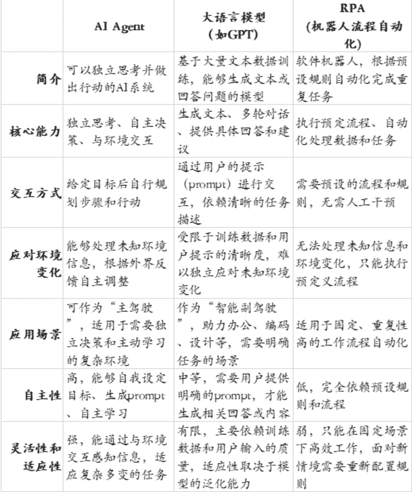
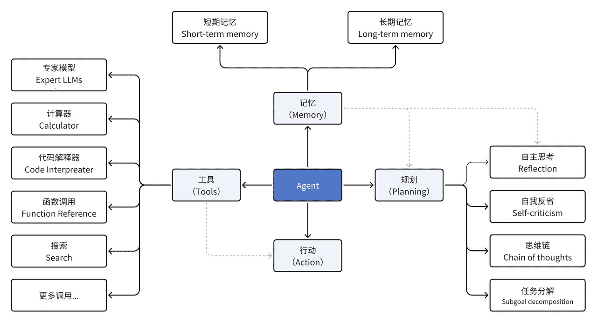
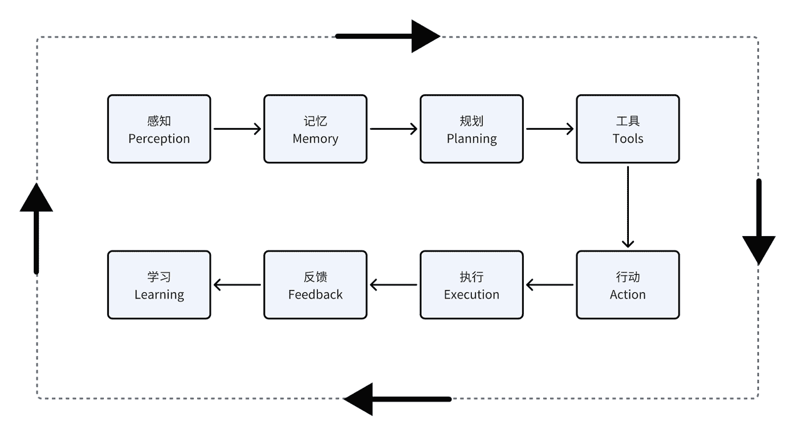
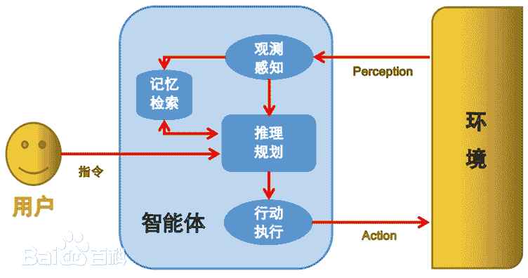

# 智能体

> 来源：[https://keenchase.feishu.cn/docx/LYbxdZHOXoqgoFx15QYcTeyFnke](https://keenchase.feishu.cn/docx/LYbxdZHOXoqgoFx15QYcTeyFnke)

> 点我返回👉【杰夫AI知识库｜首页】

> [**点我跳转👉【AI工具库】**](https://keenchase.feishu.cn/wiki/TSyWwNmPsi2CZTk4fqMc2XQgnkd)

# 认知篇：基本介绍

## 定义

### 智能体

智能体（Agent）是一个更广泛的概念，指的是可以在环境中自主感知、决策并采取行动去实现特定目标的实体。智能体可是一种软件程序，可以在没有人工干预的情况下**自主地执行任务，包括感知**环境、理解语言、与其他智能体交流等。智能体也可以是一个独立的实体，也可能是一个机器人，或者是一个其他类型的自动化系统。智能体的核心能力是自主性、适应性和学习能力，需要能够获取环境信息，基于这些信息做出决策，并通过交互不断学习和优化其行为。比如，工业自动化、智能家居、机器人和自动驾驶等。

### AI Agent

是智能体的一种实现，特指那些应用了人工智能技术，尤其是机器学习和深度学习技术的智能体。这些智能体拥有处理复杂任务的能力，能够进行自然语言理解和生成、**推理、规划等高级认知功能。在实现上，**AI agent 通常依赖于大型的语言模型或其他类型的深度学习模型作为其核心决策和处理单元。比如，聊天机器人、语音助手、推荐系统等。或者说，所有 AI agent 都是智能体，但并非所有智能体都是 AI agent。智能体强调的是自主行动和环境交互的能力，而 AI agent 强调的是实现这一能力的先进人工智能技术。随着技术的发展，AI agent 在智能体中的角色越来越像人类的代理，能够在没有人类直接指导的情况下，实现更为复杂的任务和目标。智能体是一个更广泛的概念，可以包括各种类型的软件程序，而 AI agent 则是指利用人工智能技术的特殊类型的智能体，具有更强的感知、学习和推理能力。

# 智能体构成

智能体的大脑就是 LLM，而它由几个关键模块构成：​

### **规划（Planning ）**

智能体能够将复杂任务分解为更小、更易于管理的子任务，从而更高效地处理这些任务。这一过程涉及到对任务的深入理解和巧妙拆解，为后续执行铺平道路。其中思维链是一种非常重要的技术，主要作用于提升模型在处理复杂任务时的性能。核心在于引导模型进行“逐步思考”，将难题拆解为一系列较小、更易于处理的步骤。这一过程首先涉及将问题划分为多个思维步骤，然后在每个步骤中生成多个可能的思考路径，从而构建出一个多层次的思维树状结构。通过这种方法，模型能够更有效地探索问题的解决方案，从而在复杂任务中实现更高的准确性和效率。

示例：用户想要在某宝上找一把适合初学者的吉他

智能体规划搜索策略，决定使用哪些关键词和过滤器来缩小搜索范围，如“初学者吉他”、“价格区间”、“用户评价”。

###

### **记忆（Memory）**

智能体不仅具有短期记忆，能记住当前的上下文信息，还拥有长期记忆，可以在长时间跨度上保留和调用大量信息。这为智能体提供了在长时间内不断学习和进化的能力，通常是通过与外部向量数据库和检索增强生成器的交互来实现的，主要目的是减少 LLM 的幻觉问题。

示例：用户想要在某宝上找一把适合初学者的吉他 智能体回顾用户的购物历史和偏好，例如，之前在与智能体聊天中产生对于音乐相关的产品描述，或者用户在某宝上对音乐类商品的浏览记录。

### 工具（Tools）

智能体学习调用外部 API 以获取模型权重中缺少的额外信息（通常在预训练后难以更改），包括搜寻检索信息、代码执行能力、对专有信息源的访问等。

示例：用户想要在某宝上找一把适合初学者的吉他

•

智能体调用某宝的搜索引擎 API，使用上述关键词和过滤器来检索产品信息。- 智能体可能利用某宝的图像识别工具来识别商家上传的吉他图片，以便找到相似的产品。

•

智能体可能使用数据分析工具来分析某宝上关于吉他的销售数据，找出最畅销的初学者吉他款式。

### **行动（Action）**

智能体基于其感知（Perception）和规划（Planning）所做出的响应。这是决策循环中的一个关键步骤，它涉及智能体对其环境进行操作以实现特定目标或响应特定情况。在智能体的设计中，行动通常是由一个称为策略（Policy）的函数决定的，这个策略函数会根据智能体的当前状态和目标来选择最佳的行动。行动的结果会通过反馈（Feedback）机制返回给智能体，根据这些反馈来调整其策略，从而实现更好的性能。

示例：用户想要在某宝上找一把适合初学者的吉他

智能体根据搜索结果，为用户推荐一系列最相关的产品列表，包括产品图片、价格、用户评价等详细信息。

那么基于这些模块，我们拆解组合就会得到以下的这运行步骤：

## 智能体特点

智能体的主要特点：​

•**主动思考与行动的能力**

智能体不仅能被动地响应指令，而且能够主动进行思考和决策。

•**感知和理解需求**

智能体能够理解用户的需求，这通常涉及到对自然语言的理解。

•**拆解目标和形成规划**

智能体能够将复杂的任务分解为更小、更可管理的步骤，并制定实现这些步骤的计划。

•**记忆能力**

智能体拥有一定程度的记忆能力，能够存储和回忆先前的交互、知识和经验，以此来指导当前的决策和行为。

•**使用工具和 API**

智能体能够利用各种外部工具和应用程序接口（API）来执行任务和访问信息。

•**决策和行动**

最终，智能体能够基于以上过程做出决策并采取行动。

## 智能体应用架构

由下面几个部分组成：​

•**用户：**用户是智能体的使用者；用户设定智能体的目标，定义性能指标；给智能体以指令。

•**智能体：**智能体根据用户给出的指令或设定的目标，感知观测环境状态，检索内置知识和感知经验记忆，对任务进行定义、分解和规划，形成并执行行动策略，反馈作用于目标环境。

•**工作环境：**智能体工作交互的周边事物和作用的对象；环境就是智能体关心的世界；智能体通过观察感知来了解环境状态。

## 智能体类型

### 按照代码类型

•

零代码智能体： 通过 prompt 编辑的方式，表达意图、提供行为说明，引入数据集、工具等能力，创建智能体。

•

低代码智能体： 通过拖拽方式快捷搭建业务流，结合大模型、数据集、工具等组件，完成智能体开发。

### 按工作模式类型

AI 智能体可以分为单 Agent、多 Agent、混合 Agent（人机交互 Agent）三种类型。

**单 Agent**：这种代理侧重于执行单一任务或一系列相关任务，且不需要与其他智能体进行交互。单个代理可以根据任务执行不同的操作，如需求分析、项目读取、代码生成等。例如手机上的 Siri 或 Google Assistant，你可以要求它设置闹钟、查询天气、播放音乐等，每个请求都是由单个 AI 代理独立处理的，它根据你的命令执行特定的任务。

**多 Agent**：这种模式侧重于智能体之间的互动（合作或对抗）和信息共享，多个智能体协同工作，相互交流信息，共同完成更复杂的任务或目标。多 agent 应用场景在软件行业开发、智能生产、企业管理等高度协同的工作中非常有帮助。

**混合 Agent**：这种模式中，人工智能系统和人类共同参与决策过程，交互合作完成任务，强调的是人机协作的重要性和互补性。智慧医疗、智慧城市等专业领域可以使用混合智能体来完成复杂的专业工作。以智慧医疗为例，医生和 AI 系统共同进行病情诊断，AI 系统可以快速分析病人的医疗记录、影像资料等，提供初步的诊断建议；而医生则可以基于 AI 的分析结果和自己的专业知识和经验，做出最终的诊断决定。

### 按决策制定和行为方式类型

**简单反射型 Agent**：基于“如果-那么”规则直接响应当前的环境状态，不存储任何历史数据或状态。它们的设计简单，反应迅速，但适用范围有限。

例如一个简单的客户线索收集机器人，在抖音有新增意向客户（例如咨询或留资）时，就触发企业微信的通知消息到群里。这类代理适合处理一些规则明确、不需要深度逻辑或历史上下文理解的任务。

**基于模型的反射型 Agent**：拥有环境的内部模型，能够基于对环境的理解和过去的经验做出更复杂的决策。它能够适应环境变化，处理更复杂的任务。

例如智能家居系统中的温度控制器，它不仅能够根据当前的室温调节空调，还能学习用户的偏好，并预测何时需要提前调整温度。

**基于目标的 Agent：**这类决策从根本上不同于前面描述的条件-动作规则，因为它涉及对未来的考虑，包括“如果我这样做会发生什么？”和“这会让我快乐吗？因为了解环境的现状并不总是足以决定做什么。例如，在一个路口，出租车可以左转、右转或直行。正确的决定取决于出租车要去哪里。换句话说，除了当前状态的描述之外，智能体还需要某种描述理想情况的目标信息，例如设定特定的目的地。

### 按体系结构和主要特性类型

**认知型智能体：**这类智能体具有一套完整的符号模型，用以描述和感知外部环境变化，并能与其他智能体通过高级通信协议进行协作。当智能体在资源获取过程中遇到冲突时，它们能够根据有限的环境资源和自身目标进行合理的协商分配来解决问题。此外，认知型智能体还具有记忆、存储和分析功能，可以预测后续行为可能产生的影响，并通过评估比选，实施最佳策略。

**反应型智能体：**这类智能体是基于刺激-反应规则的，它们感知外部环境变化，并遵循特定的运行规则作出相应的反应。

**混合型智能体：**这类智能体兼具认知型智能体和反应型智能体的特性，这也是大多数智能体所属的种类。

### 按应用领域和功能类型

如在机器人领域，智能体可以分为服务型智能机器人、工业型智能机器人、教育型智能机器人、娱乐型智能机器人和军事型智能机器人等。这些智能体根据其应用领域的不同，具有不同的功能和特点。

# ✅**注意：**分类并不是相互排斥的，一个智能体可能同时属于多个类别。智能体的设计和实现取决于其应用场景和所需功能。