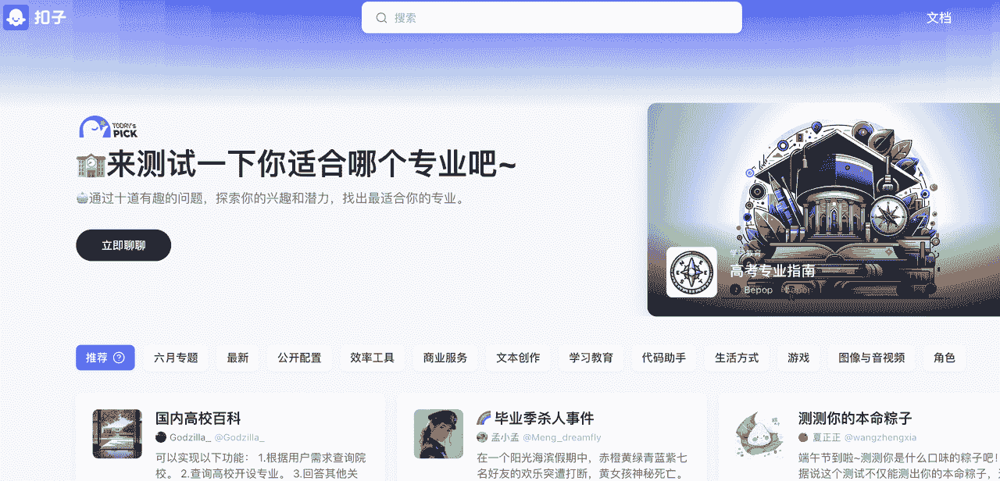
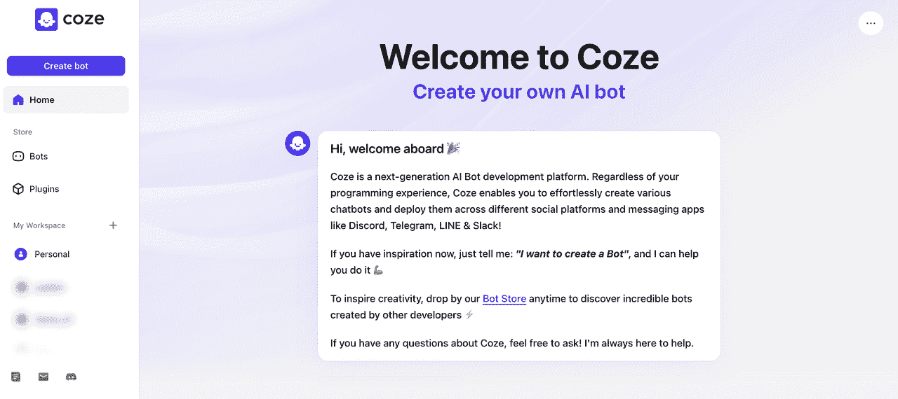
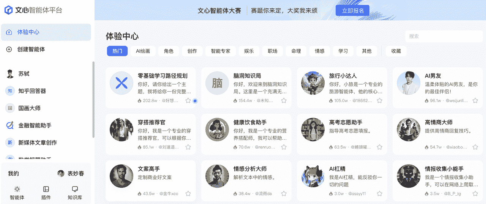
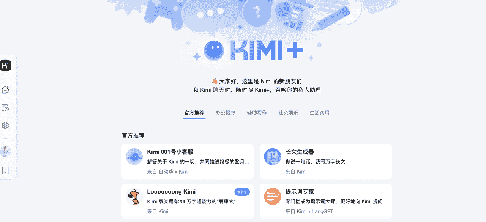
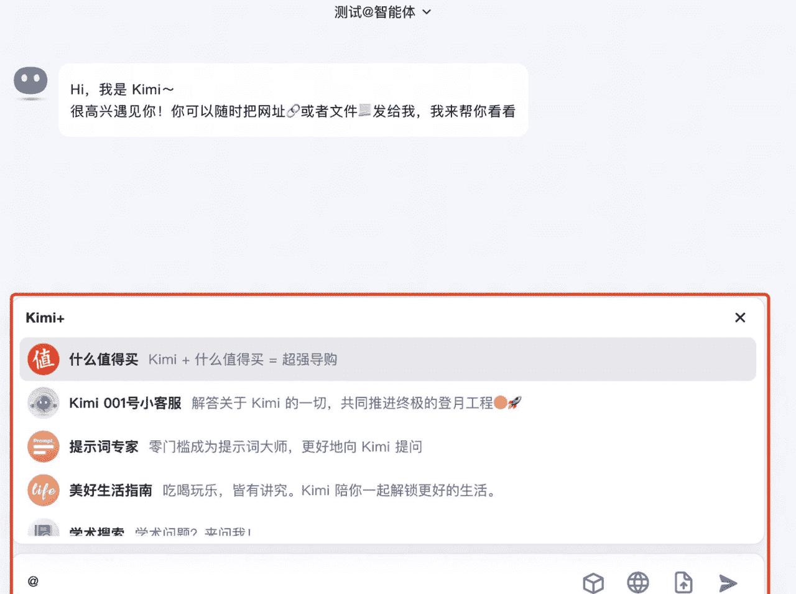

# AI 智能体平台精选

> 来源：[https://keenchase.feishu.cn/docx/TUl1dKd6YojfaBxG7ovc0oHYnNc](https://keenchase.feishu.cn/docx/TUl1dKd6YojfaBxG7ovc0oHYnNc)

# 1.扣子

**工具介绍：**字节跳动在国内正式推出一站式 AI Bot 开发平台扣子，任何用户都可以快速、低门槛地搭建自己的 Chatbot，且平台支持用户将其一键发布到飞书、微信公众号、豆包等渠道。大模型使用的是字节自研的云雀大模型和 kimi 大模型。

**网络条件：**不需要特殊网络

**体验网址：**https://www.coze.cn/

**工具优点：**

1.低门槛的用户体验：Coze 平台的设计理念是使 AI 聊天机器人的创建和部署变得简单易行。对于没有编程背景的用户来说，这是一个巨大的优势。通过提供直观的用户界面和丰富的预制 Bot，Coze 降低了技术门槛，使得更多的人能够接触和利用 AI 技术。

2.丰富的功能和资源：Coze 提供了 Bot 商店、插件商店和团队空间等多种功能，这些都是为了增强用户的创造力和协作能力。用户可以利用这些资源来创建更加智能和个性化的聊天机器人，满足各种复杂的业务需求。

3.多平台兼容性：Coze 支持将聊天机器人部署到多个社交平台和消息应用程序，这意味着用户可以通过一个统一的平台管理多个 Bot，极大地提高了效率和 Bot 的可达性。

4.定制化和扩展性：Coze 的定制化和扩展性是其另一个显著优势。用户不仅可以使用平台提供的工具和资源，还可以进行深度定制，以满足特定的业务需求。

5.透明的定价模式：Coze 的定价模式清晰透明，用户可以根据自己的需求和预算选择合适的套餐，无需担心隐藏费用。

**是否免费：**

1.免费试用

Coze 平台提供免费试用期，用户可以在这段时间内免费体验平台的所有基础功能。这包括对 Bot 商店和插件商店的访问，以及团队空间的基本使用。免费试用期为用户提供了一个无风险的机会，来评估 Coze 平台是否适合自己的需求。

2.基础套餐

基础套餐是 Coze 平台的入门级收费模式。它提供了 Bot 创建和部署的核心功能，适合个人用户或小型企业。基础套餐通常包括一定数量的 Bot 交互次数和一些基本的插件使用权限。此套餐的价格可能根据提供的服务范围和支持的交互次数而有所不同。

3.高级套餐

高级套餐为用户提供了更多的功能和资源。除了基础套餐中的所有功能外，高级套餐还包括高级插件的使用权限、更多的 Bot 交互次数、优先客服支持等。这一套餐适合对 AI 聊天机器人有更高要求的中大型企业。

4.企业定制

企业定制套餐是 Coze 平台提供的最高级别服务。它提供了完全定制化的解决方案，包括专属的项目管理、定制开发、专业培训和技术支持。企业定制套餐的价格通常根据用户的具体需求和服务内容来定制。

5.附加服务

除了上述套餐外，Coze 平台还提供了一系列的附加服务，如额外的 Bot 交互次数购买、专业的插件开发、数据分析服务等。这些服务可以单独购买，也可以作为套餐的一部分，以提供更加全面的服务体验。

**使用建议：**

•初期学习曲线：尽管 Coze 致力于简化操作流程，但对于 AI 和聊天机器人开发完全陌生的用户来说，仍然存在一定的学习曲线。用户需要花时间熟悉平台的各项功能。

•功能过载：功能丰富的同时也可能导致用户在初次使用时感到功能过载，对于一些只需要基础功能的用户来说，Coze 平台上众多的选项可能会显得有些复杂。

•依赖网络连接：作为一个在线平台，Coze 的使用完全依赖于稳定的网络连接，在网络连接不佳的情，用户可能会遇到访问困难。

•高级功能的成本：虽然 Coze 提供了免费试用和基础套餐，但对于需要高级功能和定制服务的用户来说，成本可能会相对较高。

•国内版和国际版在功能上存在一些差异，主要是工具和插件等的差异。国内版支持 30 秒无代码生成 AI Bot，并集成了插件工具集，满足了个性化的使用需求。它还提供了 Bots 商店和插件，用户可以将自己制作的 AI Bot 发布到商店中。

•**官方教程：**[www.coze.cn](https://www.coze.cn/docs/guides/welcome)

**工具介绍：**Coze（中文名“扣子”）是由字节跳动推出的一款 AI 聊天机器人构建平台国际版使用的模型更为强大。

**网络条件：**需要特殊网络

**体验网址：**https://www.coze.com/

**工具优点：**

1.

支持非常复杂的流程设定，可以开发非常强大的智能体应用。

2.

丰富的插件，增加 AI chat bot 的能力。预置的插件已经足够多了，比如 DALLE 3、Google 搜索、天气查询等等。如果预置的插件不满足需求，也可以自己构建插件。

3.

知识库 -构建自己的知识问答机器人，除了常见的上传文档之后，可以针对文档内容提问的问答机器人，还支持在线数据，API，表格数据等等。

4.

能免费白嫖 GPT4。

**是否免费：**是

**使用建议：**

官方教程：[www.coze.com](https://www.coze.com/docs/guides/welcome)

# 3.文心智能体平台

**工具介绍：**文心智能体平台是基于文心大模型的智能体构建平台，为开发者提供低成本的开发方式，支持广大开发者根据自身行业领域、应用场景，采用多样化的能力、工具，打造大模型时代的原生应用。并且为开发者提供百度生态流量分发路径，完成商业闭环。

**网络条件：**不需要特殊网络

**体验网址：**https://agents.baidu.com/center

**工具优点：**

全新升级后的文心智能体平台，有 5 个「超能力」：技术底子厚、开发成本低、快速可成长、分发渠道广、商业可闭环。截止目前，已有 3 万多个智能体被创建、5 万多名开发者和上万家企业入驻，共同构建了一个繁荣的智能体生态圈。文心智能体平台提供面向所有领域、所有人的强大开发及应用能力，给开发和使用者带来了巨大的想象颠覆。

**是否免费：**是

**使用建议：**

[文心智能体平台介绍](https://mbd.baidu.com/newspage/data/videolanding?nid=sv_17640208424833725160)

# 4.Kimi+

**工具介绍：**Kimi+是 Kimi 中的智能体商店，负责将不同场景制成模板，方便用户高效使用各种大模型功能。

**网络条件：**不需要特殊网络

**体验网址：**Kimi.ai - 帮你看更大的世界

**工具优点：**

Kimi+目前共有 5 个类目，24 个智能体，其中 5 个类目有：​

1.

官方推荐：这一类目下的智能体是 Kimi 官方推荐的，旨在提供基础而全面的服务，帮助用户更好地了解和使用 Kimi 的功能。

2.

办公提效：专注于提高用户在办公场景中的效率，包括翻译、简历修改、API 使用指导等。

3.

辅助写作：提供写作辅助的智能体，如小红书爆款生成器、公文笔杆子、论文改写降重等，帮助用户在内容创作和学术写作上提升效率和质量。

4.

社交娱乐：这一类目的智能体提供了社交和娱乐功能，如塔罗师、猜猜我在想谁等，旨在覆盖用户的社交和休闲生活使用场景。

5.

生活实用：包括旅行规划、学习技巧、留学咨询等生活服务类智能体，帮助用户在日常生活中获得更加便捷和实用的帮助。

**是否免费：**是

**使用建议：**

Kimi+目前仅支持网页端，app 端和小程序端均未更新。

在正常对话中使用“@”调用智能体

1.开始正常对话：在与 Kimi Chat 的正常互动中，可以随时通过特定的“@”符号来调用智能体。

2.输入“@”符号：在对话输入框中键入“@”，这时会弹出一个包含所有智能体的下拉列表。

3.选择所需智能体：从列表中选择想要调用的智能体。一旦选中，智能体会被“激活”，准备接收用户的指令或问题。

4.继续对话：在智能体被激活后，可以直接输入具体的需求，智能体会根据其专业化功能提供相应的服务。

---