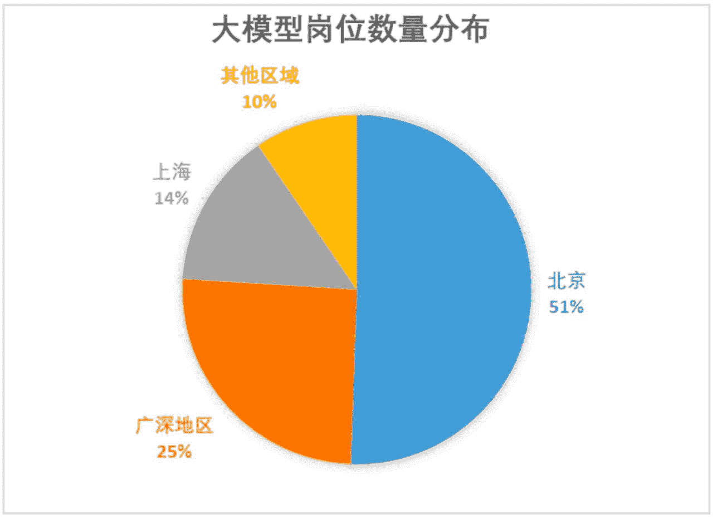
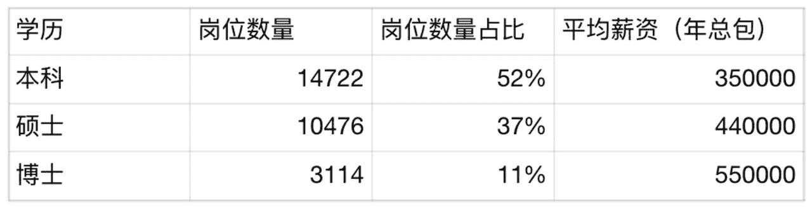
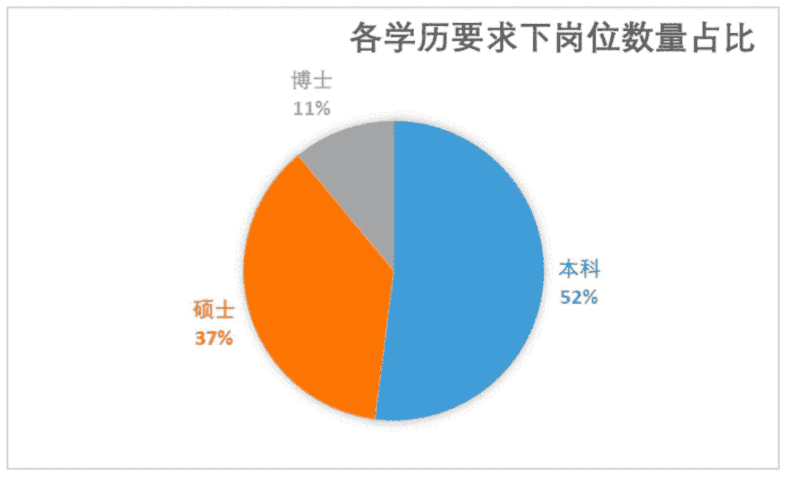
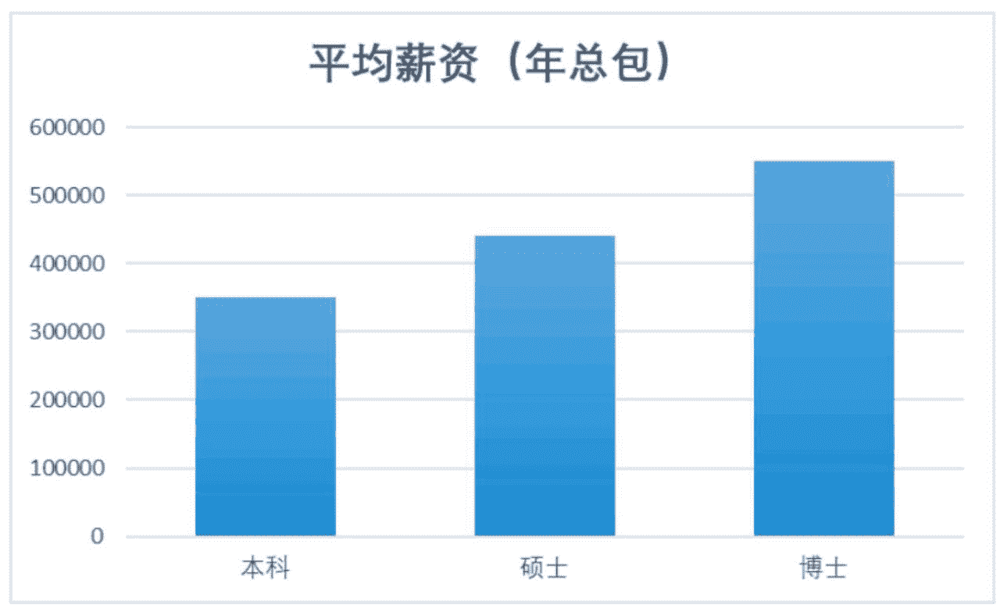
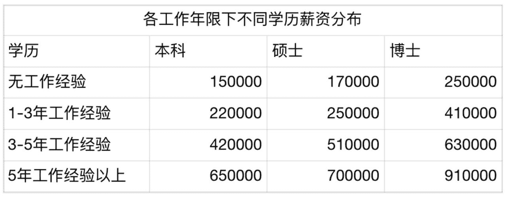
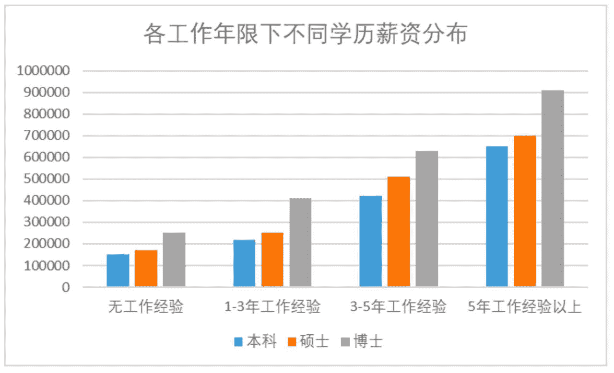
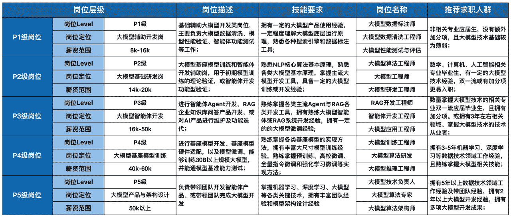

# 赋范2025大模型求职指南

> 来源：[https://kq4b3vgg5b.feishu.cn/docx/VyStdk2DSo1Tl0xdFBmcxqmMnlb](https://kq4b3vgg5b.feishu.cn/docx/VyStdk2DSo1Tl0xdFBmcxqmMnlb)

👉 2[025大模型最强求职指南！整理全网2万份J](https://www.bilibili.com/video/BV18JreYpE5Q)D，一手数据信息揭秘求职真相！（视频）

---

⼤模型技术正处于爆发式增长阶段，⼤模型岗位⽬前属于蓝海市场。据调查，  2024年第四季度⼤模型在招岗位 数量激增400%，⼈才供需⽐不到1.4，也就是1.4个⼈竞争⼀个岗位，远低于2.8这个平均⽔平，竞争并不算激烈，

⽽且岗位薪资是⽔平较⾼，平均薪资达到33k，相⽐传统IT岗位如Java开发，⼤模型岗位平均薪资⾼出约30%，⽽相 ⽐深度学习、数据挖掘、数据分析等数据类技术岗位，⼤模型岗位薪资⾼出约18%。

---

# ⼀、⼤模型岗位地区分布分析

根据统计数据显⽰，⽬前全⽹有 **28,312**** 个在**招**的⼤模型相关岗位。其中，** **90%** 的岗位集中分布在北上⼴深**， 显**⽰出⼀线城市作为技术创新前**沿阵地****的强⼤吸引⼒。其中，北京地区**以其显著的优势成为最⼤的⼤模型岗位集中 地，占⽐达到 51%；其次是⼴深地区，占⽐约 25%；上海则排名第三，占⽐约 14%。除了北上⼴深，其他岗位主 要分布在 杭州、成都、重庆、西安、郑州 等省会城市，这些城市因其在区域科技发展中的重要地位⽽成为次⼀级  的热门选择。

| **区域** | **在招岗位数量** | **岗位数量占⽐** |
| --- | --- | --- |
| 北京 | 14439 | 51% |
| ⼴深地区 | 7079 | 25% |
| 上海 | 3964 | 14% |
| 其他地区 | 2830 | 10% |

作为⼀项前沿技术，⼤模型相关岗位⾸先在北京爆发并不意外。北京作**为全国科**技创新的核⼼，不仅拥有丰富 的 ⾼校资源  （如清华⼤学、北京⼤学等），还汇聚了国内领先的科技公司和研究机构。此外，北京还享有国家政策 的强⼒⽀持，完善的产业链⽣态，以及活跃的技术交流环境。可以说，北京为⼤模型技术从理论研究到实际应⽤提  供了⼀个⽆可⽐拟的⼟壤。

**对于希望进⼊⼤模型⾏业的**求**职者**来**说，北京⽆疑是⾸选**。不仅因为北京的 岗位数量最多、机会最⼴泛 ，更重 要的是这⾥的⼤模型应⽤领域丰富多样 ，涵盖了 ⾃然语⾔处理、计算机视觉、⽣成式 AI 应⽤、智能推荐系统 等多  个⽅向。这种多样性可以极⼤拓宽技术⼈的技术视野 ，同时在北京这样⼀个开放、 包容且具备探索精神的环境中，

求职者有更⼤可能激发⾃⼰的技术创造⼒。

这种技术视野的拓宽和创造⼒的激发，对于技术⼈来说是⽆价的。正因如此， 尽管在北京求职意味着⾯临更⼤ 的竞争压⼒，但它同时也意味着更快速的成长机会和更⾼的职业起点。

值得⼀提的是，其他热门城市如 **杭州**，因其互联⽹产业的深厚积淀，吸引了⼤量专注⼤模型应⽤的企业；⽽

**成都、西安** 等新兴科技城市则凭借成本优势和政府扶持，成为吸纳技术⼈才的重要后备基地。因此， 想要扎根⼀线 城市的求职者可以⾸选北京、上海、⼴州和深圳，⽽希望追求更⾼性价⽐⽣活质量的技术⼈也可以关注新⼀线城市  的机会。

# ⼆、⼤模型岗位⾏业分布分析

当**前，⼤模型相关岗位**主要集中分布在以下六⼤⾏业： 互联⽹科技公司、车企、国有企业、咨询公司、⾦融⾏ 业、科研机构与⾼校 。每个⾏业的岗位分布和特点各有千秋 ，体现了⼤模型技术⼴泛的适⽤性和潜⼒。

**1.** **互联⽹科技公司**

互**联⽹**公**司是⼤模型**岗**位的主⼒军，**这**些岗位**的**核⼼⼯作**是开**发或维护**基于⼤模型的 AI 产品 。例如， 常见的 AI 应⽤包括 AI 编程⼯具、 ChatBI 系统、⽂⽣视频产品、企业知识库问答⼯具、视觉创意⽣成⼯具 等。此外， 部  分⾏业巨头还涉及⼤模型的底层研发与训练⼯作，⽐如 阿⾥的 Qwen 系列模型、腾讯的混元⼤模型、百度的⽂⼼ ⼀⾔模型 等。

互联⽹科技公司因其 **⼯作节奏快、压⼒⼤、收⼊⾼** ⽽闻名， 同时具有浓厚的创新氛围和较⼤的职业发展空 间。对技术⼈来说，这类公司既是快速成长的舞台，也是实现技术突破的最佳场所。

**2.** **车企**

新能源汽车⾏业正快速崛起，成为⼤模型技术的新兴应⽤领域。 许多车企 ，尤其是头**部品牌 ，已**经开始招聘⼤  模型技术相关岗位。 未来汽车被视为类似于智能⼿机的 移动智能终端，AI 技术在其中的作⽤不可或缺，从⾃动驾驶 到个性化⼈机交互 ，都离不开⼤模型的⽀持。这⼀领域的岗位对技术⼈的应⽤开发能⼒提出了更⾼要求，也为技术  突破提供了更多场景化的机会。

**3.** **咨询公司和⾦融⾏业**

咨询公司和⾦融⾏业是较早拥抱⼤模型技术的传统⾏业，主要在 战略咨询、管理咨询、⾦融科技、量化交易   等领域实现了应⽤。 例如，⼤模型在⽣成智能报告、优化决策建议、 设计量化策略等⽅⾯展现出极⼤潜⼒。特别值 得注意的是，⽬前许多⼤模型相关的竞赛和研究活动由⾦融机构主办 ，表明这⼀⾏业对技术创新的⾼度重视。

**不过 ，咨询和⾦融⾏业**对于求职者的 学历和背景资历要求较⾼ ，例如**硕⼠**及以上学历、顶尖⾼校背景或相关⾏ 业经验 。 同时，这类岗位主要集中在 上海，因⽽适合⽬标明确、资历较强的求职者关注。

**4.** **国有企业和公⽴医院**

**近年来，国企在**智**能化转型⽅⾯**动作频频 ，尤其是 三⼤电信运营商（中国移动、中国联通、中国电信），成为 ⼤模型技术的“ 国家队” 。例如， 电信公司于 2024 年 12 ⽉发布了名为 TeleAI 的⽂⽣视频⼤模型， 性能甚⾄超越了   Sora 模型，展现了国企在前沿技术开发上的强劲实⼒。

此外，国企在 **AI** **辅助诊疗** **等领域也有显著突**破。⼀些公⽴医院已经启动了相关试点⼯作， 推动 AI 技术服务于 医疗健康领域。相较于互联⽹公司，国企更加注重 稳定性和社会责任 ，适合追求⼯作稳定且认可国企⽂化的技术⼈。

**5.** **科研机构与⾼校**

科研机构与⾼校聚焦于 **⼤模型的底层原理** 和 **基座模型训练**，是⼤模型技术⽣态的重要基⽯。这些研究⽅向包 括 多模态⼤模型训练、合成数据训练、强化学习训练 等， 同时基于国产芯⽚的⼤模型训练与适配研究也备受关

注，是打破国际算⼒垄断的重要环节。

科研机构和⾼校岗位往往对学历要求**较⾼（通常为博⼠或硕⼠**）， 更适合具有 科研精神和长期技术追求 的求 职者。对于那些⽴志于推动⼤模型底层突破、实现⾃主可控的技术⼈来说，这⽆疑是最佳的选择。

# 三、⼤模型岗位学历及薪资分布

了**解了⼤模型岗位的地区和⾏业分布****后，相信⼤家**已**经有了⼀些⽬**标**⾏业**的偏好 。那么接下来， 我们来深⼊分 析 ⼤模型岗位的学历及薪资分布情况，这可能是求职者最为关⼼的部分之⼀。根据统计的 28,312 份⼤模型岗位 JD 数据（剔除了百万年薪以上的总监级或合伙⼈级别岗位）， 我们得到了以下结论：

**学历与薪资分布**

•  **本科及以上学历：** 占⽐约 **52%**，平均年总包约为 **35** **万元**。

•  **硕⼠及以上学历：**  占⽐约 **37%**，平均年总包约为 **44** **万元**。

•  **博⼠学历：**  占⽐约 **11%**，平均年总包约为 **55** **万元**。

整体来看，⼤模型岗位的 **全国平均年总包为** **40.5** **万元，折合⽉薪约为** **33K**。如果将⼤模型岗位与其他技术类岗位 进⾏横向⽐较，可以发现：

•  相较于传统 IT 岗位（如 **Jav**a** 开发**），⼤模型岗位的平均薪资 ⾼出约 30%；

•  相较于数据类技术岗位（如深度学习**、数据**挖**掘、数**据分析），⼤模型岗位薪资 ⾼出约 18%。

**需要特别**说明的是，这⾥统计的是全国各地岗位**的平均薪资⽔平**， 若仅统计 北京地区 的数据，薪资⽔平会更⾼。 例如，北京⼤模型岗位的年薪通常⽐全国平均⾼出 15%-25%。

⼤模型岗位不仅起薪较⾼，其成长性也极为可观。以下是按学历和⼯作经验划分的薪资变化趋势：

•  **本科⽣：**

+   应届⽣的平均年总包约 **15** **万元**；

+   **具备** **5 **年以上⼯作经验的**本科岗**位**，**平均年总包可达 65 万元，薪资增幅⾼达 4.3 倍。

•  **硕⼠⽣：**

+   应届⽣的平均年总包约 **22** **万元**；

+   **具备** **5 **年以上⼯作经验的硕⼠岗位，平均年总包可达 80 万元。

•  **博⼠⽣：**

+   应届⽣的平均年总包约 **30** **万元**；

+   **具备** **5 **年以上⼯作经验的博⼠岗**位，平**均**年总**包超过 90 万元 ，部分岗位甚⾄达到 120 万元 以上。

这表明，⼤模型岗位不仅对经验丰富的技术⼈才需求迫切 ，同时也提供了极具竞争⼒的薪资激励。对于技术⼈来 说，这⼀领域⽆疑是⼀个⾼投⼊、⾼回报的职业发展⽅向。

额外分析：⼤模型岗位对经验的偏好

**从薪资变**化曲线可以看出，⼤模型岗位随着 ⼯作年限 的增加，其薪资增幅远⾼于传统 IT ⾏业。 原因在于，⼤ 模型技术发展迅速，⾏业对掌握前沿技术、 具备实战经验的⾼级技术⼈才有着强烈的需求。这种薪资的增幅也反映 了技术沉淀的重要性。

对于 **刚毕业的应届⽣** 来说， 虽然初期薪资可能不及资深从业者， 但其起点已⾼于传统技术岗位， 未来职业发 展的潜⼒更⼤。因此，对于年轻技术⼈来说， 抓住⼤模型⾏业的发展机遇⽆疑是⼀次最佳的职业选择。

# 四、 岗位⼈才画像

在求**职⼤模型相关**岗**位时，⼤家可能会发现招聘⽹站上⼤模型岗**位的名称五花⼋门， 像“⼤模型算法⼯程师”“AI 训练师”“智能应⽤开发⼯程师”等等， 看似都是⼤模型相关岗位， 但它们之间的差异可能很⼤。 那么 ，如何分辨这些 岗位的具体要求？不同学历、技能和⼯作经验的求职者又该如何选择最适合⾃⼰的岗位？

**为了帮助⼤家**快**速**定**位到****适合的投递**⽅**向 ，我**们团队对整理的 28,312 份 JD 进⾏了详细的岗位层级划分，将这 些岗位按照实际要求划分为 P1-P5 五个层级。这些层级覆盖了从基础开发到核⼼架构设计的不同⼯作⽅向，并针对 岗位定位、薪资范围、岗位描述、技能要求、岗位名称以及推荐的求职⼈群 进⾏了详尽分类。以下是岗位层级划分  的总结表格（见下图）。

+   **快速定位适合的岗位层级**

举例来说， 假设我是 **应届毕业⽣**，并且已经具备⼀定的⼤模型技术开发经验 ，那么：

•  最适合我的岗位层级是 **P1** **到** **P2**。

•  **P1** **级岗位：** 主要是辅助开发类岗位， 例如⼤模型数据标**注、性能测试**、 基础⽀持等，薪资范围为 8K-16K。这 些岗位对学历的要求相对较低， 更加注重基础技能能⼒，是技术⼈职场的起点。

•  **P2** **级岗位：** 偏向于基础研发， 例如 NLP** 算法实现和模**型调试验证等，薪资范围为 14K-20K。如果我是数学、 计算机或⼈⼯智能相关专业毕业，且有⼀些加分经历（如参加竞赛、发表论⽂等）， 那么直接申请 P2 级岗位是⾮常稳妥的选择。

+   **稳扎稳打** **，逐步进阶**

**如果**⽬**前的背**景或技能⽔平更倾向于 P1 级岗位，可以从事 数据标注、模型性能评估等基础⼯**作。这**类**岗位**在** 薪资和成长空**间上可能不如⾼阶岗位， 但提供了深⼊了解⼤模型技术的绝佳机会。 随着技术能⼒的提升和⼯作经验 的积累，完全可以逐步向 P2、 P3 甚⾄更⾼级岗位 迈进，实现职业上的跃升。

•  **⾼阶岗位的要求与机会**

**对于**已**经具**备** 5** **年以上**⼯作经验的技术⼈，可以将⽬标锁定在 P4 级或 P5 级岗位：

•  **P4** **级岗位：**** 偏重于⼤模型**的基座模型训练，薪资范围在 40K-60K。这些岗位要求求职者熟悉⼤规模模型训练 的流程 ，能够独⽴负责模型的优化和测试⼯作。

•  **P5** **级岗位：** 是⼤模型相关领域的顶级职位，主要**从事**核**⼼产品**设计与架构开发，年薪普遍在 50 万以上，是具 有丰富项⽬经验的⾼端技术⼈才的⾸选。

随着⼈⼯智能技术的飞速发展，⼤模型技术已经成为科技⾏业的核⼼驱动⼒之⼀。⽆论是技术探索、产品应

⽤，还是产业布局，⼤模型都展现出了巨⼤的潜⼒和⽆限的可能性。这份《2025⼤模型岗位求职指南》从岗位的地 区分布、⾏业特点、学历与薪资⽔平、到具体的岗位层级划分，全⾯解析了⼤模型岗位的就业现状 ， 旨在为每⼀位  怀抱技术梦想的求职者提供⼀份清晰的求职地图 。通过之前的内容 ，我们可以看到：

•  地区分布上，北上⼴深依然是⼤模型技术的主战场，⽽新⼀线城市也为技术⼈提供了更多选择；

•  **⾏业分布⼴泛，** 涵盖互联⽹、车企、⾦融、咨询等多个领域 ，每个⾏业对⼤模型技术有着不同的期待与需求；

•  **薪资⽔平和成长空间令⼈瞩⽬** ，尤其是对经验丰富的技术⼈才需求强烈；

•  **岗位层级清晰明确** ，适合不同背景、不同发展阶段的技术⼈选择⾃⼰的成长路径。

对于所有希望进⼊⼤模型领域的求职者来说，这既是⼀个挑战重重的赛道，也是⼀个机遇满满的未来。⽆论你 是刚⼊⾏的应届⽣，还是在⾏业中深耕多年的技术专家， 只要拥有持续学习的能⼒、不断突破的勇⽓和对技术的热 爱 ，都有机会在这个领域找到属于⾃⼰的舞台。

最后 ，祝愿每⼀位技术⼈都能找到⼼仪的岗位，在⼤模型技术浪潮中乘风破浪，创造属于⾃⼰的职业辉煌！