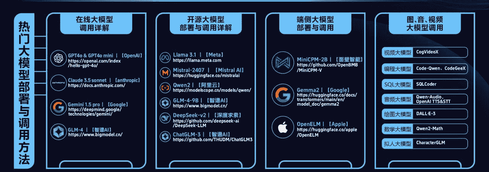
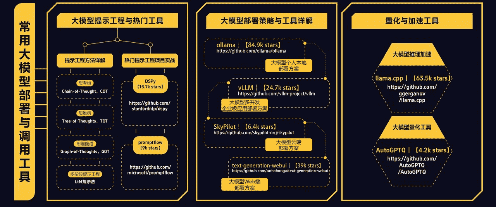
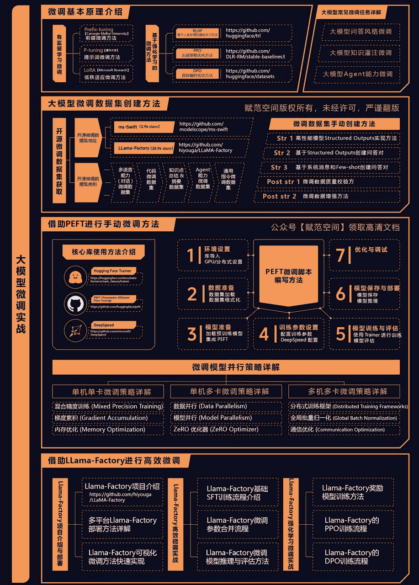
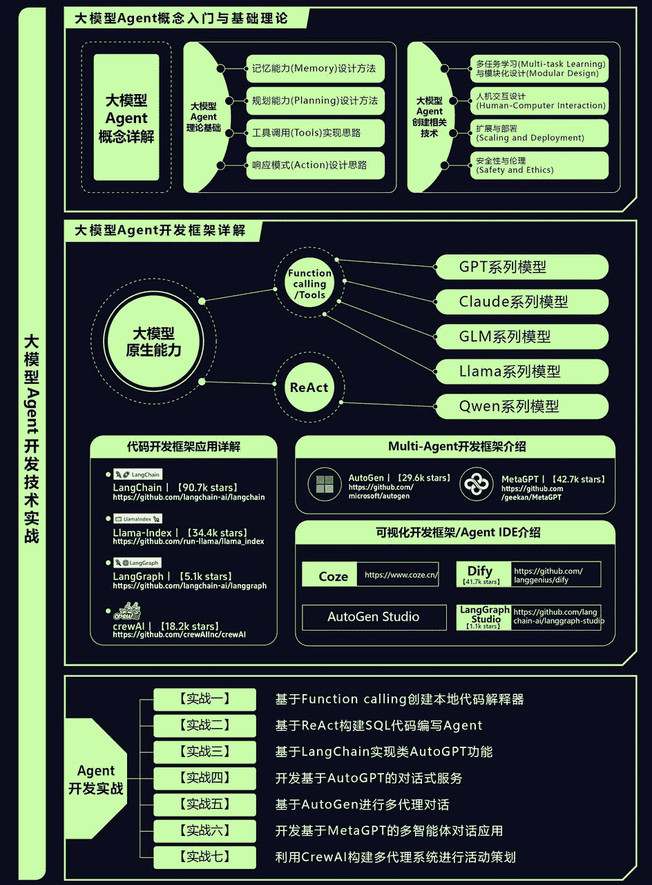
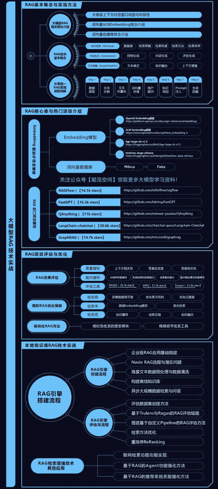
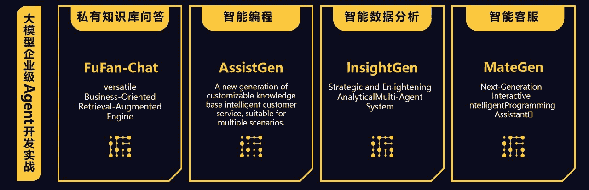

# 赋范2024大模型技术全景地图

> 来源：[https://kq4b3vgg5b.feishu.cn/docx/Lmjhd9Eppoov9HxQ2vRczi7onQg](https://kq4b3vgg5b.feishu.cn/docx/Lmjhd9Eppoov9HxQ2vRczi7onQg)

**@九天Hector真人讲解**最**新大模**型**技术栈梳理！玩**转开源&在线大模型！微调、RAG、Agent开发全进阶技术详解！

| #### **2024大模型技术全景地图** |  |  |
| --- | --- | --- |
| Level 1. |  | 四大类20+模型快速介绍 |
|  |  | 大模型基础调用必备提示词策略 |
| Level 2. |  | 大模型微调技术概览 |
|  |  | 大模型Agent技术概览 |
|  |  | 大模型Rag技术概览 |
| Level 3. |  | 自研智能体[MateGen](https://kq4b3vgg5b.feishu.cn/docx/Wfnida03mol6mZxmxJ3cw11dnsg?from=from_copylink) 全家桶已上线！ |

📌 获**取完****整高清版全图**，以及更多课件、项目数据、代码等，扫码添加英英，详询哦👇

**🍻现开设了大****模型技术交流群，**扫描👆码，来遇见更多志同道合的小伙伴~

**📍 海量硬核独家技术干****货内容+****无门槛技****术交流+****不定期开设硬****核干货&前沿技术公开课**