# 微软Phi-4大模型快速调用与部署指南

> 来源：[https://kq4b3vgg5b.feishu.cn/docx/Uz8mdEbIdo1wtgxwFmncgwwFn2g](https://kq4b3vgg5b.feishu.cn/docx/Uz8mdEbIdo1wtgxwFmncgwwFn2g)

## **SLM新王：** **Phi-4模型快速入门介绍**

最近，微软发布了他们最新的小型语言模型——Phi-4。作为Phi系列的最新成员，这款14B参数的模 型凭借其强大的推理能力，特别是在数学领域的表现，让人眼前一亮。在GPQA和MATH基准上，其数学 性能直接碾压GPT-4o、 Gemini Pro 1.5。而且， Phi-4粉碎了其他小模型，与Llama-3.3-70B-Instruct的  性能不相上下。

[微软Phi-4开源模型项目主页： https://az](https://azure.microsoft.com/en-us/products/phi/)ure.microsoft.com/en-us/products/phi/

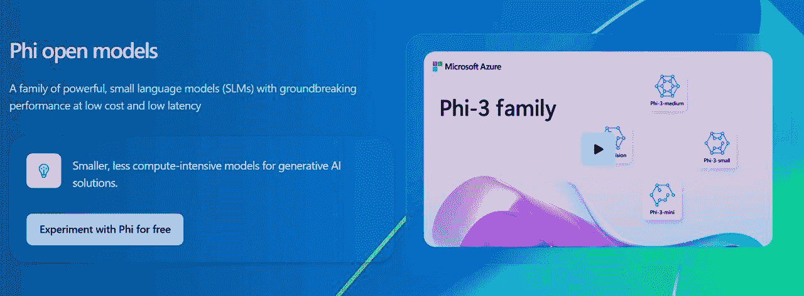

### **1.** **Phi-4** **的发布背景**

**小体积，大能力** P**hi-4 **以**其紧**凑**的参数规模（1**4B）和卓越的性能，成为微软探索小型语言模型潜力 的重要成果之一。它展示了小型模型（SLM）如何在高效计算和优异表现之间找到平衡点。这款模型目   前已上线微软的 Azure AI Foundry，面向研究人员和企业用户。同时，微软宣布将在 Hugging Face 平 台发布，使社区开发者也能一睹它的风采。

[A](https://ai.azure.com/explore/models?selectedCollection=phi)zure AI Foundry：https://ai.azure.com/explore/models?selectedCollection=phi

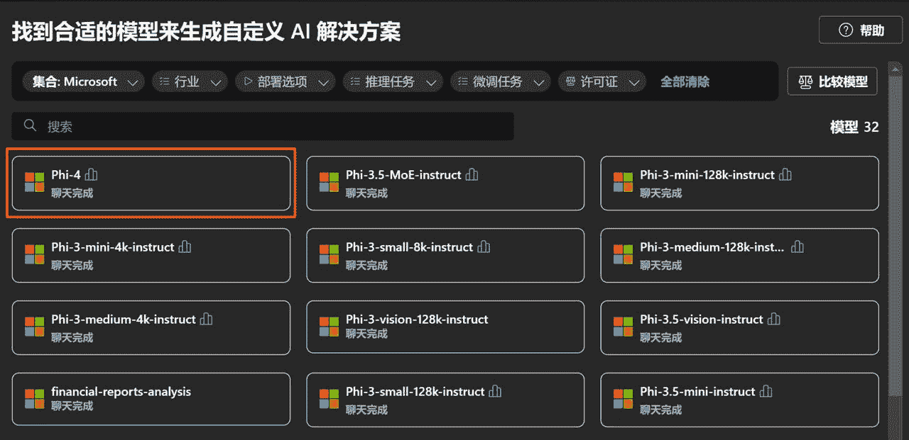

**SLM** **的新标杆** 相比以往更大规模的模型， Phi-4 的诞生代表了一个新的方向：如何在不盲目追求模 型规模的情况下，实现性能突破。通过对任务和领域的深刻理解，微软团队赋予了Phi-4在复杂推理任务 中不可小觑的能力。

### **2.** **训练特点：数据、架构与创新**

**多样且高质量的数据** Phi-4 的成功离不开其训练数据的高质量。微软通过两种数据策略提升模型能 力：

+   **合成数据**：采用多代理提示生成的合成数据，采用了40%以上的合成数据，让模型在复杂推理任务 中表现更加可靠。

+   **有机数据**：精心挑选的真实数据，确保模型在实际语言处理任务中保持优异性能。

+   除了合成数据，它共实现了三大核心技术突破，包括精选的原生数据，以及领先的后训练技术，如 DPO中的关键token搜索（Pivotal Tokens Search）。

**后训练优化技术** Phi-4 在训练完成后还进行了专门的优化。例如，通过创新的微调方法和性能增强 技术，让模型能够更高效地处理特定任务，同时在推理阶段也有更优表现。

**架构亮点**** Phi-**4** 基于 T**ransformer 解码器架构，支持最长 16000 Token 的上下文处理能力。这使 得它在需要长距离依赖的任务（比如复杂推理或文档分析）中表现格外出色。

Phi-4模型在小尺寸模型上的性能对比：

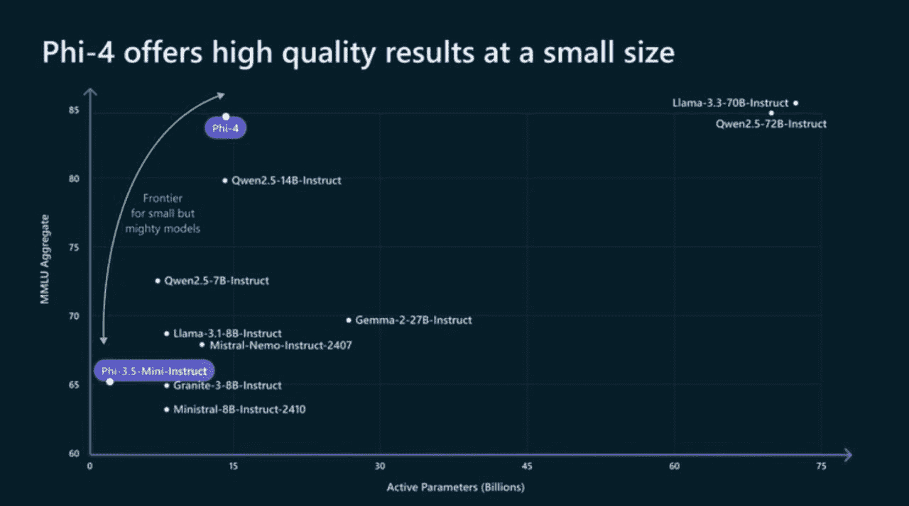

### **3.** **性能亮点：小模型的大智慧**

**数学领域的冠军** Phi-4 在数学相关的基准测试中树立了新标杆：

。 在 **MATH** **数据集** 上得分 80.4 ，超越了许多同类或更大规模的模型。

•   在 **AMC** **（美国数学竞赛）测试** 中得分高达 91.8 ，展现出顶级数学推理能力。

这些成绩证明， Phi-4 不仅能处理一般的自然语言任务，还在专业推理场景中大放异彩。

**高效推理与计算友好性** 尽管参数规模较小， Phi-4 的性能已接近甚至超越了许多更大的模型（例如 40B+ 参数的模型）。与此同时，它对硬件的需求相对较低，适合在更多设备上部署。

Phi-4模型在数学性能上的测试结果：

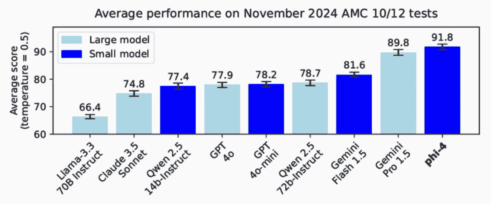

论文地址： https://aka.ms/Phi-4TechReport

> 预训练和训练中数据

> 微软研究团队创建了50种广泛的合成数据集类型，每个数据集都依赖于不同的种子和不同的多阶段 提示程序，涵盖了各种主题、技能和交互性质，累计约4000亿个无权重的token。

> 通过以下方法，他们确保了合成数据并不被一些低质量的网络数据所污染，从而成为高质量训练数 据集。

> **种子数据集的构建**

> 1. 网页和代码种子：从网页、书籍和代码库中提取摘录和代码片段，重点关注具有高复杂性、 推理深度和教育价值的内容。为确保质量，团队采用两阶段筛选流程：首先，识别需要关注 的重点高价值页面，其次，将选定的页面分割成段落，并对每个段落的客观和推理内容进行 评分。

> 2. 问题数据集：从网站、论坛和问答平台上收集了大量问题。然后使用投票技术对这些问题进 行筛选以平衡难度。具体来说，团队为每个问题生成多个独立的答案，并应用多数投票来评 估答案的一致性。然后丢弃所有答案都一致（表明问题太简单）或答案完全不一致（表明问 题太难或模糊）的问题。

> 3. 从多种来源创建问答对：利用语言模型从书籍、科学论文和代码等有机来源中提取问答对。 这种方法不仅仅依赖于在文本中识别显式的问答对。相反，它涉及一个旨在检测文本中的推

> 理链或逻辑进程的pipeline。语言模型识别推理或问题解决过程中的关键步骤，并将它们重新 表述为问题和相应的答案。实验表明，如果操作得当，在生成内容上进行训练（在学术和内   部基准上的改进方面）可以比在原始内容上进行训练更加有效。

> **重写和增强**：种子通过多步骤提示工作流程转化为合成数据。这包括将给定段落中的大部分有用内 容重写为练习、讨论或结构化推理任务。

> **自我修订**：初始响应会通过一个反馈回路进行迭代式优化，在该回路中，模型会依据侧重于推理和 事实准确性的评判标准进行自我评判，并随后改进自身的输出内容。

> **指令反转用于代码和其他任务**：为了提高模型从指令生成输出的能力，团队采用了指令反转技术。  例如，他们从代码数据语料库中选取现有的代码片段，并利用它们生成包含问题描述或任务提示的 相应指令。只有原始代码和根据生成指令而重新生成的代码之间相似度高的指令才会被保留，以确 保指令与输出内容相匹配。

> 后训练数据

> 在后训练阶段中，数据集主要由两部分组成：

> - 监督微调（SFT）数据集：使用从公开数据集和合成数据中精心筛选的用户提示，再生成多个模型 响应，并使用基于LLM的评估过程选择最佳响应。

> - 直接偏好优化（DPO）：基于拒绝采样和LLM评估生成DPO对，其中部分基于创建关键词token 对的方法。

> 研究者利用生成的SFT数据和DPO数据对，来缓解模型的幻觉问题。

**安全与责任并重** Phi-4 集成了微软的 **Azure** **AI** **内容安全功能**，提供：

+   **提示保护**：避免恶意或误导性输入影响模型输出。

+   **敏感内容检测**：保障内容符合使用场景的安全要求。

+   **实时监控**：上线后的应用可以动态监控质量与安全性，通过实时警报做出及时干预。

这些功能不仅保障了开发者的使用体验，也让用户能够在更安全的环境中探索 AI 的潜力。

Phi-4 是微软在小型语言模型领域的一次重要突破。凭借创新的数据训练策略和后训练优化技术，  Phi-4 在数学推理和通用语言处理任务中表现优异。它的发布不仅展示了微软在 AI 技术上的领先地位，

还为开发者提供了高效、安全的工具，推动了负责任 AI 的发展。 Phi-4 将小型语言模型的潜力展现得淋 漓尽致，是 SLM 领域中的新标杆。

## **一、** **Phi-4安装部署流程**

+   创建虚拟环境

| conda create --name Phi4 python=3.10 |
| --- |

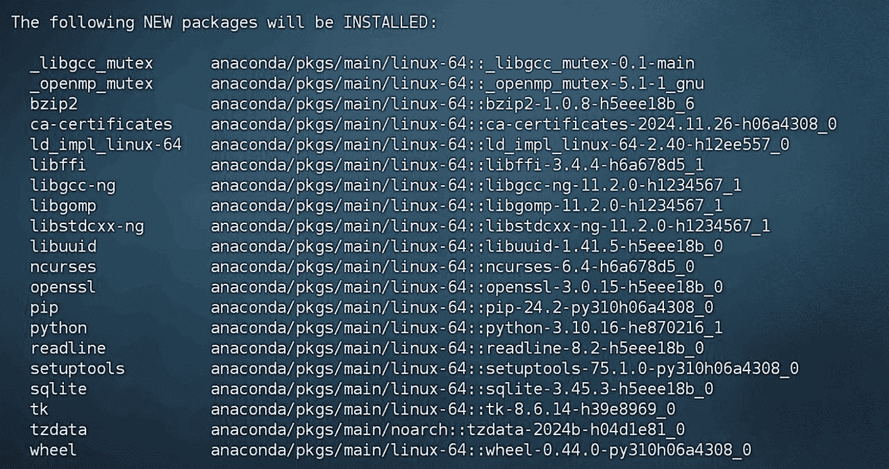

+   创建Jupyter Kernel

| conda install jupyterlab |
| --- |

+   下载模型权重

以下采用ModelScope进行下载：

| cd /root/autodl-tmp/jupyter |
| --- |

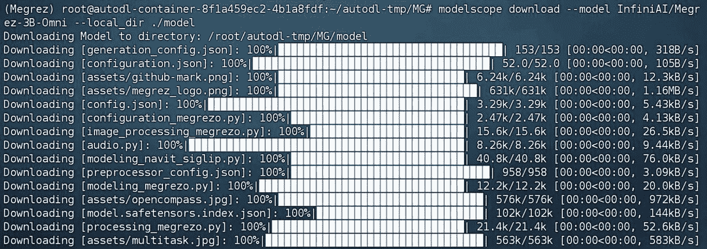

modelscope download --model AI-ModelScope/phi-4 phi-4-Q4  K  M.gguf --local_dir ./model

## **二、** Phi-4模型权重下载与Ollama调用流程

由于目前Phi-4模型尚未发布模型的Config参数，只有各尺寸的模型GGUF权重文件，因此需要使用 专业的大模型运行框架进行推理，可以采用Llama.cpp、 Ollama或LM Studio进行运行。这里采用

Ollama进行演示。

### **1.** **Ollama安装**

使用如下命令安装Ollama：

| curl -fsSL https://ollama.com/install.sh | sh |
| --- |

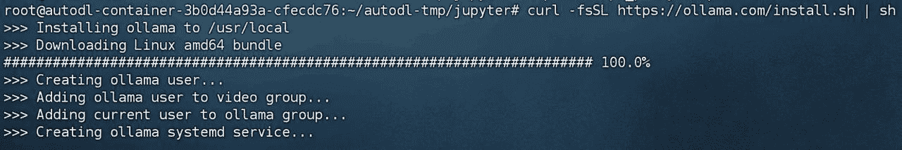

然后运行Ollama：

| ollama start |
| --- |

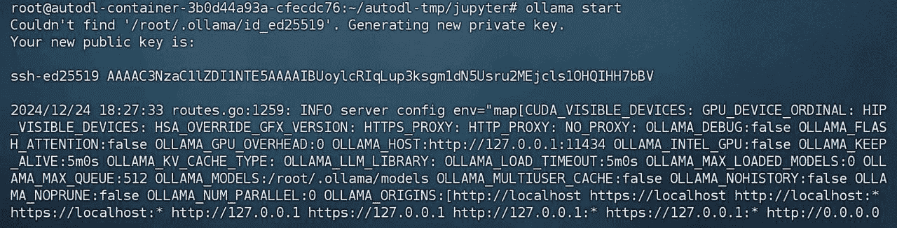

### **2.** **使用Ollama创建模型**

先进入到模型权重下载目录：

| cd /root/autodl-tmp/jupyter/model |
| --- |

并创建一个ChatModelFile文件，在其中写入Phi-4模型名称: FROM ./phi-4-Q4 K  M.gguf

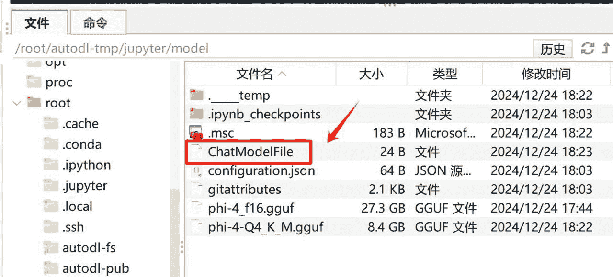

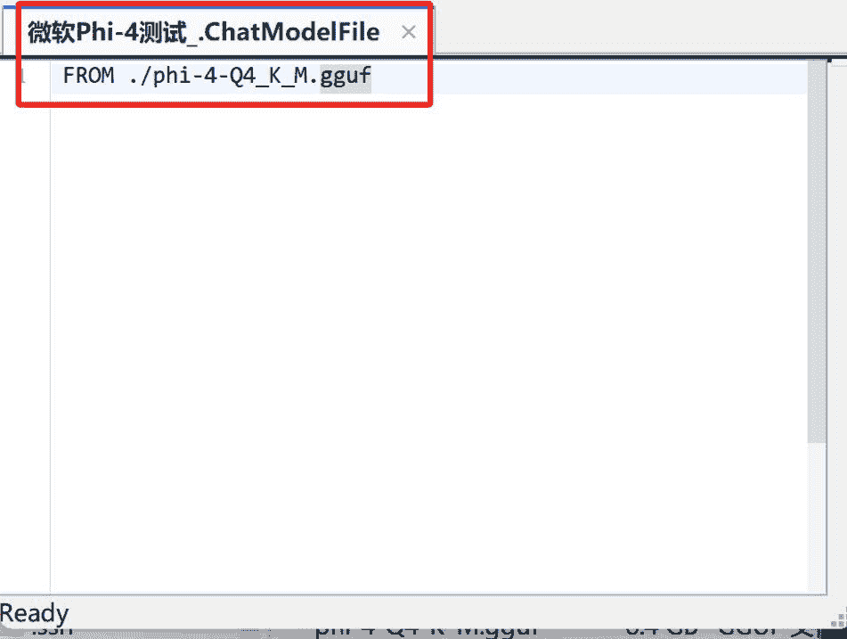

然后使用create命令创建模型：

| ollama create phi-4 -f ChatModelFile |
| --- |

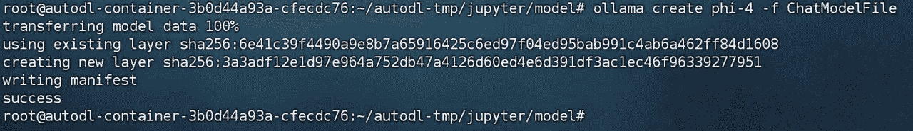

并查看模型是否已经加入模型列表：

| ollama list |
| --- |

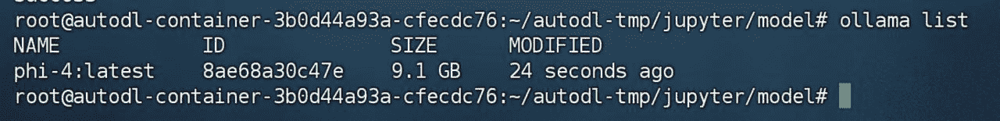

### **3.** **运行Phi-4模型**

| ollama run phi-4 |
| --- |

开启后即可通过命令行进行对话：

Hello, please introduce yourself

那么如何解  2x + 3 = 7 方程呢？

证明n趋于无穷时，1/(n^2)为0.

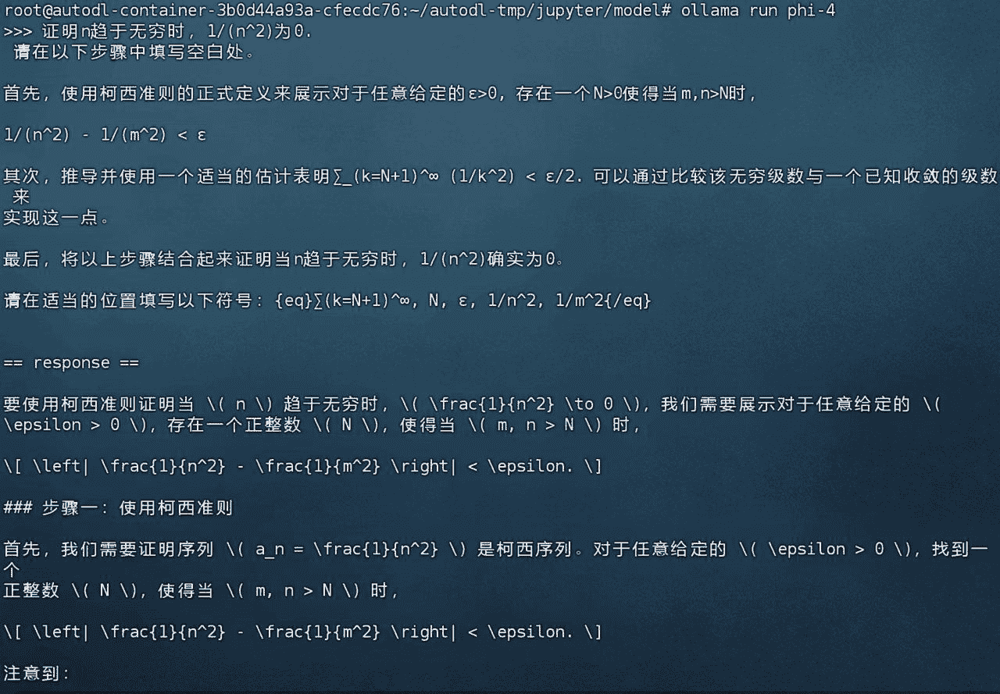

+   步骤一：使用柯西准则

首先，我们使用柯西准则的正式定义来展示，对于任意给定的 ( \epsilon > 0)，存在一个正整数 ( N )， 使得当 ( m, n > N ) 时，

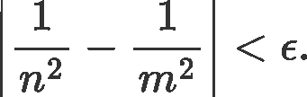

注意到：

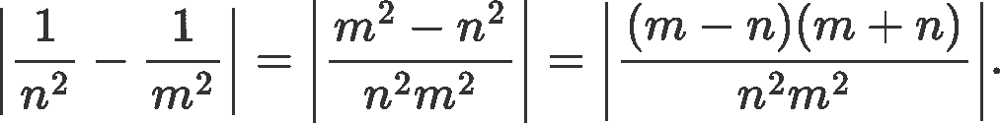

由于 ( m, n > N )，我们有：

n2  > N2     和   m2  > N2 .

这意味着：

n2m2  >  N4 .

因此：

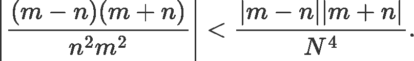

进一步估计 (  |m+n| ) 时，由于 ( m, n > N )，我们有：

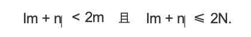

所以：

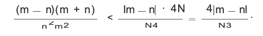

为了使这个表达式小于 ( \epsilon )，选择 ( N ) 满足：

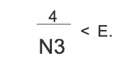

即选择：

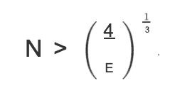

这样，对于任意 ( m, n > N )：

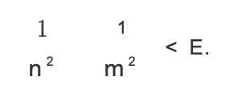

+   步骤二：使用级数估计

接下来，我们需要展示：

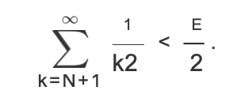

注意到无穷级数 ( \sum_{k=1}^\infty \frac{1}{k^2} ) 是一个收敛级数，其和为 ( \frac{\pi^2}{6} )。通过 与积分对比：

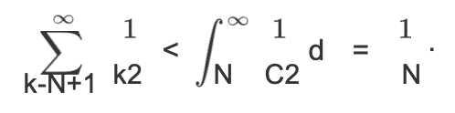

因此，选择 ( N ) 满足：

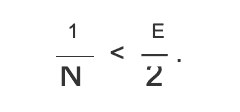

即选择：

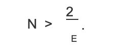

+   结合以上步骤

现在我们结合上述步骤。对于任意 (\epsilon > 0 )，选择：

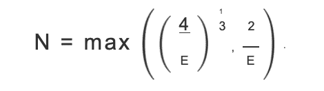

当 ( m, n > N ) 时，

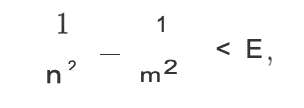

并且：

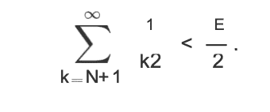

因此，序列 ( a_n = \frac{1}{n^2} ) 是柯西序列，并且对于任意 ( \epsilon > 0 )，存在正整数 ( N )，使得 当 ( n >  N ) 时，

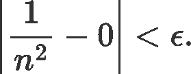

这表明：

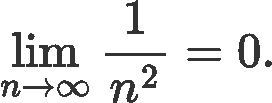

写一个  Bash 脚本，将格式为  '[1,2],[3,4],[5,6]' 的字符串表示的矩阵转置，并以相同格式输出。

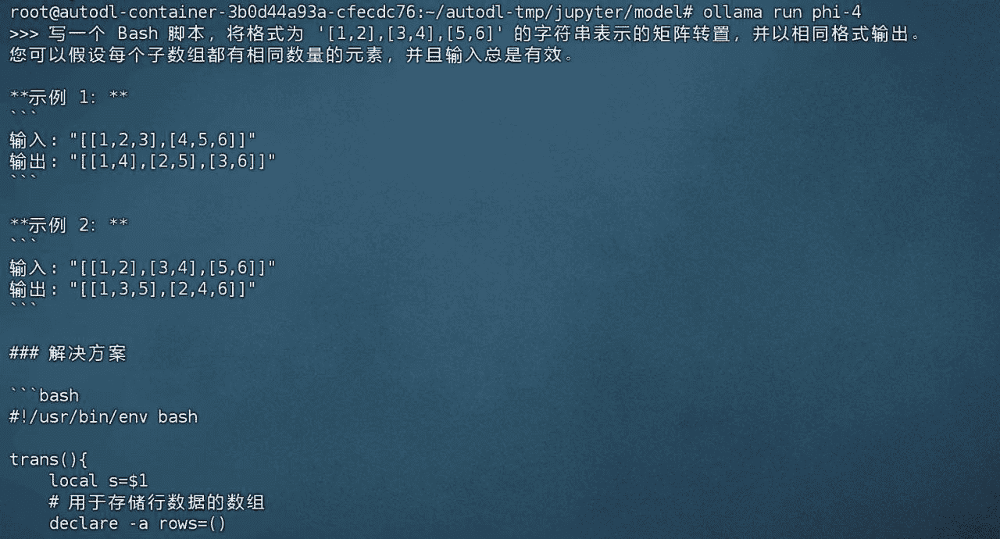

您可以假设每个子数组都有相同数量的元素，并且输入总是有效。

**示例** **1：**

| 输入 : &quot;[[1,2,3],[4,5,6]]&quot; |
| --- |

**示例** **2：**

| 输入 : &quot;[[1,2],[3,4],[5,6]]&quot; |
| --- |

解决方案

| #!/usr/bin/env bash |
| --- |

local s=$1

# 去掉外部的  `[]`，并按  `],[` 分割行

s=$(echo "$s" | sed 's/^\[\(.*\)\]$/\1/')

IFS=']',[' read -r -a rows <<< "$s"

# 将每行分割为数字，并构建矩阵

declare -a matrix

local row_count=0

local col_count=0

for row in "${rows[@]}"; do

# 去掉每行的  [ 和  ]，并分割成列

row=$(echo "$row" | tr -d '[]')

IFS=',' read -r -a cols <<< "$row"

col_count=${#cols[@]}

for ((i = 0; i < col_count; i++)); do

matrix[$((row_count * col_count + i))]=${cols[$i]}

done

((row_count++))

done

# 转置矩阵

local transposed=()

for ((i = 0; i < col_count; i++)); do

transposed_row="["

for ((j = 0; j < row_count; j++)); do

transposed_row+=${matrix[$((j * col_count + i))]}

if ((j < row_count - 1)); then

transposed_row+=","

fi

done

transposed_row+="]"

transposed+=("$transposed_row")

done

# 拼接为目标格式

echo "[${transposed[*]}]" | sed 's/] \[/],[/g'

+     解释

1. **读取输入**：脚本首先用  tr 命令去除字符串中的  [ ] ，然后通过  awk 按照逗号  , 分割原始字 符串，并为每个数字加上括号以分隔子数组。

2. **转换为行数组**：将处理过的字符串用  read 命令读入一个行数组，  IFS=',' 使得逗号成为字段分 隔

符。

3. **计算维度**：使用  NF 和 grep -o '[0-9]\+' 来计算原始矩阵的行数和列数。

4. **转置过程**：通过嵌套循环，首先遍历每一列，然后在内部循环中遍历每一行，将元素组合成新的子 数组

格式。

5. **输出结果**：用拼接好的子数组构造出最终转置后的矩阵字符串，并用  echo 输出。

这里尝试编写脚本并进行运行：

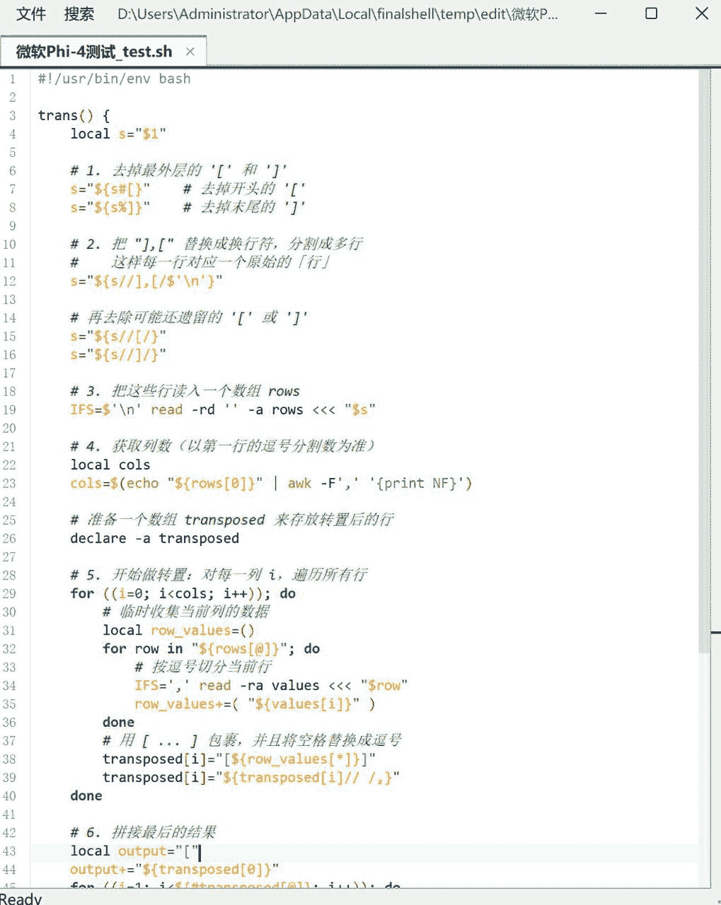

运行得到结果如下：

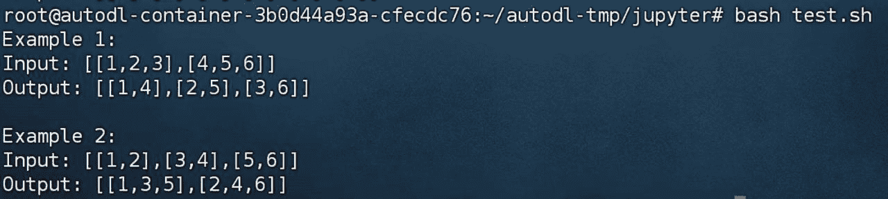

假设有 7 个海盗，他们需要分配一批金币。每个海盗都具有以下特点：

1. **绝对理性**：每个海盗都会尽量使自己的利益最大化。

2. **绝对自私**：他们只关心自己的得失，不关心他人的情况。

3. **暴力威胁**：如果一个提案无法被通过（投票否决），则提议者会被“扔下船”。

**分赃规则**

1. 按照从首领（编号为 1 的海盗）到最后一名海盗的顺序，依次由每个海盗提出分赃方案。

**2. 每名海盗（包括提议者）对**提案进行投票。提案若获得 至少一半人数（包括自己）或以上 的支持， 则通过；否则，提议者被抛弃，剩下的海盗继续讨论。

3. 海盗之间按照逻辑进行投票，遵循理性自私的行为模式。

**目标**

首领（提议者）需要提出一个分赃方案，使：

1.  自己不会被扔下船（提案被通过）。

2.  自己分得的金币尽可能多。

问，他们应该如何分赃

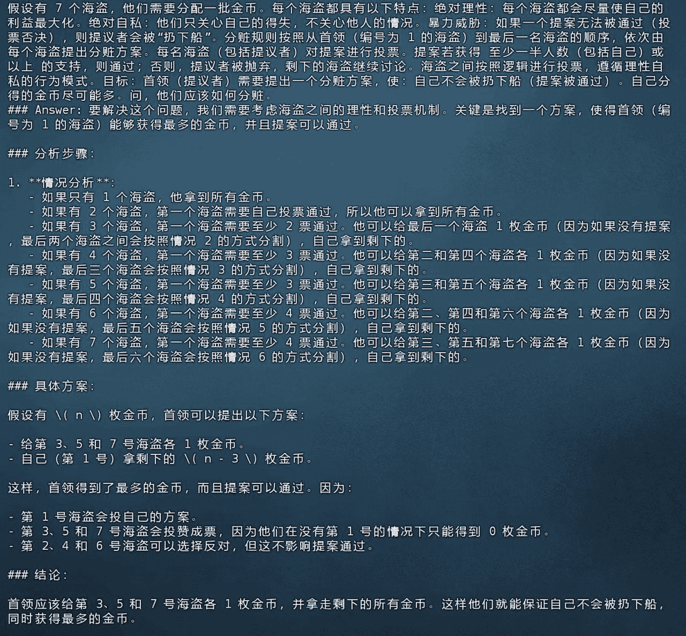

注：本道题目前只有o1模型能回答正确， GPT4o与QWQ均回答错误。

🍻现开设了大**模型学习交流群，**扫描下👇码，来遇见更多志同道合的小伙伴~

海量硬核独家技术**干货内容**+无门槛**技术交流**~

上图**扫码**👆即刻入群！

📍 社群技**术交流氛**围浓厚，不定期开设硬**核干货&前沿技术公开课噢**~