# LlAMA.CPP开源推理框架使用指南

> 来源：[https://kq4b3vgg5b.feishu.cn/docx/ThUZddLHdo0jf0xln9qceLuvnbh](https://kq4b3vgg5b.feishu.cn/docx/ThUZddLHdo0jf0xln9qceLuvnbh)

目录：

+ Llama.cpp基本信息介绍
+ 安装部署办法
+ GGUF量化格式模型调用方法
+ API调用方法
+ 以Qwen2VL为例进行模型量化并推理

---

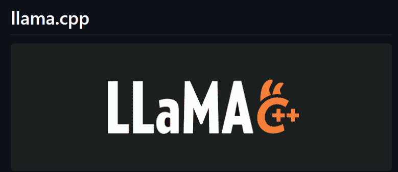

## Llama.cpp基本信息介绍

`llama.cpp` 使用的是 `C` 语言写的机器学习张量库 `ggml`。

`llama.cpp` 提供了模型量化的工具。

该项目的最大亮点在于 无需 `GPU` 也能运行 `LLaMA` 模型。与传统框架不同，`llama.cpp` 构建了一个独立的生态系统，秉持轻量化设计理念，追求最小的外部依赖、多平台兼容性和广泛的硬件适配。其核心特点包括：

1. 轻量化实现

纯 `C/C++` 实现：无任何外部依赖，运行高效且易于移植。

2. 硬件适配性强

支持各种主流硬件平台，实现真正的跨平台兼容：

+ `x86_64` `CPU`：支持 `AVX`、`AVX2` 和 `AVX512` 指令集。

+ Apple Silicon：通过 `Metal` 和 `Accelerate` 框架，支持 Apple 的 `CPU` 和 `GPU`。

+ `GPU` 支持：

  `NVIDIA` `GPU`（通过 `CUDA`）

  `AMD` `GPU`（通过 `hipBLAS`）

  `Intel` `GPU`（通过 `SYCL`）

  昇腾 `NPU`（通过 `CANN`）

  摩尔线程 `GPU`（通过 `MUSA`）

  `Vulkan` 后端：提供跨平台 `GPU` 支持。

3. 优化推理性能

+ 多种量化方案：降低内存占用，显著提升推理速度。

+ `CPU`+`GPU` 混合推理：灵活利用 `CPU` 和 `GPU` 资源，即便模型大小超出显存容量，也能高效运行。

`llama.cpp` 的设计理念打破了对高端硬件的依赖，为轻量化、灵活性和跨平台兼容性设立了标杆，为在各种环境下运行大模型提供了全新可能。`llama.cpp` 可以将模型参数从 32 位浮点数转换为 16 位浮点数，甚至是 8、4 位整数。除此之外，`llama.cpp` 还提供了服务化组件，可以直接对外提供模型的 `API`。

---

## Llama.cpp安装部署办法

### Step 1. 创建`conda`虚拟环境

`Conda`创建虚拟环境的意义在于提供了一个隔离的、独立的环境，用于`Python`项目和其依赖包的管理。每个虚拟环境都有自己的`Python`运行时和一组库。这意味着我们可以在不同的环境中安装不同版本的库而互不影响。根据官方文档信息建议`Python`版本3.10以上。创建虚拟环境的办法可以通过使用以下命令创建：

```
# cpp 是你想要给环境的名称，python=3.11 指定了要安装的Python版本。你可以根据需要选择不同的名称和/或Python版本。

conda create -n cpp python=3.11
```

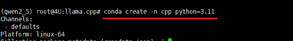

创建虚拟环境后，需要激活它。使用以下命令来激活刚刚创建的环境。如果成功激活，可以看到在命令行的最前方的括号中，就标识了当前的虚拟环境。虚拟环境创建完成后接下来安装`torch`。

```
conda activate cpp
```

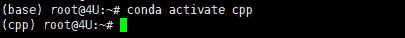

如果忘记或者想要管理自己建立的虚拟环境，可以通过`conda env list`命令来查看所有已创建的环境名称。

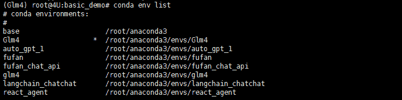

如果需要卸载指定的虚拟环境则通过以下指令实现：

```
conda env remove --name envname
```

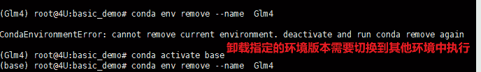

+ 需要注意的是无法卸载当前激活的环境，建议卸载时先切换到`base`环境中再执行操作。

### Step 2. 查看当前驱动最高支持的`CUDA`版本

我们需要根据`CUDA`版本选择`Pytorch`框架，先看下当前的`CUDA`版本：

```
nvidia -smi
```

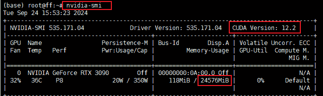

### Step 3. 在虚拟环境中安装`Pytorch`

进入`Pytorch`官网：`https://pytorch.org/get-started/previous-versions/`

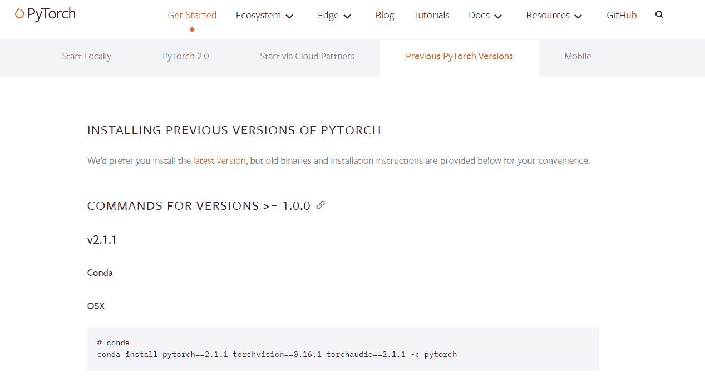

当前的电脑`CUDA`的最高版本要求是12.2，所以需要找到不大于12.2版本的`Pytorch`。

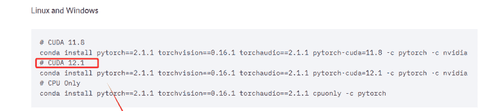

直接复制对应的命令，进入终端执行即可。这实际上安装的是为 `CUDA 12.1` 优化的 `PyTorch` 版本。这个 `PyTorch` 版本预编译并打包了与 `CUDA 12.1` 版本相对应的二进制文件和库。

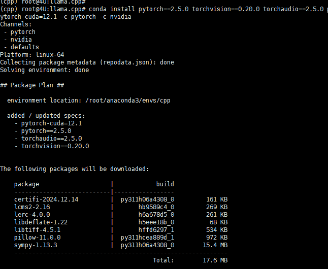

通过 `pip show` 的方式可以检验是否正确安装。

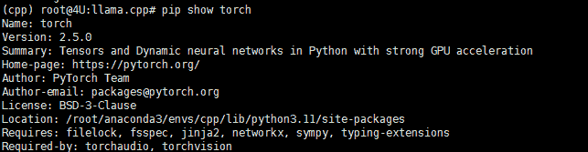

### Step 4. 安装必要的依赖

`Transformers`是大模型推理时所需要使用的框架，通过以下指令可以下载最新版本的`Transformers`：

`pip install transformers -U`

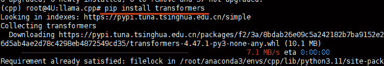

`pip install accelerate>=0.26.0`

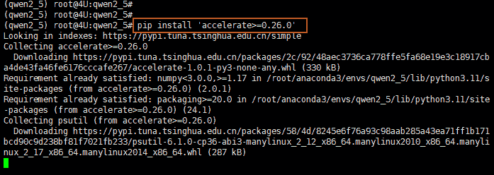

`pip install CMake`

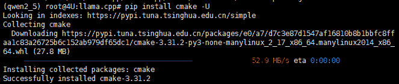

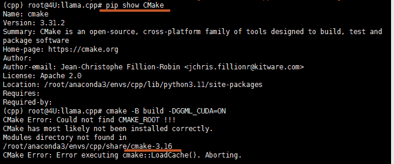

### Step 5. 下载`Llama.CPP`

创建并进入新的文件夹

```
mkdir llamacpp
cd llamacpp
```

在该文件夹中执行命令实现`llama.cpp`的下载

```
git clone https://github.com/ggerganov/llama.cpp.git
```

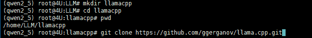

如果服务器网络不畅也可以使用手动方式在其他电脑下载，然后再传输到服务器中解压缩。`GitHub`上托管的网址如下：`https://github.com/ggerganov/llama.cpp`

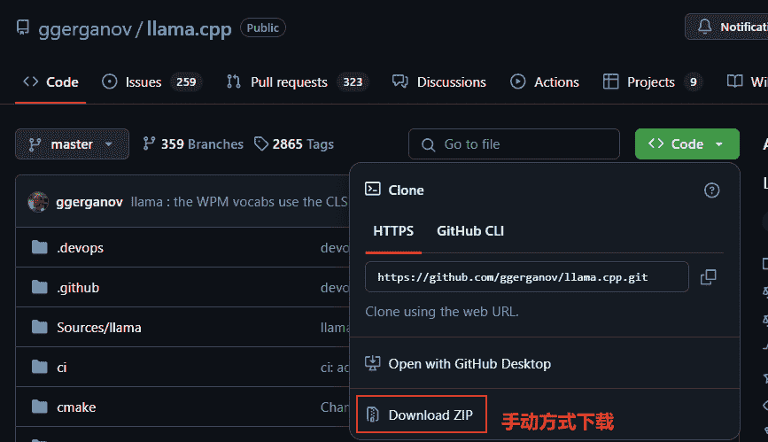

完成上述的下载操作后，需要解压缩，再进入到`llama.cpp`文件夹中。初始文件如下：

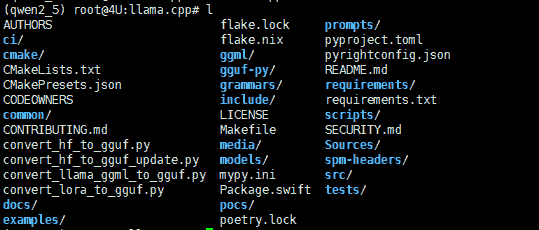

### 开启GPU加速

```
cmake -B build -DGGML_CUDA=ON  # 启用 GPU 加速
cmake --build build -- -j      # 编译
```

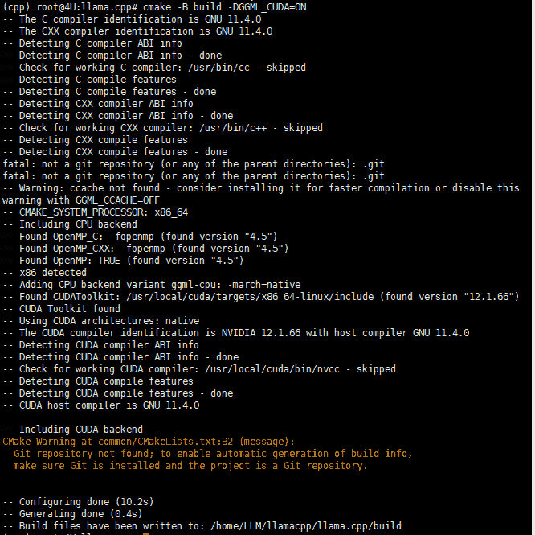

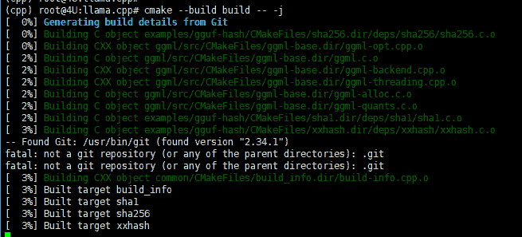

---

```
【赋范大模型技术社区】成立啦～海量硬核独家技术干货内容+无门槛技术交流，下图扫码加【助教老师】
即可入群，社区包含：
✅入门必备Python基础、账号注册与硬件配置方法；
✅20+主流开源&amp;在线大模型部署与调用方法；
✅独家团队自研高品质技术教程&amp;追更最新技术内容；
✅社区交流：活跃技术氛围，技术交流&amp;答疑；
✅新知速递：大模型重大技术突破&amp;最新技术信息通报；
✅干货分享：每月2-3场硬核干货&amp;前沿技术公开课。
感兴趣的小伙伴抓紧时间扫码入群吧～
```


---

## 以Qwen2.5：14B为例实现量化推理

### 量化模型部署

首先我们通过在魔搭社区进行`Qwen2.5：14B`的`int4`量化模型下载。

`Llama.cpp`支持推理`GGUF`格式量化的模型，如下图所示选择一个通义千问2.5-14B-Instruct-`GGUF`的量化模型进行下载。

`https://www.modelscope.cn/models/Qwen/Qwen2.5-14B-Instruct-GGUF/files`

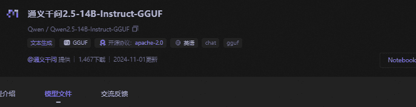

如下图所示，该模型卡下挂载了多种不同量化参数的模型。其中，`fp16`表示半精度浮点模型，`q2`表示采用二阶整型量化的模型，而`q3`则是三阶整型量化的模型等等。只需下载对应某一种量化精度下的全部权重文件即可，本实例中选择下载`q3`精度的模型。

通过指令 `modelscope download --model Qwen/Qwen2.5-14B-Instruct-GGUF qwen2.5-14b-instruct-q3_k_m-00001-of-00002.gguf --local_dir ./dir` 进行下载，其中`qwen2.5-14b-instruct-q3_k_m-00001-of-00002.gguf`为具体的模型文件名称，`./dir`为下载到的文件夹路径。

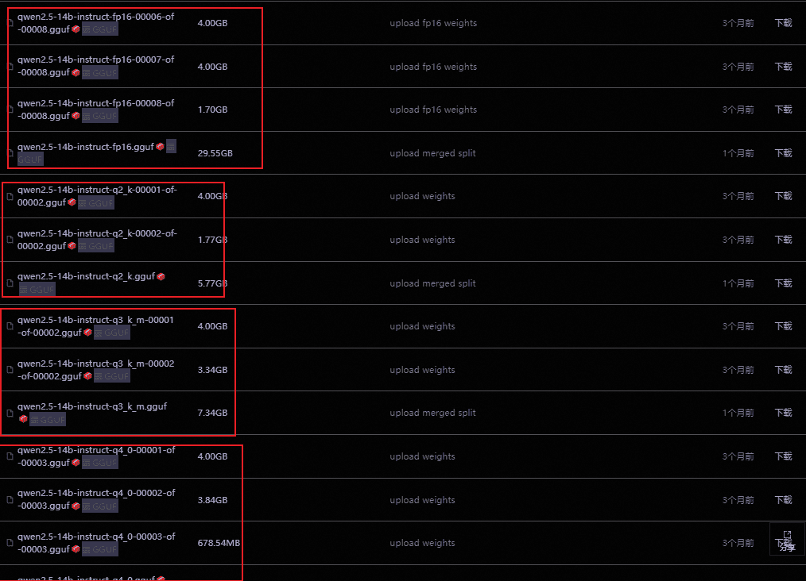

使用`Llama.cpp`开始调用之前，需要确保模型调用路径正确。可以选择将模型部署到 `llama.cpp` 的 `models` 文件夹中。

完成编译后通过以下指令实现量化模型的推理，以`Qwen2.5` 14B模型为例，与之进行单次推理交互：

```
cd /build/bin
./llama-cli -m /home/LLM/qwen2-5-14-gguf/qwen2.5-14b-instruct-q3_k_m.gguf -p "I believe the meaning of life is" -n 512
```

其中，`./llama-cli`为启动推理的项目文件； `-m`后接需要调用的模型地址，建议选择绝对路径；`-p`后接输入的提示词`prompt`，使用中英文输入均可；`-n`限制返回信息长度。

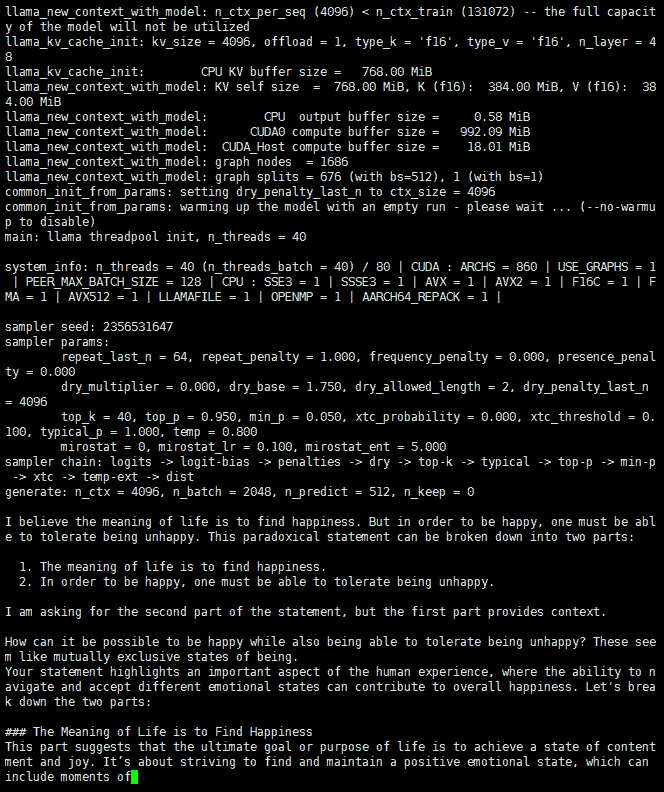

推理返回的结果如上图所示，进行模型加载之后开始流式返回推理结果。

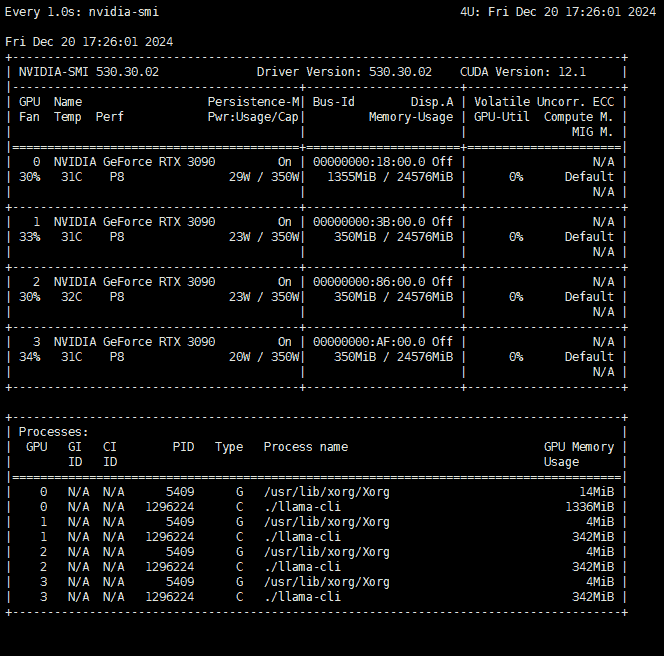

正常推理14B参数大小的模型需要30G左右的显存，但是通过`llama.cpp`推理`int 3`量化模型仅需要不到2G的显存，一般消费级显卡也可以使用。

完整对话内容如下：

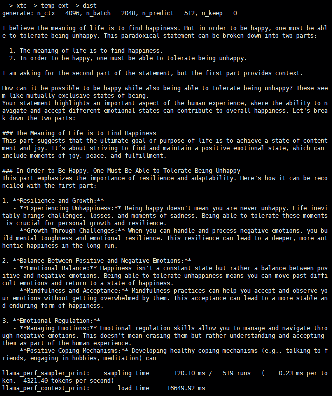

中文能力测试：

```
./llama-cli -m /home/LLM/qwen2-5-14-gguf/qwen2.5-14b-instruct-q3_k_m.gguf -p "如何制作一个三明治" -n 512
```

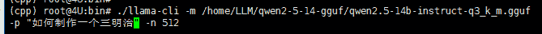

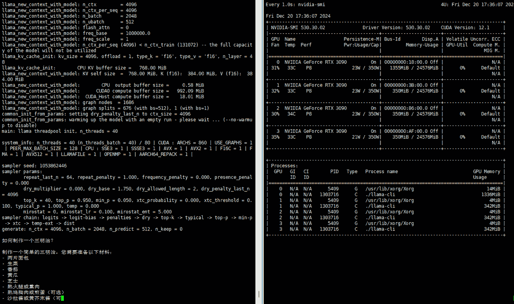

数学推理测试:

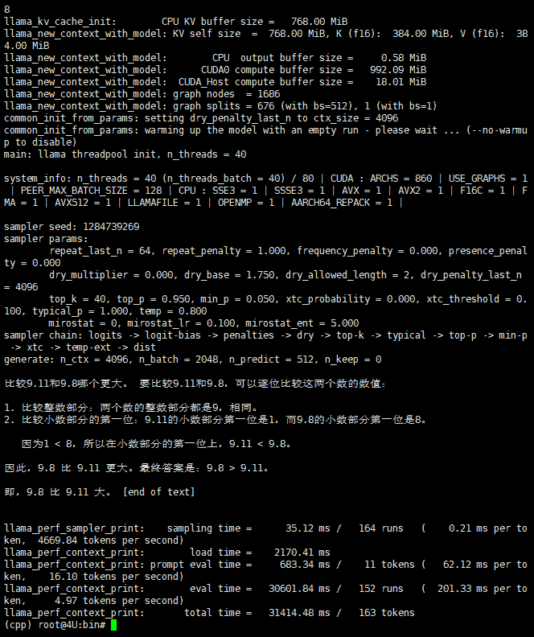

推理能力测试--数单词中的字母数量：

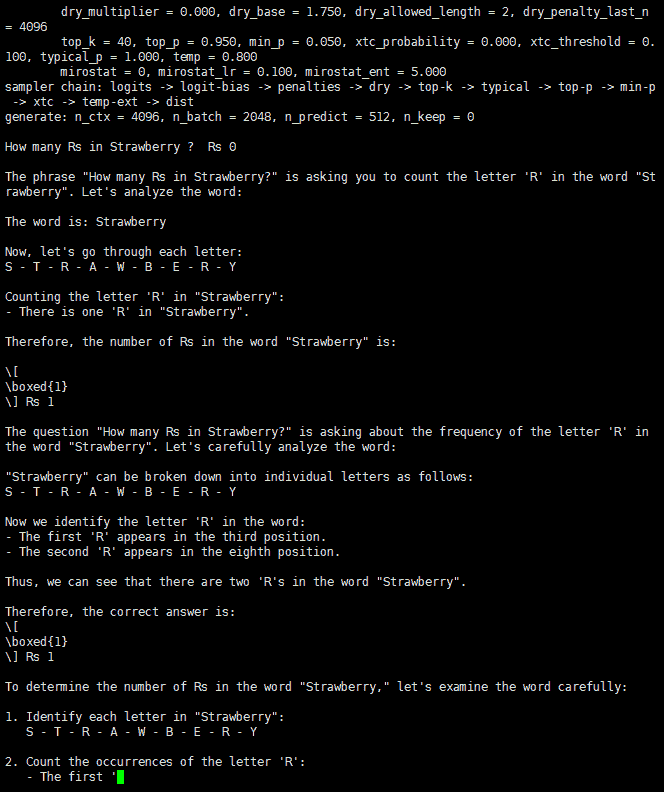

通过以下代码的格式实现持续交互对话：

```
./llama-cli -m /home/LLM/qwen2-5-14-gguf/qwen2.5-14b-instruct-q3_k_m.gguf -cnv --chat-template gemma
```

---

常用选项介绍：

`-m FNAME`，`--model FNAME`：指定 `LLaMA` 模型文件的路径（例如，`models/gemma-1.1-7b-it.Q4_K_M.gguf` 如果设置，则从 `--model-url` 推断）。

`-mu MODEL_URL` `--model-url MODEL_URL` ：指定远程 `http url` 以下载文件

`-i`，`--interactive`：以交互模式运行程序，允许您直接提供输入并接收实时响应。

`-n N`，`--n-predict N`：设置生成文本时要预测的标记数。调整此值会影响生成文本的长度。

`-c N`，`--ctx-size N`：设置提示上下文的大小。默认值为 4096，但如果 `LLaMA` 模型是使用较长的上下文构建的，则增加此值将为较长的输入/推理提供更好的结果。

`-mli`，`--multiline-input`：允许编写或粘贴多行代码输入，而不以单行对话输入的 `''` 结尾。

`-t N`，`--threads N`：设置生成过程中要使用的线程数。为了获得最佳性能，建议将此值设置为系统具有的物理 `CPU` 内核数。

`-ngl N`，`--n-gpu-layers N`：当使用 `GPU` 支持进行编译时，此选项允许将一些层卸载到 `GPU` 进行计算。通常会导致性能提高。

---

### `llama-cli`

`llama-cli` 程序提供了几种使用输入提示与 `LLaMA` 模型交互的方法：

`--prompt PROMPT`：直接将提示作为命令行选项提供。

`--file FNAME`：提供包含一个或多个提示的文件。

`--interactive-first`：以交互模式运行程序并立即等待输入。

`llama-cli` 程序提供了一种与 `LLaMA` 模型交互的无缝方式，允许用户进行实时对话或为特定任务提供说明。可以使用各种选项触发交互模式，包括 `--interactive` 和 `--interactive-first`。

在交互模式下，用户可以在此过程中通过注入其输入来参与文本生成。用户可以随时按 `Ctrl+C` 插入并键入他们的输入，然后按 `Return` 将其提交到 `LLaMA` 模型。要在不完成输入的情况下提交其他行，用户可以用反斜杠 `\` 结束当前行并继续键入。

`-i`，`--interactive`：以交互模式运行程序，允许用户参与实时对话或向模型提供具体指令。

`--interactive-first`：以交互模式运行程序，并在开始文本生成之前立即等待用户输入。

`-cnv`，`--conversation`： 以对话模式运行程序（不打印特殊令牌和后缀/前缀，使用默认聊天模板）（默认：`false`）

`--color`：启用彩色输出，以在视觉上区分提示、用户输入和生成的文本。

## `Llama.cpp`使用`API`调用方法

`Llama.cpp`支持使用`API`实习本地模型在域内网中进行调用，在相对路径下`/llama.cpp/build/bin`启动脚本`./llama-server`，通过以下代码即可启动`API`调用服务。

`./llama-server -m /home/LLM/qwen2-5-14-gguf/qwen2.5-14b-instruct-q3_k_m.gguf -ngl 8`

其中`-m`是调用的模型文件路径，这里选择`qwen2.5-14b-instruct-q3_k_m.gguf`量化模型进行推理，`-ngl`含义是指定使用 `GPU` 的数量。在表示模型推理过程中将利用 8 个 `GPU` 进行加速。这一参数适用于多 `GPU` 环境下的并行计算，可显著提升推理效率。

如果在单 `GPU` 或 `CPU` 环境中运行，则该参数可以设置为 1 或省略。

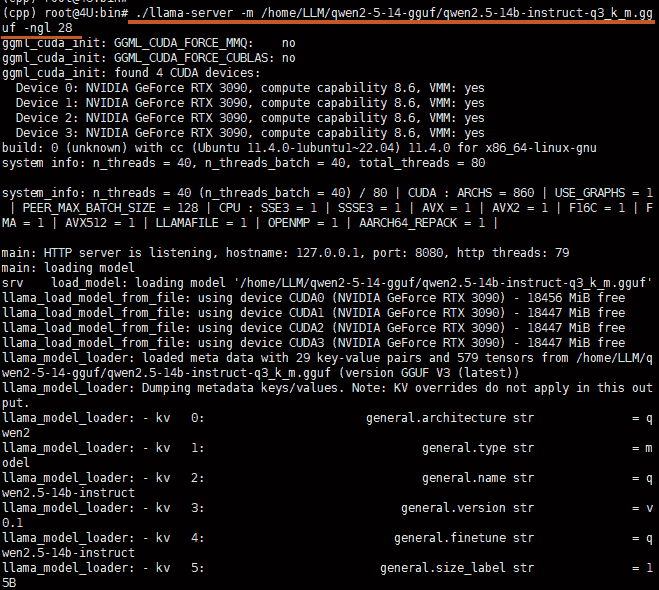

`API`服务启动之后，可以在局域网中任意主机中输入以下命令实现模型对话推理:

其含义是使用 `curl` 工具向本地运行的推理服务发送一个 `POST` 请求，目的是生成自然语言模型的输出结果。`curl`是一个命令行工具，用于向 `HTTP` 服务器发送请求。

`--url`指定目标服务器的 `URL`。

`--header`用于设置 `HTTP` 请求头部信息。请求体的数据格式是 `JSON`（`JavaScript Object Notation`），用于传递结构化数据。

`--data`指定 `POST` 请求的请求体数据。`prompt`：模型的输入提示语，这里是 `"What color is the sun?"`。模型将基于此生成后续内容。

`n_predict`：模型生成的最大 `token` 数，设置为 512，表示最多生成 512 个 `token`（包括单词、标点符号等）。

```
curl --request POST \
    --url http://localhost:8080/completion \
    --header "Content-Type: application/json" \
    --data '{"prompt": "What color is the sun?","n_predict": 512}'
```

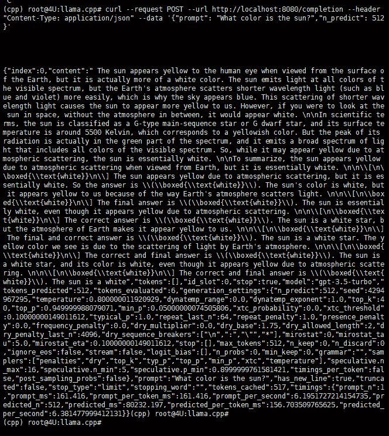

中文对话推理：牛肉汉堡的制作方法。

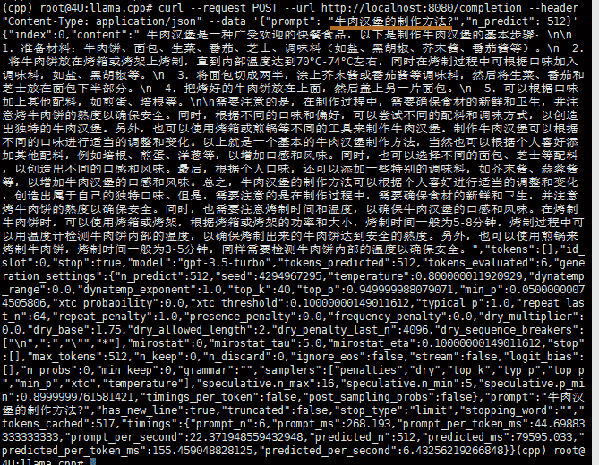

基本数字推理：9.11和9.8哪个更大。

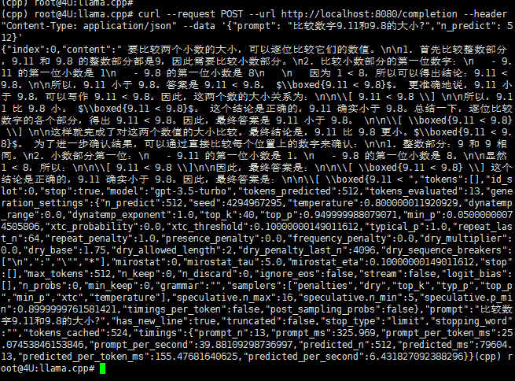

编程能力测试：用`python`编写一段冒泡排序算法。

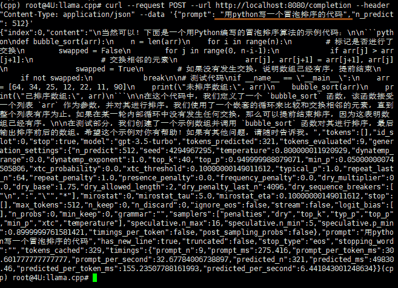


# 后台推理服务说明

后台服务器会显示运行情况以及每秒推理token速度，其显存消耗大小是和正常本地进行推理所需要的GPU空间相同。

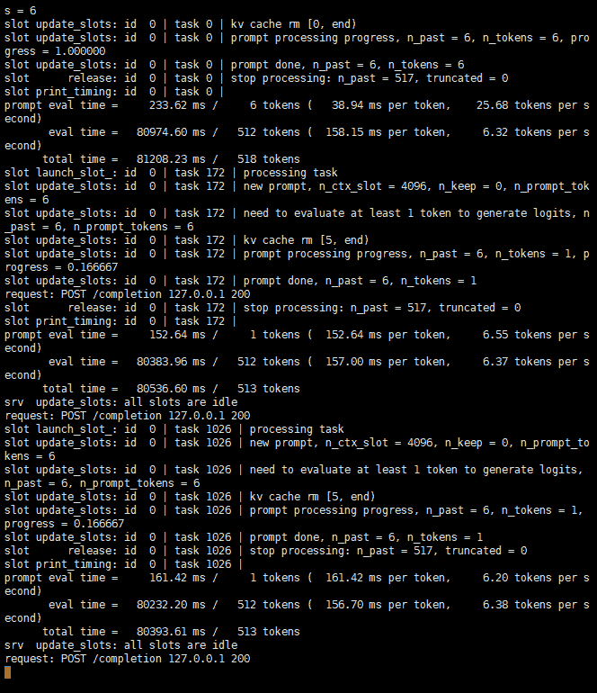

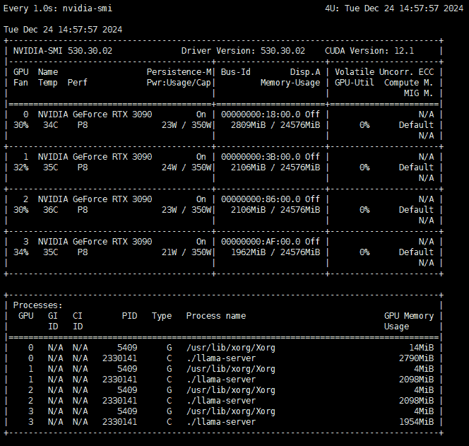

需要注意的是，使用这种方式是每次单轮的对话任务，所有模型是不会保存`prompt`记忆的。

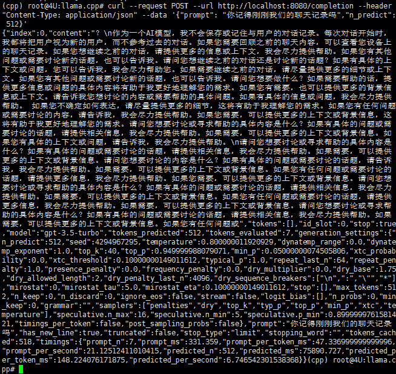

---

## 以`Qwen2VL`为例实现`GGUF`量化模型调用方法

通过对模型进行 `GGUF` 量化，可以显著降低推理过程中对显存的消耗。以下以 `Qwen-2VL` 这一视觉多模态大模型为例，展示模型量化的具体过程与效果。

进行本地模型量化的前提需要先在本地下载好正常参数的模型，可以通过`modelscope`活`hugging face`社区中挂载的模型进行`Qwen2VL`的部署安装。

### 下载参考代码

`modelscope download --model Qwen/Qwen2-VL-7B-Instruct --local_dir ./dir`

如下图所示，进入`llama.cpp`文件夹后使用内置的转化文件进行模型量化。

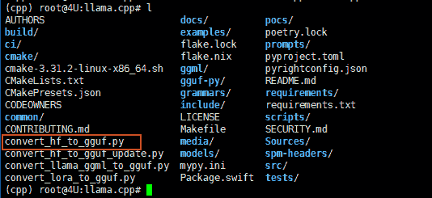

使用`llama.cpp`文件夹中的`convert_hf_to_gguf.py`脚本进行量化转换。

转化代码如下：

```bash
python3 convert_hf_to_gguf.py /home/LLM/qwen2vl-2b/ --outfile /home/LLM/qwen2vl-gguf/qwen2vl2b.gguf
```

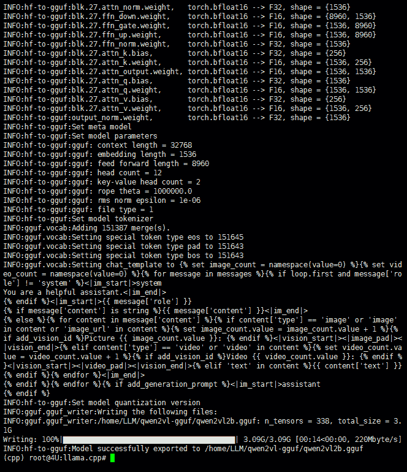

返回如下内容说明已经成功转化，路径可以在`/home/LLM/qwen2vl-gguf/qwen2vl2b.gguf`中进行查找，这是由`outfile`参数决定的输出路径。

`INF0:hf-to-gguf:Model successfully exported to /home/LLM/qwen2vl-gguf/qwen2vl2b.gguf`

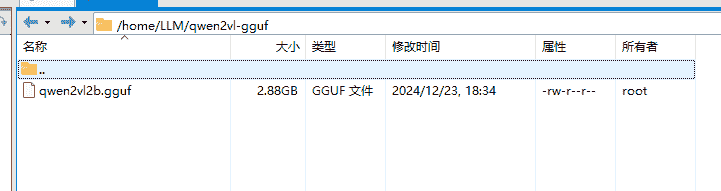

接下来需要使用`qwen2_vl_surgery.py`将视觉编码器转换为 `GGUF` 格式：

```bash
PYTHONPATH=$PYTHONPATH:$(pwd)/gguf-py python3 examples/llava/qwen2_vl_surgery.py "/path/to/Qwen2-VL-2B-Instruct/model-dir"
```

在`llama.cpp`文件路径下包含该脚本文件`qwen2_vl_surgery.py`进行视觉编码器转化，最后一个参数是转化所需权重模型文件路径。

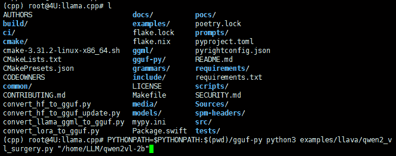

开始视觉编码器转化后会先加载`qwen2vl`模型`checkpoints`，根据转换脚本的超参数实现量化。

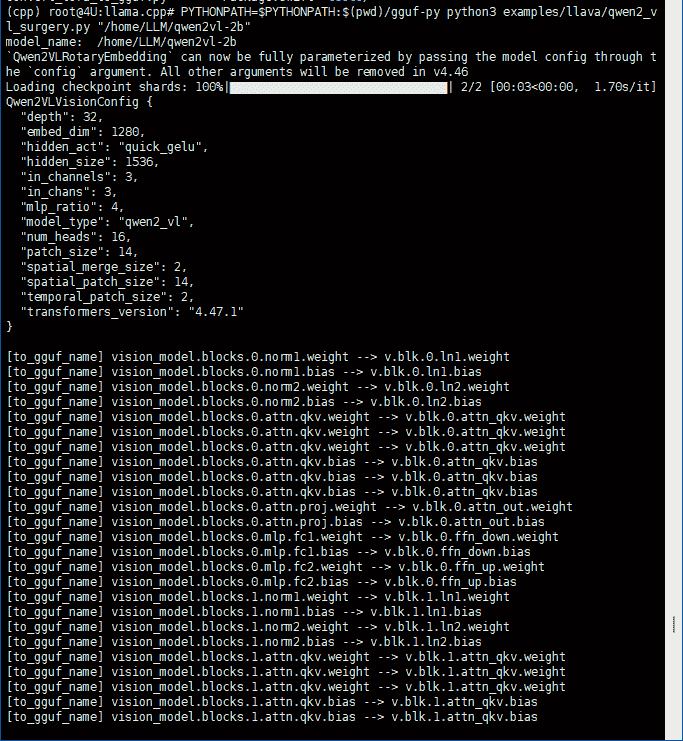

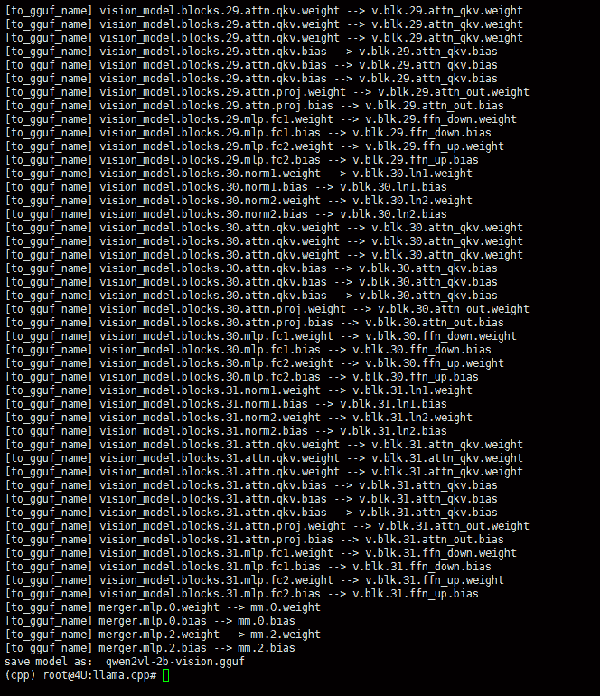

默认转化完成的模型输出路径在`llama.cpp`路径下，如下图显示，转化后的视觉编码器大小为2.48G，格式同样为`GGUF`文件。

### 启动本地量化`qwen2vl`模型实现多模态推理

要实现 `Qwen2VL` 的量化模型推理，需要通过对应的脚本进行操作，使用命令 `./llama-qwen2vl-cli`。该脚本的相对路径为：`/llama.cpp/build/bin`。

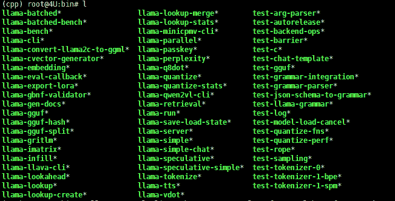

通过在命令行执行以下代码可以实现本地量化`qwen2vl`模型实现多模态推理，该操作在脚本所在文件夹下进行执行，其中`./llama-qwen2vl-cli`为启动量化模型的脚本，`-m`后接第一步进行量化得到的权重模型，`--mmproj`后接视觉编码模型的文件地址，`-p`后接需要输入的`prompt`文字信息，`--image`后输入图片信息的文件地址。

```bash
./llama-qwen2vl-cli -m /home/LLM/qwen2vl-gguf/qwen2vl2b.gguf --mmproj qwen2vl-vision.gguf -p "Describe this image in Chinese." --image "/home/LLM/llama3_2_v/PiKaQ.jpg"
```

### 世界知识认知测试


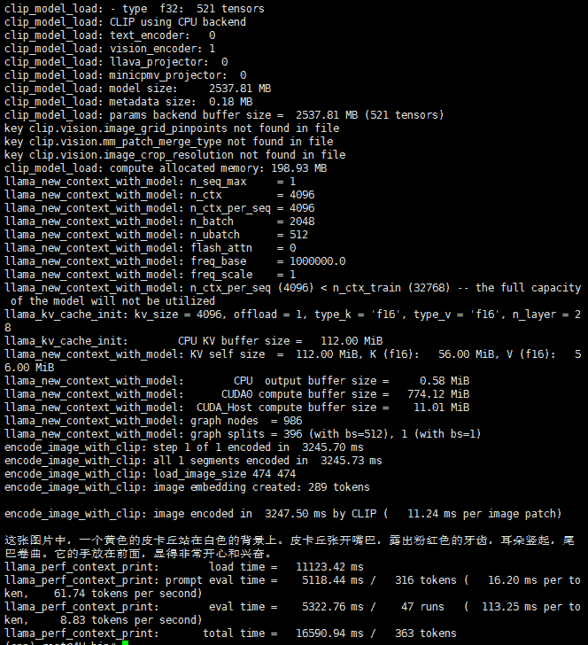

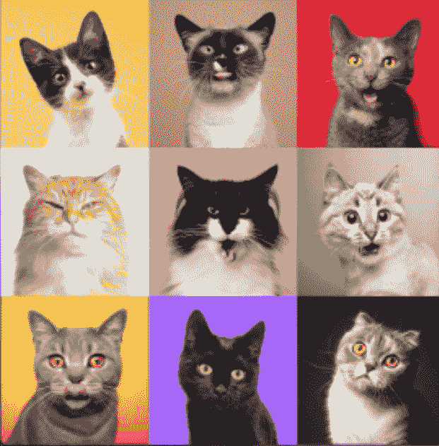

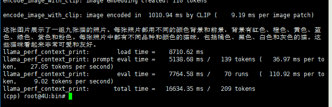

### OCR光学字符识别


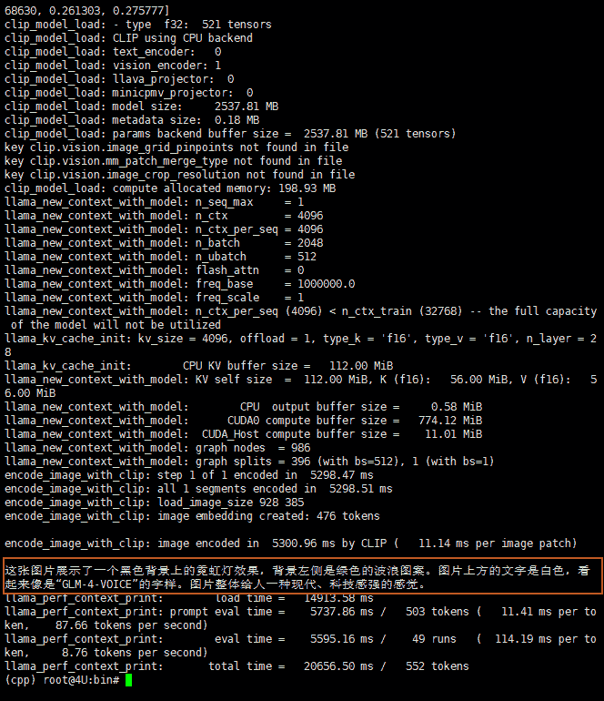

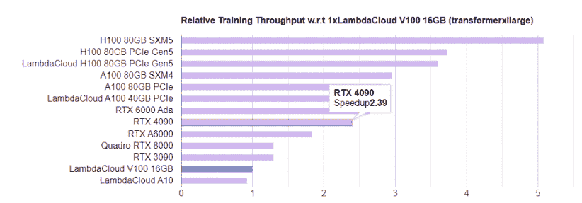

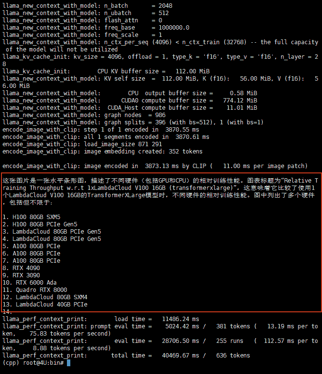

本流程使用的是`qwen2vl：2b`量化后的模型，由以上的测试结果来看，虽然是小参数模型的量化版本，其视觉功能基本没有受到影响，运行起来消耗显存大约为1G，是轻量化部署模型（如端侧部署）的极佳选项。

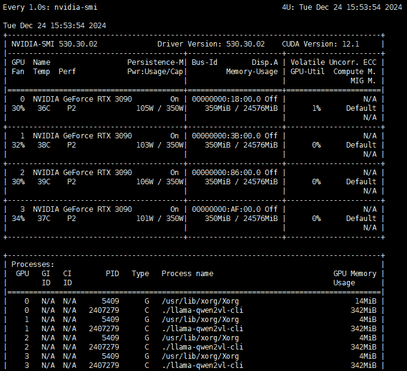

---

## 📍更多大模型技术内容学习

扫码添加助理英英，回复“大模型”，了解更多大模型技术详情哦👇


此外，扫码回复“入群”，即可加入大模型技术社群：海量硬核独家技术干货内容+无门槛技术交流！

---
