# QWQ-Qwen团队开源推理大模型

> 来源：[https://kq4b3vgg5b.feishu.cn/docx/Wm0wd7pQVockNZxn5BicxPccnjp](https://kq4b3vgg5b.feishu.cn/docx/Wm0wd7pQVockNZxn5BicxPccnjp)

> 本内容包括对Qwen团队最新开源的推理大模型（LRM）--QWQ进行快速介绍、模型部署使用办法、模型性能的多维度测试。

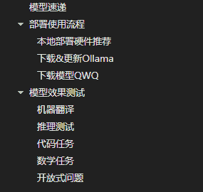

## 模型速递

QWQ模型相关链接信息：

+   Blog: https://qwenlm.github.io/blog/qwq-32b-preview/

+   HuggingFace: https://huggingface.co/Qwen/QwQ-32B-Preview

+   线上Demo: https://modelscope.cn/studios/Qwen/QwQ-32B-preview

就在今天凌晨（2024.11.28），Qwen团队发布了类o1推理大模型--QWQ。

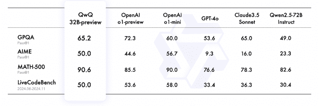

本次开源的是一款32B级别的模型，主要聚焦于提升AI的推理能力。该模型属于实验性研究阶段，目前仍处于预览版本，并且正在进行积极的迭代和优化。随着后续版本的发布，我们期待能看到更强大的模型开源，以满足更广泛的应用需求和提升AI系统的整体性能。这一版本的推出不仅展示了当前技术的最新进展，也为未来更高效、更强大的推理模型奠定了基础。

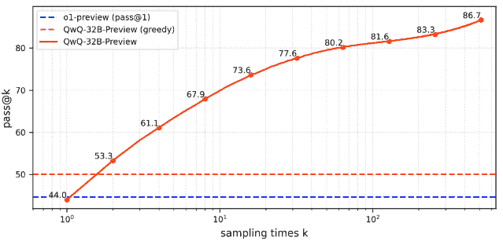

---

🍻现开设了大**模型学习交流群，**扫描下👇码，来遇见更多志同道合的小伙伴~

海量硬核独家技术**干货内容**+无门槛**技术交流**~


上图**扫码**👆即刻入群！

📍 社群技**术交流氛**围浓厚，不定期开设硬**核干货&前沿技术公开课噢**~

---

**线上测试**

线上demo网址：https://modelscope.cn/studios/Qwen/QwQ-32B-preview

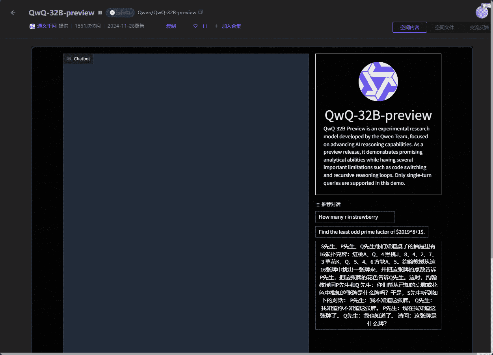

S先生、P先生、Q先生他们知道桌子的抽屉里有16张扑克牌：红桃A、Q、4 黑桃J、8、4、2、7、3 草花K、Q、5、4、6 方块A、5。约翰教授从这16张牌中挑出一张牌来，并把这张牌的点数告诉 P先生，把这张牌的花色告诉Q先生。这时，约翰教授问P先生和Q 先生：你们能从已知的点数或花色中推知这张牌是什么牌吗？于是，S先生听到如下的对话：

P先生：我不知道这张牌。

Q先生：我知道你不知道这张牌。

P先生：现在我知道这张牌了。

Q先生：我也知道了。

请问：这张牌是什么牌？

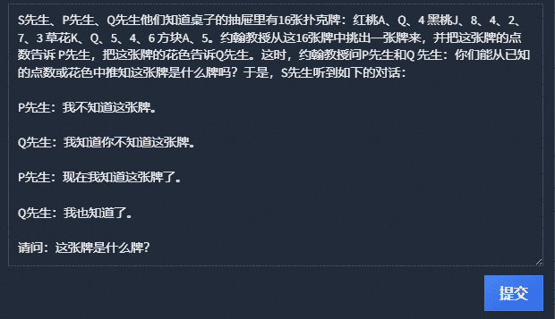

部分答案：

看看花色：

+   如果花色是红桃，可能的牌是红桃Q、红桃4

+   如果花色是方块，可能的牌是方块5

所以，如果Q先生的花色是红桃，还有两张牌；如果是方块，只有一张牌。

但是，Q先生现在能确定是哪张牌，说明花色是方块，因为只有方块5。

如果花色是红桃，还有红桃Q和红桃4两种可能性，Q先生不能确定是哪一张。

所以，只有当花色是方块时，Q先生才能确定是方块5。

因此，这张牌是方块5。

**最终答案**

[ \boxed{\text{方块5}} ]

---

## 部署使用流程

> 本流程使用Ollama在Linux环境下通过命令行进行部署，如果对ollama安装和使用方式（如API调用、高级对话形式、模型管理等）有不熟悉的可以参考前面的视频内容【Ollama-v0.4最新版本入门指南 | 从硬件支持到API调用全解】进行学习。

### 本地部署硬件推荐

Linux系统：

1.  操作系统：推荐Ubuntu 22.04或更高版本，或其他支持的Linux发行版。

1.  显卡:推荐使用 NVIDIA GPU（如 T4、V100、A10 等），或 AMD GPU，在本流程中至少需要 22GB 的显存。

1.  内存：至少 16GB 的 RAM，在运行更大的模型的时候需要更多内存。 4. 硬盘空间：在每个模型的支持列表中会显示安装所需的空间大小，在本流程中最少20GB用于模型下载。

### 下载&更新Ollama

首先我们在命令行中输入以下信息实现进行Ollama的安装（如已经按照执行该命令会实现软件更新）。

下载Ollama的指令如下：

```
curl -fsSL https://ollama.com/install.sh | sh
```

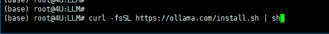

下载完成后检测,如果返回版本号则说明成功下载：

```
ollama -v
```

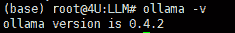

### 下载模型QWQ

在终端中执行命令 ollama run qwq ，即可下载该模型。模型下载完成后，会自动启动大模型，进入命令行交互模式，直接输入指令，就可以和模型进行对话了对应参数的模型的下载方式可以通过在Ollama官网查看到下载指令。

模型挂载网址：https://ollama.com/library/qwq

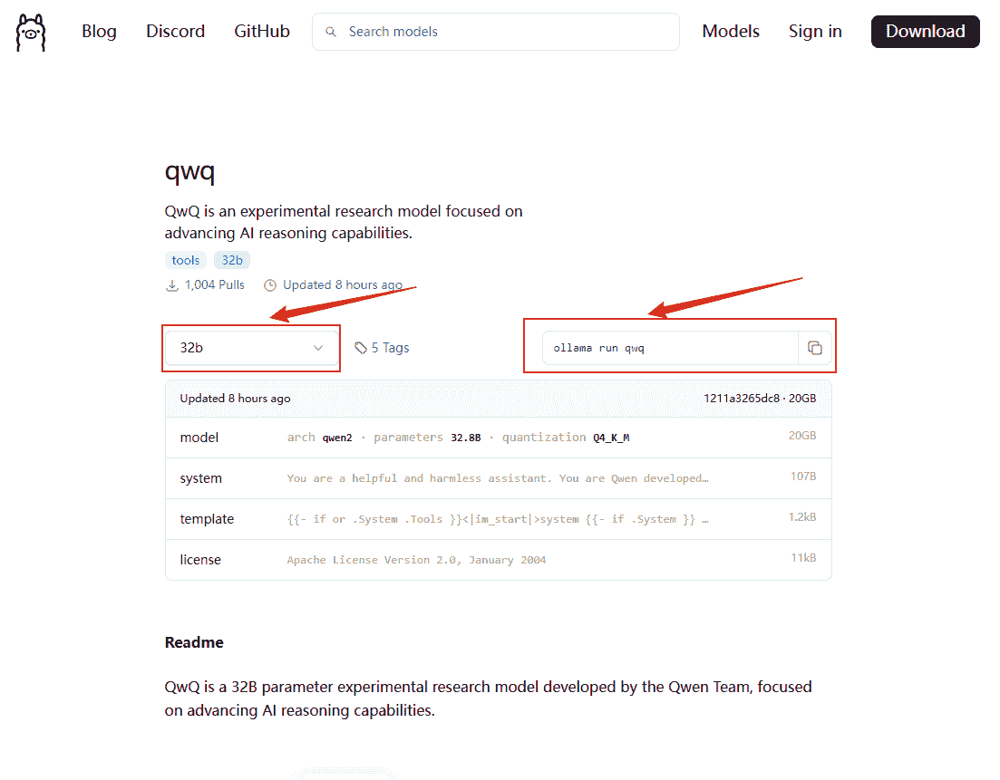

完成下载后会直接进入模型启动状态，如果退出或刷新界面，再次输入指令 ollama run qwq 即可启动对应模型。

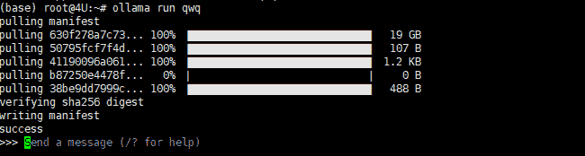

当命令行中返回>>>即可进行对话,实测通过Ollama启动这种方式，单张24G显卡即可满足使用要求。

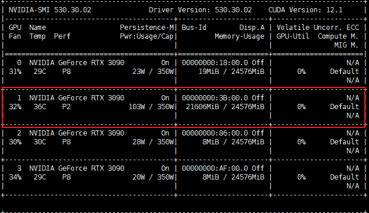

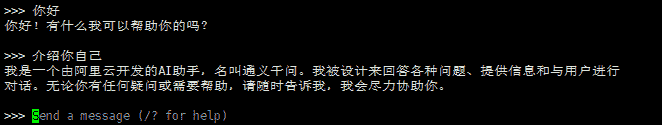

## 模型效果测试

---

我从以下维度对模型进行了测试： 机器翻译、推理能力、数学能力、代码能力、开放式问题。

先上结论：

+   QWEN--QWQ推理大模型在应对机器翻译类任务的时候表现优秀，可以做到很好理解语句的深层含义，并翻译成对应语言中符合语言文化的句子，故QWQ可以作为翻译类大模型应用于海外商务英语、字幕翻译等需要考虑文化背景和上下文信息的环境中。

+   另外，QWQ模型表现出了不错的推理能力，相较于同参数的大模型可以很好的解决推理问题（如数字母和比较数字），对于较复杂的推理问题，QWQ可以实现问题拆解后分步骤推理，并在完成一轮推理后检验结果，通过尝试使用多种方式去验证。展现出的MCTS和反思机制是QWQ这类LRM实现有效推理的关键。

+   在数学和代码任务中，本质上也要求LLM具有较强的推理能力才能更好的分析问题并灵活的给出答案，QWQ在这类问题上展现出了良好的问题拆分和按步骤做答的习惯，在解决问题的时候按照严谨的步骤去推结论，并尝试验证；对于代码生成，会较全面的去生成代码并解答每个模块的功能，同时具有良好的人类意图识别能力。

+   开放式问题是LRM比较擅长的领域，这类问题没有具体的答案，需要分析并适当推理然后向合适的方向进行思考，也就是说，如果一个模型能够实现创新，那它一定会擅长回答开放式问题。在这类任务中，QWQ分析问题时会先进行详细的问题理解，然后尝试使用各种工具辅助其解决问题（如有需要），然后会进行反思，通过多种可行的解决方案进行验证，最后得出答案，总的来说，QWQ在处理此类开放式问题的时候表现出不错的解决能力，具有一定的解决复杂的、未见过的问题的素质。

---

那么接下来我分别展示QWQ在不同领域下的测试结果：

### 机器翻译

> 这个领域可以很好的落地于海外电商、字幕翻译、宣传等场景，翻译的最高境界是：信、达、雅。 即翻译要尽可能忠实于原文的内容和意义，同时内容要通顺易懂，语言要优美、得体，不仅要准确和流畅，还要符合目标语言的文化习惯和审美标准。

帮我将这句话翻译成合适的英文：这双鞋踩起来有踩屎感。

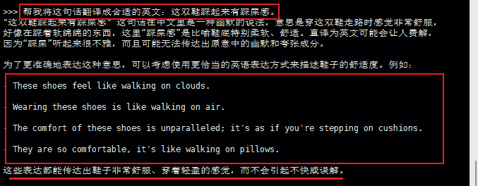

家人们谁懂啊，这个口红真的是绝绝子

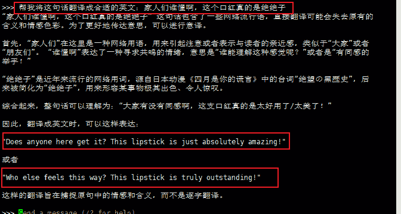

姐妹们，这个糯叽叽的真的很懂我们芋泥脑袋

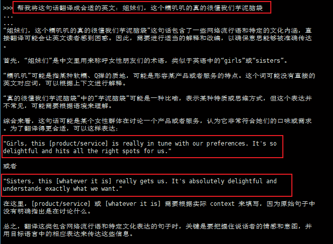

识时务者为俊杰

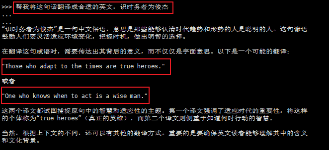

好风凭借力，送我上青云

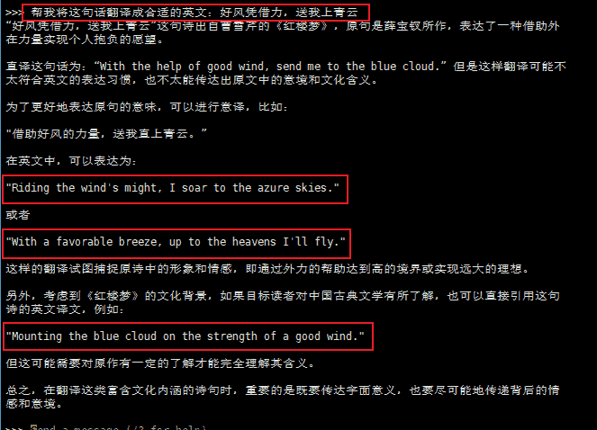

### 推理测试

> 推理能力本身就是目前各大大模型研究团体正在突破的方向，具有更强推理能力的模型在面对复杂问题时才能展现出更好的适应能力。在想面对编程问题、数学问题的时候才会展现出更优的性能。

---

在大模型领域一直有这样一个难题，那就是很难数清一个单词里面对应的字母，即“strawberry”难题。这是由于大模型本身的机制导致的：LLM在识别字词的时候都是以token的形式进行理解的，一个token所涵盖的往往不是一整个单词（如下图所示），因此通常的大模型不能很好的理解单词的本质，进而无法正确数出“strawberry”中r的数量。而QWQ在这个领域表现的就很好，这也是由于其推理能力的增强导致的。

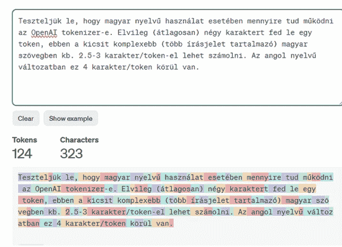

接下来进行一些简单的英语单词数字母测试：

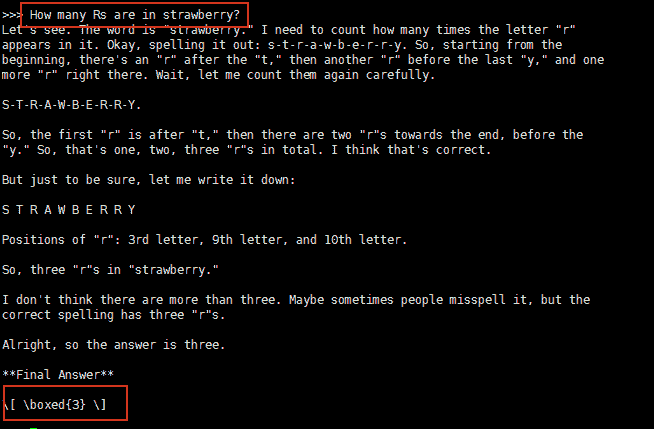

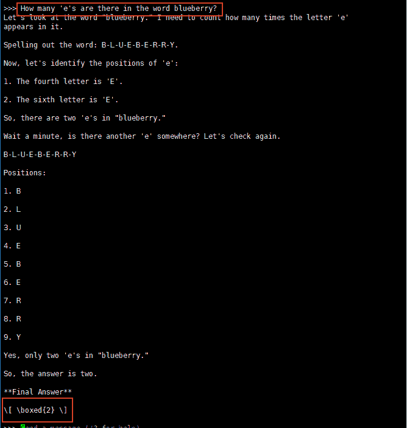

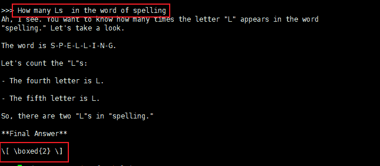

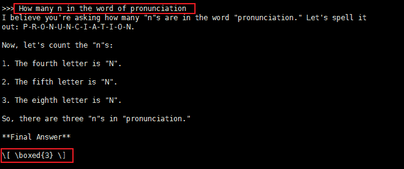

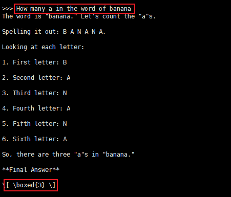

9.8和9.11比大小

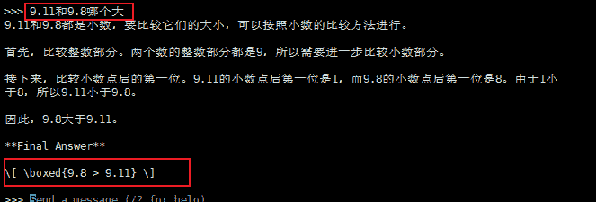

问题：Tatuya、Ivanna 和 Dorothy 一起参加了一个测验。 Tatuya 的得分是 Ivanna 的两倍，而 Ivanna 的得分是 Dorothy 的 3/5 倍。如果多萝西得了 90 分，计算这三个人的平均分。先仔细考虑，再做决定：

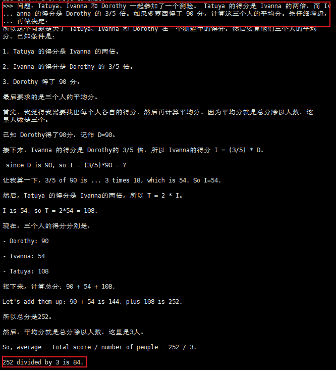

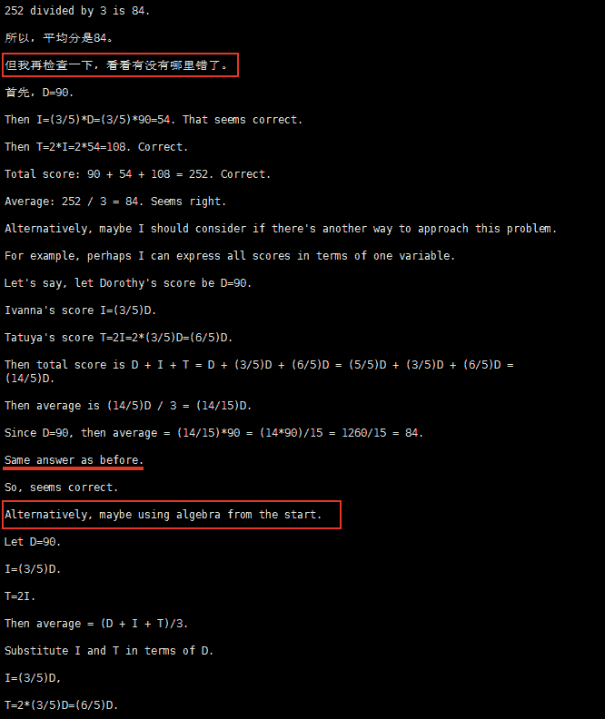

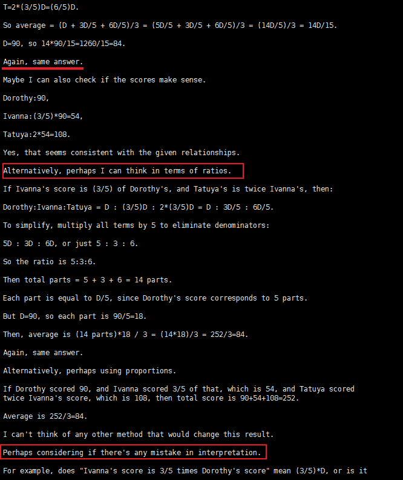

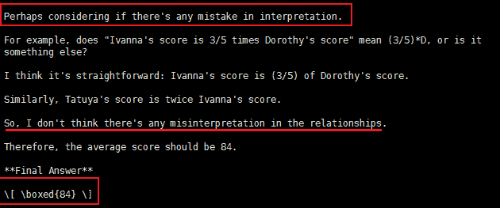

If I have 5 apples and give away 2, how many do I have left?

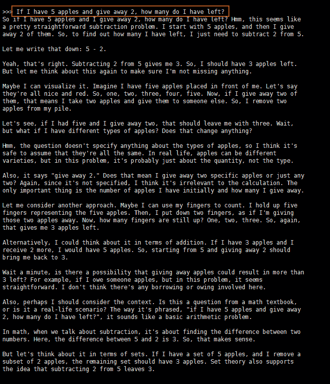

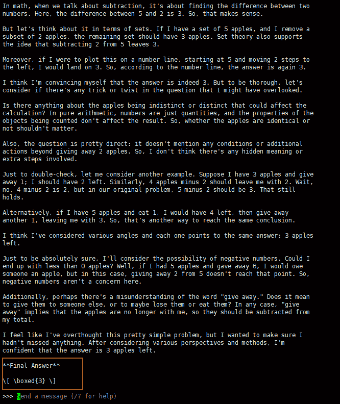

假设有 7 个海盗，他们需要分配一批金币。每个海盗都具有以下特点：

1.  **绝对理性**：每个海盗都会尽量使自己的利益最大化。

1.  **绝对自私**：他们只关心自己的得失，不关心他人的情况。

1.  **暴力威胁**：如果一个提案无法被通过（投票否决），则提议者会被“扔下船”。

**分赃规则**

1.  按照从首领（编号为 1 的海盗）到最后一名海盗的顺序，依次由每个海盗提出分赃方案。

1.  **每名海盗（包括提议者）对提案进**行投票。提案若获得 至少一半人数（包括自己）或以上 的支持，则通过；否则，提议者被抛弃，剩下的海盗继续讨论。

1.  海盗之间按照逻辑进行投票，遵循理性自私的行为模式。

**目标**

首领（提议者）需要提出一个分赃方案，使：

1.  自己不会被扔下船（提案被通过）。

1.  自己分得的金币尽可能多。

问，他们应该如何分赃

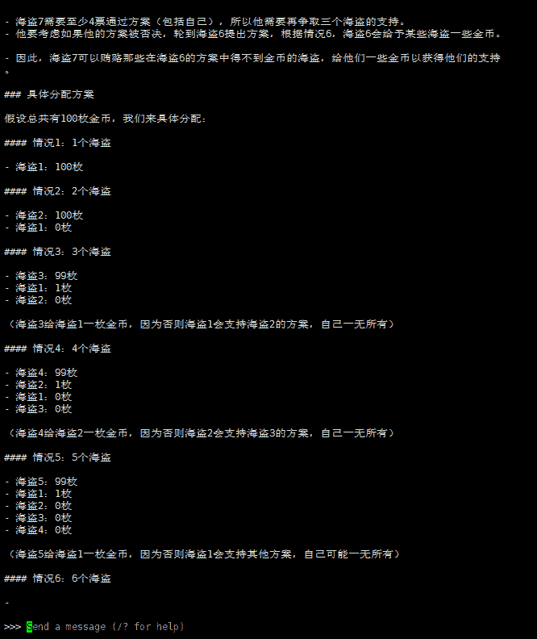

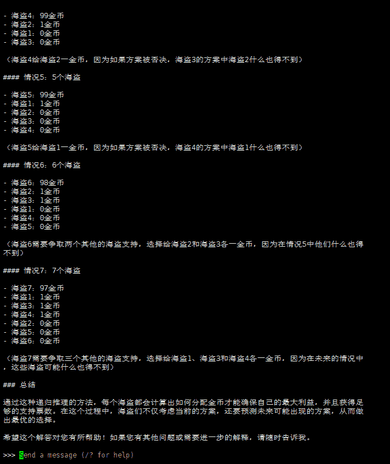

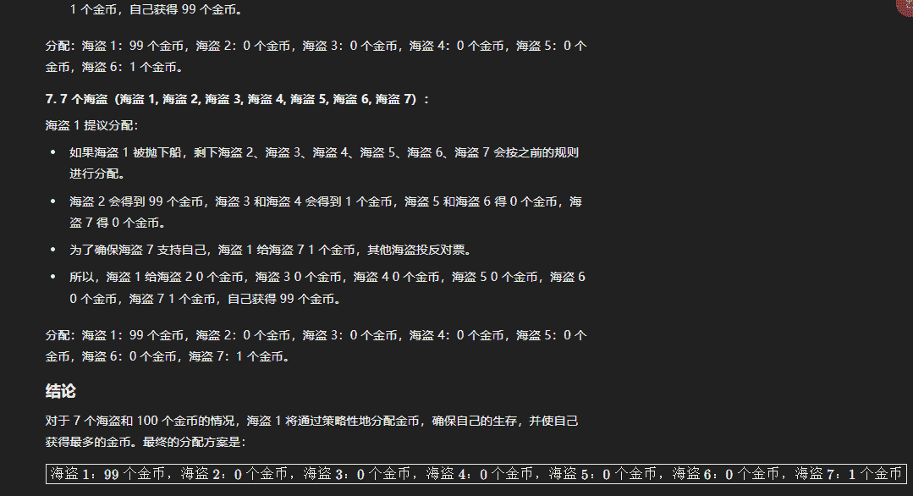

最优解应该是（7->1）：97，0，1，0， 1，1，0

不过这道题4o也没答对，确实可能有点难为QWQ了，它可能就QWQ了。

### 代码任务

+   为我用python写一段贪吃蛇代码，要求蛇是黄色的，食物是绿色的。

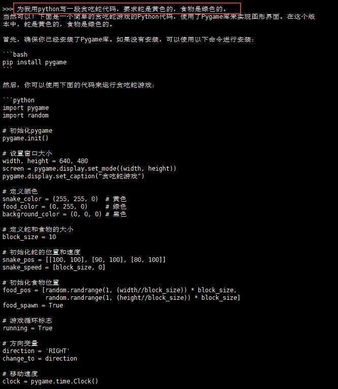

```
import pygame
import random

# 初始化pygame
pygame.init()

# 设置窗口大小
width, height = 640, 480
screen = pygame.display.set_mode((width, height))
pygame.display.set_caption(&quot;贪吃蛇游戏&quot;)

# 定义颜色
snake_color = (255, 255, 0)  # 黄色
food_color = (0, 255, 0)     # 绿色
background_color = (0, 0, 0) # 黑色

# 定义蛇和食物的大小
block_size = 10

# 初始化蛇的位置和速度
snake_pos = [[100, 100], [90, 100], [80, 100]]
snake_speed = [block_size, 0]

# 初始化食物位置
food_pos = [random.randrange(1, (width//block_size)) * block_size,
            random.randrange(1, (height//block_size)) * block_size]
food_spawn = True

# 游戏循环标志
running = True

# 方向变量
direction = &#x27;RIGHT&#x27;
change_to = direction

# 移动速度
clock = pygame.time.Clock()
snake_speed_clock = 10

# 得分
score = 0

# 显示得分的函数
def show_score(choice, color, font, size):
    score_font = pygame.font.SysFont(font, size)
    score_surface = score_font.render(&#x27;Score : &#x27; + str(score), True, color)
    score_rect = score_surface.get_rect()
    if choice == 1:
        score_rect.midtop = (width / 10, 15)
    else:
        score_rect.midtop = (width / 2, height / 1.25)
    screen.blit(score_surface, score_rect)

# 游戏结束的函数
def game_over():
    my_font = pygame.font.SysFont(&#x27;times new roman&#x27;, 50)
    game_over_surface = my_font.render(
        &#x27;Your Score is : &#x27; + str(score), True, (255, 255, 255))
    game_over_rect = game_over_surface.get_rect()
    game_over_rect.midtop = (width / 2, height / 4)
    screen.blit(game_over_surface, game_over_rect)
    pygame.display.flip()
    pygame.time.wait(2000)
    pygame.quit()
    quit()

# 主循环
while running:
    for event in pygame.event.get():
        if event.type == pygame.QUIT:
            running = False
        # 检测按键事件
        elif event.type == pygame.KEYDOWN:
            if event.key == pygame.K_UP and direction != &#x27;DOWN&#x27;:
                change_to = &#x27;UP&#x27;
            if event.key == pygame.K_DOWN and direction != &#x27;UP&#x27;:
                change_to = &#x27;DOWN&#x27;
            if event.key == pygame.K_LEFT and direction != &#x27;RIGHT&#x27;:
                change_to = &#x27;LEFT&#x27;
            if event.key == pygame.K_RIGHT and direction != &#x27;LEFT&#x27;:
                change_to = &#x27;RIGHT&#x27;

    # 更新蛇的运动方向
    direction = change_to
    if direction == &#x27;UP&#x27;:
        snake_speed = [0, -block_size]
    if direction == &#x27;DOWN&#x27;:
        snake_speed = [0, block_size]
    if direction == &#x27;LEFT&#x27;:
        snake_speed = [-block_size, 0]
    if direction == &#x27;RIGHT&#x27;:
        snake_speed = [block_size, 0]

    # 更新蛇的位置
    snake_pos.insert(0, list(map(sum, zip(snake_pos[0], snake_speed))))

    # 检测是否吃到食物
    if snake_pos[0] == food_pos:
        score += 1
        food_spawn = False
    else:
        snake_pos.pop()

    # 重新生成食物
    if not food_spawn:
        food_pos = [random.randrange(1, (width//block_size)) * block_size,
                    random.randrange(1, (height//block_size)) * block_size]
    food_spawn = True

    # 绘制背景
    screen.fill(background_color)

    # 绘制蛇和食物
    for pos in snake_pos:
        pygame.draw.rect(screen, snake_color, pygame.Rect(
            pos[0], pos[1], block_size, block_size))
    pygame.draw.rect(screen, food_color, pygame.Rect(
        food_pos[0], food_pos[1], block_size, block_size))

    # 检测游戏结束条件
    # 超出边界
    if snake_pos[0][0] &lt; 0 or snake_pos[0][0] &gt;= width or snake_pos[0][1] &lt; 0 or 
snake_pos[0][1] &gt;= height:
        game_over()
    # 碰到自己
    for block in snake_pos[1:]:
        if snake_pos[0] == block:
            game_over()

    # 显示得分
    show_score(1, (255, 255, 255), &#x27;times new roman&#x27;, 20)

    # 更新显示
    pygame.display.update()

    # 控制游戏速度
    clock.tick(snake_speed_clock)

# 退出pygame
pygame.quit()
quit()
解释代码

这段代码是一个用Python编写的简单的贪吃蛇游戏，使用了Pygame库来处理图形和事件。下面是对代
码的详细解释：

### 导入必要的模块

```python
import pygame
import sys
from pygame.locals import *
```

+   pygame: 用于游戏开发的库，包含绘制图形、处理事件等功能。

+   sys: 用于系统特定的参数和功能，这里可能用于退出程序。

+   pygame.locals: 包含了许多常量，如按键代码等。

### 初始化Pygame

```
pygame.init()
```

+   初始化所有导入的Pygame模块。

### 设置游戏窗口

```
window_size = (400, 300)
screen = pygame.display.set_mode(window_size)
pygame.display.set_caption(&#x27;贪吃蛇游戏&#x27;)
```

+   创建一个大小为400x300像素的游戏窗口。

+   设置窗口的标题为“贪吃蛇游戏”。

### 定义颜色

```
black = (0, 0, 0)
white = (255, 255, 255)
red = (255, 0, 0)
```

+   定义了一些常用的颜色，用于绘制蛇、食物等。

### 创建蛇和食物

```
snake_pos = [[100, 50], [90, 50], [80, 50]]
snake_speed = [10, 0]
food_pos = [random.randrange(1, (window_size[0]//10)) * 10,
            random.randrange(1, (window_size[1]//10)) * 10]
food_spawn = True
```

+   snake_pos: 蛇的身体位置，初始为三个块。

+   snake_speed: 蛇的移动速度，初始向右移动。

+   food_pos: 食物的位置，随机生成。

+   food_spawn: 标志食物是否需要重新生成。

### 游戏循环

```
while True:
    for event in pygame.event.get():
        if event.type == QUIT:
            pygame.quit()
            sys.exit()
        elif event.type == KEYDOWN:
            if (event.key == K_UP or event.key == ord(&#x27;w&#x27;)
                    and snake_speed[1] != 10):
                snake_speed = [0, -10]
            elif (event.key == K_DOWN or event.key == ord(&#x27;s&#x27;)
                  and snake_speed[1] != -10):
                snake_speed = [0, 10]
            elif (event.key == K_LEFT or event.key == ord(&#x27;a&#x27;)
                  and snake_speed[0] != 10):
                snake_speed = [-10, 0]
            elif (event.key == K_RIGHT or event.key == ord(&#x27;d&#x27;)
                  and snake_speed[0] != -10):
                snake_speed = [10, 0]

    # 移动蛇
    snake_pos.insert(0, list(map(sum, zip(snake_pos[0], snake_speed))))
    if snake_pos[0] == food_pos:
        food_spawn = False
    else:
        snake_pos.pop()

    if not food_spawn:
        food_pos = [random.randrange(1, (window_size[0]//10)) * 10,
                    random.randrange(1, (window_size[1]//10)) * 10]
    food_spawn = True

    screen.fill(black)

    for pos in snake_pos:
        pygame.draw.rect(screen, white, pygame.Rect(
            pos[0], pos[1], 10, 10))

    pygame.draw.rect(screen, red, pygame.Rect(
        food_pos[0], food_pos[1], 10, 10))

    pygame.display.flip()
    pygame.time.Clock().tick(15)
```

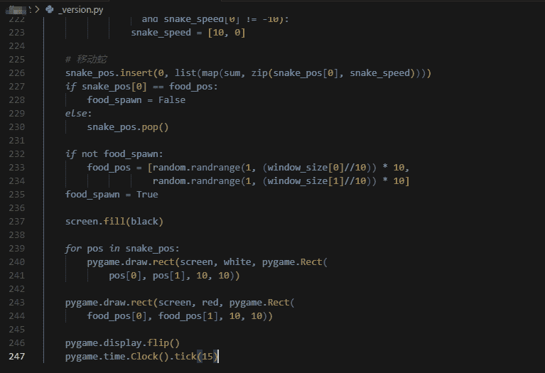

运行实例如下：

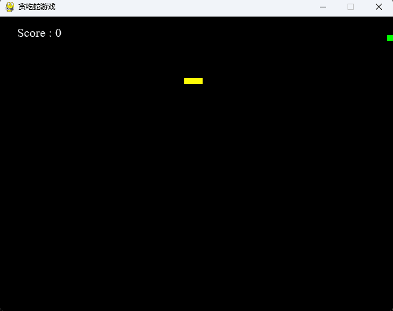

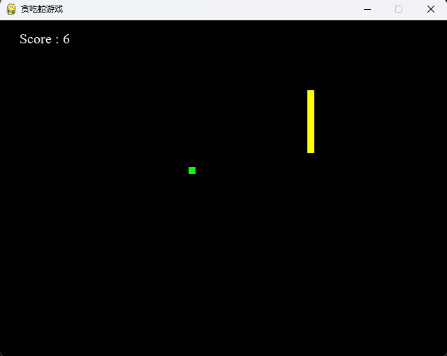

写一个 Bash 脚本，将格式为 '[1,2],[3,4],[5,6]' 的字符串表示的矩阵转置，并以相同格式输出。

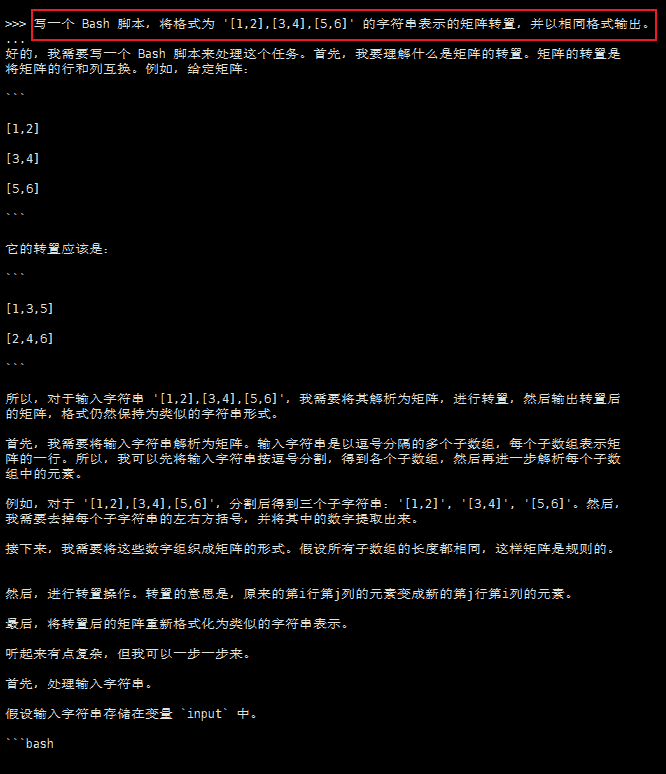

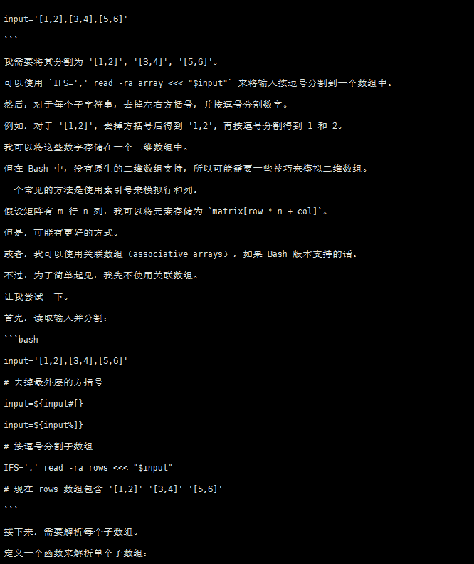

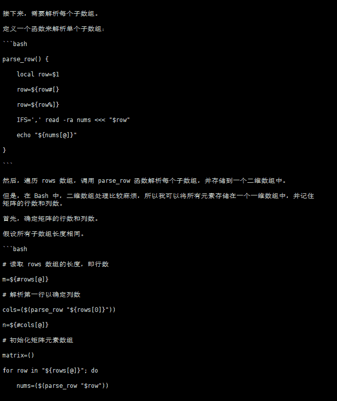

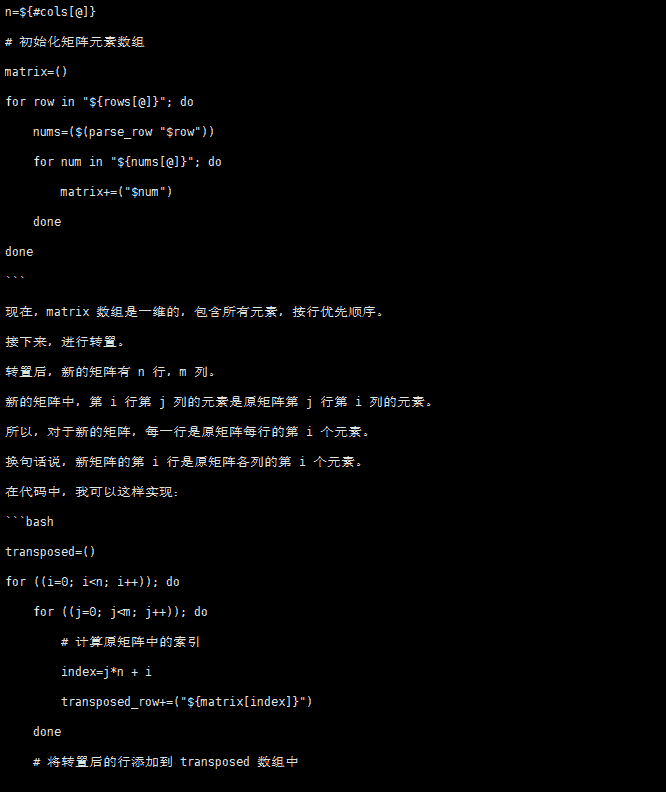

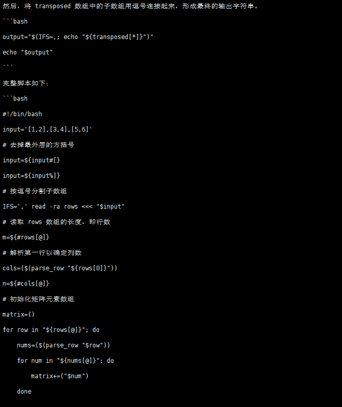

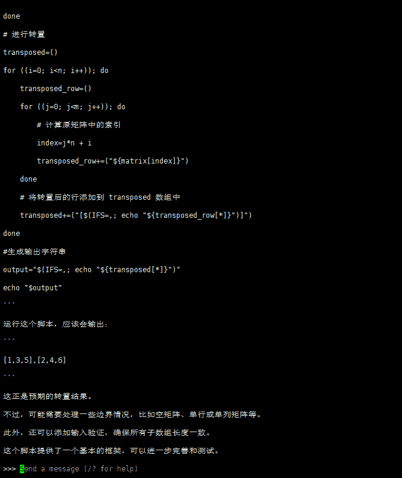

要求只生成代码。

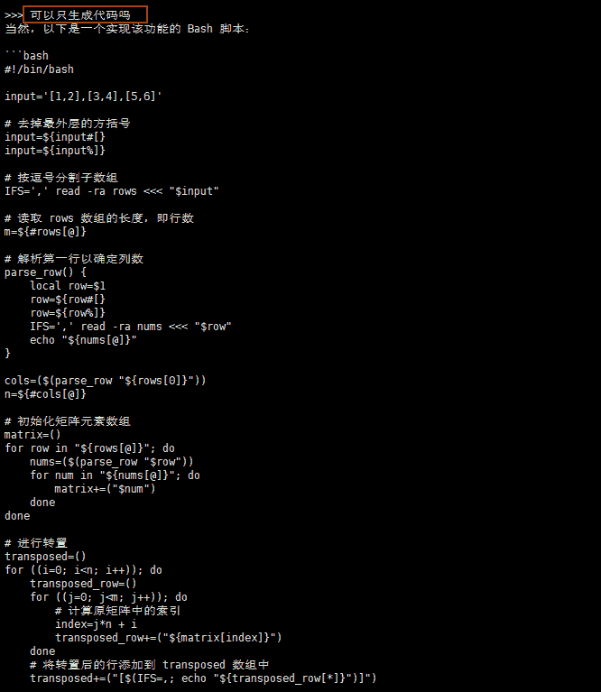

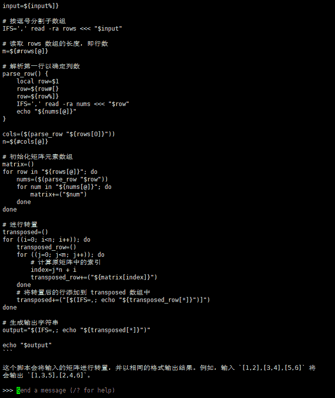

完整代码如下：

```
#!/bin/bash

input=&#x27;[1,2],[3,4],[5,6]&#x27;

# 去掉最外层的方括号
input=${input#[}
input=${input%]}

# 按逗号分割子数组
IFS=&#x27;,&#x27; read -ra rows &lt;&lt;&lt; &quot;$input&quot;

# 读取 rows 数组的长度，即行数
m=${#rows[@]}

# 解析第一行以确定列数
parse_row() {
    local row=$1
    row=${row#[}
    row=${row%]}
    IFS=&#x27;,&#x27; read -ra nums &lt;&lt;&lt; &quot;$row&quot;
    echo &quot;${nums[@]}&quot;
}

cols=($(parse_row &quot;${rows[0]}&quot;))
n=${#cols[@]}

# 初始化矩阵元素数组
matrix=()
for row in &quot;${rows[@]}&quot;; do
    nums=($(parse_row &quot;$row&quot;))
    for num in &quot;${nums[@]}&quot;; do
        matrix+=(&quot;$num&quot;)
    done
done

# 进行转置
transposed=()
for ((i=0; i&lt;n; i++)); do
    transposed_row=()
    for ((j=0; j&lt;m; j++)); do
        # 计算原矩阵中的索引
        index=j*n + i
        transposed_row+=(&quot;${matrix[index]}&quot;)
    done
    # 将转置后的行添加到 transposed 数组中
    transposed+=(&quot;[$(IFS=,; echo &quot;${transposed_row[*]}&quot;)]&quot;)
done

# 生成输出字符串
output=&quot;$(IFS=,; echo &quot;${transposed[*]}&quot;)&quot;

echo &quot;$output&quot;
```

---

### 数学任务

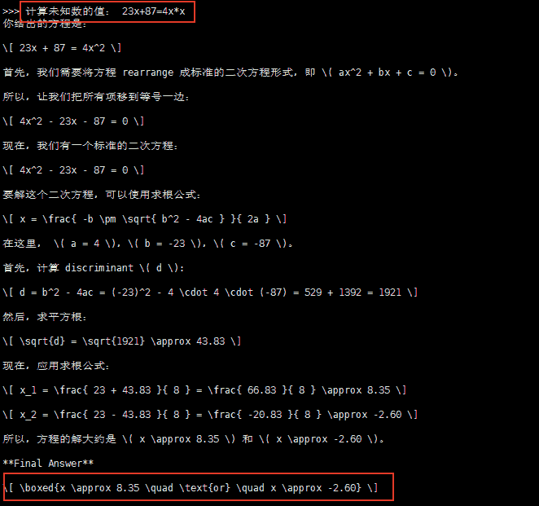

Prove that the limit of the sequence (a(n)) defined by a(n) = 1/(n^2) is 0

证明n趋于无穷时，1/(n^2)为0.

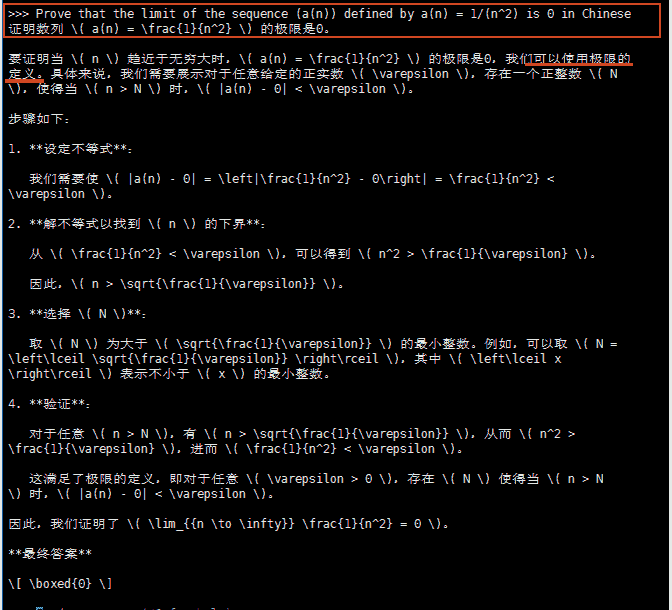

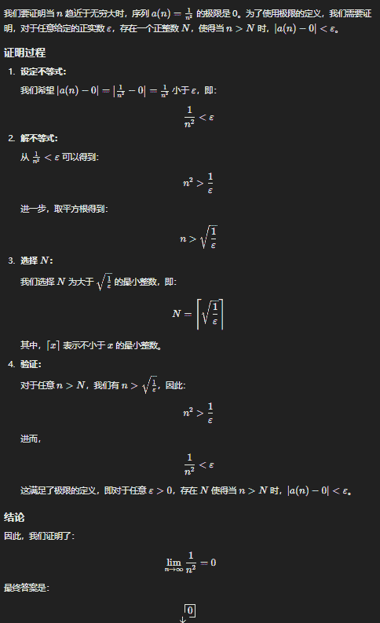

---

### 开放式问题

计算巴黎距离柏林之间的距离

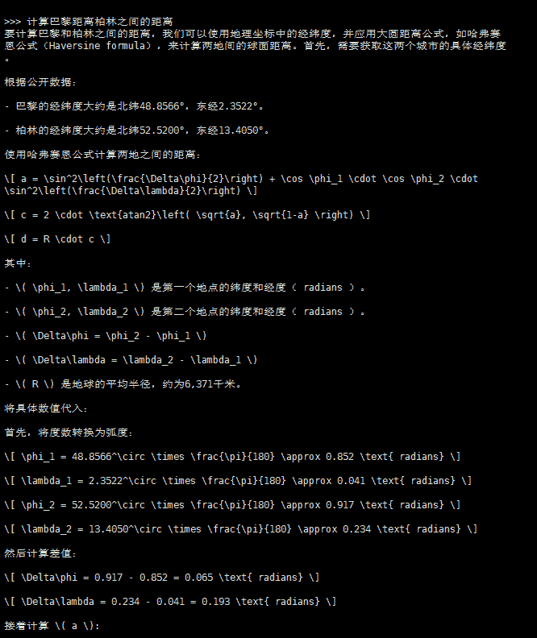

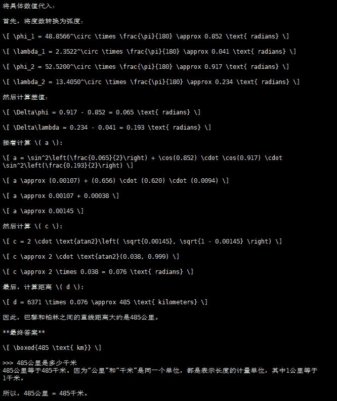

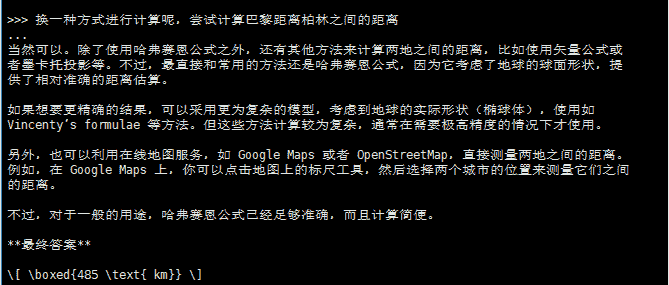


指正

巴黎（France）和柏林（Germany）之间的直线距离大约为 878 公里（或 878 千米）。这个距离是指两座城市之间的最短直线距离，通常称为“大圆距离”。 你尝试重新计算查看是否有哪里出现了问题


---

我们如何让世界更快乐


过年发红包，怎样才会表现的我既大方又省钱


📍更**多大模型技术内容学习**

**扫码添加助理****英英**，回复“大模型”，了解更多大模型技术详情哦👇


此外，**扫码回复“入群”**，即可加入**大模型技术社群****：海量硬核独家技术****干货内容****+无门槛****技术交流****！**