# 最新Ktransformers v0.24并发部署 DeepSeek-R1&V3模型

> 来源：[https://kq4b3vgg5b.feishu.cn/docx/FCOqdF5BDox8mbxIXhwciGW6nsf](https://kq4b3vgg5b.feishu.cn/docx/FCOqdF5BDox8mbxIXhwciGW6nsf)

## 课程说明：

+   体验课内容节选自《2025大模型Agent智能体开发实战》(春季班)完整版付费课程

体验课时间有限，若想深度学习大模型技术，欢迎大家报名由我主讲的《2025大模型Agent智能体开发实战》(春季班)

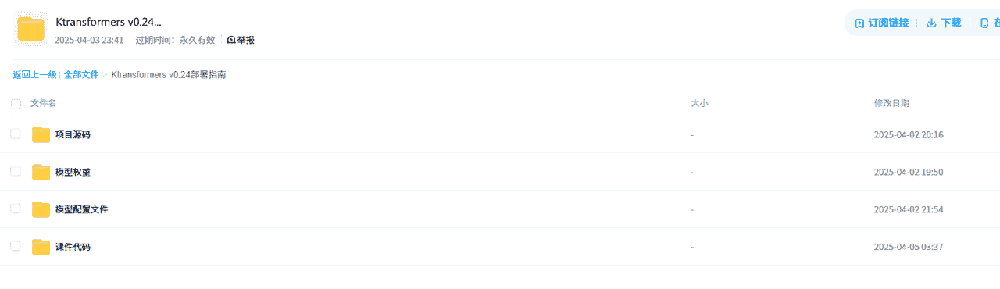

此外，公开课全套学习资料，已上传至网盘

（ https://pan.baidu.com/s/1NLniijSwld39yKGf075q2g?pwd=h632 ）

需要更系统深入学习大模型可扫码⬆️添加助教咨询喔～

---

## 一、 DeepSeek-R1&V3高性能部署思路

### **1.主流高性能部署方案**

截止目前，毫无疑问， DeepSeek模型最高性价比的部署方案有两个，其一是清华大学团队提出的 Ktransformers部署方案，

[.  ktransformers：https:](https://github.com/kvcache-ai/ktransformers)//github.com/kvcache-ai/ktransformers

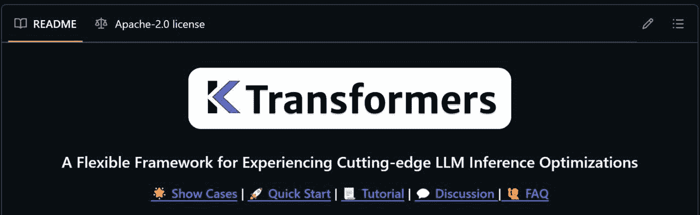

其二则是Unsloth动态量化方案，

.  Unsloth：[https://github.c](https://github.com/unslothai/unsloth)om/unslothai/unsloth

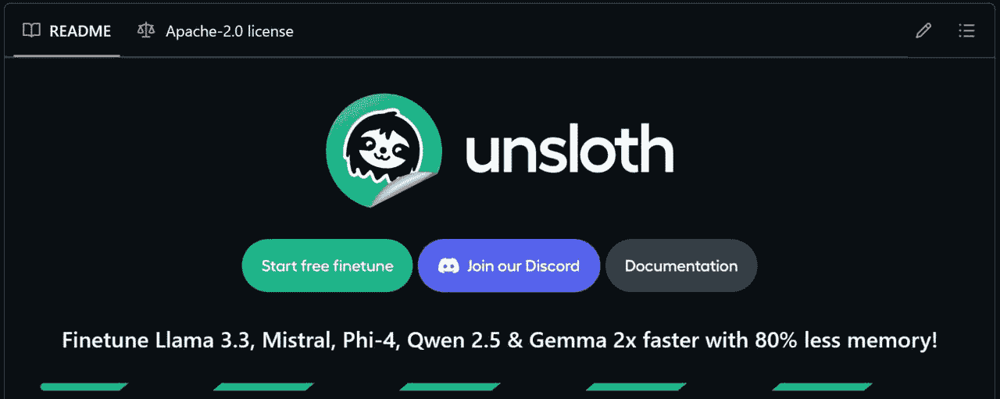

尽管两套方案都是采用CPU+GPU混合推理，但有所不同的是， Ktransformers技术方案是在llama.cpp 上进行的大幅修改，从而加快了CPU推理速度，而Unsloth则主要是在模型量化层面下功夫，推出了

1.58bit等一众梁化程度较深、但同时推理性能较好的量化模型，而实际运行过程，底层仍然是使用 llama.cpp进行推理。

在此前的公开课中，我们曾分别介绍过独家KTransformers技术实战 ：https://www.bilibili.com/vi deo/BV1kyAke9EBA/

以及独[家Unsloth动态量化部署满血DeepSeek](https://www.bilibili.com/video/BV1oePLezEZD/)：https://www.bilibili.com/video/BV1oePLezEZD/

甚至详细讲解过KTransformers+Unsloth结合部署方案，既使用KTransformers来运行Unsloth的

1.58bit动态量化模型《[60G内存+14G显存运](https://www.bilibili.com/video/BV1AL9mY2E5a/)行满血DeepSeek R1！》https://www.bilibili.com/video/B V1AL9mY2E5a/

### 2.Ktransformers v0.24重大更新

虽然Ktransformers能够高效完成推理加速，但受限于此前的技术架构，导致其无法进行并发，这也 是阻碍Ktransformers框架迈向工业化应用的核心因素。而就在4月2号的项目更新中， Ktransformers正 式推出了v0.24版，该版本在0.23基础上进行了1万多行的代码更新，不仅进一步提高了推理速度，而且    还增加了并发功能。

[新版Ktransformers v0.24更新公告如下： ht](https://github.com/kvcache-ai/ktransformers/blob/main/doc/en/balance-serve.md)tps://github.com/kvcache-ai/ktransformers/blob/ma in/doc/en/balance-serve.md

KTransformers v0.2.4 发布说明

我们非常高兴地宣布，期待已久的 KTransformers v0.2.4 现已正式发布！在这个版本中，我们对整 体架构进行了重大重构，更新了超过 1 万行代码，为社区带来了备受期待的多并发支持。

本次重构借鉴了 sglang 的优秀架构，在 C++ **中实现了高性能**的异步并发调度机制，支持如连续批  处理、分块预填充（chunked prefill）等特性。由于支持并发场景下的 GPU 资源共享，整体吞吐量也 在一定程度上得到了提升。

**1. 多并发支持**

+    新增对多个并发推理请求的处理能力，支持同时接收和执行多个任务。

+   我们基于高性能且灵活的算子库 **flashinfer **实现了自定义的  custom_flashinfer ，并实现了可变  批大小（variable batch size）的 CUDA Graph，这在提升灵活性的同时，减少了内存和 padding 的开销。

+   **在我们的**基准测试中， 4 路并发下的整体吞吐量提升了约 130%。

+   在英特尔的支持下，我们在最新的 Xeon6 + MRDIMM-8800 平台上测试了 **KTransformer**s v0.**2.4。通过提高并发度**，模型的总输出吞吐量从 17 tokens/s 提升到了 40 tokens/s。我们观察 到当前瓶颈已转移至 GPU，使用高于 4090D 的显卡预计还可以进一步提升性能。

**2. 引擎架构优化**

**借鉴 sglang **的调度框架，我们通过更新约 11,000 行代码，将 KTransformers 重构为一个更清晰的 三层架构，并全面支持多并发：

+   **Server（服务层） **：处理用户请求，并提供兼容 OpenAI 的 API。

+   Inference Engine（推理引擎） ：负责模型推理，支持分块预填充。

+   **Scheduler（调度器） **：管理任务调度与请求编排。通过 FCFS （先来先服务）方式组织排队请求， 打包为批次并发送至推理引擎，从而支持连续批处理。

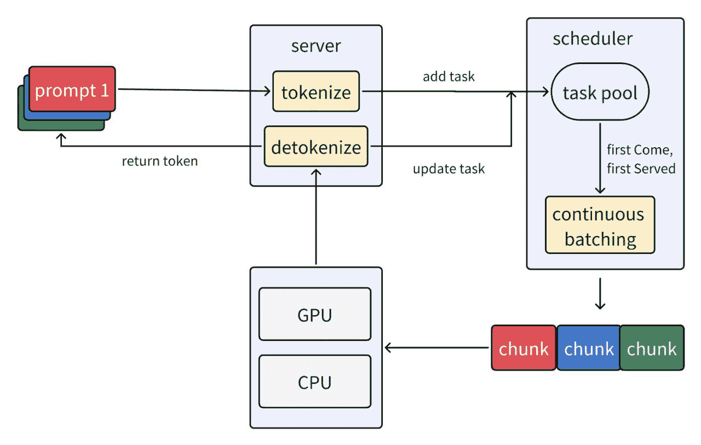

**3. 项目结构重组**

所有 C/C++ 代码现已统一归类至  /csrc 目录下。

**4. 参数调整**

我们移除了一些遗留和已弃用的启动参数，简化了配置流程。未来版本中，我们计划提供完整的参 数列表和详细文档，以便用户更灵活地进行配置与调试。

---

接下来我们就尝试借助Ktransformers v0.24进行DeepSeek-R1和V3模型的本地安装部署。

### 3.Ktransformers运行所需硬件要求

由于Ktransformers是采用CPU+GPU混合推理，因此对内存有较大要求，以下是不同量化模型在使 用Ktransformers运行时的基本硬件要求：

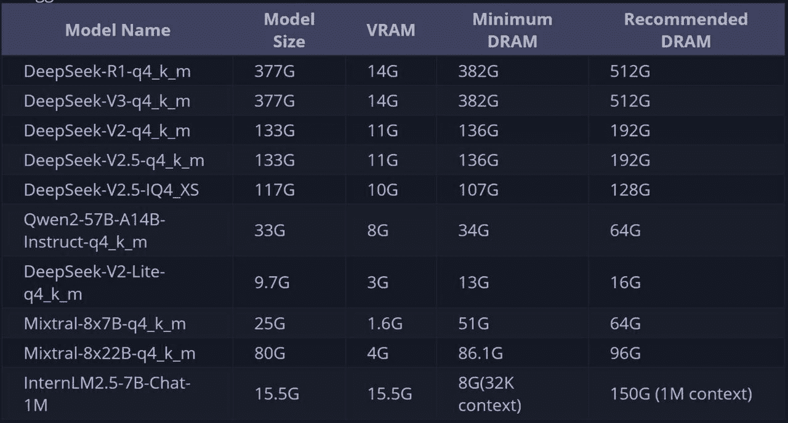

而如果是运行DeepSeek-R1 1.58bit模型（IQ1_S），则需要14G显存+120G以上内存，而如果运行 1.73bit模型（IQ1_M），则需要14G显存+140G以上内存，而如果是2.22-bit（IQ2_XXS），则需要14G 显存+170G内存， 2.51-bit（Q2_K_XL）则需要14G显存+200G内存。

| **模型名称** | **精度（比特）** | **显存需求** | **内存需求** |
| --- | --- | --- | --- |
| IQ1_S | 1.58-bit | 14GB | ≥120GB |
| IQ1_M | 1.73-bit | 14GB | ≥140GB |
| IQ2_XXS | 2.22-bit | 14GB | ≥170GB |
| Q2_K_XL | 2.51-bit | 14GB | ≥200GB |
| Q4_K_M | 4-bit | 14GB | ≥382GB |
| FP16 | FP16 | 14GB | 1TB |

> DeepSeek模型组本地部署本地显存占用表：

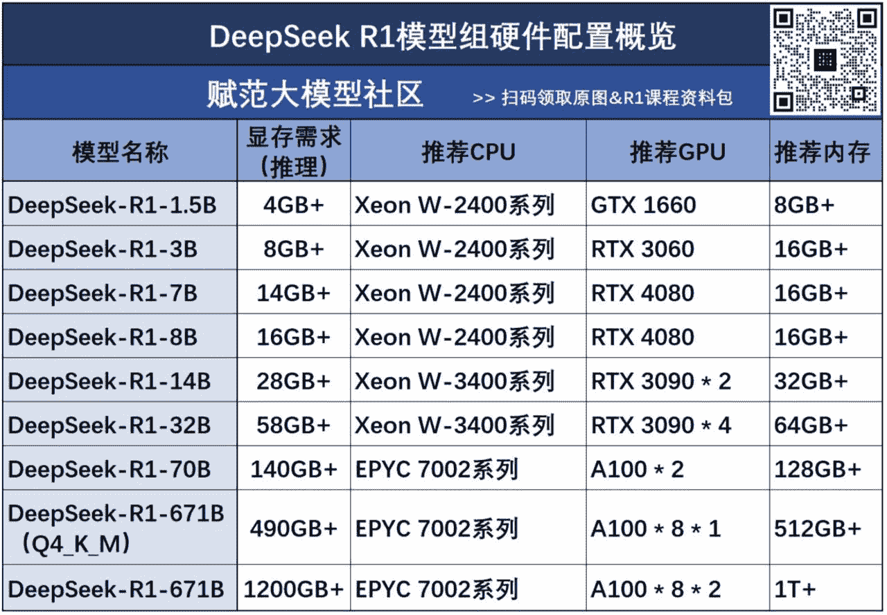

+   [  更多低成本部署方案+硬件采购避坑指南！：](https://www.bilibili.com/video/BV1K7ACewEfM/) [ht](https://www.bilibili.com/video/BV1K7ACewEfM/)tps://www.bilibili.com/video/BV1K7ACewEf M/

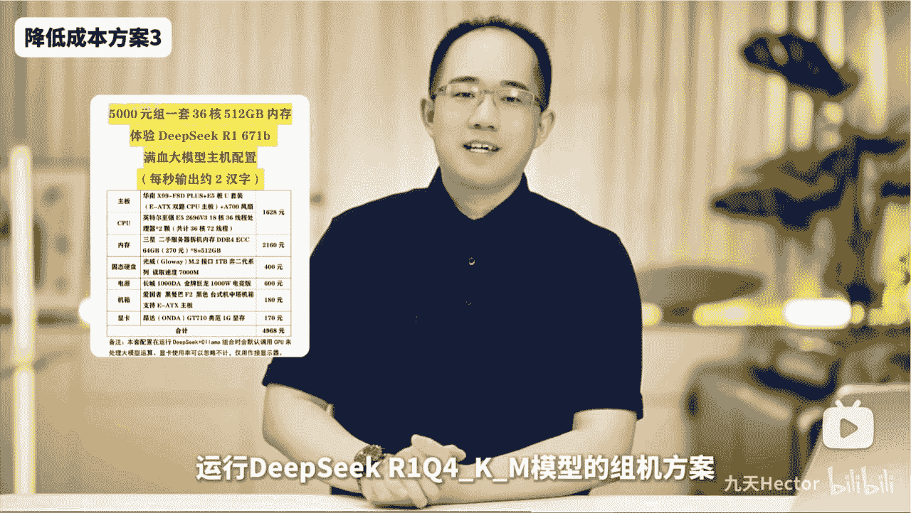

>

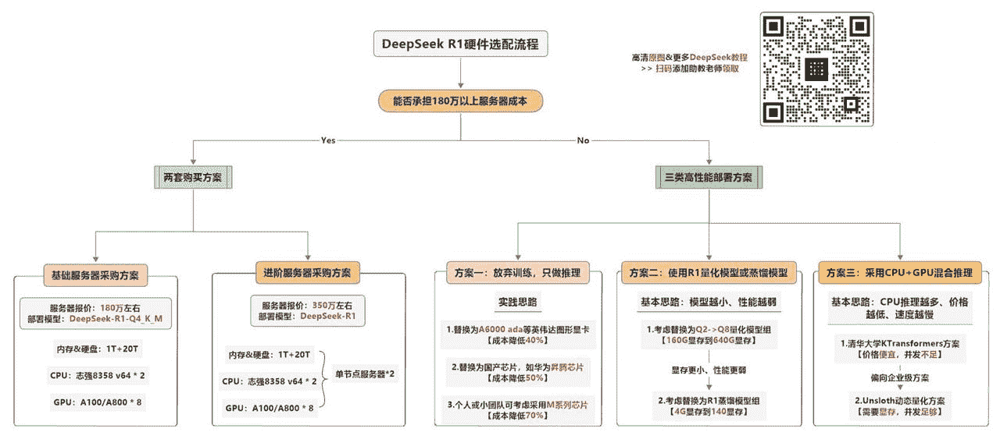

+   公开课部署模型：本节公开课以部署1.58bit模型为例进行演示，对应的部署流程可以拓展到任意精度的DeepSeek-R1模型（只需要下载对应的模型权重和配置即可）。

+   本节公开课配置：

。 PyTorch 2.5.1 ， Python 3.12(ubuntu22.04) ，Cuda 12.4

。 操作系统： Ubuntu 22.04

。 **GPU**： H800 * 2 （实际只使用单卡14G显存）

。 **CPU**：40 vCPU Intel(R) Xeon(R) Platinum 8458P

。 **内存 **：200GB DDR4

+   Ktransformers部署方案核心性能瓶颈：但凡涉及到CPU+GPU混合推理，核心的性能瓶颈都是CPU 和内存性能， Ktransformers也不例外。

+   课件代码领取：

## **二**、 KTransformers v0.24部署与调用流程

### **1.KTransformers项目入门介绍              **

#### **1.1 项目定位                                             **

KTransformers（发音为“Quick Transformers”）旨在通过先进的内核优化和计算分布/并行化策略 来增强你使用Transformers的体验。

KTransformers 是一个灵活、以 Python 为中心的框架，其核心设计理念是可扩展性。用户仅需一 行代码，即可实现优化模块的集成，并享受到以下特性：

+     与 Transformers 兼容的接口

+   **  符合 OpenAI 和 Ol**lama 规范的 RESTful API

+     一个简化版的 ChatGPT 风格 Web UI（最新版已弃用）

项目定位将 KTransformers 打造成一个灵活的平台，供用户探索和实验创新的大模型推理优化技 术。因此，项目支持编写自定义脚本来实现模型权重的灵活卸载。

#### **1.2 项目参考资料                                      **

+   GitHub主页：[https://github.com/kvca](https://github.com/kvcache-ai/ktransformers)che-ai/ktransformers

+   项目使用指南： [h](https://kvcache-ai.github.io/ktransformers/index.html)ttps://kvcache-ai.github.io/ktransformers/index.html

### **2. KTransformers v0.24部署流程           **

KTransformers支持在Windows、 Linux等操作系统下，使用源码部署或者docker工具进行部署。

考虑到更为一般的企业级应用场景，本次实验采用Linux系统作为基础环境进行演示，并采用源码部署的 方法进行部署。

+   创建虚拟环境

| conda create --name kt python=3.11 |
| --- |

+   安装基础依赖并验证

| # 安装依赖库 |
| --- |

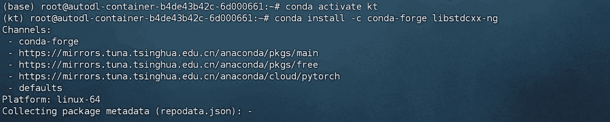

| # 验证 GLIBCXX 版本（应包含 3.4.32） |
| --- |

> 注意，这里要选择自己的anaconda或者miniconda 的安装路径

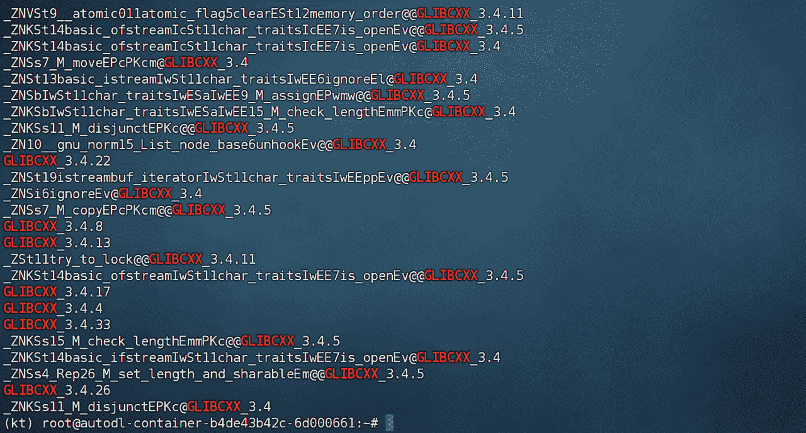

+   安装系统依赖

| sudo apt update |
| --- |

> 注意，以上是一行命令

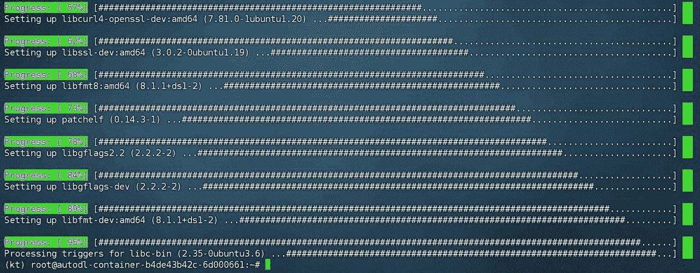

+   构建 ktransformers

| # 若实用AutoDL，则需先开启学术加速 |
| --- |

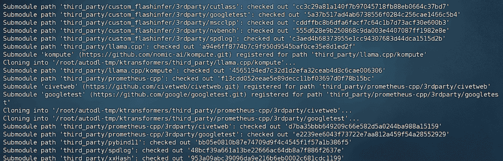

其中submodule update命令是用于进行子模块的安装， kt的子模块包括llama.cpp、 prometheus- cpp等项目。等待安装完成后可在主目录下的 third_party文件夹中看到：

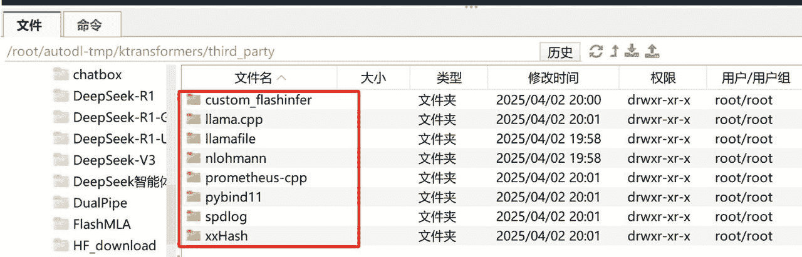

完整库

+   设置NUMA

为了确保Ktransformers能顺利运行，我们还需要设置单NUMA模式运行。

这里我们需要先确认下服务器上有几个NUMA节点（可以简单理解为有几块CPU），我们可以通过 如下命令进行查看

| lscpu | grep &quot;NUMA&quot; |
| --- |

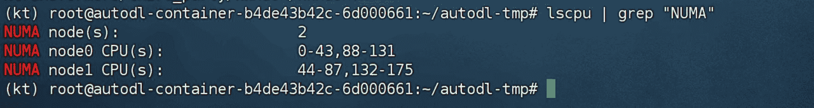

此时服务器上有两个NUMA节点。此外，不同的服务器也可能出现其他个数节点情况。

+   若是NUMA = 1 ，运行以下命令：

| sudo env USE_BALANCE_SERVE=1 PYTHONPATH=&quot;$(which python)&quot; |
| --- |

+   若是NUMA >1 ，则运行以下命令：

| # 先安装libnuma-dev |
| --- |

其中运行的install.sh脚本如下：

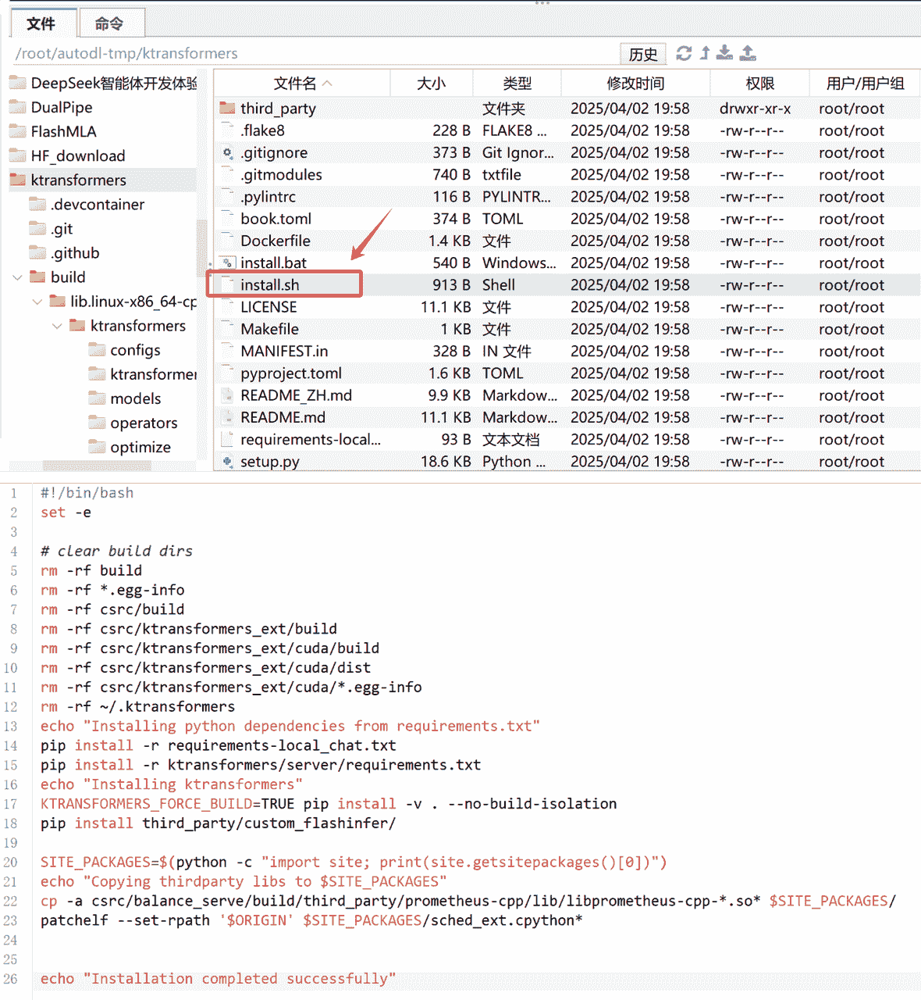

顺利运行后看到如下信息：

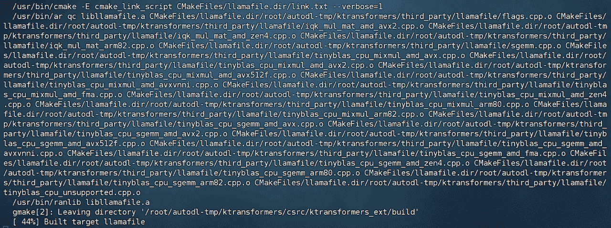

需要注意的是，新版Ktransformers整个编译过程等待时间相对较长，需要几十分钟甚至是一 个小时左右，请耐心等待编译完成。完成后看到如下图所示：

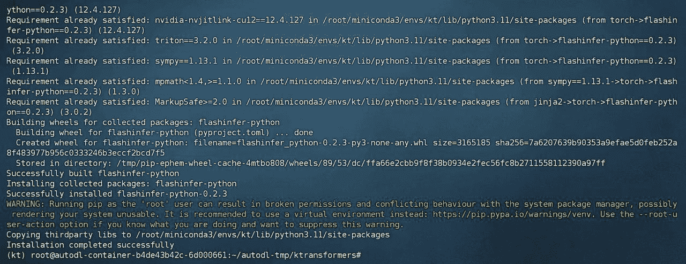

> 注意，如果出现类似Target "cmTC_abfec" requires the language dialect  "CUDA20", but CMake does not know the compile flags to use to enable it. 报错，或者在编译的第三个阶段报错，则说明cmake版本太低，此时需要进行升 级：

| pip install cmake --upgrade |
| --- |

> 然后再次进行编译即可。

+   查看ktransformers版本号

一切安装完成后，即可输入如下命令查看当前安装情况

| pip show ktransformers |
| --- |

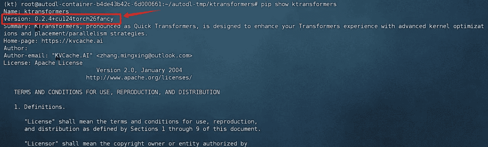

### 3.DeepSeek R1模型权重与配置文件下载

本次实验使用官方推荐的DeepSeek R1 UD-IQ1_S，直接使用Unsloth压制的模型即可，模型下载地 址：

+   魔搭社区下载地址： [h](https://www.modelscope.cn/models/unsloth/DeepSeek-R1-GGUF)ttps://www.modelscope.cn/models/unsloth/DeepSeek-R1-GGUF

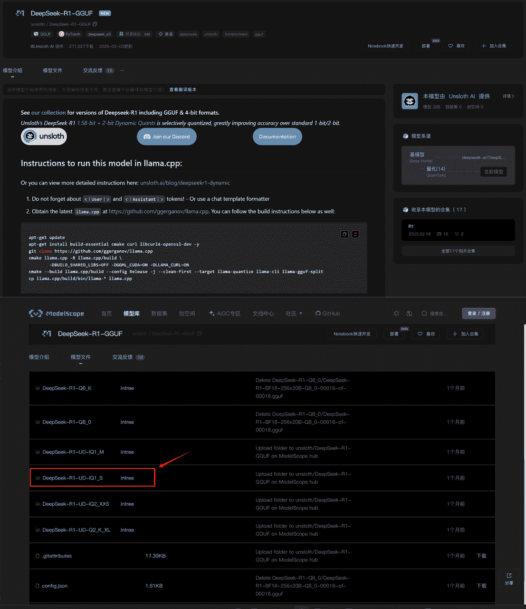

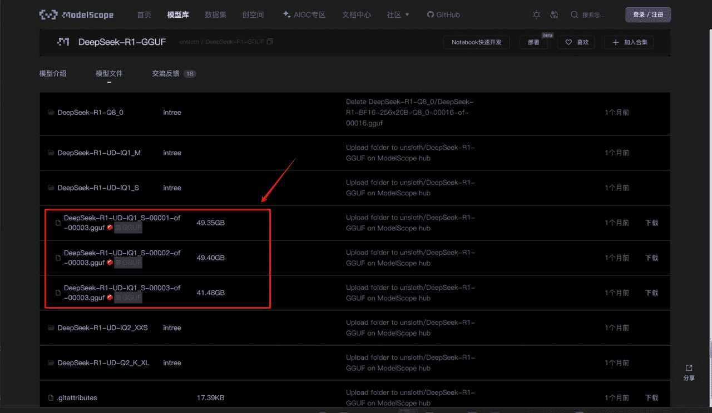

+   [HuggingFace下载地址： https://hu](https://huggingface.co/unsloth/DeepSeek-R1-GGUF)ggingface.co/unsloth/DeepSeek-R1-GGUF

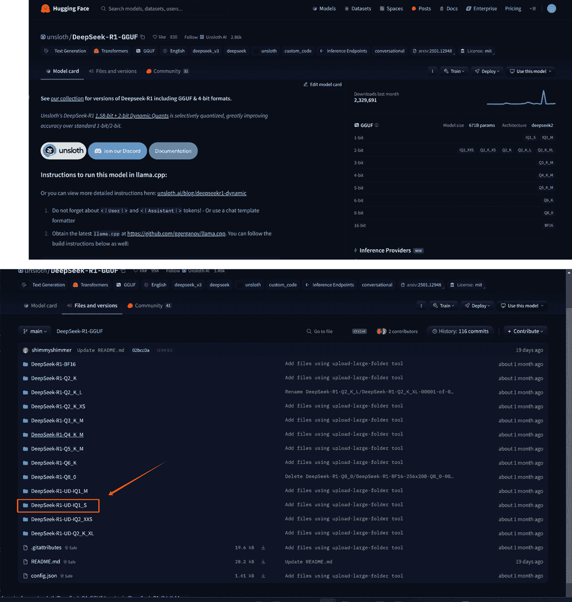

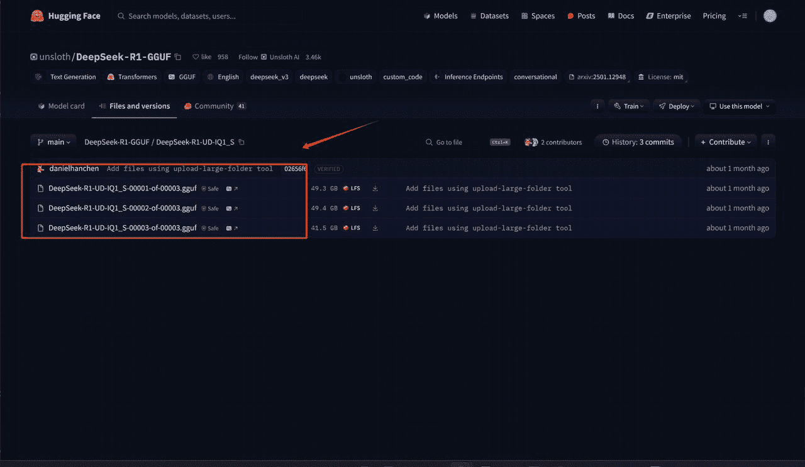

模型权重较大，总共约130G左右。若使用HuggingFace进行下载，则需要一些网络工具。

> [  AutoDL学术加速方法介绍： http](https://www.autodl.com/docs/network_turbo/)s://www.autodl.com/docs/network_turbo/

这里推荐使用魔搭社区进行下载，流程如下：

+   【可选】借助 screen持久化会话

由于实际下载时间可能持续2个小时，因此最好使用screen开启持久化会话，避免因为关闭会话导 致下载中断。

| screen -S kt |
| --- |

创建一个名为kt的会话。之后哪怕关闭了当前会话，也可以使用如下命令

| screen -r kt |
| --- |

> 若未安装screen，可以使用 sudo apt install screen命令进行安装。

+    使用魔搭社区进行下载

使用modelscope进行权重下载，需要先安装魔搭社区

| pip install modelscope |
| --- |

然后输入如下命令进行下载

| mkdir ./DeepSeek-R1-GGUF |
| --- |

| modelscope download --model unsloth/DeepSeek-R1-GGUF  --include &#x27;**Q4_K_M**&#x27; --local_dir /root/autodl-tmp/DeepSeek-R1-GGUF |
| --- |

相关文件可以在课件网盘中领取：

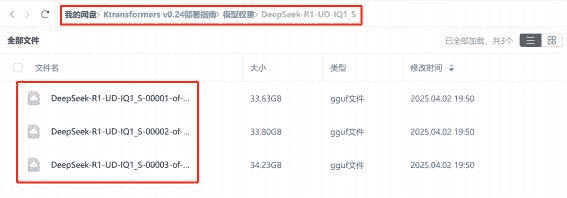

+   下载DeepSeek R1原版模型的配置文件

此外，根据KTransformer的项目要求，还需要下载DeepSeek R1原版模型的除了模型权重文件外  的其他配置文件，方便进行灵活的专家加载。因此我们还需要使用modelscope下载DeepSeek R1 模型除了模型权重（ .safetensor）外的其他全部文件，可以按照如下方式进行下载

| mkdir ./DeepSeek-R1 |
| --- |

| modelscope download --model deepseek-ai/DeepSeek-R1  --exclude &#x27;*.safetensors&#x27;  --local_dir /root/autodl-tmp/DeepSeek-R1 |
| --- |

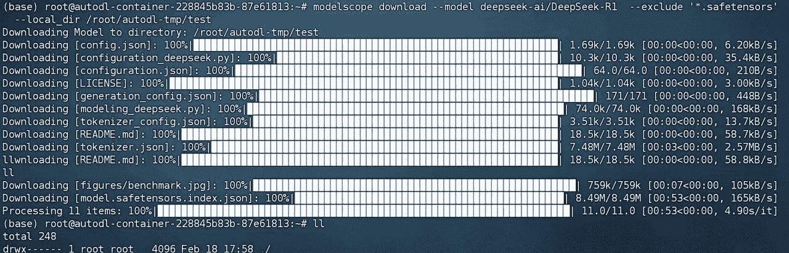

下载后完整文件如下所示：

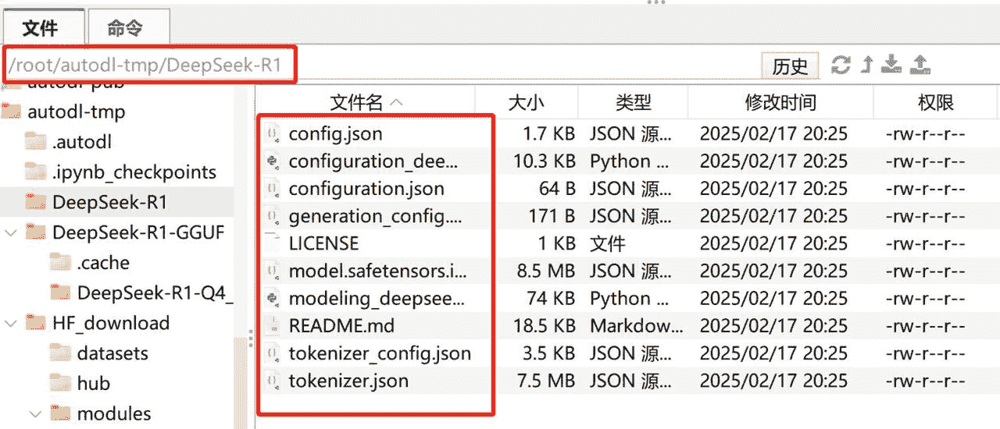

相关文件也可以在课程课件中领取：

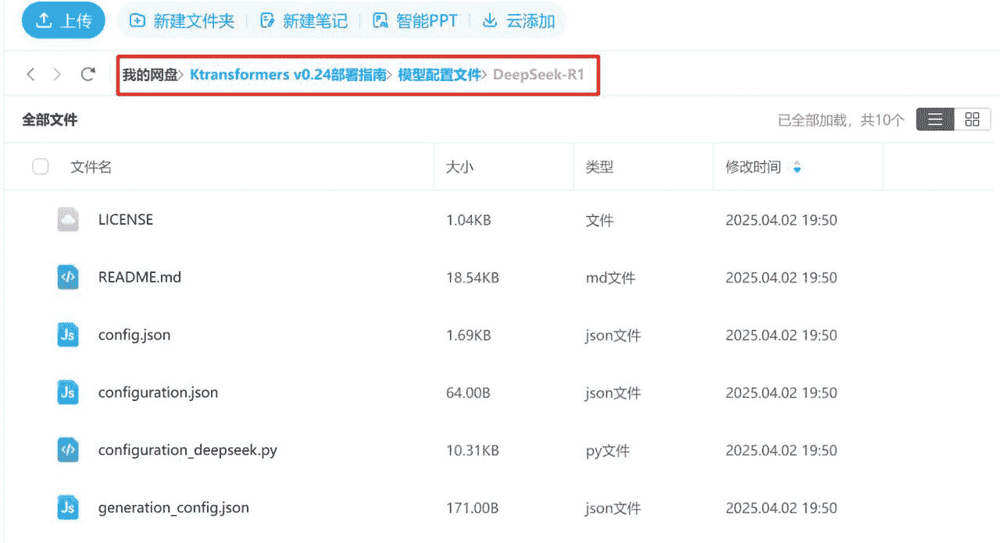

+   成果汇总

这里最终我们是下载了DeepSeek UD-IQ1_S模型权重和DeepSeek R1的模型配置文件，并分别保存 在两个文件夹中：

+   DeepSeek R1 UD-IQ1_S模型权重地址： /root/autodl-tmp/DeepSeek-R1-GGUF/DeepSeek-R1-UD-IQ1_S

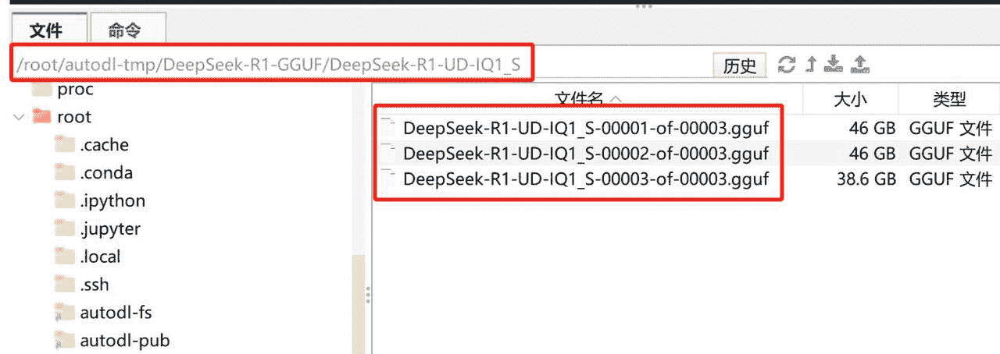

+   DeepSeek R1的模型配置文件地址： /root/autodl-tmp/DeepSeek-R1

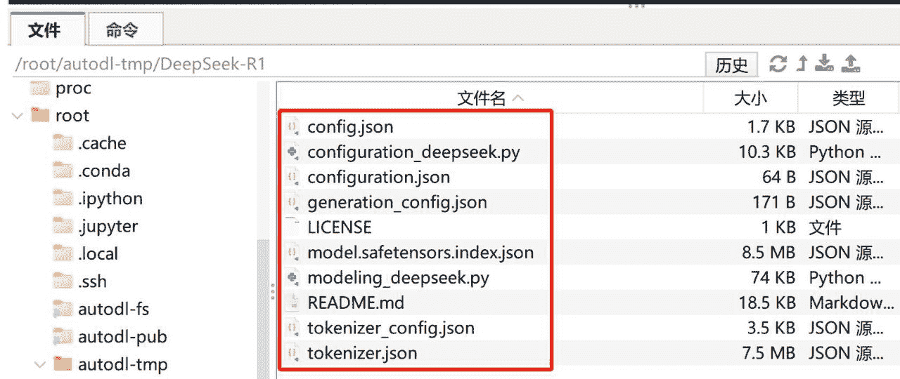

### 4.DeepSeek V3-0324 模型权重与配置文件下载

接下来我们继续下载DeepSeek-V3-0324模型权重与配置文件。不同于R1模型是推理模型， V3-0324 模型是对话模型，但由于其出色的Agent能力（Function calling能力）， V3-0324模型在很多场景下也有 很多实际应用需求。由于R1和V3模型架构完全相同，因此Ktransformers也是可以调用V3模型来进行响   应的。

本次实验使用官方推荐的DeepSeek-V3-0324 Q2_K_XL（1.58bit模型目前不太稳定）模型，该模型 也是目前最稳定的动态量化模型，需要14G显存+170G内存即可调用。

+   魔搭社区下载地址： [h](https://www.modelscope.cn/models/unsloth/DeepSeek-V3-0324-GGUF/summary)t[tps:/](https://www.modelscope.cn/models/unsloth/DeepSeek-V3-0324-GGUF/summary)/www.modelscope.cn/models/unsloth/DeepSeek-V3-0324-GGUF/su mmary

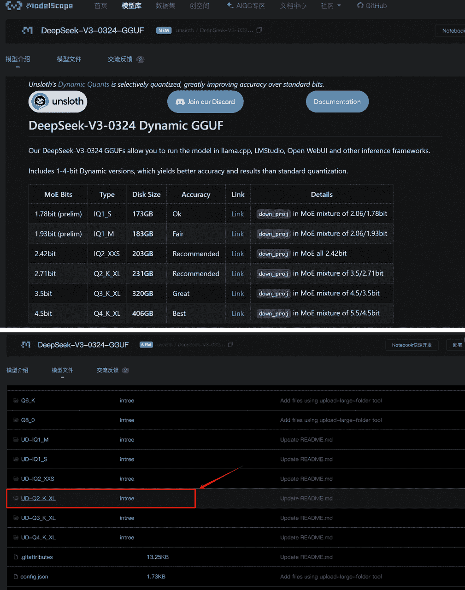

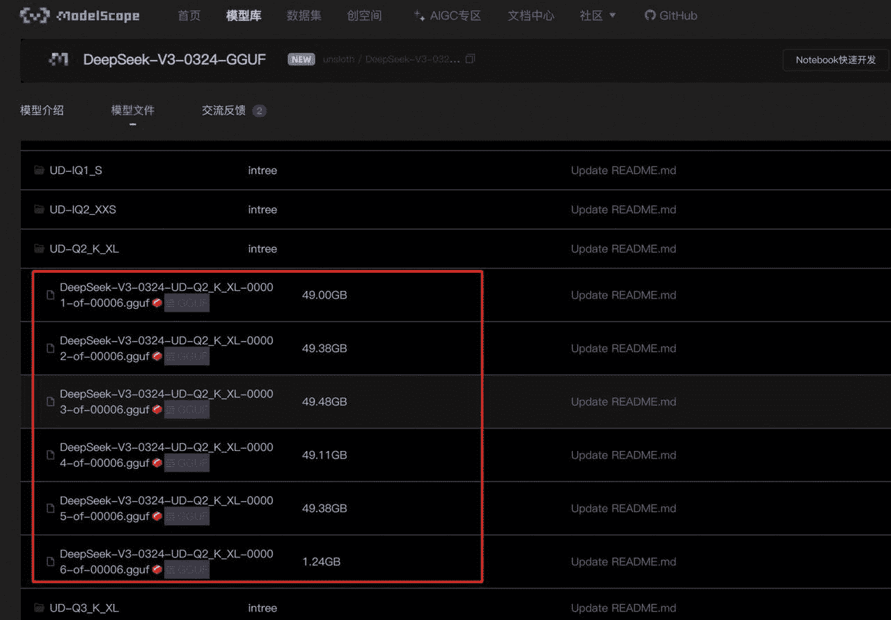

+   [H](https://huggingface.co/unsloth/DeepSeek-V3-0324-GGUF)uggingFace下载地址： https://huggingface.co/unsloth/DeepSeek-V3-0324-GGUF

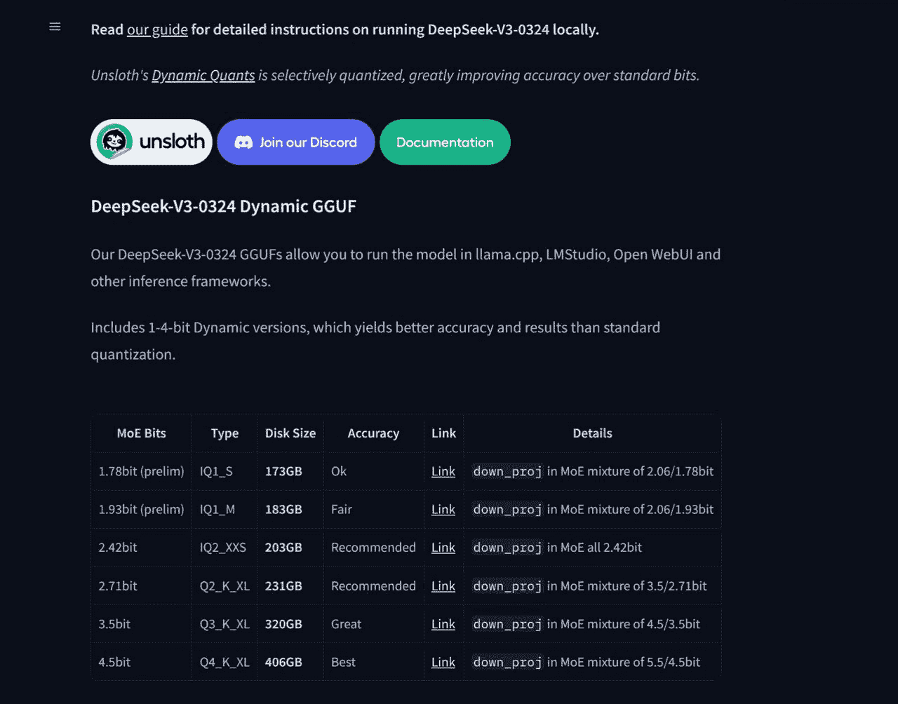

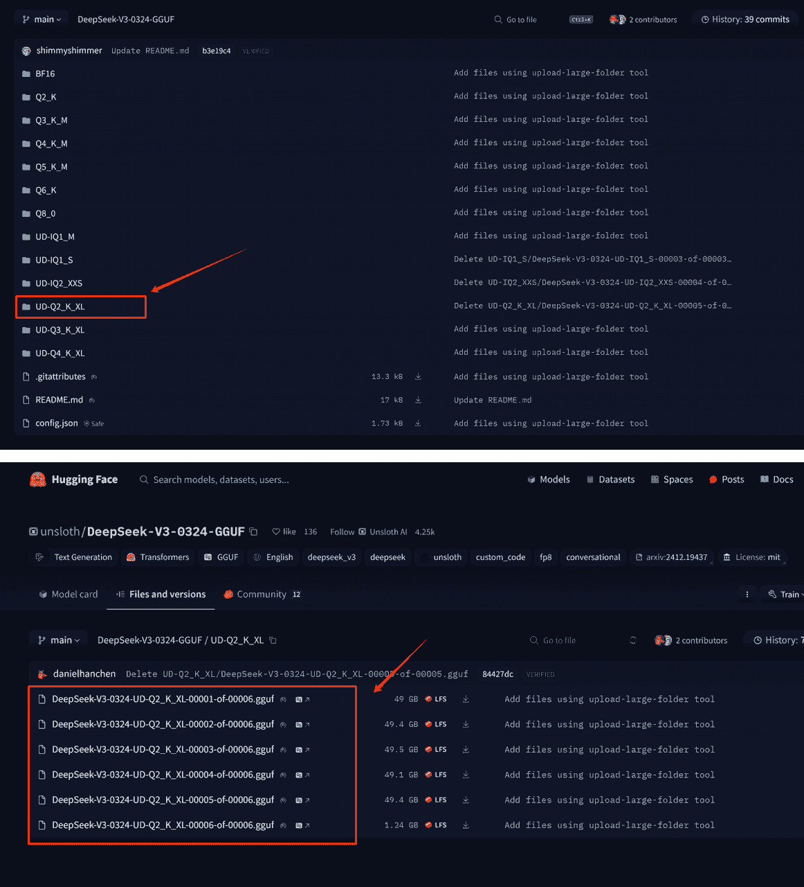

+   使用魔搭社区进行下载 输入如下命令进行下载

| mkdir ./DeepSeek-V3-0324-GGUF |
| --- |

| modelscope download --model unsloth/DeepSeek-V3-0324-GGUF  --include &#x27;**Q4_K_M**&#x27; --local_dir /root/autodl-tmp/DeepSeek-V3-0324-GGUF |
| --- |

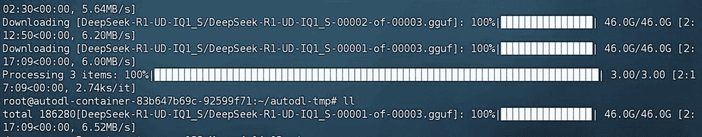

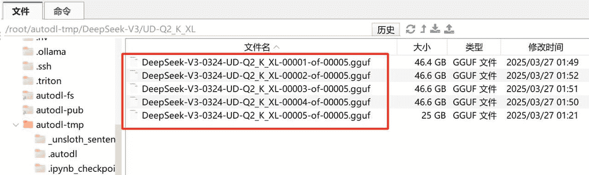

+   下载DeepSeek V3原版模型的配置文件

| mkdir ./DeepSeek-V3-0324 |
| --- |

| modelscope download --model deepseek-ai/DeepSeek-V3-0324  --exclude &#x27;*.safetensors&#x27;  --local_dir /root/autodl-tmp/DeepSeek-V3-0324 |
| --- |

下载后完整文件如下所示：

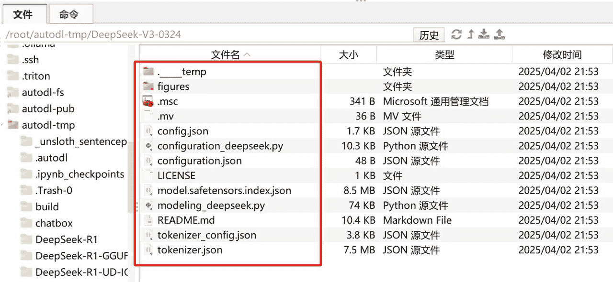

相关文件也可以在课程课件中领取：

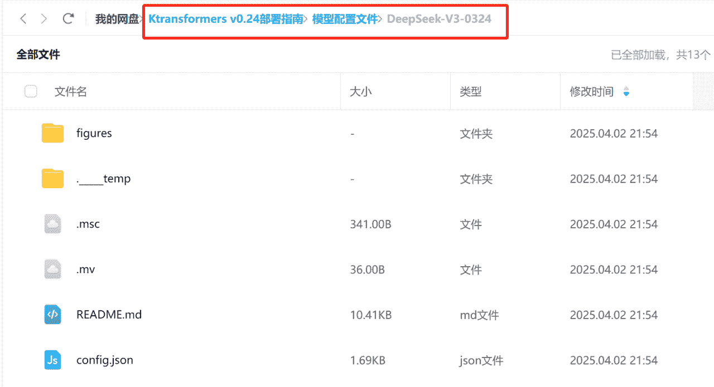

+   成果汇总

这里最终我们是下载了DeepSeek V3 Q2_K_XL模型权重和DeepSeek V3的模型配置文件，并分别保 存在两个文件夹中：

+   DeepSeek V3 Q2模型权重地址： /root/autodl-tmp/DeepSeek-V3/UD-Q2_K_XL

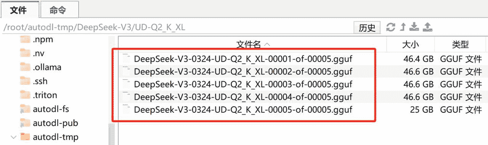

+   DeepSeek V3 IQ2的模型配置文件地址： /root/autodl-tmp/DeepSeek-V3-0324

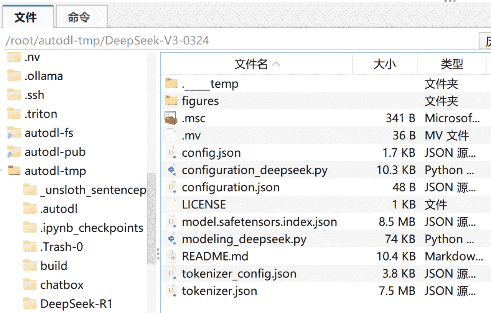

## **三、 KTransformer v0.24版调用D**eepSeek运行流程

在安装完成了KTransformer v0.24，并下载好了模型权重和相应的模型配置之后，接下来即可尝试

进行调用了。 KTransformer v0.24支持两种调用方法，分别借助 local_chat.py进行命令行本地对话， 以及实用 server/main.py开启服务，然后在默认10002端口进行OpenAI风格的API调用。这里我们重   点尝试使用后端服务模式调用DeepSeek模型。

### 1.DeepSeek-R1调用流程

部署完成后，即可使用如下命令开启后端服务，并在10002端口实现OpenAI风格API调用。这里需 要输入如下命令：

| python ktransformers/server/main.py \ |
| --- |

等待响应如下：

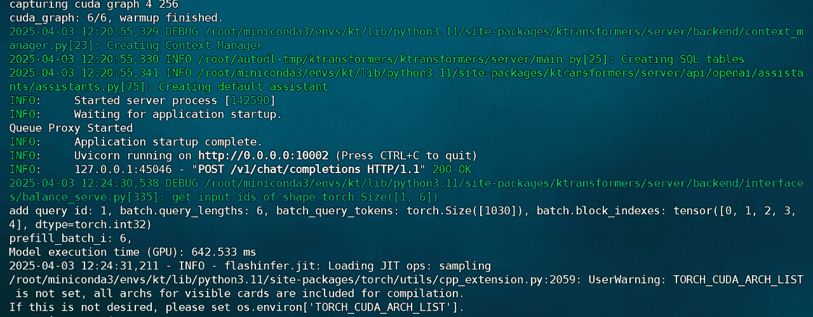

然后即可在命令行输入如下命令进行调用：

| curl -X POST http://localhost:10002/v1/chat/completions \ |
| --- |

即可获得如下响应：

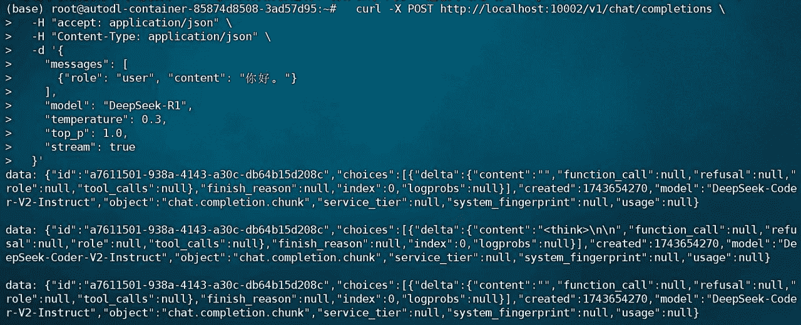

当然，我们也可以直接在Jupyter中尝试对其进行调用：

| from openai import OpenAI |
| --- |

base_url="http://localhost:10002/v1")

model="DeepSeek-R1",

messages=[

{"role": "user", "content": "你好，好久不见 !"}

]

响应结果如下所示：

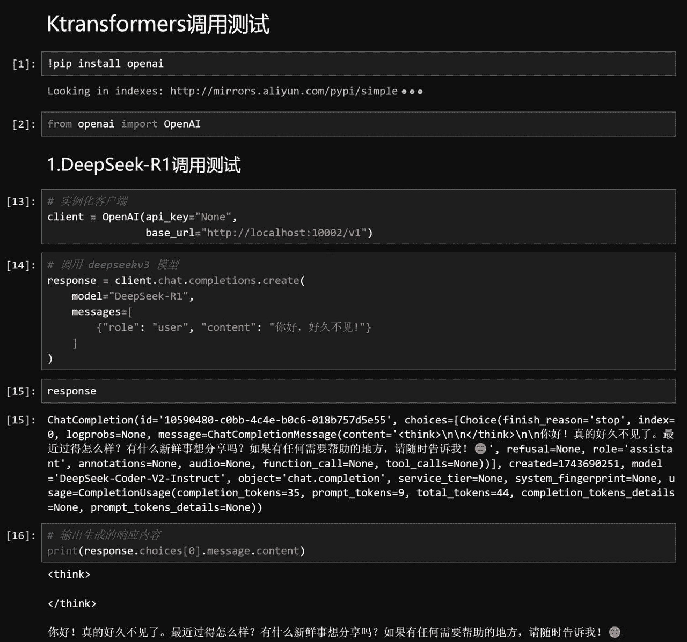

### 2.DeepSeek-V3-0324 调用流程

可使用如下命令开启后端服务，并在10002端口实现OpenAI风格API调用。这里需要输入如下命令：

| python ktransformers/server/main.py \ |
| --- |

等待响应如下：

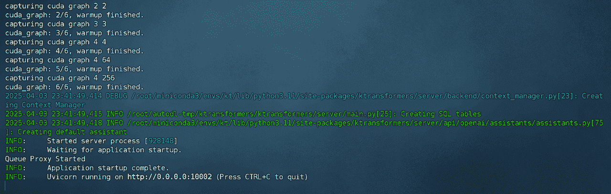

然后即可在命令行输入如下命令进行调用：

| curl -X POST http://localhost:10002/v1/chat/completions \ |
| --- |

即可获得如下响应：

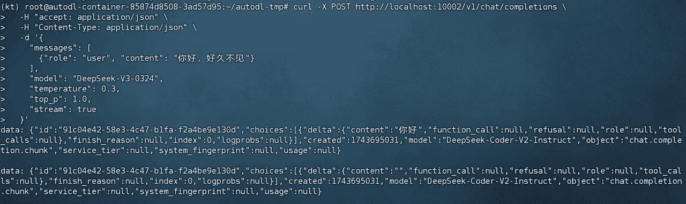

当然，我们也可以直接在Jupyter中尝试对其进行调用：

| from openai import OpenAI |
| --- |

base_url="http://localhost:10002/v1")

model="DeepSeek-V3-0324",

messages=[

{"role": "user", "content": "你好，好久不见!"}

]

响应结果如下所示：

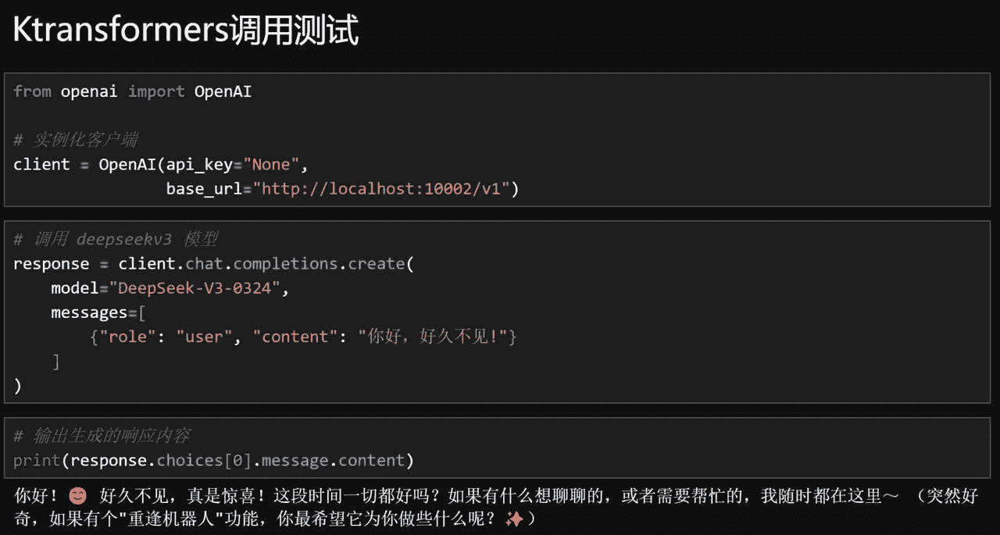