# DeepSeek R1 + Open-Webui多功能企业级部署实战

> 来源：[https://kq4b3vgg5b.feishu.cn/docx/X55pdKQL8oz6D1xzzhcc40mjnIg](https://kq4b3vgg5b.feishu.cn/docx/X55pdKQL8oz6D1xzzhcc40mjnIg)

# 课程说明：

+   体验课内容节选自《2025大模型Agent智能体开发实战》完整版付费课程

体验课时间有限，若想深度学习大模型技术，欢迎大家报名由我主讲的《2025大模型Agent智能体开发实战》：

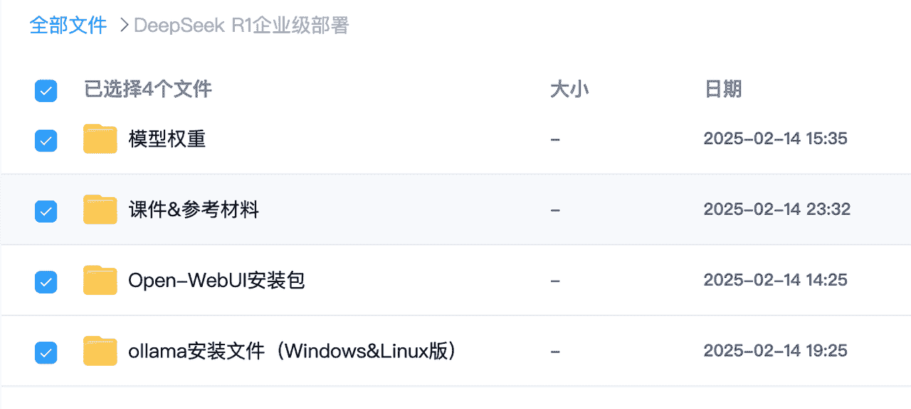


此外，公开课全套学习资料，已上传至网盘（ https://pan.baidu.com/s/1zdVHEEyJdgtE31DLvz41Iw?pwd=i8q7 ）

需要更系统深入学习大模型可扫码⬆️添加助教咨询喔～

---

## **一、** **DeepSeek** **R1本地部署系列教程**

在[此前的公开课中，我们曾详细介绍过DeepSeek](https://www.bilibili.com/video/BV19kFoe6Ef7/) R1模型的本地部署+Ollama、vLLM等主流框架调 用流程：https://www.bilibili.com/video/BV19kFoe6Ef7/


以及，讲解了DeepSeek R1模型+An[ythingLLM的知](https://www.bilibili.com/video/BV12qF2ePEDa/)识库问答实战： https://www.bilibili.com/video/BV 12qF2ePEDa/

但对于DeepSeek R1，仍然有大量的实用功能没有实现，如代码解释器、联网功能、更加高效的知识库 检索功能、外部工具调用功能、以及连接本地MySQL数据库等功能。

本节公开课，我们就将结合DeepSeek R1与最热门的企业级大模型前端调用框架Open-WebUI，来 详细介绍如何完善丰富DeepSeek R1的本地部署调用功能。

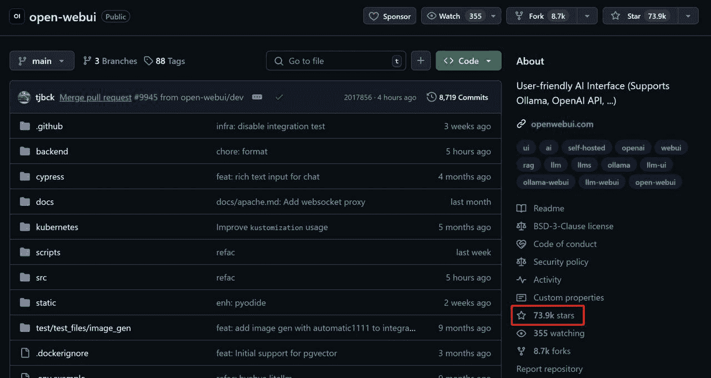

+     **硬件要求**：本节公开课需调用DeepSeek R1 Distill 14B蒸馏模型进行实验，最少需要10G显存。

+     **课件代码领取**：公开课随课提供全部课件、代码、模型权重等各项内容。

+     **课程参考资料**：为了更好的辅助学习，随公开课附赠相关参考资料。

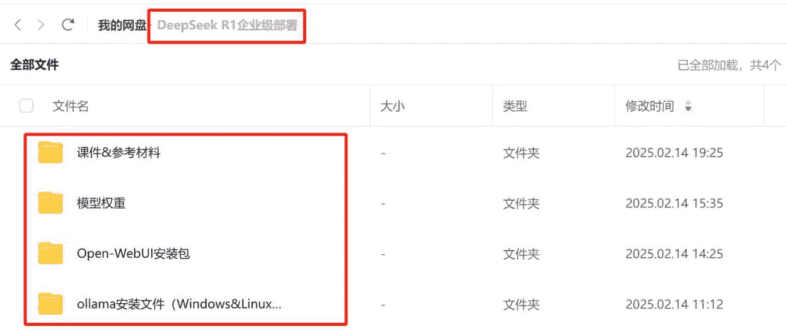


此外，公开课训练项目代码、数据、**及**模型权重等等，已上传至课件网盘，联系⬆**️**助教回复“DS网盘”，即可领取（目前咨询人数较多，助教老师在加急一一回复啦，小伙伴们发送后耐心等待一下哦🌹～）。

---

公开课目录：

DeepSeekR1+Open-Webui多功能企业级部署实战

一、DeepSeekR1本地部署系列教程

二、DeepSeek  R1部署基础环境搭建 1.Open-WebUI部署流程

2.ollama安装部署

3.1 【方案一】在线下载模型权重

3.2【方案二】手动下载GGUF权重并运行 三、Open-WebUI基础调用测试

1.首次启动流程   2.模型选择与切换

3.代码解释器功能实现

4.联网功能实现【国内不稳定】

四、DeepSeekR1+Open-WebUI进阶功能使用

1.RAG本地知识库问答

2.外部工具调用Functioncalling

3.连接本地MySQL数据库进行数据查询

## **二、** **DeepSeek** **R1部署基础环境搭建**

### 1.Open-WebUI部署流程

[首先需要安装Open-WebUI，官网地](https://github.com/open-webui/open-webui)址如下： https://github.com/open-webui/open-webui。

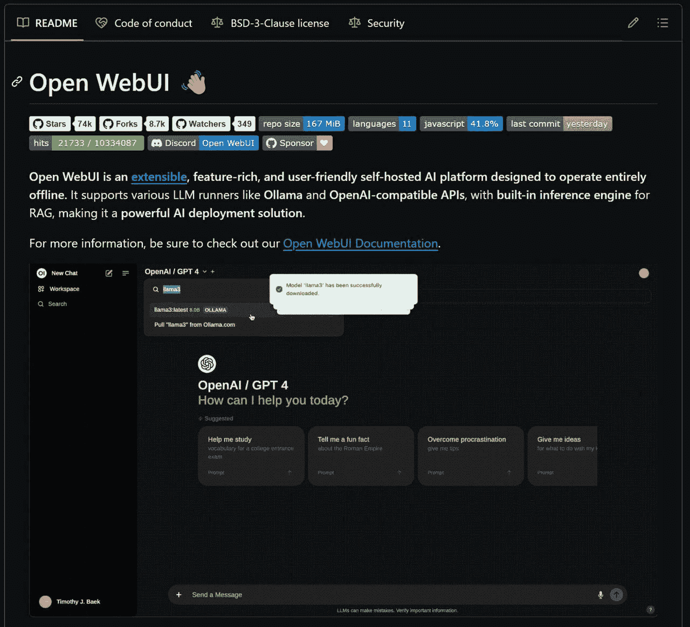

我们可以直接使用pip命令快速完成安装：

| pip install open-webui |
| --- |

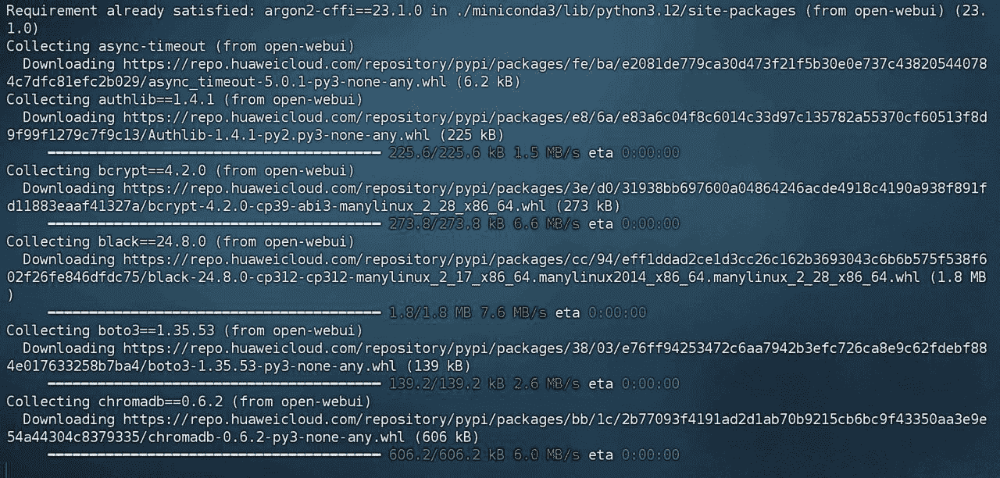

可以直接使用在GitHub项目主页上直接下载完整代码包，并上传至服务器解压缩运行：

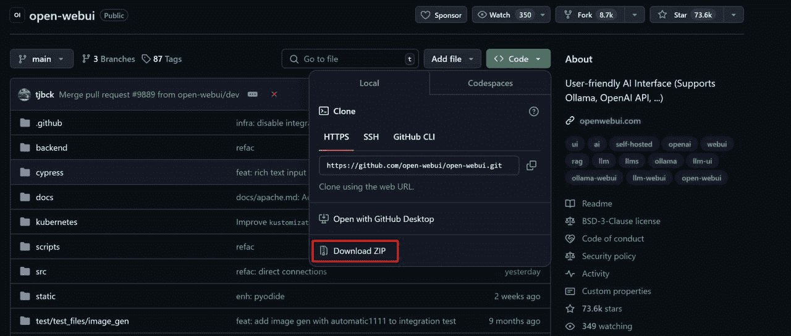

此外，也可以在课件网盘中领取完整代码包，并上传至服务器解压缩运行：

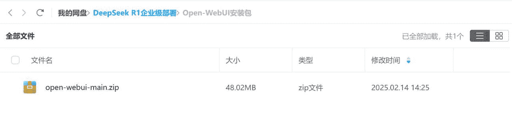


⬆️上图扫码即可领取～

安装完成后先不启动，等其他相关组件安装完后再启动。

### **2.** **ollama安装部署**

Open-WebUI原生支持使用Ollama调用本地模型进行推理， Ollama是一款大模型下载、管理、推   理、优化集一体的强大工具，可以快速调用各类离线部署的大模型。  Ollama官网：https://ollama.com/

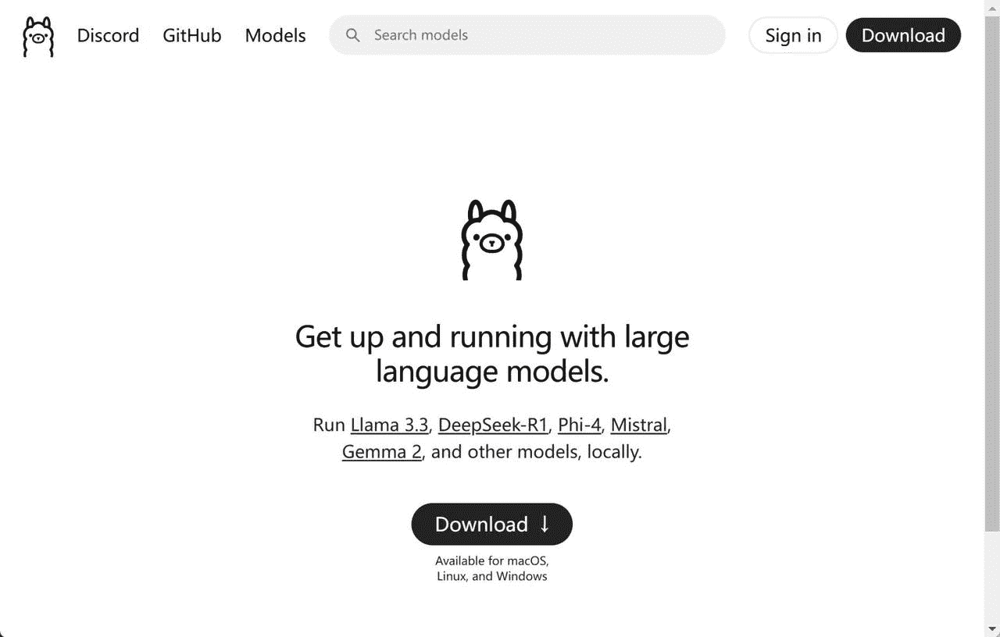

+   【安装方案一】Ollama在线安装

在Linux系统中，可以使用如下命令快速安装Ollama

| curl -fsSL https://ollama.com/install.sh | sh |
| --- |

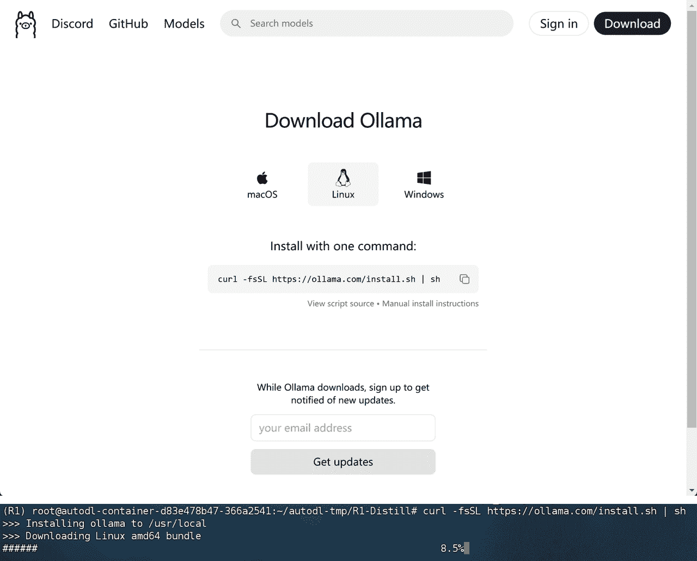

但该下载流程会受限于国内网络环境，下载过程并不稳定。

+   【安装方案二】 Ollama离线安装

因此，在更为一般的情况下，推荐使用Ollama离线部署。我们可以[在Ollama Github主页查看目前 ](https://github.com/ollama/ollama/releases)Ollama支持的各操作系统安装包： https://github.com/ollama/ollama/releases

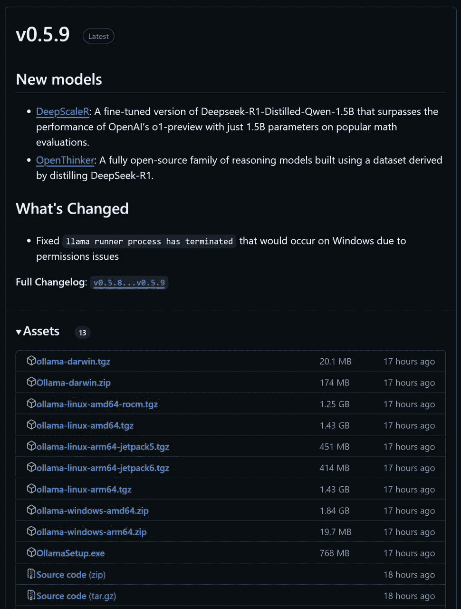

若是Ubuntu操作系统，选择其中 ollama-linux-amd64.tgz下载和安装即可。 此外，安装包也可从网盘中下载：

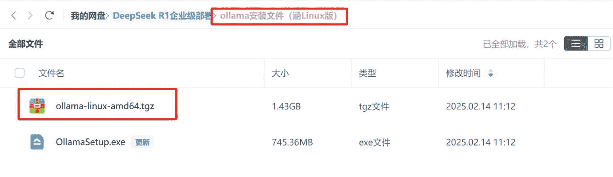

下载完成后，需要先上传至服务器：

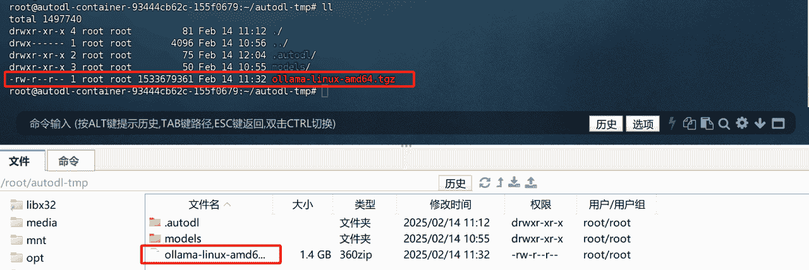

然后使用如下命令进行解压缩

| mkdir ./ollama |
| --- |

解压缩后项目文件如图所示：

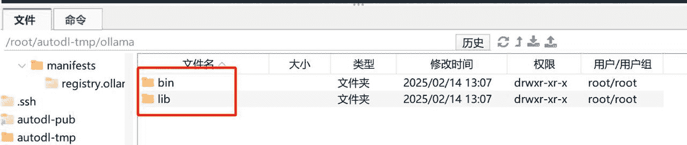

而在bin中，可以找到ollama命令的可执行文件。

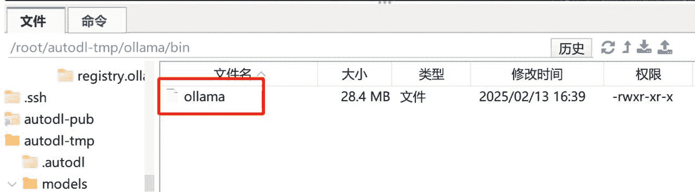

此时，我们可以使用如下方式使用ollama：

| cd ./bin |
| --- |

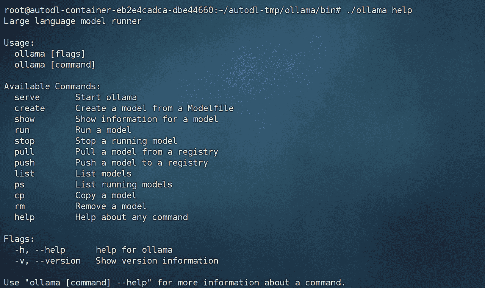

| 此处若显示没有可执行权限，可以使用如下命令为当前脚本添加可执行权限： |  |
| --- | --- |
|  | chmod +x ollama |

而为了使用命令方便，我们也可以将脚本文件写入环境变量中。我们可以在主目录（root）下找 到.bashrc文件：

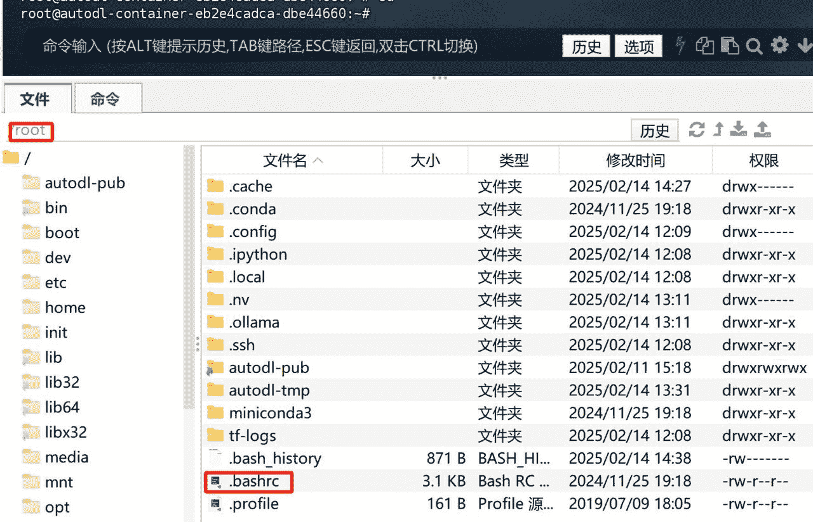

然后在 .bashrc文件结尾写入ollama/bin文件路径：

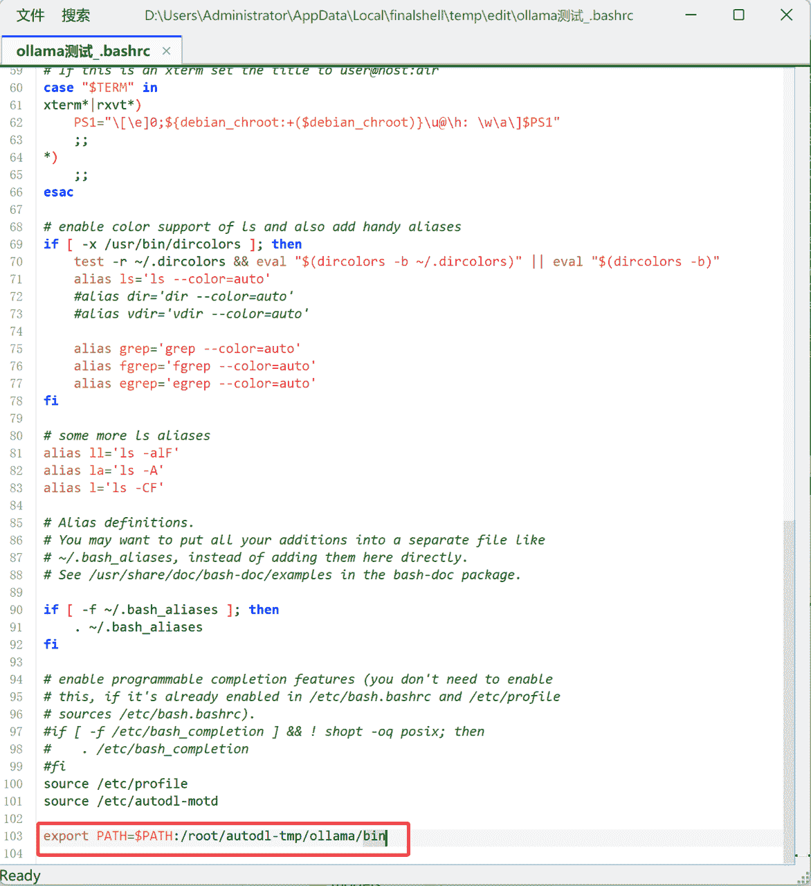

保存并退出后，输入如下命令来使环境变量生效：

| source ~/.bashrc |
| --- |

然后在任意路径下输入如下命令，测试ollama环境变量是否生效

| ollama help |
| --- |

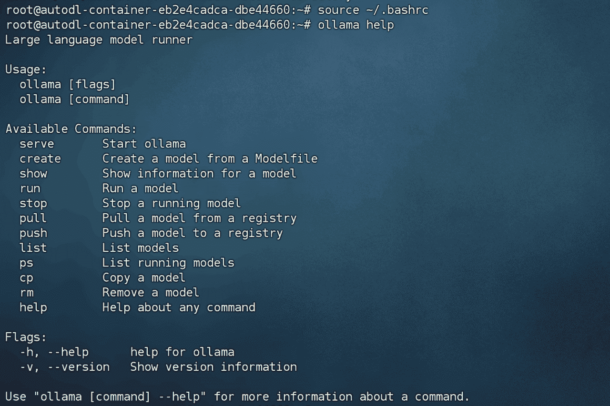

+   【可选】更换Ollama默认模型权重下载地址

接下来我们需要使用ollama来下载模型，但默认情况下， ollama会将模型下载到/root/.ollama文件 夹中，会占用系统盘空间，因此，若有需要，可以按照如下方法更换模型权重下载地址。

此外无论是在线还是离线安装的ollama，都可以按照如下方法更换模型权重下载地址。还是需要打 开 /root/.bashrc文件，写入如下代码：

| export OLLAMA_MODELS=/root/autodl-tmp/models |
| --- |

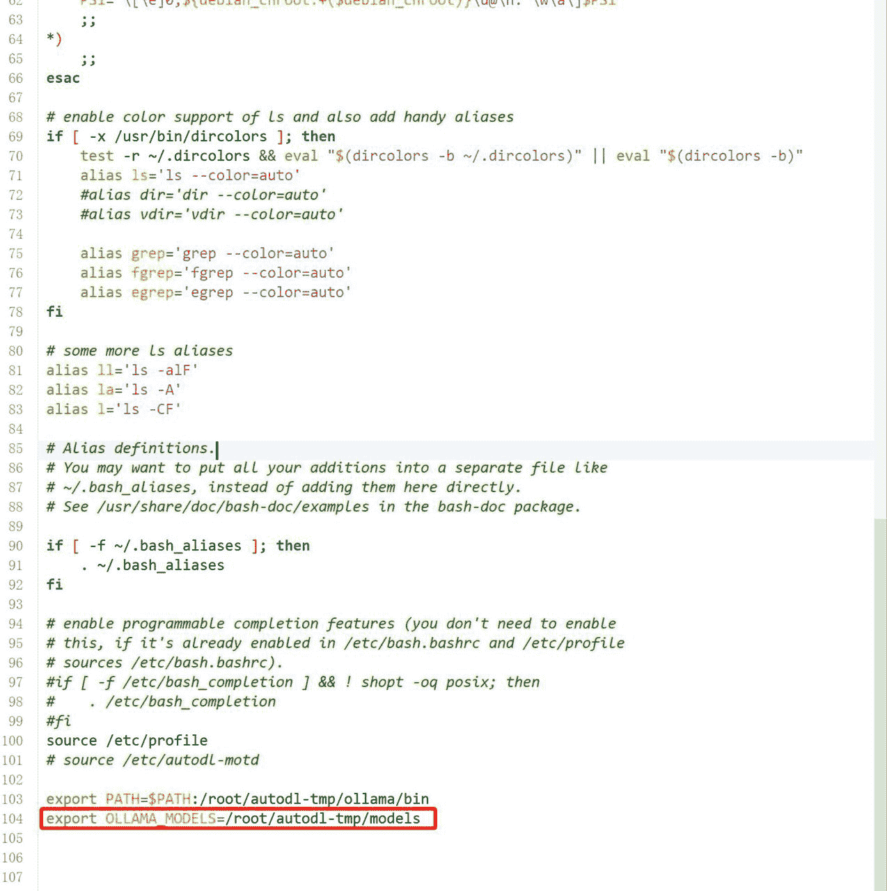

这里的路径需要改写为自己的文件地址

保存并退出后，输入如下命令来使环境变量生效：

| source ~/.bashrc |
| --- |

测试环境变量是否生效

| echo $OLLAMA_MODELS |
| --- |

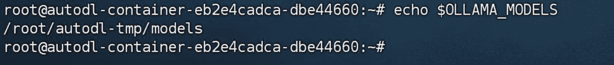

.    启动ollama

接下来即可启动ollama，为后续下载模型做准备：

| ollama start |
| --- |

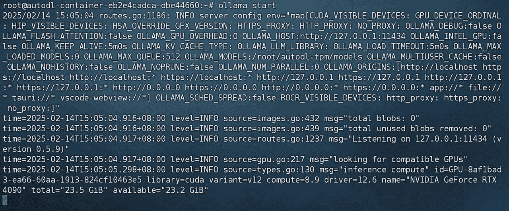

注意，在整个应用使用期间，需要持续开启Ollama。

**3.** **DeepSeek** R1与Embedding模型下载

接下来即可进入到模型下载环节。要顺利的使用Open-WebUI进行对话和知识库检索问答，需要下  载对话模型和Embedding模型。模型权重下载可以使用ollama pull命令进行在线下载（没有网络门槛， 且速度很快），当然也可以手动下载模型权重，然后上传到服务器上，再注册到Ollama中，就可以通过 Ollama调用模型了。以下两种模型权重下载方法任选其一执行即可。

#### **3.1** **【方案一】在线下载模型权重**

+    DeepSeek R1 Distill模型权重下载流程

目前DeepSeek R1及其蒸馏模型均支持使用ollama[进行调用，可以在模型主](https://ollama.com/library/deepseek-r1)页查看调用情况： https://oll ama.com/library/deepseek-r1

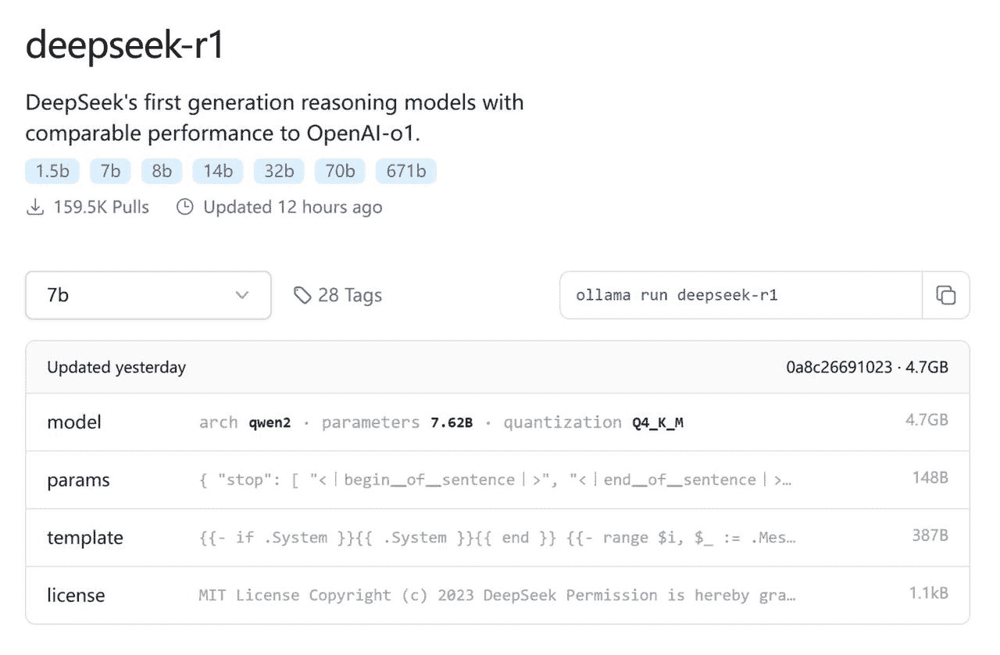

其中各模型在Q4   K   M量化情况下运行所需显存情况如下：

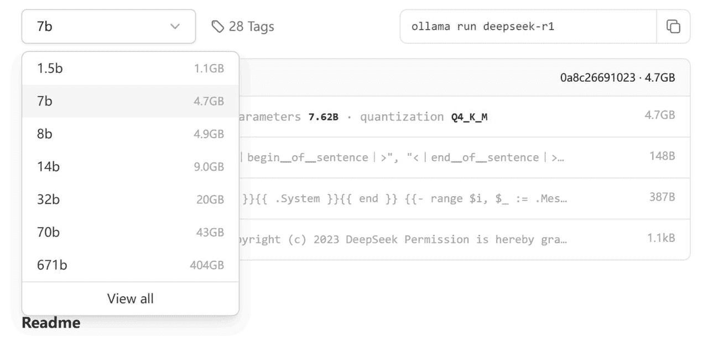

这里我们还是以1.5B模型为例进行演示，其他模型流程类似（只需要更换模型名称即可）。 .  deepseek-r1:1.5b模型权重下载流程

| ollama run deepseek-r1:1.5b |
| --- |

若只下载不调用，则可以使用ollama pull命令

使用该命令后系统就会自动下载模型权重，并自动完成注册。

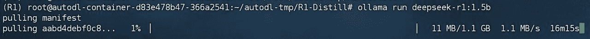

等待模型下载完成后即可直接使用：

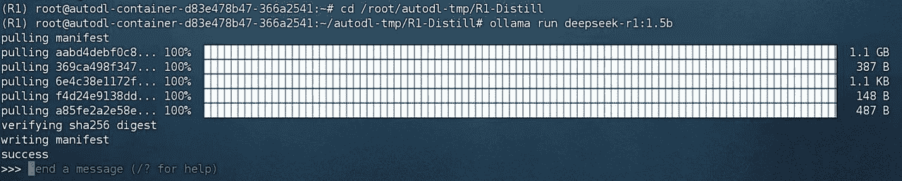

对话效果如下：


+   Embedding模型下载流程

nomi[c-embed-text是一个专门用于特征提取](https://ollama.com/library/nomic-embed-text)和句子相似度计算的Embedding模型。该模型在多个任务    上表现出色，特别是在分类、检索和聚类任务中，表现与OpenAI上一代Embedding模型性能相当。其核 心优势在于能够生成高质量的句子嵌入，这些嵌入在语义上非常接近，从而在相似度计算和分类任务中   表现优异。https://ollama.com/library/nomic-embed-text

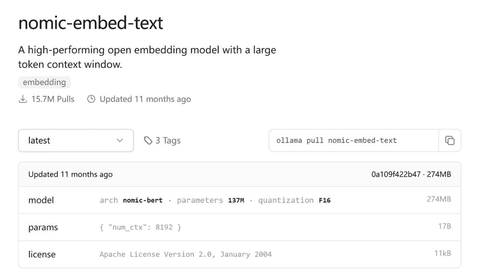

在线下载流程如下：

| ollama pull nomic-embed-text |
| --- |

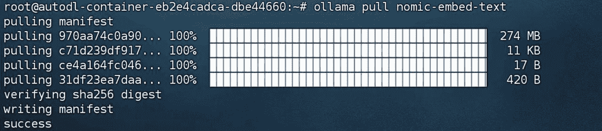

也可以使用ollama list查看当前下载的模型列表：

| ollama list |
| --- |

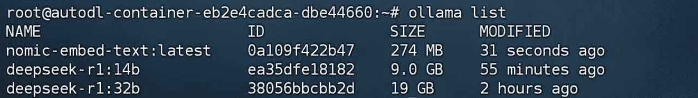

此时应该能看到nomic embedding和DeepSeek R1 1.5B模型。 此外，若要使用多模态功能，则还需要安装Janus pro

| ollama pull erwan2/DeepSeek-Janus-Pro-7B |
| --- |

#### **3.2** 【方案二】手动下载GGUF权重并运行

除了使用ollama run命令外， ollama也支持调用手动下载的自定义模型，但需要是GGUF格式。模型权 重可以在huggingface或魔搭社区上下载。

+   DeepSeek R1 Distill模型权重下载流程

目[前De](https://modelscope.cn/search?search=DeepSeek-R1-Distill-Qwen-1.5B-GGUF)e[p](https://modelscope.cn/search?search=DeepSeek-R1-Distill-Qwen-1.5B-GGUF)Seek-R1-Distill-Qwen-1.5B模型已有各种不同量化版本的GGUF模型在魔搭社区中上线了： htt ps://modelscope.cn/search?search=DeepSeek-R1-Distill-Qwen-1.5B-GGUF

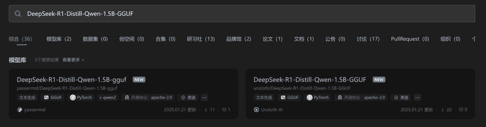

其中每个GGUF量化的权重都包含多个版本：

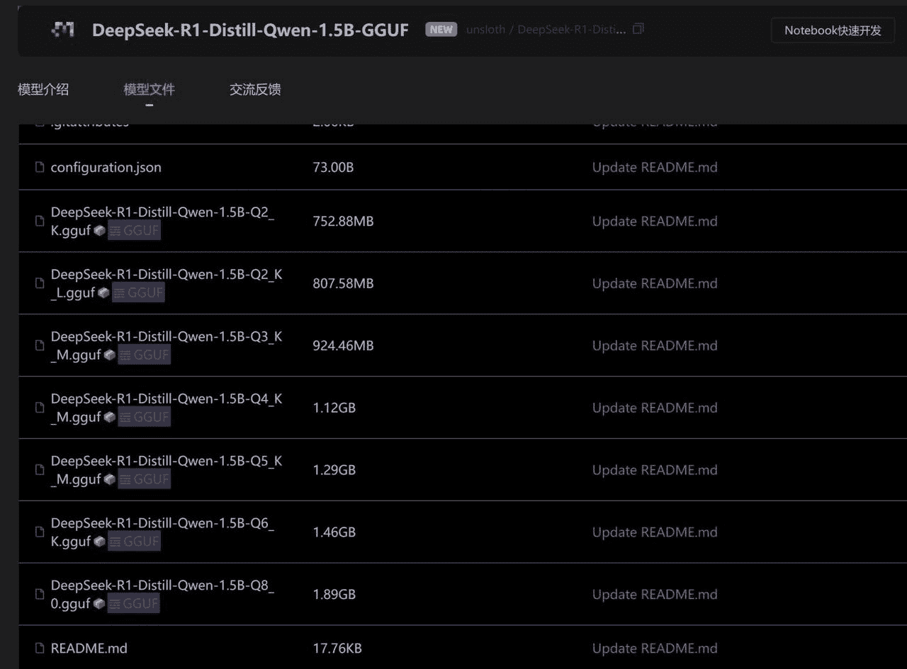

其中ollama调用的就是Q4_K_M量化版本。这里我们还是考虑下载Q4_K_M量化版本的GGUF权重进行调 用，具体执行流程如下。

+   安装魔搭社区

| pip install modelscope |
| --- |

下载GGUF格式权重

| mkdir DeepSeek-R1-1.5B-GGUF |
| --- |

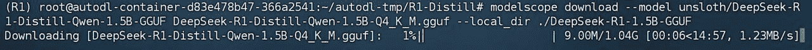

也可从网盘中直接下载：


+   注册模型

然后需要创建一个file文件，用于进行ollama模型注册：

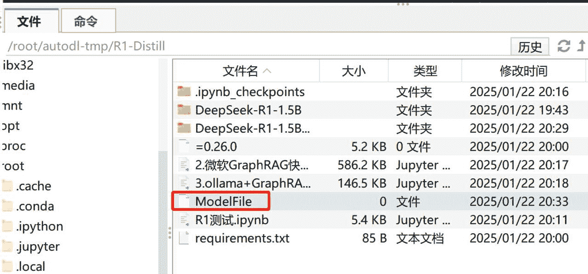

然后在File文件中写入自定义模型GGUF权重地址：

| FROM ./DeepSeek-R1-1.5B-GGUF./DeepSeek-R1-Distill-Qwen-1.5B-Q4 K  M.gguf |
| --- |

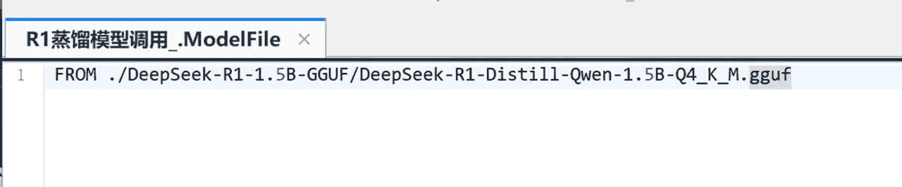

然后将该模型加入Ollama本地模型列表：

| ollama create DeepSeek-R1-1.5B -f ModelFile |
| --- |

查看模型是否注册成功

| ollama list |
| --- |

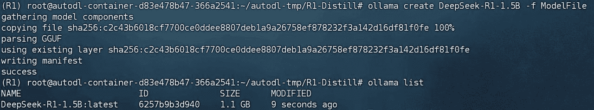

接下来即可使用了：

| ollama run DeepSeek-R1-1.5B |
| --- |


该流程也适用于其他不同型号的模型，下载对应的GGUF模型权重即可。

+   Embedding模型下载流程

类似的， nomic模型的GGUF格式也可以从魔搭社区中进[行下载，](https://modelscope.cn/models/nomic-ai/nomic-embed-text-v1.5-GGUF)然[后](https://modelscope.cn/models/nomic-ai/nomic-embed-text-v1.5-GGUF)注册使用。下载地址如下：  http s://modelscope.cn/models/nomic-ai/nomic-embed-text-v1.5-GGUF

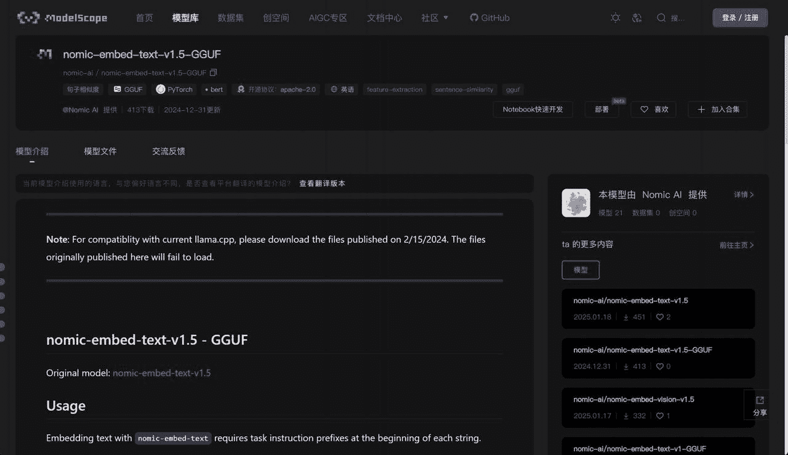

使用如下命令进行下载：

| mkdir nomic-embed-text-v1.5-GGUF |
| --- |

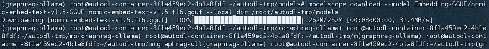

也可以在网盘中进行下载并上传至服务器

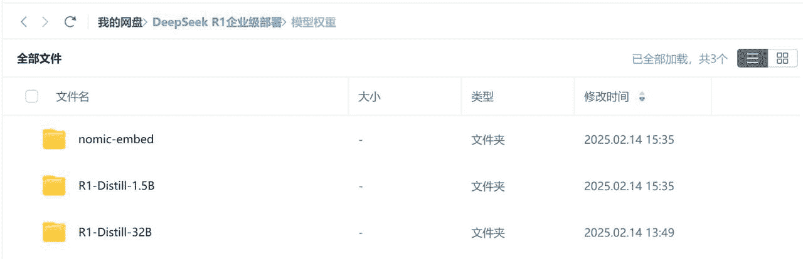


然后即可查看到下载的模型权重

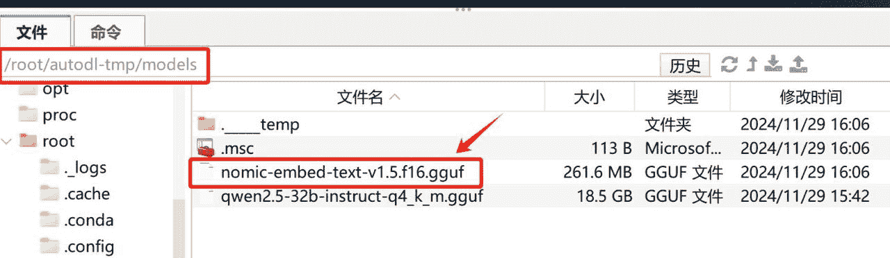

然后编写Embedding模型的File文件 EmbeddingModelFile ：

| FROM ./nomic-embed-text-v1.5.f16.gguf |
| --- |

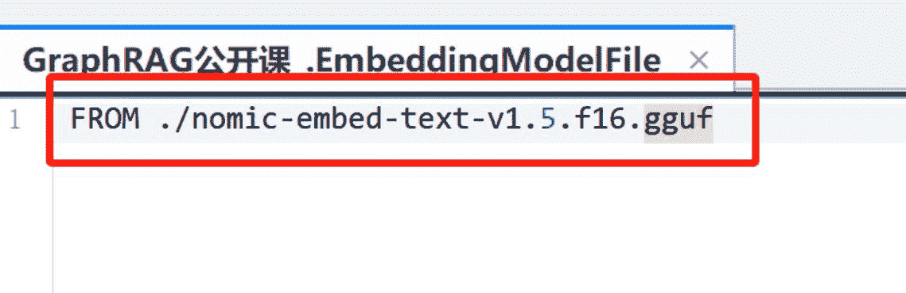

然后注册到ollama中：

| ollama create nomic-embed-text -f EmbeddingModelFile |
| --- |

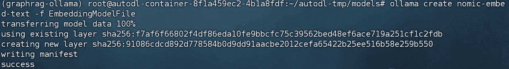

然后即可通过ollama list查看是否注册成功：

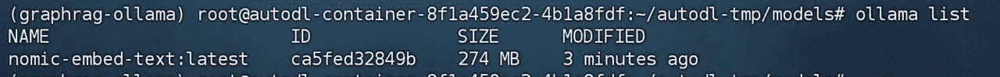

## **三、** Open-WebUI基础调用测试

### **1.** **首次启动流程**

在准备好了Open-WebUI和一系列模型权重后，接下来我们尝试启动Open-WebUI，并借助本地模 型进行问答。

首先需要设置离线环境，避免Open-WebUI启动时自动进行模型下载：

| export HF_HUB_OFFLINE=1 |
| --- |

然后启动Open-WebUI

| open-webui serve |
| --- |

需要注意的是，如果启动的时候仍然报错显示无法下载模型，是Open-WebUI试图从huggingface上下载 embedding模型，之后我们会手动将其切换为本地运行的Embedding模型。

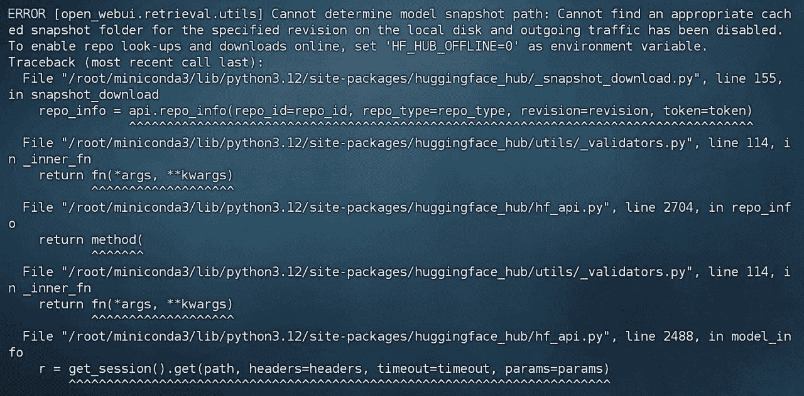

然后在本地浏览器输入地址:8080端口即可访问：


若使用AutoDL，则需要使用SSH隧道工具进行地址代理

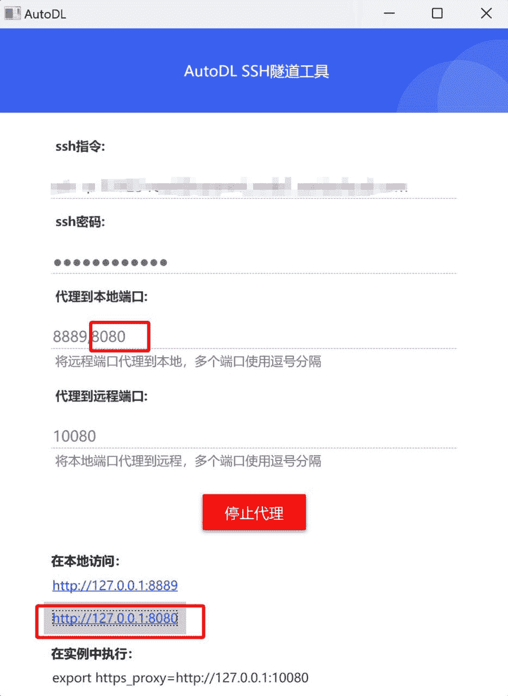

更多AutoDL相关操作详见公开课：《AutoDL快速入门与GPU租赁使用指南》 |https://www.bilibil i.com/video/BV1bxB7YYEST/

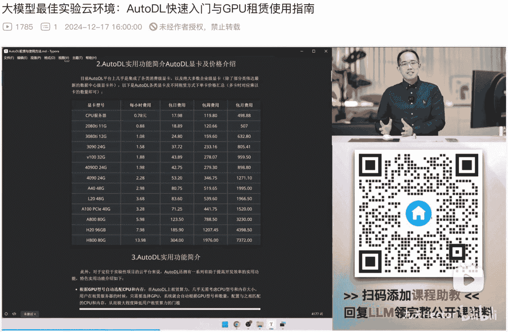

然后首次使用前，需要创建管理员账号：

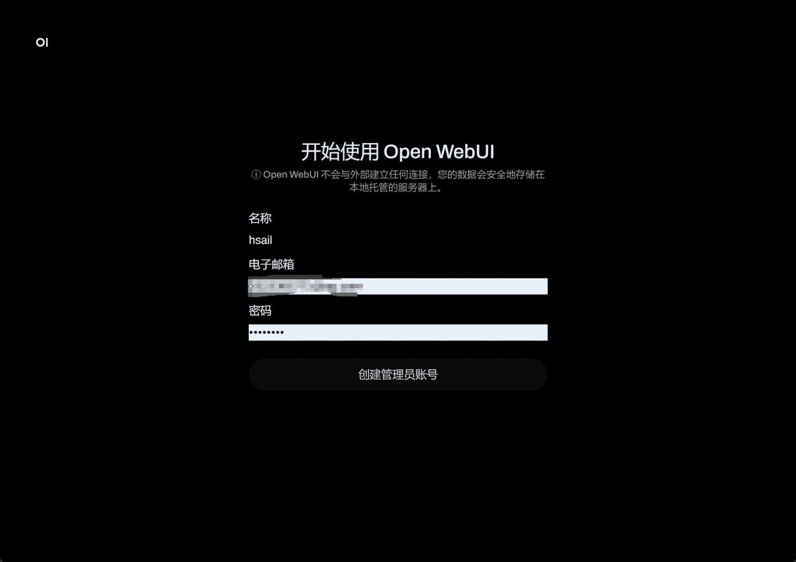

然后点击登录即可。需要注意的是，此时Open-WebUI会自动检测后台是否启动了ollama服务，并列举 当前可用的模型。稍等片刻，即可进入到如下页面：

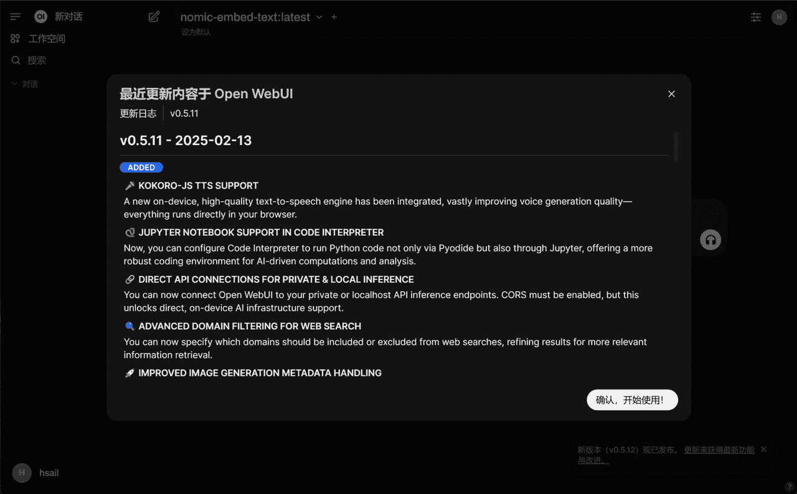

接下来即可进入到对话页面：

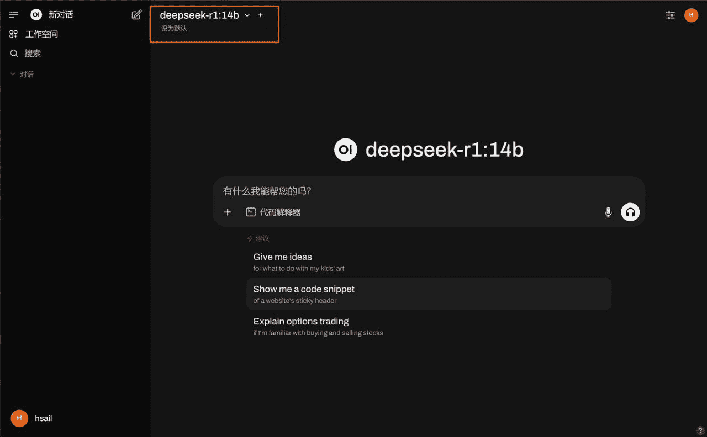

若此时Ollama服务仍然开启，点击左上角即可选择Ollama已集成的模型：

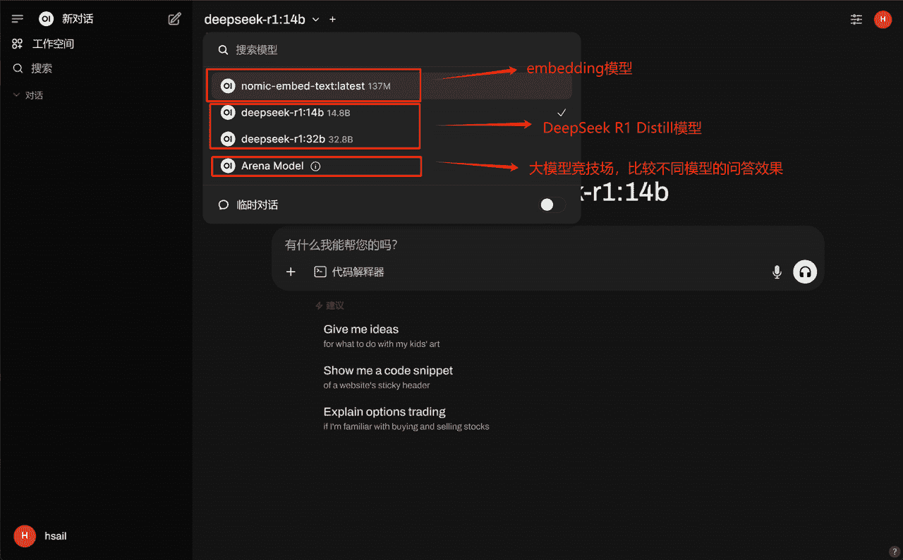

这里我们选择一个Chat模型即可开始对话：

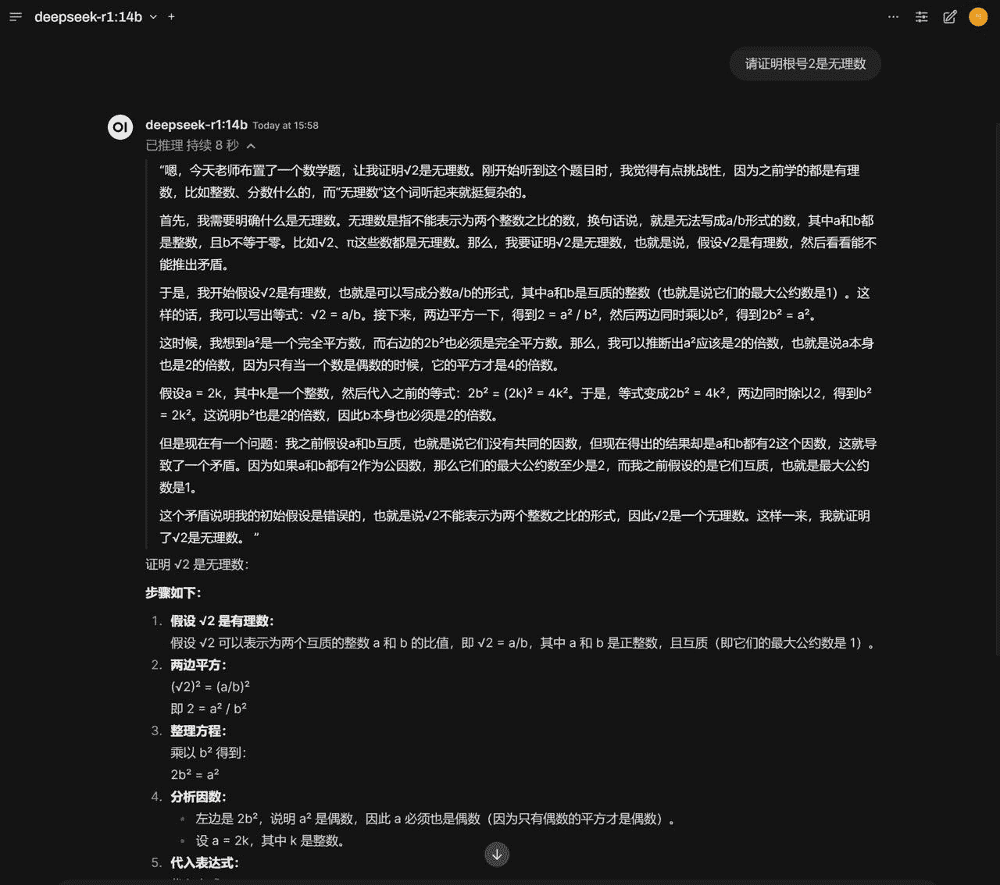

若登录对话页面时找不到模型，则需要先检查当前ollama服务是否开启、 ollama是否已经集成了 相关模型

至此，我们就完成了全部前期准备工作。

### **2.模型选择与切换**

Open WebUI支持自定义选择模型，点击左下方按钮：

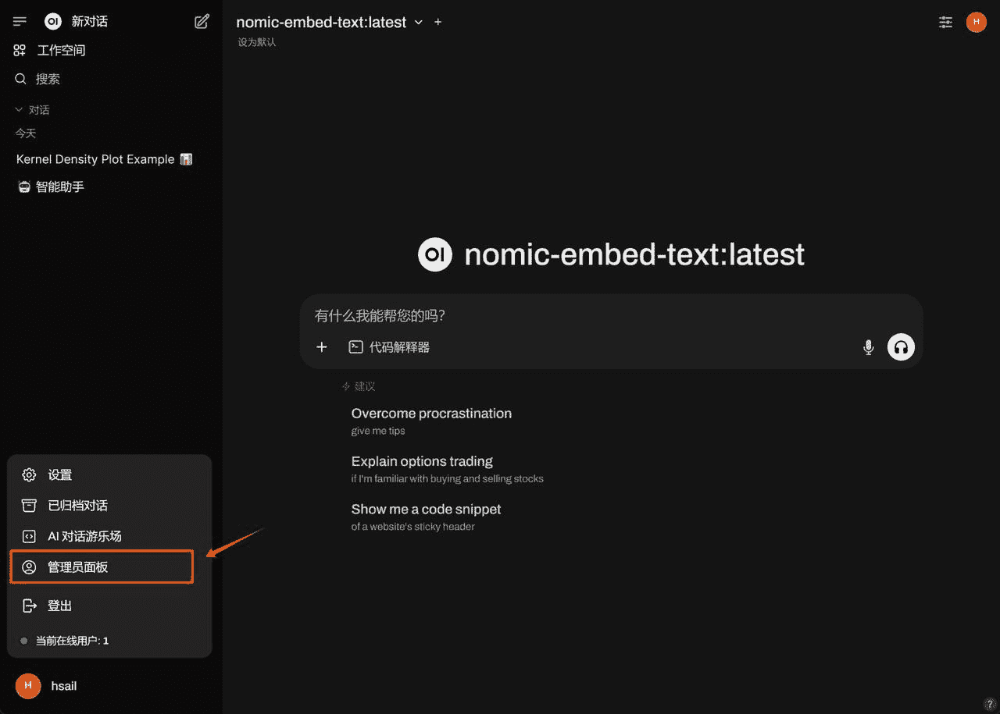

点击设置：


在外部连接中，可用选择是否启用在线模型。这里可以输入OpenAI API-KEY调用GPT模型，也可以输入 DeepSeek API-KEY，调用DeepSeek相关模型。此外，若是运行本地模型，则可在此处设置Ollama连   接。


### **3.** **代码解释器功能实现**

Open Web-UI原生支持代码解释器功能，并且可以本地实时运行，并打印运行结果：


请帮我编写一段Python代码，用于绘制一个核密度分布图示例。


### **4.** **联网功能实现【国内不稳定】**

同样，我们可以在设置页面里选择是否开启联网功能。


若是国内网络环境，推荐使用duckduckgo，是一款免费的搜索引擎，无需设置或API-KEY验证即可使 用：


此外[，若可以连接Google，也可以](https://www.bilibili.com/video/BV16u411c7Nd)使[用Google](https://www.bilibili.com/video/BV16u411c7Nd)的pse   （可编程搜索引擎），可以获得更加准确的搜索结  果。 Google pse搜索引擎注册河设置方法，详见我的23年公开课https://www.bilibili.com/video/BV16u 411c7Nd：


Op[en WebUI的各项功能，如代码解释器、联网搜索、 RA](https://space.bilibili.com/385842994/upload/video)G问答、连接本地MySQL数据库等，在我 的23年大模型公开课合集中，都有更加底层的实现方法，感兴趣的同学可以在我的主页中看到对应 教程：https://space.bilibili.com/385842994/upload/video


需要按照如下设置duckduckgo并保存后：


开启新的会话，并输入一个时效话题：


能够看到，此时Open WebUI就开启了搜索和问答。由于duckduckgo是免费搜索引擎，有的时候并不稳 定。若想要获得稳定搜索结果，建议切换为在线模型，并使用网络工具+谷歌搜索来完成。


## **四、** **DeepSeek** R1+Open-WebUI进阶功能使用

### **1.** **RAG本地知识库问答**

+   基础问答流程

Open-WebUI拥有比AnythingLLM更加强大的RAG系统、以及更加灵活的功能选择。


然后填写语义向量模型：  nomic-embed-text并保存：


回到对话页面，可以这里可以直接拖拽添加文件，也可以点击对话框中+号添加文件。


这里我们上传了DeepSeek R1的微调教程并进行提问，问答效果如下：


不同于AnythingLLM不知道当前对话中包含文档， Open WebUI的RAG系统提示词会更加完备一些。同 时还会提供对应的检索结果：


并且思考过程非常完备


+   RAG流程优化

此外，我们也可以RAG基本原理对问答效果进行优化。


### **2.** **外部工具调用Function** **calling**

+   Function calling功能介绍


+   Ollama tool use功能实现

需要注意的是， DeepSeek R1模型原生并不支持Fucntion calling，但借助Ollama，可以实现基础的 Function calling，并基于此完成Open-WebUI的外部工具调用工作。


[https://ollama.c](https://ollama.com/blog/tool-support)om/blog/tool-support

+   Open-WebUI工具调用功能实现


然后编写天气查询函数：

```
import requests 
import json
from fastapi import Request
from open_webui.models.users import Users
 
class Tools:
def    init    (self):
pass
 
async def get_weather(
self, loc: str,    request    : Request,    user    : dict,
         event_emitter    =None ) -&gt; str:
&quot;&quot;&quot;
获取指定城市的即时天气信息。

:param loc: 城市名称（如果是非英文城市名称，请先将其翻译为英文城市名称再输入）。 :param    request    : HTTP 请求对象（来自  FastAPI）。
:param    user    : 用户信息（可以用于个性化或记录请求）。
:param    event_emitter    : 事件发射器，用于将实时状态更新发送到前端。 :return: 格式化后的天气数据，作为字符串返回。
说明：
如果输入的是非英文城市名称，请先将其翻译为对应的英文城市名称再输入。 比如，输入“ 中国，北京 ”，需要转为  &quot;Beijing&quot;。
&quot;&quot;&quot;
 
# Step 1. 通知用户正在获取天气数据
await    event_emitter    ( {
&quot;type&quot;: &quot;status&quot;,
&quot;data&quot;: {&quot;description&quot;: f&quot;正在获取  {loc} 的天气数据 ...&quot;, &quot;done&quot;:
False},
} )
 
try:
# Step 2. 构建请求的  URL 和查询参数
url = &quot;https://api.openweathermap.org/data/2.5/weather&quot; params = {
&quot;q&quot;: loc,
&quot;appid&quot;: &quot;YOUR_API_KEY&quot;,  # 你的  API 密钥
&quot;units&quot;: &quot;metric&quot;,  # 使用摄氏度
&quot;lang&quot;: &quot;zh_cn&quot;,  # 输出简体中文 }
 
# Step 3. 向  OpenWeather API 发送  GET 请求
response = requests.get(url, params=params)
 
# Step 4. 解析响应数据
data = response.json()
 
# Step 5. 提取并格式化天气描述
weather_data = data.get(&quot;weather&quot;, []) if weather_data:
main_weather = weather_data[0].get(&quot;main&quot;, &quot;&quot;)
description = weather_data[0].get(&quot;description&quot;, &quot;&quot;)
weather_info = f&quot;当前天气： {main_weather} - {description}&quot; else:

weather_info = &quot;天气信息不可用。 &quot;
# Step 6. 通知用户天气数据已经成功获取
await    event_emitter    ( {
&quot;type&quot;: &quot;status&quot;,
&quot;data&quot;: {&quot;description&quot;: f&quot;成功获取  {loc} 的天气数据&quot;, &quot;done&quot;:
True},
} )
 
# Step 7. 返回格式化后的天气信息并发送到前端
await    event_emitter    ( {
&quot;type&quot;: &quot;message&quot;,
&quot;data&quot;: {&quot;content&quot;: f&quot;{loc} 的天气信息 : {weather_info}&quot;},
} )
 
# 返回格式化后的天气数据作为字符串
return f&quot;{loc} 的天气信息: {weather_info}&quot;
 
except Exception as e:
# Step 8. 如果发生错误，通知用户
await    event_emitter    ( {
&quot;type&quot;: &quot;status&quot;,
&quot;data&quot;: {&quot;description&quot;: f&quot;发生错误 : {str(e)}&quot;, &quot;done&quot;: True},
} )
# 返回错误信息
return f&quot;获取天气数据时发生错误： {str(e)}&quot;
```

并将函数进行写入：


完成后即可看到新的工具：


在对话时可以开启天气查询函数：


比如询问北京天气，可以获得如下回答：


与实际天气相符


### 3.连接本地MySQL数据库进行数据查询

此外，我们还可以借助工具，编写SQL围绕本地数据库中数据进行查询。

+   创建MySQL数据库

| apt install mysql-server |
| --- |


然后启动mysql，并设置初始密码：

| mysqld &amp; mysql |
| --- |

进入到SQL命令行后，输入如下命令：

| ALTER USER &#x27;root&#x27;@&#x27;localhost&#x27; IDENTIFIED BY &#x27;123&#x27;; |
| --- |

此处密码可根据实际需求设置。


然后输入 exit; 即可退出。

然后再次进入MySQL，并根据要求输入密码：

| mysql -u root -p |
| --- |

然后创建一个数据库：

| CREATE DATABASE school; USE school; |
| --- |

然后创建一个虚拟表格，里面包含了10位同学各自3门课程的分数：

| CREATE TABLE students_scores ( |
| --- |

| INSERT INTO students_scores (name, course1, course2, course3) VALUES |
| --- |


然后即可查看数据集基本情况：

| SELECT * FROM students_scores; |
| --- |


此外，还需要刷新身份验证，使得其他库（如pymysql）可以通过密码验证登录：

| ALTER USER &#x27;root&#x27;@&#x27;localhost&#x27; IDENTIFIED WITH mysql_native_password BY &#x27;123&#x27;; |
| --- |


+   编写SQL查询工具


写入如下内容：

import pymysql import json

from fastapi import Request

from open_webui.models.users import Users

class Tools:

def    init    (self):

pass

async def sql_inter(

self, sql_query: str,    request    : Request,    user    : dict,

event_emitter    =None ) -> str:

"""

用于获取school数据库中各张表的有关相关信息。

:param sql_query: 字符串形式的SQL查询语句，用于执行对MySQL数据库中的查询。 :param    request    : HTTP 请求对象（来自  FastAPI）。

:param    user    : 用户信息（可以用于个性化或记录请求）。

:param    event_emitter    : 事件发射器，用于将实时状态更新发送到前端。 :return: SQL 查询结果的  JSON 字符串。

"""

# Step 1. 通知用户正在执行数据库查询

await    event_emitter    ( {

"type": "status",

"data": {"description": "正在查询数据库 ...", "done": False},

}

)

try:

# Step 2. 连接  MySQL 数据库

connection = pymysql.connect(

host='localhost',  # 数据库地址 user='root',  # 数据库用户名

passwd='123',  # 数据库密码

db='school',  # 数据库名

charset='utf8'  # 字符集选择utf8

)

# Step 3. 执行  SQL 查询

with connection.cursor() as cursor: cursor.execute(sql_query)

results = cursor.fetchall()

# Step 4. 格式化查询结果

results_json = json.dumps(results, ensure_ascii=False)

# Step 5. 通知用户查询完成

await    event_emitter    ( {

"type": "status",

"data": {"description": "数据库查询完成", "done": True},

} )

# Step 6. 返回查询结果

return f"查询结果 : {results_json}"

except Exception as e:

# Step 7. 如果发生错误，通知用户

await    event_emitter    ( {

"type": "status",

"data": {"description": f"发生错误 : {str(e)}", "done": True},

} )

# 返回错误信息

return f"获取数据库查询数据时发生错误： {str(e)}"

finally:

# Step 8. 关闭数据库连接

if connection:

connection.close()


然后在对话中打开数据库查询工具：


然后即可进行对话和数据库查询：


同时，数据库查询功能还可以与代码解释器功能结合进行使用：


并且，也可以结合知识库内容进行结合使用。


并且在右侧可以看到详细的对话流程。


更多关于大模型微调技术介绍，欢迎报名由我主讲的《2025大模型Agent智能体开发实战》（2月 DeepSeek强化班） https://whakv.xetslk.com/s/1tKbjV 进行更深度系统的学习哦~


《2025大模型Agent智能体开发实战》2025年新春班上新&新年双重特惠，详细信息扫码添加助教，回

**复“大模型”** ，即可领取课程大纲&查看课程详情

