# DeepSeek R1本地部署与调用方法

> 来源：[https://kq4b3vgg5b.feishu.cn/docx/FFyGdHssDozzCCxnV97cQDzcnng](https://kq4b3vgg5b.feishu.cn/docx/FFyGdHssDozzCCxnV97cQDzcnng)

# 课程说明：

+   体验课内容节选自《2025大模型Agent智能体开发实战》完整版付费课程

体验课时间有限，若想深度学习大模型技术，欢迎大家报名由我主讲的《2025大模型Agent智能体开发实战》：

此外，公开课全部训练项目代码、数据、以及训练完的模型，已上传至课件网盘，联系⬆️助教即可领取。

---

# 最**强开**源推理模型DeepSeek R1

# **本地部署指南**

## **DeepSeek** **R1上线公告**

[DeepSeek R1上线公告：https://api-doc](https://api-docs.deepseek.com/zh-cn/news/news250120)s.deepseek.com/zh-cn/news/news250120

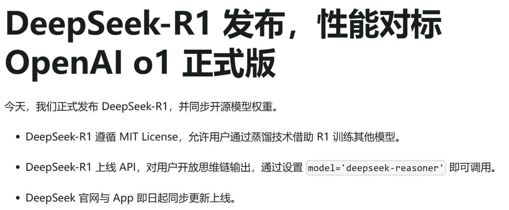

我[第一时间也在B站上](https://www.bilibili.com/video/BV1UBwbe4E1D)发布视频对R1模型进行了解读，详情请戳售https://www.bilibili.com/video/BV1 UBwbe4E1D

DeepSeek-R1 在后训练阶段大规模使用了强化学习技术，在仅有极少标注数据的情况下，极大提升了模 型推理能力。在数学、代码、自然语言推理等任务上，性能比肩 OpenAI o1 正式版。

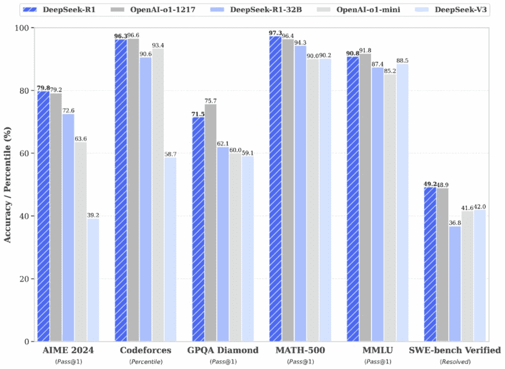

论文链接： [h](https://github.com/deepseek-ai/DeepSeek-R1/blob/main/DeepSeek_R1.pdf)ttps://github.com/deepseek-ai/DeepSeek-R1/blob/main/DeepSeek_R1.pdf

这次DeepSeek开源了DeepSeek-R1-Zero 和 DeepSeek-R1 两个 660B 模型的同时，通过 DeepSeek-R1 的输出，蒸馏了 6 个小模型开源给社区，其中 32B 和 70B 模型在多项能力上实现了对标 OpenAI o1-

mini 的效果。

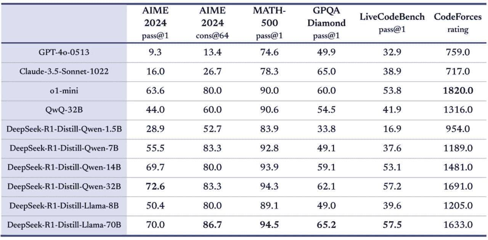

HuggingFace 链接： https://huggingface.co/deepseek-ai

## **DeepSeek** **R1开源情况介绍**

[DeepSeek R1 GitHub项目地址](https://github.com/deepseek-ai/DeepSeek-R1)： https://github.com/deepseek-ai/DeepSeek-R1

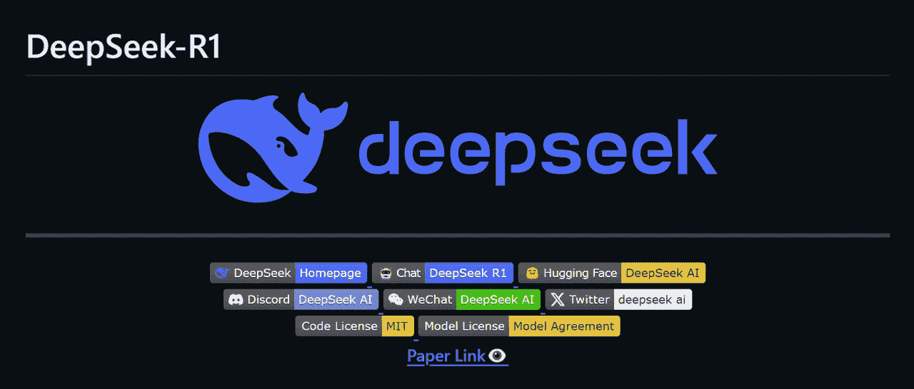

需要注意的是， DeepSeek R1采用了和DeepSeekv3完全相同的架构，只是训练过程和训练数据不同。

具体来说， DeepSeek R1是在DeepSeekV3 base模型基础上，先进行了有监督学习微调，然后再进行强

化学习训练最终获得的模型，而同时开源的DeepSeek R1 Zero则是少了有监督微调步骤，直接从 DeepSeekV3 base上经过强化学习训练得到。

因此，我们看DeepSeek R1项目，其实并没有看到模型权重和推理脚本、以及本地部署方法等关键信

息。其实也是因为这些信息都已经包含在DeepSe[ekV3模型项目中了，具体项目](https://github.com/deepseek-ai/DeepSeek-V3)地址见： https://github. com/deepseek-ai/DeepSeek-V3

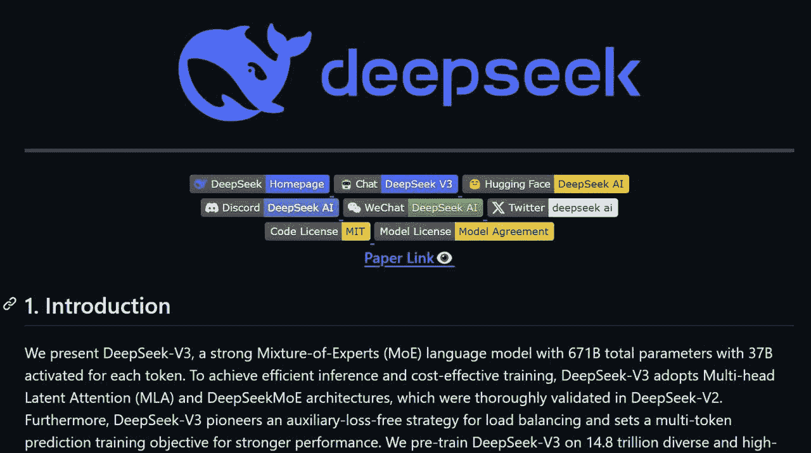

其中模型推理和架构的代码部分内容如下：

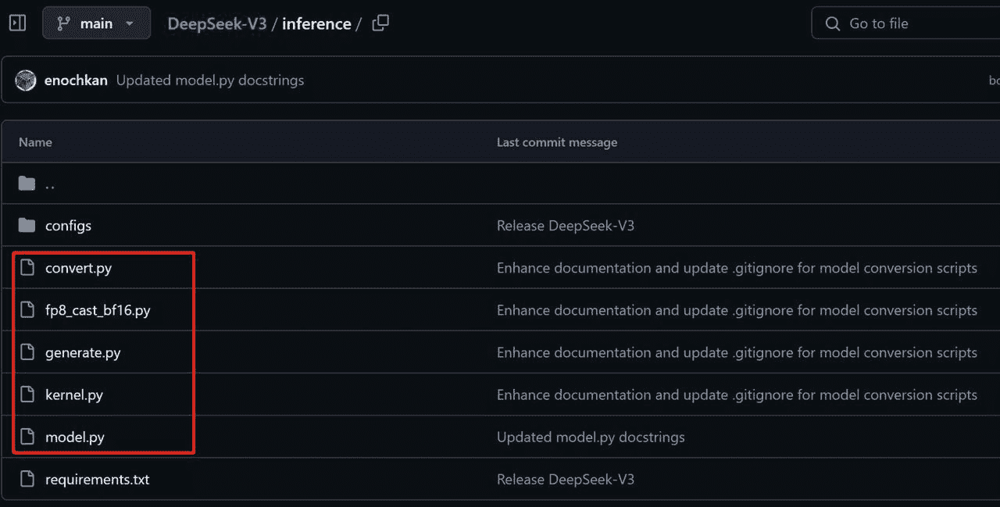

+   convert.py：用于进行格式转化，将一个已经训练好的模型检查点（checkpoint）文件从一个格式 （比如  safetensors ）转换并保存成一个适合特定模型并行度（model parallelism）和专家数    （n_experts）的格式。

+   fp8_cast_bf16 . py：代码的功能是将存储在 FP8 格式中的模型权重转换为 BF16 格式，并保存转换 后的权重。它还更新了模型的索引文件，去除了 scale_inv 的引用。

+   generate.py：代码是一个用于生成文本的示例程序，支持交互式和批量文本生成。它使用一个 Transformer 模型并进行分布式训练。

+   **kernel**.py：代码主要涉及量化和**矩阵乘**法操作，使用了 Triton 库进行加速，特别是针对 FP8 精度 （浮点8位）进行了优化。 Triton 是一个专为 GPU 上的高效自定义操作而设计的编程框架，支持

+   Python 和 PyTorch，可以通过简洁的代码来实现高效的 GPU 核心。

+   model.py： 定义了DeekSeekv3和R1的模型架构。

目前模型权重已经在hugging face上开源了，具体情况如下：

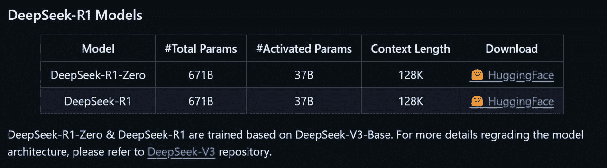

> DeepSeek-V3和R1模型在Hugging Face上的总大小为685B，其中包括671B的主模型权重和14B的 多标记预测（MTP）模块权重。

> 为了确保最佳性能和灵活性，我们与开源社区和硬件供应商合作，提供多种在本地运行模型的方 式。有关逐步指导，请参阅第6节：如何在本地运行（How_to_Run_Locally）。

> 对于希望深入了解的开发者，我们建议查阅README_WEIGHTS.md文件，了解主模型权重和多标  记预测（MTP）模块的详细信息。请注意， MTP支持目前仍在社区内积极开发中，我们欢迎您的贡 献和反馈。

[并](https://github.com/deepseek-ai/DeepSeek-V3/blob/main/README_WEIGHTS.md)且[还非常贴心的介绍了权重情况](https://github.com/deepseek-ai/DeepSeek-V3/blob/main/README_WEIGHTS.md)： https://github.com/deepseek-ai/DeepSeek-V3/blob/main/READ ME_WEIGHTS.md

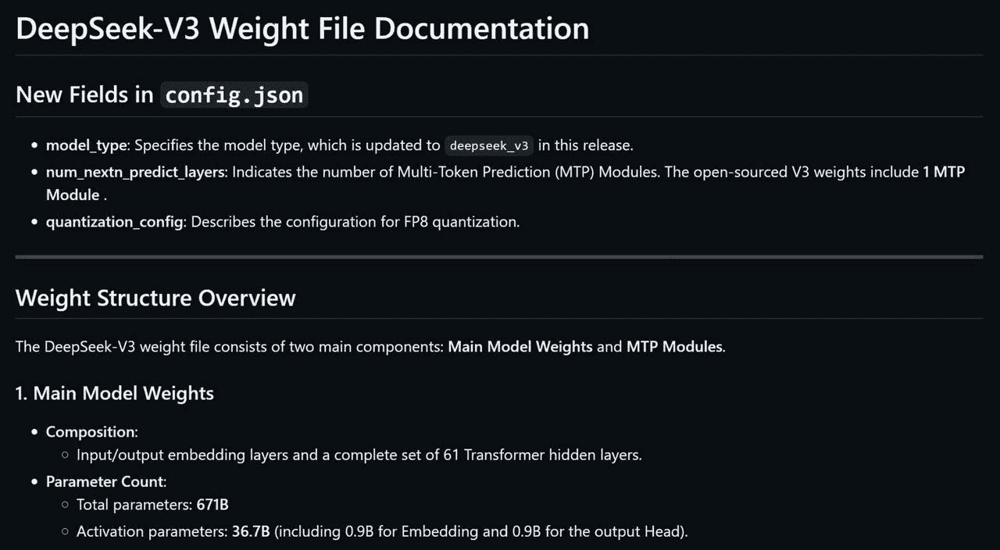

DeepSeek R1模型权重可在[hugging face上主页上下载： h](https://huggingface.co/deepseek-ai/DeepSeek-R1)t[tps:/](https://huggingface.co/deepseek-ai/DeepSeek-R1)/huggingface.co/deepseek-ai/DeepSe ek-R1，权重总共约650G大小。

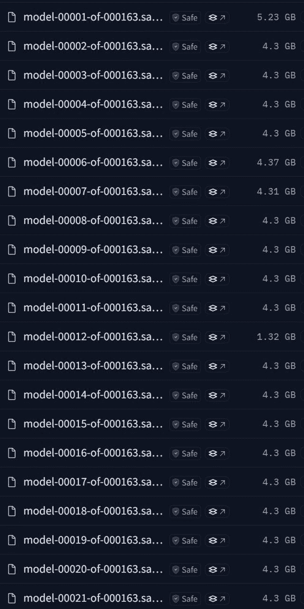

同时该页面中也包含蒸馏模型的下载地址：

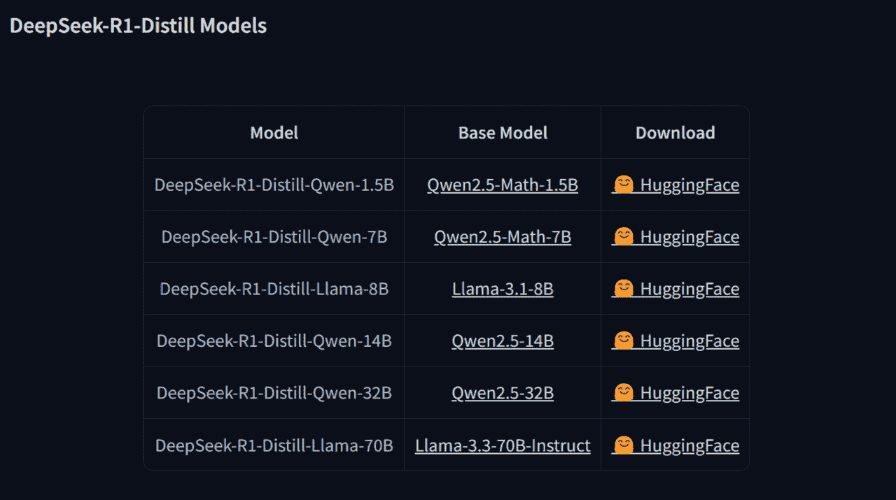

此外，也可在魔搭社区上下载： [h](https://www.modelscope.cn/models/deepseek-ai/DeepSeek-R1)ttps://www.modelscope.cn/models/deepseek-ai/DeepSeek-R1

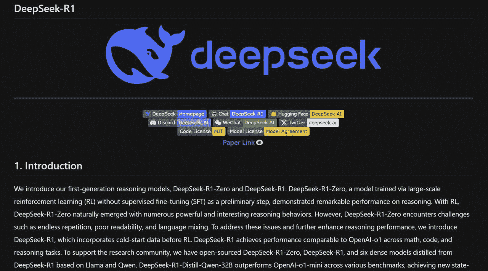

以及蒸馏模型的权重下载地址：

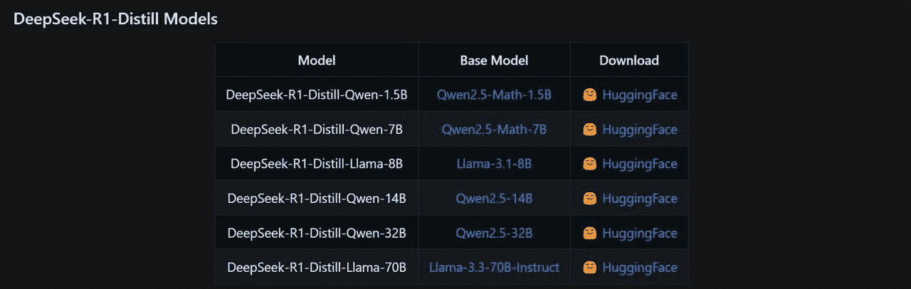

既然是权重全开源，那肯定是可以在本地运行的，以下官方介绍的本地运行方法：

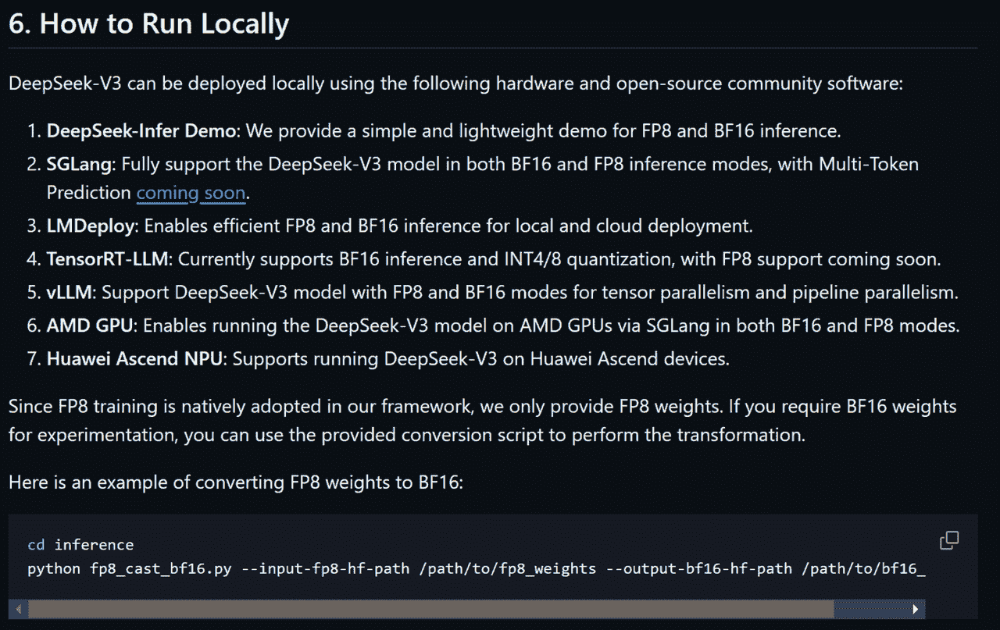

> **6.** **如何在本地运行**

+   DeepSeek-V3可以使用以下硬件和开源社区软件在本地部署：

+   **DeepSeek-Infer** **Demo**：我们提供了一个简单且轻量的演示，支持FP8和BF16推理。

+   **SGLang**：完全支持DeepSeek-V3模型在BF16和FP8推理模式下运行，且即将支持多标记预测 （MTP）。

+   **LMDeploy**：支持高效的FP8和BF16推理，适用于本地和云端部署。

+   **TensorRT-LLM**：目前支持BF16推理和INT4/8量化， FP8支持即将推出。

+   **vLLM**：支持DeepSeek-V3模型在FP8和BF16模式下进行张量并行和流水线并行。

+   **AMD** **GPU**：通过SGLang，在BF16和FP8模式下支持在AMD GPU上运行DeepSeek-V3模 型。

+   **华为Ascend** **NPU**：支持在华为Ascend设备上运行DeepSeek-V3模型。

> 由于我们的框架原生采用FP8训练，因此只提供FP8权重。如果您需要BF16权重进行实验，您可以 使用提供的转换脚本进行转换。

由于DeepSeek R1的框架原生采用 FP8 训练，因此仅提供 FP8 权重，预估仅700GB+显存便可轻松运行。当然也可以转换到BF16，在半精度下，需1000GB+，而量化到int4时需要450GB+。以下是半精度 下显存占用情况：（占用 490G 显存，需要 7张 80GA100，租赁成本约1000元1天）

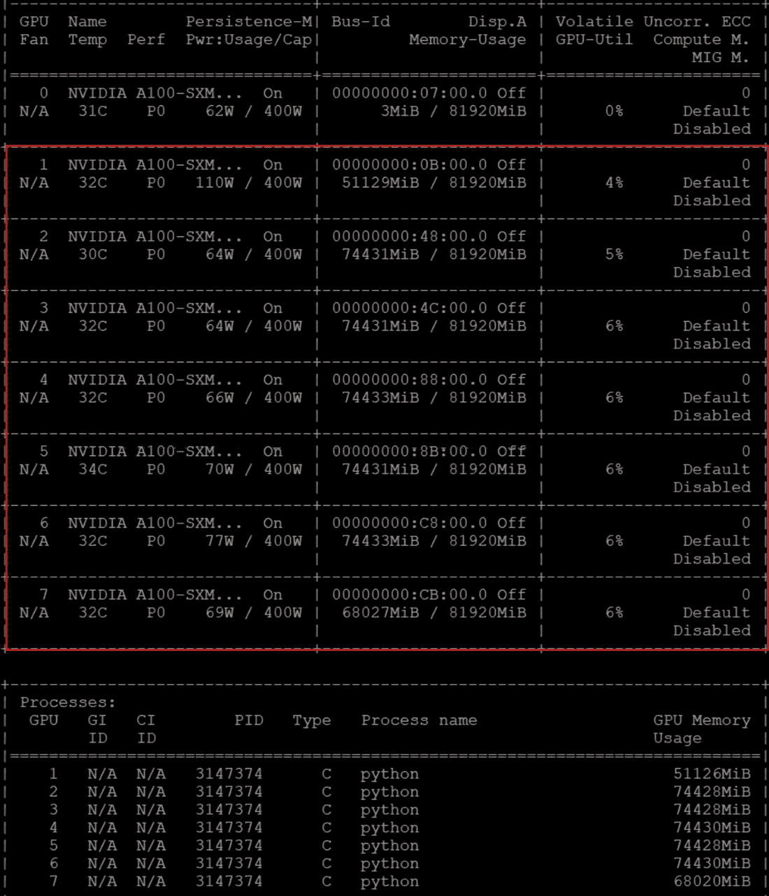

## **DeepSeek** **R1本地部署与调用流程**

本次[Deep](https://www.bilibili.com/video/BV1jjwVe4EKn/)Se[ek R1的本地部署流程和DeepSee](https://www.bilibili.com/video/BV1jjwVe4EKn/)kV3完全相同，由于服务器使用冲突，本教程只介绍 DeepSeek R1部署流程与代码解释，具体模型调用的实机演示，参看DeepSeekV3部署调用流程： http  s://www.bilibili.com/video/BV1jjwVe4EKn/

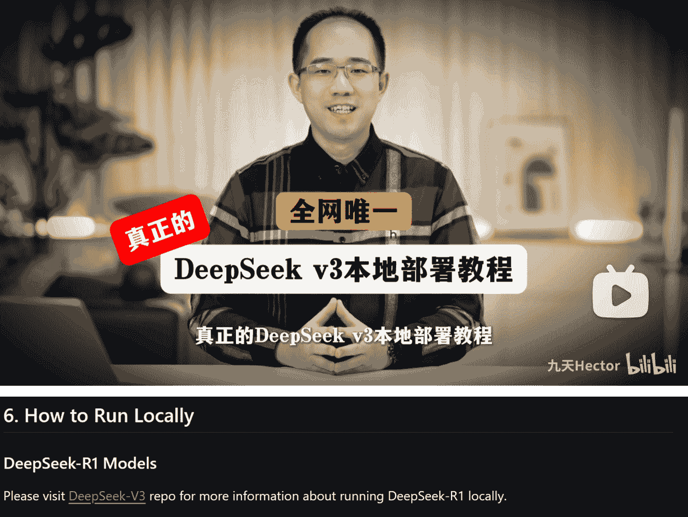

此[外，硬件环境也可考虑在AutoDL上进行租赁，具](https://www.bilibili.com/video/BV1bxB7YYEST/)体租赁方法可参考我的教程：《AutoDL快速入 门与GPU租赁使用指南》 https://www.bilibili.com/video/BV1bxB7YYEST/

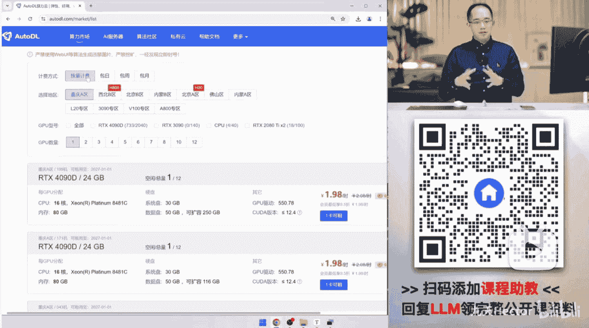

+    创建虚拟环境

| conda create --name dv3 python=3.11 conda init |
| --- |

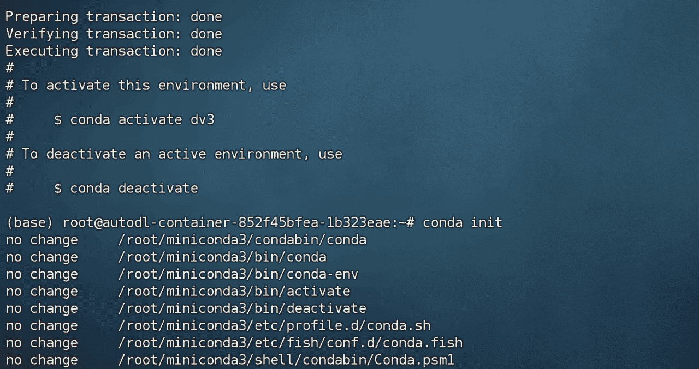

| conda install jupyterlab conda install ipykernel |
| --- |

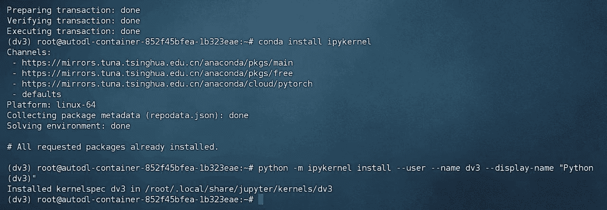

+   登录Github主页拉取项目

[访问DeepSeek V1主页：https:](https://github.com/deepseek-ai/DeepSeek-V3)//github.com/deepseek-ai/DeepSeek-V3

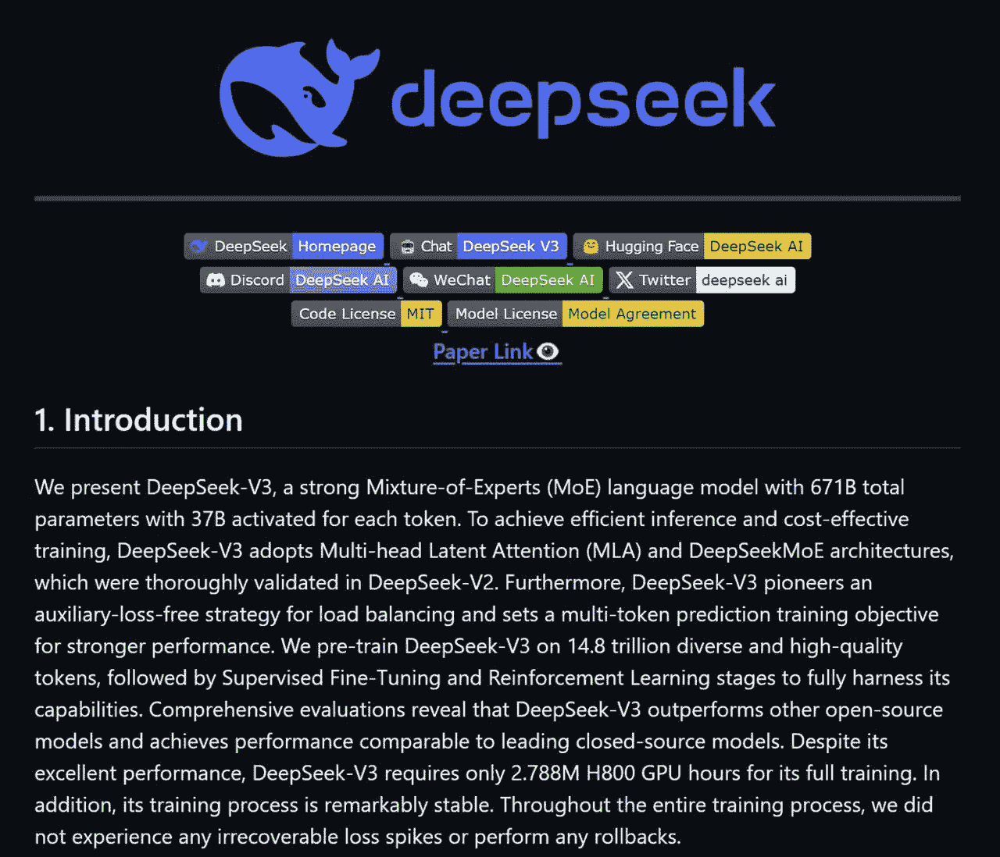

> 注，这里需要下载DeepSeekV3的项目源码，然后使用DeepSeek R1的权重进行调用。

| git clone https://github.com/deepseek-ai/DeepSeek-V3.git |
| --- |

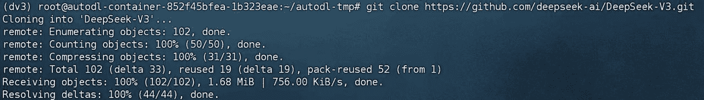

+   安装依赖

| cd DeepSeek-V3/inference |
| --- |

+   下载模型权重

可以在HuggingFace或者魔搭社区上下载模型权重，考虑到国内网络[情](https://www.modelscope.cn/models/deepseek-ai/DeepSeek-R1)况[，推荐使](https://www.modelscope.cn/models/deepseek-ai/DeepSeek-R1)用魔搭社区进行  下载。 DeepSeek R1魔搭社区官网地址： https://www.modelscope.cn/models/deepseek-ai/DeepSee k-R1

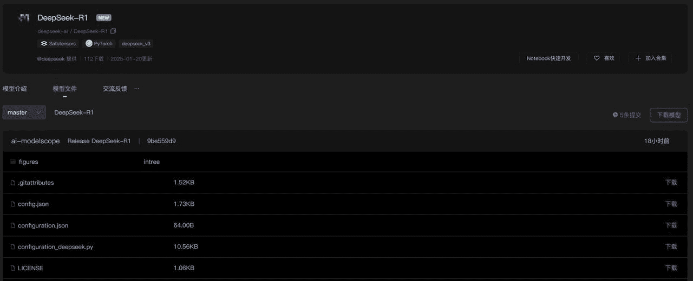

> 注，下载前需提前留出600G左右存储空间，用于保存模型权重

具体下载流程如下：

| pip install modelscope |
| --- |

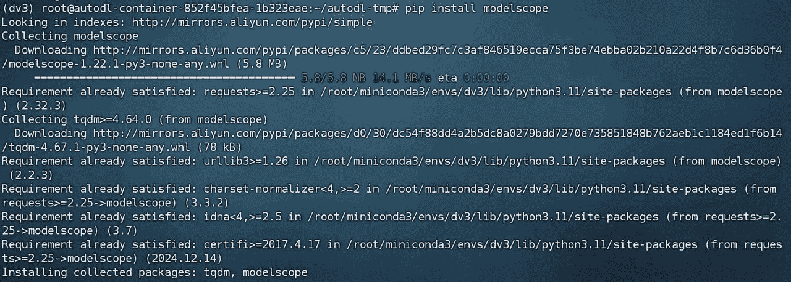

| mkdir ./deepseek |
| --- |

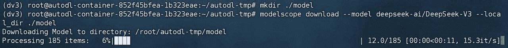

+     借助convert.py模型权重转化

| cd DeepSeek-V3/inference |
| --- |

+   python convert.py ：运行convert.py脚本，这个脚本的作用是将Hugging  Face格式的模型权 重转换为另一个特定的格式。

+   --hf-ckpt-path /path/to/DeepSeek-R1 ：指定Hugging  Face格式的模型检查点路径（即模型 文件所在的位置）。在这个例子中是 /path/to/DeepSeek-R1。

+   --save-path /path/to/DeepSeek-R1-Demo ：指定转换后的模型权重保存的路径，即你想将模型 保存到哪里。

+   --n-experts 256 ：指定模型中的专家数量，这可能是与模型的分布式训练或者混合专家模型 （Mixture of Experts, MoE）相关的参数，设置为256表示该模型将使用256个专家。

+   --model-parallel 16 ：这个参数指定模型并行的程度，通常是指将模型分布在16个GPU上进行 训练或推理。

+    借助generate.py进行模型推理

| torchrun --nnodes 2 --nproc-per-node 8 --node-rank $RANK --master-addr $ADDR generate.py --ckpt-path /path/to/DeepSeek-R1-Demo --config |
| --- |

这部分命令用于运行模型并生成文本。各个参数的含义如下：

+   torchrun ：用于分布式训练或推理的命令。它会启动多个进程，支持跨多个节点（即多台机器） 运行。

+   --nnodes 2 ：指定集群中的节点数目。在这个例子中，使用2个节点（即2台机器）。

+   --nproc-per-node 8 ：每个节点上运行的进程数。在每个节点上启动8个进程，通常是为了充分 利用每个节点上的多个GPU。

+   --node-rank $RANK ：当前节点在集群中的排名，用于区分不同节点。   $RANK 是一个环境变量， 代表当前节点的编号。

+   --master-addr $ADDR ：指定主节点的地址。主节点通常负责协调所有其他节点的工作。   $ADDR 是一个环境变量，表示主节点的IP地址或主机名。

+   generate.py ：这是运行文本生成任务的脚本，它会使用模型进行推理生成文本。

+   --ckpt-path /path/to/DeepSeek-R1-Demo ：指定转换后的DeepSeek-R1模型检查点路径。这 个路径是你之前在转换步骤中保存的模型文件。

+   --config configs/config_671B.json ：指定模型的配置文件。配置文件包含模型的架构、超参 数等信息。在这个例子中，配置文件是 configs/config_671B.json。

+   --interactive ：启用交互模式，通常表示用户可以在命令行中输入内容，并实时获得模型的响 应。

+   --temperature 0.7 ：生成的温度值，影响模型的输出随机性。温度越高，生成的文本越随机； 温度越低，生成的文本越确定。 0.7通常意味着适度的随机性。

+   --max-new-tokens 200 ：限制生成的最大新token数量，表示每次生成时最多生成200个新的词 元。

然后即可完成推理。

### **DeepSeek** **R1+SGLang部署方案**

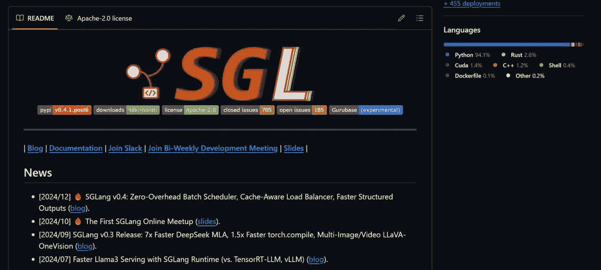

SGLang项目主页： [https://github.c](https://github.com/sgl-project/sglang)[o](https://github.com/sgl-project/sglang)m/sgl-project/sglang

SGLang  目前支持 MLA 优化、 DP Attention、 FP8 (W8A8)、 FP8 KV 缓存和 Torch Compile，在开 源框架中提供了领先的延迟和吞吐量性能。

需要注意的是， SGLangv0.4.1 完全支持在 NVIDIA 和 AMD GPU 上运行 DeepSeek-V3和R1，使其  成为一个高度通用且稳健的解决方案。 SGLang 还支持多节点张量并行，允许你在多个网络连接的机器上 运行该模型。目前多标记预测（MTP）正在开发中，进展可以在优化计划中追踪。

+   安装SGLang

| pip install &quot;sglang[all[]&gt;=0.4](https://flashinfer.ai/whl/cu124/torch2.4/flashinfer)[.1](https://flashinfer.ai/whl/cu124/torch2.4/flashinfer)[.post5&quot; --fin](https://flashinfer.ai/whl/cu124/torch2.4/flashinfer)[d](https://flashinfer.ai/whl/cu124/torch2.4/flashinfer)[-li](https://flashinfer.ai/whl/cu124/torch2.4/flashinfer)[n](https://flashinfer.ai/whl/cu124/torch2.4/flashinfer)[ks ht](https://flashinfer.ai/whl/cu124/torch2.4/flashinfer)[t](https://flashinfer.ai/whl/cu124/torch2.4/flashinfer)[ps://f](https://flashinfer.ai/whl/cu124/torch2.4/flashinfer)[la](https://flashinfer.ai/whl/cu124/torch2.4/flashinfer)[s](https://flashinfer.ai/whl/cu124/torch2.4/flashinfer)[hinfer.ai/](https://flashinfer.ai/whl/cu124/torch2.4/flashinfer)whl/cu124/torch2.4/flashinfer |
| --- |

+    调用DeepSeek R1

| python3 -m sglang.launch_server --model deepseek-ai/DeepSeek-R1 --tp 8 --trust- remote-code |
| --- |

此时服务将在30000端口启动。接下来即可使用OpenAI风格API来调用DeepSeek R1模型了：

| import openai |
| --- |

### **DeepSeek** **R1+LMDeploy部署方案**

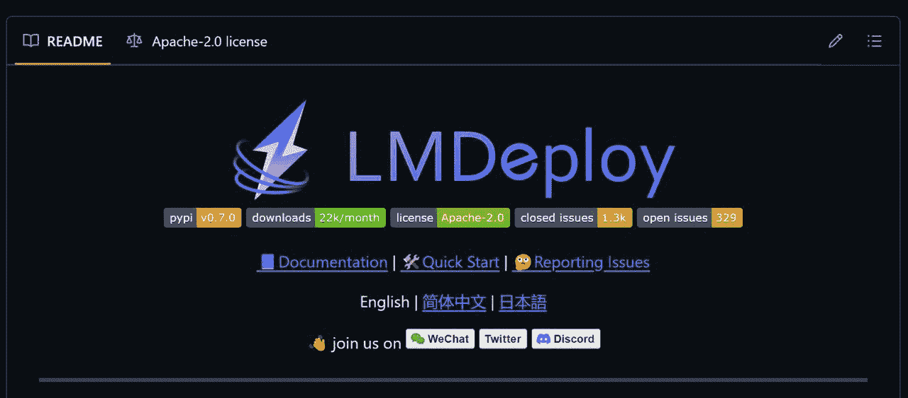

LMDeploy项目主页： [https://github.c](https://github.com/InternLM/lmdeploy)om/InternLM/lmdeploy

LMDeploy 是一个灵活且高性能的推理与服务框架，专为大语言模型量身定制，现在支持

DeepSeek-R1。它提供了离线管道处理和在线部署能力，能够与基于 PyTorch 的工作流无缝集成。具体 使用LMDeploy调用DeepSeek R1流程如下：

+   安装LMDeploy

| git clone -b support-dsv3 https://github.com/InternLM/lmdeploy.git cd lmdeploy |
| --- |

+    单任务推理，编写Python脚本执行

| from lmdeploy import pipeline, PytorchEngineConfig |
| --- |

+   在线服务调用

先运行如下命令

| # run |
| --- |

接下来即可在23333端口调用DeepSeek R1模型：

| from openai import OpenAI client = OpenAI( |
| --- |

### **DeepSeek** **R1+vLLM部署方案**

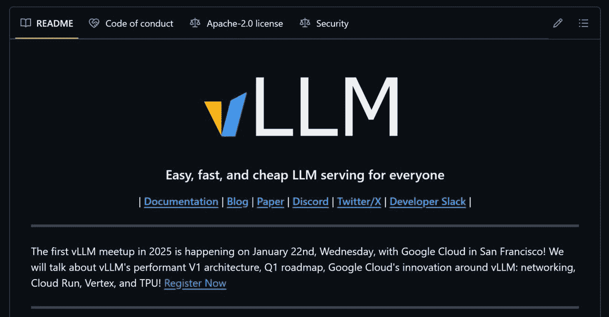

vLLM项目主页： [https://github.c](https://github.com/vllm-project/vllm)om/vllm-project/vllm

vLLM v0.6.6 支持在 NVIDIA 和 AMD GPU 上以 FP8 和 BF16 模式进行 DeepSeek-R1 推理。除了标准技 术外，vLLM 还提供了管道并行性，允许你在多个网络连接的机器上运行该模型。

+   vLLM安装

| pip install vllm |
| --- |

+   DeepSeek R1调用

目前vLLM已支持DeepSeek R1模型调用，可[以在模型支持列表中查看模型关键字： ](https://docs.vllm.ai/en/latest/models/supported_models.html) https://docs.vllm.ai/ en/latest/models/supported_models.html

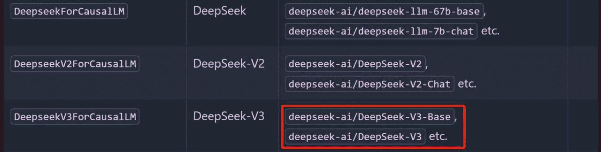

接下来即可使用如下代码进行调用：

| from vllm import LLM |
| --- |

DeepSeek官网： https://www.deepseek.com/

[DeepSeek R1 GitHub项目地址](https://github.com/deepseek-ai/DeepSeek-R1)： https://github.com/deepseek-ai/DeepSeek-R1

[DeepSeek R1 Hugging Face项目](https://huggingface.co/deepseek-ai/DeepSeek-R1)地址： https://huggingface.co/deepseek-ai/DeepSeek-R1

[D](https://modelscope.cn/models/deepseek-ai/DeepSeek-R1/)eepSeek R1魔搭社区地址： https://modelscope.cn/models/deepseek-ai/DeepSeek-R1/